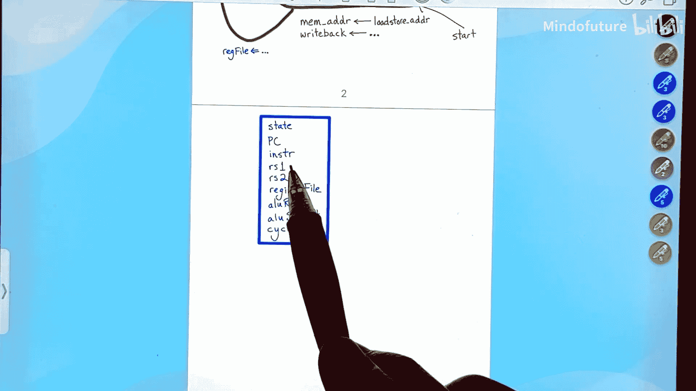

# RISC-V处理器架构，RV32指令集架构，汇编语言，Verilog-FPGA-p23-P23-RISC-V---Verilog-Implementation-(FemtoRV)--BV1aQ3nztE7J_p23-

In this video， I am going to be describing ver log code that implements a risk 5 processor core。

This is a very cool code。 and actually I' have learned a bit from it。

 and I think you'll find it very interesting。This code is written by Bruno Levy and Matthias Cock。

And I'll be going over virtually every line of this code。呃。

ThereThis code comes from a collection of cores called the Fmto RV 32 project。

 and this version of the module is called the Corrk。

 and it is the most elementary version of the Rik 5 core。 however。

 it implements the complete risk 532 I instruction set。

 as well as a control and status register called cycles。So， this code。Contains a single module。

 Pymto RV 32， and it goes from here to the end of this printed material。 I've got 11 pages。

 I haven't changed the code at all， except for some minor formatting。Before we start in with this。

 let's look at how this module is going to be used in a larger system。

So in a simple computer system you might have a core module and a module for main memory and one or more modules for I devices。

 and those are all connected by some sort of a bus that carries the address and the data as well as some control signals between the core and the modules。

In Verlog， each one of these modules needs to be instantiated。

 and it would be instantiated within a larger module。

 So most likely our design would involve a top level module。

 And here's our Fymto RV 32 module that I'll be talking about。

 And we'll assume that we've got some memory modules and Io device modules as well。

 But I won't be talking about those。Instead， let's focus on the signals to and from the core module。

 So in this diagram， I've drawn the Fmto RV 32 module with the signals going in and out of the module。

I'm using exactly the names that are used in the code itself。So it's a clocked module。

 so we see a clock input， and we see a reset that uses negative logic that is you pull it low to reset the core。

And the core provides an address which is 32 bits going out here。

 and there's some lines for reading data and for writing data。So in order to read data。

 the core provides an address and it pulses this read strobe line to get the memory active or the IO device active。

And the memory or I device provides a full word that is 32 Bs or 4 bytes of data back to the core。

If the memory or the I device needs a bit of delay。

 it can raise this readed busy line and the core will then delay one or more cycles as necessary until the read busy line goes low again。

In order to write data， the core would provide an address as well as 32 bits of data along the right data signal。

It would also provide a right mask。 This is a four bit signal。

 and that initiates the right operation。The memory or the Iio device can raise the right busy line to cause the core to delay if the memory or device needs additional time in order to perform the operation。

Now， this right mask， which is four Bs， controls which of the bytes are actually written。

 So we always provide 32 Bs， but we may want to write only one of the bytes or maybe two of the bytes that is a half word。

 or maybe all four bytes。 And so the right mask has a one to indicate which of these four bytes should be written to the memory or to the device。

So these signals here。Are exactly the signals that we see in the module code。

 so we have our clock signal， we have a reset line and here's a 32 bit address bus。

 and we have the 32 bits of write data and the 32 bits of read data。Here we have the Reed Strobe。

 which the core outputs。 and here we have the right mask， which is four bits that the core outputs。

 And then we have two input lines for the readed busy and the right busy。Okay。

 so this module just has these connections to the outside world。

 and let's also look at these defines。These things are not used elsewhere in the module。

 So I think it's safe to ignore them。 I'm not really sure what N RV stands for。

 Maybe it's not risk 5。There are also some other constants。

 the counter width that refers to this read cycles control and status register。

And whether we're using a two level shifter or not。The Com just described these。

 but I'll talk about these more when we discuss those individual parts of the module。

We've also got a couple of parameters here， we've got the address at which we want to begin executing when the reset line is pulsed。

 so we're just going to start executing at address  zero。Our address line is 32 B in size。

 but we may not use all four gigabytes that a 32 B address would enable。

 so we might not want to make our registers the full 32 B in size。

 so if we have a smaller memory or smaller address space we can use this parameter here。

 which says that we're only going to have 24 B addresses within the core。

Before we can talk about the code of the module in detail。

 I want to give an overview of the finite state machine and a general picture of how this core is going to operate。

So our finite state machine has these four states， fetch instruction， weight instruction。

 execute and weight， A U or memory。The normal instruction cycle involves going around this loop here。

 We fetch the instruction。 We wait for the memory to send the instruction back。

 and then we execute the instruction。Some instructions will require an extra state。

 so we will take this path here before we go back to fetching the next instruction。

So in this diagram， I'm using green to show signals that are computed combinationally。Okay。

 and I'm showing blue for verr log registers。 So， for example。

 when we're in a state like weight instruction， we are setting the memory address signal and the right back signal combinationally based on the values of in the registers and other combinational signals。

When we take this transition that is on the next positive clock edge。

 we would be loading some registers， and then we are in a new state。

 and we compute some more signals combinationally。So the combinational signals that we're focusing on are memory address。

 that's the value that we're sending to the main memory unit and right back。

 which is controlling whether the registers get updated。

 and now let me talk about these registers in more detail。The main register， of course。

 determines what state we're in at any point。 Then we have our program counter。

We have a very important register called In， which contains the instruction that we're currently executing。

We also have two registers of 32 B each R S1 and R S2。

 and these will contain the value that has been fetched from the register array for the two registers that are indicated by the instruction。

Register file is an array of 32 B registers and represents just the 32 general purpose registers。

So when we look at the instruction， we'll isolate the R S1 and RS2 fields and we'll go to the register file。

 retrieve the values of those two registers， and those will then be available when we execute the instruction。

For shifting， we have two registers called AU register and AU Shi amount。

 and then we also have a register called cycles， which counts the number of execution cycles since the reset button was pressed。

Okay， now let's take a look at what happens here。When we're in the fetch instruction state。

 we are sending the program counter to the memory unit and then on the next cycle， the instruction。

 sorry the memory may respond with the instruction， so if that's the case。

 then on the following clock cycle， we will latch in to the instruction register。

 the value that came back from the memory。At the same time。

 we will look at the value that came back from the memory。

 That would be the instruction that we're going to be latching into the instruction register。

And will isolate the R S1 and Rs2 fields， and we will go to the register file and retrieve the value of those two registers。

 and we will then store those registered values into Rs 1 and Rs 2。

And we will proceed to the execute state。 Now， in the execute state。

 we can look at the instruction to determine the op code and any necessary bits， I values and so on。

 And we can use the R S 1 and R S 2 values that have already been retrieved from the register file。

Right back is a signal that determines whether on the next clock pulse。

 we need to update the register file。 And in particular。

 do we need to write a value into the destination register。 So when we're fetching the instruction。

 we won't be updating the register file， But in the execute state。

 we may need to update the destination register。 So we may set right back to true。 In which case。

 when we take this edge here， we would update the register file and modify the destination register。

Some instructions won't be updating a register， but instead they will be updating the program counter。

For branch and jump and call instructions and so on， we would be modifying the programme counter。

 But in any case， we would go back to the fetch instruction and then look for the next instruction。

In the case of load， store and shift instructions。We will need to insert some extra cycles。 Okay。

 and that's what the weight A or memory state is for。So in the case of the load or store instruction。

 we would be supplying。A combinationally computed value called load store address to the main memory unit。

 And then we would wait and see what happens。 And if necessary。

 we might need to wait for the memory to respond。 I'm showing in green。

 the combinational signals in blue， the registers and in the purple dashed material here。

 I'm showing conditions。 And so when we're fetching the instruction， for example。

 we may have to wait， the memory will raise the memory read busy signal。

 if it cannot respond immediately。 And if the memory can't supply the instruction immediately。

 we will stay in this state for a few clock cycles until the memory lowers the。Read busy signal。

 And on the next clock pulse， we will then latch the instruction into the instruction register and values into Rs 1 and Rs 2。

So likewise， down here， if we're doing a load or store operation。

 it may be that the read busy or the write busy signal have been raised。

 in which case we would stay in this weight A U or memory state for a few clock pulses。

 but eventually， the memory would respond。In the case of a load。

 we would be wanting to update the destination register。

 so we would set right back accordingly to one， and the destination register would be updated on this clock transition back to the initial state here。

In the case of store instructions， we would not be updating any register， so this would be set to0。

We also use this state for shift instructions， and we will need one plus in states。

 extra clock pulses， one plus in extra clock pulses where in is the number of bits we are shifting。

 so we shift one bit at a time， and so we need to load some of the registers which I'm not showing here。

And then we stay in this state to shift as long as necessary。

 and then ultimately a you busy will become low。 And at that point。

 we will write the value back into the destination register and take this edge back to the fetch instruction state。

When we initialize things， we will start in this state because on power up。

 it may be that the memory is not quite ready to respond。

 So it may have raised either the read busy or the right busy signal。

 And so we stay in this state initially until the memory has become ready to go。

 in which case we go to the fetch instruction state and supply our initial PC to the memory and begin executing。

Okay， I think that's a good overview of the F state machine。

 and now we can look at a lot of these combinationally computed signals in more detail。Next。

 I want to do a walk through of all the code， and in particular。

 I want to focus on the very registers that we've already mentioned。

 and I want to show where they're defined and updated。So here's where the module begins。

 And it goes on and on to the end of all these pages here。 But it's broken into a number of sections。

 The first section is called instruction decoding。 And you can see were defining a bunch of wires here。

With a bunch of combinational logic， okay， we'll look at all that stuff later。Next。

 we have a section for the register file。Here we see an array being created。

 These are the general purpose registers， each is 32 B in size， and there are 32 of them。

 And here we see an always block that updates the registers。

So we have a couple signals right back will be high when we need to update the register file。

RD IDD is the5 bit destination register field from the instruction。

 so that's the number of the register we want to update。

And write back data is what we want to write into that register。

 So here you can see that if write back is high and if we're not trying to update the x0 register。

 then we go ahead and write something into the register file。

We also see the definition of RS1 and RS2， the 32 bit registers that are extracted from the instruction。

 we'll see where they are set later on。The next section concerns the Arithmetic and logic unit。

 and it's mostly combinational。 So you can see a lot of wires with a lot of combinational logic。

But for the shift instruction， we have these two registers called A L U registerister and A U Shi amount。

The register that's being shifted is 32 B in size， and we have 5 bits for the shift amount。

 And down here， we see it always block that's concerned with updating the shift and implementing the shift instruction。

I'll go over all of that later。That。Always block goes all the way down to this point here。

Then we have a section for computing， the conditional branch condition， and that's shown here。

And then we have a section called program counter and branch target computation。This again。

 is mostly combinational， but we also see the definition of the program counter and the instruction register。

Full size instructions are 32 bits， and we are only looking at we are ignoring the least significant two bits because for full size instructions。

 they are always one one。This shows that this code ignores some bits。 And what would happen if。

 for example， we encountered an illegal instruction or a compressed instruction。 Well。

 it's not clear exactly what this code would do， but it would be undefined， I guess。

The program counter could be as much as 32 bits， but we've restricted it to 24 bits。

 so we've got a 24 bit program counter here。And then the next section concerns computing some signals relating to the load and store instructions。

 So here we have some。Instructions， some wires related to load。

 and here we have some wires related to storing。And last but not least， we come to the state machine。

So we have four states， that instruction， weight instruction， execute， and weight A or memory。

And we have a state register right here。Now， with four states。

 you could imagine that we would use two bits to encode the current state， but in fact。

 we're going to use four bits and we're going to use one hot encoding。

 What that means is at any one time exactly one of the bits in this four bit state variable will be high。

And so that's what we're doing here。 We're defining which bit corresponds to the fetch instruction state。

 That's bit 0。 and bit1 corresponds to the weight instruction state。Bit 2 is for the execute state。

 and B 3 is for the weight value or memory state。 And so we have four dates or four Bs total。

 So here， we're defining a variable with  four Bs。Now we're also defining these constants here and it's just a one in the correct bit position。

 for example， the execute bit is bit number two， so we have a one that's been shifted over into the bit position number two。

And then we have some combinational stuff being computed here。

 and then we get to the always block that sets the variables for the state， the instruction。

 Rs1 and Rs2， and basically runs our state machine。

 so this always block goes down to this point here。And it starts by looking at the reset signal。

 And if that is low， then we're going to initialize the state register to the weight A U or memory state。

And we're going to initialize PC to the reset address。 If we have an address width， say， of 24。

 we're just extracting the low order 24 bits from the reset address。But if it's not a reset。

Then we do a case statement， and we have four different cases here， here。

 here and here for the weight instruction， Ex， weight value or memory。 And finally。

 the fetch instruction states。Now， this is a one hot encoding。

 and so we're doing something a little bit odd here that you might not be familiar with。Normally。

 in a case statement， you' would have a variable here such as state。

 And then here you would have the values to match for a particular state。But in this case。

 we're just having a constant one。 So what the barrel log compiler will do is it will come。

Produce a circuitry that will determine。When this is equal to that， you know。

 normally we think of when this is equal to that， but it's similar to say when that is equal to that or in other words。

 when this particular bit， Okay， so what we're doing is we're selecting one particular bit out of the state variable。

And we're asking whether it's one。Okay， the weight instruction bit recall was bit number one。

 So we're asking when bit number one of our state variable is equal to one。

 and then we do this code here。And likewise， when the execute bit， which is bit number2。

Of the state variable is one。 Then we do this material here。And so on。So in this always block。

 we're setting variables， instruction， state， Rs 1 and Rs2。And program counter as well。

So I don't want to bog down too much here， but basically if the memory is no longer busy and has come back with a result。

 then we're going to go to memory okay， this is memory read data that's what's coming from the memory and we're going to take that word and store it in the instruction register now we're only going to look at the upper 30 bits and we're going to ignore the least significant two bits and we're only going to save those bits at the same time we're going to look at the data that's coming out of the memory。

And in particular， we're going to look at the RS1 field， which is in bits 15 through 19。

 so here we're extracting that field number or that register number from that field。

 and we're using it as an index into the register file and we're setting the RS1 register。

And likewise， here we're looking at bits 20 through 24。

 which is the field that indicates register RS2， and we're using that register number as an index into the register file。

 retrieving a 302 bit value and saving it in register RS2。And then we're going to the execute state。

 We also see that the program counter is getting updated depending on some conditions it could be the program counter plus4 or program or some other stuff。

 which we'll get into later， and we also see the state being set appropriately in these particular cases。

And finally， we have a section called cycle counter。

Remember that we have one control and status register called cycles。

And here we are defining a register by default， it's 32 bits。

But if you want to define this constant interview counter with to be something else。

 then we would define a register of that number of bits here。 But in any case。

 we have an always block here that will simply update the cycles register on every clock pulse。

Finally， if we're running this ver log code in a test bench scenario。

 then we need to go ahead and have an initial block that will initialize the cycle counter and the shift amount。

 and also register x0。 So here we're updating register x0 to be 0 if we're not in a test bench if we're on an FPG。

 then we're assuming and relying on the fact that the FPG will initialize all of the ver log registers to 0 so that x0 will be properly initialized。

This file ends with some comments， and these comments basically describe how this funny case statement is working here。

 where we have a one bit as the thing we're selecting on， and then we have some conditions here。

 and we also talk about the one hot encoding down here。Okay。

 so that's our first pass of this risk5 core module。Next。

 let's go over this section called instruction decoding。

As the comet says it will extract a number of fields from the instruction。

 so we can see that we're defining a number of wires here， and the only input， if you will。

 is the instruction register。 That's the only thing that's determining what these wires will be set to。

It says we're setting that destination register Rs1 and Rs2 function 3 immediate and the op code Well actually Rs1 and Rs2 are set somewhere else so the comments wrong so all instructions have one of these formats here and we see the primary op code in this area here we see the destination register in bits 7 through 11 and we see some other fields in their positions so the first thing we do is extract the destination register number so you can see bits 7 through 11 are just basically renamed as the destination register ID which is5 bits。

Next， we take care of the function 3 The function 3 is in bit positions 12 through 14 in every instruction。

 so here we are extracting bits 12 through 14。And we're encoding these in a one hot format。

 In other words， we're going to use 8 bits， and they'll all be 0， except for one of those bits。

 right with 3 B field。 We can have 8 possible values。

 So we're taking a  one bit and shifting it over。By whatever the function 3 field says。

 and we're calling that function 3 is。Here we have a V log attribute。

 and this is telling our software that the following variable is encoded in this one hot format。

 and it might allow the software to create slightly more efficient circuitry。

And why are we doing it in this way， well， among other things。

 decoding it and using the one hot form will reduce the look up table count。Okay， next we have some。

Wires call for the immediate values， depending on which format instruction we have。

 So you format immediate formats， store instructions。

 branch instructions and the jump and link instructions。 And so let's take a look at well。

 let's take a look at the i format to start with because that might be the easiest to understand。

 we're taking these upper 12 bits， shifting them down and then sign extending to give the immediate value to use in i format instructions。

 And we see that going on here。 we're taking bits 20 through 30。

 And those are our least significant bits here。 And then we're taking the sign bit 31 and duplicating it or replicating it 21 times。

 So this notation here where you have 21 and then something in braces means just replicate it。

 So that's how we extract the 32 B immediate value for i format instructions。

We've also got the store instructions that get extracted this way。

 we've got the branch instructions that get extracted this way。

 and we've got U format instructions which are extracted this way。

And then we have the jump and Lee construction， which is extracted this way。

 And so let me just look at the J format and follow this through here。So。

We start with a0 in the least significant bit， and then we've got the green material coming from bits 21 through 30。

 so that's here。 And then we have this yellow bit from position 20。 So we see that here。

 Then we have the blue bits from 12 through 19。And then finally， we have the sign bit。

 which is extended 12 times。 So again， we see 12 and then the sign bit included in braces。

 and the others are similar。 So those values will be available whenever we have one of the instructions that needs them。

I should also add that we see this verilator li off and the matching verilator length on。

 this is giving a clue to the verilator software， which normally would check for possible errors。

Now remember that we've restricted our address bus to only 24 bits instead of the full 32 bits。

For the store， branch and J A L instructions， we're using the immediate value only to build a target address。

 and we're ignoring the upper 8 B。 We're using only the lower 24 B。

 And so some of these bits here in the upper part will not ever get used。

 And the verilator lint function。 Its looking for possible errors and would complain。

 This basically just turns off that checking for these three lines and then turns it back on。Next。

 let's take a look at the primary op code。 Okay， that's always in。These bit positions here。

 bit positions 2 through 6。 We're going to ignore the least significant two Bs。 Those are always one。

 Okay， and so instead。We're going to look at bit positions 2 through 6 and determine what its value is。

 So here are all the different choices。 And so one of these will hold。

 so we will categorize the instruction。The comment says that Ri 5 has only 10 different instructions。

 but it's got a lot more than that because there are many different kinds of A U immediate instructions。

 many kinds of load instructions， many kinds of branch instructions and so on。

 But we're basically categorizing it into one of these 10 different categories。

 So we can just go through these categories very quickly。For the register to register instructions。

We have。A primary op code that is 0，1，1，0，0。 And so we see that。Here， A L U register 0，1，1，0。

0 for the register to register operations。For I format instructions。

We have the A LU operations with one primary op code， and we see that here is A L U immediate。

 and that's register with an immediate 0，0，1，0，0。And then we have the load instructions。

 with all zeros。So here we see that that load instruction is just looking for all zeros。

 and that'll go to memory。And then finally， we have the JAL R instruction 11，0，01。

 and that's shown here， 1，1，0，0，1。 and that's for the JALR。 And then we've got the。

Lad upper immediate and the A UI PCC， and those are shown here。L U I is 0，1，1，0，1。01，101。

 and the A UI PC is 0，0，10，1。And。For the J AL instruction， our op code is 0，11，11。

 ignoring the last two bits。 and we've done something a little bit different here。

 we've got a comment for this test。 and this is incorrect。 It should be 01，1，11， but it's a comment。

 so it's not really affecting anything。 but instead we're doing something different with this particular test。

Notice that for all of these。 Okay， this is bit 2 here。 and this is bit 3。

 Notice that bit 3 is always 0 in all cases， except for the J A L instruction。

 So it suffices simply to pull out that one bit here。 And that might save a little bit of circuitry。

 So that's what we're doing there。And let's see for the branch instructions。

 our primary output is 11000， and we see that here， 11000。

 and what else we have the store instructions。And those are shown here， and it is 0，1，0，0，0，01，0，0，0。

And then。For the system instructions we're only going to be using one system instruction basically to read our counter control and status register and so we'll see 11100 for the system instructions that's 11100 and the only one we have is to read the cycles CSR into the destination register so I believe I've covered everything here and so the only other thing to mention is we have two categories of instructions that use the ALU we have the ones that use the ALU with register in an immediate and then we have is ALU register with register register operations so we're also setting this wire here is ALU to determine whether we're going to be using the ALU at all。

Now， let's take a look at this section that deals with the program counter and computing the target of branch and jump instructions。

First， we see the definition of the PC register， which was restricted to 24 Bs and the instruction register。

Many instructions will just proceed to the next instruction。

 so we need to compute the address of the next instruction。 so here we see PC plus 4 being computed。

For branch instructions and the A UI PC and JAL instruction。

 we'll be using a PC relative instruction。 In other words。

 we'll be adding to the program counter an immediate value and which immediate value we use depends on what kind of instruction we've actually got。

So here we're computing the target address as PC plus immediate。

 and we're adding to the program counter and essentially what we're doing is testing to see whether we've got a JAL instruction and if so we're using the J immediate value。

 and if it's an AUIC we use the U immediate value， and otherwise we use the B immediate value。

But what we're actually doing rather than using this is JAL signal is we're looking at bit number three of the instruction register。

If that's a one， it's sufficient to identify J A L instruction。 So we use the J immediate。 And。

 of course， we just use the lower 24 Bs of it。And otherwise。

 the bit number 4 of the instruction is sufficient to distinguish between the A U I PC and branch instructions。

 So we test that here。Now you might ask since is JAL and is AUIC are both one bit signals。

 why not just use those， and I guess the answer could be that you could use those that would work but we've also got an addition going on and so if you're concerned about performance you want to get to that addition enable that to happen as soon as possible。

 and the is JAL and is AUIC signals are computed in with a little bit more circuitry so they may not be ready and valid as soon as just grabbing the bits directly from the instruction which is sufficient to do and so that might be a performance decision here。

Okay， we may have a load or store instruction， and in that case。

 we need to compute the address and the address is computed by adding the value of one register to an immediate value。

 So we have the Rs1 barrel log register and we're using the low order 24 Bs of that here and adding to it。

An immediate value。 And we need to determine whether we've got a load or store instruction。

 and we could look at our is load or is store signal。

 But instead looking at bit number 5 of the instruction is sufficient。 And if it's a one。

 we use the S immediate value。 And if it's not， we use the I immediate。

 which is used for the load instructions。 And then we add that to the value of the Rs1 and that is the loads store address。

Now we send to the memory module and the IO modules， a memory address。

 so one of the outputs for our RS our risk5 module is called memory address。

 and so instead of having a separate wire we're simply assigning that。

Our finite state machine has four states， and two of the states。

 fetch instruction and weight instruction are concerned with fetching the next instruction。

 So if we're in either of those two states， the address we want to be sending to the memory module is the program counter。

If we're in one of the other two states， the execute state or the weight A L U or memory state。

 then it might be a loader store instruction。 So in that case。

 we send the loads door address that we just computed right here to the memory module。

Now we are also turning the error checking off for the verilator tool here。

 and down here we'll turn it back on。Now， let's look at some very log code that's concerned with the load instructions。

Here we're going to compute a number of signals combinationally。

Recall that we have already computed the Lo's door address。

We've taken the value in some register and added the immediate value to it to give us a 24 B address。

The memory unit and the I O units work in terms of words。Okay。

 so the memory unit or the I O units will ignore the least significant two Bs。

 which will result in a word aligned address， and it will move words that is 32 B or 4 byte quantities back and forth。

However， we have load instructions for byte and half word as well as word。

 and so we need this code to sort all of that out。The comment here says that we need something to handle unaligned loads and stores。

 which is misleading at best。This core requires all log and stores to use aligned addresses。

 In other words， all half word accesses must use even addresses。

 and all word sized accesses must use addresses that are evenly divisible by four。

 This cor can't handle unaligned half worder word accesses。

The risk5 spec leaves the question of whether a corps will handle unaligned accesses as implementation dependent。

 and this implementation does not。It requires half word accesses to use addresses that end in0 and word accesses to use addresses that end in 0。

0。 That is addresses that are evenly divisible by4。

What the comment here is saying is that we need some circuitry to handle the cases where the address for a byte or half word access is not word aligned。

So let's recall what the load instruction looks like。 It's encoded like this。

 And here we see the load instructions。 And if we look at the function 3 field。

 we can see that bits 12 and 13 here differentiate between byte， half and word operations。0。

0 is a bite。0ero1 is a half word operation and10 is a word size operation。

And we could also use Bi 14 to distinguish between an unsigned operation and a signed operation。Okay。

 the memory unit will ignore the least significant two bits。

 but here we're taking a look at the bits in bit position 0 and 1。

Let's assume we've got a half word operation， Then we can ignore bit0 and just look at bit1 to determine whether we want the low order or the upper half word from the word that's returned from memory。

Memory data is the value， the 32 B quantity that's returned from the memory unit or from the I O unit。

 And if that bit is a 0， then we're going to take the least significant half word。 And if it's a one。

 we'll take the most significant 16 bits from that word size quantity。

If it happens to be a byte access， then we need to select one byte from this half word。

 So we look at the least significant bit。 And if it's 0。

 we take the low order byte from this half word。 And if it is a one。

 we take the upper byte from the half word that we've computed here。

Okay now we're going to build the 32 bit quantity that we're going to store into the register。

 and so we have to determine whether we have a bitete access， a half access or not。

If it's a byte access， we're going to use this value that we computed here in load byte。

 And if it's a half word access， we use the half word。 And otherwise。

 we use the full 32 Bs that came back from the memory unit or the I O device。 So is it a byte access。

 Well， let's compute it here。 Basically， we're looking at bits 12 and 13 from the instruction。

If they are 0，0， then we have a by access。 If they are 01， we have a half word access。

 and otherwise we have a word access。And so that helps us to determine whether we've got a bitete operation。

 a half word or a word operation。 But if it's a bite or half word。

 we have to deal with the sign bits。 Okay， so here we are doing the sign extension。 Okay。

 so we figure out what the sign is。Well， here's our。2。Express to compute the sine bit。 It's an and。

 right？ And if bit 14 is a one， then it's unsigned。 So if it's a1， this is not， it's a 0。

 So the sign bit will be 0。 Okay， However， if bit 14 is a 0， then this is a one。

 and then all of this matters。 If it's a by access， we look at the。

Most significant bit of the by from the load by here。 And if it's a not a by access。

 we would look at the most significant bit in the half word， which is here。 And that's our sign bit。

 And so then for the bys， we just replicate that 24 times。 And for half word。

 we fill the upper two bys with that signine bit。 And so that gives us the load data that we want to move into the register for any of these load operations。

Okay， now let's look at this very log code， which is concerned with these store instructions。

It computes two signals， memoryory， right data， which is a 32 B quantity。And the store right mask。

 which is a four bit quantity。 And these are computed combinationally。

Recall that the memory and the IO devices move data in terms of words that is in terms of 4 byte or 32 bit quantities。

The right mask is a four bit quantity that tells which bytes in a word are to be updated。

 So the memory or the I O device ignores the last two Bs of the load store address and updates the word。

 But it only updates the bys that are selected by the right mask。 So， for example。

 if we're writing one of the bytes。 there would be a 1 bit in one position。

 and we would update only that by。Okay， so in order to understand how we build the right data。

 I have made this diagram to hopefully sort help us sort through that。

While the memory and the I devices ignore the final two bits of the load store address。

Here we're going to look at those two bits to determine how to build the right data。

 So in this diagram， the first box here represents the four bytes in the source register and the second box represents the memory right data that we're constructing。

 so if， for example， we're writing a single byte we're always taking that byte from the least significant byte in in the register and we're moving it into one of the bytes in the memory right data。

 so depending on the load store address， we might be moving it into the least significant byte and using a right mask of 00。

0，1 or the second byte and using a 0，0，10 for the right mask all the way up to the most significant byte with 10。

0，0 as the right mask。If we're doing a store half word， then we'll take two bytes from the register。

 the two lower order bytes always， and we'll move them into either the lower half word or the upper half word and set the right mask to either 0。

0，1，1 or 1，1，0，0。 And in the case of a word operation。 We just move the bytes。

 We take all four bytes and use a mask of all ones。

 And we assume that half word operations will have a load store address that ends in 0，0 or 1，0。

 so we can differentiate by looking at the bit。 the second bit here。

 And we will assume that word operations have a load store address that ends in 0，0。 So。

Notice that where the least significant byte of the memory right data comes from is always the least significant byte of the source register。

 These other cases don't need the low order byte to be set so we don't really care what it's set to because it won't be written。

So the blue here shows that the least significant bite is coming always from the least significant bite of the source register。

 And we see that going on here。 The least significant bite comes from R S 2 and the lower order by。

Next， let's look at where the second bite comes from。 that's shown in purple here。

 and it could be coming from the low order bite here。Or in the case of this half word right。

 it's coming from the second byte， and in the case of the word right it's coming from the second byte。

 and in the other cases， we don't really care what goes into the second bitete of memory right data。

So we could differentiate these two cases by looking at the least significant bit of the load door address。

And so that's what happens right here。 We're looking at the least significant bit of the load store address。

 And if it's a one， okay， well， that's a bite operation。

 And so we're taking it the least significant bite from the register。 And if it's a0。

 that is used for the half word and word operations。 and we take the second byte。

To continue with this， let's look at the third by。 Where does that come from。

 That's shown in green here， And it might come from the least significant bite of the register in these two cases。

 or it might come from the third by in the word store operation。

 and we can differentiate these two cases by looking at the second bit of the load store address。

 which is 0 or one。 So if it's one， it comes from the least significant by。

 So that's what we see going on here， we're setting the third by of memory right data。As follows。

 if the bit is a one， we use the least significant byte from the register。

 otherwise we use the third byte from the register。And finally， let's look at where the。

Most significant bite comes from it can come from the least significant bite of the register in a bitete operation。

 or it can come from the second bite， or it can come from the most significant bite。

And so what we're going to do is first look at the。This case right here。

 And we're going to differentiate this case from these other two cases by looking at the least significant bit。

 So if it's a one， we take the least significant bite。

And we see that happening here for the most significant bit of the memory right data。

 looking at the least significant bit。 If it's a one。

 we take the least significant bit of the source register。 Otherwise， we look at the second bit。

 and that differentiates。Between。this case。And this case here。 And if it's a one。

 we take the second bite。 And if it's a 0， we take the fourth bite。 So that's what's going on here。

 If it is a one， we take the second bite。 And if it's a0， we take the most significant bite。

And then we've got to compute the memory right mask。

 and we're going to set it to one of these values as shown here。

We've already set the memory byte access to one if we've got a byte operation or and we've set the memory half word access to a one。

 if we've got a half word access， so basically we're setting the right mask， if it's a byte access。

 we do this， if it's a half word we do that if a word。

 otherwise it's a word access and we use a mask of 1，111。So if it's a half access。

 we can look at the second bit of the load door address， right。

 the second bit of the load door address to determine whether we've got this case or this case。

 and then we set the right mask either to 0011 or 1100。And so that's what's going on here。

 We're looking at the second bit and setting the right mask。To either 1，1，0，0 or 0，0，1，1。

And then for by operations， if it's a byte operation。

 what we're going to do is we're looking at the second bit and the first bit。

 And if both of them are 0， we have 0，0，0，1 if the。Le significant bit is a1 then its 00，0，1，0。

 and the other cases are shown here。 So this is sort of a giant if statement that sets the right mask。

 Now， I should point out that this is not the right mask that we will be sending directly to the main memory in the I O devices because it might not be a store instruction at all。

 And if it's not a store instruction， we need to have a right mask of all zeroes。

 So we will use this store right mask only for store instructions。 and we'll see that later on。Next。

 let's take a look at the ALU。 It takes two inputs， ALU in1 and ALU in2。

 which are both 32 bit values。And it produces a 32 B result called A LU out。

So the two operarans are gotten from RS1， RS2 and the immediate value in the instruction。

The first opera brand always comes from the Ver log register that holds the register RS1。

The second opera can come from either RS2 or the immediate in the instruction。

If it is a register to register ALU operation， or it's a branch operation， we use the value of RS2。

Branch instructions will need to do a subtraction to determine whether the two values are equal or less than or whatever。

Otherwise， we use the immediate value from the instruction。Most of this code is combinational。

 but for the shift operation will require several clock cycles。

 So we have a couple of registers and a couple of wires associated with the shift operation。

 I'll talk about those later。The first thing we do is we compute a opera N 1 plus opera R 2。

 and we store that in A U plus。So for the JALR instruction。

 we compute a target address by adding RS1 to the immediate value in the instruction。

 and so we'll use ALU+ for the JALR instruction。For the load instruction。

 it doesn't use the ALU at all。 it uses the load store address that we discussed earlier。

 which adds the immediate and computes the target address for that。

 So we're just left with the register to immediate ALU instructions。So after computing the sum。

 we need to compute the difference so we're going to compute operaand 1 minus operaand 2。

 and so that's computed right here， and let me try to explain that。First of all。

Addition and subtraction have the same values， regardless of whether youre thinking of the input operas as signed or unsigned values。

So to perform this subtraction， what we're going to do is we're going to turn them into s values by adding an extra bit。

 And then we're going to compute opera and 1 minus opera and 2 by first negating opera and 2。

 and then adding opera and 1 to it。 Okay， so remember that to。Neggate a binary value。

 We flip the bits and increment。 So we're going to be adding an extra bit to get a 33 B result。

 and then we'll flip the bits like this。 And then we will add1。

 So this would be our representation of- 12。 and we would add that to compare 5 and 12。Okay。

 so that's what's happening here。First of all， we here's operaand1 and we're extending it with a zero to make so we're treating these things as unsigned essentially。

 and extending it with a zero。Ora end 2， what we're going to do is negate it。

 So we flip the bits with the Tilde operator。And then we're going to add one over here。

So we first add a0 in the most significant position。Okay， right here。 But then when we flip it。

 we get one。 so we don't actually flip that bit。 We just use a one right there instead。

 And then this is a one constant。 So we flip the bits and then increment here。

 we can do this addition in any order， we're going to get the same result。

 and then we add in opera and1 And so that gives us our opera n1 minus opera n 2 result。

 and we can look at all 33 bits， if we want to determine some of these conditions here。

 So to determine whether these two things are equal， we want to set this equal wire to one。

 if it only if the 32 bits of the result， the lower 32 bits， ignoring this 33 bit。

 If those bits are all0， then the two opera ends must have been equal。Now。

 if we are thinking of the two operas as unsigned， we can determine whether we have a less than condition by remembering that we converted them to signed numbers that were 1 bit larger。

 and we could ask whether our 33 B result was negative。

 So we're just looking at the s bit of the 33 B result here。

Now for determining the less than condition for。Sign numbers， it's a little bit trickier。

 What we're doing is we're looking at the signs of opera N 1 and opera N 2 here。

 and we're doing an exclusive ore。Okay， so let's think about what that does here。

 I made this little chart to sort of work through it。Here's operaand 1 and opera end 2。

 and if the signs are different， then our result is pretty straightforward。

 A negative is always less than a positive， and a positive is never less than a negative。

 So if we exclusive or the sign bits， we get these two cases， we isolate these two cases here。

 and we can determine whether to return a1 or a0 by simply looking at the sign bit of the first operaand。

 okay， if it's negative， we return one because we have a less than situation。

So that's what we do here。We do an exclusive aura of the two sign bets。 And if that's one。

 we return the sign bet of the first operaand， bit 31 of the first operaand。Okay， but if the。

2 operas have the same sign Then our exclusive war would be 0。

 And then we have to kind of look at the cases。 I mean， it could be we're subtracting a big number。

 a small number from a big number or a big number from a small number。

 In one case we have not less than in another case we have less than。

 And we can look at the sign of the result of the subtraction to determine which case we have。

So if the sign of the result is one that is the result is negative， like in this 5 minus 7 example。

 we know it's less than treating these numbers as sine values。And if the result is positive。

 then we know that it's not less than， and we can return a0， which is the sign of the result。

And likewise， if we've got a negative minus a negative。

 the result will either be positive or negative， and we may have a not less than situation or less than situation。

 But again， we can check the sign of the result。 Okay， if it is positive。

 the sign of the result will be 0。 and that is a not less than。 on the other hand。

In this last example， we see -7， and -5。The result is -2， and that is because -7 is less than -5。

 Okay， so we can look at the sign of the result， which is one and use that as our result for the less than so。

That's exactly what we see here。 Here's the exclusive or。 and if it's0。

 then we look at the s bit of our 33 bit result and return that。

There is one very subtle point in our computation of the less than value that I want to address for the sake of completeness。

So when the signs are the same， we are using the sign of the result as the value for the less than Boolean。

 and assuming you understand this， you might say， okay。

 but if you look very closely at the computation that we actually do here for less than。

If the exclusive or is 0， we use the 33d bit that we've added。

 not the s bit of the result and is it legal to use a 33rd value And that's a perfectly good question。

 because remember what we did。 Okay， we took our original 32 B value。

 which is represented in blue here。 and we treated it as an unsigned， That is a positive number。

 we extended it to 33 Bs and treated it as a signed number。 And then we negated that。

 So this 33r bit is computed in sort of a funny way。

 we treated the original value as an unsigned positive number。

 So when we performed the subtraction is the value of the 33rd bit going to work。

 And the answer is yes， it is going to work。 Okay， and I'm not going to go over all these cases。

 possible cases here。But you can see that when the two signs are equal。

 the 33rd bit and the 32nd bit。 that is the signine bit of the result and this additional bit that we've added will always be the same。

 So， yes， it is valid to use the 33rd bit instead of bit 3032。

 So I just wanted to mention that for the sake of completeness。 Okay， now we've got the sum。

And we've got the difference， and we've got the less than and less than unsigned。

 So now it's time to look at building the output。Now。

 remember that the function 3 op code is a 3 bit field。

 and we've pulled it out into this function 3 is， which is an 8 bit value。 And it's a one hot value。

 a one hot representation。 So exactly one of the bits in this is going to be a one。Okay。

 and so we cover all the cases here， this last one here。

 function 3 is a shift is true if bit 1 or bit 5 is high， so we've got bits 0，1，2，3，4，5，6 and7。

 so we've got all the cases。And what we're doing from each one of these cases。 Okay。

 from this parentheesis to this parentheesis， we've got eight different things here。

 and we're oring them all together。 So only one of these bits will be high。

 So we'll only get one of these results， Otherwise， the other ones will all be zeros。

 and we ore them together like this。This is kind of a funny way to do things。

 but if you think about it， it allows all of the stuff here to be done simultaneously and concurrently。

 and then we build the final result by doing oares。

 which maybe happen in a tree and only take a few gate delays。Okay， so。

Function code 0 is maybe the most complex， and for that one。

We have to look at the bit 30 to determine whether we have an ad or a subtract operation。So。

If our function 3 op code is 000， that's the bit0， then we need to look at bit 30 to determine whether we have a subtraction or not。

 and so that's what we're doing here。We do however need to distinguish between the two cases because we also have 000 being used for the register immediate operations。

 so here we're using register 1 and the immediate and bit 30 here could be pretty much anything。

 so we need to distinguish this edition。From。This edition。

 and the way we do that is by looking at this bit right here。 Bi number 5。

 It's a one for the register to register format instructions and for the immediate format instructions。

 it's a0。 So that's why we're looking at bit 5。So if bit 30 is a one and we have a register to register。

呃。Instruction， then we are going to use the subtraction and we take the low 32 bits。

 ignoring the upper 33r bit as our result。 and in all other cases， we just have an addition。Now。

 for the。Op code2 is set if less than I'll look at it here。 It' set if。Less than for for op code 2。

 Okay， I'm going to ignore the shifts for now。 and that should set。The output to be either 0 or1。

 if viewing the opera is signed， we have a less than situation。 And so that's what happens here。

 We take the less than that we've computed and we fill the upper 31 Bs with zeros。So and then for。

Opcode 0，1，1。Okay， that's set if less than unsigned， we're going to do the same thing。

 we take the less than unsigned that we just computed。

 and it's either a 01 and we fill 31 zeros in the upper beds。And then for。Op codes 4。呃。6 and 7。

 we have exclusive or and an or。 And so here we're computing the bitwise exclusive or。Or and and。

And for cases four， six and seven。And then if it's a shift instruction， okay。

 that is if bit 1 or bit 5 is true， then we're going to use the output from the shifting code。

 which I'll be describing next。Most of the A L U circuitry is combinational， as we saw。

 But for shifting， we've got some sequential logic。For that， we've got these two registers here。

A L U register is a 32 B register that contains the value that we are shifting。

 and A U shift amount is a 5 B register that contains the number of bits that we need to shift by。

So this is sequential logic， and it's going to require some extra clock cycles。

 It will require one clock cycle to load the registers。

 And then for every bit that we want to shift by， we have an additional clock cycle。 So， for example。

 if the shift amount is 5， we would have6 extra clock cycles。

The AU busy signal is computed to let the rest of the core know when the shift is complete。

 So a unary ore operation applied to a single value here， just as an or of all the bets。

 So if there are any one bits， then AU busy would be true。 But when AU shift amount reaches 0。

 AU busy would be 0。This signal called A U right will be pulsed to start the shifting or to let us know when we can start shifting。

 And I think it's slightly misnamed。 A better name might be something like A U start shift or something like that。

 But in any case， it is what it is。Okay， so now let's look at the code that deals with the shifting。

 so here we have an always block that goes from here down to here。

The first thing it does is it checks to see whether we have a shift operation and whether the start signal。

 A L U right has been raised。 So if we've got a left to right shift operation。

 then function 3 is shift will be true。 And if we've also got A L U right being true。

 then we go ahead and begin by loading these two registers。We load A U register with operaand 1。

 and we load AU Shi amount with the lower 5 bes of operaand 2。Now。

 we can skip this if death here for a moment and focus on this code down here。

So here we're looking at the shift amount and we're asking， is it 0 or not。

 and if there are any1 bits， this unary or would be make this true。

 So if we still have some shifting to do， then what we will do is decrement the shift amount by one and we will shift one bit。

Okay so we have to look at the function 3 op code and if it's 001， we've got a left shift。

 Okay so that's what we're doing here。 we're looking at we're looking for function code 001。

 And if that's true， we're taking ALU register and shifting it to the left one position。Otherwise。

 it must be 101， and in that case， we need to look at bit 30 of the instruction to determine whether we need to do an arithmetic or a logical shift。

So that's what we're doing here。Now， let's say it's not a one that is we have a logical shift。 Okay。

 in that case， instruction bit 30 would be a 0， and this expression here would be a0。

 And so this becomes the new leftmost bit and we take the upper 31 bits and move those into the lower 31 bits。

 So we're basically shifting in a0。On the left end， the most significant end。 On the other hand。

 if instruction bit 30 is a1， then we've got an arithmetic shift。

 And so then what we do is we shift in to the uppermost bit。 the previous value of the sign bit。

 So you can see we're duplicating bit 31 here。 And that's the arithmetic shift。Okay。

 next let's take a look at this code that's commented out here。

And the idea is that we are shifting in units of four。

 So here we're testing the upper bits to determine whether the shift amount is 4 or larger。

 and if it's four are larger， we are going to shift by four bits at once。

 So we're decrementing the shift amount by4。 And in the case of a left shift。

 you can see we're shifting it to the left by four bits。 And in the case of a right shift。

 we're doing the same thing as as down here， except we're taking the upper 28 Bs。

 and we're moving it into the lower 28 B position。 And then for the upper  four bits。

 we're replicating either as0 bit。 Okay， if it's。If the 30th bit of the instruction is 0。

 we're just using a 0， or we are using the previous sign bit and replicateating that four bits。

 So if you were to include this code here， we would basically。

Loop by we would speed up the shifting by really a factor of four， so if for example。

 we had to shift by 13 bits， we could do three of these and one of these and use only four clock cycles plus the fifth clock cycle to load the registers。

Now let's go back to our finite state machine and discuss some of these combinational signals that are computed in each of our states。

 In particular， we'll look at the memory address that's sent to the main memory unit and the right back signal that determines whether we write something into the destination register and we'll also look at the right back data。

 which is the value that's actually written into the register file。

So remember that the fetch instruction state is used for sending the program counter to the memory in order to fetch an instruction。

 and then on the next state， the next cycle， the memory may be able to respond immediately with a value which on the following clock cycle here would be latched into the instruction register。

If the memory is not able to respond immediately， it would raise the memory， read busy signal。

 and we would stay in the weight instruction stage for a few clock cycles。

So we will be sending the program counter in both these states to the memory unit。

 and we won't be updating any registers， so we need to set the right back signal to0 so that the register file will not be updated。

Once we've got the instruction latched into this instruction register。

 we enter the execute state and then we determine whether it's what kind of instruction it is and what to do about it。

In some cases we can take this edge back to the fetch instruction state immediately。

 we might be updating the register file， so we would raise the right back signal and we would also set right back data to whatever we want to write into the destination register。

And in other cases， we wouldn't be updating the register file。

 and we may or may not also be updating the program counter in the case of branch or jump instructions。

So when do we not update the register file？Well， in all instructions。

 except for the branch instructions and the store instructions。

 we are updating the destination register。 That destination register might be the zero register。

 but in any case we're writing something to the register file。

 but for branch instructions where we compare to registers and update the PC。

 we don't want to modify the destination register， and likewise for store instructions。

 we are modifying the memory， not the register。Okay， if it's a branch instruction。

 we could jump back immediately， but we still need to set the right back to0 here。

But if it's a store instruction or a load or shift instruction， we will take this edge。

 and we may need to wait several several cycles。 But at some point， we are ready to。

Jump back to the state that fetches the next instruction。

We may or may not be writing into the register file。 If we've gotten here for a store instruction。

 we won't be writing anything to the register file。

 So right back would need to remain low here to prevent a right on this edge here。

But if it's a load or a shift instruction， then we would be writing some data back。Okay。

 so let's start by looking at the memory address。Up here in these two states。

 we're sending the program counter。But in the following two states in the execut or the weight A memory state。

 we'll send the load's door address。It might be a shift operation。

 but it won't hurt to send the memory address。 So we see that happening right here。Okay。

 we're looking to see。Whether we are in the fetch state， fetch instruction state。

 or the weight instruction state， and if so， then we send the program counter and otherwise we send the loads door address。

Okay， so now next let's take a look at the right back signal and that is shown right here Okay so we're going to write something back to the register file in all for all instructions except for branch instructions and store instructions and here is ended with the not of one of these two。

 so if it's not one of these then right backward to be0 if it is one of these two that right backward be zero。

Otherwise， we look at the state， okay if we don't have a branch and we don't have a store。

 then we need to look at the state， we're only going to be writing back in the execute state and the weight ALU or memory state。

 so in these two states it would be zero and in these two states it would be one unless it's a branch or store instruction。

Now， the next question to ask is， what exactly do we write back into the destination register？

Here we see that rate that right back data is computed as the。Disjunction of 1，2，3，4，5。

6 different values。Each of those values is a conditional and at most one of these would be selected if it's a system instruction that would be high。

 if it's a load up immediate， this would be high， and if it's an ALU register to register or an ALU register immediate instruction is ALU would be high。

And likewise， if it's a JALR or JAL， and if it's a load。Only one at most one of these would be high。

 It could be that none of them are high because it could be a store instruction or a branch。

 So if is store or is branch is high， none of these would be high， but whichever one is high。

 will select the value to be written back。 O， and otherwise， the other five of them would be 0。

 And so we're oing all of those zeros together with whichever one of these is selected。

The system instruction， there's only one system instruction that simply reads the cycles counter into the destination register。

 if it's a load upper immediate， we use the upper the U immediate value from the instruction。

If it's one of the ALU instructions， we use whatever the ALU produced and AU add upper immediate to PC。

 well， we're just using this value that we've computed。

 which is the program counter plus the immediate value。And if it's a JLR or JL。

 we need to store the return address， that is the address after the JLR or JAL instruction。

 which is the program counter plus 4。Into the destination register。 And finally。

 if it's a load instruction， we are computing the load data。 we talked about that earlier。

 And that's what would be loaded into the destination register。Okay。

 the other thing I want to discuss is where we compute the。The memory。Read strobe here。

 So we certainly want to be reading the memory here when we're fetching and waiting。 Okay。

 so the memory read strobe must be raised in to tell the main memory unit that we want it to retrieve something。

 Also， it needs to be raised here， if it's a load instruction。

 So here we're computing the memory read strobe。And we're asking。

 do we have a fetch instruction state， if so， we raise it， oh。

 I guess we don't keep it high while we're waiting， we just raise it once to get the read going。

Excuse me。And。Then if it is a load instruction when we're in the execute state and it's a load instruction。

 we would raise the re strobe at that point and。While we're looking at that。

 we also might as well look at the memory right mask。 remember this is the four bit mask。

 and if we raise one of the bits， it tells the main memory unit that we want to write operation so。

The store mask is the sequence of bits sequence of four bits that we computed to indicate which bytes we want to be writing back to the memory。

 so we're going to end those four bits with something， and so what do we do。

 we take a look at whether we're in the execute state here and whether we have a store instruction and if both of those are true。

 we want to use this store right mask so we simply replicate this value four times to get four bits and then end it with the store mask and that tells us what to send to the memory right mask output of the module to get the main memory unit started on a right operation。

Now I want to look at this timing diagram to show what's happening as we move through the various states。

So。Each of these vertical lines represents a positive edge of the clock pulse。

 and I'm showing the very log registers in blue， and so here we see the instruction register。

 here we see the program counter， and down here this represents all of the bits of the general purpose registers。

And I'm showing combinational signals in green。And so here's the state that we're in。

 we'll start in the fetchch state with a particular program counter and we'll go to the weight instruction state and then we'll go to the execute state。

 and for the purposes of this example let's assume we've got something that is not a load store or shift instruction and something that updates the registers。

 so perhaps we've got to register to register add， something like that。Okay， so。

We see that the program counter remains constant throughout this instruction and we also see that when we're in the fetch state。

 we're going to be sending the program counter to the memory and in the next state we're going to get something back from the data。

 I'm sure in the memory as a register because it comes back during this state and for the purposes of the core we can sort of look at it like a register。

But in the fetch state， we are pulsing the memory readtrobe。 and so when we're in the fetch state。

 we pulse the memory readtrobe as and at the same time。

 the memory begins to operate and given the memory address。

 which is the same as the program counter and the memory readtrobe hope the memory will respond and we'll assume it doesn't take any delays。

 And so it responds on the next cycle and in the weight instruction cycle we've got data coming back from the memory here。

 and so then on the next clock edge， we'll be loading the instruction register。

 we'll also take a look at this data and look at the Rs1 and Rs2 fields we'll go to the register file and we'll extract the contents of those two registers and we will load the Rs1 and RS2 registers。

 So on the following clock pulse when we move into the execute state， we'll be loading the。

three registers with some value， and I'm indicating that here。Now while we're in the execute state。

 we have a lot of combinational processing going on， we compute a bunch of data。

 we figure out what kind of instruction we've got and so on and so forth。

 but among other things we determine that we are going to need to write back data to the register file we're going to need to update the destination register so we'll be raising the right back line and we also figure out what data we're going to be writing back so that's the right back data so those will become valid during this state and they are basically computed from the instruction given the state that we're in and so these are ready and then on the follow and clock pulse since right back is high we will be updating the register file so the destination register will be written with whatever we've computed should be written back into it and then at the same time we'll be updating the program。

And so we will go on to the next instruction。Now I want to talk about the weight A or memory state。

 and in particular， I want to focus on what happens with a shift operation because there's some subtletties going on there。

So we're going to transition from the execute state to the weight A U or memory state whenever we have a load store or shift instruction。

 So let's look at this need to weight signal。 And that's computed right here。

 So we see that if we have a load or a store or we have an AU instruction。

 That is a register to register or register to immediate instruction。

 and the operation being performed as a shift。 Then we need to go into the。W， A U or memory state。

We've also got some if def stuff going on here that's basically the same。

 except it's also asking whether this memory address is in the memory mapped IO region。

I'm not really sure what that's about， so I can't really explain that。Okay。

 so then we stay in this state as long as the memory is busy either reading or writing or the ALU is busy。

 But notice even if we have a load or store instruction。

 we're still looking at ALU busy and so we're computing AU busy right here。

 if there are any one bits in the shift amount， that is if it's not zero， then AU busy will be true。

 so we're checking AU busy regardless of whether even if it's a load or store instruction。

 So I just want to emphasize that it's important that we initialize the AU shift amount。

 that register must be initialized to0 and it must be0 at all times。

So that we don't accidentally raise this A L U busy signal for load and store instructions。

 So if you recall， when I looked at the code for whether we have a test bench。

 we specifically set the A L U shift amount to 0 here。 Okay， if it's a test bench situation。

We need to set this register to0， along with a couple of other registers。

 and we will assume that for our FPJ implementation， the register gets initialized to 0。

 And so that's what keeps that register at0 and prevents us from taking this transition for load and store instructions。

Okay， so well， what？Dts this shifting operation。 Now， this is the code from the AU。

 And we see that on the clock edge， if A right is high。And we have a shift operation。

 then we're going to load the register with a 32 bit value that comes from opera1。And the shift out。

That is a 5 B value。 We take the lower 5 Bs of operaan 2。 So that gets things going。

 So the next question is， where is A L U W computed， And if I shuffle my papers around here。

 I might be able to find it。A L U， right， is computed in this line here。

 and we're looking at is this， an are we in the execute state and is this an A L U operation。

 not is it a shift operation， but is it any kind of an A L U operation。So I'm thinking that this ALU。

 this weight ALU or memory state would be useful if we were going to add a multiplier。

 a multi state multiplier to。A multie multiplier。Unit 2 this core。 But in any case。

 A L U right becomes high when we've got an A L U operation in the exact state。

 and that allows us to transition here。And。And to do this load of these two registers as we move into the weight A U or memory state。

So I've got a timing diagram that goes into quite a bit of depth on exactly how the shift operation works。

 So let me try to work through this。We're going to assume we're already in the execute state。

 and we're going to be shifting， and we'll have several additional states for the shift operation before we return to the fetch state。

So we。Don't show the instruction to register， but we assume it's fixed throughout all of this。

 and we determine that it is an ALU operation， so that becomes high and we look at the instruction and determine that it is a shift instruction。

 so that also stays high for the duration of this instruction。And here we show our ALU right signal。

 okay whenever we have。An A LU operation。 And we're in the execute state。

're going to raise that for one pulse。 So that one pulse will start things going。

And also the fact that we've got an ALU operation and it's a shift operation will cause us to wait。

 so we'll raise need the weight， which will keep us in the weight ALU。

 which will get us to the weight ALU or memory state right here。

 it'll stay high but we don't care about it， later on but it does get us into the weight ALU or memory state。

Okay。So now we've got。The fact that it's a shift operation and AU right is high。

 so we're going to clock in operaand1 into our register and we're going to grab the lower5 bits from the second operaand and put that into the shift amount register and so I'm showing those two registers here。

Okay， so。We're looking at the fact that it's AU right， and it's an shift operation。

 And given that those two things are true on the next clock pulse。

 we're going to shift in a value into the AU register。 it would be a 32 B value。

 But for this example， I'm just showing four the bits。

 And we shift in a the second opera end into the shift amount。

 And let's assume that we're going to be shifting two bits。Okay。

 the other thing that we want to pay attention to is write back。

Right back is high if our state is execute or weight AU or memory。

 and we have an ALU operation or a load operation。 and so we are raising right back。

 So what this means is that on every clock edge， namely here here and here。

 we will be and here as well， we will be loading the destination register。

So the instruction register doesn't change throughout all these states。

 So we're loading the same register each time， and we load it with partial results here。

 here and here。 But in the final clock pulse at this point here we'll load it with whatevers in the A U register at the end of this。

Shifting operation。So on this clock edge here were going into we're shifting a value into the shift amount and the starting value。

 and then on every clock edge after that， okay here and here。

 we will decrement okay so that's what's going on down here， if the shift amount is not zero。Okay。

 then we decrement it， and we shift in something into the A U register that we we perform the shifting and update the A U register。

 so。Given that the shift amount is not0， then that will cause us to update both the AU register and the shift amount itself。

 So here we update decrement。 again， we do the same thing。 decrement at this point。

 it becomes0 so we won't be doing any more decrement and it will stay at 0 until we have the next shift operation。

ok。Now we have the ALU busy， which is computed。Somewhere。

Okay ALU busy is computed by the shift amount right and when it reaches zero AU busy falls okay and that allows us to go into the fetch state and when we go into fetch state sort of we're done with all of this stuff and that last load into the register file we'll load the last value right the right back state high up until this point and so on the final clock edge before we transition into the fetch then we are loading the register file So at that point we transition back to the fetch state。

 load the result into the destination register and the shifting is done。

Now let's return to our F tape machine and focus on the updating of the program counter。

It occurs whenever we leave the execute state， whether we return to the effect instruction state immediately or whether we go to the weight AU or memory state and eventually get back to the fetch instruction state。

So normally the program counter would be incremented。

 and certainly if we do a load store or shift operation， it's just going to be incremented。

But it might be modified if we have a jumping instruction。

 that would be a JAL or JALR or a branch instruction。

So let's look at the branch instruction first and we have this combinational signal。

 and that tells us whether or not we want to jump if we have a branch instruction and the condition is met。

So the function 3 Op code determines what we want to test for in the branch instruction。

 and we've previously computed the equal less than and less than unsed signals when we talked about the ALU。

So this expression right here is true if we should jump and if we have a branch instruction。

 it's computed in all cases， but if it's not a branch instruction， it doesn't really matter。Okay。

 so now that we've got this predicate that deals with the branch instructions。

 we are ready to go ahead and determine what whether to jump or not。

 so let's take a look at the code for the finite state machine and。

Here we see the always block and we have the reset stuff right here， and then we have our four cases。

 we have the fetch instruction in which case we simply go to the weight instruction state。

 and then we have。Weight instruction。 And here is where we may stay in this state， if the。

Memory read busy is high， but when it is low， then we will go ahead and latch in the instruction。

 as well as latching in the values for registers Rs1 and Rs 2。

 and then we'll proceed to the execute state。And then when we're in the execute state。

 we update the program counter。So here we see it being updated。

 regardless of whether we go to the weight AU or memory state or the fetch instruction state。

 we update the program counter， and it depends on whether we're looking at a JAL R instruction or not。

 so first of all， with the J AL R instruction， we are basically just looking at the addition in the ALU instruction of the immediate with the。

Opper and1 register。 And so that's the result from the A L U plus that we did in the A L U。

 And we're only using the low order 24 Bs。 Okay， and furthermore。

 we're forcing the least significant bit to be a0。 In other words。

 we're forcing it to be an aligned address。Okay， if it's not a JALR。

 then it might be a branch or a JAL instruction。 and so if we want to take the jump。

We will add the immediate value to the program counter and first so let's take a look at whether we want to take the jump or not。

 jump to PC plus immediate。And that's computed right here。 Okay， If we have a J A L instruction。

 we always jump and。We also jump if we have a branch instruction and this predicate that we just saw is true。

 and in those two cases， we will take the jump。And。So if we do decide to take the jump。

 then we want to set the program counter to PC plus immediate。And we talked about that earlier。

 but basically we're determining whether we have a JAL or AUI PC and so on。

 and we are computing the PC plus immediate value here。And so that's what we would be using。

And in all other cases， we just increment the program counter by adding4 to it。

 and we computed PC plus4 earlier as just adding four to the program counter。

 So that allows us to update the program counter， and I think we've talked about the weight ALU or memory state。

 we will go to the fetch。Instruction state， if the。Read busy is not true。

 and the right Bu is not true。 and the A U is not busy。 In other words。

 when we have we stay in this state， otherwise that is， if either one of these three things is true。

Okay， I think that pretty much concludes my discussion of the Rik5 corere。

 I think this is really a cool code。 And I've enjoyed going over it。

 I've learned a lot myself from this video， And I hope you have， too。 So thanks for watching。

 I'll see you in some future video。😊。