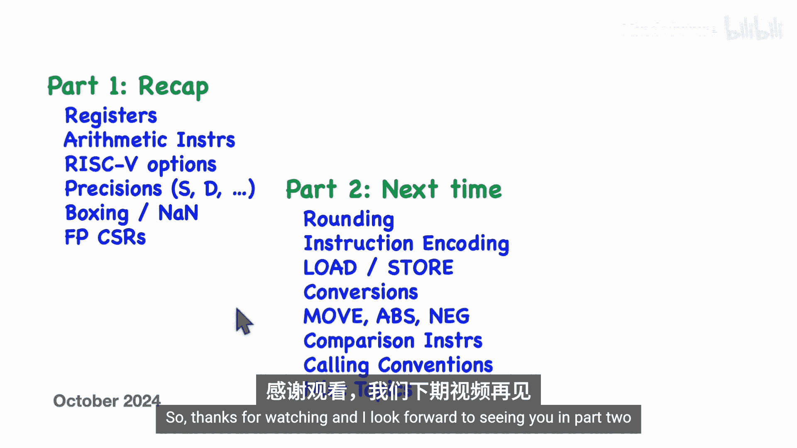

# RISC-V处理器架构，RV32指令集架构，汇编语言，Verilog-FPGA-p25-P25-OBSOLETE,-UPDATED---RISC-V-Assembly-Code-#9-Floating-Point-Instructions-(pt.--BV1aQ3nztE7J_p25-

Welcome to another video on the Rik5 In my previous video。

 I talked about how floating point numbers are represented in general。

 and in this video and the next video， I'll be describing how floating point is implemented on the Rik5 processor。

In this video， which is part one， I'll be introducing the floating point registers and the basic instructions that perform arithmetic computation。

I'll talk about various risk5 options， including the different precisions， like single precision。

 double precision， and so on。I will also talk about how smaller precision values are boxed inside larger。

 not a number of quantities， and I will describe the floating point control and status registers。

 which contain， among other things， information about how to perform rounding。In the following video。

 part 2， I will describe rounding in more detail， and I will talk about how floating point instructions are encoded into binary machine instructions。

I'll go over the various load and store instructions。

 instructions to convert between different precisions。 I'll talk about the move。

 absolute value and negate instructions。And I'll cover instructions that compare to floating point values。

I'll also talk about the floatinglo Point Col conventions。

 and I'll cover various miscellaneous topics。Okay， let's get started with part1。

If your core implements floating point， then in addition to the 32 general purpose integer registers。

 there will be 32 additional so called floating point registers。

 and these have names like F 0 through F 31。 And by the way。

 there's nothing special about register 0， like there is with the integer registers。

And so the next question is， how big are these registers。

 and that depends on which options are implemented by your core。 So option F， option D and option Q。

 single precision values require 32 Bs， double precision values require 64 Bs and quad precision requires 128 Bs。

 So regardless of what's implemented， there's only one register set。

 And it would be the largest size。 And so， for example， if options F and D are implemented。

 your registers would be 64 B， and capable of holding either a single or a double precision value。

Now， if anything is implemented， it will be option F for single precision。

Option D is an option on top of F， it requires F， and option Q is an option on top of that。

 so if option Q is implemented， then you've got single and double precision instructions as well as quad precision instructions。

There's also another option that includes half precision。Half precision numbers are 16 B in size。

 and this requires that single precision be implemented。

 So the registers will be at least big enough to hold a half precision value。

Here is our first floating point instruction。It adds the values in these two floating point registers and puts the result in a destination floating point register。

Now we have 32 registers， so these are encoded with5 bit fields in the instruction。 and in fact。

 the encoding of the floating point instructions is very similar to the encoding for the integer instructions。

 It's just that the op code bits are different。 So given the opcode bits。

 the core will understand that these five bit fields refer to the floating point registers and not the general purpose registers。

We can make some generalizations about floating point instructions。 First。

 they all begin with an S to indicate floating point。 And second， they have a size suffix。

 In this case， dot S indicates that this is a single precision at addition。And so for other sizes。

 we have other instructions， half， double and quadword instructions。

And which which of these instructions will be implemented on your core will depend on your particular core and which optional extensions your core implements。

 So in my slides， in this video， I'm going to be showing all of the instructions with the understanding that some of them will work。

 but some of them may not work。 if you don't have those optional extensions。 For example。

 if your core doesn't implement quad， precisionion in floating point。

 then this last instruction is going to raise an illegal instruction trap。

 if you were to try to execute it。There are a lot of floating point instructions that we'll be describing。

 but we can begin by grouping them into these general categories。First。

 we have arithmetic type instructions。 a subtract multiplied divide， square root， men and max。

Then we have classification instructions to determine what sort of a floating point number we have。

 Remember that we have plus and 0， plus and minus infinity。 We have normal numbers。

 We have sub normalor， and we have not a number things。

And we have load and store instructions to move floating point numbers back and forth to memory。

 we have some comparison instructions that will test a particular condition and set an integer register to either one or zero to indicate the outcome。

And we have a bunch of conversion instructions。 We can convert back and forth between integer values in the general purpose integer registers。

 and we can convert between the different precisions of floating point numbers。 And finally。

 we have some other miscellaneous instructions。 For example。

 to move values between floating point registers to compute the absolute value or to thegate of floating point numbers and so on。

So here are the basic floating point instructions which perform arithmetic computation。

They take their arguments in the floating point registers。

 and they produce a result which is placed in a destination floating point register。

We have instructions to perform addition， subtraction， multiplication， division。

 and we have instructions to compute the minimum and the maximum of two values。

 and we have an instruction that computes the square root。If your core implements floating point。

 then it will have these instructions， and these work on single precision values。

 and they all end with a dot S suffix to indicate the single precision operation。

If your core also implements double precision， then these instructions， in addition。

 will be implemented， and these instructions perform the computation using double precision。

 and they end with a dot D suffix。And if your core implements quad precision。

 then you've got these instructions to perform arithmetic using 128 bits of precision。

 and these end with a dot Q suffix， and finally， if your core also implements 16 bit precision。

 then you've got instructions that end with a dot H suffix。In this video。

 I'll be describing all of the floating point instructions without much regard for which instructions are actually implemented on your risk 5 core。

 And that's going to depend on which optional extensions your core actually implements。

With the risk 5 notation， optional extensions are usually indicated with a single letter like F D or Q。

But for some of the options， they have longer names， and those names begin with a capital Z。

 for example， floating point， half precision is indicated with this particular code。

And if you try to implement an instruction that's compatible with the options that your core implements。

 then fine， it will execute。 but if you try to implement an instruction that's appropriate only for options that are not implemented。

 then the instruction will cause an illegal instruction exception， and then trap handling will ensue。

So for the conversion instructions， we have a large collection of different conversion instructions。

 For example， this instruction converts a value that's represented in half precision to a value that's represented in quad precision。

 and of course， it would require both the Q option and the Z F H option to be implemented。

 otherwise it would cause an illegal instruction exception。The next question to ask is。

 what happens if， for example， we try to execute a single precision arithmetic instruction on a core that implements double precision。

Single precision values require 32 bits， but our registers would be 64 bits in size。

So for source operas， only the lower order or 32 B would be used。

 The upper 32 B would just be ignored。 and for the destination。

 the result would be placed into the lower half of the 64 B register， right？

 And the upper half would be set to just all onces。

And this is sort of similar to the way integer arithmetic works on an RV 64 bit machine where the integer registers are 64 bits。

 and we do a 32 bit addition。In the case of integer arithmetic， the result would be sine extended。

 and the difference with floating point arithmetic。 the upper half is extended with all ones。

 It's always filled with ones。To understand how this works， let's review the not a number values。

 In my previous video on floating point representation， I described the not a number or Nan values。

 and a value is interpreted as a not a number value。 If it's exponent as all ones。

 and the mantisa contains at least a single one bit。We don't care about the sign bitt。So。

 for example， this double precision value here would be interpreted as not a number。

 and notice that we don't even care what's in the lower half of this value。 And in fact。

 what we can do is we can hide something in the lower half。 This is called the payload。

 And what we're going to be doing is hiding a single precision floating point value in the lower half。

So as a double precision value， it's interpreted as not a number。

 but if we look only at the lower half， then we have our single precision value。

This technique is called boxing。So on a core that implements both single and double precision。

 we can box a single precision number inside a double precision number。

 And here's a picture that shows what's going on。And when interpreted as a double。

 it's a not a number value， but when interpreted as a single precision value。

 we just look at the lower order of 32 B。 And we can also do this。

 We can box a double inside of a quad， and we can box a half inside of a single。

 It's basically the same idea。And in fact， we can do this recursively， for example。

 a half precision can be boxed inside a single precision number。

 which is itself boxed inside a double precision value。

 So here is how a half precision value would be represented in a core that implements double precision in which the registers are 64 Bs in size。

I want to take this opportunity to make a slight diggression。 And for the sake of completeness。

 I want to mention something about not a number of values that you might encounter。Okay。

 so sometimes you see a distinction being made between quiet nas and signaling Ns。

Quiet Nans are sometimes called Q Nans or written like this。

 and signaling Nans are sometimes written like this。 S Nan。Okay， with risk  five。

 all the not a number values are quiet by default， Okay。

 so signaling Ns are just not used and you can probably just ignore this distinction。Okay。

But here's the idea with signaling Nans。If signaling NanNs are implemented。

 then the most significant bit of the mantisa is used to distinguish between quiet and signaling。

 If it's one， the Nn is quiet and if it's 0， it would be signaling， okay。With a quiet Nn。

 if one of the operas to an instruction is a quiet， not a number value。

 then the result would be another， not a number value。 And so quiet Nans are propagated。

 So the idea is， if you have problems in a lengthy computation。

 then the result will be a not a number after several instructions。Whereas with a signaling。

 not a number value， if one of the operarans is a signaling， not a number。

 then the computation will stop。 the instruction will cause an exception。

 and then trap handling will ensue。 So signaling Ns will cause an end to the computation and an exception。

 whereas quiet Ns will be propagated。 And as I said， with the risk， processor by default。

 the not a numbers are quiet。 And so signaling is an option that's probably not going to be implemented in the processor you have。

One very useful instruction is the F class instruction。

It takes a value in a floating point register and determines what sort of floating point number it is。

 and it stores a code value into one of the general purpose integer registers。

There are several variations of this， so there are four different size suffixes。

Remember that a floating point value can be， well， it can be positive or negative infinity。

 positive or negative 0。 It can be a normal number。

 or a so called D normal or sub normalormal number。 It can be positive or it can be negative。

 And it might possibly be not a number value。 So here are all the code values。

 And one of these integers is moved into the general purpose integer destination registered to tell you what sort of thing you've got。

Now， I want to mention the floating point， control and status register。

 which contains two fields that control the operation of the floating point instructions。

The first field is the rounding mode field， and the second field contains five flag bits。

So the rounding mode field contains a code number， okay。

 here they are right here that tell how the floating point arithmetic instructions should round the result when it cannot be represented exactly。

 So here we have some symbolic names， R N E for round and nearest with ties to even what ties to even means is that when the exact result is exactly halfway between two values that are representable。

 then it would round to the value that ends with a0 in the least significant bit。

Then we have Rt0 or round towards 0， and then we have R D round down and R up， round up。

 and then we have round to nearest with ties going to the value with the largest magnitude。

For the flag bits， we have a number of bits that would be set by any instruction if the particular condition occurs。

 so after a series of several instructions of larger computation。

 we can then check these bits to see whether any one of these conditions has occurred。

The invalid bit is set if an invalid operation， for example。

 adding positive and negative infinity occurs。DZ bit， that's this bit number3。

 is set if we try to divide by0， we have a bit for overflow。

 and we have another bit that is set if an underflow occurs in a computation。

 and finally we have a bit that is set if a result that is exact cannot be represented with the given precision。

And so there's also a register called F flagags and that contains the five floating point flag bits。

 and this is a separate register， but the bits that it contains are exactly the same bits。

 So if you want to modify or query the bits， it doesn't matter which register you use you'll get the same results and likewise we have an FRM or rounding mode register and again。

 similarly， these three bits are exactly the same bits that are in the FCSR register。

So given that we've got this set up， you'll probably just ignore the F CSR register altogether and simply use the F flags and the FRM register。

In order to query or modify these control and status registers， we have these instructions。

 the first one is to read the FCSR， moving it into a destination integer register。

 and the second one is to set or modify， and it takes a value in one of the general purposese integer registers and moves it into the FCSR register。

We also have instructions that access the roundunding mode register and the flags register。

 then the first one will read and the second one will set or modify the rounding mode register。

 and here we can read or set the F flags register。Just to go into a little greater detail。

 which you can safely ignore， every control and status register has a 12 B address。

 And here are the addresses for the floating point registers。

And the instructions that I just mentioned are actually pseudo instructions。

 so the assmbler will translate them into machine instructions that actually exist。For example。

 the instruction to read from the FCSR register is actually translated into the CSR instruction that will read and set a control and status register。

 and here are the opera that would actually be used。And likewise。

 when we go to set one of the floating point control and status registers with an instruction like this。

 it would actually be translated into the instruction that does a concurrent read and write to any control and status register。

So this just shows， again， the power of this pseudo instruction mechanism。

 we can have these six instructions and the underlying machine instructions that are used are far more general and can be used in other ways as well。

Okay， that concludes this video， which is the first part of a two part series on how floating point is implemented in risk 5。

In this video， I introduced the floating point registers。

 and I describe the basic instructions to perform arithmetic computation。

 I also talk quite a bit about the various precisions， single double quad and half precision。

I described how values of smaller precision are boxed inside of values of larger precision。

 where the larger value is interpreted as a not a number quantity。

And I just wrapped up by talking about the control and status registers that are used for the floating point instructions。

In the next video， I'll go into talking about the rounding modes in greater detail。

 I'll also talk about how floating point instructions are encoded into binary。

 and then I'll talk about a bunch of different instructions， including the load' door instructions。

 instructions to convert between various precisions。

 the move absolute value and the gate instructions。

And the instructions that will be used to compare to floating point values。

I'll also talk about the floating point calling conventions and cover a couple of other items。

Thanks for watching and I look forward to seeing you in part  two。

