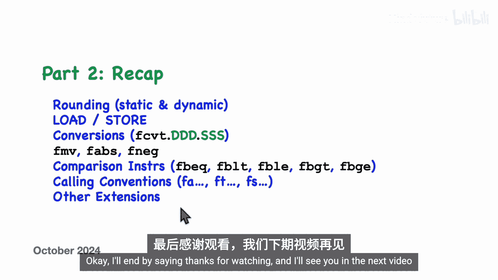

# RISC-V处理器架构，RV32指令集架构，汇编语言，Verilog-FPGA-p26-P26-OBSOLETE,-UPDATED---RISC-V-Assembly-Code-#10---Floating-Point-Instructions-(--BV1aQ3nztE7J_p26-

。

This video is part of a series in which I describe Risk 5 assembly language programming。

In the previous video， which was part1 and this video， which is part 2。

 I describe how floating point is implemented in risk 5。Previously。

 I talked about the floating point registers， the arithmetic instructions。

 and the different precisions like single， double and so on。

 and I described how values of smaller precision are boxed inside of larger precision values that are not a numbers。

 and I also described the floating point control and status registers。In this video。

 which is part two， I will go into the various rounding modes。

 and I will talk about how floating point instructions are encoded into binary machine instructions。

I will be covering the load and store instructions。

 instructions that perform conversions between various precisions。The move。

 absolute value and negate instructions and instructions that will compare to floating point values。

I'll also talk about the floatinglo point calling conventions and cover a few other topics as well。

Okay， with that， let's go ahead and get started with part 2。Next。

 I want to talk about how we specify which rounding mode to use。

 And there are two approaches called dynamic and static。 with dynamic。

 we use the rounding mode bits that are in the floating point control and status register to determine how a result should be rounded if it can't be represented exactly。

Whereas with static， we specify the rounding mode directly in the instruction。

Here are some examples that show how this would be done with assembly language。

If you want to use the rounding mode bits in the control and status register。

 you basically just don't do anything， but if you want to specify the rounding mode explicitly in the instruction。

 then you would add as sort of a fourth opera and， one of these symbols。

 and these are the rounding mode symbols we saw earlier， round to the nearest round towards0， round。

 down， round up and round to the nearest with ties going to the one with the maximum magnitude。

And this rounding stuff applies to the arithmetic instructions。

 as well as two instructions that do conversions， and it applies to the various different sizes。

For certain instructions， the result will always be exact。 For example。

 the minimum and the maximum instructions and also converting something like a single precision to a double precision。

 the result will be exactly representable。 And if you try to specify a static rounding mode for instructions like that。

 the assembler is going to complain。When it comes to the question of how floating point instructions are encoded in binary machine code。

 there are a lot of details that you can ignore， but I did want to look at one example to give you a feel for things。

 So here's a floating point subtract instruction。 and every instruction is turned into a 32 B full size instruction。

 And floating point instructions have a number of fields。

The field shown in brown are the op code bits， and we have a primary op code field over here。

 and then a more specific op code field that determines whether we have ads， subtract。

 multiplier or whatever。We have a twobit field to determine whether it's a single precision。

 double precision， quad precision or whatever。And then we have fields for the destination and source registers。

 And we also have a3 B field for the rounding mode。

So here is how this particular instruction would be encoded。And in particular， the 0，0。

1 value for the rounding mode is for round to 0。And we can use any one of the different rounding modes。

 and if we don't specify any rounding mode at all， that is we want dynamic rounding mode。

 then the code 111 would be used。 and in that case。

 the rounding mode would be determined by the floating point control and status register。

Recall that for general purpose registers， we have a number of load and store instructions。

We can load or store either words， double words or quad words that is either for8 or 16 byte quantities to or from memory。

With floating point， it's the same idea， except we also have a half word version so we can move either 48。

16 or two bytes from memory to a destination register or from destination register to memory。Now。

 in the case of the floating point， the destination for the load instructions would be one of the floating point registers and for the store we are moving from one of the floating point registers in the case of the address computation。

 the address is computed by adding an offset that's included in the instruction directly to a base address or a value that's in register RS1 and for the floating point loads and stores。

 this is still a general purpose integer register that's being used。Also。

 I want to mention that which of these instructions can be used depends on exactly which extensions are implemented by your core。

 I mean you can't do a load quadword if your core is not implementing quadword floating point values。

With integer loads that go into one of the general purpose integer registers。

 a smaller value will be s extended to fit into the larger registers。With a floating point load。

 when the size is smaller than the register itself， the value will be boxed， as we described before。

 In other words， it will be enclosed as the payload of a not a number value。

There are a number of conversion instructions which copy a value from a source register to a destination register。

 converting from one format to another along the way。

The source and destination can be either floating point values or integer values。

 If there are floating point values， we would specify a floating point register and。

Integers would be in general purpose registers。Here's the general format of the convert instruction。

 It has a suffix that tells the source format and the destination format。

 as well as a source and destination register。And as an example。

 we are converting from a 32 bit integer， so the source register must be one of the general purpose registers。

To a single precision floating point value。 So the destination register must be one of the floating point registers。

As far as the source and destination specifiers go。

We can specify either SD DQ or H for single double half quad or half precision floating point values。

 in which case the corresponding register must be a floating point register。Or we can specify W， W U。

 L or L U for 32 or 64 B integers either signed or unsigned， in which case。

 the corresponding register should be a general purpose integer register。

That so there are a lot of these conversion instructions available and which ones are actually available on a particular risk 5 core is going to depend on which optional extensions that core actually implements。

We've also got a couple of instructions called floatinglo point Mo that copy bitts between a general purpose integer register and a floating point register without performing any conversion。

So when we have a bit pattern in a general purpose integer register。

 it would be interpreted as some particular integer。

 And when we move those same bits without any kind of conversion into a floating point register。

 they would be interpreted as a single precision floating point number。

 and it would have a completely different and unrelated value。So for these move instructions。

 we use the format code X to indicate which of these two registers is the general purpose integer register。

 and these two instructions move 32 bits back and forth。

If we have an RV 64 machine and double precision floating point is implemented。

 we also have these two additional instructions， and these move 64 bits back and forth between a general purpose register and a double precision floating point register。

Here are three more useful floating point instructions。

The first computes the absolute value by clearing the sign bit in a source floating point register and moving the result into a destination register。

The second instruction negates the value in one floating point register and moves the result into another。

 and the final F move moves a value from one floating point register to another floating point register。

In case you're interested， the previous three instructions are actually pseudo instructions。

 They're implemented with these three underlying machine code instructions。

 And if you care about these instructions and what they do exactly。

 you can freeze the video and take a look。 but otherwise， let's go ahead and move on。

Testing is important， so let's take a look at how we compare floating point values。

All of the comparison instructions have this general approach。

You take a look at the values in two floating point registers and you compare them。

 and then you move either a one or a0 into a destination register。

 which is one of the general purpose integer registers。

Here's an example of floating equality testing for single precision values。

 and we also have variations for different sizes。After executing this instruction。

 you would execute a branch instruction to test the value to see whether it's 0 or not。

 So this instruction would branch if the two values were equal。

 and if you want a branch if they are not equal， then you would use the opposite branch instruction。

Now at this point， I want to mention that equality testing is a bit tricky with floating point numbers because things can be rounded and when you think two things are equal。

 they might not be exactly equal because of rounding。Also。

 in the presence of not a number of quantities， testing with the relational operators can be a bit tricky as well。

The other relational comparisons follow similarly。 For example， we have a floating less than test。

 a floating less than an equal test， a floating greater than test and a floating greater than an equal test。

 all in the various sizes， depending on which extensions are implemented on your core。

 And these all test in the same way， less than less than or equal。

 greater than greater than or equal。For what it's worth。

 only the less than and less than equal operations are actually implemented in hardware。

 The greater than and greater than equal tests are actually pseudo instructions and implemented with the less than and less than equal。

 simply by swapping the two registers that are involved。As I mentioned previously。

 testing equality with floating point numbers is a bit risky due to rounding。

The number you're dealing with may not be exactly what you think it is。

A better approach is to compute the difference and then compare it with less than against some threshold value。

 some epsilon value。And with not a number of quantities， be careful， the less than。

 less than or equal， greater than greater than an equal comparisons against not a number of values are considered to be invalid operations。

 and the invalid operation bit in the control and status register would be set。But oddly enough。

 with an equality comparison， that's considered to be O。 The invalid operation bit would not be set。

Also， any test against a not a number value will return false。

 And this gives a counterintuitive result。 When you compare a not a number with another。

 not a number， that's always going to be false。 So if you take a bit pattern that represents not a number。

 it will compare to be not equal to itself to the exact same bit pattern。

 which is not really what you expect。Also， we have a positive and a negative 0。

 And this leads to some unusual behavior。 These two things are equal to each other。

 So they will test as being equal。 Yet， if you divide one by positive 0。

 you'll get positive infinity。 But if you divide one by negative 0。

 you'll get something completely different。 you'll get negative infinity。 And in my mind。

 that really challenges the meaning of equality itself。So up until now。

 Ive referred to the floating point registers with names like F 0 all the way up to F 31。

 But like the general purpose registers， the floating point registers also have alternate names。

 or we could say nicknames。 So we have special names for argument registers， F A 0 through 7。

 and for temporaries F T 0 through F T 11 and for call saved floating point registers。

 F S 0 through F S 11。So here's the correspondence between these alternate names and the other names。

 You don't really need to remember these correspondences。

 because the asmbler will take care of these。 You can go ahead and use the alternate names。

 and you probably should。So these registers are used for the same sorts of things in the same sorts of ways as the general purpose registers。

 If we have floating point arguments to a function。

 they would be passed in the F A0 through 7 registers。 and within the function。

 we can use those as well as the temporary registers without bothering to save the previous values。

 but we also have some callee saved registers， So we would need to save the previous value of the callee saved register before we use it。

 and then restore that previous value before we return。In the remainder of this video。

 I wanted to mention a couple of optional risk 5 extensions that are probably less commonly implemented。

Although you might not ever encounter or need this stuff。

 I did want to mention it just in case you do。So the ZFA extension adds a couple of new instructions。

 including this one， the floating point load immediate。

And this upper end here is one of 32 possible constant values。

 and these values get encoded somehow into a five bit field within the instruction itself。

 and it moves that value into the destination floating point register。

And this extension also includes a floating point round to integer instruction in its various sizes。

 and this takes a value in a floating point register and round it to an integer according to the current rounding mode and places the result into a floating point register。

You can achieve almost the same result by doing a convert and moving it into an integer general purpose register and then moving it back to a floating point register if you have to。

This extension also includes a couple of other instructions that are even more obscure。Normally。

 a risk5 processor that implements floating point will have a separate set of registers to hold those floating point values。

 and those are the registers that we call F0 through F 31。

But why not just use the general purpose registers， the X registers？

So the idea here is that all the floating point instructions work the same way。

 they just act on or operate on the general purpose X registers instead of the floating point registers。

Another way of saying this is that the。Floating point registers are just aliases or other names for the X registers。

Well， there are a couple of reasons why having a separate register file for the floating point numbers is a good idea。

For one thing， the floating point registers can only contain floating point numbers。

 but there's no requirement that they actually store those floating point numbers in the format specified by the IEE 754 spec。

The hardware might actually use more bits than the IEE spec in order to make various operations faster or perhaps reduce the hardware requirements。

For example， the exponents might be stored in two's complement form instead of the funky biased way that they are stored in the Iries spec。

 and also， the exponents might be given a few more bits。

 eliminating the need to store or have dennormalized numbers represented specially。Also。

 we might might make that leading bit， which is normally implicit。 We might make that explicit。

But that said， we do have these options listed here。In F in X option。

 single precision floating point values are stored in the general purpose registers。With D and X。

Double precisions are stored in the general purpose registers。 And finally。

 with the H in X half precision floating point values are stored directly into the general purpose registers。

And finally， I'd like to mention the H in X min option。

 which just provides some very minimal support for half precision floating point。

It provides just a couple of extra instructions， and these instructions can convert between half precision and single precision floating point。

And between half precision and double precision floating point， if that's implemented。

 And the idea with these is that you can convert a half precision number into a larger precision。

 do some arithmetic on it。 And then when you're done， convert it back into half precision。Okay。

 that wraps up this video， and it wraps up my discussion of how floating point is implemented in risk 5。

In this video， I talked about how rounding works。 I talked about static in which case the rounding mode is included directly in the instruction and dynamic mode in which case the rounding mode is determined by bits in a control and status register。

I talked about the various load and store instructions to move data between memory and floating point registers。

I talked about the convert instruction in all of its forms that converts between a source precision and a destination precision。

 including directly copying bits with no conversion at all when we use X。And I talked about the move。

 absolute value and the gate instructions。And I talked about instructions to compare to floating point registers either for equality less than less than or equal。

 greater and greater than or equal。 And these instructions set a general purpose register to be either true or false to indicate the outcome。

And I talked about the floating point calling conventions。

 and I mentioned the alternate names for the floating point registers。

Names that begin with F A for arguments。 There are names that begin with F T for temporaries。

 and there are names that begin with F S for callee saved floating point registers。

 And I also talk about a few other extensions that are less commonly used。Okay。

 I'll end by saying thanks for watching and I'll see you in the next video。

