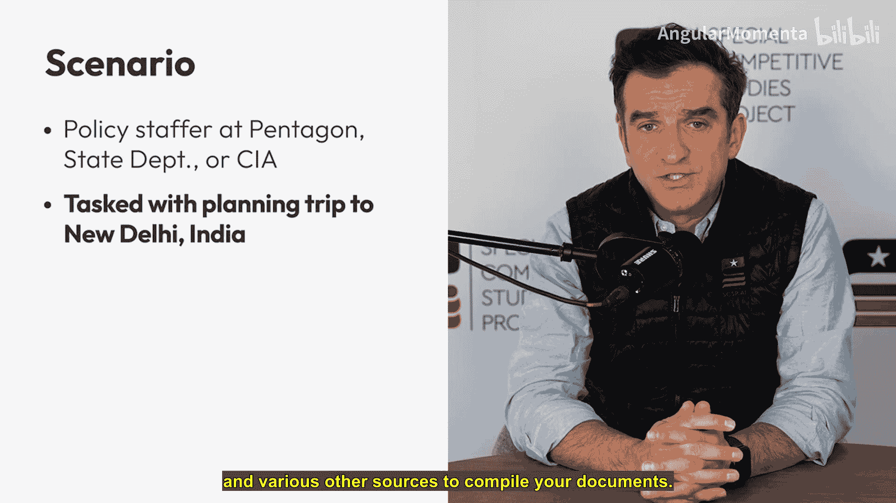
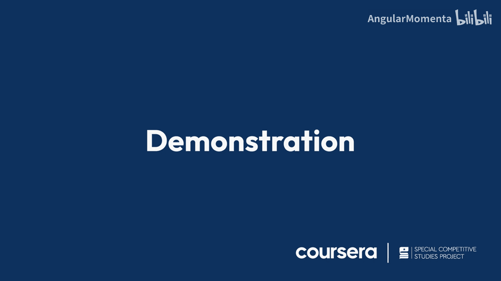
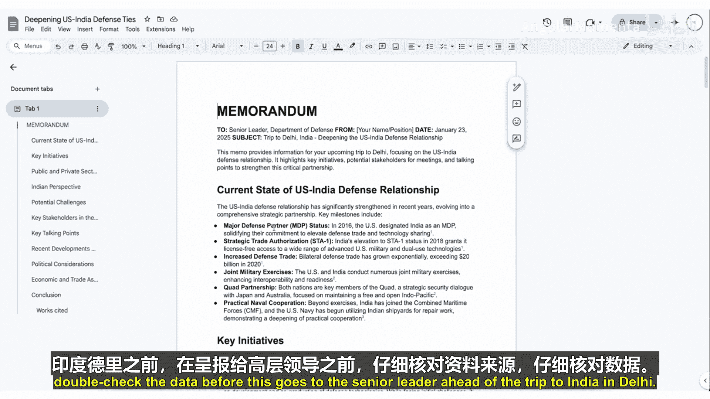
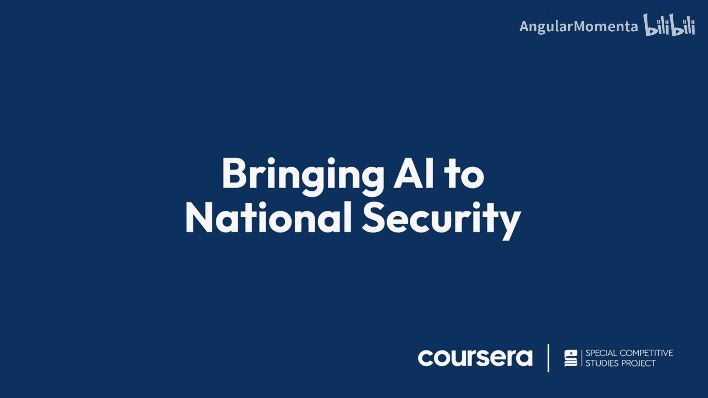

# 【Special Competitive Studies Project】国家安全中的人工智能 p01 01_01_01_bringing-ai-to-national-security -BV1jPrHBsEdy_p1-

Hi， I'm Milly Baraktorri， CEO of the Special Competitive Studies Project。

 and welcome to our course on AI for national Security。

Before I LED special competitive studies project， I served in a number of roles across the federal government。

 and no matter where I went， there were always memos and background documents to write and prepare for our senior leaders。

😊，Today， AI can provide the first draft to help start these documents that ultimately will be edited and finished by a policy analyst or a saer。

We created this course with Coursera to help employees at the federal or state level utilize the latest tools to achieve their mission。

We didn't just want to talk about these tools， we wanted to demonstrate the real world examples of how you can apply AI for your day to day job。

As an example， imagine you're a policy staffer at the Pentagon or State Department or the Central Intelligence Agency。

 and you are tasked to plan your leader upcoming trip to New Delhi， India。Under normal circumstances。

 you spend days， if not weeks compiling background information， scheduling calls。

 talking to outside experts， in house experts， confirming details of your trip and ultimately writing talking points for your leader。

You would go over policy documents， intelligence reports and briefings。

 and various other sources to compile your documents。

It's a time consuming job， and there's always a chance of missing critical and important details while having other work to do during your day。

Let me try to demonstrate this task as executed by using one of the large language models in this case。

 Google's Gemini and there a model called Dreers， which is an e tool to perform these kind of tasks。

 I'm sure other models have similar capabilities whether it's clo or Chad GPT。

 but for the purposes of today's course， I'm going to use Gemini Dre released in January 2025。

 so let me show you how I would do this。So in the prompt。

 I'm going to include a text that will tell the large language models for the memo that I need to prepare for the leader in the de Parno defense for his upcoming trip to Delhi。

 The model will give me an outline of the research plan， which you can see here。

 If you're not happy with the research that is going to conduct， you can edit the plan right below。

If you're okay with the research plan as outlined， you can hit Start Research。So right now。

 on the left side， you can see the progress of how far the model has gone to build the memo for you。

 and this didn't even require a full minute。 Now again。

 this is done all in open source research of the information that exists all over the Internet on the right side。

 they're pulling the information from the think tank reports， government documents， news sites。

 Indian think tank， etc。All right， so Ge and I advanced 1。

5 pro with deep research has given me the first draft On the right side。

 you can export this document in your Google Docs。 which I'm going to do it right now。

 and then I'm going to scroll down just to give you a sense of how good this document it is at least as a starting point。

 So you have something to work from。 This is not a finished document by no means。

 as we said at the beginning。 This requires human intervention in terms of editing in terms of double checking data。

 sources， etc ceter。 but at least it will give you a nice solid first draft。

 So you can see the memorandum is built。 As I prompted the model。

 it talks about the Cur state of play between US and India in terms of defense relationship。

 It talks about the last key initiatives for the past 10 years。

 It talks about the Indian perspective in our relationship。Potential challenges。

 key stakeholders on their side， who are the key principles。

And then potential talking points for your leader to use in conversations with Indian leaders。

If you go down， it gives you the economic data of the overall trade， goods and services。

And then all the way to the bottom， you have the work cited。

It took less than a minute for the seven page memo to be built。

 which I think is a great start for you to continue working， refine it， double check sources。

 double check the data before this goes to the senior leader ahead of the trip to India in Delhi。

