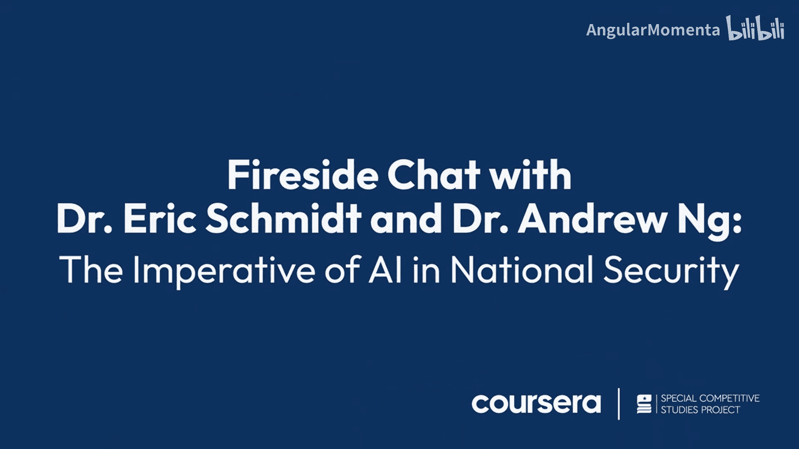

# 【Special Competitive Studies Project】国家安全中的人工智能 p02 01_01_02_the-imperative-of-ai-in-national-security -BV1jPrHBsEdy_p2-

Eric， it's really an honor to start this course with you。

You have been involved in helping our government for the last 10 years， modernize the I。

 the software， and how they think about integration of new technologies， particularly AI。

 since the early days of the Defense Innovation Board than the National Security Commission on AI。

 and even now with the Biiotech Commission。You have seen and you have witnessed first hand some of the challenges and opportunities of integrating。

 cutting edge solutions， especially AI into a big and complex organization。

 So my first question to you。How will AI shape the future of defense capabilities。

 I've been thinking about tanks。Because everyone loves tanks and having ridden in them and watched them。

 they're terrifying。But if I were in a tank。If I were an American in a tank。

 I'd be terrified because I'm a sitting duck。So what I want in front of me is 20 drones。

 making sure that in front is clear， but I also want something in the back。

 watching the back as well。 And by the way， the tanks cost $10 million。

 The American tanks can cost up to $30 million。 A drone cost $1000。

 Why do we have 20 ahead and 20 a time all the time。So one way to think about it。

 And I want to be very clear that I salute the courage of our soldiers because I don't have that courage。

 I would literally run away。 I'm afraid。 It's so dangerous。 But if I want a secure American lives。

 What I really want is I want a persistent， forward， autonomous ISR capability。

 I want drones always ahead of me， always watching。 And ideally。

 I would have an ISR or basically a surveillance drone ahead of me。

 and I'd also have a bomber drone ahead of me that would take care of anybody in front of me that was a threat that was a legal threat for me to approach as I'm driving my tank。

 I'm using the tank as a metaphor， the same would be true if I were an infantry man in in a forest。

 I'd want that persistent thing。 And that I think， is the key thing that's missed in this drone conversation。

 Everybody spending their time talking about a human and a drone and a target。 That's not what。

Software can do。 What software can do can build a layer of drones that are always there。

 always watching。 by the way， during the day and night， occasionally。

 they have to be recharged with fuel or electricity or what have you。

 I want that before I'm even as a human， even near the flat， even near the front line。

 And I think that's coming very quickly。

I find it inspiring that AI is already having an impact on safety and security。

 even within the United States。 about a month ago， a Sky Fire AI。

 which is a portfolio company of AI found， which I lead。

 was credit with saving a policeman's life here in the United States。

It turns out that when the alarm goes off， say a burglar alarm， many of them are false alarm。

 maybe well sell out by moisture or an animal or something， and still skyfire。

 which led by CEOo Don Matthews offers a drone as first responder program where after an alarm can send a drone out to take a look and if it's a false alarm and comeback does having saved the police officer。

 you're from heavily drive to take a look。What happened at 2 am was an officer。

 an officer had pulled over a vehicle and was not heard from for several minutes since。

 and police dispatch asked us to take a drone that was actually returning from another mission to turned endel a false alarm to reroute to figure out where this police officer was。

The police officer had pulled over a vehicle in a crossros in a complex clover leaf pattern and dispatch actually wasn't sure one level the officer was at。

Aroaz ill fly there and from an aerial view， very quickly locate the police officer。

 As well as it turned out the driver of the vehicle he had pulled over。

 who it turned out had escaped from a local detention facility。

The officer and his assailants were actually now visible from the road。

 to rush it down by drainish ditch and fighting。 and the officer looked like he was losing。

 It seemed like he still has radio， but he wasn't able to reach it to radio for whole。

 And there was also concern that he may lose control of his service weapon that could end up being used against him。

So the wash officer who coordinates the activities of that shift。

 later estimated that against sent patrol carra， it would taken maybe five to7 minutes to locate the officer in the assailant。

 given us multi levell complex globally。Because we had drone imagery from the air。 we were able。

 police dispatch was able to immediately direct responding units exactly where the officer was。

 and the first vehicle got there not not5 to 7 minutes。

 but 45 seconds and subsequently another former police unit showed up a few minutes later。

Because of this rapid response， police officers were able to rapidly take control of the situation and apprehend the suspect and perhaps most importantly result in a safe outcome for this junior police officer Hi Andrew。

 you have advocated for empowering every individual with AI agents。So applying this to public sector。

 how can AI tools be specifically leveraged to enhance the efficiency and effectiveness of public sector workers in their daily job？

Of other the work in the public sector and in national defense specifically requires a massive amounts of information processing。

 and AI is a general purposese technology， and just as it is hoping many businesses today process information and make decisions。

 there is lots of room to take these amazing technologies be it AI of generative AI and so on and adapt them to the many use cases that we want to serve better in the public sector and I feel like the problems that the federal government faces。

 they are somewhat unique but not completely unique。

 which is why over the last many decades of tech innovation。

 many innovations from Silicon Valley have found out to be useful for defense as well。For example。

 I know Yu showed the demo just now of using a large language model to sort through documents to help draft the memo to the Secretary of Defense。

 and I feel like in a defense ecosystem and I saw some of this firsthand when I was doing work with DARPA through Stanford University AI offers a very strong potential to help us ti our policies or legacy IT systems and help people process more data。

One way to think about AI is。I wish we could give everyone an army of really high workinging and frankly pretty lowco interns that may not know damage about our work。

 but are really hard workinging and willing to go in and do what it takes and I think AI。

 despite a lot of limitations can take a lot of grunt work a lot of routine repetitive work of people in the federal government and hope our workforce become much more efficient And so what I'm seeing is a lot of people that may not be professional software engineers learning enough about AI to build these new innovative。

 amazing things and making themselves much more effective in their job roles。

Ever report on my team using a white for Y magazine using Gene AI。

 he has written code to scrap websites to scrap our as feed online to hold fl for him interesting articles he should pay attention to have a mark on my team that。

 you now Bill's websites by themselves using using Gene A to launch new campaigns。

 and some seen in tons of job roles， people that are not professional software engineers able to use these tools in a very effective way that frankly goes well beyond prompting or large language modern internet。

 with specific areas within Do O D offered the greatest potential for rapid and full integration of AI to enhance our defense capabilities and our efficiencies。

 if you go back to the third offset from years ago in the US military。

 The real idea was to move to precision and autonomy。

 And I think that continues to be the right answer。

 modern AI systems allow you to discriminate in favor of。😊。

Target and have almost no collateral damage。So the notion of autonomous systems。

 especially ones that are human control， but from a distance。

 is probably the single biggest change that's going to happen in war and in defense。

 You can see that in Ukraine， where basically people are flying drones from the comfort of an office building drinking coffee while the drone is doing its work。

 whether it's defensive or offensive。 Our military should move very quickly to these technologies。

 because of the way the DoD works， it takes forever， but eventually it'll happen。You。

 speaking as an educator as an AI technologist， I'm really glad that our community is engaging with national security to figure out how our tools and knowhow can contribute to national security。

 I remember when the project Maven came down and largetech Company decided not to engage in。

 national security。 I really found myself wondering。😊。

I feel privileged to live in democracy of with I tru going out to put their lies on the line to protect us all。

 and if those in tech unwilling to step up to at least support our troops， then frankly。

 one on earth are be doing， so I'm really glad that the tech community is willing to take a look at the hard questions that national security and defense raise and to do our part to contribute to having a safe。

 thriving democracy and to support our troops。You have noted that any country or state that trains its workforce in AI will have a competitive edge。

Emphasizing its benefits to national security and economic competitiveness。

What strategies should national security agencies employ to effectively upkill their personnel in AI competencies？

Because AI is such a powerful technology。 I think that any country or state that embraces it and uses it well will gain a competitive edge both in national security and in economic competitiveness at this moment in time。

The opportunities to build amazing things be for security or commercial applications or nonprofit N geott applications。

 I think are immense。 And it feels every day to me that the set of amazing things we can build is vastly bigger than the number of skilled people that exist right now to go and actually pursuing and capture all these opportunities。

 So I would say really to everyone in governments or not。 this is a great time to go learn about AI。

 And if you embrace these tools you better do things far more effectively than than what you were previously able to。

 And that's why training is such an important piece of what we do。 I think once。😊。

Al everyone had to learn to use web search。 almost everyone had to learn to use a smartphone and today。

I can't imagine in the business world， I just can't imagine hiring a marketer。

 a recruiter or HRr professional that doesn't know how to use Internet search。

 I think we're rapidly approaching the point where I can't imagine hiring a marketer recruiter or really anyone to do almost any row in an office that doesn't know how to use generative AI。

 making sure that。All of us。Embrace this technology and use it to the extent possible will be critical for national competitiveness。

 You have seen what AI can do in the private sector。

 How do you think this will translate in the battlefield and what's going to be different about the war because of AI。

 Part of the reason AI is so prominent this year。 is people believe that AI technology will transform business。

 as we know it， marketing， as we know it， sales as we know it， kind of everything as we know it。

 under the guidance of humans， not on its own。So if you think about a business。

 a business is typically look at something， then design something， and then procure something。

 and then manufacture something， and then ship it and build the customer。

 Each of those can be understood as an agent and each of those agents can operate autonomously。

 So you have the agent to plan and the agent to buy and the agent to design and the agent to build。

Exactly that same agent approach。Is how the military works。 The military is， in that sense。

 just a large company。 It's also a large planning mechanism。 And in my years in the military。

 all I can say is they spent all day planning with humans on whiteboards。 Well。

 that planning should be done by AI systems to figure out optimal defensive strategy。

 offensive strategies and so forth。 I think it will revolutionize the way the Pentagon is is run and how our decisions are made。

 Unfortunately， today， our government in general， is very bad at purchasing software and in particular。

 AI systems。 they're different from hardware systems。 Software is never done。

 You're always iterating。 You're always making it better。

 And we've not been able to get that understanding into the US military in the right way yet。

