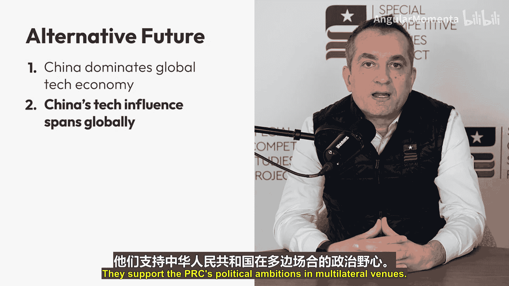

# 【Special Competitive Studies Project】国家安全中的人工智能 p03 01_01_03_the-stakes-of-falling-behind -BV1jPrHBsEdy_p3-

Hi， I'mil B Barakari， and I spent over 13 years at the Pentagon and the White House working on defense policy and strategy。

Most Americans alive today day， over 97% cent to be precise。

 have only known a world in which freedom is the desired destiny of each nation。 Democra。

 rather than autocracy， provides the best model to organize societies。

 technologicaln innovation is pursued for the purpose of improving。

 rather than reducing human welfare， and the United States is the leading superpower in the world。

An intense competition is currently unfolding on whether this will continue to be the future or not。

 In fact， how this future plays out will be shaped principally by the technological competition between the United States and the People's Republic of China。

Now， to really appreciate the stakes of this competition。

 it is useful to imagine what an alternative future may look like。

 one in which the People's Republic of China prevails。 In other words。

 imagining what the future may look like。 Should Beijing succeed in controlling the global digital infrastructure。

 Enjoy the dominant position in world's technology platforms。😊。

Control the means of production for critical technologies and harness a new wave of general purpose technologies。

 like artificial intelligence， biotech and new forms of energy。If that is the future。

 there are a number of deeply troubling outcomes that can be foreseen。

 I'll offer sixth for illustration。First， China dominates the world economy and captures the trillions of dollars worth of value generated by the next wave of technologies。

The United States and its allies lose out on the majority of the jobs and growth promised by the new technologies。

 supplyly chains for new technologies are built in China。 Beijing's dominance of tech sectors。

 creates powerful platforms and companies that replace US based companies in key areas。

 including cloud services， social media and Internet search。Second。

 China's technological spheres of influence spread throughout the globe。

 Beijing uses its technological advantage for political leverage。 Nations， including US allies。

 become increasingly reliant on China's technologies and inevitably swing into its political orbit。

Countries dependent on China's digital infrastructure and platforms become unwilling to risk crossing Beijing in a global crisis。

 They support the PRC's political ambitions in multilateral venues。 Third。

 when open internet is compromised and digital oppression replaces digital freedom。

 Beijing's vision of a sovereign Internet sweeps the globe。 China's surveillance state is globalized。

 Beijing's backed tech platforms replace other global platforms has shaped the global discourse using sophisticated algorithms。

 China ends up controlling the digital payment infrastructure， Riing the power of US dollar。

 Beijing collects vast amounts of data that can be applied to target individuals and refine its propaganda。

Fourth， the digital infrastructure of nations is cyber compromiserod。

 The world becomes dependent on China for most core digital technologies， key electronics。

 components and Finn products woven into every critical system， energy grids， ports， airports。

 financial systems and government offices become vulnerable to PRRC cyber exploits。

 Beijing uses them as threats during a disagreement and deploys them as cyber attacks in a crisis。

Fth， the US military's technological edge erodes。 China uses its dominant position in autonomous systems。

 robotics and low cost but mass manufacturing to build weapons systems to outmatch US capabilities。

 create new war fighting paradigms ander confidence in the US military deter term。

The combination of reduced capability and allies hedging forces the United States to make painful compromises in the Indopific。

 The most critical region of this century，6， Beijing threatens to cut off or actually cuts off the supply of chips and other critical technology inputs。

 Beijing denies as the supply of rare earth materials necessary for energy。

 digital and defense technologies and cuts off the supply of leading edge semiconductors。

92% cent of which are produced in Taiwan。 Americans's military is degraded and the nation is plunged into a depression。

 Americans are forced to live in a world where China can turn off the technological tab。

 In aggregate， then， this alternative future amount of the unraveling of the world。

 The United States and its allies painstakingly build after World War Ii and presents a serious challenge to future US prosperity。

The United States and other democracies become economically dependent。

 losing their engines of prosperity and freedom of action in the world。

 Our leaders would face hard choices。 They would have to compromise beliefs。

 sacrifice allies to secure a place in a different world order or fight to sustain a US position from a smaller technoindustrial base。

 W geopolitical position and diminished military advantage。Now。

 even if only some of this came to pass， the world will be a much darker place for the United States and freedom。

 It would lead to the transformation of our daily lives in ways that will be impossible to ignore a losing scenarios plausible。

 already， we have seen how China wields its technological advantages to extract data。

 Cur compliance and punish individuals， companies and even nations that do not act in accordance with its wishes or criticize bi policies。

If we consider the state of the technology competition， how we got here。

 how prepared we are to harness emerging technologies today。

 and where trend lines suggest we're going， there is ample reason for concern。

