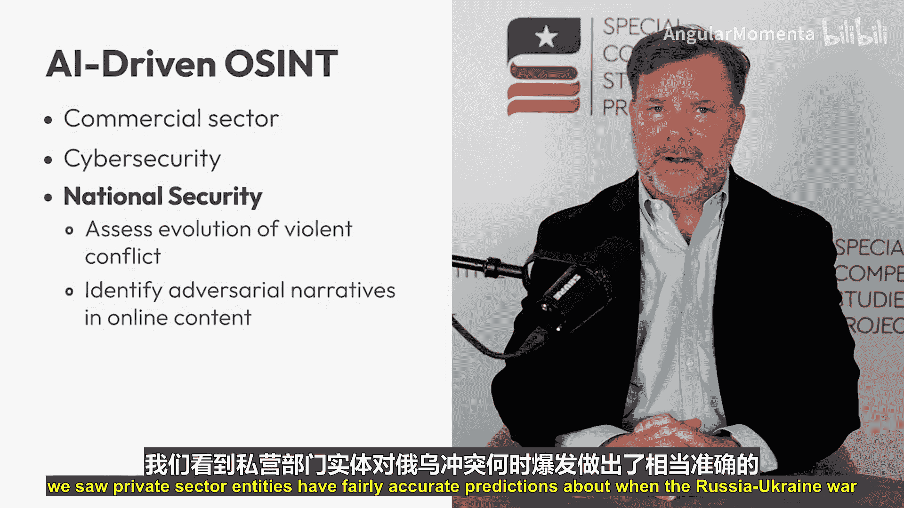
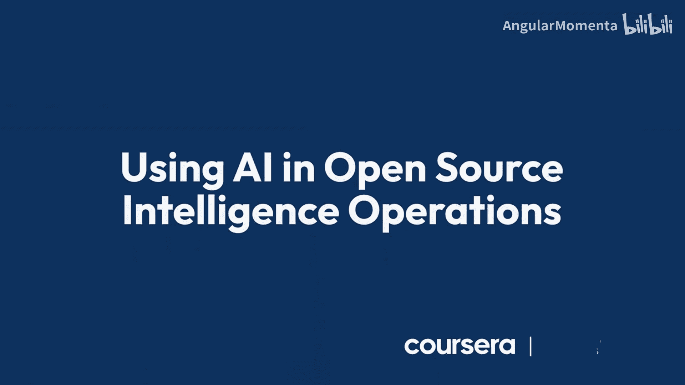

# 【Special Competitive Studies Project】国家安全中的人工智能 p04 01_02_01_using-ai-in-open-source-intelligence-operations -BV1jPrHBsEdy_p4-

Hello， my name is William Usher， and I spent over 30 years working at the Central Intelligence Agency。

In this video， I'm going to discuss how artificial intelligence is revolutionizing the business of intelligence。

 specifically how it is changing， how intelligence services collect and analyze publicly available and commercially available information。

What in the intelligence world we refer to as open source intelligence or OSent？

Let's start with what OSsin is and why it is important。When we think of intelligence work。

 we often think only of clandestine collection。And the data that it's used in the production of highly classified written products like the president's daily brief or closed doors risk briefings。

While that is absolutely an important part of what the intelligence community does， the reality is。

 our threat landscape is ever changing， which requires our methods and sources to adapt as well。

Think for a moment about how social media has become an important source of real time updates on geopolitical events。

That's OSsent right there。Open source intelligencetel is the collection and analysis of publicly and commercially available data to support strategic decision making。

This could include data from social media platforms， news outlets， public and commercial databases。

 satellite imagery， and even online forums。While the US intelligence community has numerous open source intelligence units。

The main work is done by CIA's open source Enterprise and the Defense Intelligence Agency's Open So Integration Center。

Osent also is a growing industry in the commercial sector。In fact。

 on a growing range of issues from Chinese domestic microchip production。

 Russian efforts to evade financial sanctions or terrorist use of cryptocurrency。

Private sector analysts， independent online investigators and academic researchers are doing some of the most cutting edge work。

So what is this cutting edge work coming from？One key answer is artificial intelligence。AI。

 particularly in its forms like machine learning and natural language processing。

Is dramatically improving the efficiency， accuracy and scope of once labor intensive processes。

Used for identifying sources， data collection and cleaning， and even analysis and reporting。

AI also can translate and analyze foreign language reports。

 social media posts and other textual and audio data in real time。

 breaking down language barriers and speeding up the process of gathering actionable intelligence。

For example。National security agencies such as the CIA， FBI and Defense Intelligence Agency。

 use AI powered OScent platforms to monitor geopolitical events。

 track extremist activities and identify emerging threats。

AI algorithm scan social media for signs of unrest or coordinated action。

Spped through thousands of news reports to detect misinformation and even analyzed large volumes of satellite images very quickly to detect movements of troops in military equipment。

As an example， CIA currently uses a platform known as Osiris。

 which leverages a large language model to collate and process copious amounts of publicly available information。

The platform can also generate summaries and allow analysts to directly query or explore scenarios using chatbots。

These summaries can be ready for policymakers far quicker than a manual writing process。

And this is only a starting point for how AI could be used by Western intelligence services。

 And all of this is important because we know our adversaries like China are leveraging the nexus of AI and OSsN to bolster their own military decision making and capabilities。

 particularly when it comes to understanding foreign military capabilities and technological developments。

But it's not just intelligence agencies that benefit from AI driven OScent。In the commercial sector。

 companies are leveraging AI to collect and analyze open source data for a variety of applications。

From market research and competitive intelligence to cyber security and risk management。

And for the I C， it's crucial to keep abreast of commercial developments because they present opportunities to leverage the information out there without having to reinvent the wheel。

In cyberseity， AI driven OScent platforms are scanning for vulnerabilities。

 identifying potential threats before they escalate。

These platforms continuously monitor open source data such as blogs， forums。

 and technical reports for signs of cyber attacks。Or emerging vulnerabilities。

Looking at national security issues more closely， AI driven methods of pattern recognition and predictive analytics have leveraged OSE to draw assessments on the evolution of violent conflicts such as identifying where troops might move and specific geographic regions that are likely to see military action。

As an important example。We saw private sector entities have fairly accurate predictions about when the Russian Ukraine War would start。

Other companies are using AI to make sense of the massive amounts of content posted online every day to identify encounter counter narratives spread by competitors and other adversaries who want to divide and disrupt our societies。

It's important to highlight that the use of AI in OSN is and will always be one piece of the IC's work。

AI could be and likely will be leveraged to support the clandcent work of the IC。In addition。

 it's always crucial to keep in mind that the IC will have to navigate a delicate balance between using publicly available data for security purposes and respecting individual privacy rights。

ButAs you can see， the use of AI for OSE。Is changing intelligence work。

It's allowing agencies and companies to stay ahead of the curve。

 make faster decisions and mitigate risks。In the future。

 we'll see even more powerful tools that can predict emerging threats。

 uncover new opportunities and transform how data is turned into actionable insights。

