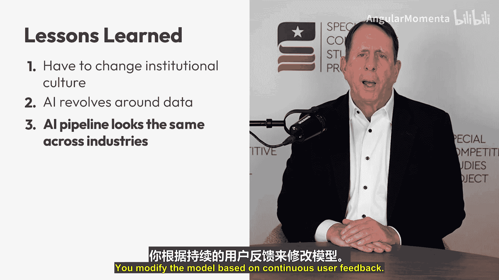
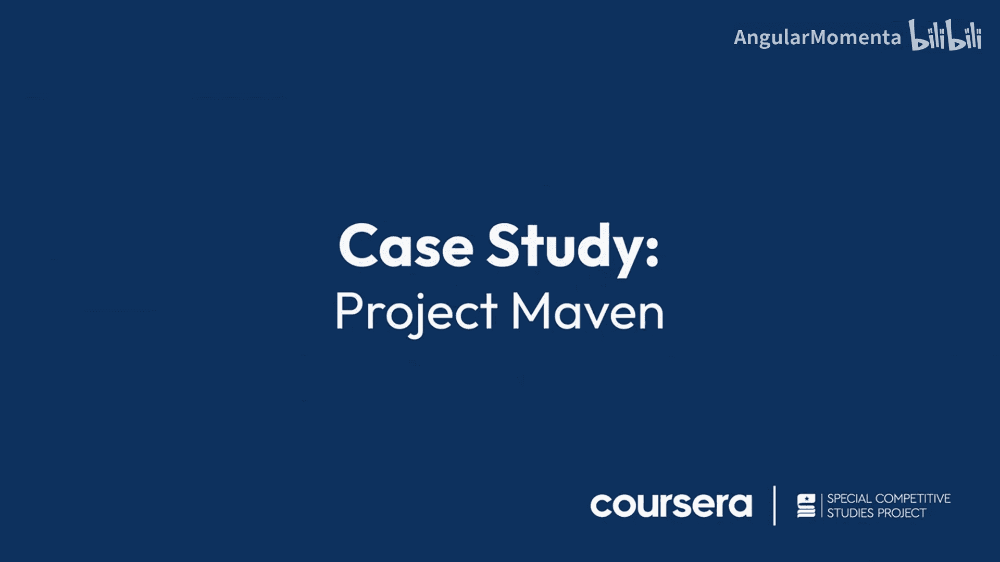

# 【Special Competitive Studies Project】国家安全中的人工智能 p05 01_02_02_case-study-project-maven -BV1jPrHBsEdy_p5-

Hi there， I'm Jack Shanahan， retired Air Force officer。

 I hope this SESP Coursera courseurse on AI financial security represents the beginning of a lifelong AI journey for you。

I want to talk to you about Project maven。 I will describe what it was when we launched our voyage of discoveryovery in 2016。

 the lessons we learned。What Maven looks like today and why I still believe that it represents an AI big bang moment for the Department of Defense。

So why Project maven？In the summer of 2016， while serving in the Pentagon as a three star general in the office of the Underecret of Defense for Intelligence。

I chaired one of our regular intelligence， surveillance， reconnaissance， or ISR， processing。

 exploitation and dissemination， or PE。Executive steering groups。

These meetings provided a forum for senior leaders from across the military services and the intelligence community。

To talk about challenges and opportunities arising from the collection of ever increasing amounts of data from global intelligence platforms and sensors。

From undersea to outer space in all domains in between to include cyberspace and unclassified open source information。

This was a seminal moment for everyone in the room。

It was unanimous agreement that we were experiencing a catastrophic successory。

There was more intelligence collection from more sources。At every classification level。

 than at any previous point in history。Yet it was impossible for analysts to process and analyze so much information。

They were， in short， drowning in data。Was not only a problem of massive volume。

 but also increasing velocity， variety， and even veracity。

It was evident to all of us that we could no longer rely on traditional automation tools。

 better business practices， or that time honored government solution of throwing more and more people at the problem。

We needed to find an entirely new， even revolutionary way of improving effectiveness and efficiencies across every phase of the intelligence cycle。

When the meeting finished， I turned to our innovative， classic disruptor Marine Corps colonel。

 who ran the lower level working group。And asked him to solve the seemingly unsolvable。hi he did。

Less than 10 months later in April， 2017， then Deputy Secretary of Defense Bob Workk。

Formerly established the Alic warfare cross functional team， otherwise known as Project Maven。

 This was the DoD's first program dedicated to operationalizing artificial intelligence and machine learning at speed and at scale。

I was tasked to stand up in Le maven with the explicit direction to accelerate the DoD's integration of big data and machine learning。

And to quote， turn the enormous volume of data available to DoD into actionable intelligence and inciites its speed quote。

Specifically， the maven team's mission was to field AI capabilities to augment， accelerate。

 and automate exploitation analysis of full motion video from unmanned aerial systems or drones。

We were also directed to consolidate existing algorithm based technology projects to include initiatives that developed。

 employed or fielded AI， ML， deep learning， and computer vision algorithms。

Within eight months of standing up， we had delivered the first computer vision models to operational units deployed overseas in combat。

For the Department of Defense， that was light speed， still not nearly fast enough。

But it was remarkable achievement， nonetheless。Over the next year。

 we continue to update fielded models， deploy new ones and branch out into natural language processing。

One of the most important points I want to emphasize is that we did not start with an AI solution in search of a problem。

Instead， we had a problem we knew we could not solve without AI。

That's a key lesson you should never forget It's far too easy to be swayed by AI hype and marketing。

Once you decide to dive into the deep end of the AI pool。

 must always start with the specific problem you are trying to solve。

 whether that's a back office administrative function。

 an analytic challenge or an operational war fighting imperative。

It's hard to describe seven years later。Just how challenging our journey was in those early days。

 Yet every scar we earned paved the way for all future AI projects to include everything we did at the Joint AI Center or the Jake after I left Maven and stood up that organization。

Let me talk about our three most salient lessons learned。First， and in my view， most importantly。

 this was about changing culture。 It was not about any single technology。 Honestly。

 technology these days， mostly a commodity。It was about shaking up the status quo。

 We proved that it was possible to create a startup culture in the institutional bureaucracy。

It's as true now as it has ever been， culture eat strategy for breakfast。 ignore it at your peril。

Next， to underscore the obvious AI revolves around data。

 You cannot talk about AI without starting the conversation with data。 To be honest。

 most AI projects today fail once the people task to lead them。

 graphs the magnitude of the data challenges they face。The enthusiasm tends to fade rapidly。

 What kind of data， Where is it， How good is it， How do you get it， How do you clean it。

 How do you prepare it for use in training an algorithm in turning it into a model and so on。Yes。

 data is a big obstacle to clear， but it's hardly insurmountable。

I can assure you that things are so much better and easier today than we kicked off maven7 years ago。

 There are plenty of commercial companies who can help you solve your data challenges。

You must begin with a data plan， however， and that data plan should always flow directly from your organization's data strategy if your organization doesn't have a data strategy。

 I can assure you it needs one。Third， the good news is that whether you are in the government。

 commercial industry or academia。😊，The AI pipeline or lifecycl looks mostly the same。

 There are no deep secrets to the process。Once you know the problem you're trying to solve。

 you start with data。 You use the data to turn an algorithm into an AI model。You test the model。

 You feel a minimal viable product。 You modify the model based on continuous user feedback。

 and you keep repeating the cycle。

So where is Maven to， Well， there are really two stout branches to the original maven tree。

The official program， what we call a program of record。

 transferred to the National Geosspatial Intelligence Agency last year。

It's going well with plenty of support from the very top。

But as you will see from the additional readings， Maven is now being used as much by the operational community as by intelligence analysts。

 Their feedback has been crucial to continuous improvement。On one hand。

 I am thrilled that so much has happened with Maven since we launched in 2017。😊，On the other hand。

 it is disappointing that it remains one of the few AI projects that have successfully scaled and steadily continued to advance in the government。

We need hundreds of mavens in the government， not one or two。

 My most important charge to all of you is a simple one。 Get going。

 Theres no substitute for getting started on an AI project。

 and for talking with others who have already been down the AI path。

 you should be excited about not daunted by the opportunity to challenge the status quo and dive straight into an AI project。

Maven was the AI Big B for the Department of Defense。

 at least in terms of figuring out how to rapidly field AI capabilities and scale them in terms of technology。

 though， it was like the Wright Brothers flyer， not the Apollo Lunar module。 Yet still。

 America went from the first flight at Kitty Hawk to putting a man on the moon in 66 years。

I hope all of you will walk away from this course with ideas about how to accelerate the adoption of AI across the government over the next few years。

 It is one of the most exciting times in recent history。

 but we cannot afford to wait another 66 years。😊，To get it right。

Thanks again for taking this course and good luck on your AI journey。

