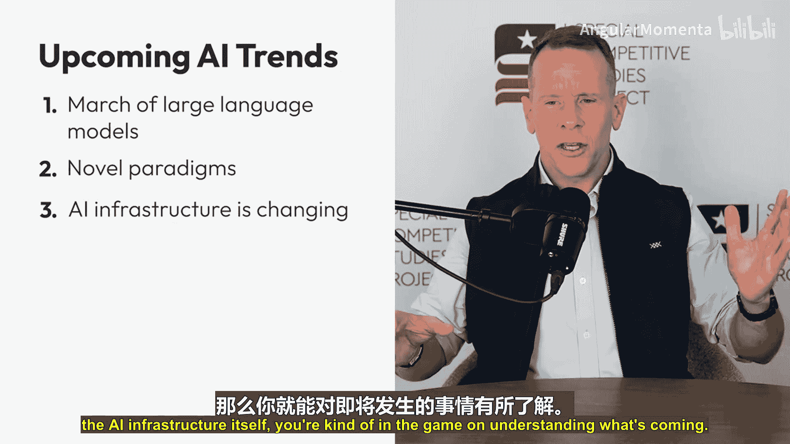
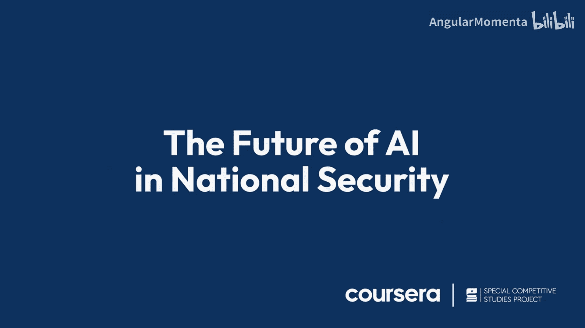

# 【Special Competitive Studies Project】国家安全中的人工智能 p06 01_03_01_the-future-of-ai-in-national-security -BV1jPrHBsEdy_p6-

Hi， everyone。 I'm Pj。 Makeish， and it's my pleasure to be here with you today to think about the future of AI and how it might intersect with your work。

 But the opportunity to study AI for the last 10 years directly and indirectly。

 started with something in the Pentagon called the third offset from 2015 to 2017。

 marching all the way forward to my time on staff at the National Security Commission on Artificial Intelligence。

 So this is an amazing subject。 I love thinking about it with people and what I want to offer today。

 are two basic ways。 you might stay ahead of the T of AI and how you might think about the trends of AI。

 because they are changing literally daily。 So how does a worker stay ahead of what's coming next。

 We're all kind of in that together。 And so I want to offer two basic ways to maybe think about it。

 And hopefully they're helpful。😊，The first one I want to talk through is that you're dealing with a general purpose technology。

 so let's talk about what does that mean and why might that be a helpful way to think about AI And second。

 there are not one or two but three big trends shaping the future of AI and I think we can talk about them in simple ways that'll help us just wrap our minds around the daily changes to help you stay ahead of the curve。

 So number one， let's think about general purpose technologies。

They are things like machines and the machine age or electricity and the age of electrification。

 When general purpose technologies come to the earth， they tend to remain。

 and they subend most functions of society On this chart， what you see is the steady march of。

Let's say5 general purpose technologies in the machine age。

 we might think of the beginning of this as the steam engine in 1780 at their machines are still with us today。

 In fact， I want to show you this one。What you're looking at now is the National Iition facilityac。

 This is a machine in which we created a star for a billionth of a second and released over one megajoule of net positive energy at Lordre's Livermore Lab。

It would have been very difficult to imagine the nis when the steam engine was created in 1780。

Likewise。The picture you're looking at now is a picture of the Earth electrified。

But when Nikcol O Tesla was heads down on his lab bench。

 just trying to create alternating current in a battery。

 it would have been very difficult for him to imagine this scene you're seeing。

 the completely electrified world because A C current enabled the creation of electrical grids。

So the first point is that you are dealing with and we are all navigating a general purposepose technology。

 something that is so broadly useful that we don't even know how to fully wrap our minds around the changes that will be。

 We just know that when we're dealing with the general purpose technology， it's here to stay。

 they tend to stick， and they tend to stack， which means is they combine with one another to create new forms of innovation that you can't even imagine yet。

So that's point number one。What number two about trying to stay ahead of the curve is just to basically know the trends that are coming up。

 So there's three real trends to know about。 Number one is the march of the large language models。

 This is the creation of the models that were interacting with， they're very useful for work。

 they're getting better each year， They're changing in levels of their generalness。

 which is how good they are at multiple tasks。 And that will reach what's called something like the scaling laws。

 which is how long will these models improve， And so they're no longer cost effective to operate。

 And whether there is a wall or not。 they will grow to some useful cost point。

 where they just get better and better at some point of usefulness that will always have。Number 2。

 there's forms of AI， we might call novel paradigms that have nothing to do with large language models per se。

 They are things like the ability to create agents and agents are processing loops of algorithms that perform a task for you repeatedly with some degree of autonomous behavior like they work for you。

And the ability to create multi agent teams is already here on the earth， in fact。

 you will be able to create agents for yourself with increasing ease as time goes by。

But those agents will start to have something like human memory where they can remember their interactions with you。

 they will also start to have something like the ability to learn with a few repetitions in the gym instead of many。

 we call this few shot learning。And so those things I just described， which is agent AI。

 AI with something like human memory and something like the ability to learn like humans。

 Those are novel paradigms。 They will combine with trend1 and they will operate on their own autonomously。

 So just know that those paradigms are always emerging。

 you'll see new ones in your career and just know that when you hear about you're like， oh。

 that's probably a new paradigm。 You get to basically understand how it might impact your work and you drive on from there。

 Numb3， the whole AI infrastructure is changing。 And that's a third megatrend。Data。

 data science data centers， the ability to do compute and advanced compute all the way up to quantum computing networks and advanced networks like optical networks。

 and energy like fusion energy or driving down the cost of it so that these models are easier and cheaper to operate。

 All of those are having their own innovation underneath the AI stack。

 and that's its own trend to understand。 So you'll constantly see evolution in the AI stack。

 you'll see new paradigms and you'll see these models behave differently。

 And if you just understand those three basic trends， the models， the paradigms。

 the AI infrastructure itself， you're kind of in the game on understanding what's coming。

So in review， no one really knows where it's going。

 We just know it's going to be highly useful for work。 It is constantly evolving。

 And one way to think about that is you're on a journey to really deal with a general purposese technology and we're all in that together。

 And then there's more than one trend at play。 If you're able to identify them in the news。

 get a basic sense of where they're going。 You will be like the AI enabled worker who's able to dominate in that space and make yourself increasingly effective in your mission。

 So we're on that journey together。 I hope that's helpful to just think about where AI is going。

 And we are totally on that journey together all the best to you as you continue to learn how to incorporate AI in your work。

 Thank you so much。😊。

