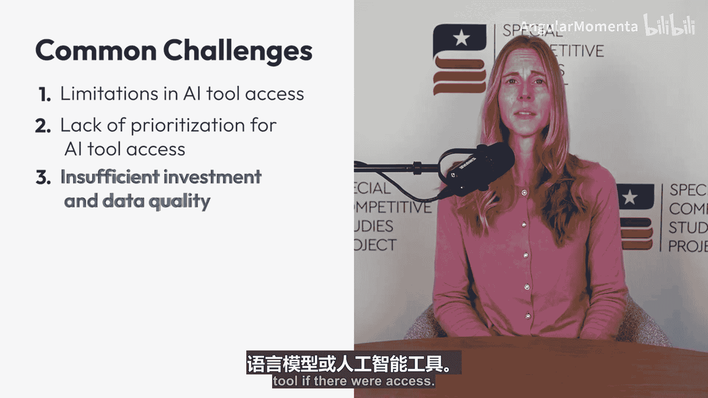
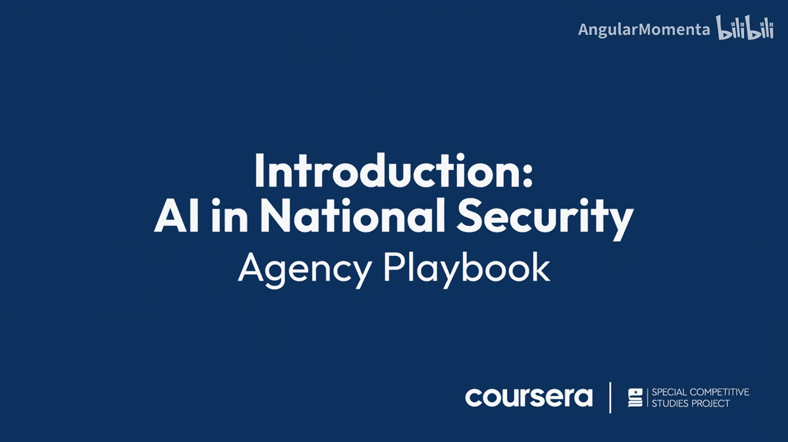

# 【Special Competitive Studies Project】国家安全中的人工智能 p09 04_01_01_introduction-ai-in-national-security-agency-playbook -BV1jPrHBsEdy_p9-

Hi， I'm Diana Gellhaus and congratulations for making it to Moule4。

If the last module was about leveraging AI tools to enhance individual productivity。

 this module is about leveraging AI tools to advance organizational goals。In this module。

 we will address the following questions。One， why aren't AI tools already adopted at scale in my organization and two。

 what can I do to be a change agent for my organization by designing and implementing an AI playbook？

Let's start with unpacking the problem。If you are wondering why AI tools are not widely available or adopted in your organization。

 you're not alone。Here are some common challenges and barriers as to why AI tools are not your organizational norm。

First， limitations in AI tool access at your organization。

 including no proprietary instance or sensitive data。Second。

 a lack of prioritization for AI tool access and adoption at the department or organizational level。

 or simply support from senior leadership。Third， insufficient investment in data architecture or data quality。

 or both， to even use an LLM or AI tool if there were access。

Fourth， a patchwork of inconsistent or unclear AIU's policies and strategies。

 particularly when there are multiple offices or stakeholders that have relevant authorities。

And fifth， a workforce that is not data or AI ready， nor incentivized to be。Of course。

 the issue could be one or a combination of these。You should take away from this module that you can be a change agent to advance your organization and mission。

 no matter where you sit or what your role is。This module will help you work through creating an AI playbook and determine some productive actions you can take now as next steps。

