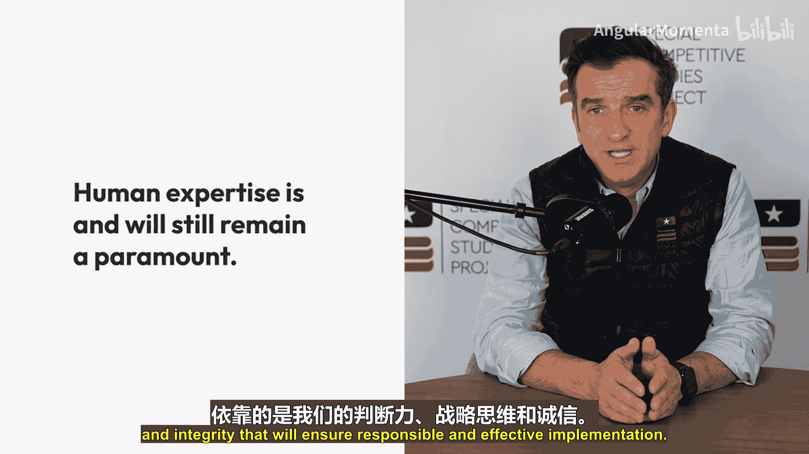
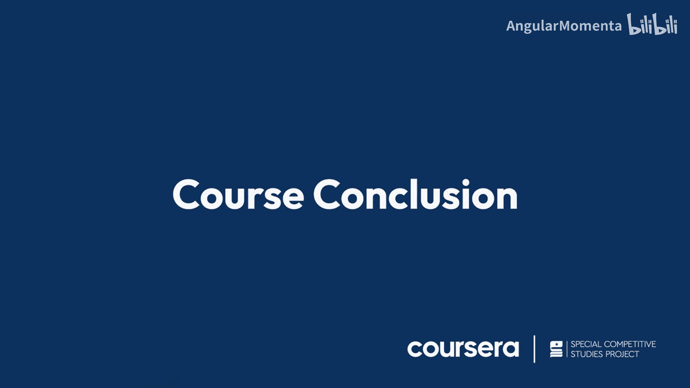

# 【Special Competitive Studies Project】国家安全中的人工智能 p10 04_02_05_course-conclusion -BV1jPrHBsEdy_p10-

Thank you for joining us on this journey on AI and national security。

Integrating artificial intelligence into public sector missions。

I hope together we explored how AI can streamline processes。

 accelerate decision making and enhance collaboration。

We examined real world examples of how these powerful tools can improve operational efficiency and empower you to achieve more in your role。

Before I wrap up， I want to emphasize one key takeaway。

Human expertise is and will still remain a paramount。AI amplifies our capabilities。

 but it's our judgment， strategic thinking and integrity that will ensure responsible and effective implementation。

 I encourage you to continue advocating for your AI adoption in your own teams and organizations。

Applying the lessons you have learned here to drive innovation without compromising security。Again。

 thank you for your dedication and engagement。 I look forward to seeing how you bring these insights to life in your mission to safeguard our national security。

😊，Congratulations on completing this course。

