# sjtu_se_101_ics1


## 计算机系统导论

## 课程大纲

- 授课教师
- 教材与评分
- 课程动机
- 推荐阅读
    - 前言第7~9页（第10~20页选读）

## 助教团队

- 陈榕
- 侯君、刘宇宸、成立、闵师达
- 上机课：
    - 单周13:30～15:30
    - 软件楼报告厅、机房

## 教材与网站

- Randy Bryant 和 David O'Hallaron，
    - *《计算机系统：程序员视角》*
    - *第2版*
    - Prentice Hall，2011年。
- Brian Kernighan 和 Dennis Ritchie，
    - *《C程序设计语言（第二版）》*
    - Prentice Hall，1988年
- http://ipads.se.sjtu.edu.cn/courses/ics/

## 为第一次辅导课（周三）做准备

- 从FTP下载（临时）
    - 地址：ftp://202.120.40.125:4321
        - 用户名：student
        - 密码：student
    - VMware Player（免费）：VMware-player-4.0.2-591240.exe
        - 或从 www.vmware.com 获取
    - 虚拟机镜像：VM-stu
    - Linux镜像：debian-6.0.3-i386-CD-1.iso
- 参见课程页面中的相关幻灯片
    - http://ipads.se.sjtu.edu.cn/courses/ics/schedule.shtml

## 评分标准

- 考试（60%）
    - 期中（20%）
    - 期末（40%）
    - 所有考试均为开卷/开笔记。
- 实验（35%）
    - 7次实验（25%），（每次3%-8%）
    - 实验2和实验3机考（10%）
- 作业（5%）

## 理解供给与需求

## 2018年前STEM领域年度职位空缺与大学毕业生人数对比


数据来源：美国劳工统计局就业预测，2008-2018（http://www.bls.gov/emp/ep_table_102.pdf），国家科学基金会科学资源统计处（http://www.nsf.gov/statistics/nsf08321/tables/tab5.xls），以及国家教育统计中心（http://nces.ed.gov/programs/digest/d08/tables/dt08_286.asp）

## 扩大计算机科学的覆盖面

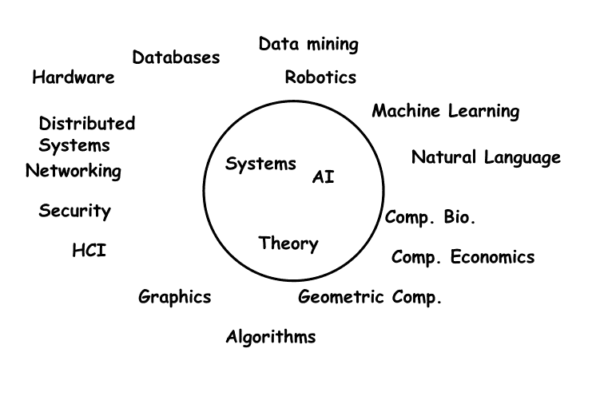

## 计算机科学学生以往所见的覆盖面

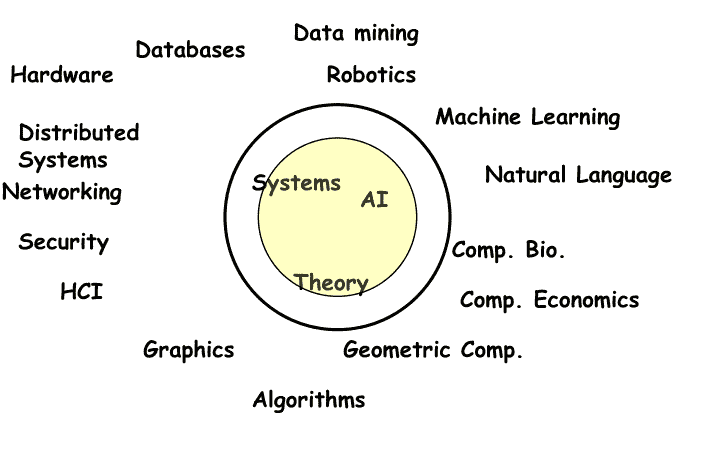

## 不同方向允许更深层次学习...

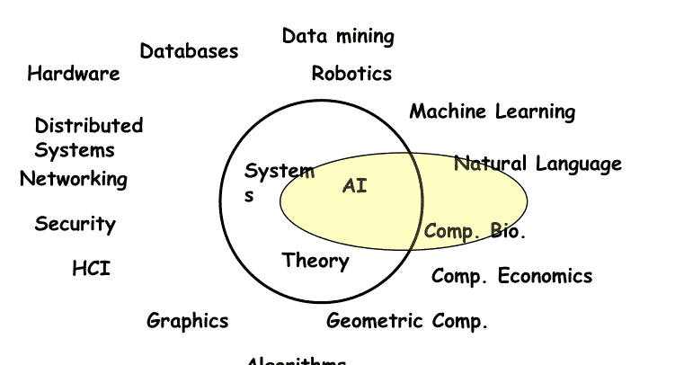

所覆盖材料的总量必须保持不变

## ...在更多样化的领域

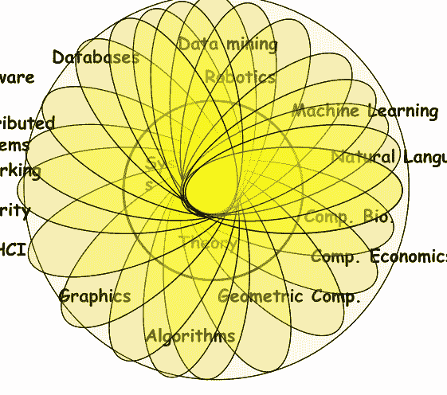

## 总体潜在覆盖面更大

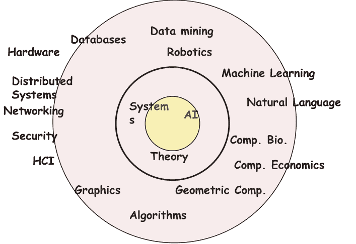

所有学生都会学习的核心材料经过精简，以便容纳更多内容

## “大帐篷”计算机科学

- 电气工程
- 硬件
- 数据库
- 分布式系统
- 网络
- 安全
- 设计
- 人机交互
- 心理学
- 图形学
- 艺术
- 算法
- 几何计算
- 理论
- 系统
- 人工智能
- 数据挖掘
- 机器人
- 机器学习
- 自然语言处理
- 计算生物学
- 计算经济学
- 统计学
- 语言学
- 生物学
- 经济学

## 修订后的课程结构：核心

### 理论核心：5门课程

- 逻辑
- 计算基础
- 数据结构与算法
- 算法
- 概率论

### 系统核心：6门课程

- 程序设计
- 计算机系统基础(1) & (2)
- 计算机系统工程
- 数据库
- 软件工程


## 系统方向课程

- 操作系统
- 体系结构
- 编译器
- 分布式系统
- 计算机系统工程
- 计算机系统导论

### 计算机系统的层次

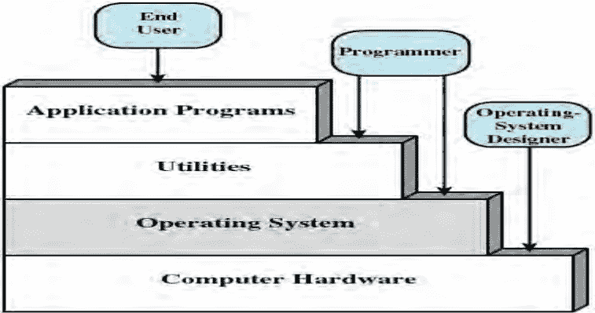

**图2.1 计算机系统的层次与视角**

## 为什么要学习计算机系统？

- 大量系统公司
    - 微软、谷歌、IBM、EMC、思科、VMware
    - 谷歌的核心是什么？
        - 谷歌集群、GFS、MapReduce、BigTable
    - 扎实的系统知识是你在这类公司和顶尖大学获得好offer/晋升的必要条件

## 我们现在在哪里？

- 程序设计是现代大多数系统的核心
    - 计算机系统
    - 嵌入式设备：手机、汽车控制等
    - 电子设备：数字信号处理器、可编程控制器
- 程序员必须理解他们的机器及其局限性
    - 正确性：计算机算术、存储分配
    - 效率：内存与CPU性能


## 我们在哪里？
- 从抽象到细节（现实）
- 从应用层到系统层
- 从 C++ 到 C

## 本课程的特点
- 持久的概念
- 从程序员的角度出发
- 主动学习
- 成为稀有的“ power programmer ”

## 持久概念
- 计算机系统由协同工作以运行程序的硬件和系统软件组成
- 系统的具体实现会随时间变化
- 但底层概念不会
- 所有计算机系统都有执行相似功能的相似硬件和软件组件

## 从程序员的角度
- 而不是系统设计者的角度
  - 很少有学生有机会构建一个计算机系统
  - 教每个计算机科学家如何设计微处理器是浪费的
  - 如何构建的知识并不能转化为如何使用的知识

## 从程序员的角度
- 它只涵盖会影响
  - 用户级 C 程序的正确性、性能或实用性的主题
- 对系统采取更广泛、更现实的观点
  - 计算机硬件是什么
  - 现代计算机如何工作

## 主动学习
- 新概念后面跟着实践问题
- 家庭作业问题和实验也是真实的
- 通过实践学习
  - 处理具体问题
  - 在真实系统上编写和运行程序
- 实用、具体、动手且令人兴奋

## 成为稀有的“Power Programmer”
- 通过对以下内容的理解而启发
  - 底层计算机系统
  - 以及它对你的应用程序的影响
- 你知道
  - 事物如何工作以及
  - 它们损坏时如何修复

## 本书的缺点
- 这本书是由著名的教授编写的
- 这本书中的材料非常好
- 然而，这本书对中国学生来说组织得不够好
  - 有些部分过于冗长
  - 一些重要思想没有得到强调
- 你最好按照我的指示阅读这本书

祝好运！

## 计算机系统概述

## 大纲
- 计算机系统的层次
- 建议阅读
  - 前言 7-8，1.2，1.4.1，1.7（1.7.1之前），1.7.3，1.8，1.9.1（第一段），第1章中的4个旁注

## 计算机系统的层次
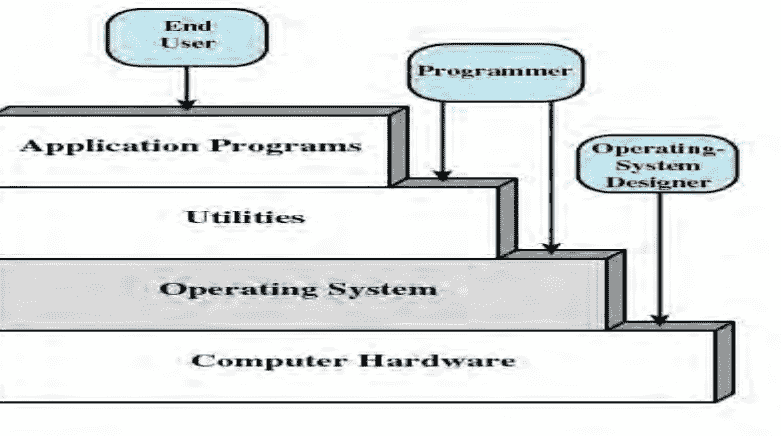
Figure 2.1 Layers and Views of a Computer System

## 计算机硬件 - Von Neumann 架构
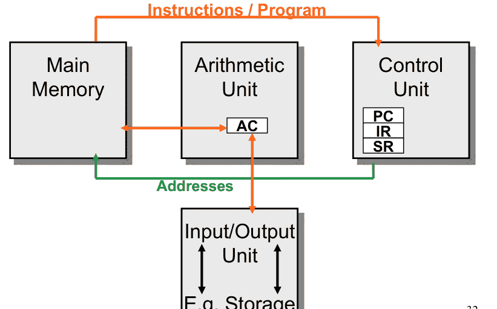

## EDVAC

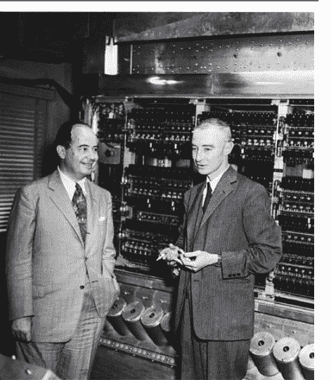

## IA-32
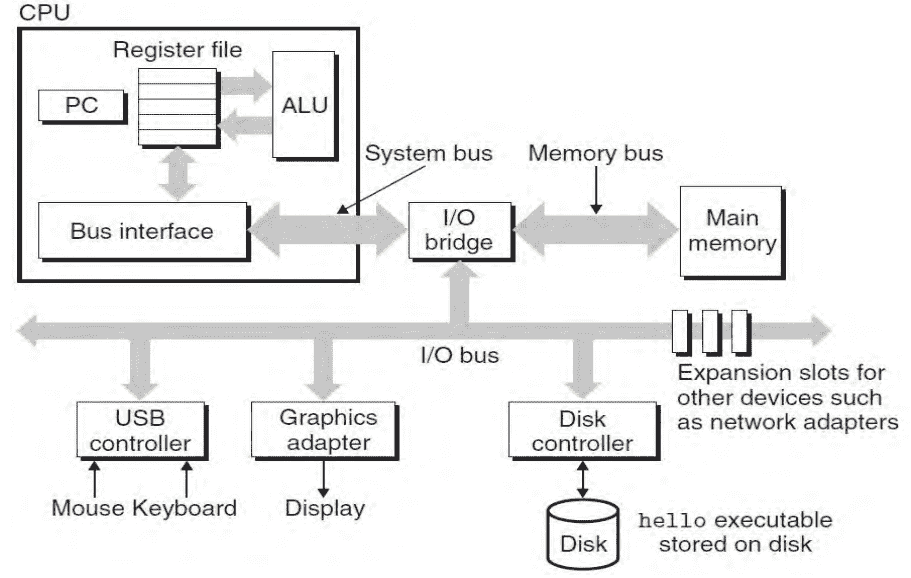

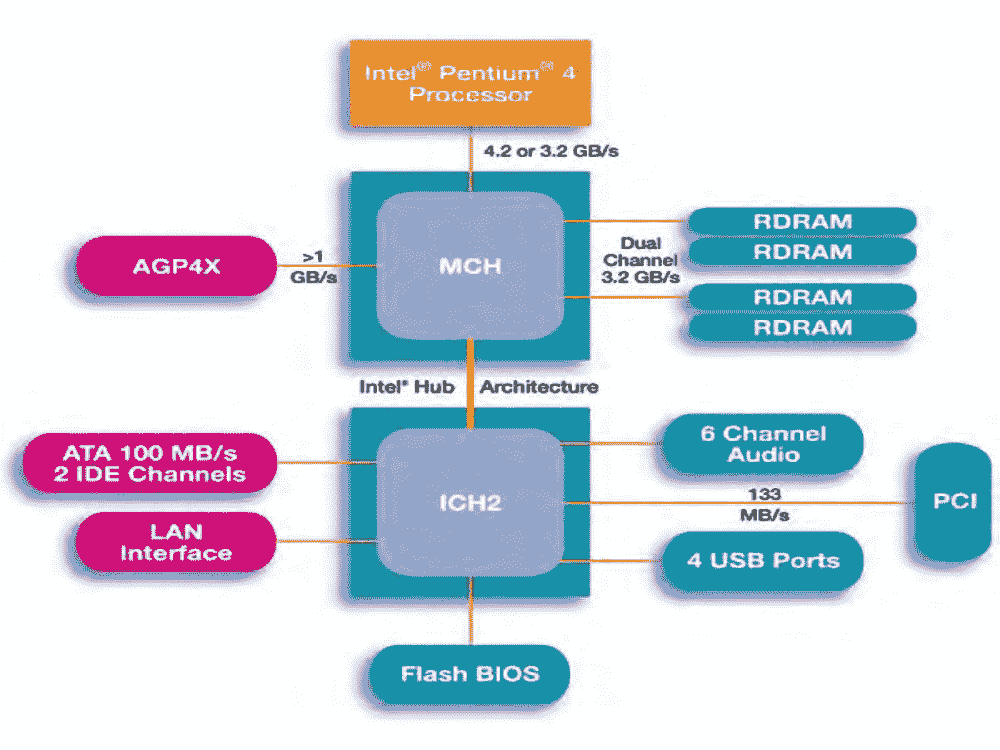

## Intel® Core™ i7 处理器家族
DDR3 memory 8.5 Gb/s

DDR3 memory 8.5 Gb/s

DDR3 memory 8.5 Gb/s

QPI (25.6 GB/s)

## X58 IOH
PCI Express* 2.0 Graphics
Support for
Multi-card configurations:
1x16, 2x16, 4x8 or
other combination

up to 36 lanes

2 GB/s DMI

## ICH10 ICH10R
12 HI-Speed USB 2.0 Ports; Dual EHCI; USB Port Disable

480 Mb/s each

6 PCI Express* x1

500 MB/s each x1

Intel® Integrated 10/100/1000 MAC

GCI | LCI

Intel® Gigabit LAN Connect

Intel® High Definition Audio

3 Gb/s each

6 Serial ATA Ports; eSATA; Port Disable

Intel® Matrix Storage Technology

Intel® Turbo Memory with User Pinning

LPC or SPI

BIOS Support

Intel® Extreme Tuning Support

Optional

## Intel® X58 Express Chipset Block Diagram

## 操作系统
- 1960 年代
  - IBM OS/360, Honeywell Multics,
- Fernado Jose Corbató
  - IEEE Computer Pioneer Award, 1982
  - ACM Turing Award, 1990


## Linux
- 1991, Linus Torvalds
- Unix-like operating systems
- 386(486)AT, bash(1.08), gcc(1.40)
- Posix complaint version of Unix operating system
- Available on a wide array of computers
  - From handheld devices to mainframe computers
  - wristwatch


## 我们已经见过许多操作系统


## 编译

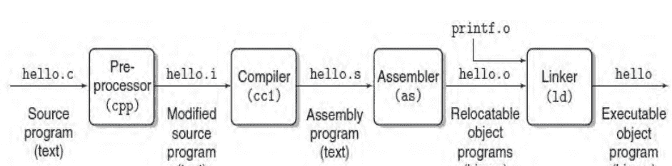

## GNU

- 自由软件
- Richard Stallman，1984年
- 一个带有源代码的完整类 Unix 系统
- 一个环境
  - Unix 操作系统的主要组件
  - 除了内核


## C 编程语言

- **C** 是由
  - 1969 年至 1973 年
  - 贝尔实验室的 Dennis Ritchie 开发的。
- 美国国家标准学会 ANSI
  - 于 1989 年批准了 ANSI C 标准。
- 该标准定义了
  - C 语言
  - 以及一套被称为 *C 标准库* 的库函数。

## C 编程语言

- Kernighan 和 Ritchie 在他们的经典著作中描述了 ANSI C
  - 该书 affectionately 被称为 "K&R"。
- 用 Ritchie 的话说，C 是
  - 古怪的，
  - 有缺陷的，
  - 并且取得了巨大的成功。
- 为什么会成功？

## C 编程语言

- *C 与 Unix 操作系统紧密相连*
  - C 从一开始就被开发为 Unix 的系统编程语言。
  - 大部分 Unix 内核，以及所有支持工具和库，都是用 C 编写的。

## C 编程语言

- *C 与 Unix 操作系统紧密相连*
  - 随着 Unix 在 1970 年代末和 1980 年代初在大学中变得流行，许多人接触到了 C 并发现他们喜欢它。
  - 由于 Unix 几乎完全用 C 编写，因此可以轻松移植到新机器上，这为 C 和 Unix 都创造了更广泛的受众。

## C 编程语言

- *C 是一种小巧、简单的语言。*
  - 设计由一个人控制，而不是委员会，结果是一个干净、一致的设计，负担很少。
  - K&R 书籍仅用 261 页就描述了完整的语言和标准库，并附有大量示例和练习。
  - C 的简单性使其相对容易学习并移植到不同的计算机上。

## C 编程语言

- *C 是为实际目的而设计的。*
  - C 是为实现 Unix 操作系统而设计的。
  - 后来，其他人发现他们可以用它编写想要的程序，而语言不会成为阻碍。

## C 编程语言

- C 是系统级编程的首选语言
- 也有庞大的应用级程序安装基础。

## C 编程语言

- 然而，它并不适合所有程序员和所有情况
  - C 指针是常见的混淆和编程错误来源
  - C 也缺乏对类和对象等有用抽象的显式支持
  - C++ 和 Java 等更新的语言解决了应用级程序的这些问题


## 网络
- 计算机通过网络连接

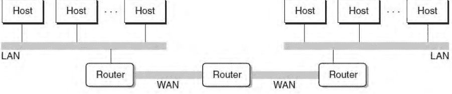

## 云
- 计算机系统支持云计算


## 平台
- 硬件平台
  - Intel IA-32/x86-64
- 操作系统
  - Linux
- 编程语言
  - ANSI C
- 工具
  - GNU
- 网络
  - TCP/IP、套接字

## 重要主题
- 并发与并行
  - 并发：多个同时发生的活动
  - 并行：利用并发来使系统运行得更快
- 抽象

内核虚拟内存

用户代码不可见的内存

用户栈
（运行时创建）

共享库的内存映射区域

printf 函数

运行时堆
（由 malloc 在运行时创建）

读写数据

只读代码和数据

从 hello 可执行文件加载

0x08048000 (32)
0x00400000 (64)

0

## 信息的表示（1）

## 大纲
- 位与字节
- 理解数的机器表示
- 推荐阅读
  - 1.1, 2.1.1

## 为什么用位？
- 现代计算机存储和处理
  - 信息以二值信号表示
  - 这些不起眼的二进制数字就是位
- 位构成了数字革命的基础

## 十进制表示法
- 基数为 10
- 已使用了 1000 多年
- 起源于印度
- 12 世纪由阿拉伯数学家改进
- 13 世纪由意大利数学家 Leonardo Pisano 传入西方
  - 更为人熟知的名字是斐波那契

## 为什么用位？
- 使用十进制计数法对拥有十根手指的人类来说很自然
- 但在构建存储和处理信息的机器时，二进制值效果更好

## 为什么用位？

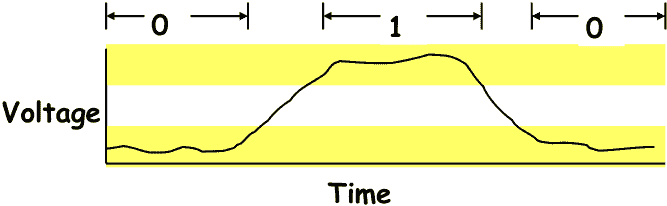


## 为什么用位？
- 用于存储二值信号并执行计算的电子电路非常简单可靠
- 这使得制造商能够将数百万个这样的电路集成到单个硅芯片上

## 位的分组
- 单独一个位并不是很有用
- 英语字母表中有 26（或 52）个字符，它们单独存在时也不是很有用
- 然而，英语词汇中却有大量单词。这是如何实现的？
- 类似地，我们可以通过使用_位_（而不是单个位）来表示任意有限集合的元素

## 位的分组
- 要做到这一点，我们
  - 先把位组合在一起
  - 然后对不同位模式应用某种*解释*
    - 从而为每种模式赋予含义
- 8 位一组构成一个字节
  - 1956 年 7 月，Werner Buchholz 博士
  - 在 IBM Stretch 计算机的早期设计阶段提出


## 位的值
位        01010
值        0*2^4+1*2^3+0*2^2+1*2^1+0*2^0 = 10

值        102 (1100110)
位        102 = 51*2 + 0  (0)
51   = 25*2 + 1  (1)
25   = 12*2 + 1  (1)
12   = 6*2 + 0  (0)
6    = 3*2 + 0  (0)
3    = 1*2 + 1  (1)
1    = 0*2 + 1  (1)

## 将位组合为数——三种编码
- 无符号编码
  - 表示大于或等于 0 的数
  - 使用传统的二进制表示
- 二进制补码编码
  - 表示正数或负数最常用的方式
- 浮点编码
  - 用于表示实数的科学计数法的二进制版本

## 将位组合为数——理解数
- 数的机器表示并不等同于
  - 整数和实数
- 它们是整数和实数的有限近似
  - 有时，它们会以意想不到的方式表现

## 'int' 不是整数
- 溢出
  - 200*300*400*500 = -884,901,888
  - 一组正数的乘积却产生了负数结果
- 交换律与结合律仍然成立
  - (500 * 400) * (300 * 200)
  - ((500 * 400) * 300) * 200
  - ((200 * 500) * 300) * 400
  - 400 * (200 * (300 * 500))


## 'float' 不是真正的数字

- 正数集合的乘积为正数
- 溢出和下溢
- 结合律不成立
  - (3.14+1e20)-1e20 = 0.0
  - 3.14+(1e20-1e20) = 3.14

## 十六进制

- 基数 16 的数字表示
- 使用字符 '0' 到 '9' 和 'A' 到 'F'
- 在 C 中写 FA1D37B₁₆ 为
  - 0xFA1D37B 或
  - 0xfa1d37b

## 十六进制

- 字节 = 8 位
  - 二进制 00000000₂ 到 11111111₂
  - 十进制：0₁₀ 到 255₁₀
  - 十六进制 00₁₆ 到 FF₁₆

| 十六进制 | 十进制 | 二进制 |
|---|---|---|
| 0 | 0 | 0000 |
| 1 | 1 | 0001 |
| 2 | 2 | 0010 |
| 3 | 3 | 0011 |
| 4 | 4 | 0100 |
| 5 | 5 | 0101 |
| 6 | 6 | 0110 |
| 7 | 7 | 0111 |
| 8 | 8 | 1000 |
| 9 | 9 | 1001 |
| A | 10 | 1010 |
| B | 11 | 1011 |
| C | 12 | 1100 |
| D | 13 | 1101 |
| E | 14 | 1110 |
| F | 15 | 1111 |

## 十六进制 vs. 二进制

0x173A4C

十六进制    1    7    3    A    4    C

二进制    0001 0111 0011 1010 0100 1100

1111001010110110110011

二进制        11 1100 1010 1101 1011 0011

十六进制    3    C    A    D    B    3

0x3CADB3

## 十六进制 vs. 十进制

十六进制　　0xA7
十进制　　　　10*16+7 = 167

十进制　　　　314156 = 19634*16 + 12 (C)
　　　　　　　　19634 = 1227*16 + 2 (2)
　　　　　　　　1227 = 76*16 + 11 (B)
　　　　　　　　76 = 4*16 + 12 (C)
　　　　　　　　4 = 0*16 + 4 (4)
十六进制　　0x4CB2C

## 十六进制 vs. 二进制

- 0x39A7F8 ->
  0011 1001 1010 0111 1111 000
- 1100100101111011 -> C97B
- 0xD5E4C -> 1101 0101 1110 0100 1100
- 1001101110011110110101 -> 2 6 E 7 B 5

## 十进制、十六进制、二进制

| 十进制 | 二进制 | 十六进制 |
|---|---|---|
| 167 | 10100111 | 0xA7 |
| 62 | 00111110 | 0x3E |
| 188 | 10111100 | 0xBC |
| 3*16+7=55 | 0011 0111 | 0x37 |
| 8*16+8=136 | 1000 1000 | 0x88 |
| 15*16+3=243 | 1111 0011 | 0xF3 |
| 5*16+2=82 | 01010010 | 0x52 |
| 10*16+12=172 | 10101100 | 0xAC |
| 14*16+7=231 | 11100111 | 0xE7 |

## C 编程语言 (1)

## 大纲

- 示例代码
- 简介
- 编译器驱动
- 汇编代码和目标代码
- 建议阅读
  - 1.2, 2.1.3

## "Hello world" 示例

```
1 #include <stdio.h>
2
3 int main()
4 {
5     printf("hello, world\n");
6 }
```

头文件

标准库

## 文件包含和宏替换

```
a.c
#include "b.h"

main()
{
    return i+j;
}
```

```
b.h
#define i 100
int j;
```

```
int j;

main()
{
return 100 + j;
}
```

宏替换

## 文件包含和宏替换

- #include "filename"
- #include <filename>
- #define forever for(;;) /* infinite loop */
- #define square(x) (x)*(x)

## C 中的整型数据类型

- C 中有几种数据类型表示整数
- 区别在于整数的大小
- 它反映了硬件的实现

| C 声明 | 典型大小 |
|---|---|
| char | 1 字节 |
| short | 2 字节 |
| int | 4 字节 |
| long long | 8 字节 |

## 格式化输出 - Printf

- `int printf(char* format, arg1, arg2, ...)`
- `printf("%d, %d\n", i, j);`
- `%d, %i`　十进制数字
- `%o`　八进制数字（无前导零）
- `%x, %X`　十六进制数字
- `%c`　单个字符

## Hello 程序

```
1   #include <stdio.h>
2
3   int main()
4   {
5       printf("hello, world\n");
6   }
```

## Hello 程序

- 源程序
  - 由编辑器创建并保存为文本文件（完全由 ASCII 字符组成）
  - 二进制文件
    - 非文本文件
- 开始时为高级 C 程序
  - 可以被人类阅读和理解
- 个别的 C 语句必须由编译器驱动翻译
  - 以便 hello 程序可以在计算机系统上运行

| Dec | Hx | Oct | Char | Dec | Hx | Oct | Html | Chr | Dec | Hx | Oct | Html | Chr | Dec | Hx | Oct | Html | Chr |
|---|---|---|---|---|---|---|---|---|---|---|---|---|---|---|---|---|---|---|---|
| 0 | 0 | 000 | NUL (null) | 32 | 20 | 040 | & #32; | Space | 64 | 40 | 100 | & #64; | @ | 96 | 60 | 140 | & #96; | ` |
| 1 | 1 | 001 | SOH (start of heading) | 33 | 21 | 041 | & #33; | ! | 65 | 41 | 101 | & #65; | A | 97 | 61 | 141 | & #97; | a |
| 2 | 2 | 002 | STX (start of text) | 34 | 22 | 042 | & #34; | " | 66 | 42 | 102 | & #66; | B | 98 | 62 | 142 | & #98; | b |
| 3 | 3 | 003 | ETX (end of text) | 35 | 23 | 043 | & #35; | # | 67 | 43 | 103 | & #67; | C | 99 | 63 | 143 | & #99; | c |
| 4 | 4 | 004 | EOT (end of transmission) | 36 | 24 | 044 | & #36; | $ | 68 | 44 | 104 | & #68; | D | 100 | 64 | 144 | & #100; | d |
| 5 | 5 | 005 | ENQ (enquiry) | 37 | 25 | 045 | & #37; | % | 69 | 45 | 105 | & #69; | E | 101 | 65 | 145 | & #101; | e |
| 6 | 6 | 006 | ACK (acknowledge) | 38 | 26 | 046 | & #38; | & | 70 | 46 | 106 | & #70; | F | 102 | 66 | 146 | & #102; | f |
| 7 | 7 | 007 | BEL (bell) | 39 | 27 | 047 | & #39; | ' | 71 | 47 | 107 | & #71; | G | 103 | 67 | 147 | & #103; | g |
| 8 | 8 | 010 | BS (backspace) | 40 | 28 | 050 | & #40; | ( | 72 | 48 | 110 | & #72; | H | 104 | 68 | 150 | & #104; | h |
| 9 | 9 | 011 | TAB (horizontal tab) | 41 | 29 | 051 | & #41; | ) | 73 | 49 | 111 | & #73; | I | 105 | 69 | 151 | & #105; | i |
| 10 | A | 012 | LF (NL line feed, new line) | 42 | 2A | 052 | & #42; | * | 74 | 4A | 112 | & #74; | J | 106 | 6A | 152 | & #106; | j |
| 11 | B | 013 | VT (vertical tab) | 43 | 2B | 053 | & #43; | + | 75 | 4B | 113 | & #75; | K | 107 | 6B | 153 | & #107; | k |
| 12 | C | 014 | FF (NP form feed, new page) | 44 | 2C | 054 | & #44; | , | 76 | 4C | 114 | & #76; | L | 108 | 6C | 154 | & #108; | l |
| 13 | D | 015 | CR (carriage return) | 45 | 2D | 055 | & #45; | - | 77 | 4D | 115 | & #77; | M | 109 | 6D | 155 | & #109; | m |
| 14 | E | 016 | SO (shift out) | 46 | 2E | 056 | & #46; | . | 78 | 4E | 116 | & #78; | N | 110 | 6E | 156 | & #110; | n |
| 15 | F | 017 | SI (shift in) | 47 | 2F | 057 | & #47; | / | 79 | 4F | 117 | & #79; | O | 111 | 6F | 157 | & #111; | o |
| 16 | 10 | 020 | DLE (data link escape) | 48 | 30 | 060 | & #48; | 0 | 80 | 50 | 120 | & #80; | P | 112 | 70 | 160 | & #112; | p |
| 17 | 11 | 021 | DC1 (device control 1) | 49 | 31 | 061 | & #49; | 1 | 81 | 51 | 121 | & #81; | Q | 113 | 71 | 161 | & #113; | q |
| 18 | 12 | 022 | DC2 (device control 2) | 50 | 32 | 062 | & #50; | 2 | 82 | 52 | 122 | & #82; | R | 114 | 72 | 162 | & #114; | r |
| 19 | 13 | 023 | DC3 (device control 3) | 51 | 33 | 063 | & #51; | 3 | 83 | 53 | 123 | & #83; | S | 115 | 73 | 163 | & #115; | s |
| 20 | 14 | 024 | DC4 (device control 4) | 52 | 34 | 064 | & #52; | 4 | 84 | 54 | 124 | & #84; | T | 116 | 74 | 164 | & #116; | t |
| 21 | 15 | 025 | NAK (negative acknowledge) | 53 | 35 | 065 | & #53; | 5 | 85 | 55 | 125 | & #85; | U | 117 | 75 | 165 | & #117; | u |
| 22 | 16 | 026 | SYN (synchronous idle) | 54 | 36 | 066 | & #54; | 6 | 86 | 56 | 126 | & #86; | V | 118 | 76 | 166 | & #118; | v |
| 23 | 17 | 027 | ETB (end of trans. block) | 55 | 37 | 067 | & #55; | 7 | 87 | 57 | 127 | & #87; | W | 119 | 77 | 167 | & #119; | w |
| 24 | 18 | 030 | CAN (cancel) | 56 | 38 | 070 | & #56; | 8 | 88 | 58 | 130 | & #88; | X | 120 | 78 | 170 | & #120; | x |
| 25 | 19 | 031 | EM (end of medium) | 57 | 39 | 071 | & #57; | 9 | 89 | 59 | 131 | & #89; | Y | 121 | 79 | 171 | & #121; | y |
| 26 | 1A | 032 | SUB (substitute) | 58 | 3A | 072 | & #58; | : | 90 | 5A | 132 | & #90; | Z | 122 | 7A | 172 | & #122; | z |
| 27 | 1B | 033 | ESC (escape) | 59 | 3B | 073 | & #59; | ; | 91 | 5B | 133 | & #91; | [ | 123 | 7B | 173 | & #123; | { |
| 28 | 1C | 034 | FS (file separator) | 60 | 3C | 074 | & #60; | < | 92 | 5C | 134 | & #92; | \ | 124 | 7C | 174 | & #124; | | |
| 29 | 1D | 035 | GS (group separator) | 61 | 3D | 075 | & #61; | = | 93 | 5D | 135 | & #93; | ] | 125 | 7D | 175 | & #125; | } |
| 30 | 1E | 036 | RS (record separator) | 62 | 3E | 076 | & #62; | > | 94 | 5E | 136 | & #94; | ^ | 126 | 7E | 176 | & #126; | ~ |
| 31 | 1F | 037 | US (unit separator) | 63 | 3F | 077 | & #63; | ? | 95 | 5F | 137 | & #95; | _ | 127 | 7F | 177 | DEL |

控制字符
07 铃声
08 退格
09 水平制表
0A 换行
0B 垂直制表
0C 换页
0D 回车 \r


## Hello 程序

```
#include <stdio.h>

int main()
{
    printf("hello, world\n");
}
```

## Hello 程序

- C 程序被翻译成
  - 一系列低级机器语言指令
- 这些指令随后被打包成一种形式
  - 称为目标程序
- 目标程序存储为二进制磁盘文件
  - 也称为可执行目标文件

## 编译器 gcc 的上下文

hello.c  源程序（文本）
预处理器（cpp）
hello.i  修改后的源程序（文本）
编译器（cc1）
hello.s  汇编程序（文本）
汇编器（as）
hello.o  可重定位目标程序（二进制）
链接器（ld）
hello  可执行目标程序（二进制）

## 预处理器

## 宏替换

```
a.c
#include "b.h"

main()
{
    return i+j;
}
```

```
b.h
#define i 100
int j;
```

使用命令获得

```
gcc -E a.c
```

源文件 a.i

```
## 1 "a.c"
## 1 "<built-in>"
## 1 "<command-line>"
## 1 "a.c"
## 1 "b.h" 1

int j;
## 2 "a.c" 2

main()
{
return 100 +j ;
}
```

## 源代码和汇编代码

```
int accum = 0;
int sum(int x, int y)
{
    int t = x+y;
    accum += t;
    return t;
}
```

```
_sum:
    pushl %ebp
    movl %esp,%ebp
    movl 12(%ebp),%eax
    addl 8(%ebp),%eax
    addl %eax, accum
    movl %ebp,%esp
    popl %ebp
    ret
```

*使用命令获得*

gcc -O2 -S code.c

*汇编文件 code.s*

## 机器代码

| 机器代码 | 描述 |
|---|---|
| `55 89 e5 8b 45 0c`<br>`03 45 08 01 05 00`<br>`00 00 00 89 ec 5d`<br>`c3` | *使用命令获得*<br><br>`gcc -O2 -c code.c`<br><br>*可重定位目标文件* `code.o` |

## 编译

源代码
[*.c, *.h]

C 程序预处理器

源代码
[*.i]

C 程序编译器

GNU 编译器集合

汇编代码
[*.s]

汇编器

二进制代码
[*.o]

链接器/装载器

二进制代码
[*.out]

E

S

O

C

## C 的标准化

- C 的原始 Bell Labs 版本
  - 书籍 K&R 的第 1 版
- 1989 年的 ANSI C 标准
  - 美国国家标准学会
  - 修改函数声明的方式
  - 书籍 K&R 的第 2 版
  - ISO C90（国际标准化组织）

## C 的标准化

| C 版本 gcc | 命令行选项 |
|---|---|
| GNU 89 | *无*, -std=gnu89 |
| ANSI, ISO C90 | -ansi, -std=c89 |
| ISO C99 | -std=c99 |
| GNU 99 | -std=gnu99 |

- **ACM:**
  - 计算机协会
- **IEEE:**
  - 电气和电子工程师学会

## 大纲

- 位级操作
- 建议阅读
  - 2.1.7~2.1.10

## 布尔代数

- 由 George Boole 在 19 世纪创立
  - 逻辑的代数表示
    - 将“真”编码为 1
    - 将“假”编码为 0

## 布尔代数

## 与

A&B = 1 当且仅当 A=1 且 B=1

| & | 0 | 1 |
|---|---|---|
| 0 | 0 | 0 |
| 1 | 0 | 1 |

## 或

A|B = 1 当 A=1 或 B=1 时

| | | 0 | 1 |
|---|---|---|
| 0 | | 0 | 1 |
| 1 | | 1 | 1 |

## 非

~A = 1 当 A=0 时

| ~ |  |
|---|---|
| 0 | 1 |
| 1 | 0 |

## 异或

A^B = 1 当 A=1 或 B=1 时，但不同时

| ^ | 0 | 1 |
|---|---|---|
| 0 | 0 | 1 |
| 1 | 1 | 0 |

## 一般布尔代数

- 对位向量操作
  - 操作按位应用

```
01101001
& 01010101
---------
01000001

01101001
| 01010101
---------
01111101

01101001
^ 01010101
---------
00111100

~ 01010101
---------
10101010
```

## 一般布尔代数

- 集合的表示
  - 宽度为 w 的位向量表示 {0, ..., w-1} 的子集
  - a_j = 1 如果 j ∈ A
    - 01101001    {0, 3, 5, 6}
    - 01010101    {0, 2, 4, 6}
  - & 交集        01000001 {0, 6}
  - | 并集                01111101 {0, 2, 3, 4, 5, 6}
  - ^ 对称差 00111100 {2, 3, 4, 5}
  - ~补集           10101010 {1, 3, 5, 7}


## 操作信息 (1)

## 大纲
- 位级操作
- 建议阅读
  - 2.1.7~2.1.10

## 布尔代数
- 由乔治·布尔(1815-1864)创立
  - 逻辑的代数表示
    - 将“真”编码为 1
    - 将“假”编码为 0
- 克劳德·香农(1916-2001)创立了信息理论
  - 建立了布尔代数与数字逻辑之间的联系
- 在数字系统的设计和分析中起着核心作用


## 一般布尔代数
- 对位向量进行操作
  - 操作按位应用

01101001      01101001      01101001      ~ 01010101
& 01010101  | 01010101  ^ 01010101
--------    --------    --------      ---------
01000001    01111101    00111100      10101010

## RGB 颜色模型

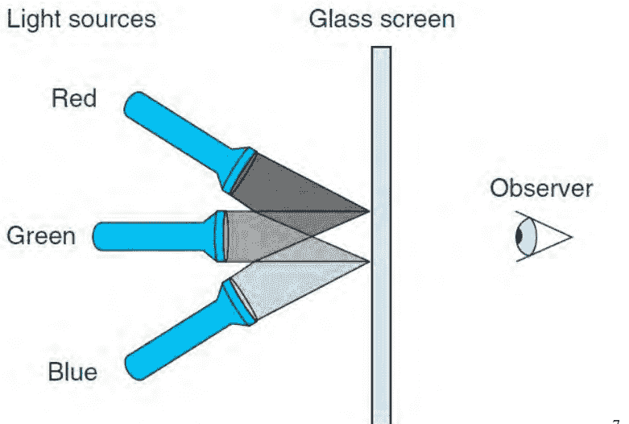

## RGB 颜色模型


品红

青色

| R | G | B | Color |
|---|---|---|-------|
| 0 | 0 | 0 | 黑色 |
| 0 | 0 | 1 | 蓝色 |
| 0 | 1 | 0 | 绿色 |
| 0 | 1 | 1 | 青色 |
| 1 | 0 | 0 | 红色 |
| 1 | 0 | 1 | 品红 |
| 1 | 1 | 0 | 黄色 |
| 1 | 1 | 1 | 白色 |

## RGB 颜色模型
- 上面列出的八种颜色的补色会是什么？
  - 颜色的补色是通过
    - 关闭亮着的灯和
    - 打开熄灭的灯
    - 形成的
- 描述对以下颜色应用布尔运算的效果：
  Blue | Green =
  Yellow & Cyan =
  Red ^ Magenta =

## C 中的位级操作
- 操作 &, |, ~, ^ 在 C 中可用
  - 应用于任何“整数”数据类型
    - long, int, short, char
  - 将参数视为位向量
  - 参数按位应用

## C 中的位级操作

| ~0x41 | 0xBE |
| ~0100 0001 | 1011 1110 |
| ~0x00 | 0xFF |
| ~0000 0000 | 1111 1111 |
| 0x69 & 0x55 | 0X41 |
| 0110 1001 & 0101 0101 | 0100 0001 |
| 0x69 | 0x55 | 0x7D |
| 0110 1001 | 0101 0101 | 0111 1101 |

## Xor 的妙用
- 按位异或是一种加法形式
- 具有每个值都是其自身加法逆元的额外属性
  - A ^ A = 0

## Xor 的妙用

```
int inplace_swap(int *x, int *y)
{
    *x = *x ^ *y;  /* #1 */
    *y = *x ^ *y;  /* #2 */
    *x = *x ^ *y;  /* #3 */
}
```

| Step | *x | *y |
|---|---|---|
| Begin | A | B |
| 1 | A^B | B |
| 2 | A^B | (A^B)^B = A^(B^B) = A^0 = A |
| 3 | (A^B)^A = (B^A)^A = B^(A^A) = B^0 = B | A |
| End | B | A |

## Xor 的妙用

```
1 void reverse_array(int a[], int cnt) {
2     int first, last;
3     for (first = 0, last = cnt-1;
4         first <= last;
5         first++,last--)
6         inplace_swap(&a[first], &a[last]);
7 }
```

## 掩码操作
- 位模式
  - 0xFF
    - 最低有效八位为 1
    - 表示一个字中的低位字节
- 掩码操作
  - X = 0x89ABCDEF
  - X & 0xFF =?
- 位模式 ~0
  - 为什么不是 0xFFFFFFFF？

## 掩码操作
- 编写适用于任意字长 w ≥ 8 的 C 表达式
- 对于 x = 0x87654321，w = 32
- x 的最低有效字节，其余位全部设为 0
- [0x00000021]。

## 掩码操作
- 除最低有效字节外全部取反，最低有效字节保持不变
  - [0x789ABC21]
- 将最低有效字节设为全 1，其余字节保持不变
  - [0x876543FF]。

## Bis & Bic
- bis (int x, int m) (bit set)
  - 将结果 z 在 m 为 1 的每个位位置设为 1
- bic(int x, int m) (bit clear)
  - 将结果 z 在 m 为 1 的每个位位置设为 0
- 数字设备公司 VAX
- 使用 bis 和 bic 实现
  - Or(int x, int y)
  - Xor(int x, int y)


## C 语言中的逻辑运算

- 逻辑运算符
  - &&, ||, !
  - 将 0 视为 “False”
  - 任何非零值视为 “True”
  - 始终返回 0 或 1
  - 提前终止（短路）

## C 语言中的逻辑运算

- 示例（char 数据类型）
  - `!0x41  -->  0x00`
  - `!0x00  -->  0x01`
  - `!!0x41 -->  0x01`
  - `0x69 && 0x55  -->  0x01`
  - `0x69 || 0x55  -->  0x01`

## 逻辑运算中的短路

- a && 5/a
  - 如果 a 为零，则 5/a 的求值会被停止
  - 避免除零
- 仅使用位级和逻辑运算
  - 实现 x == y
  - 当 x 和 y 相等时返回 1，否则返回 0

## C 语言中的移位运算

- 左移：x << y
  - 将位向量 x 左移 y 位
  - 丢弃左侧多余的位
  - 右侧用 0 填充

| 参数 x | 01100010 |
| << 3 | 00010000 |

| 参数 x | 10100010 |
| << 3 | 00010000 |

## C 语言中的移位运算

- 右移：x >> y
  - 将位向量 x 右移 y 位
    - 丢弃右侧多余的位
  - 逻辑移位
    - 左侧用 0 填充
  - 算术移位
    - 在右侧复制最高有效位
    - 对二进制补码整数表示很有用（尤其是负数）

| 参数 x | 01100010 |
| Log. >> 2 | 00011000 |
| Arith. >> 2 | 00011000 |

| 参数 x | 10100010 |
| Log. >> 2 | 00101000 |
| Arith. >> 2 | 11101000 |

## C 语言中的移位运算

- 会发生什么？
  - `int lval = 0xFEDCBA98 << 32;`
  - `int aval = 0xFEDCBA98 >> 36;`
  - `unsigned uval = 0xFEDCBA98u >> 40;`

- 可能为
  - lval     0xFEDCBA98    (0)
  - aval     0xFFEDCBA9    (4)
  - uval     0x00FEDCBA    (8)

- 需要注意
  - `1<<2 + 3<<4` 表示 `1<<(2 + 3)<<4`

## bitCount

- 返回字中 1 的个数
- 示例：bitCount(5) = 2, bitCount(7) = 3
- 合法操作：! ~ & ^ | + << >>
- 最大操作数：40

## 求和 8 组每组 4 位

```
int bitCount(int x) {
    int m1 = 0x11 | (0x11 << 8);
    int mask = m1 | (m1 << 16);
    int s = x & mask;
    s += x>>1 & mask;
    s += x>>2 & mask;
    s += x>>3 & mask;
```

## 合并求和

```
/* Now combine high and low order sums */
s = s + (s >> 16);

/* Low order 16 bits now consists of 4 sums.
   Split into two groups and sum */
mask = 0xF | (0xF << 8);
s = (s & mask) + ((s >> 4) & mask);
return (s + (s>>8)) & 0x3F;
}
```

## 信息存储

## 计算机硬件 - Von Neumann 架构

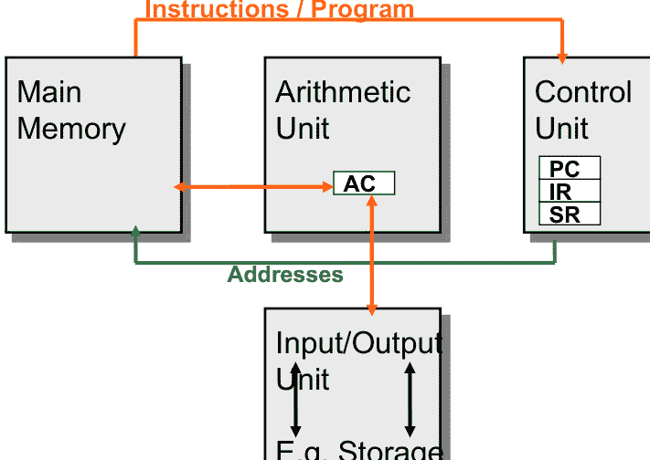

## 存储

- 用于计算中记住数据值的系统组件
- 涵盖广泛的技术
  - RAM 芯片
  - 闪存
  - 磁盘
  - CD
- 抽象模型
  - READ 和 WRITE 操作

## READ/WRITE 操作

- 两个重要概念
  - 名称和值
- WRITE(*name*, *value*)　　 value ← READ(*name*)
- WRITE 操作指定
  - 要记住的值
  - 可用于将来召回该值的名称
- READ 操作指定
  - 某个先前记住的值的名称
  - 存储设备返回该值

## 大纲

- 虚拟内存
- 指针和字长
- 建议阅读
  - 2.1 的第一段
  - 2.1.2, 2.1.3, 2.1.4, 2.1.5, 2.1.6

## 计算机硬件 - Von Neumann 架构

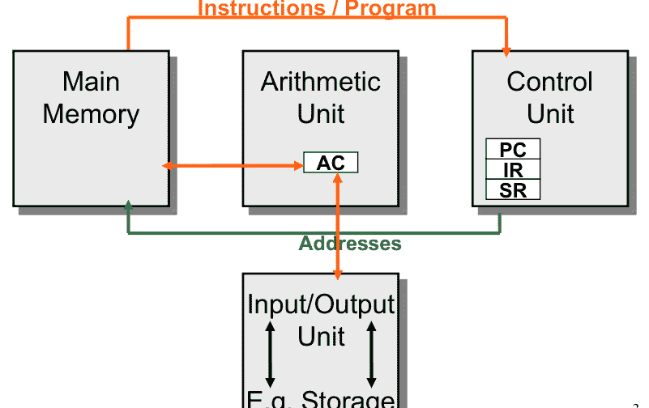

## 存储

- 用于计算中记住数据值的系统组件
- 涵盖广泛的技术
  - RAM 芯片
  - 闪存
  - 磁盘
  - CD
- 抽象模型
  - READ 和 WRITE 操作

## 模具的失效形式与寿命

### 一、模具的失效

模具的失效是指模具失去正常工作的能力。模具的失效分为非正常失效和正常失效两类。非正常失效(早期失效)是指模具未达到一定寿命时的失效。正常失效是指模具经过大量的生产制件后,因缓慢地塑性变形或磨损等而最终失效。

模具的失效形式有断裂、塑性变形、磨损、疲劳等。断裂是指模具出现裂纹或开裂,是模具最严重的失效形式;塑性变形是指模具在受力过程中发生屈服,导致尺寸变化;磨损是指模具表面材料逐渐损失,影响制件精度;疲劳是指模具在循环应力作用下产生裂纹并扩展。

不同失效形式之间存在相互联系,如磨损和疲劳往往同时发生。模具的失效过程与其材料、热处理、使用条件等因素密切相关。

### 二、模具的寿命

模具的寿命是指模具在正常使用条件下,从开始使用到失效所能完成的制件总数。模具寿命的高低直接影响制件成本和模具费用。

提高模具寿命的途径包括:合理选择模具材料、优化模具结构设计、改进制造工艺、合理使用与维护等。

### 三、影响模具寿命的因素

影响模具寿命的因素主要有:模具材料、模具结构、加工精度、热处理质量、使用条件及维护保养等。

| 模具类型 | 寿命(万次) |
|---------|-----------|
| 冲裁模 | 50~100 |
| 弯曲模 | 100~200 |
| 拉深模 | 20~50 |
| 塑料模 | 10~50 |


## 字长
- 表示
  - 指针数据的正常大小
- 虚拟地址由
  - 这样一个字编码
- 虚拟地址空间的最大大小
  - 由字长决定的最重要的系统参数

## 字长
- 对于具有 n 位字长的机器
  - 虚拟地址的范围可以从 0 到 2ⁿ-1
- 当前大多数机器为 32 位（4 字节）
  - 地址限制为 4GB
  - 对于内存密集型应用来说变得太小了
- 高端系统为 64 位（8 字节）
  - 潜在可寻址 1.8 X 10¹⁹ 字节

## 字长
- 不幸的是
  - 它也曾被用来表示整数的正常大小
- 机器支持多种数据格式
  - 始终是字节的整数倍

## 数据大小
- **C 对象的大小（以字节为单位）**

| C 数据类型 | 32-bit | 64-bit |
|---|---|---|
| char | 1 | 1 |
| short | 2 | 2 |
| int | 4 | 4 |
| long int | 4 | 8 |
| long long int | 8 | 8 |
| char * | 4 | 8 |
| float | 4 | 4 |
| double | 8 | 8 |

## intN_t 和 uintN_t
- 另一类整数类型
  - 指定 N 位有符号和无符号整数
  - 由 ISO C99 标准引入
  - 在文件 stdint.h 中。
- 典型值
  - int8_t, int16_t, int32_t, int64_t
  - uint8_t, uint16_t, uint32_t, uint64_t
  - N 取决于实现

## 数据大小
- 使程序在不同机器和编译器之间可移植的困难
  - 程序对不同数据类型的确切大小敏感
  - C 标准对不同数据类型的数值范围设定了下限
  - 但没有上限

## 数据大小相关错误
- 使程序在不同机器和编译器之间可移植的困难
  - 程序对不同数据类型的确切大小敏感
  - C 标准对不同数据类型的数值范围设定了下限
  - 但没有上限

## 数据大小相关错误
- 32 位机器在过去 20 年里一直是标准
- 许多程序已被编写
  - 假设表中列出的“32 位”分配
- 随着 64 位机器的增加
  - 许多隐藏的字长依赖性表现为
    - 将这些程序迁移到新机器时的错误

## 示例
- 许多程序员假设
  - 声明为类型 int 的程序对象可用于存储指针
- 这对大多数 32 位机器来说运行良好
- 但在 64 位机器上会导致问题

## 虚拟内存
- 之前幻灯片中介绍的内存
  - 只是一个概念对象，并且
  - 实际上并不存在
- 它为程序提供了一个看似单一的字节数组
- 它是向机器级程序呈现的概念映像

## 虚拟内存
- 实际实现使用组合
  - 硬件
  - 软件
- 硬件
  - 随机存取存储器（RAM）（物理）
  - 磁盘存储（物理）
  - 特殊硬件（执行抽象）
- 软件
  - 和操作系统软件（抽象）

## 走向抽象
- 将物理事物抽象为逻辑

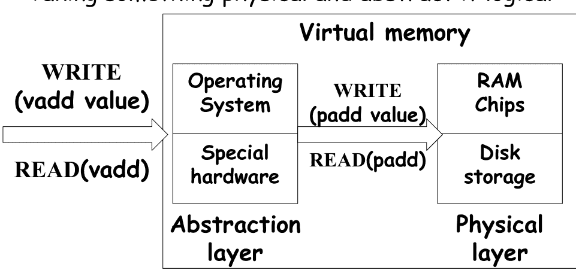

## 将虚拟内存细分为更易管理的单元
- 一项任务
  - 编译器和
  - 运行时系统
- 存储不同的程序对象
  - 程序数据
  - 指令
  - 控制信息

内核虚拟内存

用户代码不可见的内存

用户栈
（运行时创建）

共享库的内存映射区域

printf 函数

运行时堆
（由 malloc 在运行时创建）

读写数据

只读代码和数据

0x08048000 (32)

0x00400000 (64)

0

从 hello 可执行文件加载


## 字节序

- 大对象应如何存储在内存中？
- 对于跨多个字节的程序对象
  - 对象的地址会是什么？
  - 我们如何在内存中排列字节？
- 多字节对象存储为
  - 一段连续的字节序列
  - 对象的地址由所使用的字节的最小地址给出

- 小端序
  - 最低有效字节具有最低地址
  - Intel
- 大端序
  - 最低有效字节具有最高地址
  - Sun, IBM
- 双端序
  - 机器可以配置为小端或大端运行
  - 许多近期微处理器

### 大端序 (0x1234567)

0x100 0x101 0x102 0x103

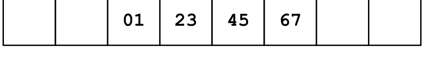

### 小端序 (0x1234567)

| 0x100 | 0x101 | 0x102 | 0x103 |
|-------|-------|-------|-------|
| 67    | 45    | 23    | 01    |

## 如何访问对象

- C 编译器生成的实际机器级程序
  - 只是将每个程序对象视为一串字节
- C 中指针的值
  - 是上述存储块的第一个字节的虚拟地址

- C 编译器
  - 为每个指针关联类型信息
  - 生成不同的机器级代码来访问指向的值
    - 存储在指针指定的位置，具体取决于该值的类型
- C 编译器生成的实际机器级程序
  - 没有关于数据类型的任何信息

## 打印字节表示的代码

```c
void show_int(int x) {
    show_bytes((byte_pointer) &x, sizeof(int));
}
```

```c
void show_float(float x) {
    show_bytes((byte_pointer) &x, sizeof(float));
}
```

```c
void show_pointer(void *x) {
    show_bytes((byte_pointer) &x, sizeof(void *));
}
```

## C 中的特性

- typedef
  - 为一种类型命名
  - 语法与声明变量完全相同
- printf
  - 格式字符串：`%d`, `%c`, `%x`, `%f`, `%p`
- sizeof
  - `sizeof(T)` 返回存储类型 T 的对象所需的字节数
  - 朝着编写可在不同机器类型间移植的代码迈出一步

- 指针和数组
  - start 被声明为指针
  - 它被引用为数组 `start[i]`
- 指针创建和解引用
  - 取地址运算符 `&`
  - `&x`
- 类型转换
  - `(byte_pointer) &x`

## 打印字节表示的代码

```c
void test_show_bytes(int val) {
    int ival = val;
    float fval = (float) ival;
    int *pval = &ival;
    show_int(ival);
    show_float(fval);
    show_pointer(pval);
}
```

## 示例

- Linux 32: 运行 Linux 的 Intel IA32 处理器
- Windows: 运行 Windows 的 Intel IA32 处理器
- Sun: 运行 Solaris 的 Sun Microsystems SPARC 处理器
- Linux 64: 运行 Linux 的 Intel x86-64 处理器
- 参数为 12345 即 0x3039

## 字节序变得可见

- 绕过正常的类型系统
  - 强制类型转换
  - 按照与创建时不同的数据类型引用对象
  - 对大多数应用编程强烈不推荐
  - 对系统级编程非常有用甚至是必要的

## 其他可见情况

- *在不同机器之间通信*
- *反汇编器*
  - `80483bd: 01 05 64 94 04 08`
  - `add %eax, 0x8049464`

## 表示字符串

- C 中的字符串
  - 由字符数组表示
  - 每个字符以 ASCII 格式编码
  - 字符串应以空字符结尾
    - 最后一个字符 = 0
  - `\a \b \f \n \r \t \v`
  - `\\ \? \' \" \000 \xhh`

```c
char S[6] = "12345";
```

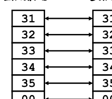


## 表示字符串

```c
/* strlen: return length of string s */
int strlen(char *s)
{
    char *p = s;

    while (*p != '\0')
        p++;
    return p-s;
}
<string.h>
```

## 表示字符串

```c
/* trim: remove trailing blanks, tabs, newlines */
int trim(char s[])
{
    int n;

    for (n = strlen(s)-1; n >= 0; n--)
        if ( s[n] != ' ' && s[n] != '\t' && s[n] != '\n')
            break;
    s[n+1] = '\0';
    return n;
}
```

## 64 位数据模型

| Processors |
|---|---|---|---|---|---|---|---|---|---|---|---|
| 4-bit | 8-bit | 12-bit | 16-bit | 18-bit | 24-bit | 31-bit | 32-bit | 36-bit | 48-bit | 64-bit | 128-bit |
| Applications |
|---|---|---|---|---|---|---|---|---|---|---|---|
|  |  |  | 16-bit |  |  |  | 32-bit |  |  | 64-bit |  |
| Data Sizes |
| nibble | octet | byte | word | dword | qword |

## 64 位数据模型

| Data model | short | int | long | long long | pointers | Sample operating systems |
|---|---|---|---|---|---|---|
| LLP64 | 16 | 32 | 32 | 64 | 64 | Microsoft Win64 (X64/IA64) |
| LP64 | 16 | 32 | 64 | 64 | 64 | Most Unix and Unix-like systems (Solaris, Linux, etc.) |
| ILP64 | 16 | 64 | 64 | 64 | 64 | HAL(Fujitsu subsidiary) |
| SILP64 | 64 | 64 | 64 | 64 | 64 | ? |

## 表示信息 (2)

## 大纲

- Encodings
  - Unsigned and two's complement
- Conversions
  - Signed vs. unsigned
  - Long vs. short
- Suggested reading
  - Chap 2.2

## 无符号表示

- **Binary (physical)**
  - Bit vector \([x_{w-1}, x_{w-2}, x_{w-3}, \ldots, x_0]\)
- **Binary to Unsigned (logical)**

$$B2U(X) = \sum_{i=0}^{w-1} x_i \cdot 2^i$$

## 二进制补码

- Binary (physical)
  - Bit vector [x_{w-1}, x_{w-2}, x_{w-3}, … x_0]
- Binary to Signed (logical)
- 2's complement

B2T(X) = -x_{w-1}·2^{w-1} + Σ_{i=0}^{w-2} x_i·2^{i}

Sign Bit

## 从二进制补码到二进制

- If nonnegative
  - Nothing changes
- If negative, its binary representation is
  - $1x_{w-2}\cdots x_{1}x_{0}$
- Its value is x
  - Assume its absolute value is y = -x
  - The binary representation of y is
  - $0y_{w-2}\cdots y_{1}y_{0}$

x = -2^{w-1} + \sum_{i=0}^{w-2} x_i 2^{i} = -\sum_{i=0}^{w-2} y_i 2^{i} = -y

\sum_{i=0}^{w-2} x_i 2^{i} = 2^{w-1} - \sum_{i=0}^{w-2} y_i 2^{i} = \sum_{i=0}^{w-2} (1 - y_i) 2^{i} + 1

2^{w-1} = \sum_{i=0}^{w-2} 2^{i} + 1 \quad x_{w-1} = 1 \quad y_{w-1} = 0

## 二进制补码

∑_{i=0}^{w-1} x_i 2^i = ∑_{i=0}^{w-1} (1 - y_i) 2^i + 1

- What does it mean?
  - Computing the negation of x into binary with w-bits
  - Complementing the result
  - Adding 1

## 从数字到二进制补码

- -5
  - 5
  - 0101 (binary for 5)
  - 1010 (after complement)
  - 1011 (add 1)

## 二进制补码编码示例

## -12345 的二进制/十六进制表示

Binary: 0011 0000 0011 1001 (12345)

Hex: 3 0 3 9

Binary: 1100 1111 1100 0110 (after complement)

Hex: C F C 6

Binary: 1100 1111 1100 0111 (add 1)

Hex: C F C 7

## 数值范围

- Unsigned Values
  - Umin=0
  - Umax=2^{w-1}
- Two’s Complement Values
  - Tmin = -2^{w-1}
  - Tmax = 2^{w-1}-1

## 数值范围

- Relationship
  - \(|TMin| = TMax + 1\)
  - \(Umax = 2^*TMax + 1\)
  - \(-1\) has the same bit representation as \(Umax\),
    - a string of all 1s
  - Numeric value 0 is represented as
    - a string of all 0s in both representations

## 有趣的数字

| Value | 8 | 16 | 32 | 64 |
|---|---|---:|---:|---:|---:|
| $UMax_w$ | 0xFF<br>255 | 0xFFFF<br>65,535 | 0xFFFFFFFF<br>4,294,967,295 | 0xFFFFFFFFFFFFFFFF<br>18,446,744,073,709,551,615 |
| $TMin_w$ | 0x80<br>−128 | 0x8000<br>−32,768 | 0x80000000<br>−2,147,483,648 | 0x8000000000000000<br>−9,223,372,036,854,775,808 |
| $TMax_w$ | 0x7F<br>127 | 0x7FFF<br>32,767 | 0x7FFFFFFF<br>2,147,483,647 | 0x7FFFFFFFFFFFFFFF<br>9,223,372,036,854,775,807 |
| −1 | 0xFF | 0xFFFF | 0xFFFFFFFF | 0xFFFFFFFFFFFFFFFF |
| 0 | 0x00 | 0x0000 | 0x00000000 | 0x0000000000000000 |


## 有符号数值的替代表示

- 反码：
  - 最高有效位权重为 2^{w-1}-1
- 符号-幅度
  - 最高有效位是符号位
  - 它决定剩余位应赋予负权重还是正权重

| X | B2U(X) | B2T(X) |
|---|---|---|
| 0000 | 0 | 0 |
| 0001 | 1 | 1 |
| 0010 | 2 | 2 |
| 0011 | 3 | 3 |
| 0100 | 4 | 4 |
| 0101 | 5 | 5 |
| 0110 | 6 | 6 |
| 0111 | 7 | 7 |
| 1000 | 8 | -8 |
| 1001 | 9 | -7 |
| 1010 | 10 | -6 |
| 1011 | 11 | -5 |
| 1100 | 12 | -4 |
| 1101 | 13 | -3 |
| 1110 | 14 | -2 |
| 1111 | 15 | -1 |

## 逻辑与物理之间的映射

- 唯一性
  - 每种位模式代表唯一的整数值
  - 每个可表示整数都有唯一的位编码

## 逻辑与物理之间的映射

- 反转映射（从逻辑到物理）
  - `U2B(x) = B2U⁻¹(x)`
    - 无符号整数的位模式
  - `T2B(x) = B2T⁻¹(x)`
    - 二进制补码整数的位模式

## 2's Comp. 与无符号之间的关系

Two's Complement

Unsigned

T2U

T2B

B2U

x

ux

X

Maintain Same Bit Pattern

w-1

0

ux

+ + + • • • + + +

- x

- + + • • • + + +

+2^{w-1} - -2^{w-1} = 2*2^{w-1} = 2^{w}

ux = { x    x ≥ 0
       x + 2^{w}   x < 0 }

## 两种表示之间的转换

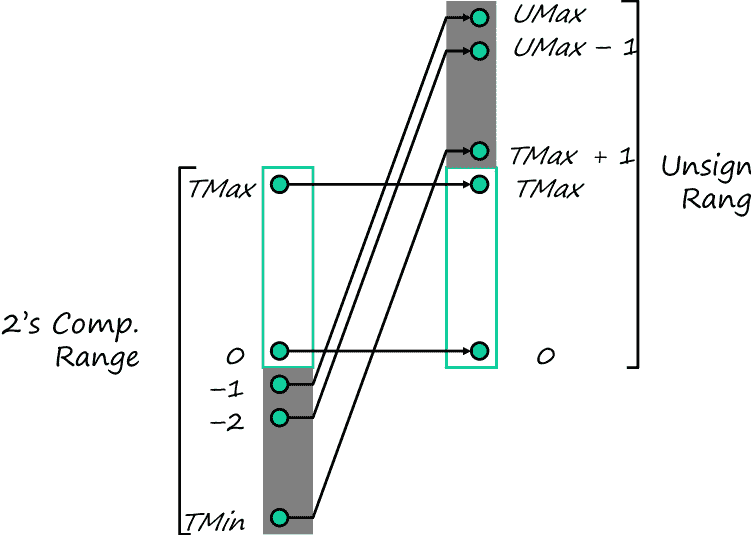

## C 中的整型数据类型

- 有符号类型（用于整数）
  - char, short [int], int, long [int]
- 无符号类型（用于非负数）
  - unsigned char, unsigned short [int],
    unsigned [int], unsigned long [int]
- Java 没有无符号数据类型
  - 使用 byte 替代 char

## 整型数据类型

- C 支持多种整型数据类型
  - 表示有限范围的整数

| C 声明 | 保证 |  | 典型 32 位 |  |
|---|---|---|---|---|
|  | 最小值 | 最大值 | 最小值 | 最大值 |
| char | -127 | 127 | -128 | 127 |
| unsigned char | 0 | 255 | 0 | 255 |
| short [int] | -32,767 | 32,767 | -32,768 | 32,767 |
| unsigned short | 0 | 65,535 | 0 | 65,535 |
| int | -32,767 | 32,767 | -2,147,483,648 | 2,147,483,647 |
| unsigned [int] | 0 | 65,535 | 0 | 4,294,967,295 |
| long [int] | -2,147,483,647 | 2,147,483,647 | -2,147,483,648 | 2,147,483,647 |
| unsigned long | 0 | 0 | 0 | 4,294,967,295 |

## C 中有符号与无符号之间的类型转换

- C 允许将一种类型变量解释为其他数据类型
  - 类型转换（隐式）
  - 类型转换（显式）

## 从有符号到无符号的类型转换

```
short int          x = 12345;
unsigned short int ux = (unsigned short) x;
short int          y = -12345;
unsigned short int uy = (unsigned short) y;
```

- 结果值
  - 位表示不变
  - 非负值保持不变
    - ux = 12345
  - 负值变为（大）正值
    - uy = 53191

| Weight | 12,345 |  | -12,345 |  | 53,191 |  |
|---|---|---|---|---|---|---|
|  | Bit | Value | Bit | Value | Bit | Value |
| 1 | 1 | 1 | 1 | 1 | 1 | 1 |
| 2 | 0 | 0 | 1 | 2 | 1 | 2 |
| 4 | 0 | 0 | 1 | 4 | 1 | 4 |
| 8 | 1 | 8 | 0 | 0 | 0 | 0 |
| 16 | 1 | 16 | 0 | 0 | 0 | 0 |
| 32 | 1 | 32 | 0 | 0 | 0 | 0 |
| 64 | 0 | 0 | 1 | 64 | 1 | 64 |
| 128 | 0 | 0 | 1 | 128 | 1 | 128 |
| 256 | 0 | 0 | 1 | 256 | 1 | 256 |
| 512 | 0 | 0 | 1 | 512 | 1 | 512 |
| 1,024 | 0 | 0 | 1 | 1,024 | 1 | 1,024 |
| 2,048 | 0 | 0 | 1 | 2,048 | 1 | 2,048 |
| 4,096 | 1 | 4096 | 0 | 0 | 0 | 0 |
| 8,192 | 1 | 8192 | 0 | 0 | 0 | 0 |
| 16,384 | 0 | 0 | 1 | 16,384 | 1 | 16,384 |
| ±32,768 | 0 | 0 | 1 | -32,768 | 1 | 32,768 |
| Total |  | 12,345 |  | -12,345 |  | 53,191 |

## C 中的无符号常量

- 默认情况下
  - 常量被视为有符号整数
- 若后缀为 “U” 则为无符号
  - 0U, 4294967259U


## 类型转换约定

- 表达式求值
  - 如果在单个表达式中混合使用无符号和有符号
    - 有符号值会隐式转换为无符号
  - 包括比较操作 <, >, ==, <=, >=
  - W = 32 的示例

## 类型转换约定

| 常量1 | 常量2 | 关系 | 求值 |
|---|---|---|---|
| 0 | 0U | == | unsigned |
| -1 | 0 | < | signed |
| -1 | 0U | > | unsigned |
| 2147483647 | -2147483648 | > | signed |
| 2147483647U | -2147483648 | < | unsigned |
| -1 | -2 | > | signed |
| (unsigned)-1 | -2 | > | unsigned |

## 从短整型到长整型

```
short int x = 12345;
```

```
int ix = (int) x;
```

```
short int y = -12345;
```

```
int iy = (int) y;
```

- • 我们需要扩展数据大小
- • 无符号类型之间的转换是正常的
- • 有符号类型之间的转换是棘手的

## 扩展位表示

- 零扩展
  - 在表示中添加前导 0
- 符号扩展
  - [x_{w-1},x_{w-2},x_{w-3},…x_0]

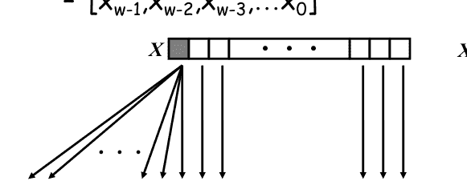

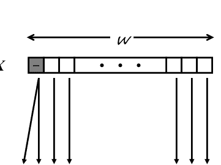

## 从短整型到长整型

```
short int sx = 12345; : 0x0309
```

```
int x = (int) sx;      : 0x00000309
```

```
short int sy =-12345;: 0xcfc7
```

```
int y = (int) sy;      : 0xffffcfc7
```

```
unsigned ux = sx;       : 0xffffcfc7
```

## 从短整型到长整型

```
int fun1(unsigned word) {
    return (int)((word << 24) >> 24);
}
```

```
int fun2(unsigned word) {
    return ((int) word << 24) >> 24;
}
```

| w | fun1(w) | fun2(w) |
|---|---|---|
| 0x00000076 | 00000076 | 00000076 |
| 0x87654321 | 00000021 | 00000021 |
| 0x000000C9 | 000000C9 | FFFFFFFC9 |
| 0xEDCBA987 | 00000087 | FFFFFF87 |

用文字描述这两个函数执行的实用计算。

## 从长整型到短整型

```
int      x = 53191;
short int sx = x;
int      y = -12345;
short int sy = y;
```

- 我们需要截断数据大小
- 从长整型到短整型的转换是棘手的

## 截断数字

| | 十进制 | 十六进制 | 二进制 |
|---|---|---|---|
| x | 53191 | 00 00 CF C7 | 00000000 00000000 11001111 11000111 |
| sx | -12345 | CF C7 | 11001111 11000111 |
| y | -12345 | FF FF CF C7 | 11111111 11111111 11001111 11000111 |
| sy | -12345 | CF C7 | 11001111 11000111 |

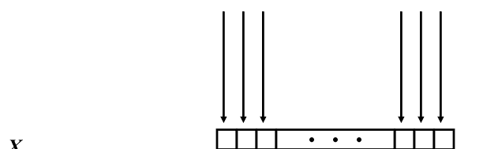

## 截断数字

- 无符号截断
  $B2U_w([x_w, x_{w-1}, \cdots, x_0]) \bmod 2^k = B2U_k([x_k, x_{k-1}, \cdots x_0])$
- 有符号截断
  $B2T_k([x_k, x_{k-1}, \cdots x_0]) = U2T_k(B2U_w([x_w, x_{w-1}, \cdots, x_0]) \bmod 2^k)$

## 有符号与无符号的建议

## 非直观特性

```c
float sum_elements ( float a[], unsigned length )
{
    int i ;
    for ( i = 0; i <= length − 1; i++)
        result += a[i] ;
}
```

## 有符号与无符号的建议

```
/* Prototype for library function strlen */
size_t strlen(const char *s);

/* Determine whether string s is longer than string t */
/* WARNING: This function is buggy */
int strlonger(char *s, char *t) {
    return strlen(s) - strlen(t) > 0;
}
```

## 有符号与无符号的建议

```
1 /*
2 * Illustration of code vulnerability similar to that found in
3 * FreeBSD’s implementation of getpeername()
4 */
5
6 /* Declaration of library function memcpy */
7 void *memcpy(void *dest, void *src, size_t n);
```

## 有符号与无符号的建议

```
9 /* Kernel memory region holding user-accessible data */
10 #define KSIZE 1024
11 char kbuf[KSIZE];
12
13 /* Copy at most maxlen bytes from kernel region to user buffer */
14 int copy_from_kernel(void *user_dest, int maxlen) {
15     /* Byte count len is minimum of buffer size and maxlen */
16     int len = KSIZE < maxlen ? KSIZE : maxlen;
17     memcpy(user_dest, kbuf, len);
18     return len;
19 }
```

## 有符号与无符号的建议

- 位集合
  - 位向量
  - 掩码
- 地址
- 多精度算术
  - 数字由字数组表示


## 操作信息 (2)
算术运算

## 大纲
- 算术运算
  - 溢出
  - 无符号加法、乘法
  - 有符号加法、取反、乘法
  - 使用移位执行 2 的幂乘法
- 建议阅读
  - 第 2.3 章

## 无符号加法

操作数：w 位

真和：w+1 位

丢弃进位：w 位

UAdd_w(u , v)

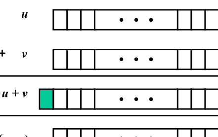

## 无符号加法
- 标准加法函数
  - 忽略进位输出
- 实现模算术
  - s = UAddw(u , v) = (u + v) mod 2^w

```
UAdd_w(u,v) = { u + v      u + v < 2^w
                  u + v - 2^w  u + v ≥ 2^w }
```

## 无符号加法

### 练习题 2.27

编写一个具有以下原型的函数：

/* 判断参数是否可以相加而不溢出 */
int uadd_ok(unsigned x, unsigned y);

此函数应返回 1，如果参数 x 和 y 相加不会导致溢出

## 溢出当且仅当 (X+Y) < X

## 无符号加法构成阿贝尔群
- 在加法下封闭
  - 0 ≤ UAdd_w(u , v) ≤ 2^w -1
- 可交换
  - UAdd_w(u , v) = UAdd_w(v , u)
- 结合
  - UAdd_w(t, UAdd_w(u,v)) = UAdd_w(UAdd_w(t, u), v)

## 无符号加法构成阿贝尔群
- 0 是加法单位元
  - `UAdd_w(u, 0) = u`
- 每个元素都有加法逆元
  - 令 `UComp_w(u) = 2^w - u`
  - `UAdd_w(u, UComp_w(u)) = 0`

## 无符号加法

| $x$ | $\overset{u}{-4} x$ |
| Hex Decimal | Decimal Hex |
| 0 |  |
| 5 |  |
| 8 |  |
| D |  |
| F |  |

## 有符号加法
- 功能
  - 真和需要 w+1 位
  - 丢弃最高位
  - 将剩余位视为 2 的补码整数

Tadd(u,v) = { u + v − 2^w,    TMax_w < u + v (PosOver)
                u + v,      TMin_w ≤ u + v ≤ TMax_w
                u + v + 2^w, u + v < TMin_w (NegOver) }

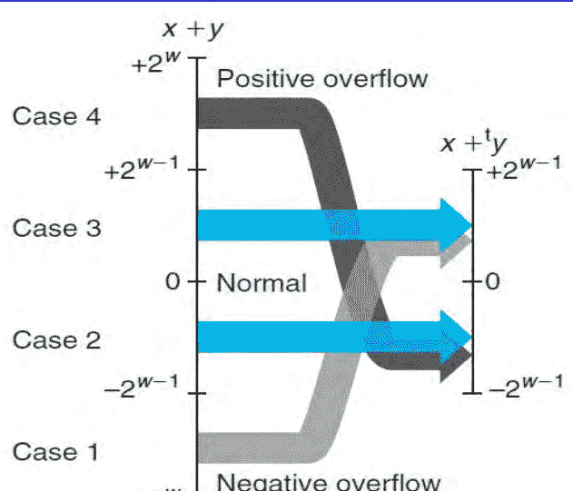

## 检测 TAdd 溢出
- **任务**
  - 给定 `s = TAdd_w(u, v)`
  - 判断 `s = Add_w(u, v)` 是否成立
- **断言**
  - 溢出当且仅当以下任一情况成立：
    - `u, v < 0, s ≥ 0` (NegOver)
    - `u, v ≥ 0, s < 0` (PosOver)
  - `ovf = (u < 0 == v < 0) && (u < 0 != s < 0);`

## TAdd 的数学性质
- 补码在 TAdd 下构成群
  - 封闭、可交换、结合、0 是加法单位元
  - 每个元素都有加法逆元
- 令 $TComp_w(u) = \begin{cases} -u & u \neq TMin_w \\ TMin_w & u = TMin_w \end{cases}$
- $TAdd_w(u , TComp_w(u)) = 0$

## 检测 Tadd 溢出

```
/* 判断参数是否可以相加而不溢出 */
/* 警告：此代码有错误。 */

int tadd_ok(int x, int y) {
    int sum = x+y;
    return (sum-x == y) && (sum-y == x);
}
```

## 检测 Tadd 溢出

```
/* 判断参数是否可以相减而不溢出 */

/* 警告：此代码有错误。 */

int tsub_ok(int x, int y) {

    return tadd_ok(x, -y);

}
```

## TAdd 的数学性质
- 与 UAdd 同构的代数
  - TAdd_w(u , v) = U2T (UAdd_w(T2U(u), T2U(v)))
  - 由于两者具有相同的位模式
  - T2U(TAdd_w(u , v)) = UAdd_w(T2U(u), T2U(v))

## 使用补码和增量取反
- 在 C 中
  - ~x + 1 == -x
- 补码
  - 观察：~x + x == 1111...111 == -1
- 增量
  - ~x + x + (-x + 1) == -1 + (-x + 1)
  - ~x + 1 == -x

x 10011101
+ ~x 01100010
--------
-1 11111111

## 乘法
- 计算 w 位数 x、y 的精确乘积
  - 有符号或无符号
- 范围
  - 无符号：0 ≤ x * y ≤ (2^w - 1)^2 = 2^{2w} - 2^{w+1} + 1
    - 最多 2w 位
  - 补码最小值：x * y ≥ -2^{w-1}*(2^{w-1}-1) = -2^{2w-2} + 2^{w-1}
    - 最多 2w-1 位
  - 补码最大值：x * y ≤ (-2^{w-1})^2 = 2^{2w-2}
    - 最多 2w 位，但仅对 TMinw^2 成立


## 乘法

- 无符号
  $x *^{u}_{w} y = (x \cdot y) \mod 2^{w}$
- 有符号
  $x *^{t}_{w} y = U2T_{w}((x \cdot y) \mod 2^{w})$
- 给定两个位向量 $\vec{x}$ 和 $\vec{y}$
- $B2U_{w}(\vec{x}) *^{u}_{w} B2U_{w}(\vec{y})$ 与 $B2T_{w}(\vec{x}) *^{t}_{w} B2T_{w}(\vec{y})$ 相同

## 乘法

- 保持精确结果
  - 需要随着每次乘积的计算不断扩展字长
  - 在软件中由“任意精度”算术包完成

## 2的幂乘法与移位

操作数：w 位

u

k

* 2^k

真实乘积：w+k 位 u · 2^k

丢弃 k 位：w 位

UMult_w(u , 2^k)

TMult_w(u , 2^k)

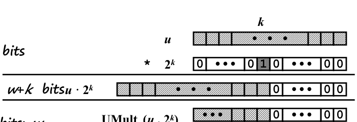

## 2的幂乘法与移位

- 操作
  - u << k 给出 u * 2^k
  - 既适用于有符号也适用于无符号
- 示例
  - u << 3 == u * 8
  - u << 5 - u << 3 == u * 24
  - 大多数机器的移位和加法比乘法快得多
    - 编译器会自动生成此代码

## XDR 库中的安全漏洞

```
/*
 * Illustration of code vulnerability similar to that found in
 * Sun’s XDR library.
 */
```

## XDR 库中的安全漏洞

```
5 void* copy_elements(void *ele_src[], int ele_cnt, size_t ele_size) {
6     /*
7     * Allocate buffer for ele_cnt objects, each of ele_size bytes
8     * and copy from locations designated by ele_src
9     */
10    void *result = malloc(ele_cnt * ele_size);
11    if (result == NULL)
12        /* malloc failed */
13        return NULL;
```

## XDR 库中的安全漏洞

```
14  void *next = result;
15  int i;
16  for (i = 0; i < ele_cnt; i++) {
17      /* Copy object i to destination */
18      memcpy(next, ele_src[i], ele_size);
19      /* Move pointer to next memory region */
20      next += ele_size;
21  }
22  return result;
23 }
```

## 程序的机器级表示 I

## 大纲

- 内存和寄存器
- 建议阅读
  - Chap 3.1, 3.2, 3.3, 3.4

## 高级编程语言的特征

- 抽象
  - 生产力高
  - 可靠
- 类型检查
- 与手工编写代码一样高效
- 可以编译并在多种不同的机器上执行

## 汇编编程语言的特征

- 管理内存
- 执行计算的低级指令
- 高度机器特定

## 从编写汇编代码到理解汇编代码

- 不同的技能集
  - 转换
  - 源代码与汇编代码之间的关系
- 反向工程
  - 试图理解系统创建的过程
    - 通过研究系统
    - 通过反向工作

## 理解编译系统的工作原理

- 优化程序性能
- 理解链接时错误
- 避免安全漏洞
  - 缓冲区溢出

## C 构造

- 变量
  - 可以声明不同数据类型
- 操作
  - 算术表达式求值
- 控制
  - 循环
  - 过程调用和返回

## 代码示例

```
C code
int accum = 0;
int sum(int x, int y)
{
    int t = x+y;
    accum += t;
    return t;
}
```

## 代码示例

```
C code
int accum = 0;
int sum(int x, int y)
{
    int t = x+y;
    accum += t;
    return t;
}
```

使用命令获取
gcc -O2 -S code.c
汇编文件 code.s

```
_sum:
    pushl %ebp
    movl %esp,%ebp
    movl 12(%ebp),%eax
    addl 8(%ebp),%eax
    addl %eax, accum
    movl %ebp,%esp
    popl %ebp
    ret
```

## 历史视角

- 漫长的演进发展
  - 起源于相当原始的 16 位处理器
  - 添加了更多功能
    - 利用技术改进的优势
    - 满足对更高性能和支持更先进操作系统的需求
  - 带有提供向后兼容性的功能，这些功能已过时


## X86 家族

- 8086(1978, 29K)
  - IBM PC 与 DOS 的核心（8088）
  - 16 位，可寻址 1M 字节，用户可用 640K
  - x87 用于浮点运算
- 80286(1982, 134K)
  - 更多（现已过时）的寻址模式
  - IBM PC-AT 与 Windows 的基础
- i386(1985, 275K)
  - 32 位架构，平坦寻址模型
  - 支持 Unix 操作系统

## X86 家族

- Pentium III(1999, 8.2M)
  - 新指令类用于操作浮点数向量（SSE，流式 SIMD 扩展）
  - 后期因集成二级缓存增至 24M
- Pentium 4(2001, 42M)
  - Netburst 微架构，时钟频率高但功耗高
  - SSE2 指令，新的数据类型（例如 双精度）

## X86 家族

- **Pentium 4E:** (2004, 125M 晶体管)。  
  - 增加 *超线程*  
    - 在单个处理器上同时运行两个程序  
  - EM64T，IA32 的 64 位扩展  
    - 最初由 Advanced Micro Devices (AMD) 开发  
    - x86-64  
- **Core 2:** (2006, 291M 晶体管)  
  - 回到类似 P6 的微架构  
  - 多核（单个芯片上的多个处理器）  
  - 不支持超线程

## X86 家族

- *Core i7: (2008, 781 M 晶体管).*  
  - 集成超线程和多核  
  - 初始版本在每个核心上支持两个执行程序
- *Core i7: (2011.11, 2.27B 晶体管)*  
  - 每个芯片 6 个核心  
  - 3.3G  
  - 6*256 KB (L2), 15M (L3)

## X86 家族

- Advanced Micro Devices (AMD)
  - 起初，
    - 在技术上仅落后于 Intel，
    - 生产更便宜、性能较低的处理器
- 在 1999 年
  - 率先突破 1 千兆赫时钟速度壁垒
- 在 2002 年
  - 引入 x86-64
  - 广泛采用的 IA32 64 位扩展

## 穆尔定律

## Intel 微处理器复杂度


## C 代码

- 加两个有符号整数
- int t = x+y;

## 汇编代码

- 操作数：
  - x: 寄存器 %eax
  - y: 内存 M[%ebp+8]
  - t: 寄存器 %eax
- 指令
  - addl 8(%ebp),%eax
  - 加 2 个 4 字节整数
  - 类似于表达式 x += y
- 返回函数值在 %eax 中

## 汇编程序员的视角

地址
数据
指令

% %ah %al
% %dh %dl
% %ch %cl
% %bh %bl
%esi
%edi
%esp
%ebp
%eip
%eflag

FF
C0 BF
栈
80 7F
堆
40 3F
DLLs
堆
数据
文本
08 00

## 程序员可见状态

- 程序计数器(%eip)
  - 下一条指令的地址
- 寄存器文件
  -  heavily used 程序数据
  - 整数和浮点

## 程序员可见状态

- 条件码寄存器
  - 保存最近执行指令的状态信息
  - 实现控制流中的条件更改

- 条件码寄存器

- 保存最近执行指令的状态信息

- 实现控制流中的条件更改

## 操作数

- 在高级语言中
  - 要么是常量
  - 或变量
- 示例
  - A = A + 4
    变量 → A
    常量 → 4

## 变量在哪里？——寄存器与内存

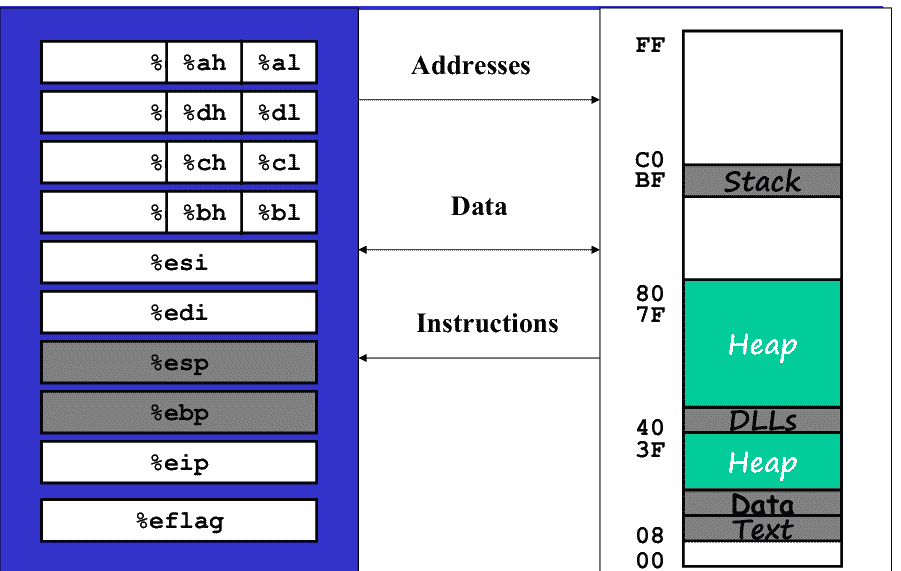

## 操作数

- 在汇编语言中的对应物
  - 立即数 ( 常量 )
  - 寄存器 ( 变量 )
  - 内存 ( 变量 )
- 示例

```
movl 8(%ebp), %eax
addl $4, %eax
```

内存

寄存器

立即数

## 简单寻址模式

- 立即数
  - 表示一个常量
  - 格式为 $imm ($4, $0xffffffff)
- 寄存器
  - 计算机系统中最快的存储单元
  - 通常为 32 位长
  - 寄存器模式 Eₐ
    - 寄存器中存储的值
    - 表示为 R[Eₐ]


## 虚拟空间

- 一个线性字节数组
  - 每个都有其唯一的地址（数组索引），从零开始

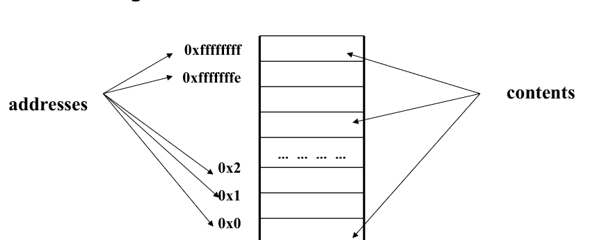

## 内存引用

- 数组的名称标注为 M
- 如果 addr 是一个内存地址
- M[addr] 是从 addr 开始的内存内容
- addr 用作数组索引
- M[addr] 中有多少字节？
  - 取决于上下文

## 索引寻址模式

- 一个表达式用于
  - 内存地址（或数组索引）
- 最一般形式
  - Imm(E_b, E_i, s)
  - 常量“位移” Imm：1、2 或 4 字节
  - 基址寄存器 E_b：任意 8 个整数寄存器之一
  - 索引寄存器 E_i：任意，除了 %esp
  - S：比例因子：1、2、4 或 8

## 内存寻址模式

- 上述形式表示的地址
  - imm + R[E_b] + R[E_i] * s
- 它给出值
  - M[imm + R[E_b] + R[E_i] * s]

## 寻址模式

| 类型 | 形式 | 操作数值 | 名称 |
|---|---|---|---|
| 立即数 | $Imm | Imm | 立即数 |
| 寄存器 | Eₐ | R[Eₐ] | 寄存器 |
| 内存 | Imm | M[Imm] | 绝对寻址 |
| 内存 | (Eₐ) | M[R[Eₐ]] | 间接寻址 |
| 内存 | Imm(Eᵦ) | M[Imm + R[Eᵦ]] | 基址+位移 |
| 内存 | (Eᵦ, Eᵢ) | M[R[Eᵦ] + R[Eᵢ]*s] | 索引寻址 |
| 内存 | Imm(Eᵦ, Eᵢ) | M[Imm + R[Eᵦ] + R[Eᵢ]] | 缩放索引寻址 |
| 内存 | (, Eᵢ, s) | M[R[Eᵢ]*s] | 缩放索引寻址 |
| 内存 | (Eᵦ, Eᵢ, s) | M[R[Eᵦ] + R[Eᵢ]*s] | 缩放索引寻址 |
| 内存 | Imm(Eᵦ, Eᵢ, s) | M[Imm + R[Eᵦ] + R[Eᵢ]*s] | 缩放索引寻址 |

| 地址 | 值 |
|---|---|
| 0x100 | 0xFF |
| 0x104 | 0xAB |
| 0x108 | 0x13 |
| 0x10C | 0x11 |

| 寄存器 | 值 |
|---|---|
| %eax | 0x100 |
| %ecx | 0x1 |
| %edx | 0x3 |

| 操作数 | 值 |
|---|---|
| %eax | 0x100 |
| (%eax) | 0xFF |
| $0x108 | 0x108 |
| 0x108 | 0x13 |
| 260 (%ecx,%edx) | (0x108) 0x13 |
| (%eax,%edx,4) | (0x10C) 0x11 |

## 代码示例

```
C code
int accum = 0;
int sum(int x, int y)
{
    int t = x+y;
    accum += t;
    return t;
}
```

```
_sum:
    pushl %ebp
    movl %esp,%ebp
    movl 12(%ebp),%eax
    addl 8(%ebp),%eax
    addl %eax, accum
    movl %ebp,%esp
    popl %ebp
    ret
```

使用命令获取
    gcc -O2 -S code.c
汇编文件 code.s

## 代码示例

| 使用命令获取 |
|---| 
| objdump -d code.o |
| 反汇编输出 |
| 0x80483b4 <sum>: | |
| 0x80483b4 55 | push %ebp |
| 0x80483b5 89 e5 | mov %esp,%ebp |
| 0x80483b7 8b 45 0c | mov 0xc(%ebp),%eax |
| 0x80483ba 03 45 08 | add 0x8(%ebp),%eax |
| 0x80483bd 01 05 00 00 00 00 | add %eax, 0x0 |
| 0x80483c3 89 ec | mov %ebp,%esp |
| 0x80483c5 5d | pop %ebp |
| 0x80483c6 c3 | ret |

## 目标代码

- 3 字节指令
- 存储在地址 0x80483ba
- 0x80483ba:  03 45 08

## 汇编指令中的操作

- 仅执行非常基础的操作
- 通常按顺序一个接一个执行
- 操作存储在寄存器中的数据
- 在内存和寄存器之间传输数据
- 有条件地分支到新的指令地址

## 理解机器执行

- 指令序列存储在哪里？
  - 在虚拟内存中
  - 代码区
- 指令如何执行？
  - %eip 存储内存地址，从该地址，
  - 机器可以一次读取整条指令
  - 然后执行它
  - 增加 %eip
    - %eip 也称为程序计数器（PC）

## 代码布局

Linux/x86 进程内存映像

0xffffffff

内核虚拟内存

对用户代码不可见的内存

0xc0000000

读写数据

只读数据

只读代码

%eip

0x08048000

禁止访问

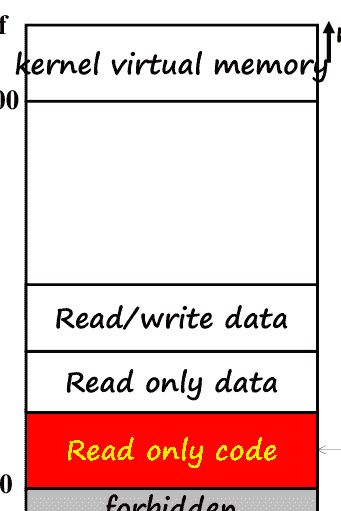

## 数据布局

- 汇编中的对象模型
  - 一个大型的、按字节寻址的数组
  - 甚至有符号或无符号整数之间也没有区别
  - 代码、用户数据、操作系统数据
  - 用于管理过程调用和返回的运行时栈
  - 由用户分配的内存块


0xFFFFFFFF

内核虚拟内存

对用户代码不可见的内存

0xc0000000

用户栈
（在运行时创建）

共享库的内存映射区域

printf() 函数

0x40000000

运行时堆
（由 malloc 在运行时创建）

读写数据

从 hello 可执行文件加载

只读代码和数据

0x08048000

未使用

0

## 程序的机器级表示 I

## 大纲

- 内存和寄存器
- 数据移动指令
- 建议阅读
  - 第 3.1、3.2、3.3、3.4 章

## 高级编程语言的特征

- 抽象
  - 生产力高
  - 可靠
- 类型检查
- 与手工编写代码一样高效
- 可以编译并在多种不同的机器上执行

## 汇编编程语言的特征

- 管理内存
- 执行计算的低级指令
- 高度机器特定

## 为什么我们应该理解汇编代码

- 理解编译器的优化能力
- 分析代码中的潜在低效
- 有时需要程序的运行时行为

## 从编写汇编代码到理解汇编代码

- 不同的技能集
  - 转换
  - 源代码与汇编代码之间的关系
- 反向工程
  - 尝试理解系统创建的过程
    - 通过研究系统
    - 通过逆向工作

## 理解编译系统的工作原理

- 优化程序性能
- 理解链接时错误
- 避免安全漏洞
  - 缓冲区溢出

## C 构造

- 变量
  - 可以声明不同数据类型
- 操作
  - 算术表达式求值
- 控制
  - 循环
  - 过程调用和返回

## 代码示例

```
C code
int accum = 0;
int sum(int x, int y)
{
    int t = x+y;
    accum += t;
    return t;
}
```

## 代码示例

```
C code
int accum = 0;
int sum(int x, int y)
{
    int t = x+y;
    accum += t;
    return t;
}
```

使用命令获取
gcc -O2 -S code.c
汇编文件 code.s

```
_sum:
    pushl %ebp
    movl %esp,%ebp
    movl 12(%ebp),%eax
    addl 8(%ebp),%eax
    addl %eax, accum
    movl %ebp,%esp
    popl %ebp
    ret
```

## 历史视角

- 长期演进发展
  - 起源于相当原始的 16 位处理器
  - 增加更多功能
    - 利用技术改进的优势
    - 满足对更高性能和支持更先进操作系统的需求
  - 带有提供向后兼容性的功能，这些功能已过时

## X86 家族

- 8086(1978, 29K)
  - IBM PC 和 DOS 的核心（8088）
  - 16 位，可寻址 1M 字节，用户可用 640K
  - x87 用于浮点运算
- 80286(1982, 134K)
  - 更多（现已过时）的寻址模式
  - IBM PC-AT 和 Windows 的基础
- i386(1985, 275K)
  - 32 位架构，平坦寻址模型
  - 支持 Unix 操作系统

## X86 家族

- Pentium III(1999, 8.2M)
  - 用于操作浮点数向量的新指令类（SSE，流式 SIMD 扩展）
  - 后来增至 24M，因集成二级缓存
- Pentium 4(2001, 42M)
  - Netburst 微架构，时钟频率高但功耗高
  - SSE2 指令，新数据类型（例如双精度）

## X86 家族

- Pentium 4E: (2004, 125M晶体管)。
  - 增加超线程
    - 在单个处理器上同时运行两个程序
  - EM64T，IA32 的 64 位扩展
    - 最初由 Advanced Micro Devices（AMD）开发
    - x86-64

- Core 2: (2006, 291M晶体管)
  - 回到类似 P6 的微架构
  - 多核（单芯片上的多个处理器）
  - 不支持超线程


## X86 家族

- *Core i7: (2008, 781 M 晶体管)。*
  - 集成了超线程和多核
  - 初始版本在每个核心上支持同时执行两个程序
- *Core i7: (2011.11, 2.27B 晶体管)*
  - 每个芯片 6 个核心
  - 3.3G
  - 6*256 KB (L2), 15M (L3)
- Advanced Micro Devices (AMD)
  - 起初，
    - 在技术上仅落后于英特尔，
    - 生产更便宜且性能较低的处理器
  - 在 1999 年
    - 率先突破 1 吉赫兹时钟速度壁垒
  - 在 2002 年
    - 引入 x86-64
    - 被广泛采用的 IA32 的 64 位扩展

## 摩尔定律

### Intel 微处理器复杂度

Transistors

Year

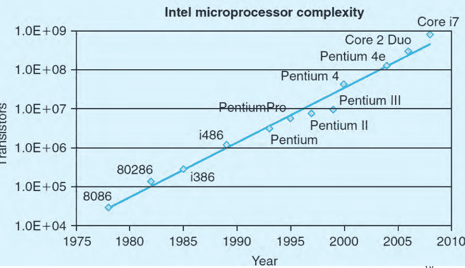

## 汇编代码

- 操作数：
  - x: 寄存器 %eax
  - y: 内存 M[%ebp+8]
  - t: 寄存器 %eax
- 指令
  - `addl 8(%ebp),%eax`
  - 加法 2 个 4 字节整数
  - 类似于表达式 `x += y`

## 汇编程序员的视角

```
%ah %al
%dh %dl
%ch %cl
%bh %bl
%esi
%edi
%esp
%ebp
%eip
%eflags

Addresses
Data
Instructions

FF
C0
BF
Stack
80
7F
Heap
40
3F
DLLs
Heap
Data
Text
08
00
```

## 程序员可见状态

- 程序计数器 (%eip)
  - 下一条指令的地址
- 寄存器文件
  -  heavily used program data
  - 整数和浮点
- 条件码寄存器
  - 保存最近执行指令的状态信息
  - 实现控制流中的条件变化

## 操作数

- 在高级语言中
  - 要么是常量
  - 或变量
- 示例
  - A = A + 4
    - 变量 → A
    - 常量 → 4

### 变量在哪里？——寄存器与内存

```
Addresses
Data
Instructions

%ah %al %dh %dl %ch %cl %bh %bl %esi %edi %esp %ebp %eip %eflags

FF CO BF Stack 80 7F Heap DLLs 40 3F Heap Data Text 08 00
```

- 在汇编语言中的对应物
  - 立即数 (常量)
  - 寄存器 (变量)
  - 内存 (变量)
- 示例

```asm
movl 8(%ebp), %eax
addl $4, %eax
```

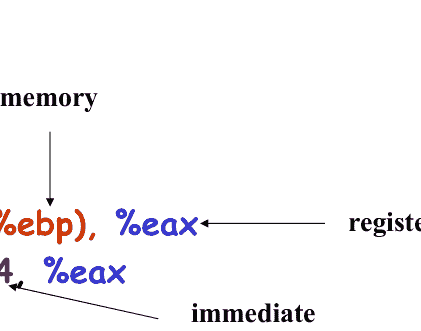

## 简单寻址模式

- 立即数
  - 表示一个常量
  - 格式为 $imm ($4, $0xffffffff)
- 寄存器
  - 计算机系统中最快的存储单元
  - 通常为 32 位长
  - 寄存器模式 Eₐ
    - 寄存器中存储的值
    - 表示为 R[Eₐ]

## 虚拟地址空间

- 一个线性字节数组
  - 每个都有其唯一的地址 (数组索引) 从零开始

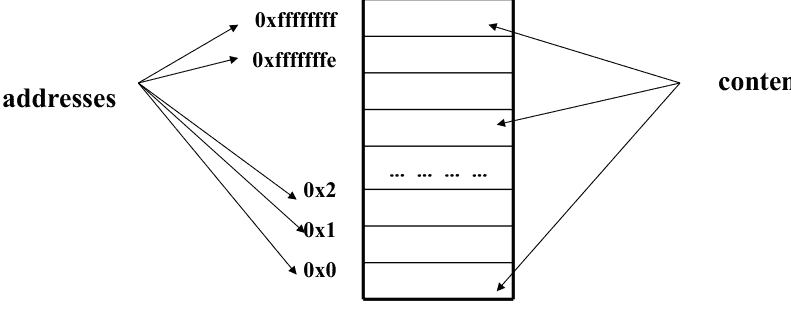

## 内存引用

- 数组的名称标注为 M
- 如果 addr 是一个内存地址
- M[addr] 是从 addr 开始的内存内容
- addr 用作数组索引
- M[addr] 中有多少字节？
  - 取决于上下文

## 索引寻址模式

- 一个表达式用于
  - 内存地址 (或数组索引)
- 最一般形式
  - Imm(E_b, E_i, s)
  - 常量 "位移" Imm: 1, 2 或 4 字节
  - 基址寄存器 E_b: 任意 8 个整数寄存器
  - 索引寄存器 E_i: 任意, 除 %esp 外
  - s: 比例因子: 1, 2, 4, 或 8

## 内存寻址模式

- 上述形式表示的地址
  - imm + R[E_b] + R[E_i] * s
- 它给出值
  - M[imm + R[E_b] + R[E_i] * s]

## 寻址模式

| 类型 | 形式 | 操作数值 | 名称 |
|---|---|---|---|
| Immediate | `$Imm` | `Imm` | Immediate |
| Register | `Eₐ` | `R[Eₐ]` | Register |
| Memory | `Imm` | `M[Imm]` | Absolute |
| Memory | `(Eₐ)` | `M[R[Eₐ]]` | Indirect |
| Memory | `Imm(E_b)` | `M[Imm + R[E_b]]` | Base+displacement |
| Memory | `(E_b, E_i)` | `M[R[E_b] + R[E_i]]` | Indexed |
| Memory | `Imm(E_b, E_i)` | `M[Imm + R[E_b] + R[E_i]]` | Indexed |
| Memory | `(, E_i, s)` | `M[R[E_i] * s]` | Scaled indexed |
| Memory | `(E_b, E_i, s)` | `M[R[E_b] + R[E_i] * s]` | Scaled indexed |
| Memory | `Imm(E_b, E_i, s)` | `M[Imm + R[E_b] + R[E_i] * s]` | Scaled indexed |


| 地址 | 值 |
|---|---|
| 0x100 | 0xFF |
| 0x104 | 0xAB |
| 0x108 | 0x13 |
| 0x10C | 0x11 |

| 寄存器 | 值 |
|---|---|
| %eax | 0x100 |
| %ecx | 0x1 |
| %edx | 0x3 |

| 操作数 | 值 |
|---|---|
| %eax | 0x100 |
| (%eax) | 0xFF |
| $0x108 | 0x108 |
| 0x108 | 0x13 |
| 260 (%ecx,%edx) | (0x108) 0x13 |
| (%eax,%edx,4) | (0x10C) 0x11 |

## 汇编指令中的操作

- 仅执行非常基础的操作
- 通常按顺序逐条执行
- 操作存储在寄存器中的数据
- 在内存和寄存器之间传输数据
- 有条件地分支到新的指令地址

## 理解机器执行

- 指令序列存储在哪里？
  - 在虚拟内存中
  - 代码区
- 指令如何执行？
  - %eip 存储内存的地址，从该地址，
  - 机器可以一次性读取整条指令
  - 然后执行它
  - 增加 %eip
    - %eip 也称为程序计数器 PC

## 代码布局

Linux/x86 进程内存映像

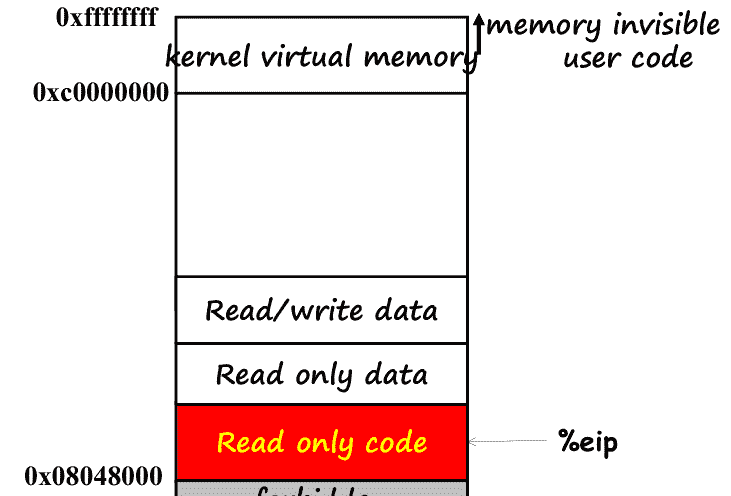

## 地址模式

常量 & 变量 f() { int i = 3; }

## 立即数 & 内存

```
00000000 < _f>:
   0: 55                         push   %ebp
   1: 89 e5                      mov    %esp,%ebp
   3: 83 ec 14                   sub    $0x14,%esp
   6: c7 45 fc 03 00 00 00       movl   $0x3,-0x4(%ebp)
   d: c9                         leave
   e: c3                         ret
```

## 顺序执行

```
000000 PC
0: 55 PC
1: 89 e5      mov %esp,%ebp
3: 83 ec 14   sub $0x14,%esp
6: c7 45 fc 03 00 00 00
            movl $0x3,-0x4(%ebp)
d: c9         leave
e: c3         ret
```

```
00 00 00 0e
00 00 00 0d
```

```
c3 ret
c9 leave
00
00
00
03
fc
45
c7 movl $0x3,-0x4(%ebp)
14
ec
83 sub $0x14,%esp
e5
```

```
PC 00 00 00 06
```

```
PC 00 00 00 03
```

```
PC 00 00 00 01
PC 00 00 00 00
```

## 代码布局

Linux/x86 进程内存映像

0xffffffff

内核虚拟内存

对用户代码不可见的内存

0xc0000000

读写数据

只读数据

只读代码

%eip

0x08048000

禁止访问

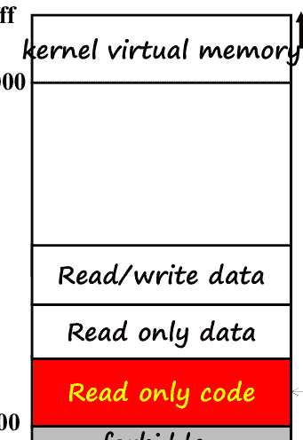

## 数据布局

- 汇编中的对象模型
  - 一个大型的、按字节寻址的数组
  - 甚至有符号或无符号整数之间也没有区别
  - 代码、用户数据、操作系统数据
  - 用于管理过程调用和返回的运行时栈
  - 由用户分配的内存块

## 示例 C 代码

```
```c
#include <stdio.h>

int accum = 0;

int sum(int x, int y)
{
    int t = x + y;
    accum += t;
    return t;
}

int main()
{
    int s;
    s = sum(4,3);
    printf(" %d %d \n", s, accum);
    return 0;
}
```
```

## 示例 目标代码

```
08048360 <sum>:
8048360:  55                    push   %ebp
8048361:  89 e5                 mov    %esp,%ebp
8048363:  8b 45 0c              mov    0xc(%ebp),%eax
8048366:  8b 55 08              mov    0x8(%ebp),%edx
8048369:  5d                    pop    %ebp
804836a:  01 d0                 add    %edx,%eax
804836c:  01 05 f0 95 04 08     add    %eax, 0x80495f0
8048372:  c3                    ret
```

## 示例 目标代码

```
08048360 <sum>:
8048360: 55              push %ebp
8048361: 89 e5            mov %esp,%ebp
8048363: 8b 45 0c          mov 0xc(%ebp),%eax
8048366: 8b 55 08          mov 0x8(%ebp),%edx
8048369: 5d               pop %ebp
804836a: 01 d0             add %edx,%eax
804836c: 01 05 f0 95 04 08  add %eax, 0x80495f0
8048372: c3               ret
```

## 使用不同大小访问对象

```
```c
int main(void) {
    char c = 1;     short s = 2;
    int i = 4;      long l = 4L;
    long long ll = 8LL;
    return;
}
```
```

```
```asm
8048335:c6  movb  $0x1,0xffffffe5(%ebp)
8048339:66  movw  $0x2,0xffffffe6(%ebp)
804833f:c7  movl  $0x4,0xffffffe8(%ebp)
8048346:c7  movl  $0x4,0xffffffec(%ebp)
804834d:c7  movl  $0x8,0xfffffff0(%ebp)
8048354:c7  movl  $0x0,0xfffffff4(%ebp)
```
```

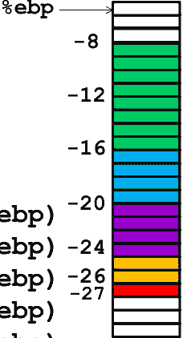


0xFFFFFFFF

内核虚拟内存

对用户代码不可见的内存

0xc0000000

用户栈
（在运行时创建）

共享库的内存映射区域

printf() 函数

0x40000000

运行时堆
（由 malloc 在运行时创建）

读写数据

从 hello 可执行文件加载

只读代码和数据

0x08048000

未使用

0

## 移动指令

- 格式
  - mov src, dest
  - src 和 dest 只能是以下之一
    - 立即数
    - 寄存器
    - 内存

## 移动指令

- 格式
  - (src, dest) 的唯一可能组合是
    - （立即数，寄存器）
    - （内存，寄存器）加载
    - （寄存器，寄存器）
    - （立即数，内存）存储
    - （寄存器，内存）存储

## 数据移动示例

```
movl $0x4050, %eax      immediate register
movl %ebp, %esp         register   register
movl (%edx, %ecx), %eax memory    register
movl $-17, (%esp)       immediate memory
movl %eax, -12(%ebp)    register   memory
```

## 数据格式

- 移动数据指令
  - mov（通用）
  - movb（移动字节）
  - movw（移动字）
  - movl（移动双字）

## 不同 Mov 指令

```
int main(void) {
char c = 1; short s = 2;
int i = 4; long l = 4L;
long long ll = 8LL;
return;
}
```

```
8048335:c6 45 e5 01    movb $0x1,0xfffffffe5(%ebp)
8048339:66 c7 45 e6 02 00    movw $0x2,0xfffffffe6(%ebp)
804833f:c7 45 e8 04 00 00 00    movl $0x4,0xfffffffe8(%ebp)
8048346:c7 45 ec 04 00 00 00    movl $0x4,0xffffff fec(%ebp)
804834d:c7 45 f0 08 00 00 00    movl $0x8,0xffffff f0(%ebp)
8048354:c7 45 f4 00 00 00 00    movl $0x0,0xffffff f4(%ebp)
```

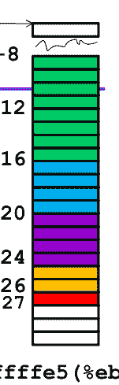

## 数据移动示例

初始值 %dh=8d        %eax =98765432

1  movb  %dh, %al        %eax=9876548d

2  movsbl  %dh, %eax     %eax=ffffff8d

3  movzbl  %dh, %eax     %eax=0000008d

## 栈布局

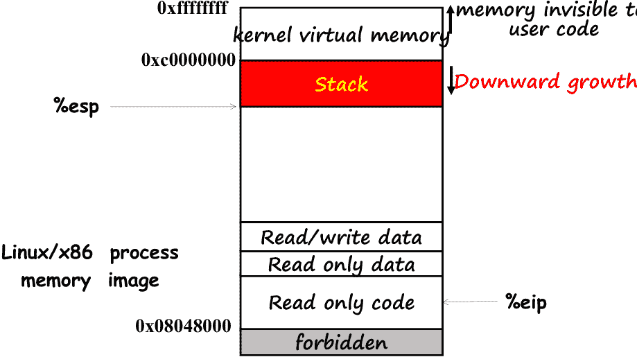

## 栈操作

- 有两个栈操作指令
  - Push 和 Pop
- Push
  - 减小 %esp（扩大栈）
  - 将寄存器中的值存储到栈中
- Pop
  - 将栈顶的值存储到寄存器中
  - 增加 %esp（缩小栈）

## 栈操作

| %eax | 0x123 |
| %edx | 0 |
| %esp | 0x108 |

pushl %eax ?

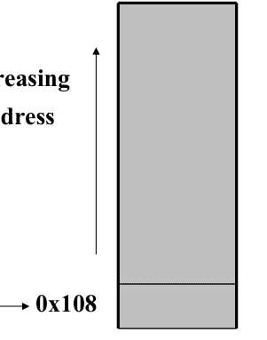

## 栈操作

| %eax | 0x123 |
| %edx | 0 |
| %esp | 0x104 |

pushl %eax
popl %edx ?

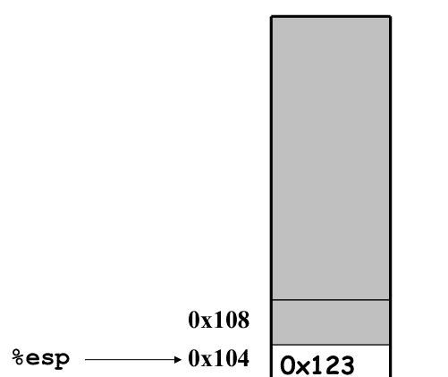

## 栈操作

| %eax | 0x123 |
| %edx | 0x123 |
| %esp | 0x108 |

popl %edx

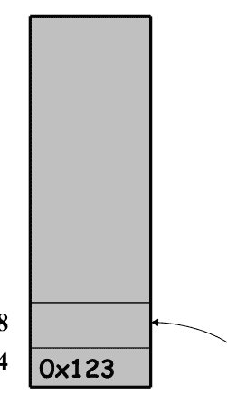

%esp → 0x108
0x104
0x123
栈“顶”

## 大纲

- C 指针
- 数据操作
- 条件码
- 建议阅读
  - 第 3.4 章，3.5 章，3.6.1 章，3.6.2 章

## C 中的指针

- 在 C 中，一个对象可能是
  - 一个整数
  - 一个结构或
  - 其他程序单元
- 声明指针
  T *p;

## C 中的指针

- 在 C 中，指针的值是
  - 某个存储块第一字节的虚拟地址
  - 类型信息用于
    - 识别对象的长度
    - 解释对象 *p
- 生成指针
  p = &obj

## 数据移动示例

```
int main()
{
    int a = 4 ;
    /* “address of” operator creates a pointer */
    int b = exchange(&a, 3);
    printf("a = %d, b = %d\n", a, b);
}
```

## 数据移动示例

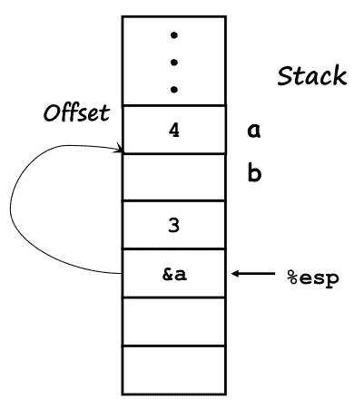

变量 a 可以在寄存器中吗？

## 数据移动示例

```
int exchange(int *xp, int y)
{
    /* operator * performs deferencing */
    int x = *xp ;
    *xp = y ;
    return x ;
}
```


## 数据移动示例

```c
int exchange(int *xp, int y)
{
    int x = *xp;

    *xp = y;
    return x;
}
```

```asm
1 pushl  %ebp
2 movl   %esp, %ebp
3 movl   8(%ebp), %eax
4 movl   12(%ebp), %edx
5 movl   (%eax), %ecx
6 movl   %edx, (%eax)
7 movl   %ecx, %eax
8 movl   %ebp, %esp
9 popl   %ebp
```

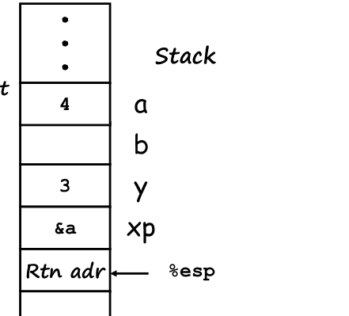

```
1 pushl %ebp
```

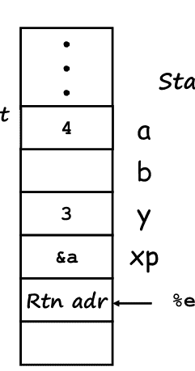

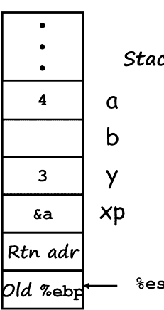

```
2 movl %esp, %ebp
```

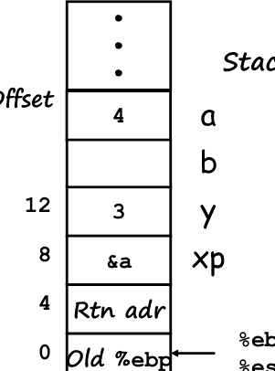

3 movl 8(%ebp), %eax

%eax: xp 20(%ebp)

如何用 %ebp 表示 xp ？

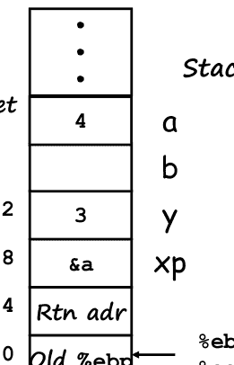

```
3 movl 8(%ebp), %eax
4 movl 12(%ebp), %edx
```

%eax: xp
%edx: 3

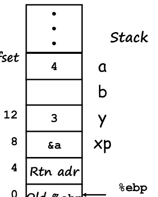

3 movl    8(%ebp), %eax
4 movl    12(%ebp), %edx
5 movl    (%eax), %ecx

%eax: xp
%edx: 3
%ecx: 4


```
3 movl 8(%ebp), %eax
4 movl 12(%ebp), %edx
5 movl (%eax), %ecx
6 movl %edx, (%eax)
```

%eax: xp
%edx: 3
%ecx: 4
*xp(a): 3

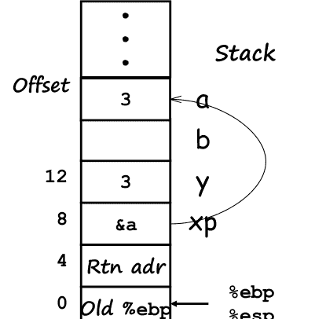

```
3 movl    8(%ebp), %eax
4 movl    12(%ebp), %edx
5 movl    (%eax),   %ecx
6 movl    %edx,     (%eax)
7 movl    %ecx,     %eax
```

%eax: xp
%edx: y
%ecx: 4
*xp(a): 3
%eax: 4 (old *xp) return value

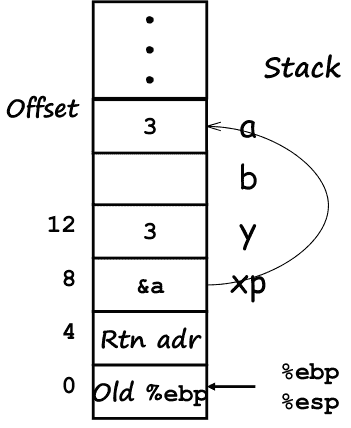


Stack

Offset

b

%esp

%eax 4
Return value


## 算术和逻辑运算

| 指令 | 效果 | 描述 |
|---|---|---|
| leal S, D | D ← &S | 加载有效地址 |
| incl D | D ← D + 1 | 递增 |
| decl D | D ← D − 1 | 递减 |
| negl D | D ← -D | 取负 |
| notl D | D ← ~D | 补码 |
| addl S, D | D ← D + S | 加法 |
| subl S, D | D ← D − S | 减法 |
| imull S, D | D ← D * S | 乘法 |

| 指令 | 效果 | 描述 |
|---|---|---|
| xorl S, D | D ← D ^ S | 异或 |
| orl S, D | D ← D | S | 或 |
| andl S, D | D ← D & S | 与 |
| sall k, D | D ← D << k | 左移 |
| shll k, D | D ← D << k | 左移 |
| sarl k, D | D ← D >> k | 算术右移 |
| shrl k, D | D ← D >> k | 逻辑右移 |

## 算术表达式的汇编代码

```c
int arith(int x, int y, int z)
{
    int t1 = x+y;
    int t2 = z*48;
    int t3 = t1&0xFFFF;
    int t4 = t2*t3;
    return t4;
}
```

```asm
movl 12(%ebp), %eax        # Get y
movl 16(%ebp), %edx        # Get z
addl 8(%ebp), %eax         # Compute t1=x+y
leal (%edx,%edx,2), %edx   # Compute 3*z
sall $4, %edx              # Compute t2=48*z
andl $0xFFFF, %eax         # Compute t3=t1&FFFF
imull %edx, %eax            # Set t4 as return val
```

## 特殊算术运算

| imull S | R[%edx]:R[%eax] ← S*R[%eax] | 有符号全乘 |
| mull S | R[%edx]:R[%eax] ← S*R[%eax] | 无符号全乘 |
| cltd | R[%edx]:R[%eax] ← SignExtend(R[%eax]) | 转换为四字 |
| idiv S | R[%edx] ← R[%edx]:R[%eax] mod S
R[%eax] ← R[%edx]:R[%eax] ÷ S | 有符号除法 |
| divl S | R[%edx] ← R[%edx]:R[%eax] mod S
R[%eax] ← R[%edx]:R[%eax] ÷ S | 无符号除法 |

## 示例

```
Initially x at %ebp+8, y at %ebp+12
1 movl 8(%ebp), %eax
2 imull 12(%ebp)
3 pushl %edx
4 pushl %eax
```

```
1 movl 8(%ebp), %eax
2 cltd
3 idivl 12(%ebp)
4 pushl %eax
5 pushl %edx
```

## 汇编程序员的视角

%ah %al
%dh %dl
%ch %cl
%bh %bl
%esi
%edi
%esp
%ebp
%eip
%eflag
Addresses
Data
Instructions
FF
C0 BF
Stack
80 7F
Heap
40 3F
DLLs
Heap
Data
Text
08 00


## 条件码

- 条件码
  - 一组单比特位
  - 维护在条件码寄存器中
  - 描述最近一次算术或逻辑操作的属性

- EFLAGS
  - CF: 进位标志
    - 最近一次操作在最高有效位产生进位输出
    - 用于检测无符号操作的溢出
  - OF: 溢出标志
    - 最近一次操作导致了二进制补码溢出——正或负
  - ZF: 零标志
    - 最近一次操作结果为零
  - SF: 符号标志
    - 最近一次操作结果为负值

## 设置条件码

- 由算术操作隐式设置

  `addl Src,Dest`

  C 类比: t = a+b

  - CF 在最高有效位有进位输出时置位
    - 用于检测无符号溢出
  - ZF 在 t == 0 时置位
  - SF 在 t < 0 时置位
  - OF 在二进制补码溢出时置位

    `(a>0 && b>0 && t<0) || (a<0 && b<0 && t>=0)`

- `lea` 指令
  - 对条件码没有影响

- `xorl` 指令
  - 进位标志和溢出标志被置为 0

- 移位指令
  - 进位标志被置为最后移出的位
  - 溢出标志被置为 0

- 由比较指令显式设置
  - `cmpl Src2,Src1`
  - `cmpl b,a` 类似于计算 a-b 但不设置目标
  - CF 在最高有效位有进位输出时置位
    - 用于无符号比较
  - ZF 在 a == b 时置位
  - SF 在 (a-b) < 0 时置位
  - OF 在二进制补码溢出时置位

    ```
    (a>0 && b<0 && (a-b)<0) ||
    (a<0 && b>0 && (a-b)>0)
    ```

- 由测试指令显式设置
  - `testl Src2,Src1`
  - 根据 *Src1* & *Src2* 的值设置条件码
    - 有用的一种做法是让其中一个操作数为掩码
  - `testl b,a` 类似于计算 `a&b` 但不设置目标
  - ZF 在 `a&b == 0` 时置位
  - SF 在 `a&b < 0` 时置位

## 访问条件码

- 条件码不能直接读取
- 访问它们的常用方法之一是
  - 基于条件码的某种组合设置整数寄存器
  - Set 命令

- 每个 set 命令执行后
  - 得到一个单字节，置为 0 或 1
- 不同 set 命令的描述适用于
  - 比较指令已执行的情况

| 指令 | 同义词 | 效果 | 置位条件 |
|---|---|---|---|
| Sete | Setz | ZF | 相等/零 |
| Setne | Setnz | ~ZF | 不相等/非零 |
| Sets |  | SF | 负数 |
| Setns |  | ~SF | 非负数 |
| Setl | Setnge | SF^OF | 小于 |
| Setle | Setng | (SF^OF)\|ZF | 小于或等于 |
| Setg | Setnle | ~(SF^OF)&~ZF | 大于 |
| Setge | Setnl | ~(SF^OF) | 大于或等于 |
| Seta | Setnbe | ~CF&~ZF | 高于 |
| Setae | Setnb | ~CF | 高于或等于 |
| Setb | Setnae | CF | 低于 |
| Setbe | Setna | CF\|ZF | 低于或等于 |

初始时 a 在 `%edx` 中，b 在 `%eax` 中

```assembly
1 cmpl %eax, %edx    #compare a:b
2 setl         %al    #set low order byte to 0 or 1
3 movzbl %al, %eax
                   #set remaining bytes of %eax to 0
```

## 程序的机器级表示 III

### 大纲

- 跳转指令
- 将 C 中的控制结构翻译为汇编
  - goto
  - 分支
  - 循环
- 建议阅读
  - Chap 3.6

### 控制

- 程序执行最重要的两个部分
  - 数据流（访问和操作数据）
  - 控制流（控制操作的顺序）

- 顺序执行是默认的
  - 指令按其在程序中出现的顺序执行
- 改变控制流
  - 跳转指令


## 跳转指令
```
1   xorl  %eax, %eax      Set %eax to 0
2   jmp   .L1             Goto .L1
3   movl  (%eax), %edx    Null pointer dereference
4   .L1:
5   popl  %edx
```

## 无条件跳转
- 无条件跳转
- 直接跳转：jmp  label
  - jmp .L
- 间接跳转：jmp  *Operand
  - jmp  *%eax
  - jmp  *(%eax)

## 条件跳转
- 要么跳转，要么在代码序列的下一条指令处继续执行
  - 取决于条件码的某种组合
- 全部为直接跳转

## 跳转指令
```
1   jle .L2
2   .L5:
3   movl %edx, %eax
4   sarl $1, %eax
5   subl %eax, %edx
6   leal (%edx, %edx, 2), %edx
7   testl %edx, %edx
8   jg  .L5
9   .L2:
10  movl %edx, %eax
```

## 跳转示例
```
1   8: 7e 0d          jle  17<silly+0x17>
2   a: 89 d0          mov  %edx, %eax  dest1:
3   c: c1 f8          sar  %eax
4   e: 29 c2          sub  %eax, %edx
5   10: 8d 14 52       lea  (%edx, %edx, 2), %edx
6   13: 85 d2          test %edx, %edx
7   15: 7f f3          jg   a<silly+0x10>
8   17: 89 d0          movl %edx, %eax  dest2:

d+a = 17
17+f3(-d) = a
```

## 跳转示例
```
1   804839:   7e 0d          jle     17<silly+0x17>
2   804839e:  89 d0          mov     %edx, %eax          dest1:
3   80483a0:  c1 f8          sar     %eax
4   80483a2:  29 c2          sub     %eax, %edx
5   80483a4:  8d 14 52       lea     (%edx, %edx, 2), %edx
6   80483a7:  85 d2          test    %edx, %edx
7   80483a9:  7f f3          jg      a<silly+0x10>
8   80483ab:  89 d0          movl    %edx, %eax          dest2:
```

d+804849e = 80483ab

80483ab+f3(-d) = 804839e

## C 中的控制结构
- Gotos
  - goto L
  - break
  - continue
- 分支
  - if () { } else { }
  - switch () { }

## C 中的控制结构
- 循环
  - while () {    }
  - do {    } while ()
  - for (init; test; incr){    }

## 翻译条件分支
```
if ( test-expr )
    then-statement
else
    else-statement
```

```
t = test-expr ;
if ( t )
    goto true ;
else-statement
goto done

true:
    then-statement

done:
```

## 翻译条件分支
```
int absdiff(int x, int y)
{
    if (x < y)
        return y - x;
    else
        return x - y;
}
```

```
int absdiff(int x, int y)
{
    int rval;
    if (x < y)
        goto less
    rval = x - y;
    goto done;
less:
    rval = y - x;
done:
    return rval;
}
```

## 跳转指令
```
1.     movl 8(%ebp), %edx        get x
2.     movl 12(%ebp), %eax       get y
3.     cmpl %eax, %edx           cal x - y
4.     jl .L3                    if x < y goto less
5.     subl %eax, %edx            compute x - y
6.     movl %edx, %eax            set return val
7.     jmp .L5                   goto done
8. .L3:                           less:
9.     subl %edx, %eax            compute y − x
10. .L5:                          done: Begin Completion code
```

## Do-while 翻译
```
do
    body-statement
while (test-expr)
```

```
loop:
    body-statement
    t = test-expr;
    if ( t )
        goto loop ;
```

## Do-while 翻译
```
int fib_dw(int n)
{
    int i = 0;
    int val = 0 ;
    int nval = 1 ;

    do {
        int t = val + nval ;
        val = nval ;
        nval = t ;
        i++;
    } while ( i<n) ;
    return val ;
}
```

```
.L6:
    lea (%ebx, %edx), %eax
    movl %edx, %ebx
    movl %eax, %edx
    incl %ecx
    cmpl %esi, %ecx
    jl .L6
    movl %ebx, %eax
```

| register | value | initially |
|---|---|---|
| %ecx | i | 0 |
| %esi | n | n |
| %ebx | val | 0 |
| %edx | nval | 1 |
| %eax | t | - |

## While 循环翻译
```
while (test-expr)
    body-statement
```

```
loop:
    t = test-expr
    if (!t)
        goto done;
    body-statement
    goto loop;
done:
```

```
if (!test-expr)
    goto done;
do
    body-statement
while(test-expr)
done:
```


## While 循环转换

```
int fib_w(int n)
{
    int i=1;
    int val=1;
    int nval=1;

    while ( i<n ) {
        int t=val+nval ;
        val = nval ;
        nval = t ;
        i++;
    }
    return val ;
}
```

```
int fib_w_goto(int n)
{
    int val=1;
    int nval=1;
    int nmi, t ;

    if ( val >= n )
        goto done ;
    nmi = n-1;

loop:
    t=val+nval ;
    val = nval ;
    nval = t ;
    nmi--;
    if ( nmi )
        goto loop
 done:
    return val
}
```

## While 循环转换

| 寄存器使用 |
|---|---|---|
| 寄存器 | 变量 | 初始值 |
| %edx | nmi | n-1 |
| %ebx | val | 1 |
| %ecx | nval | 1 |

```
1. movl 8(%ebp), %eax
2. movl $1, %ebx
3. movl $1, %ecx
4. cmpl %eax, ebx
5. jge .L9
6. lea -1(%eax), %edx
7. .L10:
8. lea (%ecx, %ebx), %eax
9. movl %ecx, %ebx
10. movl %eax, %ecx
11. decl %edx
12. jnz .L10
13. .L9:
```

## While 循环转换

```
/* strcpy: copy t to s; pointer version 2 */
void strcpy(char *s, char *t){
    while ((*s = *t) != '\0') {
        s++;
        t++;
    }
}
```

## While 循环转换

```
_strcpy:
    pushl    %ebp
    movl     %esp, %ebp
    jmp L2
L3:
    addl $1, 8(%ebp)
    addl $1, 12(%ebp)
```

```
L2:
    movl     12(%ebp), %eax
    movzbl   (%eax), %edx
    movl     8(%ebp), %eax
    movb     %dl, (%eax)
    movl     8(%ebp), %eax
    movzbl   (%eax), %eax
    testb    %al, %al
    jne      L3
    popl %ebp
    ret
```

## For 循环转换

```
for ( init-expr; test-expr; update-expr)
    body-statement
```

```
init-expr
while ( test-expr) {
    body-statement
    update-expr
}
```

## For 循环转换

```
_strcmp:
    pushl    %ebp
    movl     %esp, %ebp
    subl $4, %esp
    jmp L2
L5:
    movl     8(%ebp), %eax
    movzbl   (%eax), %eax
    testb    %al, %al
    jne  L3
    movl     $0, -4(%ebp)
    jmp L4
L3:
    addl $1, 8(%ebp)
    addl $1, 12(%ebp)
L2:
    movl     8(%ebp), %eax
    movzbl   (%eax), %edx
    movl     12(%ebp),
    %eax
    movzbl   (%eax), %eax
    cmpb     %al, %dl
    je   L5
```

```
movl    8(%ebp), %eax
movzbl  (%eax), %eax
movsbl  %al,%edx
movl    12(%ebp), %eax
movzbl  (%eax), %eax
movsbl  %al,%eax
movl    %edx, %ecx
subl %eax, %ecx
movl    %ecx, -4(%ebp)
L4:
    movl    -4(%ebp), %eax
leave
ret
```

## Switch 语句

```
int switch_eg(int x, int n)
{
    int result = x ;
    switch ( n ) {
    case 100:
        result *= 13 ;
        break ;
    case 102:
        result += 10 ;
        /* fall through */
```

```
case 103
    result += 11;
    break ;
case 104: case 106:
    result *= result ;
    break ;
default:
    result = 0 ;
}
return result ;
}
```

## Switch 结构

- Switch 结构的属性
  - 整数测试
  - 多种结果（数量可能很大）
  - 提高源代码的可读性

## Switch 语句

```
int switch_eg(int x, int n)
{
    int result = x;  // Integer testing
    switch ( n ) {
    case 100:
        result *= 13 ;
        break ;
    case 102:
        result += 10 ;
        /* fall through */

```

```
case 103
    result += 11;
    break ;
case 104: case 106:  // Multiple cases
    result *= result ;
    break ;
default:
    result = 0 ;
}
return result ;
}
```

## 跳转表

- 高效的实现
- 避免冗长的 if-else 语句序列
- 标准
  - case 的数量以及 case 值的稀疏程度

## Switch 语句

```
int switch_eg(int x, int n)
{
    int result = x ;
    switch ( n ) {
    case 100:
        result *= 13 ;
        break ;
    case 102:
        result += 10 ;
        /* fall through */
```

```
case 103
    result += 11;
    break ;
case 104: case 106:
    result *= result ;
    break ;
default:
    result = 0 ;
}
return result ;
}
```

## 跳转表的实现

```
code jt[7] = {loc_a, loc_def, loc_b, loc_c, loc_d, loc_def, loc_d};
```

```
int switch_eg_goto ( int x, int n)
{
    unsigned ni = n-100;
    int result = x ;
    if ( ni >6 )
        goto loc_def ; //default
    goto jt[ni];

loc_a: //100
    result *= 13 ;
    goto done ;
loc_b: //102
    result += 10 ;  /* fall through */
```

```
loc_c: //103
    result +=11;
    goto done ;
loc_d: //104, 106
    result *= result ;
    goto done ;
loc_def: //default
    result = 0 ;
done:
    return result ;
}
```


## 跳转表

```asm
1. .section .rodata
2. .align 4
3. .L7:
4.     .long .L3        case 100: loc_a
5.     .long .L2        case 101: loc_def
6.     .long .L4        case 102: loc_b
7.     .long .L5        case 103: loc_c
8.     .long .L6        case 104: loc_d
9.     .long .L2        case 105: loc_def
10.    .long .L6        case 106: loc_d
```

## 跳转表的实现

```asm
1.     movl  8(%ebp), %edx                         get x
2.     movl  12(%ebp), %eax                        get n
3.     subl  $100, %eax                            compute index = n - 100
4.     cmpl  $6, %eax                              compare index: 6
5.     ja    .L2                                   If >, goto default
6.     jmp   *.L7(, %eax, 4)
7. .L2:                                             default:
8.     mov   $0, %eax                              result = 0
9.     jmp   .L8                                   goto done
10. .L5:                          loc_c: // 103
11.   movl  %edx, %eax            result = x
12.   jmp   .L9                   goto rest
13. .L3:                          loc_a: // 100
14.   leal  (%edx, %edx, 2), %eax result = x * 3
15.   leal  (%edx, %eax, 4), %eax result = x + 4 * result
16.   jmp   .L8                   goto done
17. .L4:                          loc_b: // 102
18.   leal  10(%edx), %eax        result = x + 10
19. .L9:
    rest: // fall through
20.     addl  $11, %eax          result += 11
21.     jmp   .L8               goto done
22. .L6:
    loc_d: // 104, 106
23.     movl  %edx, %eax         result = x
24.     imull %edx, %eax        result *= x
25. .L8:
    done:
```

## 控制

## 大纲

- Switch 语句
- 条件传送
- 推荐阅读
  - 第 3.6.6 节，第 3.6.7 节

## Switch 语句

```c
int switch_eg(int x, int n)
{
    int result = x ;
    switch ( n ) {
    case 100:
        result *= 13 ;
        break ;
    case 102:
        result += 10 ;
        /* fall through */
    case 103:
        result += 11;
        break ;
    case 104: case 106:
        result *= result ;
        break ;
    default:
        result = 0 ;
    }
    return result ;
}
```

## Switch 结构

- Switch 结构的特性
  - 整数测试
  - 多种结果（可能数量众多）
  - 提高源代码的可读性

## Switch 语句

```c
int switch_eg(int x, int n)
{
    int result = x ;
    switch ( n ) {
    case 100:
        result *= 13 ;
        break ;
    case 102:
        result += 10 ;
        /* fall through */
    case 103:
        result += 11;
        break ;
    case 104: case 106:
        result *= result ;
        break ;
    default:
        result = 0 ;
    }
    return result ;
}
```

- 整数测试
- 多个分支

## 跳转表

- 高效的实现
- 避免冗长的 if-else 语句序列
- 判断标准
  - case 的数量和 case 值的稀疏程度

## 跳转表的实现

## 跳转表

```text
jtab: Targ0
Targ1
Targ2
...
Targn-1
```

### 跳转目标

```text
Targ0: Code Block 0
Targ1: Code Block 1
Targ2: Code Block 2
...
Targn-1: Code Block n-1
```

### 近似翻译

```text
target = JTab[op];
goto *target;
```

## Switch 语句

```c
int switch_eg(int x, int n)
{
    int result = x ;
    switch ( n ) {
    case 100:
        result *= 13 ;
        break ;
    case 102:
        result += 10 ;
        /* fall through */
    case 103:
        result += 11;
        break ;
    case 104: case 106:
        result *= result ;
        break ;
    default:
        result = 0 ;
    }
    return result ;
}
```

## 跳转表的实现

```c
code jt[7] = {loc_a, loc_def, loc_b, loc_c, loc_d, loc_def, loc_d};
```

```c
int switch_eg_goto ( int x, int n)
{
    unsigned ni = n - 100;
    int result = x ;
    if ( ni > 6 )
        goto loc_def; // default
    goto jt[ni];

loc_a: // 100
    result *= 13 ;
    goto done ;
loc_b: // 102
    result += 10 ;  /* fall through */

loc_c: // 103
    result += 11;
    goto done ;
loc_d: // 104, 106
    result *= result ;
    goto done ;
loc_def: // default
    result = 0 ;
done:
    return result ;
}
```


## 跳转表

+   1. .section .rodata
+   2. .align 4
+   3. .L7:
+   4.     .long .L3        case 100: loc_a
+   5.     .long .L2        case 101: loc_def
+   6.     .long .L4        case 102: loc_b
+   7.     .long .L5        case 103: loc_c
+   8.     .long .L6        case 104: loc_d
+   9.     .long .L2        case 105: loc_def
+   10.    .long .L6        case 106: loc_d

## 跳转表实现

+   1. movl 8(%ebp), %edx                 get x
+   2. movl 12(%ebp), %eax                get n
+   3. subl $100, %eax                    compute index = n − 100
+   4. cmpl $6, %eax                      compare index:6
+   5. ja .L2                             If > , goto default
+   6. jmp *.L7(, %eax, 4)
+   7. .L2:                                default:
+   8. mov $0, %eax                       result = 0
+   9. jmp .L8                            goto done

## 跳转表实现

```
10. .L5:                          loc_c: // 103
11.     movl  %edx, %eax            result = x
12.     jmp   .L9                   goto rest
13. .L3:                          loc_a: // 100
14.     leal  (%edx, %edx, 2), %eax result = x * 3
15.     leal  (%edx, %eax, 4), %eax result = x + 4 * result
16.     jmp   .L8                   goto done
17. .L4:                          loc_b: // 102
18.     leal  10(%edx), %eax        result = x + 10
```

## 跳转表实现

```
19. .L9:
    rest: // fall through
20.     addl  $11, %eax          result += 11
21.     jmp   .L8                goto done
22. .L6:
    loc_d: // 104, 106
23.     movl  %edx, %eax          result = x
24.     imull %edx, %eax          result *= x
25. .L8:
    done:
```

## 条件移动

## (a) 原始 C 代码

```
1 int absdiff(int x, int y) {
2   return x < y ? y-x : x-y;
3 }
```

## (b) 使用条件赋值的实现

```
1 int cmovdiff(int x, int y) {
2   int tval = y-x;
3   int rval = x-y;
4   int test = x < y;
5   /* Line below requires
6     single instruction: */
7   if (test) rval = tval;
8   return rval;
9 }
```

## 条件移动

**(c) 生成的汇编代码**

*(x at %ebp+8, y at %ebp+12)*

+   1. `movl 8(%ebp), %ecx`    *Get x*
+   2. `movl 12(%ebp), %edx`    *Get y*
+   3. `movl %edx, %ebx`    *Copy y*
+   4. `subl %ecx, %ebx`    *Compute y-x*
+   5. `movl %ecx, %eax`    *Copy x*
+   6. `subl %edx, %eax`    *Compute x-y and set as return value*
+   7. `cmpl %edx, %ecx`    *Compare x:y*
+   8. `cmovl %ebx, %eax`    *If <, replace return value with y-x*

| Register | Value |
|---|---|
| `%ecx` | x |
| `%edx` | y |
| `%ebx` | y-x |
| `%eax` | x-y |

## 无效情况

+   - Conditional Move instructions suppose that  
+     “there is no **side effect**”

```
int cread(int *xp) {
    return (xp ? *xp : 0);
}
```

## 过程调用

## 概要

+   - Procedure call
+   - Stack frame
+   - Calling conventions
+   - Recursive
+   - Suggested reading
+     - Chap 3.7

## 过程/函数内的执行

+   - Data Movement (e.g., movl $-17, (%esp))
+   - Arithmetic Operations (e.g., incl 8(%eax))
+   - Logical Operations (e.g., xorl 8(%esp), %eax)
+   - Condition Codes (e.g., cmpl %eax, %edx)
+   - Jump Instructions (e.g., jg .L5)

How to execute cross procedures?

## 过程/函数调用

+   - Another type of unconditional JUMP
+     - SAME:
+       - Control from one part to another
+     - DIFF:
+       - Return
+       - Passing data (arguments, return values)
+       - Local variable
+       - Registers

## 基本概念

+   - Terminology
+     - Caller
+     - Callee
+   - call-1
+     - Caller: f
+     - Callee: g
+   - call-2
+     - Caller: g
+     - Callee: h


## 基本概念

+   - Terminology
+     - Caller: g
+     - Callee: f

+   - Control Flow
+     e.g. int g() { return 1; }
+     int f() { return g(); }
+     int main() { g(); return f(); }


## 过程/函数实现

- 调用被调函数
- 返回到调用者
- 传递数据
- 寄存器
- 局部变量

## 过程/函数实现

- 调用被调函数：call（新指令）
- 返回到调用者
- 传递数据
- 寄存器
- 局部变量

## 调用被调函数

- 指令
  - `call label`（直接）
  - `call *operand`（间接）
- 行为描述（由硬件执行）
  - 将*返回地址*保存到栈中
  - 跳转到被调函数的*入口*

call = push + jmp

```
push retaddr
jmp callee
```

## 过程/函数实现

- ✓ 调用被调函数：call（新指令）
- ? 返回到调用者：ret（新指令）
- ? 传递数据
- ? 寄存器
- ? 局部变量

## 返回到调用者

- 指令
  - `ret`

- 行为描述（由硬件执行）
  - 从栈中弹出*返回地址*
  - 跳转到调用者中的*返回地址*

ret = pop + jmp

```
pop retaddr
jmp retaddr
```

## 过程/函数实现

- 调用被调函数：**call**（新指令）
- 返回到调用者：**ret**（新指令）
- 传递数据：**栈**、**寄存器**
- 寄存器
- 局部变量

## 栈帧结构

- 为某个过程分配的那部分栈空间
- 一个栈帧由以下两个指针界定
  - 帧指针 %ebp
  - 栈指针 %esp
- 当过程正在执行时，栈指针可以移动（动态）
- 帧指针是静态的


## 栈帧结构

- call：将*返回地址*保存到栈中
- ret：从栈中弹出*返回地址*
  - 调用者栈帧的末尾


## 恢复调用者的 %ebp

- 指令
  - `leave`

- 行为描述（由硬件执行）
  - 将 %esp 调整为被调函数的 %ebp
  - 从栈中弹出*调用者的 %ebp*

leave = mov + pop

```
mov %ebp, %esp
pop %ebp
```

## call 与 ret 的执行

```
//beginning of function sum
1.08048394 <sum>:
2. 8048394: 55              push   %ebp
             . . .
3. 80483a4:                  ret

//call to sum from main
4. 80483dc: e8 b3 ff ff ff  call   8048394<sum>
5. 80483e1: 83 c4 14       add    $0x14, %esp
```

| 执行 call | call 之后 | ret 之后 |
|---|---|---|
| `%eip` `0x080483dc` | `%eip` `0x08048394` | `%eip` `0x080483e1` |
| `%esp` `0xff9bc960` | `%esp` `0xff9bc95c` | `%esp` `0xff9bc960` |
| `ret` `-` | `ret` `0x080483e1` | `ret` `-` |

## 内存布局


## 传递数据：参数

push 参数 N

...

push 参数 1


## 传递数据：参数

push 参数 N
...
push 参数 1
call 被调函数


## 传递数据：参数

```
push argument N
...
push argument 1
call callee
push %ebp
```


## 传递数据：返回值

- 用于保存返回值的特定寄存器
  - %eax 用于将被调函数的结果传递给调用者

## 过程/函数实现

- ✓ 调用被调函数：call（新指令）
- ✓ 返回到调用者：ret（新指令）
- ✓ 传递数据：栈、寄存器
- ? 寄存器：调用约定
- ? 局部变量

## 调用约定

- 寄存器是所有过程共享的单一资源
  - 同一时刻只能有一个过程处于活动状态
  - 在调用者与被调函数之间划分寄存器
    - 调用者保存寄存器
    - 被调函数保存寄存器
  - 只考虑该过程用到的寄存器

## 调用约定

- 调用者保存寄存器
  - %eax、%edx、%ecx
  - 由调用者保存
  - 被调函数可以自由使用这些寄存器
  - 返回后这些寄存器中的内容可能会被改变
  - 如果调用者在调用后还要使用这些寄存器，则必须恢复它们


## 调用者保存寄存器

```
push %eax
push argument N
...
push argument 1
call callee
```


## 调用约定

- 被调用者保存寄存器
  - %ebx、%esi、%edi
  - 由被调用者保存
  - 调用者可以自由使用这些寄存器
  - 被调用者在使用前必须保存它们
  - 被调用者必须在返回前恢复它们

## 被调用者保存寄存器

```
call callee
push %ebp
mov %esp, %ebp
push %ebx
...
```


## 过程/函数实现

- ✔ 调用被调用者：call（新指令）
- ✔ 返回调用者：ret（新指令）
- ✔ 传递数据：栈、寄存器
- ✔ 寄存器：调用约定
- ? 局部变量：栈

## 局部变量

- 为什么不用寄存器存储局部变量？
  - 没有足够的寄存器
  - 数组和结构体（例如 a[2]）
  - 需要取地址（例如 &a）

## 局部变量

- **分配**
  - 在已保存的寄存器或旧`%ebp`之下
  - `move/sub %esp`（例如 `subl $4, %esp`）
- **释放**
  - `move/add %esp`（例如 `addl $4, %esp`）
- **使用**
  - 相对于`%esp`/`%ebp`（例如 `movl %eax, 8(%esp)`）


## 过程调用

## 过程/函数实现

- 调用被调用者：call（新指令）
- 返回调用者：ret（新指令）
- 传递数据：栈、寄存器
- 寄存器：调用约定
- 局部变量：栈

## 局部变量

- 为什么不用寄存器存储局部变量？
  - 没有足够的寄存器
  - 数组和结构体（例如 a[2]）
  - 需要取地址（例如 &a）

## 局部变量

- 分配
  - 在已保存的寄存器或旧%ebp之下
  - move/sub %esp（例如 subl $4, %esp）
- 释放
  - move/add %esp（例如 addl $4, %esp）
- 使用
  - 相对于%esp/%ebp（例如 movl %eax, 8(%esp)）


## 整体流程


## 整体流程

- 1. 保存调用者保存寄存器
  （%eax、%edx、%ecx）


## 整体流程

- 1. 保存调用者保存寄存器
  （%eax、%edx、%ecx）

- 2. 从右到左压入实际参数


## 整体流程

- 1. 保存调用者保存寄存器（%eax、%edx、%ecx）
- 2. 从右到左压入实际参数
- 3. 调用指令
  - 保存返回地址
  - 将控制权转移给被调用者


## 整体流程

4. 保存调用者的%ebp


## 整体流程

- 4. 保存调用者的%ebp
- 5. 设置被调用者的%ebp


## 整体流程

- 4. 保存调用者的%ebp
- 5. 设置被调用者的%ebp
- 6. 保存被调用者保存寄存器（%ebx、%edi、%esi）


## 整体流程

- 4. 保存调用者的%ebp
- 5. 设置被调用者的%ebp
- 6. 保存被调用者保存寄存器（%ebx、%edi、%esi）
- 7. 为局部变量分配空间


## 整体流程

……

n-4. 将返回值保存在%eax中


## 整体流程

……

- n-4. 将返回值保存在%eax中

- n-3. 释放局部变量空间


## 整体流程

……

- n-4. 将返回值保存在%eax中
- n-3. 释放局部变量空间
- n-2. 恢复被调用者保存寄存器


## 整体流程

……

- n-4. 将返回值保存在%eax中
- n-3. 释放局部变量空间
- n-2. 恢复被调用者保存寄存器
- n-1. 恢复调用者的%ebp


## 整合

+   - **n-4.** 将返回值保存在 %eax  %esp
+   - **n-3.** 释放局部变量
+   - **n-2.** 恢复被调用者保存寄存器
+   - **n-1.** 恢复调用者 %ebp
+   - **n.** Ret 指令
+     - 弹出返回地址
+     - 将控制权转移给调用者


## 示例

```
1 int swap_add(int *xp, int *yp)
2 {
3     int x = *xp;
4     int y = *yp;
5
6     *xp = y;
7     *yp = x;
8     return x + y;
9 }
```

## 示例

```
11 int caller()
12 {
13     int arg1 = 534;
14     int arg2 = 1057;
15     int sum = swap_add(&arg1, &arg2);
16     int diff = arg1 - arg2;
17
18     return sum * diff;
19 }
```

## 参数传递

```
1 leal -4(%ebp),%eax
    Compute &arg2
```

```
2 pushl %eax
    Push &arg2
```

调用者的栈帧

|  |  |
|---|---|
| 0 | Saved %ebp | %ebp |
| -4 | arg2(1057) |  |
| -8 | arg1(534) |  |
| -12 | &arg2 | %esp |

## 参数传递

```
1 leal -4(%ebp),%eax
Compute &arg2
```

```
2 pushl %eax
Push &arg2
```

```
3 leal -8(%ebp),%eax
Compute &arg1
```

```
4 pushl %eax
Push &arg1
```

调用者的栈帧

|  |  |
|---|---|
| 0 | Saved %ebp | %ebp |
| -4 | arg2(1057) |  |
| -8 | arg1(534) |  |
| -12 | &arg2 |  |
| -16 | &arg1 | %esp |

## 调用指令

```
1 leal -4(%ebp),%eax
    Compute &arg2
```

```
2 pushl %eax
    Push &arg2
```

```
3 leal -8(%ebp),%eax
    Compute &arg1
```

```
4 pushl %eax
    Push &arg1
```

```
5 call swap_add
    Call the swap_add function
```

调用者的栈帧

|  |  |
|---|---|
| 0 | Saved %ebp | %ebp |
| -4 | arg2(1057) |  |
| -8 | arg1(534) |  |
| -12 | &arg2 |  |
| -16 | &arg1 |  |
| -20 | Return Addr | %esp |

## swap_add 中的设置代码

```
swap_add:
```

```
1 pushl %ebp
```

*保存旧的 %ebp*

## 调用者的栈帧

| Offset | Content |  |
|---|---|---|
| 0 | Saved %ebp | %ebp |
| -4 | arg2(1057) |  |
| -8 | arg1(534) |  |
| -12 | yp(&arg2) |  |
| -16 | xp(&arg1) |  |
| -20 | Return Addr |  |
| -24 | Saved %ebp | %esp |

## swap_add 中的设置代码

swap_add:

```
1  pushl %ebp
    Save old %ebp
```

```
2  movl %esp,%ebp
    Set %ebp as frame pointer
```

## 调用者的栈帧

|  |  |
|---|---|
| 24 | Saved %ebp |  |
| 20 | arg2(1057) |  |
| 16 | arg1(534) |  |
| 12 | yp(&arg2) |  |
| 8 | xp(&arg1) |  |
| 4 | Return Addr |  |
| 0 | Saved %ebp |  |


swap_add 的栈帧

## swap_add 中的设置代码

```
swap_add:
1 pushl %ebp
    Save old %ebp
2 movl %esp,%ebp
    Set %ebp as frame pointer
3 pushl %ebx
    Save %ebx
```

调用者的栈帧

|  |  |
|---|---|
| 24 | Saved %ebp |  |
| 20 | arg2(1057) |  |
| 16 | arg1(534) |  |
| 12 | yp(&arg2) |  |
| 8 | xp(&arg1) |  |
| 4 | Return Addr |  |
| 0 | Saved %ebp |  |
| -4 | Saved %ebx |  |

%ebp

%esp

swap_add 的栈帧

## swap_add 中的主体代码

```
5  movl 8(%ebp),%edx
```

获取 xp

调用者的栈帧

|  |  |
|---|---|
| 24 | Saved %ebp |  |
| 20 | arg2(1057) |  |
| 16 | arg1(534) |  |
| 12 | yp(&arg2) |  |
| 8 | xp(&arg1) |  |
| 4 | Return Addr |  |
| 0 | Saved %ebp |  |
| -4 | Saved %ebx |  |

%edx xp(= &arg1 = %ebp+16)

%ebp

%esp

swap_add 的栈帧

## swap_add 中的主体代码

```
5  movl 8(%ebp),%edx
    Get xp
```

```
6  movl 12(%ebp),%ecx
    Get yp
```

调用者的栈帧

|  |  |
|---|---|
| 24 | Saved %ebp |  |
| 20 | arg2(1057) |  |
| 16 | arg1(534) |  |
| 12 | yp(&arg2) |  |
| 8 | xp(&arg1) |  |
| 4 | Return Addr |  |
| 0 | Saved %ebp |  |
| -4 | Saved %ebx |  |

%edx xp(= &arg1 = %ebp + 16)

%ecx yp(= &arg2 = %ebp + 20)

%ebp

%esp

swap_add 的栈帧

## swap_add 中的主体代码

```
9 movl %eax, (%edx)
```

*将 y 存储在 *xp 处*

## 调用者的栈帧

|  |  |
|---|---|
| 24 | Saved %ebp |  |
| 20 | arg2(1057) |  |
| 16 | arg1(1057) |  |
| 12 | yp(&arg2) |  |
| 8 | xp(&arg1) |  |
| 4 | Return Addr |  |
| 0 | Saved %ebp |  |
| -4 | Saved %ebx |  |

%ebp

%esp

## swap_add 的栈帧

%edx xp(= &arg1 = %ebp + 16)

%ecx yp(= &arg2 = %ebp + 20)

%ebx 534

%eax 1057


## swap_add 中的主体代码

```
9 movl %eax, (%edx)
    Store y at *xp
```

```
10 movl %ebx, (%ecx)
    Store x at *yp
```

调用者的栈帧

|  |  |
|---|---|
| 24 | 保存的 %ebp |
| 20 | arg2(534) |
| 16 | arg1(1057) |
| 12 | yp(&arg2) |
| 8 | xp(&arg1) |
| 4 | 返回地址 |
| 0 | 保存的 %ebp |
| -4 | 保存的 %ebx |

%edx xp(= &arg1 = %ebp + 16)

%ecx yp(= &arg2 = %ebp + 20)

%ebx 534

%eax 1057

swap_add 的栈帧

## swap_add 中的结束代码

```
12 popl %ebx    Restore %ebx
```

调用者的栈帧

|  |  |
|---|---|
| 24 | 保存的 %ebp |
| 20 | arg2(534) |
| 16 | arg1(1057) |
| 12 | yp(&arg2) |
| 8 | xp(&arg1) |
| 4 | 返回地址 |
| 0 | 保存的 %ebp |
| -4 | 保存的 %ebx |

%ebp
%esp

swap_add 的栈帧

%edx xp(= &arg1 = %ebp + 16)

%ecx yp(= &arg2 = %ebp + 20)

%ebx 原始值

%eax 1591

## swap_add 中的结束代码

```
12 popl %ebx    Restore %ebx
13 movl %ebp, %esp    Restore %esp
```

调用者的栈帧

|  |  |
|---|---|
| 24 | 保存的 %ebp |
| 20 | arg2(534) |
| 16 | arg1(1057) |
| 12 | yp(&arg2) |
| 8 | xp(&arg1) |
| 4 | 返回地址 |
| 0 | 保存的 %ebp |
| -4 | 保存的 %ebx |

%edx xp(= &arg1 = %ebp + 16)

%ecx yp(= &arg2 = %ebp + 20)

%ebx 原始值

%eax 1591

swap_add 的栈帧


## swap_add 中的结束代码

```
12 popl %ebx    Restore %ebx
13 movl %ebp, %esp
    Restore %esp
14 popl %ebp    Restore %ebp
```

调用者的栈帧

|  |  |
|---|---|
| 0 | 保存的 %ebp |
| -4 | arg2(534) |
| -8 | arg1(1057) |
| -12 | yp(&arg2) |
| -16 | xp(&arg1) |
| -20 | 返回地址 |
|  | 保存的 %ebp |
|  | 保存的 %ebx |

%ebp

%esp

%edx xp(= &arg1 = %ebp + 16)

%ecx yp(= &arg2 = %ebp + 20)

%ebx 原始值

%eax 1591

## swap_add 中的结束代码

```
12 popl %ebx    Restore %ebx
13 movl %ebp, %esp
    Restore %esp
14 popl %ebp    Restore %ebp
15 ret          Return to caller
```

- 按值调用

%edx xp(= &arg1 = %ebp + 16)
%ec x yp(= &arg2 = %ebp + 20)
%ebx 原始值
%eax 1591

调用者的栈帧

|  |  |
|---|---|
| 0 | 保存的 %ebp |
| -4 | arg2(534) |
| -8 | arg1(1057) |
| -12 | yp(&arg2) |
| -16 | xp(&arg1) |
| -20 | 返回地址 |
|  | 保存的 %ebp |
|  | 保存的 %ebx |

%ebp

%esp

## 递归示例

```
1 int fib_rec(int n)
2 {
3     int prev_val, val;
4
5     if (n <= 2)
6         return 1;
7     prev_val = fib_rec(n-2);
8     val = fib_rec(n-1);
9     return prev_val + val;
10 }
```

## 设置代码

```asm
fib_rec:
pushl %ebp
movl %esp,%ebp
subl $16,%esp
pushl %esi
pushl %ebx
```

保存旧的 %ebp  
将 %ebp 设置为 *帧指针*  
在栈上分配 16 字节  
保存 %esi（偏移 -20）  
保存 %ebx（偏移 -24）

## 递归


## 主体代码

|  | 代码 | 注释 |
|---|---|---|
| 7 | movl 8(%ebp),%ebx | 获取 n |
| 8 | cmpl $2,%ebx | 比较 n:2 |
| 9 | jle .L24 | 如果 <=，则跳转到终止 |
| 10 | addl $-12,%esp | 在栈上分配 12 字节 |
| 11 | leal -2(%ebx),%eax | 计算 n-2 |
| 12 | pushl %eax | 压栈作为参数 |
| 13 | call fib_rec | 调用 fib_rec(n-2) |

## 递归

栈帧


## 主体代码

```
14 movl %eax,%esi
Store result in %esi
```

```
15 addl $-12,%esp
Allocate 12 bytes to stack
```

```
16 leal -1(%ebx),%eax
Compute n-1
```

```
17 pushl %eax
Push as argument
```

```
18 call fib_rec
Call fib_rec(n-1)
```

```
19 addl %esi,%eax
Compute val+nval
```

```
20 jmp .L25
Go to done
```


## 终止条件

```
21 .L24:
22     movl $1,%eax

terminate:
Return value 1
```

## 结束代码

```
23 .L25: done:
24     leal -24(%ebp),%esp    Set stack to offset -24
25     popl %ebx             Restore %ebx
26     popl %esi             Restore %esi
27     movl %ebp,%esp         Restore stack pointer
28     popl %ebp             Restore %ebp
29     ret                  Return
```

## 排列

```
#include <stdio.h>

void permute(int a[], int n, int k)
{
    int i;
    if (k == 0) {
        for ( i=0; i<n; i++)
            printf("%d", a[i]);
        printf("\n");
    }
}
```


## 排列
```
10.  for ( i=0; i<=k; i++) {
11.      int tempi = a[i], tempk = a[k];
12.      a[i] = tempk ; a[k] = tempi;
13.      permute(a,n,k-1);
14.      a[i] = tempi; a[k] = tempk;
15.  }
16. }
```

## 排列
```asm
.file "permute.c"
.section .rdata,"dr"
LC0:
    .ascii "%d\\0"
.text
.globl _permute
    .def _permute;    .scl 2;    .type 32;    .endef
```

## 排列
```
_permute:
    pushl    %ebp
    movl     %esp, %ebp
    subl     $40, %esp
    cmpl     $0, 16(%ebp)      # k == 0 ?
    jne      L2
    movl     $0, -12(%ebp)     # i = 0
    jmp      L3
```

## 排列
```
L4:
    movl    -12(%ebp), %eax    # i
    sall    $2, %eax           # 4*i
    addl    8(%ebp), %eax      # a+4*i
    movl    (%eax), %eax       # a[i]
    movl    %eax, 4(%esp)      # pushl a[i]
    movl    $LC0, (%esp)       # pushl "%d\n"
    call    _printf
    addl    $1, -12(%ebp)      # i = i + 1
```

## 排列
```
L3:
    movl     -12(%ebp), %eax
    cmpl     12(%ebp), %eax     # i ? n
    jl       L4
    movl     $10, (%esp)        # \n
    call     _putchar

L2:
    movl     $0, -12(%ebp)      # i = 0
    jmp      L5
```

## 排列
```
L6:
    movl    -12(%ebp), %eax
    sall    $2, %eax
    addl    8(%ebp), %eax
    movl    (%eax), %eax
    movl    %eax, -8(%ebp)      # tempi = a[i]
    movl    16(%ebp), %eax
    sall    $2, %eax
    addl    8(%ebp), %eax
    movl    (%eax), %eax
    movl    %eax, -4(%ebp)      # tempk = a[k]
```

## 排列
```
movl    -12(%ebp), %eax
sall    $2, %eax
movl    %eax, %edx
addl    8(%ebp), %edx
movl    -4(%ebp), %eax
movl    %eax, (%edx)        # a[i] = tempk
movl    16(%ebp), %eax
sall    $2, %eax
movl    %eax, %edx
addl    8(%ebp), %edx
movl    -8(%ebp), %eax
movl    %eax, (%edx)        # a[k] = tempi
```

## 排列
```
movl    -12(%ebp), %eax
sall    $2, %eax
movl    %eax, %edx
addl    8(%ebp), %edx
movl    -8(%ebp), %eax
movl    %eax, (%edx)        # a[i] = tempi
movl    16(%ebp), %eax
sall    $2, %eax
movl    %eax, %edx
addl    8(%ebp), %edx
movl    -4(%ebp), %eax
movl    %eax, (%edx)        # a[k] = tempk
```

## 排列
```
addl $1, -12(%ebp)    # i = i + 1
L5:
    movl -12(%ebp), %eax
    cmpl 16(%ebp), %eax
    jle L6
    leave
    ret
```

## 排列
```
int a[]={1,2,3,4};

void main()
{
    permute(a, sizeof(a)/sizeof(a[0]), sizeof(a)/sizeof(a[0])-1);
}
```

## 排列
```
.globl _a
    .data
    .align 4
_a:
    .long    1
    .long    2
    .long    3
    .long    4
```

## 排列
```asm
.text
_main:
    ..........
    movl    $3, 8(%esp)
    movl    $4, 4(%esp)
    movl    $_a, (%esp)
    call    _permute
    ..........
    ret
```

## 数组

## 数组声明
- T A[N];
- 在内存中分配一个连续区域
  - 该区域的大小为 sizeof(T) * N 字节

## 数组的起始地址
- 数组 A 的起始地址
  - 用 Xₐ 表示
- 标识符 A 可用作
  - 指向数组开头的指针
  - 其值为 Xₐ

## 访问数组
- 数组元素可以通过
  - 使用介于 0 和 N-1 之间的整数索引来访问
- 数组元素 i 存储在地址
  - X_A + sizeof(T) * i

## 数组
```
char a[12];
```

```
char *b[5];
```


## 数组
```
double c[2] ;
```
x_c
x_c+8
```
double *d[5] ;
```
0
4
8
12
16
x_d
x_d+4
x_d+8
x_d+12
x_d+16

## 指针算术
- 加法和减法
  - p+i , p-i （结果是指针）
  - p-q （结果是 int）
- 引用与解引用
  - *p, &E
- 下标
  - A[i], *(A+i)

## 内存引用指令
- E 是一个 int 数组
  - E 的地址存储在寄存器 %edx 中
  - 索引 i 存储在寄存器 %ecx 中
- 数组元素 E[i] 被翻译为
  - movl (%edx, %ecx, 4), %eax


## 指针算术

| 表达式 | 类型 | 值 | 汇编代码 |
|---|---|---|---|
| E | int * | x_E | movl %edx, %eax |
| E[0] | int | M[x_E] | movl (%edx), %eax |
| E[i] | int | M[x_E+4i] | movl (%edx, %ecx, 4), %eax |
| &E[2] | int * | x_E+8 | leal 8(%edx), %eax |
| E+i-1 | int * | x_E+4i-4 | lea -4(%edx, %ecx, 4), %eax |
| *(&E[i]+i) | int | M[x_E+4i+4i] | movl (%edx, %ecx, 8), %eax |
| &E[i]-E | int | i | movl %ecx, %eax |

## 示例

```
1 int decimal5(int *x)
2 {
3     int i;
4     int val = 0;
5
6     for (i = 0; i < 5; i++)
7         val = (10 * val) + x[i];
8
9     return val;
10 }
```

## 示例

```
xorl    %edx,          %edx          # i = 0
xorl    %eax,          %eax          # val = 0
movl    8(%ebp),        %ecx          # get x
L2:
    leal    (%eax,%eax,4), %eax
    addl    %eax,          %eax          # val *= 10
    addl    (%ecx,%edx,4), %eax          # val += x[i]
    addl    $1,            %edx          # i++
    cmpl    $5,            %edx          # i ? 5
    jne     L2
```

## 嵌套数组

- int A[4][3];
- 数组 A 是一个二维数组
  - 有四行三列
- 它被引用为 A[0][0] 到 A[3][2]

## 嵌套数组

- int A[4][3];
- 数组的数组
  - typedef int row3_t[3];
  - row3_t A[4];
  - 数组 A 包含 4 个元素，每个元素需要 12 字节来存储 3 个整数
  - 数组 A 的整体大小为 48 字节
- 在内存中按行优先顺序排列

## 嵌套数组

| 行 | 元素 | 地址 |
|---|---|---|
| A[0] | A[0][0] | x_A |
|  | A[0][1] | x_A+4 |
|  | A[0][2] | x_A+8 |
| A[1] | A[1][0] | x_A+12 |
|  | A[1][1] | x_A+16 |
|  | A[1][2] | x_A+20 |
| A[2] | A[2][0] | x_A+24 |
|  | A[2][1] | x_A+28 |
|  | A[2][2] | x_A+32 |
| A[3] | A[3][0] | x_A+36 |
|  | A[3][1] | x_A+40 |

## 嵌套数组

- T D[R][C];
- D[i][j] 在内存地址
  - x_D + L* ( C* i + j )
  - L 是 sizeof(T)

## 访问 A[i,j]

- 它在内存 M [ xA + j*4+ i * 12 ]
- %eax 包含 x_A
- %edx 保存 i，%ecx 保存 j
- sall $2, %ecx    j*4
- leal (%edx, %edx, 2), %edx    i*3
- leal (%ecx, %edx, 4), %ecx    j*4+ i*12
- movl (%eax, %ecx), %eax

## 固定大小数组

```
#define N 16
typedef int fix_matrix[N][N];
/* Compute i,k of fixed matrix product */
int fix_prod_ele (fix_matrix A, fix_matrix B, int i, int k)
{
    int j;
    int result = 0;

    for (j = 0; j < N; j++)
        result += A[i][j] * B[j][k];

    return result;
}
```

## 观察

- 循环将访问数组 B 的元素
  - 按顺序为 B[0][k], B[1][k], ..., B[15][k]
- 这些元素在内存中占据的位置
  - 从数组 B[0][i] 的地址开始
  - 且间隔 64 字节。
- 使用指针变量 Bptr
  - 来访问这些位置。
- 使用一个简单的计数器
  - 来跟踪所需的迭代次数

## 固定大小数组

```
1 /* Compute i,k of fixed matrix product */
2 int fix_prod_ele_opt (fix_matrix A, fix_matrix B, int i, int k)
3 {
4     int *Arow=&A[i][0], *Bptr = &B[0][k];
5     int j, result = 0;
6
7     For ( cnt = 0; cnt < 16; cnt++) {
8         result += Arow[j] * (*Bptr);
9         Bptr += N;
10    }
11
12     return result;
13 }
```

## 固定大小数组

Aptr 在 %edx，Bptr 在 %ecx，结果在 %esi，cnt 在 %ebx

```
1 .L6: loop:
2     movl (%ecx),%eax        Get *Bptr
3     imull (%esi, %edx, 4),%eax Multiply by Arow[j]
4     addl %eax,%ebx          Add to result
5     addl $1, %edx           j++
6     addl $64,%ecx           Add 64 to Bptr
7     cmpl $16,%edx           compare j : 16
8     jne .L6                 if !=, goto loop
```

## 优化

```
/* Compute i,k of variable matrix product */
int var_prod_ele (int n, int A[n][n], int B[n][n], int i, int k) {
    int j;
    int result = 0;

    for (j = 0; j < n; j++)
        result += A[i][j] * B[j][k];

    return result;
}
```


## 汇编代码

n 位于 %ebp+8，A 位于 %ebp+12，i 位于 %ebp+16，j 位于 %ebp+20

```
1. movl 8(%ebp), %eax          Get n
2. sall $2, %eax               Compute 4*n
3. movl %eax, %edx             Copy 4*n
4. imull 16(%ebp), %edx        Compute 4*n*i
5. movl 20(%ebp), %eax         Get j
6. sall $2, %eax               Compute 4*j
7. addl 12(%ebp), %eax         Compute xA+4*j
8. movl (%eax,%edx), %eax      Read from xA+4*(n*i+j)
```

n 存储于 %ebp+8

寄存器：Arow 位于 %esi，Bptr 位于 %ecx，j 位于 %edx，result 位于 %ebx，%edi 保存 4*n

```
1 .L30:
2     movl    (%ecx), %eax        Get *Bptr
3     imull   (%esi,%edx,4), %eax  Multiply by Arow[j]
4     addl    %eax, %ebx           Add to result
5     addl    $1, %edx            Increment j
6     addl    %edi, %ecx          Add 4*n to Bptr
7     cmpl    %edx, 8(%ebp)       Compare n:j
8     jg      .L30                If >, goto loop
loop:
Register spill
```

## 示例

```
static char daytab[2][13] = {
    {0, 31, 28, 31, 30, 31, 30, 31, 31, 30, 31, 30, 31},
    {0, 31, 29, 31, 30, 31, 30, 31, 31, 30, 31, 30, 31}
}
/* day_of_year: set day of year from month & day */
int day_of_year(int year, int month, int day)
{
    int i, leap;
    leap = year%4 == 0 && year%100 != 0 && year%400 ==0;
    for (i = 1; i < month; i++)
        day += daytab[leap][i];
    return day;
}
```

```
/* month_day: set month, day from day of year */
int month_day(int year, int yearday, int *pmonth, int *pday)
{
    int i, leap;
    leap = year%4 == 0 && year%100 != 0 && year%400 ==0;
    for (i = 1; yearday > daytab[leap][i] ; i++)
        yearday -= daytab[leap][i];
    *pmonth = i;
    *pday = yearday;
}
```

## 指针数组

```
/* month_name: return name of n-th month */
int month_name(int n)
{
    static char *name[] = {
        "Illegal month",
        "January", "February", "March",
        "April", "May", "June",
        "July", "August", "September",
        "October", "November", "December"
    };

    return (n < 1 || n > 12) ? name[0] : name[n];
}
```


## 命令行参数

$ echo   hello, world    argv:

$ hello, world


```
#include <stdio.h>
/* echo command-line arguments */
main(int argc, char *argv[])
{
    int i ;
    for ( i = 1; i < argc ; i++)
        printf("%s%s", argv[i], (i < argc-1) ? " " : "");
    printf("\n") ;
    return 0;
}
```

```
#include <stdio.h>

/* echo command-line arguments ; 2nd version */
main(int argc, char *argv[])
{
    while ( --argc > 0 )
        printf("%s%s", ++argv, (argc > 1) ? " " : "");
    printf("\n");
    return 0;
}

printf((argc > 1) ? "%s " : "%s");
```

## 指向函数的指针

```
#include <stdlib.h>

/* numcmp: compare s1 and s2 numerically */
int numcmp(char *s1, char *s2)
{
    double v1, v2;

    v1 = atof(s1);
    v2 = atof(s2);
    if(v1 < v2)    return -1;
    else if( v1 > v2 ) return 1;
    else            return 0;
}
```

```
#include <stdio.h>
#include <string.h>
{
    .....
    int numeric = 0, (*cmp)(void *, void *);
    char *s1, *s2;
    .....
    if (...) numeric = 1 ;
    .....
    cmp = ( int (*)(void *, void *) )(numeric ? numcmp : strcmp);
    (*cmp)(s1, s2);
    .....
}
```

## 异构数据结构与对齐

## 大纲

- 结构体
- 联合体
- 对齐
  - 第 3.9、3.10 节

## 结构体

将多个对象组合成单个对象

```
struct rect {
    int llx;    /* X coordinate of lower-left corner */
    int lly;    /* Y coordinate of lower-left corner */
    int color;  /* Coding of color */
    int width;  /* Width (in pixels) */
    int height; /* Height (in pixels) */
};
```

## 结构体

每个对象通过名字引用

```
struct rect r;

r.llx = r.lly = 0;
r.color = 0xFF00FF;
r.width = 10;
r.height = 20;
```


## 结构体
```
int area (struct rect *rp)
{
    return (*rp).width * (*rp).height;
}

void rotate_left (struct rect *rp)
{
    /* Exchange width and height */
    int t = rp->height;
    rp->height = rp->width;
    rp->width = t;
}
```

## 结构体
- 内存布局
  - 所有组成部分都存储在连续的内存区域中
  - 指向结构体的指针是其第一个字节的地址

## 结构体
```
struct rec {
    int i;
    int j;
    int a[3];
    int *p;
} *r;
```

| 偏移量 | 0 | 4 | 8 |  |  | 20 |
|---|---|---|---|---|---|---|
| 内容 | i | j | a[0] | a[1] | a[2] | p |

## 结构体
- 对结构体元素的引用
  - 使用偏移量作为位移量

r->j = r->i （将元素 r->i 复制到元素 r->j）

r 位于寄存器 %edx 中。

```
1 movl    (%edx), %eax    Get r->i
2 movl    %eax,    4(%edx)  Store in r->j
```

| 偏移量 | 0 | 4 | 8 | 20 |
| 内容 | i | j | a[0] | a[1] | a[2] | p |

## 结构体
&(r->a[i])

r 在 %eax 中，i 在 %edx 中：

```
1 leal 8(%eax,%edx,4),%ecx Generate &(r->a[i])
```

| 偏移量 | 0 | 4 | 8 |  |  | 20 |
| 内容 | i | j | a[0] | a[1] | a[2] | p |

## 联合体
- 单个对象可以通过使用不同的数据类型来引用
- 联合体声明的语法与结构体完全相同，但其语义却大不相同
- 不同的字段并非引用不同的内存块，而是全部引用同一块内存

## 联合体
```
struct NODE {
    struct NODE *left;
    struct NODE *right;
    double data;
};

union NODE {
    struct {
        union NODE *left;
        union NODE *right;
    } internal;
    double data;
};
```

## 联合体
```
struct NODE {
    int is_leaf;
    union {
        struct {
            struct NODE *left;
            struct NODE *right;
        } internal;
        double data;
    } info;
};
```

## 联合体
```
1 unsigned float2bit(float f)
2 {
3     union {
4         float f;
5         unsigned u;
6     } temp;
7     temp.f = f;
8     return temp.u;
9 }
```

```
1 movl    8(%ebp),    %eax
```

## 联合体
```
1 unsigned copy (unsigned u)
2 {
3     return u;
4 }
```

```
1 movl    8(%ebp),    %eax
```

## 对齐
- 对齐限制
  - 某些类型对象的地址必须是某个值 k 的倍数（通常为 2、4 或 8）
  - 简化处理器与内存系统之间接口的硬件设计

## 对齐
- 在 IA32 中
  - 无论数据是否对齐，硬件都能正常工作
  - 对齐的数据可以提高内存系统的性能

## 对齐
- Linux 的对齐限制
  - 1 字节数据类型可以具有任意地址
  - 2 字节数据类型的地址必须是 2 的倍数
  - 任何更大的数据类型的地址必须是 4 的倍数

## 对齐
- 对齐是通过以下方式实现的
  - 确保每种数据类型的组织和分配方式都使得该类型中的每个对象满足其对齐限制。
- malloc()
  - 返回一个 void * 类型的通用指针
  - 其对齐要求为 4

## 对齐
- 结构体数据类型
  - 可能需要在字段分配中插入间隔
  - 可能需要在结构体的末尾添加填充

## 简单示例
```
struct xxx {
    int i;
    char c;
    double d;
};

struct xxx x[2];
```


## 复杂示例
```
struct xxx {
    short s;
    char c0;
    int i;
    long l;
    char c1;
    char a[2];
    double d;
    char c2;
};

struct xxx x[2];
```

0x00
0x04
0x08
0x0C
0x10
0x14
0x18
0x1C

&x[0].s
&x[0].c0
&x[0].i
&x[0].l
&x[0].c1
&x[0].a[0]
&x[0].a[1]
&x[0].d
&x[0].c2
&x[1].s

## 数组
```
struct ccc {
    char c1;
    char a[3];
    char c2;
};

struct ccc c[2];
```


## 数组

```
struct ccc {
    char c1;
    short a[3];
    char c2;
};

struct sss s[2];
```


## 数组

```
struct iii {
    char c1;
    int a[3];
    char c2;
};

struct iii i[2];
```


## 理解指针
缓冲区溢出

## 大纲

- 理解指针
- 缓冲区溢出
- 建议阅读
  - 第 3.10 章，3.12

## 指针

- 每个指针都有一个类型
  - 如果对象类型为 T
    - 指向该对象的指针类型为 T *
  - 特殊的 void * 类型
    - 表示通用指针
    - malloc 返回通用指针
- 每个指针都有一个值

## 指针

- 指针通过 & 运算符创建
  - 应用于左值表达式
    - 左值表达式可以出现在赋值的左侧
- 指针通过 * 运算符解引用
  - 结果是具有指针关联类型的数值
- 数组和指针密切相关
  - 数组名可视为指针常量
  - ip[0] 等价于 *ip

## 指针算术

- 加法和减法
  - p+i , p-i （结果为指针）
  - p-q （结果为 int）
- 取址与解引用
  - *p, &E
- 下标访问
  - A[i], *(A+i)

## 指针可以指向函数

- void (*f)(int *)
- f 是指向函数的指针
- 该函数以 int * 作为参数
- 函数的返回类型为 void
- 赋值使 f 指向 func
  - f = func
- 注意运算符的优先级
  - void *f(int *) 声明 f 为函数
    - (void *) f(int *)

## 指针声明

- char **argv ;
- int (*daytab)[13]
- int (*comp)()
- char (*(*x())[])()
  - 返回指向数组[ ] 的指针的函数，该数组元素是指向返回 char 的函数的指针
- char (*(*x[3])())[5]
  - 数组[3] 的元素是指向返回指向 char 数组[5] 的指针的函数的指针

## C 运算符

| 运算符 | 结合性 |
|---|---|
| () [] -> . ++ -- | 从左到右 |
| ! ~ ++ -- + - * & (type) sizeof | 从右到左 |
| * / % | 从左到右 |
| + - | 从左到右 |
| << >> | 从左到右 |
| < <= > >= | 从左到右 |
| == != | 从左到右 |
| & | 从左到右 |
| ^ | 从左到右 |
| | | 从左到右 |
| && | 从左到右 |
| || | 从左到右 |
| ?: | 从右到左 |
| = += -= *= /= %= &= ^= != <<= >>= | 从右到左 |
| , | 从左到右 |

注意：单目 +、- 和 * 的优先级高于双目形式

## 参数传递

- 按值调用
  - f(xp)
- 按引用调用
  - f(&xp)

## 越界内存引用

```
1 /* Implementation of library function gets() */
2 char *gets(char *s)
3 {
4     int c;
5     char *dest = s;
6     int got_char = 0; /*Has at least one character been read? */
7     while ((c = getchar()) != '\n' && c != EOF) {
8         *dest++ = c;    /* No bounds checking */
9         gotchar = 1;
10    }
```

## 越界内存引用

```
11  *dest++ = '\0';          /* Terminate String */
12  if (c == EOF && !gotchar)
13      return NULL;  /* End of file or error */
14  return s;
15 }
16
```

在键盘上按 ctrl-d 表示 EOF

## 越界内存引用

```c
14 /* Read input line and write it back */
15 void echo()
16 {
17     char buf[8];     /* Way too small! */
18     gets(buf);
19     puts(buf);
20 }
```

## 越界内存引用

```
1 echo:
2 pushl    %ebp                Save %ebp on stack
3 movl     %esp, %ebp
4 pushl    %ebx                Save %ebx
5 subl     $20, %esp           Allocate 20 bytes on stack
6 leal     -12(%ebp), %ebx     Compute buf as %ebp-12
7 movl     %ebx, (%esp)        Store buf at top of stack
8 call     gets                Call gets
9 movl     %ebx, (%esp)        Store buf at top of stack
10 call    puts                Call puts
11 addl    $20, %esp           Deallocate stack space
12 popl    %ebx                Restore %ebx
13 popl    %ebp                Restore %ebp
14 ret                         Return
```


## 越界内存引用

调用者的栈帧

echo 的栈帧

返回地址

保存的 %ebp

保存的 %ebx

[7] [6] [5] [4]

[3] [2] [1] [0]

%ebp

buf


调用者的栈帧

echo 的栈帧

返回地址

保存的 %ebp

%ebp

echo 的栈帧

[11] [10] [9] [8]

[7] [6] [5] [4]

[3] [2] [1] [0]

buf

调用者的栈帧

echo 的栈帧

返回地址

%ebp

buf

| [15] | 1[4] | [13] | [12] |
| [11] | [10] | [9] | [8] |
| [7] | [6] | [5] | [4] |
| [3] | [2] | [1] | [0] |


调用者的栈帧

echo 的栈帧

%ebp

buf

```
```c
/* This is very low-quality code.
   It is intended to illustrate bad programming practices.
   See Problem 3.43. */
char *getline()
{
    char buf[8];
    char *result;
    gets(buf);
    result = malloc(strlen(buf));
    strcpy(result, buf);
    return result;
}
```
```

```
1       080485c0 <getline>:
2       80485c0: 55              push    %ebp
3       80485c1: 89 e5              mov     %esp,%ebp
4       80485c3: 83 ec 28            sub     $0x28,%esp
5       80485c6: 89 5d f4            mov     %ebx,-0xc(%ebp)
6       80485c9: 89 75 f8            mov     %esi,-0x8(%ebp)
7       80485cc: 89 7d fc            mov     %edi,-0x4(%ebp)
    Diagram stack at this point
8       80485cf: 8d 75 ec            lea     -0x14(%ebp),%esi
9       80485d2: 89 34 24            mov     %esi,(%esp)
10      80485d5: e8 a3 ff ff ff      call    804857d <gets>
    Modify diagram to show stack contents at this point
```

```
2 push %ebp
3 mov %esp,%ebp
4 sub $0x28,%esp
5 mov %ebx,-0xc(%ebp)
6 mov %esi,-0x8(%ebp)
7 mov %edi,-0x4(%ebp)
```

*Diagram stack at this point*

```
8 lea -0x14(%ebp),%esi
9 mov %esi,(%esp)
```

+   - call 804857d <gets>


```
2 push %ebp
3 mov %esp,%ebp
4 sub $0x28,%esp
5 mov %ebx,-0xc(%ebp)
6 mov %esi,-0x8(%ebp)
7 mov %edi,-0x4(%ebp)
Diagram stack at this point
8 lea -0x14(%ebp),%esi
9 mov %esi,(%esp)
• call 804857d <gets>
```

返回地址
保存的 %ebp
保存的 %edi
保存的 %esi
保存的 %ebx

%ebp
%ebx
%edi
%esi

```
2 push %ebp
3 mov %esp,%ebp
4 sub $0x28,%esp
5 mov %ebx,-0xc(%ebp)
6 mov %esi,-0x8(%ebp)
7 mov %edi,-0x4(%ebp)
8 lea -0x14(%ebp),%esi
9 mov %esi,(%esp)
10 call 804857d <gets>
```

修改图表以显示此时的栈内容

“012345678901234567890123”

## 缓冲区溢用的恶意使用

```
void foo() {
  bar();
  ...
}
```

```
void bar() {
  char buf[64];
  gets(buf);
  ...
}
```

返回地址 A

调用 gets() 后的栈
foo 栈帧

gets() 写入的数据

B

填充

利用代码

bar 栈帧

B

- 输入字符串包含可执行代码的字节表示
- 用缓冲区的地址覆盖返回地址
- 当 bar() 执行 ret 时，将跳转到利用代码

## 1988 年 11 月著名的互联网蠕虫

- 为了访问互联网上的许多计算机
  - 4 种不同方式
  - 其中一种是对 fingerd 的缓冲区溢出攻击
- 数百台机器被有效地瘫痪
- 蠕虫的作者被抓获并被起诉。他被判处
  - 3 年缓刑
  - 400 小时社区服务
  - 以及 10,500 美元罚款

## 1988 年 11 月著名的互联网蠕虫

- 步骤
  - 使用适当的字符串调用 finger
  - 使远程站点的进程发生缓冲区溢出
  - 执行赋予蠕虫访问远程系统权限的代码
  - 蠕虫自我复制并消耗了机器几乎所有的计算资源


## 栈随机化

- 使漏洞产生栈溢出
  - 在自己的电脑上尝试正确的字符串
  - 该字符串包含
    - 攻击代码和
    - 该代码的地址
  - 将字符串放到远程计算机上
- 栈随机化使得确定攻击代码的地址变得困难

## 栈随机化

```
1 int main() {
2     int local;
3     printf("local at %p\n", &local);
4     return 0;
5 }
```

- 在 Linux（可能是 2.6.16）机器上以 32 位模式运行代码 10,000 次
- 地址范围为
  - 0xff7fa7e0 到 0xffffd7e0
  - 约为 2^23 的范围

## 栈随机化

- 在较新的机器上以 64 位模式运行
- 地址范围为
  - 0x7fff00241914 到 0x7ffffff98664
  - 约为 2^32 的范围
- *地址空间布局随机化 (ASLR)*
  - 每次程序运行时
  - 程序的不同部分被加载到内存的不同区域
    - 代码、数据、堆数据、库代码、栈

## 栈损坏检测

调用者的栈帧

echo 的栈帧

返回地址

保存的 %ebp

保存的 %ebx

Canary

[7] [6] [5] [4] [3] [2] [1] [0]

%ebp

buf

## 栈损坏检测

```
1 echo:
2     pushl %ebp
3     movl %esp, %ebp
4     pushl %ebx
5     subl $20, %esp
6     movl %gs:20, %eax    Retrieve canary
7     movl %eax, -8(%ebp)   Store on stack
8     xorl %eax, %eax       Zero out register
9     leal -16(%ebp), %ebx  Compute buf as %ebp-16
10    movl %ebx, (%esp)     Store buf at top of stack
11    call gets            Call gets
12    movl %ebx, (%esp)     Store buf at top of stack
13    call puts            Call puts
```

## 栈损坏检测

```
14    movl    -8(%ebp), %eax    Retrieve canary
15    xorl    %gs:20, %eax        Compare to stored value
16    je      .L19                 If =, goto ok
17    call    __stack_chk_fail    Stack corrupted!
18 .L19: ok:
19    addl    $20, %esp            Normal return ...
20    popl    %ebx
21    popl    %ebp
22    ret
```

- %gs:20
  - 出现在 80286 中且今天很少使用的分段寻址
  - 它被标记为只读

## 限制可执行代码区域

- 页
  - 4k 字节
  - 作为操作系统保护的单元
  - 应标记为“可读”、“可写”和“可执行”
    - 需要 3 位
- 最初 Intel 将“可读”和“可执行”合并为一个
  - 栈中的攻击代码可以被执行
- AMD 在 X86-64 中引入了“NX”
  - 现在有 3 位
  - 那“JIT”呢？

## 代码重用攻击

- **返回导向编程**
  - 在现有代码库中查找代码 gadget（例如 libc）
  - 将 gadget 的地址压入栈
  - 利用 'ret' 连接代码 gadget
  - 无代码注入
- **解决方案**
  - 无返回内核
  - 启发式手段
- **新攻击：跳转导向**
  - 将 gadget 用作调度器


## binary & libraries

# stack

insn6
...
ret

insn5
...
ret

insn4
...
ret

insn3
(pop %ebx)
...
ret

insn2
...
ret

insn1
...
ret

insn6 addr

insn5 addr

insn4 addr

User Data

insn3 addr

insn2 addr

insn1 addr

Stack Top

ret driven

## 程序的机器级表示
of Programs (x86-64)

## 大纲

- x86-64 机器级编程
  - 数据表示
  - 寄存器
  - 指令
- 建议阅读
  - Chap 3.13

## 数据类型的大小

- C 语言中的数据类型

| 数据类型 | IA32 (Linux) | x86-64 (Linux) |
|---|---|---|
| char | 1 | 1 |
| short | 2 | 2 |
| int | 4 | 4 |
| long int | 4 | 8 |
| long long | 8 | 8 |
| float | 4 | 4 |
| double | 8 | 8 |
| long double | 12 | 16 |
| pointer (e.g. char *) | 4 | 8 |

## 整数寄存器

## IA32

| %eax | %ah | %al |
| %ebx | %bh | %bl |
| %ecx | %ch | %cl |
| %edx | %dh | %dl |
| %esi |  |  |
| %edi |  |  |
| %esp |  |  |
| %ebp |  |  |


## 整数寄存器
## 将现有寄存器扩展到 64 位

| %rax | %eax | %ah | %al |
| %rbx | %edx | %dh | %dl |
| %rcx | %ecx | %ch | %cl |
| %rdx | %ebx | %bh | %bl |
| %rsi | %esi |  |  |
| %rdi | %edi |  |  |
| %rsp | %esp |  |  |
| %rbp | %ebp |  |  |

## 整数寄存器
新增 8 个 64 位寄存器

| %rax | %eax | %ah | %al | %r8 | %r8d |
| %rbx | %ebx | %dh | %dl | %r9 | %r9d |
| %rcx | %ecx | %ch | %cl | %r10 | %r10d |
| %rdx | %edx | %bh | %bl | %r11 | %r11d |
| %rsi | %esi |  |  | %r12 | %r12d |
| %rdi | %edi |  |  | %r13 | %r13d |
| %rsp | %esp |  |  | %r14 | %r14d |
| %rbp | %ebp |  |  | %r15 | %r15d |

## 整数寄存器
## 使 %ebp/%rbp 成为通用用途

| %rax | %eax | %ah | %al |
| %rbx | %ebx | %dh | %dl |
| %rcx | %ecx | %ch | %cl |
| %rdx | %edx | %bh | %bl |
| %rsi | %esi |  |  |
| %rdi | %edi |  |  |
| %rsp | %esp |  |  |
| %rbp | %ebp |  |  |

| %r8 | %r8d |
| %r9 | %r9d |
| %r10 | %r10d |
| %r11 | %r11d |
| %r12 | %r12d |
| %r13 | %r13d |
| %r14 | %r14d |
| %r15 | %r15d |

## 指令

- 长字 l (4 字节) ↔ 四字 q (8 字节)

- 新指令
  - `movl` → `movq`
  - `addl` → `addq`
  - `sall` → `salq`
  - 等等。

- 32 位指令生成 32 位结果
  - 将目标寄存器的高位清零
  - 示例：`addl`

## Switch 语句
## 跳转表

```
long switch(long x)
{
    switch(x) {
        . . .
    }
    . . .
}
```

```
.section .rodata
.align 4
.L8:
    .long .L1 # x = 0
    .long .L2 # x = 1
    .long .L3 # x = 2
    .long .L4 # x = 3
    .long .L5 # x = 4
    .long .L6 # x = 5
    .long .L7 # x = 6
```

```
switch:
    pushl %ebp          # Setup
    movl %esp, %ebp     # Setup
    movl 8(%ebp), %edx  # edx = x
    cmpl $6, %edx       # x:6
    ja .L1              # if > goto default
    jmp *.L8(, %edx, 4) # goto JTab[x]
```

## Switch 语句

- x86-64
  - 相同的总体思路，适配到 64 位代码
  - 表项为 64 位（指针）

```
.section .rodata
    .align 4
.L8:
    .long .L1 # x = 0
    .long .L2 # x = 1
    .long .L3 # x = 2
    .long .L4 # x = 3
    .long .L5 # x = 4
    .long .L6 # x = 5
    .long .L7 # x = 6
```

IA32

```
.section .rodata
    .align 8
.L8:
    .quad .L1 # x = 0
    .quad .L2 # x = 1
    .quad .L3 # x = 2
    .quad .L4 # x = 3
    .quad .L5 # x = 4
    .quad .L6 # x = 5
    .quad .L7 # x = 6
```

x86-64

## 程序的机器级表示
(x86-64)

## 大纲

- x86-64 机器级编程
  - 过程与栈
  - 对齐
  - 字节序
- 建议阅读
  - 第 3.13 章

## 示例：swap()
## IA32

```
void
swap(int *xp, int *yp)
{
    int t0 = *xp;
    int t1 = *yp;
    *xp = t1;
    *yp = t0;
}
```

```
swap:
    pushl %ebp
    movl %esp,%ebp
    pushl %ebx
    movl 12(%ebp),%ecx
    movl 8(%ebp),%edx
    movl (%ecx),%eax
    movl (%edx),%ebx
    movl %eax,(%edx)
    movl %ebx,(%ecx)
    movl -4(%ebp),%ebx
    movl %ebp,%esp
    popl %ebp
    ret
```

设置

主体

结束

## 示例：swap()
## x86-64

```
void
swap(int *xp, int *yp)
{
    int t0 = *xp;
    int t1 = *yp;
    *xp = t1;
    *yp = t0;
}
```

```
swap:
movl (%rdi), %edx
movl (%rsi), %eax
movl %eax, (%rdi)
movl %edx, (%rsi)
retq
```

## 示例：swap()

操作数通过寄存器传递

- 第一个 (xp) 在 %rdi 中
- 第二个 (yp) 在 %rsi 中
- 64 位指针

```
swap:
movl (%rdi), %edx
movl (%rsi), %eax
movl %eax, (%rdi)
movl %edx, (%rsi)
retq
```

无需栈操作

32 位数据

- 数据保存在寄存器 %eax 和 %edx 中
- movl 操作

## 示例：swap()
## 交换 64 位中的长整型

```
void
swap(long int *xp,
    long int *yp)
{
    long int t0 = *xp;
    long int t1 = *yp;
    *xp = t1;
    *yp = t0;
}
```

```
swap:
movq (%rdi), %rdx
movq (%rsi), %rax
movq %rax, (%rdi)
movq %rdx, (%rsi)
retq
```

64 位数据

数据保存在寄存器 %rax 和 %rdx 中

movq 操作

"q" 代表四字


## 2024年5月20日

尊敬的合作伙伴：

感谢您长期以来对我们公司的信任与支持。为持续优化产品体验，我们将于2024年6月1日正式发布新版API接口。

本次升级内容包括：

- 增强数据安全性能
- 优化请求响应速度
- 新增批量处理接口

请您及时迁移至新版接口，旧版本将于2024年8月31日停止服务。如有疑问，欢迎联系技术支持团队。

顺祝商祺！

×××科技有限公司

## Procedures - Register

- X86-64/Linux Register Usage
  - Arguments passed via regs
    - %rcx %rdx %rsi %rdi %r8 %r9
    - If more than 6 integer parameters, then pass rest on stack
  - Return value by %rax
  - No frame pointer
  - Special
    - %rsp stack pointer
    - %r11 used for linking

| %rax ret | %r8 arg#5 |
| %rbx | %r9 arg#6 |
| %rcx arg#4 | %r10 |
| %rdx arg#3 | %r11 link |
| %rsi arg#2 | %r12 |
| %rdi arg#1 | %r13 |
| %rsp stack | %r14 |
| %rbp | %r15 |

## Procedures - Stack

- x86-64/Linux Stack Frame
  - Caller Stack Frame
    - Arguments passed via registers
    - Return Address (pushed by "call")
  - Callee Stack Frame
    - Saved registers
    - Local variables


## X86-64 Swap

```c
void swap(long *xp, long *yp)
{
    long t0 = *xp;
    long t1 = *yp;
    *xp = t1;
    *yp = t0;
}
```

```asm
swap:
    movq (%rdi), %rdx
    movq (%rsi), %rax
    movq %rax, (%rdi)
    movq %rdx, (%rsi)
    ret
```

- Operands passed in registers
  - First (xp) in %rdi, second (yp) in %rsi
- No stack operations required (except ret)
- Avoid stack
  - Can hold all local information in registers

## Local Variables in Stack

```c
void swap_a(long *xp, long *yp)
{
    volatile long loc[2];
    loc[0] = *xp;
    loc[1] = *yp;
    *xp = loc[1];
    *yp = loc[0];
}
```

```asm
swap_a:
    movq (%rdi), %rax
    movq %rax, -24(%rsp)
    movq (%rsi), %rax
    movq %rax, -16(%rsp)
    movq -16(%rsp), %rax
    movq %rax, (%rdi)
    movq -24(%rsp), %rax
    movq %rax, (%rsi)
    ret
```


- Avoid Stack Pointer change
  - Can hold all information within small windows beyond stack pointer

## Without Stack Frame

```c
long s_count = 0

void swap_b(long a[], int i)
{
    swap(&a[i], &a[i+1]);
    s_count++
}
```

- No value held while swap being invoked
- No callee save registers needed

```asm
swap_b:
movslq %esi,%rsi          # sign extend
leaq (%rdi,%rsi,8), %rdi  # &a[i]
leaq 8(%rdi,%rsi,8),%rsi  # &a[i+1]
call swap                 # swap()
incq s_count(%rip)        # s_count++;
ret
```


## Call using Jump

```c
long scount = 0

void swap_c(long a[], int i)
{
    swap(&a[i], &a[i+1]);
}
```

- Directly return from swap
- Possible since swap is a “tail call”

```asm
swap_c:
    movslq %esi,%rsi        # Sign extend
    leaq (%rdi,%rsi,8), %rdi # &a[i]
    leaq 8(%rdi, rsi,8), %rsi # &a[i+1]
    jmp swap # swap()
```


## Understanding x86-64 Stack Frame

```asm
swap_d:
    movq %rbx, -16(%rsp)    # save %rbx
    movslq %esi,%rbx
    movq %r12, -8(%rsp)    # save %r12
    movq %rdi, %r12
    leaq (%rdi,%rbx,8), %rdi
    subq $16, %rsp
    leaq 8(%rdi), %rsi
    ...
    addq %rax, sum(%rip)
    movq (%rsp), %rbx
    movq 8(%rsp), %r12
    addq $16, %rsp
    ret
```


## Understanding x86-64 Stack Frame

```asm
swap_d:
    movq %rbx, -16(%rsp)    # save %rbx
    movslq %esi,%rbx
    movq %r12, -8(%rsp)    # save %r12
    movq %rdi, %r12
    leaq (%rdi,%rbx,8), %rdi
    subq $16, %rsp          # move stack frame
    leaq 8(%rdi), %rsi
    ...
    addq %rax, sum(%rip)
    movq (%rsp), %rbx       # restore %rbx
    movq 8(%rsp), %r12      # restore %r12
    addq $16, %rsp          # move stack frame
    ret
```


## 栈帧的特性
- 一次性分配整个帧
  - 所有栈访问都可以相对于 %rsp
  - 通过递减栈指针实现
  - 可以延迟分配
- 简单的释放
  - 递增栈指针
  - 无需基/帧指针

## 对齐

| Bytes | IA32 |  | x86-64 |  |
|-------|------|--|--------|--|
|       | Type | Alignment | Type | Alignment |
| 1 | char | No | char | No |
| 2 | short | 0₂ | short | 0₂ |
| 4 | int, float, pointer | 00₂ | int, float | 00₂ |
| 8 | double | 000₂ (Win) 00₂ (Lin) | double, pointer | 000₂ |
| 12/16 | long double | 00₂ | long double | 0000₂ |

## 示例

X86-64 或 IA32 Windows：

- K = 8；由于 double 元素

```
struct s1 {
    char c;
    int i[2];
    double d;
} *p;
```


- IA32 Linux

- K = 4；double 被当作 4 字节数据类型处理


## 字节序

### IA32 (小端)

0xf0 0xf1 0xf2 0xf3 0xf4 0xf5 0xf6 0xf7
C[0] C[1] C[2] C[3] C[4] C[5] C[6] C[7]
S[0] S[1] S[2] S[3]
LSB MSB LSB MSB
I[0] I[1]
LSB MSB
L[0]

### IA32 上的输出

Characters 0-7 = [0xf0,0xf1,0xf2,0xf3,0xf4,0xf5,0xf6,0xf7]

Shorts 0-3 = [0xf1f0,0xf3f2,0xf5f4,0xf7f6]

Ints 0-1 = [0xf3f2f1f0,0xf7f6f5f4]

Long 0 = [0xf3f2f1f0]

## 字节序

### X86-64 (小端)

0xf0 0xf1 0xf2 0xf3 0xf4 0xf5 0xf6 0xf7
C[0] C[1] C[2] C[3] C[4] C[5] C[6] C[7]
S[0] S[1] S[2] S[3]
LSB MSB LSB MSB
I[0] I[1]
LSB MSB
L[0]

### x86-64 上的输出

Characters 0-7 = [0xf0,0xf1,0xf2,0xf3,0xf4,0xf5,0xf6,0xf7]
Shorts 0-3 = [0xf1f0,0xf3f2,0xf5f4,0xf7f6]
Ints 0-1 = [0xf3f2f1f0,0xf7f6f5f4]
Long 0 = [0xf7f6f5f4f3f2f1f0]

## 主题
- Y86 指令集架构
- 建议阅读：4.1

## 目标
- 理解指令编码
- 为设计你的
  - 汇编器
  - 模拟器
  - 计算机
做准备

## Y86 处理器状态
- 程序寄存器
  - 与 IA32 相同，共 8 个。每个 32 位
- 条件码
  - 由算术或逻辑指令设置的单比特标志
    - OF：溢出  ZF：零  SF：负数
- 程序计数器
  - 指示指令的地址
- 内存
  - 字节可寻址存储数组
  - 词以小端字节序存储

### 程序寄存器

| %eax | %esi |
| %ecx | %edi |
| %edx | %esp |
| %ebx | %ebp |

### 条件码

| OF | ZF | SF |

### PC


### 内存


## Y86 指令
- 格式
  - 从内存读取 1--6 字节的信息
    - 可以根据第一个字节确定指令长度
    - 指令类型不如 IA32 多，且编码更简单
  - 每个指令访问并修改程序状态的某些部分

## Y86 指令

| Byte | 0 | 1 | 2 | 3 | 4 | 5 |
|---|---|---|---|---|---|---|
| halt | 0 | 0 | | | | |
| nop | 1 | 0 | | | | |
| rrmovl rA, rB | 2 | 0 | rA | rB | | |
| irmovl V, rB | 3 | 0 | F | rB | V | |
| rmmovl rA, D(rB) | 4 | 0 | rA | rB | D | |
| mrmovl D(rB), rA | 5 | 0 | rA | rB | D | |

| Byte | 0 | 1 | 2 | 3 | 4 |
|---|---|---|---|---|---|
| OP1 rA, rB | 6 | fn | rA | rB |  |
| jXX Dest | 7 | fn |  | Dest |  |
| cmovXX rA, rB | 2 | fn | rA | rB |  |
| call Dest | 8 | 0 |  | Dest |  |
| ret | 9 | 0 |  |  |  |
| pushl rA | A | 0 | rA | F |  |
| popl rA | B | 0 | rA | F |  |

## 指令示例

### • 加法指令

通用形式

编码表示

```
addl rA, rB    6  0  rA rB
```

- 将寄存器 rA 中的值加到寄存器 rB 中
  - 将结果存储在寄存器 rB 中
  - 注意 Y86 只允许对寄存器数据进行加法
- 根据结果设置条件码

## 指令示例
- 加法指令


- e.g., addl %eax, %esi    Encoding: 60 06
- 两字节编码
  - 第一个指示指令类型
  - 第二个给出源和目标寄存器


## 算术和逻辑运算

指令代码
功能代码

### Add

```
addl rA, rB 6 0 rA rB
```

### Subtract (rA from rB)

```
subl rA, rB 6 1 rA rB
```

### And

```
andl rA, rB 6 2 rA rB
```

### Exclusive-Or

```
xorl rA, rB 6 3 rA rB
```

- 统称为 "OP1"
- 编码仅由 "功能代码" 不同
  - 第一个指令字中的低 4 字节
- 作为副作用设置条件码
- 注意：没有乘法或除法运算

## Move Operations

`rrmovl rA, rB` — `2 0 rA rB` — Register --> Register

`irmovl V, rB` — `3 0 F rB V` — Immediate --> Register

`rmmovl rA, D(rB)` — `4 0 rA rB D` — Register --> Memory

`mrmovl D(rB), rA` — `5 0 rA rB D` — Memory --> Register

- 类似于 IA32 `movl` 指令
- 内存地址的格式更简单
- 使用不同名称以保持区分

## Move Instruction Examples

| IA32 | Y86 |
|---|---|
| movl $0xabcd, %edx | irmovl $0xabcd, %edx |
| movl %esp, %ebx | rrmovl %esp, %ebx |
| movl -12(%ebp),%ecx | mrmovl -12(%ebp),%ecx |
| movl %esp,0x12345(%edx) | rmmovl %esp,0x12345c(%edx) |

| movl $0xabcd, (%eax) | — |
| movl %eax, 12(%eax,%edx) | — |
| movl (%ebp,%eax,4),%ecx | — |

## Move Instruction Examples

| Y86 | Encoding |
|---|---|
| irmovl $0xabcd, %edx | 30 F2 cd ab 00 00 |
| rrmovl %esp, %ebx | 20 43 |
| mrmovl -12(%ebp),%ecx | 50 15 f4 ff ff ff |
| rmmovl %esp,0x12345(%edx) | 40 42 45 23 01 00 |

## Conditional Move Operations

```
cmovle rA, rB 2 1 rA rB
```

- 统称为 "cmovXX"

```
cmovl rA, rB 2 2 rA rB
```

- 共享相同的 "指令代码"

```
cmove rA, rB 2 3 rA rB
```

with rrmovl

```
cmovne rA, rB 2 4 rA rB
```

- 编码仅由 "功能代码" 不同

```
cmovge rA, rB 2 5 rA rB
```

```
cmovg rA, rB 2 6 rA rB
```

- 基于条件码的值
- 与 IA32 中的对应指令相同

## Y86 Program Stack


- 存放程序数据的内存区域
- 用于 Y86 和 IA32 支持过程调用
- 栈顶由 %esp 指示
  - 栈顶元素的地址
- 栈向较低地址增长
  - 栈顶元素位于栈中的最低地址

## Stack Operations

```
pushl rA   a 0 rA F
```

- 将 %esp 减 4
- 将 rA 中的字存储到 %esp 指向的内存中
- 类似于 IA32 （pushl %esp → 保存旧的 %esp）

```
popl rA   b 0 rA F
```

- 从 %esp 指向的内存中读取字
- 保存到 rA 中
- 将 %esp 加 4
- 类似于 IA32 （popl %esp → movl (%esp) %esp）

## Subroutine Call and Return


- 将下一条指令的地址压入栈
- 开始在 Dest 处执行指令
- 类似于 IA32


- 从栈中弹出值
- 用作下一条指令的地址
- 类似于 IA32

## Miscellaneous Instructions

```
nop  0 0
```

- 什么都不做

```
halt  1 0
```

- 停止执行指令
- IA32 有可比的指令，但在用户模式下无法执行
- 我们将使用它来停止模拟器

## Y86 Assembly

```
IA32 code
Y86 code
int Sum(int *Start, int Count)
int Sum(int *Start, int Count)
1  Sum:
1  Sum:
2     pushl %ebp
2     pushl %ebp
3     movl %esp,%ebp
3     rrmovl %esp,%ebp
4     movl 8(%ebp),%ecx   ecx = Start   4     mrmovl 8(%ebp),%ecx
5     movl 12(%ebp),%edx  edx = Count 5     mrmovl 12(%ebp),%edx
6     xorl %eax,%eax      sum = 0      6     xorl %eax,%eax
7     testl %edx,%edx
7     andl %edx,%edx Set cc
8  je .L34
8  je End
```

## Y86 Instructions

IA32 code
Y86 code

```
9 .L35:
10   addl (%ecx),%eax   add *Start to sum
11   addl $4,%ecx        Start++
12   decl %edx           Count--
13   jnz .L35            Stop when 0
14 .L34:
15   movl %ebp,%esp
16   popl %ebp
•   ret

9 Loop:
10   mrmovl (%ecx),%esi
11   addl %esi,%eax
12   irmovl $4,%ebx
13   addl %ebx,%ecx
14   irmovl $-1,%ebx
15   addl %ebx,%edx
16   jne Loop
17 End:
18   rrmovl %ebp,%esp
19   popl %ebp
20   ret
```


## Y86 程序结构

```
irmovl Stack,%esp  # Set up stack
rrmovl %esp,%ebp  # Set up frame
irmovl List,%edx
pushl %edx        # Push argument
call len2         # Call Function
halt              # Halt
.align 4
List:             # List of elements
    .long 5043
    .long 6125
    .long 7395
    .long 0
```

## 函数
len2:
    . . .

## 为栈分配空间
.pos 0x100
Stack:

- 程序从地址 0 开始
- 必须设置栈
  - 确保不要覆盖代码！
- 必须初始化数据
- 可以使用符号名称

## Y86 目标程序

```asm
1        # Execution begins at address 0
2            .pos 0
3        init:    irmovl Stack, %esp    # Set up stack pointer
4                 irmovl Stack, %ebp    # Set up base pointer
5                 call Main              # Execute main program
6                 halt                   # Terminate program
```

- 程序的初始化部分由系统自动生成
- 汇编指令
  - `.pos 0`, `.pos 0x100`
  - `.align`

## Y86 目标程序

```
8      # Array of 4 elements
9          .align 4
10  array: .long 0xd
11         .long 0xc0
12         .long 0xb00
13         .long 0xa000
```

- 数据区
  - array 表示数组的开始
  - 在 4 字节边界上对齐

## Y86 目标程序

```
15    Main: pushl %ebp
16          rrmovl %esp,%ebp
17          irmovl $4,%eax
18          pushl %eax        # Push 4
19          irmovl array,%edx
20          pushl %edx        # Push array
21          call Sum          # Sum(array, 4)
22          rrmovl %ebp,%esp
23          popl %ebp
24          ret
```

## Y86 目标程序

```
26      # int Sum(int *Start, int Count)
27  Sum:  pushl %ebp
28          rrmovl %esp,%ebp
29          mrmovl 8(%ebp),%ecx      # ecx = Start
30          mrmovl 12(%ebp),%edx     # edx = Count
31          xorl %eax,%eax          # sum = 0
32          andl %edx,%edx          # Set condition codes
33          je End
```

## Y86 目标程序

```
34      Loop: mrmovl (%ecx),%esi # get *Start
35              addl %esi,%eax      # add to sum
36              irmovl $4,%ebx      #
37              addl %ebx,%ecx      # Start++
38              irmovl $-1,%ebx     #
39              addl %ebx,%edx      # Count--
40              jne Loop            # Stop when 0
41      End:   rrmovl %ebp,%esp
42              popl %ebp
43              ret
```

## Y86 目标程序

```
44
45     # The stack starts here and grows to lower addresses
46         .pos 0x100
47         Stack:
```

- 程序员必须自行编写汇编代码
  - 包括管理内存
  - 例如为数组和栈分配内存

## 汇编 Y86 程序

```
unix> yas eg.ys
```

- 生成“目标代码”文件 `eg.yo`
  - 实际上看起来像反汇编输出

```asm
## Execution begins at address 0
        .pos 0
init:   irmovl Stack, %esp       # Set up stack pointer
        irmovl Stack, %ebp       # Set up base pointer
        call Main                # Execute main program
        halt                     # Terminate program

## Array of 4 elements
        .align 4
array:  .long 0xd
        .long 0xc0
        .long 0xb00
        .long 0xa000

Main:   pushl %ebp
        rrmovl %esp,%ebp
        irmovl $4,%eax
        pushl %eax               # Push 4
        irmovl array,%edx
        pushl %edx               # Push array
        call Sum                 # Sum(array, 4)
        rrmovl %ebp,%esp
        popl %ebp
        ret
```

```
## int Sum(int *Start, int Count)
0x042: a05f | Sum: pushl %ebp
0x044: 2045 | rrmovl %esp,%ebp
0x046: 501508000000 | mrmovl 8(%ebp),%ecx # ecx = Start
0x04c: 50250c000000 | mrmovl 12(%ebp),%edx # edx = Count
0x052: 6300 | xorl %eax,%eax # sum = 0
0x054: 6222 | andl %edx,%edx # Set condition codes
0x056: 7378000000 | je End
0x05b: 506100000000 | Loop: mrmovl (%ecx),%esi # get *Start
0x061: 6060 | addl %esi,%eax # add to sum
0x063: 30f304000000 | irmovl $4,%ebx #
0x069: 6031 | addl %ebx,%ecx # Start++
0x06b: 30f3ffffffff | irmovl $-1,%ebx #
0x071: 6032 | addl %ebx,%edx # Count--
0x073: 745b000000 | jne Loop # Stop when 0
0x078: 2054 | End: rrmovl %ebp,%esp
0x07a: b05f | popl %ebp
0x07c: 90 | ret
| # The stack starts here and grows to lower addresses
0x100: | .pos 0x100
0x100: | Stack:
```


## 模拟 Y86 程序

```
unix> yis eg.yo
```

+   - 指令集模拟器
+     - 计算每条指令对处理器状态的影响
+     - 打印与初始状态相比的变化

## 模拟 Y86 程序

在 PC = 0x11 处停止，共 52 步。状态 'HLT'，条件码 Z=1 S=0 O=0

寄存器变化：

```
%eax:  0x00000000    0x0000abcd
%ec x:  0x00000000    0x00000024
%ebx:  0x00000000    0xffffffff
%esp:  0x00000000    0x00000100
%ebp:  0x00000000    0x00000100
%esi:  0x00000000    0x0000a000
```

内存变化：

```
0x00e8: 0x00000000    0x000000f8
0x00ec: 0x00000000    0x0000003d
0x00f0: 0x00000000    0x00000014
0x00f4: 0x00000000    0x00000004
0x00f8: 0x00000000    0x00000100
0x00fc: 0x00000000    0x00000011
```

## RISC 与 CISC

+   - ISA
+     - 指令集架构
+       - 特定处理器支持的指令
+       - 它们的字节级编码
+   - CISC
+     - 复杂指令集计算机
+   - RISC
+     - 精简指令集计算机

## CISC

+   - 从最早的计算机演变而来
+   - 大型机和小型机
+     - 到20世纪80年代初
+     - 它们的指令集已经变得相当庞大
+       - 操作环形缓冲区
+       - 执行十进制运算
+       - 计算多项式
+   - 微型计算机
+     - 出现于20世纪70年代，指令集有限
+       - 受限于单芯片上的晶体管数量
+     - 到20世纪80年代初，走上了扩展指令集的道路

## RISC

+   - 发展于20世纪80年代初
+     - 理念
+       - 对于更简单的指令集形式，人们能够生成高效的代码
+       - 复杂指令难以用编译器生成且很少使用
+     - 约翰·科克（1925-2002），1987年ACM图灵奖
+     - 大卫·帕特森，加州大学伯克利分校
+     - 约翰·亨尼西，斯坦福大学


## RISC

|   |   |
|---|---|---|
| IBM | Power |
| IBM 与 Motorola | PowerPC |
| 太阳微系统公司 | SPARC |
| 数字设备公司 | Alpha |
| 惠普 | PA-RISC |
| MIPS 技术公司 | MIPS |
| 艾康电脑有限公司 | ARM |

+   - 市场因素决定了ISA的成功
+     - X86 在高端服务器、台式机和笔记本电脑市场胜出
+     - RISC 在嵌入式处理器市场胜出

## RISC 与 CISC

| CISC | 早期 RISC |
|---|---|
| 指令数量庞大 | 指令数量少得多（<100） |
| 部分指令执行时间长 | 没有执行时间长的指令 |
| 变长编码 | 定长编码 |
| 操作数指定格式多样 | 简单的寻址格式 |
| 算术和逻辑运算可应用于内存和寄存器操作数 | 算术和逻辑运算仅使用寄存器操作数。*加载/存储架构* |

## RISC

+   - **早期 RISC 的缺点**
+     - 指令更多
+     - 多周期
+     - 不向机器级程序暴露实现细节
+   - **RISC 的优点**
+     - 非常适合流水线（高效实现）
+   - **X86 融合了 RISC 特性**
+     - 将 CISC 指令动态翻译为类似 RISC 的操作并采用流水线架构
+     - X86-64 引入了更多 RISC 特性

## 浮点数

## 主题

+   - 二进制小数
+   - IEEE 754 标准
+   - 舍入模式
+   - 浮点运算
+   - C 语言中的浮点数
+   - 建议阅读：2.4

## 有理数的编码

+   - 形式 V = x × 2^y
+   - 当 |V| >> 0 或 |V| << 1 时非常有用
+   - 对实数运算的近似
+   - 从程序员的角度看
+     - 无趣
+     - 晦涩且难以理解

## 二进制小数


## 分数二进制数

- “二进制点”右侧的位表示 2 的分数次幂
- 表示有理数：∑_{i=-n}^{m} b_i 2^i

## 分数到二进制位

```
unsigned result_bits=0, current_bit=0x80000000
for (i=0;i<32;i++) {
    x *= 2
    if ( x >= 1 ) {
        result_bits |= current_bit ;
        if ( x == 1 )
            break ;
        x -= 1 ;
    }
    current_bit >> 1 ;
}
```

## 分数二进制数示例

| Value | Binary Fraction |
|-------|------------------|
| 0.2   | 0.00110011[0011] |

- Observations:
  - 形式 0.11111...11 表示略小于 1.0 的数，记为 1.0-ε
  - 二进制分数只能精确表示 x/2k
  - 其他数具有重复的位模式

## 编码有理数

- 直到 1980 年代
  - 许多特有的格式，速度快，实现简单，精度较低
- IEEE 754
  - 由 W. Kahan 为 Intel 处理器设计（图灵奖 1989）
  - 基于少量一致的原则，优雅、易于理解，很难使其变快


## IEEE 浮点表示

- 数值形式
  - V=(-1)^s × M × 2^E
  - 符号位 s 决定数字是负数还是正数
  - 尾数 M 通常是范围 [1.0,2.0) 中的分数值。
  - 指数 E 以 2 的幂加权值

## IEEE 浮点表示

- 编码
  - `s` | `exp` | `frac`
  - `s` 是符号位
  - `exp` 字段编码 *E*
  - `frac` 字段编码 *M*

- 大小
  - 单精度（32 位）：8 个 exp 位，23 个 frac 位
  - 双精度（64 位）：11 个 exp 位，52 个 frac 位

## 规范化值

- **条件**
  - exp ≠ 000...0 且 exp ≠ 111...1
- **指数编码为有偏值**
  - *E = Exp - Bias*
    - *Exp*: exp 表示的无符号值
    - *Bias*: 偏置值
      - 单精度：127（Exp: 1...254，E: -126...127）
      - 双精度：1023（Exp: 1...2046，E: -1022 ...1023）
  - 一般：*Bias = 2^{m-1} - 1*，其中 m 是指数位数

## 规范化值

- 尾数编码带隐含前导 1
  - m = 1.xxx...x₂
  - xxx...x: frac 的位
  - 最小时为 000...0（M = 1.0）
  - 最大时为 111...1（M = 2.0 - ）
  - 获得额外的前导位“免费”

## 规范化编码示例

- 值：12345（十六进制：0x3039）
- 二进制位：11000000111001
- 分数表示：
  1.1000000111001 × 2¹³
- M: 10000001110010000000000
- E: 10001100（140）
- 二进制编码
  - 0100 0110 0100 0000 1110 0100 0000 0000
  - 4640E400

## 非规范化值

- **条件**
  - exp = 000...0
- **值**
  - 指数值：E = 1 - Bias
  - 显著值 m = 0.xxx...x₂
    - xxx...x: frac 的位

## 非规范化值

- 情况
  - `exp = 000...0, frac = 000...0`
    - 表示值 0
    - 注意有不同的值 +0 和 -0
  - `exp = 000...0, frac ≠ 000...0`
    - 非常接近 0.0 的数
    - 越小精度越低
    - “渐进下溢”

## 特殊值

- `exp = 111...1, frac = 000...0`
  - 表示值（无穷大）
  - 溢出的操作
  - 正负皆有
  - 例如，1.0/0.0 = 1.0/ 0.0 = + , 1.0/ 0.0 =

## 特殊值

- `exp = 111...1, frac ≠ 000...0`
  - 非数字（NaN）
  - 表示无法确定数值的情况
  - 例如，sqrt(-1)，

## 实数编码总结


## 8 位浮点表示


## 8 位浮点表示

| Exp | exp  | E   | 2E       |
|---:|:----:|:---:|:---------|
| 0  | 0000 | -6  | 1/64 (denorms) |
| 1  | 0001 | -6  | 1/64      |
| 2  | 0010 | -5  | 1/32      |
| 3  | 0011 | -4  | 1/16      |
| 4  | 0100 | -3  | 1/8       |
| 5  | 0101 | -2  | 1/4       |
| 6  | 0110 | -1  | 1/2       |
| 7  | 0111 | 0   | 1         |
| 8  | 1000 | +1  | 2         |
| 9  | 1001 | +2  | 4         |
| 10 | 1010 | +3  | 8         |
| 11 | 1011 | +4  | 16        |
| 12 | 1100 | +5  | 32        |
| 13 | 1101 | +6  | 64        |
| 14 | 1110 | +7  | 128       |
| 15 | 1111 | n/a | (inf, NaN) |


## 动态范围（非规格化数）
- s exp frac E Value
- 0 0000 000 -6 0
- 0 0000 001 -6 1/8*1/64 = 1/512
- 0 0000 010 -6 2/8*1/64 = 2/512
- ...
- 0 0000 110 -6 6/8*1/64 = 6/512
- 0 0000 111 -6 7/8*1/64 = 7/512

## 动态范围
- s exp frac E Value
- 0 0001 000 -6 8/8*1/64 = 8/512
- 0 0001 001 -6 9/8*1/64 = 9/512
- ...
- 0 0110 110 -1 14/8*1/2 = 14/16
- 0 0110 111 -1 15/8*1/2 = 15/16
- 0 0111 000 0 8/8*1 = 1
- 0 0111 001 0 9/8*1 = 9/8

## 动态范围（非规格化数）
- s exp   frac   E   Value
- 0 0111   010   0   10/8*1 = 10/8
- ...
- 0 1110   110   7   14/8*128 = 224
- 0 1110   111   7   15/8*128 = 240
- 0 1111   000   n/a   inf

## 可表示值的分布
- 6 位 IEEE 类似格式
  - K = 3 指数位
  - n = 2 尾数位
  - 偏置为 3
- 注意分布如何向零处变得更密集。

## 可表示值的分布


## 有趣的数字

| 描述 | exp | frac | 单精度 |  | 双精度 |  |
|---|---|---|---|---|---|---|
|  |  |  | 值 | 十进制 | 值 | 十进制 |
| 零 | 00...00 | 0...00 | 0 | 0.0 | 0 | 0.0 |
| 最小的非规格化数 | 00...00 | 0...01 | $2^{-23} \times 2^{-126}$ | $1.4 \times 10^{-45}$ | $2^{-52} \times 2^{-1022}$ | $4.9 \times 10^{-324}$ |
| 最大的非规格化数 | 00...00 | 1...11 | $(1-\epsilon) \times 2^{-126}$ | $1.2 \times 10^{-38}$ | $(1-\epsilon) \times 2^{-1022}$ | $2.2 \times 10^{-308}$ |
| 最小的规格化数 | 00...01 | 0...00 | $1 \times 2^{-126}$ | $1.2 \times 10^{-38}$ | $1 \times 2^{-1022}$ | $2.2 \times 10^{-308}$ |
| 一 | 01...11 | 0...00 | $1 \times 2^{0}$ | 1.0 | $1 \times 2^{0}$ | 1.0 |
| 最大的规格化数 | 11...10 | 1...11 | $(2-\epsilon) \times 2^{127}$ | $3.4 \times 10^{38}$ | $(2-\epsilon) \times 2^{1023}$ | $1.8 \times 10^{308}$ |

## 舍入模式
- 向下舍入：
  - 舍入结果接近但不大于真实结果。
- 向上舍入：
  - 舍入结果接近但不小于真实结果。

## 舍入模式

| 模式 | 1.40 | 1.60 | 1.50 | 2.50 | -1.50 |
|---|---|---|---|---|---|
| 舍入到偶数 | 1 | 2 | 2 | 2 | -2 |
| 向零舍入 | 1 | 1 | 1 | 2 | -1 |
| 向下舍入 | 1 | 1 | 1 | 2 | -2 |
| 向上舍入 | 2 | 2 | 2 | 3 | -1 |

## 舍入到偶数
- 默认舍入模式
  - 不进入汇编很难得到其他种类
  - 其他都是统计上有偏的
    - 正数集合的和会持续被高估或低估

## 舍入到偶数
- 应用于其他十进制位
  - 当恰好处于两个可能值之间时
    - 舍入使最低有效数字为偶数
  - 例如，舍入到最近的百分位
    1.2349999    1.23    （小于一半）
    1.2350001    1.24    （大于一半）
    1.2350000    1.24    （正好一半——向上舍入）
    1.2450000    1.24    （正好一半——向下舍入）

## 舍入二进制数
- 当最低有效位为 0 时为“偶数”
- 当舍入位置右侧的位 = 100...₂ 时为正好一半

| 值 | 二进制 | 舍入后 | 操作 | 舍入十进制 |
|---|---|---|---|---|
| 2 3/32 | 10.00011 | 10.00 | 向下 | 2 |
| 2 3/16 | 10.0011 | 10.01 | 向上 | 2 1/4 |
| 2 7/8 | 10.111 | 11.00 | 向上 | 3 |
| 2 5/8 | 10.101 | 10.10 | 向下 | 2 1/2 |

## 浮点运算
- 概念视图
  - 首先计算精确结果
  - 使其适应所需精度
    - 如果指数过大则可能溢出
    - 可能舍入以适应 `frac`

## FP 乘法
- 操作数
  $(-1)^{s1} M1\ 2^{E1}$
  $(-1)^{s2} M2\ 2^{E2}$
- 精确结果
  $(-1)^{s} M\ 2^{E}$
  - 符号 $s$: $s1 ^ s2$
  - 尾数 $M$: $M1 * M2$
  - 指数 $E$: $E1 + E2$

## FP 乘法
- 修正
  - 如果 M ≥ 2，则将 M 右移，E 递增
  - 如果 E 超出范围，则溢出
  - 将 M 舍入以适应 `frac` 精度


## FP 加法
- 操作数
  - $(-1)^{s1}\ M1\ 2^{E1}$
  - $(-1)^{s2}\ M2\ 2^{E2}$
  - 假设 $E1 > E2$
- 精确结果
  - $(-1)^{s}\ M\ 2^{E}$
  - 符号 $s$，尾数 $M$：
    - 有符号对齐与相加的结果
  - 指数 $E$ : $E1$

## FP 加法
- 修正
  - 如果 $M \geqslant 2$，将 $M$ 右移，$E$ 递增
  - 如果 $M < 1$，将 $M$ 左移 $k$ 位，$E$ 递减 $k$
  - 如果 $E$ 超出范围则溢出
  - 将 $M$ 舍入以适应 `frac` 精度

## C 中的浮点数
- *C 保证两种级别*
  - float    单精度
  - double   双精度

## 浮点数难题
- int x = ...;
- float f = ...;
- double d = ...;
- 假设 d 和 f 都不是 NAN 或无穷大

## 浮点数难题的答案
- `x == (int)(float) x` — 否：24 位尾数
- `x == (int)(double) x` — 是：53 位尾数
- `f == (float)(double) f` — 是：精度提高
- `d == (float) d` — 否：丢失精度
- `f == -( -f);` — 是：仅改变符号位
- `2/3 == 2/3.0` — 否：`2/3 == 0`
- `d < 0.0 ⇒ ((d*2) < 0.0)` — 是！
- `d > f ⇒ -f < -d` — 是
- `d * d >= 0.0` — 是！
- `(d+f)-d == f` — 否：不满足结合律

## 浮点数难题的答案
- **转换**
  - 在 int、float 和 double 之间进行强制转换会改变数值
  - Double 或 float 转 int
    - 截断小数部分
    - 类似于向零舍入
    - 超出范围时未定义
      - *通常饱和到 TMin 或 TMax*
  - int 转 double
    - 只要 int 的字长 ≤ 53 位，转换就是精确的
  - int 转 float
    - 将根据舍入模式进行舍入

## 链接

## 概要
- 什么是链接以及为什么需要链接
- 编译器驱动程序
- 静态链接
- 符号与符号表
- 符号解析
- 建议阅读：7.1~7.6

## 单片源文件

main.c

ASCII 源文件

翻译器

p

二进制可执行目标文件
（磁盘上的内存映像）

- **问题：**
  - 效率：小改动需要完全重新编译
  - 模块化：难以共享通用函数（例如 printf）

## 分离编译

分别编译的可重定位目标文件

可执行目标文件（包含 main.c 和 swap.c 中定义的所有函数代码和数据）


## 什么是链接器
- 链接是
  - 将各种代码和数据片段收集并组合成单个可执行文件的过程
- 可执行文件
  - 可以被加载（复制）到内存中并执行。

## 什么是链接器
- 链接可以
  - 在编译时执行，当源代码由链接器翻译成机器代码时
  - 在加载时执行，当程序被加载到内存并由加载器执行时
  - 在运行时，由应用程序执行。

## 为什么学习链接
- 构建大型程序
  - 避免遗漏模块，尤其是库
- 避免危险的编程错误
  - 定义多个全局变量
- 理解作用域规则
  - Extern 和 static 与 auto 和 register 的区别

## 示例
- 两个函数
  - main() 和 swap()
- 三个全局变量
  - buf、bufp0 被显式初始化
  - bufp1 隐式初始化为 0

## 编译器驱动程序
- 协调翻译和链接过程中的所有步骤
  - 通常包含在每个编译系统（例如 gcc）中
  - 调用
    - 预处理器（cpp）
    - 编译器（cc1）
    - 汇编器（as）
    - 链接器（ld）。
  - 将命令行参数传递给相应的阶段

## 示例

```
unix> gcc -O2 -g -o p main.c swap.c
cpp [args] main.c /tmp/main.i
cc1 /tmp/main.i main.c -O2 [args] -o /tmp/main.s
as [args] -o /tmp/main.o /tmp/main.s
<similar process for swap.c>
ld -o p [system obj files] /tmp/main.o /tmp/swap.o
unix>
```


## 静态链接

- 输入
  - 可重定位目标文件和命令行参数
- 输出
  - 可加载和运行的完全链接的可执行目标文件

## 静态链接

- 目标文件
  - 各种代码和数据节
  - 指令位于一个节中
  - 已初始化的全局变量位于一个节中
  - 未初始化的全局变量位于一个节中

## 静态链接

- 重定位
  - 将*符号*从 .o 文件中的相对位置重定位到可执行文件中的新绝对位置。
  - 更新对这些符号的所有引用以反映其新位置。
- *引用*可以在代码或数据中
  - 代码：a(); /* 对符号 a 的引用 */
  - 数据：int *xp=&x; /* 对符号 x 的引用 */

## 代码示例

```
C code
int accum = 0;
int sum(int x, int y)
{
    int t = x+y;
    accum += t;
    return t;
}
```

使用命令获取

```
gcc -O2 -S code.c
```

汇编文件 code.s

```
_sum:
    pushl %ebp
    movl %esp,%ebp
    movl 12(%ebp),%eax
    addl 8(%ebp),%eax
    addl %eax, accum
    movl %ebp,%esp
    popl %ebp
    ret
```

## 代码示例

| 55 89 e5 8b 45 0c | 使用命令获取 |
| 03 45 08 01 05 00 | gcc -O2 -c code.c |
| 00 00 00 89 ec 5d | 可重定位目标文件 code.o |
| c3 |  |

## 代码示例

```
**Obtain with command**

```bash
objdump -d code.o
```

**反汇编输出**

```text
0x80483b4 <sum>:
0x80483b4    55                  push   %ebp
0x80483b5    89 e5               mov    %esp,%ebp
0x80483b7    8b 45 0c            mov    0xc(%ebp),%eax
0x80483ba    03 45 08            add    0x8(%ebp),%eax
0x80483bd    01 05 00 00 00 00   add    %eax, 0x0
0x80483c3    89 ec               mov    %ebp,%esp
0x80483c5    5d                  pop    %ebp
0x80483c6    c3                  ret
```

## 目标文件

- 可重定位目标文件
  - 包含二进制代码和数据，其形式可与其他可重定位目标文件组合以创建可执行文件
- 可执行目标文件
  - 包含二进制代码和数据，其形式可直接复制到内存并执行

## 目标文件

- 共享目标文件
  - 一种特殊类型的可重定位目标文件，可在加载时或运行时加载到内存并动态链接

## EFI 目标文件格式

- .text 节
  - 代码
- .data 节
  - 已初始化的（静态）数据
- .bss 节
  - 未初始化的（静态）数据
  - “由符号开始的块”
  - “更好地节省空间”
  - 有节头但不占用空间

## EFI 目标文件格式

- .rel.data 节
  - .data 节的重定位信息
  - 在合并后的可执行文件中需要修改的指针数据地址
- .debug 节
  - 调试符号表、局部变量和 typedef、全局变量、原始 C 源文件（gcc -g）

## EFI 目标文件格式

- .line 节：
  - 原始 C 源程序中的行号与 .text 节中机器码指令之间的映射。
- .strtab 节：
  - 用于符号表和节名称的字符串表。

## 符号

- 三种符号
  - 已定义的全局符号
  - 被引用的全局符号
  - 局部符号

## 符号

- 已定义的全局符号
  - 由模块 m 定义，可被其他模块引用
    - 非静态 C 函数
    - 未使用 C static 属性定义的全局变量

## 符号

- 被引用的全局符号
  - 由模块 m 引用，但由其他模块定义
    - 在其他模块中定义的 C 函数和变量
- 局部符号
  - 仅由模块 m 定义和引用。
    - 带有 static 属性的 C 函数和全局变量


## 符号表

- 每个可重定位目标模块都有一个符号表。
- 符号表包含模块所定义和引用的符号的信息。

## 符号表

- 局部非静态程序变量
  - 不包含在 `.symtab` 中的符号表中。
- 局部静态过程变量
  - 不在栈上管理。
  - 分配在 `.data` 或 `.bss` 中。

## 示例

```c
1.  int f()
2.  {
3.    static int x = 1;
4.    return x;
5.  }
6.
7.  int g()
8.  {
9.    static int x = 1;
10.   return x;
11. }
```

- `x.1` 和 `x.2` 分配在 `.data` 中。

## 符号表

- 编译器在 `.s` 文件中导出符号。
- 汇编器使用导出的符号构建符号表。
- ELF 符号表包含在 `.symtab` 节中。
- 符号表包含一组条目。

| `main.c` | `swap.c` |
|---|---|
| 1. `/* main.c */`<br>2. `void swap();`<br>3.<br>4. `int buf[2] = {1, 2};`<br>5.<br>6. `int main()`<br>7. `{`<br>8. `swap();`<br>9. `return 0;`<br>10. `}` | 1. `/* swap.c */`<br>2. `extern int buf[];`<br>3.<br>4. `int *bufp0 = &buf[0];`<br>5. `int *bufp1;`<br>6.<br>7. `void swap()`<br>8. `{`<br>9. `int temp;`<br>10.<br>11. `bufp1 = &buf[1];`<br>12. `temp = *bufp0;`<br>13. `*bufp0 = *bufp1;`<br>14. `*bufp1 = temp;`<br>15. `}` |

## ELF 符号表

```c
1. typedef struct {
2.     int name;      /* string table offset */
3.     int value;     /* section offset, or VM address */
4.     int size;      /* object size in bytes */
5.     char type:4,   /* data, func, section, or source file name */
6.          binding:4;/* local or global */
7.     char reserved; /* unused */
8.     char section;  /* section header index, ABS, UNDEF, */
9.                    /* or COMMON */
10. }
```

- ABS, UNDEF, COMMON

## ELF 符号表

| Num | Value | Size | Type | Bind | Ot | Ndx | Name |
|---:|---:|---:|---|---|---:|---|---|
| 8 | 0 | 8 | OBJECT | GLOBAL | 0 | 3 | buf |
| 9 | 0 | 17 | FUNC | GLOBAL | 0 | 1 | main |
| 10 | 0 | 0 | NOTYPE | GLOBAL | 0 | UND | swap |

| Num | Value | Size | Type | Bind | Ot | Ndx | Name |
|---:|---:|---:|---|---|---:|---|---|
| 8 | 0 | 4 | OBJECT | GLOBAL | 0 | 3 | bufp0 |
| 9 | 0 | 0 | NOTYPE | GLOBAL | 0 | UND | buf |
| 10 | 0 | 39 | FUNC | GLOBAL | 0 | 1 | swap |
| 11 | 4 | 4 | OBJECT | GLOBAL | 0 | COM | bufp1 |

alignment

## 符号解析

```c
1.    void foo(void)
2.
3.    int main()
4.    {
5.        foo();
6.        return 0;
7.    }
```

```text
Unix> gcc -Wall -O2 -o linkerror linkerror.c
/tmp/ccSz5uti.o: In function 'main':
/tmp/ccSz5uti.o (.text+0x7): undefined reference to 'foo'
collect2: ld returned 1 exit status
```

## 多重定义的全局符号

- **强符号：**
  - 函数和已初始化的全局变量。
- **弱符号：**
  - 未初始化的全局变量。
- **规则：**
  - 不允许存在多个强符号。
  - 给定一个强符号和多个弱符号，选择强符号。
  - 给定多个弱符号，选择其中任意一个弱符号。

## 多重定义的全局符号

```c
/* foo1.c */
int main()
{
    return 0;
}
```

```c
/* bar1.c */
int main()
{
    return 0;
}
```

```c
/* foo2.c */
int x = 15213;

int main()
{
    return 0;
}
```

```c
/* bar2.c */
int x = 15213;

void f()
{
}
```

## 多重定义的全局符号

```c
/* foo3.c */
#include <stdio.h>
void f();

int x = 15213;

int main()
{
    f();
    printf("x=%d\n", x);
    return 0;
}
```

```c
/* bar3.c */
int x;

void f()
{
    x = 15212;
}
```

## 多重定义的全局符号

```c
/* foo4.c */
#include <stdio.h>
void f();

int x = 15213;

int main()
{
    x = 15213;
    f();
    printf("x=%d\n", x);
    return 0;
}
```

```c
/* bar4.c */
int x;

void f()
{
    x = 15212;
}
```

## 多重定义的全局符号

```c
/* foo5.c */
#include <stdio.h>
void f();

int x = 15213;
int y = 15212;

int main()
{
    f();
    printf("x=0x%x y=0x%x\n", x, y);
    return 0;
}
```

```c
/* bar5.c */
double x;

void f()
{
    x = -0.0;
}


```

## 常用函数的打包

- 如何打包程序员常用的函数？
- 数学、I/O、内存管理、字符串操作等。

## 常用函数的打包

- 目前的链接器框架下很尴尬：
  - 方案 1：将所有函数放在单个源文件中
    - 程序员将大的目标文件链接到他们的程序中
    - 空间和时间效率低下
  - 方案 2：将每个函数放在单独的源文件中
    - 程序员显式链接适当的二进制文件到他们的程序中
    - 更高效，但对程序员负担重

## 常用函数的打包

- 解决方案：静态库（.a 归档文件）
  - 将相关的可重定位目标文件连同索引一起串联成单个文件（称为归档）
  - 增强链接器，使其尝试通过在一個或多个归档中查找符号来解析未解析的外部引用
  - 如果归档成员文件解析了引用，则将其链接到可执行文件

## 静态库（归档）
可重定位目标文件串联成一个文件的静态库（归档）。

可执行目标文件（仅包含从 p1.c 和 p2.c 调用的 libc 函数的代码和数据）

通过打包常用函数进一步提高模块化和效率（例如，C 标准库、数学库）

链接器有选择地仅将归档中程序实际需要的 .o 文件链接进去。

## 创建静态库
归档器允许增量更新：

- 重新编译发生变化的函数并替换归档中的 .o 文件。

```
ar rs libc.a atoj.o printf.o ... random.o
```

## 使用静态库

- **E:**
  - 将合并形成可执行文件的可重定位目标文件
- **U:**
  - 未解析的符号
- **D:**
  - 在之前的输入文件中已定义的符号
- 最初全部为空

## 使用静态库

- 按命令行顺序扫描 .o 文件和 .a 文件。
- 当扫描目标文件 f 时，
  - 将 f 添加到 E
  - 更新 U、D
- 当扫描归档文件 f 时，
  - 解析 U
  - 如果 m 用于解析符号，则 m 被添加到 E
  - 使用 m 更新 U、D

## 使用静态库

- 如果扫描结束时未解析列表中仍有条目，则报错
- 问题：
  - 命令行顺序很重要！
  - 道理：将库放在命令行的末尾。

## 链接

## 大纲

- 符号解析
- 重定位
- 建议阅读：7.6~7.7

## 多重定义的全局符号

- **强符号：**
  - 函数和已初始化的全局变量
- **弱符号：**
  - 未初始化的全局变量
- **规则：**
  - 不允许多个强符号
  - 给定一个强符号和多个弱符号，选择强符号
  - 给定多个弱符号，选择其中任意一个弱符号

## 多重定义的全局符号

```
1. /*foo1.c*/
2. int main()
3. {
4.     return 0;
5. }
```

```
1. /*bar1.c*/
2. int main()
3. {
4.     return 0;
5. }
```

```
1. /*foo2.c*/
2. int x=15213;
3. 
4. int main()
5. {
6.     return 0;
7. }
```

```
1. /*bar2.c*/
2. int x=15213;
3. 
4. void f()
5. {
6. }
```

## 多重定义的全局符号

```
/*foo3.c*/
#include <stdio.h>
void f();

int x=15213;

int main()
{
    f();
    printf("x=%d\n",x)
    return 0;
}

/*bar3.c*/
int x ;

void f()
{
    x = 15212 ;
}
```

## 多重定义的全局符号

```
/*foo4.c*/
#include <stdio.h>
void f();

int x=15213;

int main()
{
    x=15213
    f();
    printf("x=%d\n",x)
    return 0;
}
```

```
/*bar4.c*/
int x ;

void f()
{
    x = 15212 ;
}
```

## 多重定义的全局符号

```
/*foo5.c*/
#include <stdio.h>
void f();

int x=15213;
int y=15212;

int main()
{
    f();
    printf("x=0x%x y=0x%x \n", x, y);
    return 0;
}
```

```
/*bar5.c*/
double x ;

void f()
{
    x = -0.0 ;
}
```


## 常用函数的打包

- 如何打包程序员常用的函数？
  - 数学、I/O、内存管理、字符串操作等。

## 常用函数的打包

- 鉴于目前的链接器框架，做法很尴尬：
  - 方案 1：将所有函数放在单个源文件中。
    - 程序员将一个大的目标文件链接到他们的程序中。
    - 空间和时间效率低下。
  - 方案 2：将每个函数放在单独的源文件中。
    - 程序员显式地将适当的二进制文件链接到他们的程序中。
    - 更高效，但对程序员负担较重。

## 常用函数的打包

- 解决方案：静态库（`.a` 归档文件）。
  - 将相关的可重定位目标文件连接成一个带索引的单个文件（称为归档）。
  - 增强链接器，使其尝试通过在一個或多个归档中查找符号来解析未解析的外部引用。
  - 如果归档成员文件解析了引用，则将其链接到可执行文件中。

## 使用静态库

- **E：**
  - 将被合并以形成可执行文件的可重定位目标文件。
- **U：**
  - 未解析的符号。
- **D：**
  - 在之前的输入文件中已定义的符号。
- 最初，所有都是空的。

## 使用静态库

- 按命令行顺序扫描 `.o` 文件和 `.a` 文件。
- 扫描对象文件 `f` 时：
  - 将 `f` 添加到 `E`。
  - 更新 `U` 和 `D`。
- 扫描归档文件 `f` 时：
  - 解析 `U`。
  - 如果 `m` 用于解析符号，则 `m` 被添加到 `E`。
  - 使用 `m` 更新 `U` 和 `D`。

## 使用静态库

- 如果扫描结束时未解析列表中仍有条目，则为错误。
- 问题：
  - 命令行顺序很重要！
  - 寓意：将库放在命令行末尾。

## 重定位

- 重定位：
  - 合并输入模块。
  - 为每个符号分配运行时地址。
- 两个步骤：
  - 重定位节和符号定义。
  - 重定位节内的符号引用。

## 重定位

- 对于对位置未知的对象的每个引用：
  - 汇编器生成一个重定位条目。
  - 代码的重定位条目放在 `.rel.text` 中。
  - 数据的重定位条目放在 `.rel.data` 中。

## 重定位

- 重定位条目

```c
typedef struct {
    int offset;
    int symbol:24,
         type:8;
} Elf32_Rel;
```

## 重定位

```asm
6  e8 fc ff ff ff    call  7<main+0x7>  swap();
```

`.rel.text` 中有一个重定位条目。

| offset | symbol | type |
|---:|---|---|
| 7 | swap | R_386_PC32 |

## 重定位

```c
int *bufp0 = &buf[0];
00000000 <bufp0>:
    0: 00 00 00 00
```

`.rel.data` 中有一个重定位条目。

| offset | symbol | type |
|---:|---|---|
| 0 | buf | R_386_32 |

## 重定位

```asm
6   e8 fc ff ff ff   call   7<main+0x7>  swap();
7: R_386_PC32 swap  relocation entry
```

```text
r.offset = 0x7
r.symbol = swap
r.type = R_386_PC32

ADDR(main) = ADDR(.text) = 0x80483b4
ADDR(swap) = 0x80483c8
refaddr = ADDR(main) + r.offset = 0x80483bb
ADDR(r.symbol) = ADDR(swap) = 0x80483c8
*refptr = (unsigned) (ADDR(r.symbol) + *refptr - refaddr)
         = (unsigned) (0x80483c8 + (-4) - 0x80483bb)
         = (unsigned) 0x9
```

## 重定位

```c
int *bufp0 = &buf[0];
```

```text
00000000 <bufp0>:
       0: 00 00 00 00
                 0: R_386_32  buf
```

`int *bufp0 = &buf[0];` 重定位条目：

```text
ADDR(r.symbol) = ADDR(buf) = 0x8049454
*refptr = (unsigned) (ADDR(r.symbol) + *refptr)
         = (unsigned) (0x8049454)
```

```text
0804945c <bufp0>:
0804945c:    54 94 04 08
```

## 重定位

```c
1  foreach section s {
2    foreach relocation entry r {
3      refptr = s + r.offset; /* ptr to reference to be relocated */
4
5      /* relocate a PC-relative reference */
6      if (r.type == R_386_PC32) {
7        refaddr = ADDR(s) + r.offset; /* ref's runtime address */
8        *refptr = (unsigned) (ADDR(r.symbol) + *refptr - refaddr);
9      }
10
11     /* relocate an absolute reference */
12     if (r.type == R_386_32)
13       *refptr = (unsigned) (ADDR(r.symbol) + *refptr);
14   }
15 }
```


## 迁移
```
1  080483b4<main>:
2  080483b4:  55              push %ebp
3  080483b5:  89 e5            mov %esp,%ebp
4  080483b7:  83 ec 08         sub $0x8,%esp
5  080483ba:  e8 09 00 00 00   call 80483c8 <swap>
6  080483bf:  31 c0            xor %eax,%eax
7  080483c1:  89 ec           mov %ebp,%esp
8  080483c3:  5d              pop %ebp
9  080483c4:  c3              ret
10 080483c5:  90              nop
11 080483c6:  90              nop
12 080483c7:  90              nop
```

```
080483c8 <swap>:
080483c8: 55                push %ebp
080483c9: 8b 15 5c 94 04 08 mov 0x804945c, %edx    get *bufp0
080483cf: a1 58 94 04 08    mov 0x8049458, %edx    get *buf[1]
080483d4: 89 e5             mov %esp, %ebp
080483d6: c7 05 48 85 04 08 58 movl $0x8049458, 0x8049548
080483dd: 94 04 08
080483e0: 89 ec             mov %ebp, %esp
080483e2: 8b 0a             mov (%edx), %ecx
080483e4: 80 02             mov %eax, (%edx)
080483e6: a1 48 95 04 08    mov 0x8049548, %eax
080483eb: 89 08             mov %ecx, (%eax)
080483ed: 5d                pop %ebp
080483ee: c3                ret
```

## FIFA世界杯历史

国际足联世界杯是由国际足球联合会（FIFA），即该项运动的全球管理机构的成员的男子成年国家队参加的国际足球比赛。该锦标赛自1930年首届锦标赛以来每四年颁发一次，除了1942年和1946年因第二次世界大战而未举行。

该锦标赛包括一个资格赛阶段，在此之前三年举行，以确定哪些球队有资格参加锦标赛阶段。在锦标赛阶段，32支球队在东道主国家的场地内在一个月左右的时间内争夺冠军。

### 历史

首届世界杯于1930年在乌拉圭举行。东道主国家以4-2战胜阿根廷赢得决赛。比赛的早期几年，欧洲和南美球队主导了锦标赛。奖杯由法国艺术家阿贝尔·拉弗勒设计，由镀金纯银制成。

- 1930: 乌拉圭 — 冠军：乌拉圭
- 1934: 意大利 — 冠军：意大利
- 1938: 法国 — 冠军：意大利
- 1950: 巴西 — 冠军：乌拉圭
- 1954: 瑞士 — 冠军：西德
- 1958: 瑞典 — 冠军：巴西
- 1962: 智利 — 冠军：巴西

| 年份 | 主办国 | 冠军 |
|------|------|----------|
| 1966 | 英格兰 | 英格兰 |
| 1970 | 墨西哥 | 巴西 |
| 1974 | 西德 | 西德 |
| 1978 | 阿根廷 | 阿根廷 |
| 1982 | 西班牙 | 意大利 |
| 1986 | 墨西哥 | 阿根廷 |
| 1990 | 意大利 | 西德 |

## 示例（符号表）（Hw 7.6）
```
extern int buf[];
int *bufp0 = &buf[0];
static int *bufp1;

static void incr()
{
    static int count=0;
    count++;
}
```

```
void swap()
{
    int temp;

    incr();
    bufp1 = &buf[1];
    temp = *bufp0;
    *bufp0 = *bufp1;
    *bufp1 = temp;
}
```

| 符号 | symtab 条目？ | 符号类型 | 定义所在模块 | 段 |
|---|---|---|---|---|
| buf |  |  |  |  |
| bufp0 |  |  |  |  |
| bufp1 |  |  |  |  |
| swap |  |  |  |  |
| temp |  |  |  |  |
| incr |  |  |  |  |
| count |  |  |  |  |

- 定义符号的模块
  - swap.o
  - main.o
- 符号类型
  - local
  - global
  - extern
- 段
  - .text
  - .data
  - .bss

## 示例（重定位）（Hw 7.12）
```
1 00000000 <swap>:
2     0: 55                 push %ebp
3     1: 8b 15 00 00 00 00   mov 0x0,%edx   Get *bufp0=&buf[0]
4                         3: R_386_32 bufp0   Relocation entry
5     7: a1 04 00 00 00      mov 0x4,%eax   Get buf[1]
6                         8: R_386_32 buf   Relocation entry
7     c: 89 e5              mov %esp,%ebp
8     e: c7 05 00 00 00 00  movl $0x4,0x0 bufp1 = &buf[1];
9     14: 04 00 00 00
10                        10: R_386_32 bufp1   Relocation entry
11                        14: R_386_32 buf   Relocation entry
```


## 示例（重定位）（作业 7.12）

```
12      18: 89 ec          mov %ebp,%esp
13      1a: 8b 0a          mov (%edx),%ecx      temp = buf[0];
14      1c: 89 02          mov %eax,(%edx)      buf[0]=buf[1];
15      1e: a1 00 00 00 00    mov 0x0,%eax   Get *bufp1=&buf[1]
16                          1f: R_386_32 bufp1   Relocation entry
17      23: 89 08          mov %ecx,(%eax)      buf[1]=temp;
18      25: 5d            pop %ebp
19      26: c3            ret
ADDR(swap)=0x80483c8   ADDR(buf) = 0x8049454
ADDR(bufp0)=0x804945c   ADDR(bufp1)=0x8049548
```

| 图 7.10 中的行号 | 地址 | 值 |
|---|---|---|
|  |  |  |
|  |  |  |
|  |  |  |
|  |  |  |
|  |  |  |

## 示例（重定位）（作业 7.13）

### (a) C 代码
```c
1    extern int p3(void);
2    int x = 1;
3    int *xp = &x;
4
5    void p2(int y) {
6    }
7
8    void p1() {
9        p2(*xp + p3());
10   }
```
### (b) 可重定位目标文件的 .text 部分

```
1  00000000 <p2>:
2     0:   55   push %ebp
3     1:   89 e5  mov %esp,%ebp
4     3:   89 ec  mov %ebp,%esp
5     5:   5d    pop %ebp
6     6:   c3    ret
```

```
7 00000008 <p1>:
8       8:   55              push %ebp
9       9:   89 e5            mov %esp,%ebp
10      b:   83 ec 08         sub $0x8,%esp
11      e:   83 c4 f4         add $0xffffffff4,%esp
12      11:  e8 fc ff ff ff   call 12 <p1+0xa>
13      16:  89 c2            mov %eax,%edx
14      18:  a1 00 00 00 00   mov 0x0,%eax
15      1d:  03 10            add (%eax),%edx
16      1f:  52              push %edx
17      20:  e8 fc ff ff ff   call 21 <p1+0x19>
18      25:  89 ec            mov %ebp,%esp
19      27:  5d              pop %ebp
20 28:  c3                   ret
```

### (c) 可重定位目标文件的 .data 部分

```
1  00000000 <x>:
2      0:    01 00 00 00
3  00000004 <xp>:
4      4:    00 00 00 00
```

## 示例（重定位）（作业 7.14）

### (a) C 代码

```
1  int relo3(int val) {
2      switch (val) {
3      case 100:
4          return(val);
5      case 101:
6          return(val+1);
7      case 103: case 104:
8          return(val+3);
9      case 105:
10         return(val+5);
11     default:
12         return(val+6);
13     }
14 }
```

### (b) 可重定位目标文件的 .text 部分

```
1 00000000 <relo3>:
2     0:     55                         push %ebp
3     1:     89 e5                     mov %esp,%ebp
4     3:     8b 45 08                  mov 0x8(%ebp),%eax
5     6:     8d 50 9c                  lea 0xfffffff9c(%eax),%edx
6     9:     83 fa 05                  cmp $0x5,%edx
7     c:     77 17                    ja 25 <relo3+0x25>
8     e:     ff 24 95 00 00 00 00     jmp *0x0(,%edx,4)
9    15:     40                       inc %eax
10    16:     eb 10                    jmp 28 <relo3+0x28>
11    18:     83 c0 03                  add $0x3,%eax
12    1b:     eb 0b                    jmp 28 <relo3+0x28>
13    1d:     8d 76 00                  lea 0x0(%esi),%esi
14    20:     83 c0 05                  add $0x5,%eax
```

| 行 | 地址 | 机器码 | 汇编指令 |
|---:|:---|:---|:---|
| 8 | e: | ff 24 95 00 00 00 00 | jmp *0x0(,%edx,4) |
| 9 | 15: | 40 | inc %eax |
| 10 | 16: | eb 10 | jmp 28 <relo3+0x28> |
| 11 | 18: | 83 c0 03 | add $0x3,%eax |
| 12 | 1b: | eb 0b | jmp 28 <relo3+0x28> |
| 13 | 1d: | 8d 76 00 | lea 0x0(%esi),%esi |
| 14 | 20: | 83 c0 05 | add $0x5,%eax |
| 15 | 23: | eb 03 | jmp 28 <relo3+0x28> |
| 16 | 25: | 83 c0 06 | add $0x6,%eax |
| 17 | 28: | 89 ec | mov %ebp,%esp |
| 18 | 2a: | 5d | pop %ebp |
| 19 | 2b: | c3 | ret |

### (c) 可重定位目标文件的 .rodata 部分

*这是 switch 语句的跳转表*

1  0000      28000000 15000000 25000000 18000000

2  0010      18000000 20000000

## 链接


## 大纲

- 可执行目标文件
- 加载
- 建议阅读：7.8~7.9

## EFI object file format

|  |
|---|---|
| ELF 头 |
| 段头表 |
| .init 段 |
| .text 段 |
| .rodata 段 |
| .data 段 |
| .bss 段 |
| .symtab |
| .debug |
| .line |
| .strtab |
| 段头表 |

## 可执行目标文件

- ELF 头
  - 总体信息
  - 入口点
- .init 段
  - 一个小的函数 _init
  - 初始化
- 段头表
  - 页大小，内存段（段）的虚拟地址，段大小。

## .init 段

- 启动代码
  - 在 crt1.o 中定义的 _start 地址处
  - 所有 C 程序都相同

1. 0x080480c0<_start>:
2. call _libc_init_first
3. call _init
4. call atexit
5. call main
6. call _exit

Kernel memory

Memory invisible to user code

User stack
(created at run time)

%esp (stack pointer)

Memory-mapped region for shared libraries

brk

Run-time heap
(created by malloc)

Read/write segment
(.data, .bss)

Read-only segment
(.init, .text, .rodata)

Loaded from the executable file

0x08048000

0

## 链接

## 大纲

- 示例
- 动态链接
- 位置无关代码 (PIC)
- 建议阅读：7.10~7.12

## 示例 (符号表) (Hw 7.6)

```
extern int buf[];
int *bufp0 = &buf[0];
static int *bufp1;

static void incr()
{
    static int count=0;
    count++;
}
```

## 示例 (符号表) (Hw 7.6)

```
void swap()
{
    int temp;

    incr();
    bufp1 = &buf[1];
    temp = *bufp0;
    *bufp0 = *bufp1;
    *bufp1 = temp;
}
```

## 示例 (符号表) (Hw 7.6)

| Symbol | symtab entry? | Symbol type | Module where defined | Section |
|---|---|---|---|---|
| buf |  |  |  |  |
| bufp0 |  |  |  |  |
| bufp1 |  |  |  |  |
| swap |  |  |  |  |
| temp |  |  |  |  |
| incr |  |  |  |  |
| count |  |  |  |  |

## 示例 (重定位) (Hw 7.12)

```
1 00000000 <swap>:
2     0: 55                    push %ebp
3     1: 8b 15 00 00 00 00      mov 0x0,%edx   Get *bufp0=&buf[0]
4                           3: R_386_32 bufp0   Relocation entry
5     7: a1 04 00 00 00        mov 0x4,%eax   Get buf[1]
6                           8: R_386_32 buf    Relocation entry
7     c: 89 e5                 mov %esp,%ebp
8     e: c7 05 00 00 00 00     movl $0x4,0x0 bufp1 = &buf[1];
9     14: 04 00 00 00
10                          10: R_386_32 bufp1   Relocation entry
11                          14: R_386_32 buf    Relocation entry
```

## 示例 (重定位) (Hw 7.12)

```
12      18: 89 ec          mov %ebp,%esp
13      1a: 8b 0a          mov (%edx),%ecx    temp = buf[0];
14      1c: 89 02          mov %eax,(%edx)    buf[0]=buf[1];
15      1e: a1 00 00 00 00  mov 0x0,%eax   Get *bufp1=&buf[1]
16                       1f: R_386_32 bufp1  Relocation entry
17      23: 89 08          mov %ecx,(%eax)    buf[1]=temp;
18      25: 5d            pop %ebp
•       26: c3            ret
ADDR(swap)=0x80483c8  ADDR(buf) = 0x8049454
ADDR(bufp0)=0x804945c  ADDR(bufp1)=0x8049548
```

## 示例 (重定位) (Hw 7.12)

| Line # in Fig. 7.10 | Address | Value |
|---|---|---|
|  |  |  |
|  |  |  |
|  |  |  |
|  |  |  |
|  |  |  |

## 示例 (重定位) (Hw 7.13)

(a) C 代码

```
1      extern int p3(void);
2      int x = 1;
3      int *xp = &x;
4
5      void p2(int y) {
6      }
7
8      void p1() {
9          p2(*xp + p3());
10     }
```

## 示例 (重定位) (Hw 7.13)

(c) 可重定位目标文件的 .data 段

```
1  00000000 <x>:
2     0:     01 00 00 00
3  00000004 <xp>:
4     4:     00 00 00 00
```

## 示例 (重定位) (Hw 7.14)

(a) C 代码

```
1  int relo3(int val) {
2      switch (val) {
3      case 100:
4          return(val);
5      case 101:
6          return(val+1);
7      case 103: case 104:
8          return(val+3);
9      case 105:
10         return(val+5);
11     default:
12         return(val+6);
13     }
14 }
```


## 示例（重定位）（作业 7.14）

(b) 可重定位目标文件的 .text 节

```
1 00000000 <relo3>:
2     0:    55                 push %ebp
3     1:    89 e5              mov %esp,%ebp
4     3:    8b 45 08           mov 0x8(%ebp),%eax
5     6:    8d 50 9c           lea 0xffffff9c(%eax),%edx
6     9:    83 fa 05           cmp $0x5,%edx
7     c:    77 17             ja 25 <relo3+0x25>
```

|  |  |  |  |
|---|---|---|---|
| 8 | e: | ff 24 95 00 00 00 00 | jmp *0x0(%edx,4) |
| 9 | 15: | 40 | inc %eax |
| 10 | 16: | eb 10 | jmp 28 <relo3+0x28> |
| 11 | 18: | 83 c0 03 | add $0x3,%eax |
| 12 | 1b: | eb 0b | jmp 28 <relo3+0x28> |
| 13 | 1d: | 8d 76 00 | lea 0x0(%esi),%esi |
| 14 | 20: | 83 c0 05 | add $0x5,%eax |
| 15 | 23: | eb 03 | jmp 28 <relo3+0x28> |
| 16 | 25: | 83 c0 06 | add $0x6,%eax |
| 17 | 28: | 89 ec | mov %ebp,%esp |
| 18 | 2a: | 5d | pop %ebp |
| 19 | 2b: | c3 | ret |

## 示例（重定位）（作业 7.14）

(c) 可重定位目标文件的 .rodata 节

*这是 switch 语句的跳转表*

1  0000      28000000 15000000 25000000 18000000
2  0010      18000000 20000000

## 共享库

- 静态库的缺点
  - 在可执行文件中重复大量公共代码
    - 例如，每个 C 程序都需要标准 C 库
  - 在虚拟内存空间中重复大量代码
  - 系统库的小错误修复需要每个应用程序显式重新链接

## 示例 (1/3)

```
(a) addvec.o
void addvec(int *x, int *y, int *z, int n)
{
    int i;

    for (i = 0; i < n; i++)
        z[i] = x[i] + y[i];
}
```

## 示例 (2/3)

```
(b) multvec.o
void multvec(int *x, int *y,
int *z, int n)
{
    int i;

    for (i = 0; i < n; i++)
        z[i] = x[i] * y[i];
}
unix> gcc -c addvec.c multvec.c
unix> ar rcs libvector.a addvec.o multvec.o
```

## 示例 (3/3)

```
/* main2.c */
#include <stdio.h>
#include "vector.h"

int x[2] = {1, 2};
int y[2] = {3, 4};
int z[2];

int main()
{
    addvec(x, y, z, 2);
    printf("z = [%d %d]\n", z[0], z[1]);
    return 0;
}


```

## 静态链接库
```
unix> gcc -O2 -c main2.c
unix> gcc -static -o p2 main2.o ./libvector.a
```

## 共享库 — 解决方案

Unix> gcc -shared -fPIC -o libvector.so addvec.c multvec.c

- 共享库
- DLL（动态链接库）
- 成员
  - 在运行时动态加载到内存中，并
  - 在运行时链接到应用程序

## 共享库 — 解决方案

```
Unix>gcc -o p2 main2.c ./libvector.so


```

- 加载时链接
  - Linux 中的常见情况，由 ld-linux.so 自动处理
- 运行时链接
  - 在 Linux 中由用户使用 dlopen() 显式完成
- 共享库例程可以由多个进程共享。

## 动态链接的共享库
## 位置无关代码（PIC）

- 允许多个正在运行的进程共享相同的库代码
  - 节省宝贵的内存资源
- 朴素方法：分配专用地址
  - 地址空间使用效率低
  - 难以管理
- 更好的方法：在任何地址加载和执行
  - 位置无关代码（PIC）
  - 使用 -fPIC 的 gcc

## 位置无关代码（PIC）

- 位置无关代码（PIC）
  - 内部定义的过程（可行）
    - PC 相对引用
  - 外部定义的过程和对全局变量的引用（不可行）
    - 间接引用
    - 全局偏移表（GOT）
      - 私有
      - 位于 .data 的开头

## 位置无关代码（PIC）

• PIC 数据引用

```
call        L1
L1:    popl    %ebx
       addl    $VAROFF, $ebx
       movl    (%ebx), %eax
       movl    (%eax), %eax
```

- 性能缺点（5 条指令）
- 对 GOT 的一次额外内存引用
- 一个额外的寄存器用于保存 GOT 条目


## 位置无关代码 (PIC)

- PIC 函数调用
  ```
  call      L1
  L1:    popl  %ebx
  addl      $PROCOFF, $ebx
  call      *(%ebx)
  ```
  - 性能劣势 (3 条指令)
  - 优化：延迟绑定

- 延迟绑定
  - *全局偏移表 (GOT)*
    - .data
  - *过程链接表 (PLT)*
    - .text

| 地址 | 条目 | 内容 | 描述 |
|---|---|---|---|
| 08049674 | GOT[0] | 0804969c | .dynamic 节的地址 |
| 08049678 | GOT[1] | 4000a9f8 | 链接器的标识信息 |
| 0804967c | GOT[2] | 4000596f | 动态链接器的入口点 |
| 08049680 | GOT[3] | 0804845a | PLT[1] 中 pushl 的地址 (printf) |
| 08049684 | GOT[4] | 0804846a | PLT[2] 中 pushl 的地址 (addvec) |

- PLT

```
PLT[0]
08048444:  ff 35 78 96 04 08  pushl  0x8049678   # push &GOT[1]
80484a:  ff 25 7c 96 04 08  jmp   *0x804967c   # jmp to *GOT[2] (linker)
8048450:  00 00                         # padding
8048452:  00 00                         # padding
```

```
PLT[1] <printf>
8048454:  ff 25 80 96 04 08  jmp   *0x8049680   # jmp to *GOT[3]
804845a:  68 00 00 00 00      pushl  $0x0        # ID for printf
804845f:  e9 e0 ff ff ff     jmp    8048444       # jmp to PLT[0]
```

```
PLT[2] <addvec>
8048464:  ff 25 84 96 04 08  jmp   *0x8049684   # jump to *GOT[4]
804846a:  68 08 00 00 00      pushl  $0x8        # ID for addvec
804846f:  e9 d0 ff ff ff     jmp    8048444       # jmp to PLT[0]
```

- 调用 addvec

```
80485bb:  e8 a4 fe ff ff  call  8048464 <addvec>
```


# 运行时链接

- 从应用程序加载和链接共享库
  - 在 Linux 中由用户通过 dlopen() 显式完成

Unix>gcc –rdynamic –O2 –o p3 dll.c -ldl

```
1. #include <stdio.h>
2. #include <dlfcn.h>
3.
4. int x[2] = { 1, 2 };
5. int y[2] = { 3, 4 };
6. int z[2];
7.
int main()
{
    void *handle;
    void (*addvec)(int *, int *, int *, int );
    char *error ;
```

```c
/*dynamically load the shared library that contains addvec() */
handle = dlopen("./libvector.so", RTLD_LAZY);
if (!handle) {
        fprintf(stderr, "%s\n", dlerror());
        exit();
}

/*get a pointer to the addvec() function we just loaded */
addvec = dlsym(handle, "addvec");
if ( (error = dlerror()) != NULL ) {
        fprintf(stderr, "%s\n", error);
        exit(1);
}
```

```
28. /* Now we can call addvec() just like any other function */
29. addvec(x, y, z, 2)
30. printf("z=[%d, %d]\n", z[0], z[1]);
31.
32. /* unload the shared library */
33. if (dlclose(handle) <0) {
34.     fprintf(stderr, "%s\n", dlerror());
35.     exit(1);
36. }
37. return 0;
38. }
```

# 动态链接

# 大纲

- 动态链接
- 位置无关代码 (PIC)
- 建议阅读：7.10~7.12

# 示例 (1/3)

```c
(a) addvec.o
void addvec(int *x, int *y, int *z, int n)
{
        int i;

        for (i = 0; i < n; i++)
                z[i] = x[i] + y[i];
}
```

# 示例 (2/3)

```c
(b) multvec.o
void multvec(int *x, int *y,
int *z, int n)
{
    int i;

    for (i = 0; i < n; i++)
        z[i] = x[i] * y[i];
}
unix> gcc -c addvec.c multvec.c
unix> ar rcs libvector.a addvec.o multvec.o
```

# 示例 (3/3)

/* main2.c */
#include <stdio.h>
#include "vector.h"

int x[2] = {1, 2};
int y[2] = {3, 4};
int z[2];

int main()
{
    addvec(x, y, z, 2);
    printf("z = [%d %d]\n", z[0], z[1]);
    return 0;
}

# 静态链接库

main2.c vector.h

Translators
(cc1, as)

main2.o

libvector.a

addvec

libc.a

printf.o and any other modules called by printf.o

Linker (ld)

p2

Fully linked executable in memory

```
unix> gcc -O2 -c main2.c
```

```
unix> gcc -static -o p2 main2.o ./libvector.a
```

# 静态库的缺点

- 系统库的轻微错误修复需要每个应用程序显式重新链接
- 在可执行文件中重复大量通用代码
  - 例如，每个 C 程序都需要标准 C 库
- 在内存中重复大量代码

# 共享库

- 同义词
  - Linux 上的共享对象，以 .so 后缀表示
  - Windows 上的 DLL (动态链接库)
- 什么是共享
  - 某个特定库只有一个 .so 文件
  - .so 文件中的代码和数据被引用该库的所有可执行对象文件共享

# 共享库

- 生成共享库

```
Unix> gcc -shared -fPIC -o libvector.so addvec.c multvec.c
```

-shared: 创建共享对象

-fPIC: 创建位置无关代码

- 部分链接共享库

```
Unix>gcc -o p2 main2.c ./libvector.so


```

# 部分链接

- libvector.so 中哪些部分被复制到 p2 中？
  - 代码和数据段 — 否
  - 重定位和符号表信息 — 部分

# 动态链接

p2

Partially linked executable object code file

Loader(execve)

libc.so
Libvector.so

Code and data

Dynamic Linker(ld-linux.so)

Fully linked executable in memory

# 动态链接

- 由 execve() & ld-linux.so 完成
  - 将 libc.so 和 libvector.so 的代码和数据复制到内存段中
  - 重定位 p2 中由 libc.so 和 libvector.so 定义的符号的任何引用
- ld-linux.so 的路径包含在 p2 的 .interp 段中
- 链接后，共享库的位置固定，在执行期间不会改变

Kernel virtual memory

User stack
(created at run time)

Memory invisible to user code

Memory mapped region for shared libraries

printf function

Run-time heap
(created at run time by malloc)

Read/write data

Read-only code and data

Loaded from the hello executable file

0x08048000 (32)
0x00400000 (64)

0

## Position-Independent Code (PIC)

- Allow multiple running processes to share the same library code
  - Save precious memory resource
- Naïve: assign a dedicated address
  - Inefficient use of the address space
  - Difficult to manage
- Better: load and execute at any address
  - Position-independent code (PIC)
  - gcc with -fPIC

## Position-Independent Code (PIC)

- Position-Independent Code (PIC)
  - Internally-defined procedures (OK)
    - PC-relative reference
  - Externally-defined procedures and reference to global variable (NO)
    - Indirect reference
    - Global offset table (GOT)
      - Private
      - At the beginning of .data

## FinRL 深度强化学习实战

FinRL 是一个用于金融强化学习的开源框架，旨在弥合算法交易研究与实践之间的差距。它提供了统一的流水线，包括市场环境搭建、智能体训练、回测与部署，助力研究者与从业者快速构建稳健的交易策略。

- 数据获取与预处理
- 环境构建与特征工程
- 强化学习智能体训练
- 回测与绩效评估
- 策略部署与实盘交易

| 模块 | 说明 |
|------|------|
| data | 数据下载与清洗 |
| env | 交易环境封装 |
| agent | 强化学习算法实现 |
| backtest | 回测引擎 |
| deploy | 实盘对接模块 |
> “投资是科学的艺术，FinRL 让强化学习在金融市场中落地生根。”

## Position-Independent Code (PIC)

- PIC Function Calls
  ```
  call      L1
  L1:       popl  %ebx
  addl      $PROCOFF, %ebx
  call      *(%ebx)
  ```
  - Performance disadvantages (4 instr)
  - Optimization: lazy binding

## Position-Independent Code (PIC)

- Lazy Binding
  - Global Offset Table (GOT)
    - .data
  - Procedure Linkage Table (PLT)
    - .text

| Address | Entry | Contents | Description |
|---|---|---|---|
| 08049674 | GOT[0] | 0804969c | address of .dynamic section |
| 08049678 | GOT[1] | 4000a9f8 | identifying info for the linker |
| 0804967c | GOT[2] | 4000596f | entry point in dynamic linker |
| 08049680 | GOT[3] | 0804845a | address of pushl in PLT[1] (printf) |
| 08049684 | GOT[4] | 0804846a | address of pushl in PLT[2] (addvec) |

## Position-Independent Code (PIC)

- PLT

PLT[0]
08048444: ff 35 78 96 04 08    pushl  0x8049678    # push &GOT[1]
80484a: ff 25 7c 96 04 08    jmp    *0x804967c    # jmp to *GOT[2] (linker)
8048450: 00 00                         # padding
8048452: 00 00                         # padding

PLT[1] <printf>
8048454: ff 25 80 96 04 08    jmp    *0x8049680    # jmp to *GOT[3]
804845a: 68 00 00 00 00    pushl  $0x0        # ID for printf
804845f: e9 e0 ff ff ff    jmp    8048444       # jmp to PLT[0]

PLT[2] <addvec>
8048464: ff 25 84 96 04 08    jmp    *0x8049684    # jump to *GOT[4]
804846a: 68 08 00 00 00    pushl  $0x8        # ID for addvec
804846f: e9 d0 ff ff ff    jmp    8048444       # jmp to PLT[0]

- Call addvec

80485bb: e8 a4 fe ff ff    call 8048464 <addvec>

## Position-Independent Code (PIC)

- PLT

```
PLT[0]
08048444: ff 35 78 96 04 08    pushl 0x8049678    # push &GOT[1]
80484a: ff 25 7c 96 04 08    jmp *0x804967c    # jmp to *GOT[2] (linker)
8048450: 00 00                          # padding
8048452: 00 00                          # padding
```

```
PLT[1] <printf>
8048454: ff 25 80 96 04 08    jmp    *0x8049680    # jmp to *GOT[3]
804845a: 68 00 00 00 00    pushl $0x0          # ID for printf
804845f: e9 e0 ff ff ff    jmp    8048444        # jmp to PLT[0]
```

```
PLT[2] <addvec>
8048464: ff 25 84 96 04 08    jmp    *0x8049684    # jump to *GOT[4]
804846a: 68 08 00 00 00    pushl $0x8          # ID for addvec
804846f: e9 d0 ff ff ff    jmp    8048444        # jmp to PLT[0]
```

- Call addvec

```
80485bb: e8 a4 fe ff ff    call 8048464 <addvec>
```

## Position-Independent Code (PIC)

- PLT

```
PLT[0]
08048444: ff 35 78 96 04 08    pushl 0x8049678    # push &GOT[1]
80484a: ff 25 7c 96 04 08    jmp *0x804967c    # jmp to *GOT[2] (linker)
8048450: 00 00                        # padding
8048452: 00 00                        # padding
```

```
PLT[1] <printf>
8048454: ff 25 80 96 04 08    jmp    *0x8049680    # jmp to *GOT[3]
804845a: 68 00 00 00 00    pushl $0x0          # ID for printf
804845f: e9 e0 ff ff ff    jmp    8048444        # jmp to PLT[0]
```

```
PLT[2] <addvec>
8048464: ff 25 84 96 04 08    jmp    *0x8049684    # jump to *GOT[4]
804846a: 68 08 00 00 00    pushl $0x8          # ID for addvec
804846f: e9 d0 ff ff ff    jmp    8048444        # jmp to PLT[0]
```

- Call addvec

```
80485bb: e8 a4 fe ff ff    call 8048464 <addvec>
```


## 位置无关代码 (PIC)

| 地址 | 条目 | 内容 | 描述 |
|---|---|---|---|
| 08049674 | GOT[0] | 0804969c | .dynamic 节的地址 |
| 08049678 | GOT[1] | 4000a9f8 | 链接器的标识信息 |
| 0804967c | GOT[2] | 4000596f | 动态链接器的入口点 |
| 08049680 | GOT[3] | 0804845a | PLT[1] (printf) 中 pushl 的地址 |
| 08049684 | GOT[4] | 0804846a | PLT[2] (addvec) 中 pushl 的地址 |

```
PLT[2] <addvec>
8048464: ff 25 84 96 04 08 jmp *0x8049684 # jump to *GOT[4]
804846a: 68 08 00 00 00 pushl $0x8 # ID for addvec
804846f: e9 d0 ff ff ff jmp 8048444 # jmp to PLT[0]
```

- 调用 addvec

```
80485bb: e8 a4 fe ff ff call 8048464 <addvec>
```

- PLT

```
PLT[0]
08048444: ff 35 78 96 04 08    pushl 0x8049678    # push &GOT[1]
80484a:  ff 25 7c 96 04 08    jmp *0x804967c    # jmp to *GOT[2] (linker)
8048450: 00 00                    # padding
8048452: 00 00                    # padding
```

```
PLT[1] <printf>
8048454: ff 25 80 96 04 08    jmp    *0x8049680    # jmp to *GOT[3]
804845a: 68 00 00 00 00    pushl $0x0    # ID for printf
804845f: e9 e0 ff ff ff    jmp    8048444    # jmp to PLT[0]
```

```
PLT[2] <addvec>
8048464: ff 25 84 96 04 08    jmp    *0x8049684    # jump to *GOT[4]
804846a: 68 08 00 00 00    pushl $0x8    # ID for addvec
804846f: e9 d0 ff ff ff    jmp    8048444    # jmp to PLT[0]
```

- 调用 addvec

```
80485bb: e8 a4 fe ff ff    call 8048464 <addvec>
```


## 运行时链接

- 从应用程序加载和链接共享库
  - 在 Linux 中由用户通过 dlopen() 显式完成

```
Unix>gcc -rdynamic -O2 -o p3 dll.c -ldl
```

## 运行时链接

```
#include <dlfcn.h>
void *dlopen(const char *filename, int flag);
    returns: ptr to handle if OK, NULL on error
void *dlsym(void *handle, char *symbol);
    returns: ptr to symbol if OK, NULL on error
int dlclose(void *handle);
    returns: 0 if OK, -1 on error
const char *dlerror(void);
    returns: errormsg if previous call to
dlopen, dlsym, or dlclose failed,
NULL if previous call was OK
```

```
1. #include <stdio.h>
2. #include <dlfcn.h>
3.
4. int x[2] = { 1, 2 };
5. int y[2] = { 3, 4 };
6. int z[2];
7.
• int main()
• {
•     void *handle;
•     void (*addvec)(int *, int *, int *, int );
•     char *error ;
•
```

```
14.  /*dynamically load the shared library that contains addvec() */
15.  handle = dlopen("./libvector.so", RTLD_LAZY);
16.  if (!handle) {
17.      fprintf(stderr, "%s\n", dlerror());
18.      exit();
19.  }
20.
21.  /*get a pointer to the addvec() function we just loaded */
22.  addvec = dlsym(handle, "addvec");
23.  if ( (error = dlerror()) != NULL ) {
24.      fprintf(stderr, "%s\n", error);
25.      exit(1);
26.  }
27.
```

```
28. /* Now we can call addvec() just like any other function */
29. addvec(x, y, z, 2)
30. printf("z=[%d, %d]\n", z[0], z[1]);
31.
32. /* unload the shared library */
33. if (dlclose(handle) <0) {
34.     fprintf(stderr, "%s\n", dlerror());
35.     exit(1);
36. }
37. return 0;
38. }
```

## 动态内存分配

## 大纲

- 分配函数
- 简单分配器的实现
- 建议阅读：10.9

## 动态内存分配

- 显式与隐式内存分配器
  - 显式：应用程序分配并释放空间
    - 例如，C 中的 `malloc` 和 `free`
  - 隐式：应用程序分配，但不释放空间
    - 例如 Java、ML 或 Lisp 中的垃圾回收

## 动态内存分配

- 分配
  - 在这两种情况下，内存分配器都将内存抽象为一组块
  - 将空闲内存块分配给应用程序

Kernel virtual memory

Memory invisible to user code

User stack
(created at run time)

Memory mapped region for shared libraries

printf function

Run-time heap (created at run time by malloc)

Read/write data

Read-only code and data

0x08048000 (32)

0x00400000 (64)

0

Loaded from the hello executable file

## Malloc 包

- `#include <stdlib.h>`
- `void *malloc(size_t size)`
  - 如果成功：
    - 返回指向至少 size 字节的内存块的指针，按 8 字节边界对齐。
    - 如果 size==0，则返回 NULL
  - 如果不成功：返回 NULL
- `void free(void *p)`
  - 将 p 指向的块返回到可用内存池
  - p 必须来自之前的 malloc、calloc 或 realloc 调用。

## 为什么需要动态内存分配

```
6 int main()
7 {
8     int i, n;
9
10    scanf("%d", &n);
11    if (n > MAXN)
12        app_error("Input file too big");
13    for (i = 0; i < n; i++)
14        scanf("%d", &array[i]);
15    exit(0);
16 }
```

## 为什么需要动态内存分配

```
1 #include "csapp.h"
2
3 int main()
4 {
5     int *array, i, n;
6
7     scanf("%d", &n);
8     array = (int *)Malloc(n * sizeof(int));
9     for (i = 0; i < n; i++)
10        scanf("%d", &array[i]);
11    exit(0);
12 }


```
Kernel virtual memory

Memory invisible to user code

User stack (created at run time)

Memory mapped region for shared libraries

`printf` function

# **`sbrk`**

# Run-time heap (created at run time by malloc)

Read/write data

Read-only code and data

Loaded from the `hello` executable file

`0x08048000 (32)`

`0x00400000 (64)`

`0`
内核虚拟内存

用户栈（运行时创建）

共享库的内存映射区域

printf 函数

sbrk

运行时堆（由 malloc 在运行时创建）

读写数据

只读代码和数据

0x08048000 (32)
0x00400000 (64)

对用户代码不可见的内存

从 hello 可执行文件加载

## 假设

- 本讲座中做出的假设
- 内存是按字寻址的（每个字可以容纳一个指针）
## 分配示例

```
p1 = malloc(4*sizeof(long))
```

```
p2 = malloc(5*sizeof(long))
```

```
p3 = malloc(6*sizeof(long))
```

```
free(p2)
```

```
p4 = malloc(2*sizeof(long))


```

## 要求

- 处理任意请求序列
- 对请求做出即时响应
- 仅使用堆
- 对齐块
- 不修改已分配的块

## 目标

- 给定一系列 malloc 和 free 请求：
- $R_0, R_1, ..., R_k, ..., R_{n-1}$
- 希望最大化吞吐量和峰值内存利用率。
- 这些目标通常是冲突的

## 性能目标：吞吐量

- 单位时间内完成的请求数
- 示例：
- 5,00 malloc 调用和 5,00 free 调用在 1 秒内
- 吞吐量为 1,000 次操作/秒。

## 性能目标：峰值内存利用率

- 给定一系列 malloc 和 free 请求：
- $R_0, R_1, ..., R_k, ..., R_{n-1}$
- 定义：聚合有效载荷 $P_k$：
- malloc(p) 产生一个有效载荷为 p 字节的块。
- 在请求 $R_k$ 完成后，聚合有效载荷 $P_k$ 是当前已分配有效载荷的总和。

## 性能目标：峰值内存利用率

- 定义：当前堆大小用 Hₖ 表示
- 注意 Hₖ 是单调不减的（可以放宽）
- 定义：峰值内存利用率：
- 在 k 个请求后，峰值内存利用率为：
- Uₖ = ( maxᵢ≤ₖ Pᵢ ) / Hₖ

## 碎片

- 由碎片引起的内存利用率低下
- 碎片有两种形式
- 内部碎片
- 外部碎片

## 内部碎片

- 内部碎片
- 对于某个块，内部碎片是块大小与有效载荷大小之间的差值
## 内部碎片

- 内部碎片
- 由维护堆数据结构的开销、对齐目的的填充，或显式策略决策（例如不拆分块）引起。
- 仅取决于先前请求的模式，因此易于测量。

## 外部碎片

- 当有足够的聚合堆内存，但没有单个空闲块足够大时发生

```
p1 = malloc(4*sizeof(long))
```

```
p2 = malloc(5*sizeof(long))
```

```
p3 = malloc(6*sizeof(long))
```

```
free(p2)
```

```
p4 = malloc(6*sizeof(long))


```

## 外部碎片

- 外部碎片取决于
- 未来请求的模式
- 因此难以测量

## 实现问题

- 我们如何仅凭指针就知道要释放多少内存？
- 我们如何跟踪空闲块？
```
free(p0)
```

```
p1 = malloc(1)


```

## 实现问题

- 当分配的结构小于其放置的空闲块时，我们如何处理多余的空间？
- 我们如何为分配选择一个块
- 可能有很多块符合条件？
- 我们如何重新插入已释放的块？

## 知道要释放多少

- 标准方法
- 在结构前一个字中保存结构的长度
- 该字通常称为头部字段或头
- 每个已分配结构需要一个额外的字

## 寻找空闲块

- First fit:
  - 从开头搜索列表，选择第一个合适的空闲块
  - 在总块数（已分配和空闲）上可能需要线性时间
  - 实际上它可能导致列表开头出现“碎片”

## 寻找空闲块

- Next fit:
  - 类似 first-fit，但从上一次搜索结束的位置开始搜索列表
  - 研究表明碎片化更严重
- Best fit:
  - 搜索列表，选择大小最接近且合适的空闲块
  - 保持碎片小——通常有助于碎片化
  - 通常比 first-fit 运行更慢

## 在空闲块中分配

- 在空闲块中分配 - *拆分*
  - 由于已分配空间可能小于空闲空间，我们可能希望拆分该块
## 释放块

- 最简单的实现：
  - 只需清除已分配标志
  - 但可能导致“假碎片化”
  - 有足够的空闲空间，但分配器无法找到它

free(p)

malloc(5)
## 合并

- 如果相邻的下一个和/或上一个块是空闲的，则合并它们
  - 与下一个块合并
  - 但我们如何与上一个块合并？

free(p)
## 双向

- 边界标签 [Knuth73]
  - 在空闲块底部复制 size/allocated 词
  - 允许我们向后遍历“列表”，但需要额外空间
  - 重要且通用的技术！

## 双向

已分配块和空闲块的格式
1 word

header

boundary tag (footer)

a = 1: allocated block
a = 0: free block

size: block size

payload: application data
(allocated blocks only)
## 常数时间合并
## 常数时间合并 (case 1)
## 常数时间合并 (case 2)

| m1 | 1 |
|---|---|
|   |   |
| m1 | 1 |
| n | 1 |
|   |   |
| n | 1 |
| m2 | 0 |
|   |   |
| m2 | 0 |
| m1 | 1 |
|---|---|
|   |   |
| m1 | 1 |
| n+m2 | 0 |
|   |   |
|   |   |
|   |   |
| n+m2 | 0 |

## 常数时间合并 (case 3)
## 常数时间合并 (case 4)
## 动态内存分配

## 大纲

- The allocation functions
- Suggested reading: 9.9

## 动态内存分配

- Explicit vs. Implicit Memory Allocator
  - Explicit: application allocates and frees space
    - E.g., `malloc` and `free` in C
  - Implicit: application allocates, but does not free space
    - E.g. garbage collection in Java, ML or Lisp

## 动态内存分配

- Allocation
  - 在这两种情况下，内存分配器都将内存抽象为一组块
  - 将空闲内存块分配给应用程序

Kernel virtual memory

Memory invisible to user code

User stack
(created at run time)

Memory mapped region for shared libraries

printf function

Run-time heap (created at run time by malloc)

Read/write data

Read-only code and data

0x08048000 (32)

0x00400000 (64)

0

Loaded from the hello executable file

## Malloc package

- `#include <stdlib.h>`
- `void *malloc(size_t size)`
  - if successful:
    - returns a pointer to a memory block of at least size bytes, aligned to 8-byte boundary.
    - if size==0, returns NULL
  - if unsuccessful: returns NULL
- `void free(void *p)`
  - returns the block pointed at by p to pool of available memory
  - p must come from a previous call to malloc,calloc or realloc.

# 为什么需要动态内存分配

```c
#include "csapp.h"
#define MAXN 15213

int array[MAXN];

```
# 为什么需要动态内存分配

```c
6  int main()
7  {
8      int i, n;
9
10     scanf("%d", &n);
11     if (n > MAXN)
12         app_error("Input file too big");
13     for (i = 0; i < n; i++)
14         scanf("%d", &array[i]);
15     exit(0);
16 }
```
# 为什么需要动态内存分配

```
1 #include "csapp.h"
2
3 int main()
4 {
5     int *array, i, n;
6
7     scanf("%d", &n);
8     array = (int *)Malloc(n * sizeof(int));
9     for (i = 0; i < n; i++)
10        scanf("%d", &array[i]);
11    exit(0);
12 }


```

# sbrk() 函数

- `#include <unistd.h>`
- `void *sbrk(int incr)`
  - If successful
    - It returns the old value of brk
  - If unsuccessful
    - It returns −1
    - It sets errno to ENOMEM
  - If incr is zero
    - It returns the current value
  - incr can be a negative number
内核虚拟内存

用户代码不可见的内存

用户栈（运行时创建）

共享库的内存映射区域

`printf` 函数

# **`sbrk`**

# 运行时堆（由 malloc 在运行时创建）

读写数据

只读代码和数据

从 `hello` 可执行文件加载

`0x08048000 (32)`

`0x00400000 (64)`

`0`
内核虚拟内存

用户栈（运行时创建）

共享库的内存映射区域

printf function

sbrk

运行时堆（由 malloc 在运行时创建）

读写数据

只读代码和数据

0x08048000 (32)
0x00400000 (64)

用户代码不可见的内存

从 hello 可执行文件加载

# 分配示例

```
p1 = malloc(4*sizeof(long))


```
```
p2 = malloc(5*sizeof(long))


```
```
p3 = malloc(6*sizeof(long))


```
```
free(p2)


```
```
p4 = malloc(2*sizeof(long))


```
# 要求

- 处理任意请求序列
- 对请求做出即时响应
- 仅使用堆
- 对齐块
- 不修改已分配的块

# 目标

- 给定一些 malloc 和 free 请求序列：
  - $R_0, R_1, ..., R_k, ... , R_{n-1}$
- 希望最大化吞吐量和峰值内存利用率。
  - 这些目标通常是冲突的

# 性能目标：峰值内存利用率

- 给定一些 malloc 和 free 请求序列：
  - $R_0, R_1, ..., R_k, ..., R_{n-1}$
- 定义：聚合有效载荷 $P_k$：
  - malloc(p) 会产生一个有效载荷为 p 字节的块。
  - 在请求 $R_k$ 完成后，聚合有效载荷 $P_k$ 是当前已分配有效载荷的总和。

# 性能目标：峰值内存利用率

- *定义：当前堆大小用 Hₖ 表示*
  - 注意 Hₖ 是单调不减的（可以放宽）
- *定义：峰值内存利用率：*
  - 在 k 个请求之后，峰值内存利用率为：
    - *Uₖ = ( maxᵢ≤ₖ Pᵢ ) / Hₖ*

# 碎片

- 由碎片引起的内存利用率低下
- 碎片有两种形式
  - 内部碎片
  - 外部碎片

# 内部碎片

- 内部碎片
  - 对于某个块，内部碎片是块大小与有效载荷大小之间的差值
# 内部碎片

- 内部碎片
  - 由维护堆数据结构的开销、对齐目的的填充，或显式策略决策（例如不拆分块）引起。
  - 仅取决于之前的请求模式，因此易于测量。

## 外部碎片

- 当总体堆内存足够，但没有单个空闲块足够大时发生
```
p4 = malloc(6*sizeof(long))


```

## 外部碎片

- 外部碎片取决于
  - 未来请求的模式
  - 因此难以衡量

## 实现问题

1. 如何仅凭指针知道要释放多少内存？
2. 如何跟踪空闲块？
```
free(p0)

p1 = malloc(1)


```

## 实现问题

3. 如何为分配选择一个块
   - 可能有很多块都合适？

4. 当分配的**结构**小于其放置的空闲块时，我们如何处理多余的空间？

5. 如何重新插入已释放的块？

## 知道要释放多少

- 标准方法
  - 在结构前面的字中保存结构的长度
    - 该字通常称为*头字段*或*头*
  - 每个已分配结构都需要一个额外的字

## 知道要释放多少
```
p0 = malloc(4)


```
```
free(p0)


```

块大小数据
## 隐式列表

- 需要识别每个块是空闲还是已分配
  - 可以使用额外位
  - 如果块大小始终是 8 的倍数，则位可以放在与大小相同的字中（读取大小时屏蔽低位）。

## 隐式列表

已分配块和空闲块的格式
## 查找空闲块

- 首 fit：
  - 从列表开头搜索，选择第一个合适的空闲块
  - 可能需要线性时间，取决于块总数（已分配和空闲）
  - 实际上它可能导致列表开头出现“碎片”

## 查找空闲块

- **次 fit：**
  - 类似首 fit，但从上次搜索结束的位置开始搜索列表
  - 研究表明碎片更严重
- **最佳 fit：**
  - 搜索列表，选择大小最接近且合适的空闲块
  - 保持碎片小——通常有助于减少碎片
  - 通常比首 fit 运行更慢

## 在空闲块中分配

- 在空闲块中分配 - *分割*
  - 由于已分配空间可能小于空闲空间，我们可能希望分割块
## 释放块

- 最简单的实现：
  - 只需清除已分配标志
  - 但可能导致“假碎片”
  - 有足够的空闲空间，但分配器无法找到它
free(p)

malloc(5)

## 合并

- 如果相邻的下一个和/或上一个块是空闲的，则合并它们
  - 与下一个块合并
  - 但我们如何与上一个块合并？

free(p)
## 双向

已分配块和空闲块的格式

header

boundary tag (footer)

1 word

size

payload and padding

size

a = 1: allocated block
a = 0: free block

size: block size

payload: application data (allocated blocks only)
## 常数时间合并
## 常数时间合并（情况 1）

| m1 | 1 |
|---|---|
|   |   |
| m1 | 1 |
| n | 1 |
| **灰色区域** |   |
| n | 1 |
| m2 | 1 |
|   |   |
| m2 | 1 |
| m1 | 1 |
|---|---|
|   |   |
| m1 | 1 |
| n | 0 |
| **灰色区域** |   |
| n | 0 |
| m2 | 1 |
|   |   |
| m2 | 1 |

## 常数时间合并（情况 2）
## 常数时间合并（情况 3）
## 常数时间合并（情况 4）
## 动态内存分配

## 大纲

- 简单分配器的实现
- 建议阅读：9.9

## 实现简单分配器

- 1 int mm_init(void);
- 2 void *mm_malloc(size_t size);
- 3 void mm_free(void *bp);

## 初始化

```
1 /* private global variables */
2 static void *mem_heap; /* points to first byte of the heap */
3 static void *mem_brk;    /* points to last byte of the heap */
4 static void *mem_max_addr; /* max virtual address for the heap */
```

## 初始化

```
6 /*
7 * mem_init - initializes the memory system model
8 */
9 void mem_init(void)
10 {
11     mem_heap = (char *)Malloc(MAX_HEAP);
12     mem_brk = (char *)mem_heap;
13     mem_max_addr = (char *) (mem_heap + MAX_HEAP);
14 }
```

## 初始化

```
16 /*
17 * mem_sbrk - simple model of the sbrk function. Extends the
18 * heap by incr bytes and returns the start address of the new
19 * area. In this model, the heap cannot be shrunk.
20 */
```

## 初始化

```
21 void *mem_sbrk(int incr)
22 {
23     void *old_brk = mem_brk;
24
25     if ( (incr < 0) || ((mem_brk + incr) > mem_max_addr) ) {
        errno = ENOMEM;
        fprintf(stderr, "ERROR: mem_sbrk failed. Ran out of memory ...\n");
28     return (void *)-1;
29 }
30 mem_brk += incr;
31 return old_brk;
32 }
```

## 宏

```
1 /* Basic constants and macros */
2 #define WSIZE 4 /* word size (bytes) */
3 #define DSIZE 8 /* double word size (bytes) */
4 #define CHUNKSIZE (1<<12) /* Extend heap by this amount (bytes) */
5
6 #define MAX(x, y) ((x) > (y)? (x) : (y))
7
8 /* Pack a size and allocated bit into a word */
9 #define PACK(size, alloc) ((size) | (alloc))
10
11 /* Read and write a word at address p */
12 #define GET(p) (*(unsigned int *)(p))
13 #define PUT(p, val) (*(unsigned int *)(p) = (val))
14
```

## 宏

```
15  /* Read the size and allocated fields from address p */
16  #define GET_SIZE(p) (GET(p) & ~0x7)
17  #define GET_ALLOC(p) (GET(p) & 0x1)
18
19  /* Given block ptr bp, compute address of its header and footer */
20  #define HDRP(bp) ((char *)(bp) - WSIZE)
21  #define FTRP(bp) ((char *)(bp) + GET_SIZE(HDRP(bp)) - DSIZE)
22
23  /* Given block ptr bp, compute address of next and previous blocks */
24  #define NEXT_BLKP(bp) ((char *)(bp) + GET_SIZE(((char *)(bp) - WSIZE)))
25  #define PREV_BLKP(bp) ((void *)(bp) - GET_SIZE(((void *)(bp) - DSIZE)))
```

## mm_init()

```
1 static void *extend_heap(size_t words)
2 {
3     char *bp;
4     size_t size;
5
6     /* Allocate an even number of words to maintain alignment */
7     size = (words % 2) ? (words+1) * WSIZE : words * WSIZE;
8     if (((long)(bp = mem_sbrk(size)) == -1)
9         return NULL;
10
11     /* Initialize free block header/footer and the epilogue header */
12     PUT(HDRP(bp), PACK(size, 0));          /* free block header */
13     PUT(FTRP(bp), PACK(size, 0));          /* free block footer */
14     PUT(HDRP(NEXT_BLKP(bp)), PACK(0, 1)); /* new epilogue header */
15
16     /* Coalesce if the previous block was free */
17     return coalesce(bp);
18 }
```

## mm_free()

```
1 void mm_free(void *bp)
2 {
3     size_t size = GET_SIZE(HDRP(bp));
4
5     PUT(HDRP(bp), PACK(size, 0));
6     PUT(FTRP(bp), PACK(size, 0));
7     coalesce(bp);
8 }
```

## mm_free()

```
10 static void *coalesce(void *bp)
11 {
12     size_t prev_alloc = GET_ALLOC(FTRP(PREV_BLKP(bp)));
13     size_t next_alloc = GET_ALLOC(HDRP(NEXT_BLKP(bp)));
14     size_t size = GET_SIZE(HDRP(bp));
15
16     if (prev_alloc && next_alloc) { /* Case 1 */
17         return bp;
18     }
19
20     else if (prev_alloc && !next_alloc) { /* Case 2 */
21         size += GET_SIZE(HDRP(NEXT_BLKP(bp)));
22         PUT(HDRP(bp), PACK(size, 0));
23         PUT(FTRP(bp), PACK(size,0));
24         return(bp);
25     }
26


## mm_free()
```
27    else if (!prev_alloc && next_alloc) { /* Case 3 */
28        size += GET_SIZE(HDRP(PREV_BLKP(bp)));
29        PUT(FTRP(bp), PACK(size, 0));
30        PUT(HDRP(PREV_BLKP(bp)), PACK(size, 0));
31        return(PREV_BLKP(bp));
32    }
33
34    else { /* Case 4 */
35        size += GET_SIZE(HDRP(PREV_BLKP(bp))) +
36                GET_SIZE(FTRP(NEXT_BLKP(bp)));
37        PUT(HDRP(PREV_BLKP(bp)), PACK(size, 0));
38        PUT(FTRP(NEXT_BLKP(bp)), PACK(size, 0));
39        return(PREV_BLKP(bp));
40    }
41 }
```

## mm_malloc()
```
void *mm_malloc (size_t size)
{
    size_t asize; /* adjusted block size */
    size_t extendsize; /* amount to extend heap if no fit */
    char *bp;

    /* Ignore spurious requests */
    if (size <= 0)
        return NULL;

    /* Adjust block size to include overhead and alignment reqs. */
    if (size <= DSIZE)
        asize = DSIZE + OVERHEAD;
    else
        asize = DSIZE * ((size + (OVERHEAD) + (DSIZE-1)) / DSIZE);

    /* Search the free list for a fit */
    if ((bp = find_fit(asize)) != NULL) {
        place (bp, asize);
        return bp;
    }

    /* No fit found. Get more memory and place the block */
    extendsize = MAX (asize, CHUNKSIZE);
    if ((bp = extend_heap (extendsize/WSIZE)) == NULL)
        return NULL;
    place (bp, asize);
    return bp;
}
```

## mm_alloc()
```
1. static void *find_fit(size_t asize)
2. {
3.     void *bp ;
4.
5.     /* first fit search */
6.     for (bp = heap_listp; GET_SIZE(HDRP(bp)) > 0 ; bp = NEXT_BLKP(bp) ) {
7.         if (!GET_ALLOC(HDRP(bp)) && (asize <= GET_SIZE(HDRP(bp)))) {
8.             return bp;
9.         }
10.    }
11.    return NULL; /*no fit */
12. }
```

## mm_alloc()
```
1.  static void place(void *bp, size_t asize)
2.  {
3.      size_t csize = GET_SIZE(HDRP(bp));
4.
5.      if ( (csize - asize) >= (DSIZE + OVERHEAD) ) {
6.          PUT(HDRP(bp), PACK(asize, 1));
7.          PUT(FTRP(bp), PACK(asize, 1));
8.          bp = NEXT_BLKP(bp);
9.          PUT(HDRP(bp), PACK(csize-asize, 0));
10.         PUT(FTRP(bp), PACK(csize-asize, 0));
11.     } else {
12.         PUT(HDRP(bp), PACK(csize, 1));
13.         PUT(FTRP(bp), PACK(csize, 1));
14.     }
15. }
```

## 动态内存分配

## 大纲
- 显式空闲链表
- 分离空闲链表
- 建议阅读：9.9

## 显式空闲链表
- 使用空闲块内的指针在空闲块之间建立显式链表
- 使用数据空间存放链接指针
- 通常是双向链表
- 仍需要边界标签用于合并
- 必须认识到，链接不一定与块的顺序相同

## 显式空闲链表


## 使用显式空闲链表释放
- 将新释放的块放在空闲链表的何处
  - LIFO（后进先出）策略
    - 将释放的块插入空闲链表的开头
    - 优点：简单且时间恒定
    - 缺点：研究表明碎片比地址有序更严重。

## 使用显式空闲链表释放
- 将新释放的块放在空闲链表的何处
  - 地址有序策略
    - 插入释放的块，使空闲链表中的块始终按地址顺序排列
      - 即 addr(pred) < addr(curr) < addr(succ)
    - 缺点：需要搜索
    - 优点：研究表明碎片比 LIFO 更好

## 分离存储
- 每个大小“类”都有自己的块集合
  - 通常为每个小尺寸（2,3,4,...）都有单独的集合
  - 对于较大尺寸通常为每个 2 的幂设置一个集合

## 简单分离存储
- 每个大小类都有单独的堆和空闲链表
- 不进行分割
- 分配大小为 n 的块时：
  - 如果大小为 n 的空闲链表不为空，
    - 分配列表上的第一个块（注意，列表可以是隐式的或显式的）
  - 如果空闲链表为空，
    - 获取一个新页面
    - 从页面中的所有块创建新的空闲链表
    - 分配列表上的第一个块
  - 时间恒定


## 分离适配
- 每个大小类别一个空闲列表的数组

## 分离适配
- 分配大小为 n 的块：
  - 在适当的空闲列表中搜索大小为 m > n 的块
  - 如果找到合适的块：
    - 分割块并将碎片放在适当的列表上（可选）
  - 如果未找到块，则尝试下一个更大的类别
  - 重复直到找到块
  - 如果在所有类别中均未找到块，则尝试更多堆内存

## 分离适配
- 释放一个块：
  - 合并并放在适当的列表上（可选）
- 权衡
  - 比顺序适配搜索更快（即对二的幂大小类别为对数时间）
  - 控制碎片
    - 简单的首次适配近似于整个堆上的最佳适配
  - 合并可能增加搜索时间
    - 延迟合并可以有所帮助

## 伙伴系统
- 分离适配的特殊情况
  - 每个大小为 2 的幂
- 初始化
  - 大小为 2^m 的堆

## 伙伴系统
- 分配
  - 向上舍入到 2 的幂，例如 2^k
  - 找到大小为 2^j 的空闲块（k ≤ j ≤ m）
  - 将块一分为二，直到 j=k
    - 每个剩余的半块（伙伴）被放在适当的空闲列表上
- 释放
  - 继续与空闲伙伴合并

## 内存层次结构（I）

## 大纲
- 随机存取存储器（RAM）
- 非易失性存储器
- 建议阅读：6.1

## 随机存取存储器（RAM）
- 主要特性
  - RAM 封装为芯片。
  - 基本存储单元是单元（每个单元一个位）。
  - 多个 RAM 芯片构成一个存储器。

## 随机存取存储器（RAM）
- 静态 RAM（SRAM）
  - 每个单元使用六晶体管电路存储一位。
  - 只要保持供电，就能无限期保留值。
  - 对诸如电气噪声等干扰相对不敏感。
  - 比 DRAM 更快更贵。


## 随机存取存储器（RAM）
- 动态 RAM（DRAM）
  - 每个单元使用电容器和晶体管存储一位。
  - 值必须每 10-100 ms 刷新一次。
  - 对干扰敏感。
  - 比 SRAM 更慢更便宜。

## SRAM vs DRAM 总结

|  | 每位晶体管数 | 访问时间 | 持久？ | 敏感？ | 成本 | 应用 |
|---|---|---|---|---|---|---|
| SRAM | 6 | 1X | Yes | No | 100X | cache memories |
| DRAM | 1 | 10X | No | Yes | 1X | Main memories, frame buffers |

## 常规 DRAM 组织
- d x w DRAM：
  - dw 总位组织为 d 个大小为 w 位的超单元

16 x 8 DRAM chip

pins

2 bits
addr

memory controller

(to CPU)

8 bits
data

cols
0 1 2 3

rows
0 1 2 3

supercell (2,1)

internal row buffer


## 读取 DRAM 超单元 (2,1)
- 步骤 1(a)：行访问选通（RAS）选择行 2。
- 步骤 1(b)：行 2 从 DRAM 数组复制到行缓冲区。


## 读取 DRAM 超单元 (2,1)
- 步骤 2(a)：列访问选通（CAS）选择列 1。
- 步骤 2(b)：超单元 (2,1) 从缓冲区复制到数据线，并最终返回到 CPU。


## 内存模块


## 增强型 DRAM
- 所有增强型 DRAM 都是围绕常规 DRAM 核心构建的
- 快速页模式 DRAM（FPM DRAM）
  - 使用 [RAS, CAS, CAS, CAS, CAS] 而不是 [(RAS,CAS), (RAS,CAS), (RAS,CAS), (RAS,CAS)] 访问行内容。

## 增强型 DRAM
- 双倍数据速率同步 DRAM（DDR SDRAM）
  - SDRAM 的增强，使用时钟的两个边沿作为控制信号。
  - 不同大小的小预取缓冲区可提高有效带宽
  - DDR（2 位）、DDR2（4 位）和 DDR3（8 位）


## 增强型 DRAM
- Rambus DRAM(RDRAM)
  - 一种专有替代技术，其最大带宽高于 DDR SDRAM
- Video RAM (VRAM)
  - 类似于 FPM DRAM，但输出是通过移位行缓冲器产生
  - 双端口的（允许并发读写）

## 非易失性存储器
- DRAM 和 SRAM 是易失性存储器
  - 若断电则丢失信息。
- 非易失性存储器即使断电也能保留值
  - 通用名称为只读存储器（ROM）。
  - 具有误导性，因为某些 ROM 可以被读取和修改。

## ROM 的类型
- 可编程 ROM (PROM)
  - 一次写入
- 可擦除可编程 ROM (EPROM)
  - 用紫外线擦除
  - 由专用设备写入
  - 约 1000 次
- 电可擦除可编程 ROM (EEPROM)
  - 在印刷电路板上原位重新编程
- 闪存
  - 基于 EEPROM

## 非易失性存储器
- **固件**
  - 存储在 ROM 中的程序
  - BIOS（基本输入/输出系统）
    - 启动时代码
    - 一组小型原始输入输出功能
  - 显卡、磁盘控制器
    - 将 CPU 的 I/O（输入/输出）请求进行转换

## 内存层次结构（II）

## ✓ 存储技术和趋势
- 局部性
- 内存层次结构
- 缓存存储器

## 连接 CPU 和存储器的总线结构
- 总线是一组并行导线，用于传输地址、数据和控制信号
- 总线通常由多个设备共享

## 连接 CPU 和存储器的总线结构


## 内存读事务
- 1. CPU 将地址 A 放置在内存总线上

Load operation: movl A, %eax


## 内存读事务
2. 主存储器从内存总线读取 A，检索字 x，并将其放置在总线上。

Load operation: movl A, %eax


## 内存读事务
3. CPU 从总线读取字 x 并将其复制到寄存器 %eax 中。

Load operation: movl A, %eax


## 内存写事务
- 1. CPU 将地址 A 放置在总线上。主存储器读取它并等待相应的数据到达。


## 内存写事务
2. CPU 将数据字 Y 放置在总线上。

Store operation: movl %eax, A


## 内存写事务
3. 主存储器从总线读取数据字 Y 并将其存储在地址 A 处

Store operation: movl %eax, A


## 硬盘驱动器内部有什么？

Arm

Spindle

Platters

Actuator

SCSI connector

Electronics (including a processor and memory!)

Image courtesy of Seagate Technology

## 磁盘几何结构
- 磁盘由 **盘片** 组成，每个盘片有两个 **表面**。
- 每个表面由同心环组成的 **磁道** 构成。
- 每个磁道由间隙分隔的 **扇区** 组成。


## 磁盘几何结构（多盘片视图）
- 对齐的磁道形成一个圆柱体。


## 磁盘容量
- 容量
  - 可以存储的最大位数
  - 厂商以千兆字节（GB）为单位表示容量，其中 1 GB = 10^9。
- 容量由以下技术因素决定：
  - 记录密度（bits/in）：可挤入磁道 1 英寸段中的位数。
  - 磁道密度（tracks/in）：可挤入 1 英寸径向段中的磁道数。
  - 面密度（bits/in²）：记录密度和磁道密度的乘积。


## 磁盘容量

- 传统磁盘
  - 每个磁道具有相同数量的扇区
- 现代磁盘将磁道划分为称为记录区的互不相交的子集
  - 同一区域内的每个磁道具有相同数量的扇区，由最内侧磁道的周长决定
  - 每个区域每磁道的扇区数不同

## 计算磁盘容量


## 示例：

- 512 字节/扇区
- 300 扇区/磁道（平均）
- 20,000 磁道/表面
- 2 表面/盘片
- 5 盘片/磁盘

Capacity = 512 × 300 × 20000 × 2 × 5

= 30,720,000,000

= 30.72 GB

## 磁盘操作（单盘片视图）

磁盘表面以固定的旋转速率旋转

读写头连接到臂的末端，并在薄薄的气垫上飞越磁盘表面。

通过径向移动，臂可以将读写头定位到任意磁道上方。


## 磁盘操作（多盘片视图）


读写头协同从一个气缸移动到另一个气缸

臂

主轴

## 磁盘结构 - 单盘片俯视图


表面划分为磁道

磁道划分为扇区

## 磁盘访问


磁头位于磁道上方

## 磁盘访问


旋转为逆时针

## 磁盘访问 - 读


即将读取蓝色扇区

## 磁盘访问 - 读


After BLUE
read

读取蓝色扇区后

## 磁盘访问 - 读


After BLUE read

Red request scheduled next

## 磁盘访问 - 寻道


After BLUE
read

Seek for
RED

# Seek to red’s track

## 磁盘访问 - 旋转延迟


After BLUE
read

Seek for
RED

Rotational latency

等待红色扇区旋转一圈

## 磁盘访问 - 读


Complete read of red

## 磁盘访问 - 服务时间组成


After BLUE read

Data transfer

Seek for RED

Seek

Rotational latency

Rotational latency

After RED read

Data transfer

## 磁盘访问时间

- **旋转延迟**
  - 等待目标扇区的第一个比特经过读写头下方的时间。
  - T_avg rotation = 1/2 × 1/RPMs × 60 sec/1 min
- **传输时间**
  - 读取目标扇区中比特所需的时间。
  - T_avg transfer = 1/(avg # sectors/track) × 1/RPM × 60 secs/1 min.

## 磁盘访问时间示例

Example:

Rotational rate      7,200 RPM

T_avg seek      9 ms

Avg # sectors/track      400

T_avg rotation = 1/2 x (60secs/7200RPM) x 1000ms/sec

= 4ms

T_avg transfer = 1/400secs/track x 60sec/7200RPM x 1000ms/sec

= 0.02 ms

T_access = 9 ms + 4 ms + 0.02 ms

## 磁盘访问时间示例

## 重要要点

- 访问时间主要由 **寻道时间** 和 **旋转延迟** 主导
- 扇区中的第一个比特代价最高，其余则免费

- SRAM 访问时间约为 4 ns/双字
- DRAM 约为 60 ns
- 磁盘比 SRAM 慢约 40,000 倍
- 磁盘比 DRAM 慢约 2,500 倍

## 逻辑磁盘块

- 现代磁盘呈现出对复杂扇区几何结构更简单的抽象视图：
  - 可用扇区集合被建模为 b 大小的逻辑块序列（0, 1, 2, ...）
- 逻辑块与实际（物理）扇区之间的映射
  - 由称为磁盘控制器的硬件/固件设备维护
  - 将对逻辑块的请求转换为（表面，磁道，扇区）三元组。


## 格式化磁盘容量

- 允许控制器为每个区域预留备用磁柱
  - 解释了“格式化容量”与“最大容量”之间的差异

## 外围组件互连（PCI）

CPU 芯片

寄存器文件

ALU

总线接口

系统总线

内存总线

I/O 桥

主内存

I/O 总线

USB 控制器

鼠标

键盘

固态磁盘

图形适配器

显示器

主机总线适配器 SCSI/SATA

磁盘控制器

磁盘

磁盘驱动器

用于其他设备（如网络适配器）的扩展插槽


## 内存映射 I/O

- I/O 端口
  - 地址空间中的一个保留地址
  - CPU 用于与 I/O 设备通信
- 每个设备都关联到（或映射到）
  - 当它连接到总线时，一个或多个端口

## 读取磁盘扇区（2）

1. CPU 通过向与磁盘控制器关联的端口（地址）写入命令、逻辑块号和目标内存地址来发起磁盘读取


## 读取磁盘扇区

2. 磁盘控制器读取扇区并执行 DMA（直接内存访问）传输到主内存


## 中断

- I/O 设备通过向处理器芯片上的引脚发出信号来触发中断
  - 网络适配器、磁盘控制器、定时器芯片
- I/O 设备将一个数字放到系统总线上
  - 标识引起中断的设备
- 导致 CPU 停止当前正在进行的工作，并跳转到操作系统例程

## 固态磁盘（SSD）

- 固态磁盘（SSD）是一种基于闪存的存储技术
  - SSD 封装插入 I/O 总线上的标准磁盘插槽（通常为 USB 或 SATA）
  - 闪存转换层 = 磁盘控制器

## 固态磁盘（SSD）

I/O 总线

读取和写入逻辑磁盘块的请求

固态磁盘（SSD）

闪存转换层

闪存

块 0

块 B-1

页 0

页 1

页 P-1

页 0

页 1

页 P-1

- 页：512KB 至 4KB，块：32 至 128 页
- 数据以页为单位读写。
- 页只能在其所在块被擦除后才能写入
- 一个块在重复写入 100,000 次后会磨损。


## SSD 性能特征

| 顺序读取吞吐量 | 250 MB/s | 顺序写入吞吐量 | 170 MB/s |
| 随机读取吞吐量 | 140 MB/s | 随机写入吞吐量 | 14 MB/s |
| 随机读取访问 | 30 us | 随机写入访问 | 300 us |

- 为什么随机写入如此缓慢？
  - 擦除一个块很慢（约 1 ms）
  - 向一个页写入会触发复制块中所有有用的页
    - 找到一个已使用的块（新块）并擦除它
    - 将该页写入新块
    - 将其他页从旧块复制到新块

## SSD 与旋转磁盘的权衡

- **优点**
  - 无活动部件 → 更快、功耗更低、更坚固
- **缺点**
  - 有可能磨损
    - 通过闪存转换层中的“磨损均衡逻辑”来缓解
    - 例如 Intel X25 保证在磨损前可进行 1 PB（10^15 字节）的随机写入
  - 在 2010 年，每字节的价格约为旋转磁盘的 100 倍
- **应用**
  - MP3 播放器、智能手机、笔记本电脑
  - 开始出现在台式机和服务器中

## 存储趋势

SRAM

| 指标 | 1980 | 1985 | 1990 | 1995 | 2000 | 2005 | 2010 | 2010:1980 |
|---|---|---|---|---|---|---|---|---|
| $/MB | 19,200 | 2,900 | 320 | 256 | 100 | 75 | 60 | 320 |
| 访问（ns） | 300 | 150 | 35 | 15 | 3 | 2 | 1.5 | 200 |

DRAM

| 指标 | 1980 | 1985 | 1990 | 1995 | 2000 | 2005 | 2010 | 2010:1980 |
|---|---|---|---|---|---|---|---|---|
| $/MB | 8,000 | 880 | 100 | 30 | 1 | 0.1 | 0.06 | 130,000 |
| 访问（ns） | 375 | 200 | 100 | 70 | 60 | 50 | 40 | 9 |
| 典型大小（MB） | 0.064 | 0.256 | 4 | 16 | 64 | 2,000 | 8,000 | 125,000 |

磁盘

| 指标 | 1980 | 1985 | 1990 | 1995 | 2000 | 2005 | 2010 | 2010:1980 |
|---|---|---|---|---|---|---|---|---|
| $/MB | 500 | 100 | 8 | 0.30 | 0.01 | 0.005 | 0.0003 | 1,600,000 |
| 访问（ms） | 87 | 75 | 28 | 10 | 8 | 4 | 3 | 29 |
| 典型大小（MB） | 1 | 10 | 160 | 1,000 | 20,000 | 160,000 | 1,500,000 | 1,500,000 |


## CPU 时钟频率

计算机历史上的转折点，设计者遇到“功耗墙”

|  | 1980 | 1990 | 1995 | 2000 | 2003 | 2005 | 2010 | 2010:1980 |
|---|---|---|---|---|---|---|---|---|
| CPU | 8080 | 386 | Pentium | P-III | P-4 | Core 2 | Core i7 | --- |
| 时钟频率 (MHz) | 1 | 20 | 150 | 600 | 3300 | 2000 | 2500 | 2500 |
| 周期时间 (ns) | 1000 | 50 | 6 | 1.6 | 0.3 | 0.50 | 0.4 | 2500 |
| 核心数 | 1 | 1 | 1 | 1 | 1 | 2 | 4 | 4 |
| 有效周期时间 (ns) | 1000 | 50 | 6 | 1.6 | 0.3 | 0.25 | 0.1 | 10,000 |

## CPU-内存差距

DRAM、磁盘与 CPU 速度之间的差距在扩大。


## CPU-内存差距

DRAM、磁盘与 CPU 速度之间的差距在扩大。

弥合这一 CPU-内存差距的关键在于计算机程序的一个基本特性，即局部性


- 存储技术与趋势
- ✓ 局部性
- 内存层次结构
- 缓存存储器

## 局部性

- **局部性原理：** 程序倾向于使用与最近使用过的地址相近或相同的地址的数据和指令
  - 时间局部性
    - 最近被引用的项目在不久的将来很可能再次被引用
  - 空间局部性
    - 地址相近的项目倾向于在时间上接近被引用


## 局部性

- 现代计算机系统的所有层级都旨在利用局部性
  - 硬件
    - 缓存存储器（加快主存访问速度）
  - 操作系统
    - 使用主存加快虚拟地址空间访问速度
    - 使用主存加快磁盘文件访问速度
  - 应用程序
    - Web 浏览器通过将最近引用的文档缓存到本地磁盘来利用时间局部性

## 局部性

- 示例中的局部性
  - sum：时间局部性
  - v：空间局部性
    - 步长为 1 的引用模式
- 步长为 k 的引用模式
  - 访问连续向量的每第 k 个元素
  - 随着步长的增加，空间局部性降低

## 步长为 1 的引用模式

```
int sumarrayrows(int a[M][N])
{
    int i, j, sum = 0 ;

    for (i = 0 ; i < M ; i++)
        for ( j = 0 ; j < N ; j++ )
            sum += a[i][j] ;
    return sum ;
}
```

| 地址 | 0 | 4 | 8 | 12 | 16 | 20 |
|---|---|---|---|---|---|---|
| 内容 | a₀₀ | a₀₁ | a₀₂ | a₁₀ | a₁₁ | a₁₂ |
| 访问顺序 | 1 | 2 | 3 | 4 | 5 | 6 |

## 步长为 N 的引用模式

```
int sumarraycols(int a[M][N]) (M=2,N=3)
{
    int i, j, sum = 0 ;

    for (j = 0 ; j < N ; j++)
        for ( i = 0 ; i < M ; i++ )
            sum += a[i][j] ;
    return sum ;
}
```

| 地址 | 0 | 4 | 8 | 12 | 16 | 20 |
|---|---|---|---|---|---|---|
| 内容 | a₀₀ | a₀₁ | a₀₂ | a₁₀ | a₁₁ | a₁₂ |
| 访问顺序 | 1 | 3 | 5 | 2 | 4 | 6 |

## 局部性

- 指令获取的局部性
  - 空间局部性
    - 在大多数情况下，程序按顺序执行
  - 时间局部性
    - 循环中的指令可能被执行多次

## 局部性

```
sum = 0;
for (i = 0; i < n; i++)
    sum += a[i];
return sum;
```

- 数据引用
  - 连续引用数组元素
    空间局部性
  - 每次迭代引用变量 `sum`
    时间局部性
- 指令引用
  - 按顺序引用指令。
    空间局部性
  - 反复循环遍历循环
    时间局部性

- 存储技术与趋势
- 局部性
- ✓ 内存层次结构
- 缓存存储器

## 内存层次结构

- 存储技术和计算机软件的基本特性
  - 不同存储技术具有截然不同的访问时间
  - 更快的技术每字节成本更高且容量更小
  - CPU 与主存速度之间的差距在扩大
  - 编写良好的程序倾向于表现出良好的局部性


## 一个示例存储层次结构


## 缓存

- 存储层次结构的根本思想：
  - 对于每个 K，第 K 层的更快、更小的设备作为第 K+1 层更大、更慢的设备的缓存。
- 为什么存储层次结构有效？
  - 因为局部性，程序倾向于比访问第 k+1 层的数据更频繁地访问第 k 层的数据。
  - 因此，第 k+1 层的存储可以更慢，从而更大且每位更便宜。

大思想：存储层次结构创建了一个大存储池，其成本与底部附近的廉价存储相同，但以顶部附近的快速存储的速度向程序提供数据。

## 通用缓存概念

Cache

| 4 | 9 | 10 | 3 |

更小、更快、更昂贵的内存缓存了块的子集

| 10 |

数据以块大小的传输单元复制

| 0 | 1 | 2 | 3 |
|---|---|---|---|
| 4 | 5 | 6 | 7 |
| 8 | 9 | 10 | 11 |
| 12 | 13 | 14 | 15 |
| ... | ... | ... | ... |

更大的、更慢的、更便宜的内存被视为划分为“块”

## 通用缓存概念：命中


请求：14

**需要块 b 中的数据**

**块 b 在缓存中：**

**命中！**

## 通用缓存概念：未命中

Cache

请求：12

请求：12

需要块 b 中的数据

块 b 不在缓存中：
未命中！

从内存获取块 b

将块 b 存储在缓存中

- 放置策略：
  确定 b 的去向
- 替换策略：
  确定哪个块被驱逐（受害者）


## 存储层次结构（III）

## 大纲

- 存储层次结构
- 缓存存储器
- 建议阅读：6.3，6.4

## 存储层次结构

- 存储技术和计算机软件的基本属性
  - 不同的存储技术具有截然不同的访问时间
  - 更快的技术每字节成本更高且容量更小
  - CPU 与主内存速度之间的差距正在扩大
  - 编写良好的程序往往表现出良好的局部性

## 一个示例存储层次结构

更小、更快、每字节更昂贵的存储设备

更大、更慢、每字节更便宜的存储设备

L0：寄存器
CPU 寄存器保存从缓存内存检索的字。

L1：片上 L1 缓存（SRAM）
L1 缓存保存从 L2 缓存检索的缓存行。

L2：片外 L2 缓存（SRAM）
L2 缓存保存从内存检索的缓存行。

L3：主内存（DRAM）
主内存保存从本地磁盘检索的磁盘块。

L4：本地二级存储（本地磁盘）
本地磁盘保存从远程网络服务器上的磁盘检索的文件。

L5：远程二级存储（分布式文件系统、Web 服务器）


## 缓存

- 存储层次结构的根本思想：
  - 对于每个 K，第 K 层的更快、更小的设备作为第 K+1 层更大、更慢的设备的缓存。
- 为什么存储层次结构有效？
  - 因为局部性，程序倾向于比访问第 k+1 层的数据更频繁地访问第 k 层的数据。
  - 因此，第 k+1 层的存储可以更慢，从而更大且每位更便宜。

大思想：存储层次结构创建了一个大存储池，其成本与底部附近的廉价存储相同，但以顶部附近的快速存储的速度向程序提供数据。

## 通用缓存概念

Cache

更小、更快、更昂贵的内存缓存了块的子集

数据以块大小的传输单元复制

更大的、更慢的、更便宜的内存被视为划分为“块”


## 通用缓存概念：命中

请求：14

需要块 b 中的数据

Cache

块 b 在缓存中：

命中！


## 通用缓存概念：未命中


请求：12

需要块 b 中的数据

块 b 不在缓存中：

**未命中！**

从内存中取出块 b

将块 b 存入缓存

- **放置策略：** 决定 b 放在哪里
- **替换策略：** 决定哪个块被驱逐（牺牲块）

## 缓存未命中的类型

- 冷（强制）未命中
  - 冷未命中是因为缓存为空而发生。
- 容量未命中
  - 当活动缓存块集合（工作集）大于缓存容量时发生。
- 冲突未命中
  - 大多数缓存将第 k+1 层的块限制在第 k 层块位置的一个小子集（有时是单元素集合）中。
    - 例如，第 k+1 层的块 i 必须放在第 k 层的块 (i mod 4) 中。
  - 当第 k 层缓存足够大，但多个数据对象都映射到同一个第 k 层块时，就会发生冲突未命中。
    - 例如，访问块 0、8、0、8、0、8、…… 时，每次都会未命中。

## 缓存存储器

- 历史
  - 最初只有 3 层
    - 寄存器、主存、磁盘存储
  - 10 年后，4 层
    - 寄存器、SRAM 缓存、主 DRAM 内存、磁盘存储
  - 现代处理器，5~6 层
    - 寄存器、SRAM L1、L2（、L3）缓存、主 DRAM 内存、磁盘存储
  - 缓存存储器
    - 小型、快速的基于 SRAM 的存储器
    - 由硬件自动管理
    - 可以在芯片上、晶粒上或芯片外

## 层次结构中的缓存示例

| 缓存类型 | 缓存内容 | 缓存位置 | 延迟（周期） | 管理者 |
|---|---|---|---|---|
| 寄存器 | 4-8 字节的字 | CPU 核心 | 0 | 编译器 |
| TLB | 地址转换 | 片上 TLB | 0 | 硬件 |
| L1 缓存 | 64 字节块 | 片上 L1 | 1 | 硬件 |
| L2 缓存 | 64 字节块 | 片上/片外 L2 | 10 | 硬件 |
| 虚拟内存 | 4-KB 页 | 主存 | 100 | 硬件 + 操作系统 |
| 缓冲区缓存 | 文件的部分内容 | 主存 | 100 | 操作系统 |
| 磁盘缓存 | 磁盘扇区 | 磁盘控制器 | 100,000 | 磁盘固件 |
| 网络缓冲区缓存 | 文件的部分内容 | 本地磁盘 | 10,000,000 | AFS/NFS 客户端 |
| 浏览器缓存 | 网页 | 本地磁盘 | 10,000,000 | 网络浏览器 |
| Web 缓存 | 网页 | 远程服务器磁盘 | 1,000,000,000 | Web 代理服务器 |

- 存储技术与趋势
- 局部性
- 存储器层次结构
- ✓ 缓存存储器

## 缓存存储器

- CPU 首先在 L1 中查找数据，然后在 L2 中查找，最后在主存中查找
  - 将主存中频繁访问的块保存在缓存中

CPU 芯片


## 在 CPU 与主存之间插入 L1 缓存

CPU 寄存器堆与缓存之间的传输单位是一个 **4 字节**块。

微小且极快的 CPU 寄存器堆可容纳四个 4 字节的字。

小而快的 L1 缓存可容纳两个 8 字的块。

缓存与主存之间的传输单位是一个 **8 字**块（32 字节）。

大而慢的主存可容纳许多 8 字的块。


## 通用缓存存储器组织

缓存是集合（set）的数组。

每个集合包含一行或多行。

每行保存一个数据块。

```
1 valid bit per line
tag bits per line
B = 2^b bytes per cache block

S = 2^s sets

set 0:
  valid tag 0 1 ... B-1
  ...
  valid tag 0 1 ... B-1
  E lines per set

set 1:
  valid tag 0 1 ... B-1
  ...
  valid tag 0 1 ... B-1

set S-1:
  valid tag 0 1 ... B-1
  ...
  valid tag 0 1 ... B-1
```

## 缓存存储器

### 基本参数

| 参数 | 描述 |
|---|---|
| S = 2^s | 集合数 |
| E | 每个集合的行数 |
| B = 2^b | 块大小（字节） |
| m = log₂(M) | 物理（主存）地址位数 |

### 派生量

| 参数 | 描述 |
|---|---|
| M = 2^m | 唯一内存地址的最大数量 |
| s = log₂(S) | 集合索引位数 |
| b = log₂(B) | 块偏移位数 |
| t = m - (s + b) | 标记位数 |
| C = B × E × S | 缓存大小（字节），不包括有效位和标记位等开销 |


## 地址缓存

地址 A：

```
t bits    s bits    b bits
m-1                                 0
<tag>   <set index>   <block offset>
```

set 0:

set 1:

set S-1:

如果 `<set index>` 中某条 `<valid>` 行的标签位与 `<tag>` 匹配，则地址 A 处的字在缓存中。

字内容从块开头偏移 `<block offset>` 字节处开始。

## 直接映射缓存

- 最简单的缓存类型
- 以每个集合恰好有一行来表征。


## 访问直接映射缓存

- 集合选择
  - 使用集合索引位来确定感兴趣的集合


(1) 有效位必须被置位

所选集合 (i)：

(2) 缓存行中的标签位必须与地址中的标签位匹配

(3) 如果 (1) 和 (2)，则缓存命中，且块偏移选择起始字节。

```
t bits
s bits
b bits

0110
tag
m-1

 i
set index

100
block offset
```


## 直接映射缓存中未命中时的行替换

- 如果缓存未命中
  - 从内存层次结构中的下一级检索请求的块
  - 将新块存储在由集合索引位指示的集合的其中一条缓存行中
- 如果集合已满有效缓存行
  - 必须驱逐其中一条现有行
- 对于直接映射缓存
  - 每个集合仅包含一行
  - 当前行被新获取的行替换

## 直接映射缓存模拟

示例

M=16 字节地址

B=2 字节/块，S=4 集合，E=1 条目/集合

| t=1 | s=2 | b=1 |
| x | xx | x |

地址跟踪（读取）：

0 [0000] 1 [0001] 13 [1101] 8 [1000] 0 [0000]

| v | tag | data |
|---|---|---|
| 0 |  |  |
| 0 |  |  |
| 0 |  |  |
| 0 |  |  |


miss

(1) 0 [0000] (miss)

| v | tag | data |
|---|---|---|
| 1 | 0 | m[1]m[0] |
| 0 |  |  |
| 0 |  |  |
| 0 |  |  |

miss hit

(2) 1 [0001] (hit)

| v | tag | data |
|---|---|---|
| 1 | 0 | m[1]m[0] |
| 0 |  |  |
| 0 |  |  |
| 0 |  |  |

miss hit miss

(3) 13 [1101] (miss)

| v | tag | data |
|---|---|---|
| 1 | 0 | m[1]m[0] |
| 0 |  |  |
| 1 | 1 | m[13]m[12] |
| 0 |  |  |

miss hit miss miss

(4) 8 [1000] (miss)

| v | tag | data |
|---|---|---|
| 1 | 1 | m[9]m[8] |
| 0 |  |  |
| 1 | 1 | m[13]m[12] |
| 0 |  |  |

miss hit miss miss miss

(5) 0 [0000] (miss)

| v | tag | data |
|---|---|---|
| 1 | 0 | m[1]m[0] |
| 0 |  |  |
| 1 | 1 | m[13]m[12] |
| 0 |  |  |

| 地址（十进制） | 标签位 (t=1) | 索引位 (s=2) | 偏移位 (b=1) | 块号（十进制） |
|---|---|---|---|---|
| 0 | 0 | 00 | 0 | 0 |
| 1 | 0 | 00 | 1 | 0 |
| 2 | 0 | 01 | 0 | 1 |
| 3 | 0 | 01 | 1 | 1 |
| 4 | 0 | 10 | 0 | 2 |
| 5 | 0 | 10 | 1 | 2 |
| 6 | 0 | 11 | 0 | 3 |
| 7 | 0 | 11 | 1 | 3 |
| 8 | 1 | 00 | 0 | 4 |
| 9 | 1 | 00 | 1 | 4 |
| 10 | 1 | 01 | 0 | 5 |
| 11 | 1 | 01 | 1 | 5 |
| 12 | 1 | 10 | 0 | 6 |
| 13 | 1 | 10 | 1 | 6 |
| 14 | 1 | 11 | 0 | 7 |
| 15 | 1 | 11 | 1 | 7 |


## 为什么使用中间位作为索引？

4行缓存

- 高位索引
  - 相邻的内存行会映射到同一个缓存条目
  - 空间局部性利用不佳
- 中间位索引
  - 连续的内存行映射到不同的缓存行
  - 可以在缓存中同时容纳地址空间的 C 字节区域

高位索引

中间位索引


## 内存层次结构（IV）

## 大纲

- 缓存存储器
  - 直接映射缓存
  - 组相联缓存
- 建议阅读：6.4

## 通用缓存存储器组织

缓存是一个集合数组。

每个集合包含一个或多个行。

每行保存一块数据。

每行 1 个有效位
每行标签位
B = 2^b 字节/缓存块

set 0:
set 1:
set S-1:

S = 2^s 个集合

每个集合 E 行


## 缓存存储器

| **基本参数** |  |
|---|---|
| **参数** | **描述** |
| S = 2ˢ | 集合数 |
| E | 每个集合的行数 |
| B = 2ᵇ | 块大小（字节） |
| m = log₂(M) | 物理（主存）地址位数 |

## 缓存存储器

| **派生量** |  |
|---|---|
| **参数** | **描述** |
| M=2^m | 最大唯一内存地址数 |
| s=log2(S) | 集合索引位数 |
| b=log2(B) | 块偏移位数 |
| t=m−(s+b) | 标签位数 |
| C=B×E×S | 缓存大小（字节）不包括有效位和标签位等开销 |

## 内存访问

- 对于内存访问指令
  - movl A %eax
- 直接用 A 访问缓存
- 如果缓存命中
  - 从缓存获取值
- 否则，
  - 缓存未命中处理
  - 获取值

## 地址缓存

物理地址 A：

m-1
0

分为 3 部分：

t 位
s 位
b 位

m-1
0

<tag>
<set index>
<block offset>

## 直接映射缓存

- 最简单的缓存类型
- 以每个集合恰好一行线为特征。

p633


## 访问直接映射缓存

- 三个步骤
  - 集合选择
  - 行匹配
  - 字提取

## 集合选择

- 使用集合索引位确定感兴趣的集合


## 行匹配

在所选集合中找到一个有效位为 1 且标签匹配的行

=1?(1) 有效位必须置位

所选集合 (i)：

(2) 缓存行中的标签位必须与地址中的标签位匹配

t 位   s 位   b 位

0110   i

m-1                     0

tag   set index   block offset


## 字提取

所选集合 (i)：

块偏移选择起始字节


## 简单内存系统缓存

- 缓存
  - 16 行
  - 4 字节行大小
  - 直接映射


## 简单内存系统缓存

| Idx | Tag | Valid | B0 | B1 | B2 | B3 |
| --- | --- | ----- | --- | --- | --- | --- |
| 0 | 19 | 1 | 99 | 11 | 23 | 11 |
| 1 | 15 | 0 | - | - | - | - |
| 2 | 1B | 1 | 00 | 02 | 04 | 08 |
| 3 | 36 | 0 | - | - | - | - |
| 4 | 32 | 1 | 43 | 6D | 8F | 09 |
| 5 | 0D | 1 | 36 | 72 | F0 | 1D |
| 6 | 31 | 0 | - | - | - | - |
| 7 | 16 | 1 | 11 | C2 | DF | 03 |

## 简单内存系统缓存

| Idx | Tag | Valid | B0 | B1 | B2 | B3 |
| --- | --- | ----- | --- | --- | --- | --- |
| 8 | 24 | 1 | 3A | 00 | 51 | 89 |
| 9 | 2D | 0 | - | - | - | - |
| A | 2D | 1 | 93 | 15 | DA | 3B |
| B | 0B | 0 | - | - | - | - |
| C | 12 | 0 | - | - | - | - |
| D | 16 | 1 | 04 | 96 | 34 | 15 |
| E | 13 | 1 | 83 | 77 | 1B | D3 |
| F | 14 | 0 | - | - | - | - |

## 地址转换示例

地址：0x354

Tag
Index
Offset

| 11 | 10 | 9 | 8 | 7 | 6 | 5 | 4 | 3 | 2 | 1 | 0 |
|---|---|---|---|---|---|---|---|---|---|---|---|
| 0 | 0 | 1 | 1 | 0 | 1 | 0 | 1 | 0 | 1 | 0 | 0 |

Offset: 0x0      Index: 0x05      Tag: 0x0D

Hit? Yes      Byte: 0x36


## 未命中时的行替换

- 检查由集合索引位指示的集合的缓存行
  - 如果缓存行有效，必须将其逐出
- 从下一级检索请求的块
- 当前行被新获取的行替换

## 检查缓存行

=1? 如果有效位被置位，逐出行

选中的集合 (i)：


## 获取起始字节的地址

- 考虑内存地址如下所示


- 清除最后几位并获取地址 A


## 从内存读取块

将 A 置于总线上（A 为 A'000）


## 从内存读取块

主内存从内存总线读取 A'，检索 8 字节 x，并将其置于总线上


## 从内存读取块

CPU 从总线读取 x 并将其复制到缓存行中


## 从内存读取块

将 A' 增加 1，并将 A'+1 中的 y 复制到缓存行中。重复多次（4 或 8）


## 缓存行、集合和块

- **块**
  - 一定大小的信息包
    - 在缓存和主内存（或更低级缓存）之间移动
- **行**
  - 缓存中存储的容器
    - 一个块、有效位、标签位
    - 其他信息
- **集合**
  - 一个或多个行的集合

## 直接映射缓存模拟

示例

M=16 字节地址

B=2 字节/块，S=4 集合，E=1 条目/集合

t=1 s=2 b=1
x xx x

地址跟踪（读取）：

0 [0000] 1 [0001] 13 [1101] 8 [1000] 0 [0000]

| set | v | tag | data |
|---|---|---|---|
| 0 | 0 |  |  |
| 1 | 0 |  |  |
| 2 | 0 |  |  |
| 3 | 0 |  |  |

## 直接映射缓存模拟

示例

M=16 字节地址

B=2 字节/块，S=4 集合，E=1 条目/集合

t=1 s=2 b=1
x xx x

地址跟踪（读取）：

0 [0000] 1 [0001] 13 [1101] 8 [1000] 0 [0000]

未命中

(1) 0 [0000]（未命中）

| set | v | tag | data |
|---|---|---|---|
| 0 | 1 | 0 | m[0]m[1] |
| 1 | 0 |  |  |
| 2 | 0 |  |  |
| 3 | 0 |  |  |

## 直接映射缓存模拟

示例

M=16 字节地址

B=2 字节/块，S=4 集合，E=1 条目/集合

t=1 s=2 b=1
x xx x

地址跟踪（读取）：

0 [0000] 1 [0001] 13 [1101] 8 [1000] 0 [0000]

未命中 命中

(2) 1 [0001]（命中）

| set | v | tag | data |
|---|---|---|---|
| 0 | 1 | 0 | m[0]m[1] |
| 1 | 0 |  |  |
| 2 | 0 |  |  |
| 3 | 0 |  |  |

## 直接映射缓存模拟

示例

M=16 字节地址

B=2 字节/块，S=4 集合，E=1 条目/集合

t=1 s=2 b=1
x xx x

地址跟踪（读取）：

0 [0000] 1 [0001] 13 [1101] 8 [1000] 0 [0000]

未命中 命中 未命中

(3) 13 [1101]（未命中）

| set | v | tag | data |
|---|---|---|---|
| 0 | 1 | 0 | m[0]m[1] |
| 1 | 0 |  |  |
| 2 | 1 | 1 | m[12]m[13] |
| 3 | 0 |  |  |

## 直接映射缓存模拟

示例

M=16 字节地址

B=2 字节/块，S=4 集合，E=1 条目/集合

t=1 s=2 b=1
x xx x

地址跟踪（读取）：

0 [0000] 1 [0001] 13 [1101] 8 [1000] 0 [0000]

未命中 命中 未命中 未命中

(4) 8 [1000]（未命中）

| set | v | tag | data |
|---|---|---|---|
| 0 | 1 | 1 | m[8]m[9] |
| 1 | 0 |  |  |
| 2 | 1 | 1 | m[12]m[13] |
| 3 | 0 |  |  |

## 直接映射缓存模拟

示例

M=16 字节地址

B=2 字节/块，S=4 集合，E=1 条目/集合

t=1 s=2 b=1
x xx x

地址跟踪（读取）：

0 [0000] 1 [0001] 13 [1101] 8 [1000] 0 [0000]

未命中 命中 未命中 未命中 未命中

(5) 0 [0000]（未命中）

| set | v | tag | data |
|---|---|---|---|
| 0 | 1 | 0 | m[0]m[1] |
| 1 | 0 |  |  |
| 2 | 1 | 1 | m[12]m[13] |
| 3 | 0 |  |  |

## 直接映射缓存模拟

示例

M=16 字节地址

B=2 字节/块，S=4 集合，E=1 条目/集合

t=1 s=2 b=1
x xx x

地址跟踪（读取）：

0 [0000] 1 [0001] 13 [1101] 8 [1000] 0 [0000]
未命中 命中 未命中 未命中 未命中

(5) 0 [0000]（未命中）

抖动！

| set | v | tag | data |
|---|---|---|---|
| 0 | 1 | 0 | m[0]m[1] |
| 1 | 0 |  |  |
| 2 | 1 | 1 | m[12]m[13] |
| 3 | 0 |  |  |


## 直接映射缓存中的冲突未命中

```
1 float dotprod(float x[8], float y[8])
2 {
3     float sum = 0.0;
4     int i;
5
6     for (i = 0; i < 8; i++)
7         sum += x[i] * y[i];
8     return sum;
9 }
```

- **x 和 y 的假设**
  - x 加载到从地址 0 开始的 32 字节连续内存中
  - y 紧跟在 x 之后从地址 32 开始
- **缓存的假设**
  - 一个块为 16 字节
    - 足以容纳四个浮点数
  - 缓存由两组组成
    - 总缓存大小为 32 字节

| 元素 | 地址 | 集合索引 | 元素 | 地址 | 集合索引 |
|---|---|---|---|---|---|
| x[0] | 0 | 0 | y[0] | 32 | 0 |
| x[1] | 4 | 0 | y[1] | 36 | 0 |
| x[2] | 8 | 0 | y[2] | 40 | 0 |
| x[3] | 12 | 0 | y[3] | 44 | 0 |
| x[4] | 16 | 1 | y[4] | 48 | 1 |
| x[5] | 20 | 1 | y[5] | 52 | 1 |
| x[6] | 24 | 1 | y[6] | 56 | 1 |
| x[7] | 28 | 1 | y[7] | 60 | 1 |

- 置换
  - 读取 x[0] 会将 x[0] ~ x[3] 加载到缓存中
  - 读取 y[0] 会用 y[0] ~ y[3] 覆盖缓存行

| 元素 | 地址 | 集合索引 | 元素 | 地址 | 集合索引 |
|---|---|---|---|---|---|
| x[0] | 0 | 0 | y[0] | 48 | 1 |
| x[1] | 4 | 0 | y[1] | 52 | 1 |
| x[2] | 8 | 0 | y[2] | 56 | 1 |
| x[3] | 12 | 0 | y[3] | 60 | 1 |
| x[4] | 16 | 1 | y[4] | 64 | 0 |
| x[5] | 20 | 1 | y[5] | 68 | 0 |
| x[6] | 24 | 1 | y[6] | 72 | 0 |
| x[7] | 28 | 1 | y[7] | 76 | 0 |

- 填充可以避免置换
  - 申请 x[12] 而不是 x[8]

|  | 地址位 |  |  |  |
|---|---|---|---|---|
| 地址（十进制） | 标签位（t=1） | 索引位（s=2） | 偏移位（b=1） | 集合编号（十进制） |
| 0 | 0 | 00 | 0 | 0 |
| 1 | 0 | 00 | 1 | 0 |
| 2 | 0 | 01 | 0 | 1 |
| 3 | 0 | 01 | 1 | 1 |
| 4 | 0 | 10 | 0 | 2 |
| 5 | 0 | 10 | 1 | 2 |
| 6 | 0 | 11 | 0 | 3 |
| 7 | 0 | 11 | 1 | 3 |
| 8 | 1 | 00 | 0 | 0 |
| 9 | 1 | 00 | 1 | 0 |
| 10 | 1 | 01 | 0 | 1 |
| 11 | 1 | 01 | 1 | 1 |
| 12 | 1 | 10 | 0 | 2 |
| 13 | 1 | 10 | 1 | 2 |
| 14 | 1 | 11 | 0 | 3 |
| 15 | 1 | 11 | 1 | 3 |

|  | 地址位 |  |  |  |
|---|---|---|---|---|
| 地址（十进制） | 索引位（s=2） | 标签位（t=1） | 偏移位（b=1） | 集合编号（十进制） |
| 0 | 00 | 0 | 0 | 0 |
| 1 | 00 | 0 | 1 | 0 |
| 2 | 00 | 1 | 0 | 0 |
| 3 | 00 | 1 | 1 | 0 |
| 4 | 01 | 0 | 0 | 1 |
| 5 | 01 | 0 | 1 | 1 |
| 6 | 01 | 1 | 0 | 1 |
| 7 | 01 | 1 | 1 | 1 |
| 8 | 10 | 0 | 0 | 2 |
| 9 | 10 | 0 | 1 | 2 |
| 10 | 10 | 1 | 0 | 2 |
| 11 | 10 | 1 | 1 | 2 |
| 12 | 11 | 0 | 0 | 3 |
| 13 | 11 | 0 | 1 | 3 |
| 14 | 11 | 1 | 0 | 3 |
| 15 | 11 | 1 | 1 | 3 |

## 为什么使用中间位作为索引？

- 高位索引
  - 相邻的内存行会映射到同一个缓存条目
  - 空间局部性的利用不佳
- 中间位索引
  - 连续的内存行映射到不同的缓存行
  - 可以在一次缓存中容纳地址空间的 C 字节区域

## 组相联缓存

- 其特征是每个集合有多于一条行


## 访问组相联缓存

- 集合选择
  - 与直接映射缓存相同


## 访问组相联缓存

- 行匹配和字选择
  - 必须比较所选集合中每个有效行的标签。

=1?(1) 有效位必须被设置。

所选集合（1）：

(2) 缓存行之一中的标签位必须与地址中的标签位匹配

(3) 如果（1）和（2），则缓存命中，且块偏移选择起始字节。


## 内存层次结构（V）

## 大纲

- 缓存内存
  - 全相联缓存
  - 写操作的难题
  - 缓存参数对性能的影响
- 对写缓存友好的代码
- 矩阵乘法
- 建议阅读：6.4、6.5、6.6


## 组相联缓存

+   - 每个组包含多行（每组多于一行）


## 访问组相联缓存

+   - 组选择
+     - 与直接映射缓存相同


## 访问组相联缓存

+   - 行匹配和字选择
+     - 必须将所选组中每个有效行的标记与地址中的标记进行比较。

=1时？(1) 有效位必须为1。

所选组 (1)：

(2) 某个缓存行的标记位必须与地址中的标记位匹配。

(3) 如果(1)和(2)都成立，则为缓存命中，块偏移选择起始字节。


t 位
0110
m-1 标记
s 位
i 组索引
b 位
100 块偏移

## 相联缓存

+   - 缓存
+     - 16行
+     - 4字节行大小
+     - 2路组相联


## 简单内存系统缓存

| 索引 | 标记 | 有效位 | B0 | B1 | B2 | B3 |
| --- | --- | --- | --- | --- | --- | --- |
| 0 | 19 | 1 | 99 | 11 | 23 | 11 |
| 0 | 15 | 0 | - | - | - | - |
| 1 | 1B | 1 | 00 | 02 | 04 | 08 |
| 1 | 36 | 0 | - | - | - | - |
| 2 | 32 | 1 | 43 | 6D | 8F | 09 |
| 2 | 0D | 1 | 36 | 72 | F0 | 1D |
| 3 | 31 | 0 | - | - | - | - |
| 3 | 16 | 1 | 11 | C2 | DF | 03 |

## 简单内存系统缓存

| 索引 | 标记 | 有效位 | B0 | B1 | B2 | B3 |
|---|---|---|---|---|---|---|
| 4 | 24 | 1 | 3A | 00 | 51 | 89 |
| 4 | 2D | 0 | - | - | - | - |
| 5 | 2D | 1 | 93 | 15 | DA | 3B |
| 5 | 0B | 0 | - | - | - | - |
| 6 | 12 | 0 | - | - | - | - |
| 6 | 16 | 1 | 04 | 96 | 34 | 15 |
| 7 | 13 | 1 | 83 | 77 | 1B | D3 |
| 7 | 14 | 0 | - | - | - | - |

## 地址转换示例

地址：0x354

标记 索引 偏移
11 10 9 8 7 6 5 4 3 2 1 0
0 0 1 1 0 1 0 1 0 1 0 0

偏移：0x0    索引：0x05    标记：0x1A

命中？否

## 组相联缓存模拟

示例

M=16 字节地址

B=2 字节/块，S=2 组，E=2 行/组

地址跟踪（读取）：
0 [0000] 1 [0001] 13 [1101] 8 [1000] 0 [0000]

| t=2 | s=1 | b=1 |
| xx | x | x |

| 组 | 有效位 | 标记 | 数据 |
| 0 | 0 |  |  |
| 0 | 0 |  |  |
| 1 | 0 |  |  |
| 1 | 0 |  |  |

## 组相联缓存模拟

示例

M=16 字节地址

B=2 字节/块，S=2 组，E=2 行/组

| t=2 | s=1 | b=1 |
| xx | x | x |

地址跟踪（读取）：

0 [0000] 1 [0001] 13 [1101] 8 [1000] 0 [0000]

未命中

(1) 0 [0000] (未命中)

| 有效位 | 标记 | 数据 |
| 1 | 00 | m[0]m[1] |
| 0 |  |  |
| 0 |  |  |
| 0 |  |  |

## 组相联缓存模拟

示例

M=16 字节地址

B=2 字节/块，S=2 组，E=2 行/组

地址跟踪（读取）：

0 [0000] 1 [0001] 13 [1101] 8 [1000] 0 [0000]

未命中 命中

(2) 1 [0001] (命中)

| 组 | 有效位 | 标记 | 数据 |
|---|---|---|---|
| 0 | 1 | 00 | m[0]m[1] |
| 0 | 0 |  |  |
| 1 | 0 |  |  |
| 1 | 0 |  |  |

t=2 s=1 b=1
xx x x

## 组相联缓存模拟

示例

M=16 字节地址

B=2 字节/块，S=2 组，E=2 行/组

地址跟踪（读取）：

0 [0000] 1 [0001] 13 [1101] 8 [1000] 0 [0000]

未命中 命中 未命中

(3) 13 [1101] (未命中)

| 组 | 有效位 | 标记 | 数据 |
|---|---|---|---|
| 0 | 1 | 00 | m[0]m[1] |
| 0 | 0 | 11 | m[12]m[13] |
| 1 | 1 |  |  |
| 1 | 0 |  |  |

t=2 s=1 b=1
xx x x

## 组相联缓存模拟

示例

M=16 字节地址

B=2 字节/块，S=2 组，E=2 行/组

t=2 s=1 b=1
xx x x

地址跟踪（读取）：

0 [0000] 1 [0001] 13 [1101] 8 [1000] 0 [0000]

未命中 命中 未命中 未命中

(4) 8 [1000] (未命中) LRU（最近最少使用）

| 组 | 有效位 | 标记 | 数据 |
| 0 | 1 | 10 | m[8]m[9] |
| 0 | 1 | 11 | m[12]m[13] |
| 1 | 1 |  |  |
| 1 | 0 |  |  |

## 组相联缓存模拟

## 示例

M=16 字节地址

B=2 字节/块，S=2 组，E=2 行/组

地址跟踪（读取）：

0 [0000] 1 [0001] 13 [1101] 8 [1000] 0 [0000]

**未命中**   命中   **未命中**   **未命中**   **未命中**

(5) 0 [0000] (未命中) LRU（最近最少使用）

| 组 | 有效位 | 标记 | 数据 |
|---:|---:|---:|---|
| 0 | 1 | 10 | m[8][9] |
| 0 | 1 | 00 | m[0][1] |
| 1 | 1 |  |  |
| 1 | 0 |  |  |

t=2   s=1   b=1

xx | x | x


## 未命中时的行替换

- 如果该组的全部缓存行都有效
  - 选择哪一行被逐出？
  - LFU（最少使用）
    - 替换在某个过去时间窗口内被引用次数最少的行
  - LRU（最近最少使用）
    - 替换上次访问时间最久的行
  - 所有这些策略都需要额外的时间和硬件

## 全相联缓存

- 其特征是所有行都在唯一的一组中
- 地址中没有组索引位


## 访问全相联缓存

- 词选择
  - 必须比较每个有效行中的标记

=1?(1) 有效位必须被置位。


(2) 某条缓存行中的标记位必须与地址中的标记位匹配

(3) 如果 (1) 和 (2)，则缓存命中，且块偏移选择起始字节。

t bits
tag
m-1 0110
b bits
block offset°
100

## 写操作的问题

- 写命中
  - 写直达
    - 缓存更新其副本
    - 立即将对应的缓存块写入内存
  - 写回
    - 尽可能延迟内存更新
    - 仅在缓存块被逐出缓存时才将其写入内存
    - 为每个缓存行维护一个脏位

## 写操作的问题

- 写未命中
  - 写分配
    - 将对应的内存块载入缓存
    - 然后更新缓存块
  - 不写分配
    - 绕过缓存
    - 直接将字写入内存
- 组合
  - 写直达，不写分配
  - 写回，写分配（现代实现）

## Core 0

Regs

L1 d-cache

L1 i-cache

L2 unified cache

## Core 3

Regs

L1 d-cache

L1 i-cache

L2 unified cache

L3 unified cache
(shared by all cores)

Main memory

L1 d-cache, i-cache
32k 8-way
Access: 4 cycles

L2 unified-cache
258k 8-way
Access: 11 cycles

Block size
64 bytes for all cache

L3 unified-cache
8M 16-way
Access: 30~40 cycles

## 缓存性能指标

- **未命中率**
  - 未在缓存中找到的内存引用所占比例（未命中/引用）
  - 典型数值：
    L1 为 3-10%
    L2 可相当小（<1%），取决于大小
- **命中率**
  - 在缓存中找到的内存引用所占比例（1 - 未命中率）

## 缓存性能指标

- 命中时间
  - 将缓存中的一行交付给处理器所需的时间（包括判断该行是否在缓存中的时间）
  - 典型数值：
    L1 为 1-2 个时钟周期（core i7 中为 4 个周期）
    L2 为 5-10 个时钟周期（core i7 中为 11 个周期）
- 未命中惩罚
  - 由于未命中而额外需要的时间
  - 通常为主内存的 50-200 个周期（趋势：增加！）

## 命中率意味着什么？

- 考虑
  - 命中时间：2 个周期
  - 未命中惩罚：200 个周期
  - 平均访问时间：
  - 命中率 99%：2*0.99 + 200*0.01 = 4 个周期
  - 命中率 97%：2*0.97 + 200*0.03 = 8 个周期
- 这就是为什么使用“未命中率”而不是“命中率”

## 缓存性能指标

- **缓存大小**
  - 命中率 vs. 命中时间
- **块大小**
  - 空间局部性 vs. 时间局部性
- **相联度**
  - 抖动
  - 成本
  - 速度
  - 未命中惩罚
- **写策略**
  - 简单，读未命中，传输更少

## 编写缓存友好的代码

- 原则
  - 局部性更好的程序往往具有更低的未命中率
  - 未命中率更低的程序往往比未命中率更高的程序运行更快

## 编写缓存友好的代码

- 基本方法
  - 让常见情况运行得更快
    - 程序通常花费大部分时间在少数核心函数中。
    - 这些函数通常花费大部分时间在少数循环中
  - 最小化每个内层循环中的缓存未命中次数
    - 在其他条件相同的情况下


## 编写缓存友好的代码

(pp. 650)

```
int sumvec(int v[N])
{
    int i, sum = 0;

    for (i = 0 ; i < N ; i++)
        sum += v[i] ;
    return sum ;
}
```

时间局部性，
这些变量通常被放在寄存器中

| v[i] | i=0 | i=1 | i=2 | i=3 | i=4 | i=5 | i=6 | i=7 |
|---|---|---|---|---|---|---|---|---|
| 访问顺序，[h]it 或 [m]iss | 1[m] | 2[h] | 3[h] | 4[h] | 5[m] | 6[h] | 7[h] | 8[h] |

## 编写缓存友好的代码

- 时间局部性
  - 对局部变量的重复引用是好的，因为编译器可以将它们缓存到寄存器文件中

## 编写缓存友好的代码

- 空间局部性
  - 步长为1的引用模式是好的，因为所有层级缓存都将数据存储为连续块
  - 空间局部性在对多维数组进行操作的程序中尤其重要

## 编写缓存友好的代码

### 示例 (pp. 651, M=4, N=8)

```
int sumarrayrows(int a[M][N])
{
    int i, j, sum = 0 ;

    for (i = 0 ; i < M ; i++)
        for ( j = 0 ; j < N ; j++ )
            sum += a[i][j] ;
    return sum ;
}
```

| a[i][j] | j=0 | j=1 | j=2 | j=3 | j=4 | j=5 | j=6 | j=7 |
|---|---|---|---|---|---|---|---|---|
| i=0 | 1[m] | 2[h] | 3[h] | 4[h] | 5[m] | 6[h] | 7[h] | 8[h] |
| i=1 | 9[m] | 10[h] | 11[h] | 12[h] | 13[m] | 14[h] | 15[h] | 16[h] |
| i=2 | 17[m] | 18[h] | 19[h] | 20[h] | 21[m] | 22[h] | 23[h] | 24[h] |
| i=3 | 25[m] | 26[h] | 27[h] | 28[h] | 29[m] | 30[h] | 31[h] | 32[h] |

## 编写缓存友好的代码

### 示例 (pp. 651, M=4, N=8)

```
int sumarraycols(int a[M][N])
{
    int i, j, sum = 0;

    for ( j = 0 ; j < N ; j++ )
        for ( i = 0 ; i < M ; i++ )
            sum += a[i][j] ;
    return sum ;
}
```

| a[i][j] | j=0 | j=1 | j=2 | j=3 | j=4 | j=5 | j=6 | j=7 |
|---|---|---|---|---|---|---|---|---|
| i=0 | 1[m] | 5[m] | 9[m] | 13[m] | 17[m] | 21[m] | 25[m] | 29[m] |
| i=1 | 2[m] | 6[m] | 10[m] | 14[m] | 18[m] | 22[m] | 26[m] | 30[m] |
| i=2 | 3[m] | 7[m] | 11[m] | 15[m] | 19[m] | 23[m] | 27[m] | 31[m] |
| i=3 | 4[m] | 8[m] | 12[m] | 16[m] | 20[m] | 24[m] | 28[m] | 32[m] |

## 矩阵乘法

$$\begin{bmatrix} c_{11} & c_{12} \\ c_{21} & c_{22} \end{bmatrix} = \begin{bmatrix} a_{11} & a_{12} \\ a_{21} & a_{22} \end{bmatrix}\begin{bmatrix} b_{11} & b_{12} \\ b_{21} & b_{22} \end{bmatrix}$$

$$c_{11}=a_{11}b_{11}+a_{12}b_{21}$$

$$c_{12}=a_{11}b_{12}+a_{12}b_{22}$$

$$c_{21}=a_{21}b_{11}+a_{22}b_{21}$$

$$c_{22}=a_{21}b_{12}+a_{22}b_{22}$$

## 矩阵乘法实现

```
/* ijk */
for (i=0; i<n; i++) {
    for (j=0; j<n; j++) {
        c[i][j] = 0.0;
        for (k=0; k<n; k++)
            c[i][j] += a[i][k] * b[k][j];
    }
}
```

O(n³) 次加法和乘法
A 和 B 的每个 n² 个元素都被读取 n 次

## 矩阵乘法

- 假设：
  - 每个数组都是 n×n 的 double 数组，大小为 8
  - 存在一个单一缓存，块大小为 32 字节 ( B=32 )
  - 数组大小 n 很大，以至于单个矩阵行不适合 L1 缓存
  - 编译器将局部变量存储在寄存器中，因此循环内部对局部变量的引用不需要任何加载和存储指令。

## 矩阵乘法

```
/* ijk */
for (i=0; i<n; i++) {
    for (j=0; j<n; j++) {
        sum = 0.0;
        for (k=0; k<n; k++)
            sum += a[i][k] * b[k][j];
        c[i][j] = sum;
    }
}

变量 sum 保留在寄存器中
```

## 矩阵乘法 (ijk)

```
/* ijk */
for (i=0; i<n; i++) {
    for (j=0; j<n; j++) {
        sum = 0.0;
        for (k=0; k<n; k++)
            sum += a[i][k] * b[k][j];
        c[i][j] = sum;
    }
}
```

内层循环：


- 每次内层循环迭代的未命中数：

| A | B | C | |
|---|---|---|---|
| 0.25 | 1.0 | 0.0 | 2 次加载，0 次存储 未命中/次迭代 = 1.25 |


## 矩阵乘法 (jik)

```
/* jik */
for (j=0; j<n; j++) {
    for (i=0; i<n; i++) {
        sum = 0.0;
        for (k=0; k<n; k++)
            sum += a[i][k] * b[k][j];
        c[i][j] = sum;
    }
}
```

内部循环：


- 每次内部循环迭代的未命中次数：
- A  B  C  2 次加载，0 次存储
- 0.25  1.0  0.0  misses/iter = 1.25

## 矩阵乘法 (kij)

```
/* kij */
for (k=0; k<n; k++) {
    for (i=0; i<n; i++) {
        r = a[i][k];
        for (j=0; j<n; j++)
            c[i][j] += r * b[k][j];
    }
}
```

内部循环：


- 每次内部循环迭代的未命中次数：

| A | B | C |
|---|---|---|
| 0.0 | 0.25 | 0.25 |

2 次加载，1 次存储
misses/iter = 0.5

## 矩阵乘法 (ikj)

```
/* ikj */
for (i=0; i<n; i++) {
    for (k=0; k<n; k++) {
        r = a[i][k];
        for (j=0; j<n; j++)
            c[i][j] += r * b[k][j];
    }
}
```

内部循环：


- 每次内部循环迭代的未命中次数：

| A | B | C |
|---|---|---|
| 0.0 | 0.25 | 0.25 |

2 次加载，1 次存储
misses/iter = 0.5

## 矩阵乘法 (ikj)

```
/* ikj */
for (i=0; i<n; i++) {
    for (k=0; k<n; k++) {
        r = a[i][k];
        for (j=0; j<n; j++)
            c[i][j] += r * b[k][j];
    }
}
```


- 每次内部循环迭代的未命中次数：

A   B   C   2 次加载，1 次存储
0.0 0.25 0.25 misses/iter = 2.0

## 矩阵乘法 (jki)

```
/* jki */
for (j=0; j<n; j++) {
    for (k=0; k<n; k++) {
        r = b[k][j];
        for (i=0; i<n; i++)
            c[i][j] += a[i][k] * r;
    }
}
```

内部循环：


# 每次内部循环迭代的未命中次数：

| A | B | C |
|---|---|---|
| 1.0 | 0.0 | 1.0 |

2 次加载，1 次存储
misses/iter = 2.0

## 矩阵乘法 (kji)

```c
/* kji */
for (k=0; k<n; k++) {
  for (j=0; j<n; j++) {
    r = b[k][j];
    for (i=0; i<n; i++)
      c[i][j] += a[i][k] * r;
  }
}
```


# 每次内部循环迭代的未命中次数：

| A | B | C | Summary |
|---:|---:|---:|---|
| 1.0 | 0.0 | 1.0 | 2 loads, 1 store; misses/iter = 2.0 |


## Pentium 矩阵乘法性能

- 性能差异为
  - 对于相同的应用程序几乎是 20 倍
- 版本对具有几乎相同的测量性能
  - 具有相同的内存引用次数和每次未命中次数
- 最差的内存行为版本运行明显更慢
  - 就每次迭代的访问次数和未命中次数而言

## Pentium 矩阵乘法性能

- 在这种情况下，未命中率是比总内存访问次数更好的性能预测指标。
- 最快的一对版本（kij 和 ikj）的性能是恒定的
  - 数组远大于任何缓存
- 预取硬件足够智能，可以识别步长为 1 的访问
  - 足够快，可以跟上紧密内部循环中的内存访问

## 内存山

## 大纲

- 内存山
- 建议阅读：6.6.1

读吞吐量 (MB/s)

步长 (x8 字节)

大小 (字节)

s1 s3 s5 s7 s9 s11 s13 s15 s32 64M 16M 4M 1M 256k 64k 16k 4k

L1

L2

L3

Mem

空间局部性的斜率

时间局部性的山脊

Core i7
2.67 GHz
32 KB L1 d-cache
256 KB L2 cache
8 MB L3 cache

## 内存山

- 读吞吐量（读带宽）
  - 程序从内存系统读取数据的速率
- 内存山
  - 读带宽相对于时间局部性和空间局部性的二维函数
  - 描述了每台计算机的内存系统能力

## 内存山主程序

```
/* mountain.c - Generate the memory mountain. */
#define MINBYTES (1 << 11)  /* Working set size ranges from 2 KB */
#define MAXBYTES (1 << 26) /* ... up to 64 MB */
#define MAXSTRIDE 64       /* Strides range from 1 to 64 */
#define MAXELEMS MAXBYTES/sizeof(data)
int data[MAXELEMS];      /* The array we'll be traversing */
```


## Memory mountain 主程序

```
int main()
{
    int size;                  /* Working set size (in bytes) */
    int stride;                /* Stride (in array elements) */
    double Mhz;                /* Clock frequency */
    init_data(data, MAXELEMS); /* Initialize each element in data to 1 */
    Mhz = mhz(0);              /* Estimate the clock frequency */
```

```
for (size = MAXBYTES; size >= MINBYTES; size >>= 1) {
    for (stride = 1; stride <= MAXSTRIDE; stride++)
        printf("%.1f\t", run(size, stride, Mhz));
    printf("\n");
}
exit(0);
}
```

## Memory mountain 测试函数

```
/* The test function */
void test (int elems, int stride) {
    int i ;
    data result = 0.0 ;
    volatile data sink;

    for (i = 0; i < elems; i += stride)
        result += data[i];
    sink = result;        /* So compiler doesn't optimize away the loop */
}
```

```
/* Run test (elems, stride) and return read throughput (MB/s) */
double run (int size, int stride, double Mhz)
{
    double cycles;
    int elems = size / sizeof(int);

    test (elems, stride);                 /* warm up the cache */
    cycles = fcyc2(test, elems, stride, 0);   /* call test (elems,stride) */
    return (size / stride) / (cycles / Mhz);   /* convert cycles to MB/s */
}
```

## The Memory Mountain

- Data
  - Size
    - MAXBYTES(64M) bytes or MAXELEMS(8M) doubles
  - Partially accessed
    - Working set: from 64MB to 2KB
    - Stride: from 1 to 64


Read throughput (MB/s)

Stride (x8 bytes)

Size (bytes)

s1 s3 s5 s7 s9 s11 s13 s15 s32 64M 16M 4M 1M 256k 64k 16k 4k

L1

L2

L3

Mem

Slopes of spatial locality

Ridges of temporal locality

Core i7
2.67 GHz
32 KB L1 d-cache
256 KB L2 cache
8 MB L3 cache

## Ridges of temporal locality

- Slice through the memory mountain with stride=16
  - illuminates read throughputs of different caches and memory


## A slope of spatial locality

- Slice through memory mountain with size=4M
  - shows cache block size.


## Tutorial Lesson

## Linux & Tools

Institute of Parallel and Distributed System (iPads)
Shanghai Jiao Tong University

Rong Chen

rongchen@sjtu.edu.cn

## BIRTH of TUTORIAL LESSON

ICS introduces the Computer Systems, then WHO introduces ICS ?

- A new environment: Linux
- Many new tools: svn, ...

ICS Book does not contain them

## OUTLINE

- Pre-requisite
- Linux
- Tools

## Pre-requisite

Linux

Tools

## TASKS

## Labs (35%)

- 1: Bits
- 2: Bomb *
- 3: Y86 Assembler
- 4: Buffer Overflow *
- 5: Y86 Compiler

* Online Test

## Exams (60%)

- Middle
- Final

## Homework (5%)

## HARD RULES

Deadline: No Extension

- Multiple submissions

Plagiarism: No Tolerance

- Forbid C&P and Typo
  - from Network
  - from Classmates
- Punishment
  - 0 point for ALL

## Cheating will not be tolerated

All homework, labs and exams are to be done individually.

It is your responsibility to ensure that your passwords are well-guarded, directories protected, and printouts do not fall into other hands

Pre-requisite

Linux

Tools

Introduction

Installation

Shell

## BACKGROUND

- The History of Linux
  - Linus Torvalds, 1991
  - Unix-like Operating Systems

> "Unix is not so much an operating system as an oral history"

Heirs: Linux, BSD, Solaris, MacOS X, ...

Principle: KISS
Keep It Simple, Stupid !


## COMPARISON

- Differences between Windows and Linux
  - One Kernel and Multiple Distribution
    - 2.6.x kernel (newest: 3.2.x)
    - RedHat / Fedora, Debian
    - Suse, Gentoo, Arch, Ubuntu, ...
  - Powerful Command Line Interface
  - Directories Organization
  - ...


先决条件

Linux

工具

介绍

安装

Shell

## 安装
- 步骤 0：如何找到它？
  - SJTU 镜像站
    `ftp://ftp.sjtu.edu.cn/`
  - 例如 Debian-6.03
    `/debian-cd/6.0.3/i386/iso-cd/`
  - 在线：*通过谷歌获取官方网站*
  - 例如 Debian (/ˈdɛbiːən/, Debra + Ian)
    `http://www.debian.org/distrib/`

提示：关于版本
- Fedora
  Sulphur(9), Cambridge(10)
- Debian (Toy Story)
  Lenny(5.0), Squeeze(6.0)

## 安装
- 步骤 1：安装到哪里？
  - Cygwin
    - 抱歉，无技术支持
  - 在裸机上
    - 很酷！很危险！
  - 在虚拟机上
    - 安全！推荐！

> 提示：虚拟机
> 
> 定义
> 提供一个完整的系统平台，支持完整操作系统的执行
> 
> Java Runtime Environment

## 安装
- 步骤 2：创建 VM
  - 选择一个客户操作系统
    - Debian 6 / 其他 Linux 2.6.x 内核
  - 设置名称和位置
  - 网络连接
    - Bridge（独立 IP）或 NAT（内部 IP）
  - 磁盘容量
    - 20G（按需占用）
  - 完成！

> 提示：VMware Workstation
> 优点
> hosted, popular, graphic
> easy, stable, checkpointed

## 安装
- 步骤 3：配置 VM
  - 插入 ISO 镜像
    - "VM -> Settings -> CD-ROM : Use ISO Image"
    - ISO 镜像："debian-6.0.3-i386-CD-1.iso"
  - 配置硬件
    - 内存大小
    - #CPU / #Core
    - Ethnet Mode
  - 开机 启动吧！

## debian

通用操作系统

安装程序启动菜单
- 安装
- 图形化安装
- 高级选项 >
- 帮助


## 安装
- 步骤 4：安装 Debian
  - 选择语言和所在位置
  - 选择键盘布局
    - U.S. English
  - 配置网络
    - 主机名和域名
  - 设置 root 密码并创建用户
  - 配置时钟
    - 时区

> 提示：VMware Workstation
> 切换
> Ctrl + Alt

## 安装
- 步骤 4：安装 Debian
  - 分区磁盘
    - 手动
  - 分区
    - 1. _ swap 512M（等于内存大小）- sda2
    - 2. / ext3 填充至最大允许大小 - sda1

> 提示：Linux 中的硬盘
> 
> 命名：sd[x][y]
> sda1 - 第 1 块硬盘的第 1 个分区
> sdb3 - 第 3 块硬盘的第 2 个分区
> 
> * sd: SCSI 磁盘 / hd: IDE 磁盘

| 设备 | 挂载点/RAID/卷 | 类型 | 格式化 | 大小 (MB) | 开始 | 结束 |
|---|---|---|---|---|---|---|
| 硬盘 |  |  |  |  |  |  |
| /dev/sda |  |  |  |  |  |  |
| /dev/sda1 | / | ext3 | ✓ | 19955 | 1 | 2544 |
| /dev/sda2 |  | swap | ✓ | 509 | 2545 | 2609 |
| 空闲 |  | 空闲空间 |  | 7 | 2610 | 2610 |

## 安装
- 步骤 4：安装 Debian
  - 配置软件包管理器
    - 使用网络镜像
      - 主机名：ftp://ftp.sjtu.edu.cn
      - 镜像目录：/debian/
  - 软件选择
    - 图形化桌面环境
    - 标准系统实用工具
    - ...

> 提示：桌面环境
> GNOME /gaˈnoʊm/
> 来自 GNU 项目
> 
> KDE /ˈkeɪdiː ˈiː /
> 来自 Qt Software
> 
> 随你喜欢


## 安装
- 第 4 步：安装 Debian
  - 安装 GRUB 启动加载器
  - 等待 ...
  - 重启 ... OK ☺

## 欢迎使用 Debian 6 ！

## GNU GRUB version 1.98+20100804-14+squeeze1
- Debian GNU/Linux, with Linux 2.6.32-5-686
- Debian GNU/Linux, with Linux 2.6.32-5-686 (recovery mode)

Use the ↑ and ↓ keys to select which entry is highlighted.
Press enter to boot the selected OS, 'e' to edit the commands
before booting or 'c' for a command-line.


## 附录：系统虚拟化
- 架构


## 附录：系统虚拟化
- 虚拟机监视器
  - VMware (EMC)
    - Player, Workstation, ...
    - Fusion, VMware Server, ESX Server, ...
  - 其他
    - Hyper-V (Virtual PC)
    - xVM (VirtualBox)
    - KVM, Xen
    - ...

## 附录：VMware Workstation
- 快照 *(unsupported in VMware Player)*
  - 备份整台计算机
  - 不用担心系统崩溃
  - 在存储和计算机之间进行权衡
- VMware Workstation 中的文件
  - 配置 (.vmx)  BIOS (.nvram)
  - 分页文件 (.vmem)  磁盘 (.vmdk)
  - 快照 (.vmsn)  ...

## 附录：VMware Workstation
- 配置
  - 网络
    - >setup
      select 'network configuration'
    - >ping ftp.sjtu.edu.cn
- 安装 VMware Tools
  - click menu "VM -> Install VMware Tools"
  - >cd /media/cdrom
  - >tar zxf VMwareTools-8.1.3-203739.tar.gz
  - ...

先决条件

Linux

工具

介绍

安装

Shell

## SHELL
- 操作系统 Shell
  - 提供访问内核服务的途径
  - 命令行界面 (CLI)
    - Unix Shell
      - e.g. Bounce-Again Shell, bash
    - 非 Unix Shell
      - e.g. DOS
  - 图形用户界面 (GUI)
    - Windows, X Window (KDE, GNOME, Xfce), Mac OS

```
mars@marsmain " $ pwd
/home/mars
mars@marsmain " $ cd /usr/portage/app-shells/bash
mars@marsmain /usr/portage/app-shells/bash $ ls -al
total 130
drwxr-xr-x 3 portage portage 1024 Jul 25 10:06 .
drwxr-xr-x 33 portage portage 1024 Aug 7 22:39 ..
drwxr-xr-x 1 root root 35808 Jul 25 10:86 ChangeLog
-rw-r--r-- 1 root root 27002 Jul 25 10:06 Manifest
-rw-r--r-- 1 portage portage 4645 Mar 23 21:37 bash-3.1_p17.ebuild
-rw-r--r-- 1 portage portage 5977 Mar 23 21:37 bash-3.2_p39.ebuild
-rw-r--r-- 1 portage portage 6151 Apr 5 14:37 bash-3.2_p46-r1.ebuild
-rw-r--r-- 1 portage portage 5988 Mar 23 21:37 bash-3.2_p46.ebuild
-rw-r--r-- 1 portage portage 5643 Apr 5 14:37 bash-4.0_p10-r1.ebuild
-rw-r--r-- 1 portage portage 6230 Apr 5 14:37 bash-4.0_p10.ebuild
-rw-r--r-- 1 portage portage 5648 Apr 14 05:52 bash-4.0_p17-r1.ebuild
-rw-r--r-- 1 portage portage 5532 Apr 8 10:21 bash-4.0_p17.ebuild
-rw-r--r-- 1 portage portage 5660 May 30 03:35 bash-4.0_p24.ebuild
-rw-r--r-- 1 root root 5660 Jul 25 09:43 bash-4.0_p28.ebuild
drwxr-xr-x 2 portage portage 2048 May 30 03:35 files
-rw-r--r-- 1 portage portage 468 Feb 9 04:35 metadata.xml
mars@marsmain /usr/portage/app-shells/bash $ cat metadata.xml
<?xml version="1.0" encoding="UTF-8"?>
<!DOCTYPE pkgmetadata SYSTEM "http://www.gentoo.org/dtd/metadata.dtd">
<pkgmetadata>
<herd>base-system</herd>
<use>
<flag name='bashlogger'>Log ALL commands typed into bash; should ONLY be used in restricted environments such as honeypots</flag>
<flag name='net'>Enable /dev/tcp/host/port redirection</flag>
<flag name='plugins'>Add support for loading builtins at runtime via 'enable'</flag>
</use>
</pkgmetadata>
mars@marsmain /usr/portage/app-shells/bash $ sudo /etc/init.d/bluetooth status
```

## 命令
- 最重要
  - 搜索路径：`/bin, /usr/bin, ...`
  - 命令区分大小写
  - `man` - 显示在线手册页
    e.g. `>man man`
  - `whatis` - 在 whatis 数据库中搜索完整单词
    e.g. `>whatis passwd`


# 命令

## 文件和目录

- `ls` — 列出文件/目录  
  例如：`>ls -l`
- `mkdir` — 创建目录  
  例如：`>mkdir test`
- `cd` — 更改目录  
  例如：`>cd test`
- `rm` — 删除文件/目录  
  例如：`>rm -f a.txt`
- `cp` — 复制文件/目录  
  例如：`>cp a.txt b.txt`
- `mv` — 移动文件/目录  
  例如：`>mv a.txt c.txt`
- `pwd` — 显示当前路径  
  例如：`>pwd`
- `du` — 估算文件/目录的空间占用  
  例如：`>du -c -h test`
- `df` — 报告空闲磁盘空间  
  例如：`>df`

- 文件和目录
  - `chmod` - 更改文件/目录的权限模式
    例如：`>chmod 777 test`
  - `chown` - 更改文件/目录的所有者
    例如：`>chown rong edit`
  - `chgrp` - 更改文件/目录的所属组
    例如：`>chgrp guest draft -R`

```
$ ls -l
drwxr--r-- 1 peter admin 4096 Mar 1 2007 drafts
-rw-r--r-- 1 peter admin 30405 Mar 1 2007 edition-32
-r-xr-xr-x 1 terry admin 8460 Mar 1 2007 edit
duuugggoo C owner group size date name
C: (hard link count)
```

## 搜索

- **whereis** - 定位命令的特殊文件（二进制、源码和手册文件）
  例如：`>whereis cp`
- **find** - 在目录层次结构中搜索文件/目录
  例如：`>find . -name "c.txt"`
- **locate** - 基于数据库按名称在系统中定位文件/目录
  例如：`>locate test`
- **grep** - 文本搜索工具
  例如：`>grep "abc" . -R`

## 用户账户

- **useradd** - 创建新用户
  例如：`>useradd rong`
- **userdel** - 删除用户账户
  例如：`>userdel rong`
- **passwd** - 基于数据库设置用户账户的密码
  例如：`>passwd rong`
- **users** - 打印当前登录的用户名
  例如：`>users`

- 文本
  - `cat` - 连接并打印文件
    例如：`>cat b.txt`
  - `head` - 输出文件的开头部分
    例如：`>head -n 4 b.txt`
  - `tail` - 输出文件的结尾部分
    例如：`>tail -c 50 b.txt`
  - `wc` - 打印文件中的换行数、单词数和字节数
    例如：`>wc b.txt`
  - `cut` - 删除文件每行中的指定部分
    例如：`>cut -c 4-10 b.txt`

## 其他

- **echo** - 显示一行文本
  例如：`>echo $PATH`
- **mount** - 挂载文件系统
  例如：`>mount /dev/sda3 /mnt`
- **umount** - 卸载文件系统
  例如：`>umount /mnt`
- **ping** - 向网络主机发送 ICMP ECHO_REQUEST
  例如：`>ping 10.132.143.100`
- **date** - 打印或设置系统日期和时间
  例如：`>date "%m/%d/%y"`
- **time** - 为简单命令计时
  例如：`>time locate mapreduce`

## 其他

- `;` -- 在一行中连接两条命令
  例如：`>echo $PATH; whereis echo`
- `< > >>` -- 重定向输入和输出
  例如：`>cat b.txt >> c.txt`
- `|` -- 将前一个命令的输出作为后一个命令的输入
  例如：`>cat b.txt | grep "abc"`
- `&` -- 在新进程中执行命令
  例如：`>cat b.txt &`

# 版本控制

- APT（高级软件包工具）
  - 软件包管理系统
  - APT 的软件包资源列表：
    - `/etc/apt/sources.list`

```
$ cat /etc/apt/source.list
...
deb http://ftp.sjtu.edu.cn/debian/ squeeze main
deb-src http://ftp.sjtu.edu.cn/debian/ squeeze main
type URI of source dist comp
URI type: http, ftp, cdrom, file, ssh ...
```

| deb | http://ftp.sjtu.edu.cn/debian/ | squeeze | main |
|---|---|---|---|
| deb-src | http://ftp.sjtu.edu.cn/debian/ | squeeze | main |
| 类型 | 源 URI | 发行版 | 组件 |

- APT（高级软件包工具）
  - apt-get：*命令行工具*
    - **update** 例如：`>apt-get update`
    - **install** 例如：`>apt-get install htop`
    - **remove** 例如：`>apt-get remove htop`
    - **upgrade** 例如：`>apt-get upgrade htop`
  - apt-cache：*缓存管理器*
    - **search** 例如：`>apt-cache search htop`
    - **showpkg** 例如：`>apt-cache showpkg htop`


## 版本控制

- APT (Advanced Package Tools)
  - example: *install vim*

- >su  root user
- >apt-get update  update apt list
- >apt-cache search vim  search in cache
- >apt-get install vim  install vim
- >man vim  manual of vim

```
$ apt-cache search vim
...
vim - Vi IMproved - enhanced vi editor
vim-doc - Vi IMproved - HTML documentation
...
```

Pre-requisite

Linux

Tools

C Language

Lab

Software Installer

Compressing and Archiving

Remote Login

Text Editor

## 压缩

- GZIP (Gnu ZIP)
  - **gzip** file format
  - Compress just single file
  - Replace the original file with .gz file

```
e.g. >gzip test.txt
>gunzip test.txt.gz
```

## 归档

- TAR (Tape ARchive)
  - tar file format
  - Suffix:
    - .tar
      e.g. >tar -cf src.tar src/
    - .tgz/.tar.gz
      e.g. >tar -zxf src.tar.gz
    - .tbz/.tar.bz2
      e.g. >tar -jcf src.tbz src/

## 归档

- CPIO (CoPy files In and Out archives)
  - cpio file format
  - Suffix:
    - .cpio
      e.g. >cpio -id < test.cpio
    - .cpgz / .cpio.gz
      e.g. >find . -depth -print | cpio -o > x.cpio
      >gzip -9 x.cpio

- * TAR vs CPIO:
  http://rightsock.com/~kjw/Ramblings/tar_v_cpio.html

Pre-requisite
Linux
Tools
C Language
Lab

Software Installer
Compressing and Archiving
Remote Login
Text Editor

## 远程登录

- Telnet (Teletype network)
  - A network protocol over TCP for remote access
  - Birth in 1969, and supported by various OSes
    - Including Windows
  - e.g. >telnet bbs.fudan.edu.cn
    >telnet 10.132.143.112

## 远程登录

- SSH (Secure SHell)
  - A Replacement for Telnet
  - Communication through a **secure** channel
  - Tatu Ylönen, 1995
  - OpenSSH (OpenBSD Secure Shell), 1999
  - e.g. >ssh -l root 10.132.143.112
  - SCP, A Replacement for FTP
    - e.g. >scp b.txt root@10.132.143.112:~/test/
    - >scp root@10.132.143.112:~/test/b.txt ./

## 远程登录

- Remote Login from Windows
  - Command-Line Interface
    - PuTTY
      - act as a client for SSH and Telnet
      - Developed by Microsoft
  - Graphical User Interface
    - VNC (Virtual Network Client)
      - Platform Independent
      - Client-Sever Model

Pre-requisite

Linux

Tools

C Language

Lab

Software Installer

Compressing and Archiving

Remote Login

Text Editor

## 文本编辑器

- vi (Visual Editor)
  - /'vi: 'ai/, not /'siks/ 😊
  - Extension: vim, vile, xvi, ...
  - Simple and Convenient
  - BOOK: "learning the vi editor"
    http://www.china-pub.com/computers/common/info.asp?id=9208
  - Cheat Sheet (Chinese version)
    http://jserv.sayya.org/misc/vi-vim-cheat-sheet.png
  - ">vimtutor" to get a simple tutorial


## 文本编辑器

- Emacs (Editing MACroS)
  - /'imæks/
  - More powerful than IDE!
    - Emacs List
  - BOOK: "Learning GNU Emacs"
    http://www.china-pub.com/computers/common/info.asp?id=13395


## 感谢

## Tutorial-1 (Spring 2012)

- Rooms
  - 5103: 5100309118 ~ 5110379048
    TA: LYC & HJ
  - 5120: 5110379049 ~ 5110379104
    TA: CL & MSD
- Tasks
  - Install Linux
  - Shell http://ipads.se.sjtu.edu.cn/courses/ics/tutorials/shell.html

## 教程课程

## 工具

Institute of Parallel and Distributed System (iPads)
Shanghai Jiao Tong University

Rong Chen

rongchen@sjtu.edu.cn

## 大纲

- Pre-requisite
- SVN
- Toolchain

Pre-requisite

SVN

Toolchain

## 版本控制

- APT (Advanced Package Tools)
  - A management system for software packages
  - Package resource list for APT:
    - `/etc/apt/sources.list`

```
$ cat /etc/apt/sources.list
...
deb http://ftp.sjtu.edu.cn/debian/ squeeze main
deb-src http://ftp.sjtu.edu.cn/debian/ squeeze main
type URI of source dist comp
URI type: http, ftp, cdrom, file, ssh ...
```


## 版本控制

- APT (Advanced Package Tools)
  - apt-get: *命令行工具*
    - **update**      e.g. >apt-get update
    - **install**     e.g. >apt-get install htop
    - **remove**      e.g. >apt-get remove htop
    - **upgrade**     e.g. >apt-get upgrade htop
  - apt-cache: *缓存操作工具*
    - **search**      e.g. >apt-cache search htop
    - **showpkg**     e.g. >apt-cache showpkg htop

## 版本控制

- APT (Advanced Package Tools)
  - example: *安装 vim*

  - >su
    root 用户
  - >apt-get update
    更新 apt 列表
  - >apt-cache search vim
    在缓存中搜索
  - >apt-get install vim
    安装 vim
  - >man vim
    vim 手册

```
$ apt-cache search vim
...
vim - Vi IMproved - enhanced vi editor
vim-doc - Vi IMproved - HTML documentation
...
```

先决条件

SVN

工具链

## 版本控制

- SVN (SubVersioN)
  - 维护文件当前版本和历史版本

## 版本控制

- SVN (SubVersioN)
  - 在 Debian 上安装
    - 更新 e.g. >apt-get update
    - 搜索 e.g. >apt-cache search svn
    - 安装 e.g. >apt-get install subversion
    - 卸载 e.g. >apt-get remove subversion

## 版本控制

- SVN (SubVersioN)
  - 客户端命令
    - checkout
      e.g. >svn co svn://10.132.143.1/truck truck
      --username=rong
    - update      e.g. >svn update
    - commit      e.g. >svn ci a.c -message=".."
    - add file e.g. >svn add b.c
      >svn ci b.c -message=".."
    - del file e.g. >svn del b.c
      >svn ci b.c -message=".."

## 版本控制

- SVN (SubVersioN)
  - 客户端命令
    - show status
      e.g. >svn status -q
    - diff file
      e.g. >svn diff b.txt
    - resolve conflict
      e.g. >vi a.c  //manually remove conflict
      >svn resolved a.c

*svn 资源链接: http://subversion.tigris.org/

先决条件

SVN

工具链

C 语言

编译, Gcc

Make

## To C or Not to C

- 为什么我们选择 C？

> " The limits of my language are the limits of my world "
> 
> Tranctatus Logico-
> Philosophicus 5.6 1918

我们的需求

- 实现计算机
- 更多控制程序
- 实现不大但实用的软件
- 在多领域有良好支持

最佳选择

Assembler C Java Shell Script Lisp

## 历史

- C 语言的诞生
  - Thompson & Ritchie, 1969 ~ 1971
  - 基于 B 语言
    (BCPL, Basic Common Programming language)
  - 1973 年用 C 重写 Unix
- ANSI (American National Standards Institute)
  - C89 和 C99
- 书籍: The C Programming Language
  http://www.china-pub.com/computers/common/info.asp?id=14975

先决条件

SVN

工具链

C 语言

编译, Gcc

Make

## GNU

- 什么是 GNU？
  - GNU is Not Unix, 1983
    - Richard M. Stallman (文化传奇)
  - 目标：绝对自由的操作系统
  - The GNU Manifesto, 1985
  - Free Software Foundation (FSF)
    - Emacs, GCC, tar, ...
  - GPL, General Public License
    - 病毒式传染性


## 编译器

- **GNU Compiler Collection**
  - 预处理器, 汇编器, 链接器, 加载器, ...
  - 支持 : C, C++, Java, Fortran, Ada, ...
  - 在 Debian 上安装
    - `e.g. >apt-get remove build-essential`

## 编译

- C 文件编译示例
  - C 文件: test.h test.c
  - e.g.
    - `>gcc -E test.c > test-pp.c      (test-pp.c)`
    - `>gcc -S test.c                  (test.s)`
    - `>gcc -c test.c                  (test.o)`
    - `>gcc -o test test.c             (test)`

# 先决条件

SVN

工具链

C 语言

编译, Gcc

Make


## MAKE

- Make
  - 根据名为 "Makefile" 的文件从源代码自动构建可执行程序和库
  - GNU make
  - BOOK: "Managing Projects with GNU Make"
    - http://www.china-pub.com/computers/common/info.asp?id=25525


## MAKEFILE

- "Makefile"
  - 指定如何从每个依赖项派生目标程序
  - 上下文
    - 源文件之间的关系
    - 用于编译源文件的命令
  - 用于自动构建 Makefile 的工具
    - makedepend, Imake, autoconf, automake

Tips: disadvantage of make
tab and whitespace are different

## EXAMPLE

```
CC := gcc
OPT := -O3
CFLAGS := -Wall -I. $(OPT)

BINS := gen_log gen_sort

all: $(BINS)

%.o: %.c
	$(CC) -c -o $@ $^ $(CFLAGS)

clean:
	rm $(BINS)

Makefile
```

```
>ls
gen_log.c  gen_sort.c
>make
gcc -Wall -I. -O3   gen_log.c  -o gen_log
gcc -Wall -I. -O3   gen_sort.c -o gen_sort
>make clean
rm gen_log gen_sort
>make gen_sort
gcc -Wall -I. -O3   gen_sort.c -o gen_sort
```

## Thanks

## Tutorial Lesson

## GNU Tools

Institute of Parallel and Distributed System (iPads)
Shanghai Jiao Tong University

Rong Chen

rongchen@sjtu.edu.cn

## OUTLINE

- Pre-requisite
- Debugging
- Bomb!

Pre-requisite

Debugging

Bomb!

## GNU Tools

- GDB (Gnu DeBugger)
  - Start your program
  - Stop on special conditions
  - Exams what has happened
  - Change thing in your program

## GNU Tools

- **GDB** (Gnu DeBugger)
  - Commands
  - `gdb <file>`
  - `break FUNC | *ADDR`
  - `run`
  - `print</?> $REG | ADDR`
  - `continue | stepi | nexti`
  - `quit`

Reference
http://ipads.se.sjtu.edu.cn/courses/ics/tutorials/gdb-ref.txt

## GNU Tools

- **OBJDUMP** (OBJect-file DUMP)
  - Display information from object files
    - *Disassemble* object file
    - Show file headers
    - Show symbol table
    - ...

- Commands
  - `objdump -d | -D <object-file>`

```
080483c4 <main>:
...
80483d5:  c7 04 24 38 85 04 08      movl    $0x8048538,(%esp)
80483dc:  e8 17 ff ff ff          call    80482f8 <printf@plt>
80483e1:  8d 45 f8                lea     0xfffffff8(%ebp),%eax
80483e4:  89 44 24 04             mov     %eax,0x4(%esp)
80483e8:  c7 04 24 48 85 04 08      movl    $0x8048548,(%esp)
80483ef:  e8 e4 fe ff ff          call    80482d8 <scanf@plt>
80483f4:  8b 45 f8                mov     0xfffffff8(%ebp),%eax
80483f7:  83 f8 7b                cmp     $0x7b,%eax
80483fa:  75 0e                   jne     804840a <main+0x46>
80483fc:  c7 04 24 4b 85 04 08      movl    $0x804854b,(%esp)
8048403:  e8 c0 fe ff ff          call    80482c8 <puts@plt>
8048408:  eb 0c                   jmp     8048416 <main+0x52>
804840a:  c7 04 24 54 85 04 08      movl    $0x8048554,(%esp)
8048411:  e8 b2 fe ff ff          call    80482c8 <puts@plt>
8048416:  b8 00 00 00 00           mov     $0x0,%eax
...
8048423:  c3                      ret
```

## GNU Tools

- Install GNU Tools
  ```bash
  apt-get install build-essential
  apt-get install gdb
  ```

Pre-requisite

# Debugging

Bomb!

- > bug & warning
- debugging
- examples

## Bug & Warning

- Bug
  - Grammar
    - `int a b;`    `int a, b;`
  - Semantics
    - `int a[2]; a[2]=2;  a[0]=2;`
- Warning
  - `int a; b=a;`    `int a=0; b=a;`

Pre-requisite

# Debugging

Bomb!

bug & warning

debugging

examples

## Debugging

- Debugging = Find + Fix

Core Competency !

- Compiling (HINTS: don't miss warning)

```
gcc -Wall -o test test.c
```

- Debugging (HINTS: code review first)

```
gdb test
```

## Debugging

- Debugging = Find + Fix + *Experience*
  - example#1: "*Segmentation fault*"
  - example#2:
    test.c:6: error: expected `,` or `;` before `struct`
    test.c:9: warning: data definition has no type or storage class
    test.c:9: warning: type defaults to `int` in
    ...
    test.c:16: warning: (near initialization for `s`)
    test.c:16: error: storage size of `s` isn't known
    test.c:21: error: request for member `a` in something not a structure or union
    test.c:16: warning: unused variable `s`


先决条件

## 调试

炸弹！

Bug 与警告

调试

示例

## 示例#1

test.c: 在函数 `main' 中：
test.c:18: 警告：函数 `malloc' 的隐式声明

## 示例#2

test.c:6: 错误：在 `struct' 之前应有 `,' 或 `;'

## 示例#3

test.c:18: 错误：`j' 未声明（此函数中首次使用）

## 示例#4

test.c:18: 错误：在 `)' 标记之前应有 `;'
test.c:18: 错误：在 `)' 标记之前应有语句

## 示例#5

test.c:27: 错误：`test' 的类型冲突
test.c:4: 注意：`test' 先前的声明在此处

## 示例#1

test.c:22: 警告：此函数中 'x' 未初始化就使用

## 示例#2

test.c:16: 警告：未使用的变量 's'

## 示例#3

test.c:19: 警告：格式串的参数太少

test.c:22: 警告：此函数中 'x' 未初始化就使用

## 示例#4

test.c: 在函数 'main' 中：

test.c:24: 警告：控制流到达非 void 函数的结尾

## 示例#5

test.c: 在函数 'test' 中：

test.c:30: 警告：赋值在没有强制转换的情况下将整数转换为指针

## 这是个玩笑 ^o^

## 这是一个 "Hello world!" 程序

```
int main(void) {
    printf("hello world!\n");
    return 0;
}
```

## 这段代码如何？

```
int main(void) {
    printf("hello world!\n");
    http://ipads.se.sjtu.edu.cn/courses/ics
    return 0;
}
```

先决条件

调试

炸弹！

二进制炸弹

拆除炸弹

使用 GDB

## 拆除


- 什么是炸弹？
  - 只是一个二进制文件
- 你应该做什么？
  - 找到钥匙并拆除炸弹！
- 你可以使用什么？
  - ICS 课程中学到的任何东西
  - 任何工具

正确钥匙 → 存活
错误钥匙 → 炸弹！

gdb 计算器
strings objdump
纸和铅笔

## 演示

- 请仔细观察！
  - 一个二进制炸弹
  - 需要一个**密码**来拆除它

## 演示

```
```text
$ ./bomb
input password: 224
bomb!...
$

$ ./bomb
input password: 123
survive!
```
```

## 黑客

## 黑客帝国：重装上阵

www.thematrix.com

先决条件

调试

炸弹！

二进制炸弹

拆除炸弹

使用 GDB

## 分步操作

- 从机器码到汇编代码

```
objdump -D bomb > asm
```

名称

objdump - 显示目标文件中的信息。

语法

objdump [-d|--disassemble]
[-D|--disassemble-all]

```
080483c4 <main>:
...
80483d5:  c7 04 24 38 85 04 08      movl    $0x8048538,(%esp)
80483dc:  e8 17 ff ff ff          call    80482f8 <printf@plt>
80483e1:  8d 45 f8                lea     0xfffffff8(%ebp),%eax
80483e4:  89 44 24 04             mov     %eax,0x4(%esp)
80483e8:  c7 04 24 48 85 04 08      movl    $0x8048548,(%esp)
80483ef:  e8 e4 fe ff ff          call    80482d8 <scanf@plt>
80483f4:  8b 45 f8                mov     0xfffffff8(%ebp),%eax
80483f7:  83 f8 7b                cmp     $0x7b,%eax
80483fa:  75 0e                   jne     804840a <main+0x46>
80483fc:  c7 04 24 4b 85 04 08      movl    $0x804854b,(%esp)
8048403:  e8 c0 fe ff ff          call    80482c8 <puts@plt>
8048408:  eb 0c                   jmp     8048416 <main+0x52>
804840a:  c7 04 24 54 85 04 08      movl    $0x8048554,(%esp)
8048411:  e8 b2 fe ff ff          call    80482c8 <puts@plt>
8048416:  b8 00 00 00 00           mov     $0x0,%eax
...
8048423:  c3                      ret
```

```
```asm
080483c4 <main>:
...
80483d5:    c7 04 24 38 85 04 08    movl    $0x8048538,(%esp)
80483dc:    e8 17 ff ff ff          call    80482f8 <printf@plt>
80483e1:    8d 45 f8                lea     0xfffffff8(%ebp),%eax
80483e4:    89 44 24 04             mov     %eax,0x4(%esp)
80483e8:    c7 04 24 48 85 04 08    movl    $0x8048548,(%esp)
80483ef:    e8 e4 fe ff ff          call    80482d8 <scanf@plt>
80483f4:    8b 45 f8                mov     0xfffffff8(%ebp),%eax
80483f7:    83 f8 7b                cmp     $0x7b,%eax
80483fa:    75 0e                   jne     804840a <main+0x46>
80483fc:    c7 04 24 4b 85 04 08    movl    $0x804854b,(%esp)
8048403:    e8 c0 fe ff ff          call    80482c8 <puts@plt>
8048408:    eb 0c                   jmp     8048416 <main+0x52>
804840a:    c7 04 24 54 85 04 08    movl    $0x8048554,(%esp)
8048411:    e8 b2 fe ff ff          call    80482c8 <puts@plt>
8048416:    b8 00 00 00 00          mov     $0x0,%eax
...
8048423:    c3                      ret
```
```


## 逐步解析

- 找到关键函数和参数
  - `scanf`：密码存储在哪里？
  - `printf`：哪条指令会打印 "bomb"？

```
080483c4 <main>:
...
80483d5:  c7 04 24 38 85 04 08      movl    $0x8048538,(%esp)
80483dc:  e8 17 ff ff ff          call    80482f8 <printf@plt>
80483e1:  8d 45 f8                lea     0xfffffff8(%ebp),%eax
80483e4:  89 44 24 04             mov     %eax,0x4(%esp)
80483e8:  c7 04 24 48 85 04 08      movl    $0x8048548,(%esp)
80483ef:  e8 e4 fe ff ff          call    80482d8 <scanf@plt>
80483f4:  8b 45 f8                mov     0xfffffff8(%ebp),%eax
80483f7:  83 f8 7b                cmp     $0x7b,%eax
80483fa:  75 0e                   jne     804840a <main+0x46>
80483fc:  c7 04 24 4b 85 04 08      movl    $0x804854b,(%esp)
8048403:  e8 c0 fe ff ff          call    80482c8 <puts@plt>
8048408:  eb 0c                   jmp     8048416 <main+0x52>
804840a:  c7 04 24 54 85 04 08      movl    $0x8048554,(%esp)
8048411:  e8 b2 fe ff ff          call    80482c8 <puts@plt>
8048416:  b8 00 00 00 00           mov     $0x0,%eax
...
8048423:  c3                      ret
```

```asm
080483c4 <main>:
...
080483d5:  c7 04 24 38 85 04 08    movl   $0x8048538,(%esp)
080483dc:  e8 17 ff ff ff          call   80482f8 <printf@plt>
080483e1:  8d 45 f8                lea    0xfffffff8(%ebp),%eax
080483e4:  89 44 24 04             mov    %eax,0x4(%esp)
080483e8:  c7 04 24 48 85 04 08    movl   $0x8048548,(%esp)
080483ef:  e8 e4 fe ff ff          call   80482d8 <scanf@plt>
080483f4:  8b 45 f8                mov    0xfffffff8(%ebp),%eax
080483f7:  83 f8 7b                cmp    $0x7b,%eax
080483fa:  75 0e                   jne    804840a <main+0x46>
080483fc:  c7 04 24 4b 85 04 08    movl   $0x804854b,(%esp)
08048403:  e8 c0 fe ff ff          call   80482c8 <puts@plt>
08048408:  eb 0c                   jmp    8048416 <main+0x52>
0804840a:  c7 04 24 54 85 04 08    movl   $0x8048554,(%esp)
08048411:  e8 b2 fe ff ff          call   80482c8 <puts@plt>
08048416:  b8 00 00 00 00          mov    $0x0,%eax
...
08048423:  c3                      ret
```


## 逐步进行

- 查找关键函数和参数
  - `scanf`: 密码存储在哪里？
  - `printf`: 哪条指令会打印 "bomb"？
- 查找关键字符串
  - "bomb", "survive" 和 "password"

```
080483c4 <main>:
...
80483d5:  c7 04 24 38 85 04 08    movl    $0x8048538,(%esp)
80483dc:  e8 17 ff ff ff          call    80482f8 <printf@plt>
80483e1:  8d 45 f8                lea     0xfffffff8(%ebp),%eax
80483e4:  89 44 24 04            mov     %eax,0x4(%esp)
80483e8:  c7 04 24 48 85 04 08    movl    $0x8048548,(%esp)
80483ef:  e8 e4 fe ff ff          call    80482d8 <scanf@plt>
80483f4:  8b 45 f8                mov     0xfffffff8(%ebp),%eax
80483f7:  83 f8 7b                cmp     $0x7b,%eax
80483fa:  75 0e                   jne     804840a <main+0x46>
80483fc:  c7 04 24 4b 85 04 08    movl    $0x804854b,(%esp)
8048403:  e8 c0 fe ff ff          call    80482c8 <puts@plt>
8048408:  eb 0c                   jmp     8048416 <main+0x52>
804840a:  c7 04 24 54 85 04 08    movl    $0x8048554,(%esp)
8048411:  e8 b2 fe ff ff          call    80482c8 <puts@plt>
8048416:  b8 00 00 00 00          mov     $0x0,%eax
...
8048423:  c3                     ret
```

```
```text
...    
8048538: 69 6e 70 75 74 20 70       imul    $0x70207475,0x70 ...
804853f: 61                         popa
8048540: 73 73                      ...
8048542: 77 6f                      ...
8048544: 72 64                      ...
8048546: 3a 00                      ...
8048548: 25 64 00                   ...
804854b: 73 75                      ...
804854d: 72 76                      ...
804854f: 69 76 65 21 00             ...
8048554: 62 6f 6d                   ...
8048557: 62 21                      ...
8048559: 2e                         ...
804855a: 2e                         ...
804855b: 2e                         ...
...
```
```

## 逐步进行

- 查找关键函数和参数
  - `scanf`: 密码存储在哪里？
  - `printf`: 哪条指令会打印 “bomb”？
- 查找关键字符串
  - “bomb”, "survive" 和 "password"
- 查找关键操作符
  - `jmp`, 改变控制流
  - `cmp`, 如何判断条件

```
080483c4 <main>:
...
80483d5:  c7 04 24 38 85 04 08    movl  password ,(%esp)
80483dc:  e8 17 ff ff ff          call  80482f8 <printf@plt>
80483e1:  8d 45 f8                lea   0xffffffff8(%ebp),%eax
80483e4:  89 44 24 04            mov   %eax,0x4(%esp)
80483e8:  c7 04 24 48 85 04 08    movl  $0x8048548,(%esp)
80483ef:  e8 e4 fe ff ff          call  80482d8 <scanf@plt>
80483f4:  8b 45 f8                mov   0xffffffff8(%ebp),%eax
80483f7:  83 f8 7b                cmp   $0x7b,%eax
80483fa:  75 0e                   jne   804840a <main+0x46>
80483fc:  c7 04 24 4b 85 04 08    movl  survive ,(%esp)
8048403:  e8 c0 fe ff ff          call  80482c8 <puts@plt>
8048408:  eb 0c                   jmp   8048416 <main+0x52>
804840a:  c7 04 24 54 85 04 08    movl  bomb ,(%esp)
8048411:  e8 b2 fe ff ff          call  80482c8 <puts@plt>
8048416:  b8 00 00 00 00          mov   $0x0,%eax
...
8048423:  c3                     ret
```

```
080483c4 <main>:
...
80483d5:  c7 04 24 38 85 04 08    movl    password ,(%esp)
80483dc:  e8 17 ff ff ff        call    80482f8 <printf@plt>
80483e1:  8d 45 f8              lea     0xfffffff8(%ebp),%eax
80483e4:  89 44 24 04           mov     %eax,0x4(%esp)
80483e8:  c7 04 24 48 85 04 08    movl    $0x8048548,(%esp)
80483ef:  e8 e4 fe ff ff        call    80482d8 <scanf@plt>
80483f4:  8b 45 f8              mov     0xffffffff8(%ebp),%eax
80483f7:  83 f8 7b              cmp     $0x7b,%eax
80483fa:  75 0e                 jne     804840a <main+0x46>
80483fc:  c7 04 24 4b 85 04 08    movl    survive ,(%esp)
8048403:  e8 c0 fe ff ff        call    80482c8 <puts@plt>
8048408:  eb 0c                 jmp     8048416 <main+0x52>
804840a:  c7 04 24 54 85 04 08    movl    bomb ,(%esp)
8048411:  e8 b2 fe ff ff        call    80482c8 <puts@plt>
8048416:  b8 00 00 00 00        mov     $0x0,%eax
...
8048423:  c3                   ret
```


```
080483c4 <main>:
...

080483d5:    c7 04 24 38 85 04 08    movl    $password,(%esp)
080483dc:    e8 17 ff ff ff           call    80482f8 <printf@plt>
080483e1:    8d 45 f8                 lea     0xfffffff8(%ebp),%eax
080483e4:    89 44 24 04              mov     %eax,0x4(%esp)
080483e8:    c7 04 24 48 85 04 08    movl    $0x8048548,(%esp)
080483ef:    e8 e4 fe ff ff           call    80482d8 <scanf@plt>
080483f4:    8b 45 f8                 mov     0xfffffff8(%ebp),%eax
080483f7:    83 f8 7b                 cmp     $0x7b,%eax
080483fa:    75 0e                    jne     804840a <main+0x46>
080483fc:    c7 04 24 4b 85 04 08    movl    $survive,(%esp)
08048403:    e8 c0 fe ff ff           call    80482c8 <puts@plt>
08048408:    eb 0c                    jmp     8048416 <main+0x52>
0804840a:    c7 04 24 54 85 04 08    movl    $bomb,(%esp)
08048411:    e8 b2 fe ff ff           call    80482c8 <puts@plt>
08048416:    b8 00 00 00 00           mov     $0x0,%eax
...

08048423:    c3                       ret
```

# 密码！

先决条件

调试

# 炸弹！

二进制炸弹

拆除炸弹

使用 GDB

# 能否更高效、更安全地完成？

- 使用 GDB 拆除炸弹
  - 在关键路径上设置断点
  - 监视寄存器和/或内存
  - 按需终止程序
  - 单步执行

# 命令

- **GDB**
  - `gdb <file>`
  - `break FUNC | *ADDR`
  - `run`
  - `print</?> $REG | ADDR`
  - `continue | stepi | nexti`
  - `quit`

```
080483c4 <main>:
...
80483d5:  c7 04 24 38 85 04 08    movl    password ,(%esp)
80483dc:  e8 17 ff ff ff        call    80482f8 <printf@plt>
80483e1:  8d 45 f8              lea     0xfffffff8(%ebp),%eax
80483e4:  89 44 24 04           mov     %eax,0x4(%esp)
80483e8:  c7 04 24 48 85 04 08    movl    $0x8048548,(%esp)
80483ef:  e8 e4 fe ff ff        call    80482d8 <scanf@plt>
80483f4:  8b 45 f8              mov     0xfffffff8(%ebp),%eax
80483f7:  83 f8 7b              cmp     $0x7b,%eax
80483fa:  75 0e                 jne     804840a <main+0x46>
80483fc:  c7 04 24 4b 85 04 08    movl    survive ,(%esp)
8048403:  e8 c0 fe ff ff        call    80482c8 <puts@plt>
8048408:  eb 0c                 jmp     8048416 <main+0x52>
804840a:  c7 04 24 54 85 04 08    movl    bomb ,(%esp)
8048411:  e8 b2 fe ff ff        call    80482c8 <puts@plt>
8048416:  b8 00 00 00 00        mov     $0x0,%eax
...
8048423:  c3                   ret
```

```
$gdb bomb
(gdb)
```

```
$gdb bomb
(gdb) break *0x80483dc
Breakpoint 1 at 0x80483dc
(gdb)
```

```
0x80483dc "password"
```

```
$gdb bomb
(gdb) break *0x80483dc
Breakpoint 1 at 0x80483dc
(gdb) break *0x80483f7
Breakpoint 2 at 0x80483f7
(gdb)
```

```
0x80483dc "password"
0x80483f7 "compare"
```

```
$gdb bomb
(gdb) break *0x80483dc
Breakpoint 1 at 0x80483dc
(gdb) break *0x80483f7
Breakpoint 2 at 0x80483f7
(gdb) break *0x8048403
Breakpoint 3 at 0x8048403
(gdb)
```

```
0x80483dc "password"
0x80483f7 "compare"
0x8048403 "survive"
```

```
$gdb bomb
(gdb) break *0x80483dc
Breakpoint 1 at 0x80483dc
(gdb) break *0x80483f7
Breakpoint 2 at 0x80483f7
(gdb) break *0x8048403
Breakpoint 3 at 0x8048403
(gdb) break *0x8048411
Breakpoint 4 at 0x8048411
(gdb)
```

```
0x80483dc "password"
0x80483f7 "compare"
0x8048403 "survive"
0x8048411 "bomb"
```

```
$gdb bomb
(gdb) break *0x80483dc
Breakpoint 1 at 0x80483dc
(gdb) break *0x80483f7
Breakpoint 2 at 0x80483f7
(gdb) break *0x8048403
Breakpoint 3 at 0x8048403
(gdb) break *0x8048411
Breakpoint 4 at 0x8048411
(gdb) run
Starting program: /home/rong/tut1/bomb
Breakpoint 1, 0x080483dc in main ()

(gdb)
```

- 0x80483dc "password"
- 0x80483f7 "compare"
- 0x8048403 "survive"
- 0x8048411 "bomb"

```
```text
$gdb bomb
(gdb) break *0x80483dc
Breakpoint 1 at 0x80483dc
(gdb) break *0x80483f7
Breakpoint 2 at 0x80483f7
(gdb) break *0x8048403
Breakpoint 3 at 0x8048403
(gdb) break *0x8048411
Breakpoint 4 at 0x8048411
(gdb) run
Starting program: /home/rong/tut1/bomb
Breakpoint 1, 0x080483dc in main ()

(gdb) print/c *0x8048538
$3 = 105 'i'
(gdb)
```
```

- `0x80483dc` — "password"
- `0x80483f7` — "compare"
- `0x8048403` — "survive"
- `0x8048411` — "bomb"


```
$gdb bomb
(gdb) break *0x80483dc
Breakpoint 1 at 0x80483dc
(gdb) break *0x80483f7
Breakpoint 2 at 0x80483f7
(gdb) break *0x8048403
Breakpoint 3 at 0x8048403
(gdb) break *0x8048411
Breakpoint 4 at 0x8048411
(gdb) run
Starting program: /home/rong/tut1/bomb
Breakpoint 1, 0x080483dc in main ()

(gdb) print/c *0x8048538
$3 = 105 'i'
(gdb) print/c *0x8048539
$4 = 110 'n'
(gdb)
```

+   0x80483dc "password"
+   0x80483f7 "compare"
+   0x8048403 "survive"
+   0x8048411 "bomb"

```
$gdb bomb
(gdb) break *0x80483dc
Breakpoint 1 at 0x80483dc
(gdb) break *0x80483f7
Breakpoint 2 at 0x80483f7
(gdb) break *0x8048403
Breakpoint 3 at 0x8048403
(gdb) break *0x8048411
Breakpoint 4 at 0x8048411
(gdb) run
Starting program: /home/rong/tut1/bomb
Breakpoint 1, 0x080483dc in main ()

(gdb) print/c *0x8048538
$3 = 105 'i'
(gdb) print/c *0x8048539
$4 = 110 'n'
(gdb) print/s (char *)0x8048538
$5 = 0x8048538 "input password:"
```

```
0x80483dc "password"
0x80483f7 "compare"
0x8048403 "survive"
0x8048411 "bomb"
```

(gdb) c

继续。

输入密码：

0x80483dc "password"
0x80483f7 "compare"
0x8048403 "survive"
0x8048411 "bomb"

(gdb) c
继续。
输入密码：224

Breakpoint 2, 0x080483f7 in main ()
(gdb)

0x80483dc "password"
0x80483f7 "compare"
0x8048403 "survive"
0x8048411 "bomb"

(gdb) c
继续。
输入密码：224

Breakpoint 2, 0x080483f7 in main ()
(gdb) print/d $eax
$8 = 224

0x80483dc "password"
0x80483f7 "compare"
0x8048403 "survive"
0x8048411 "bomb"

```
(gdb) c
Continuing.
input password:224

Breakpoint 2, 0x080483f7 in main ()
(gdb) print/d $eax
$8 = 224
(gdb) c
Continuing.

Breakpoint 4, 0x08048411 in main ()
(gdb) q
The program is running.  Exit anyway? (y or n) y
$
```

0x80483dc "password"
0x80483f7 "compare"
0x8048403 "survive"
0x8048411 "bomb"

# 感谢

