# sjtu_se_105_程序设计1


## 第0课
课程概述

零集

## 课程概述


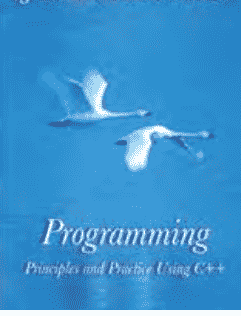

- 大量“关人”的魔鬼课程
  - 大家顺利进入了上海交大的工科学院，自然能够应付自如！
- 教授C++编程语言的课程
- 面向具备下列特质的初学者
  - 希望成为语言的“律师”
    - 我们并不希望陷入技术的犄角旮旯之中
  - 被认为有点迟钝但是相当懒惰
    - 我们不会进行填鸭式教育
- 使用
  - 某些未经测试的开发方法学或许多不必要的废话

## 课程目标

- 教与学
  - 基本的编程概念
  - 关键的实用技术
  - 基本的标准C++工具
- 学习本课程后，你将能够
  - 编写小的会话式C++程序
  - 阅读更大规模的程序
  - 自学许多其他语言的基础知识
  - 修“高级”C++程序设计课程
- 学习本课程后，你尚未成为
  - 专家级的程序员
  - C++语言专家
  - 高级库的专家级使用者

- 学生
  - 软件学院本科一年级新生
- 教师
  - 陈昊鹏
    - Mobile: 13917262561
    - E-mail: chen-hp@sjtu.edu.cn
    - Office: 软件大楼1111
    - http://reins.se.sjtu.edu.cn/~chenhp
  - 陈雨亭
    - Mobile: 15801755532
    - E-mail: chenyt@cs.sjtu.edu.cn
    - Office: 软件大楼1107

- 助教
  - 雷 伟 leiwei1990@163.com
  - 叶如锐 yeluolei@gmail.com
  - 孙海洋 sunhaiyangsjtu@gmail.com
  - 朱新宇 xyzhu1120@gmail.com
  - 何贞毅 snowymohehe@gmail.com

- 职责
  - 班主任
  - 上机辅导
  - 平时答疑
  - 作业批改

## 上课时间&地点

- 周二下午 7-8节，14:00-15:40，上院100
- 周五下午 7-8节，14:00-15:40，上院100

## 上机时间&地点

- 周四晚6:00-9:00，软件大楼 5号楼机房
- 5112/雷 伟、叶如锐、何贞毅
- 5103/孙海洋、朱新宇

## 答疑时间&地点

- 周三下午14:00-16:00 教师办公室
- 周二、周五晚上18:00-21:00，用于检查作业及答疑
- 平时有问题也可以通过邮件和教师或助教联系

- 课件
  - www.se.sjtu.edu.cn 上的elearning
  - http://courses.cs.tamu.edu/teresa/engr112/engr112-index.html
  - http://www.stroustrup.com/Programming/
- 教科书
  - Programming : principles and practice using C++, Bjarne Stroustrup, Addison-Wesley
  - 中文版： C++程序设计原理与实践，王刚译，机械工业出版社，2010-6-1
- 参考书
  - 完美的C++教程，Walter Savitch著，江山等译，机械工业出版社，2007
  - 《C++ Primer（第四版）》， Stanley B. Lippman、Barbara E. Moo、José LaJoie著，李师贤等人译，人民邮电出版社，2006
  - 《C++编程规范》， Herb Sutter、Andrei Alexandrescu，人民邮电出版社，2005

- 课件
  - http://reins.se.sjtu.edu.cn/courses/se323-fall-2012
- 实验课内容，请参考：
  - http://stap.sjtu.edu.cn/~chenyt/CPP2012.htm

## 为什么选择C++？

- 学习编程必须选择一种编程语言
- 编程语言的目的是让我们能够用代码来表示自己的思想
- C++ 能够让我们在绝大多数应用领域表示自己的思想
- C++ 是在工程领域应用得最广的编程语言之一
  - http://www.research.att.com/~bs/applications.html

- C++ 由ISO标准准确而全面地定义
  - 而该标准几乎被一致接受
- C++ 可以在几乎所有类型的计算机上使用
- 在使用C++学习到的编程概念可以直接应用于其他语言
  - 包括C、Java、C# 和 Fortran

- 第1部分 基础知识 30hrs
  - 1. 编程基本概念
  - 2. 数据类型与操作符
  - 3. 计算与语句
  - 4. 计算实例1：排序和搜索
  - 5. 函数与命名空间
  - 6. 指针与引用
  - 7. 错误处理
  - 8. 计算实例2：分解与抽象
  - 9. 递归函数
  - 10. 函数重载
  - 11. I/O
  - 12. 定制I/O
  - 13. 类
  - 14-15. 基础知识综合运用：命令行计算器

- 第2部分 OO扩展部分 18hrs
  - 16. 子类化
  - 17. 虚函数
  - 18. 纯虚函数
  - 19. 类编程实例1：图书馆
  - 20. FLTK图形库的使用
  - 21. FLTK图形库的设计：接口与实现分离
  - 22. 基于FLTK的GUI交互式程序设计
  - 23. MFC和QT的图形化设计与FLTK的对比
  - 24. 类编程实例2：图形化计算器

- 第3部分 高级话题 14hrs
  - 25. 自由存储
  - 26-28. 模板：函数模板和类模板
  - 29. 容器类
  - 30. 异常机制深入探讨
  - 31-32. 程序设计综合实例

## 授课特点

- 详细
  - 对课程中用到的知识点都进行充分地解释，以求大家真正理解
  - 排除任何“魔幻”知识点
- 实用
  - 只解释有用的概念、结构和技术
  - 不会详细解释所有的犄角旮旯
- 完备
  - 课程中介绍的概念、结构和技术可组合使用以构建有用的程序
  - 本课程之外当然还有许多有用的概念、结构和技术

## 授课特点

- 写实
  - 课程中介绍的概念、结构和技术可以用来构建 “工业级” 的程序
- 简单
  - 课程中所使用的都是可以阐释所涉及概念、结构和技术的最简单实用的实例
- 可扩展
  - 课程中讲授的概念、结构和技术可以应用于构建大型、可靠和高效的程序

## 考核方式

- 平时作业 + Projects + 期中、期末上机考试
  - 平时作业 - 45% (3% * 15)
  - Projects - 15%
  - 期中上机考试 - 15%
  - 期末上机考试 - 25%


## 第1课

## 编程与程序

第一集

## 编程与程序


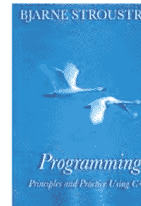

## 为什么编程？

- 软件是无形的
  - 软件是运行于计算机上的程序集
- 我们的文明运行于软件之上
  - 大部分工程活动都涉及软件
- 大部分程序运行在看起来不像PC的计算机上
  - PC有显示器、键盘和主机
  - 许多程序都是运行在嵌入式系统中
- 每一部计算机都需要运行程序
  - 否则就是一堆无用的昂贵的电子元件


## 为什么编程？

- 编程是一种用代码表达思想的方式
- 辅助问题解决的方式
- 好的程序员能够
- 理解项目中代码所扮演的角色和所使用的编程技术
- 编写好的程序的精髓在于
- 理解用户需求和对软件实现上施加的限制条件

## 计算机无处不在

- 有显示器 vs. 无显示器


- 造船

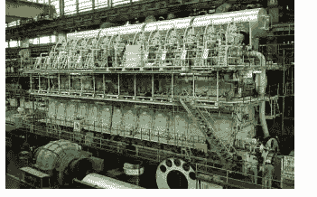


- 设计
- 构造
- 管理

- 监控
- 发动机
- 船壳设计
- 船泵

- 飞机


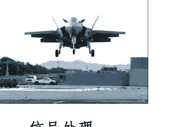

- 通信
- 控制
- 显示

- 信号处理
- “工具”控制
- 监控

- 通信

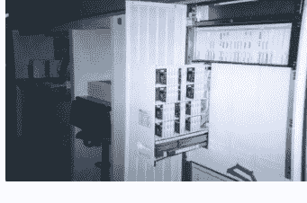


- 语音质量
- 用户界面
- 计费
- 移动

- 切换
- 可靠性
- 供电
- 图像

## 计算机无处不在

- 能源


- 控制
- 监控
- 分析
- 设计

- 通信
- 可视化
- 制造

## 计算机无处不在

- PC/工作站


除了游戏、字处理、网上冲浪和电子表格之外，我们还被大量的计算所包围

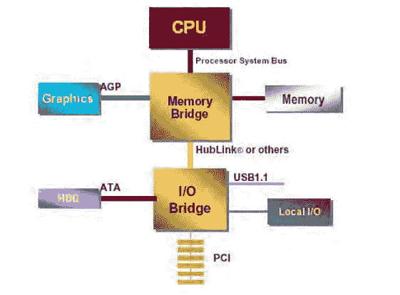

## 计算机结构

- 我们看书学习的过程：
- 人 - CPU
- 书桌 - 内存
- 书架 - 硬盘
- 书与笔记 - 数据
- 书需要放到书桌上才能被人阅读 - 数据在内存中被CPU处理
- 书桌每天晚上都要清空 - 内存中的数据关机后清零
- 书需要放到书架上妥善保存 - 数据需要存储到硬盘上
- 书摆放到书架和书桌的某个位置 - 数据在硬盘和内存中都有地址

- 我们烧菜的过程:
- 人 - CPU
- 锅和案板 - 内存
- 电冰箱 - 硬盘
- 食材 - 数据
- 食材需要放到案板和锅上才能被人烹饪 - 数据在内存中被CPU处理
- 做完饭案板和锅要清洗干净 - 内存中的数据关机后清零
- 食材需要放到冰箱中妥善保存 - 数据需要存储到硬盘上
- 食材摆放到冰箱和案板的某个位置 - 数据在硬盘和内存中都有地址

## 计算机结构

- 内存地址是线性的
- 不是二维的
- 每个地址对应一个字节
- 8 bit

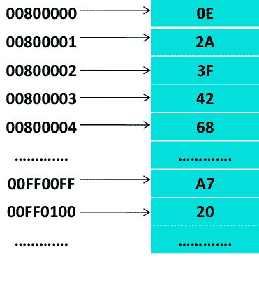

## 问题的解决

- 解决问题的策略
- 分而治之（divide and conquer）
- 逐步求精（stepwise refinement）
- 计算机解决问题的方法
- 人们用程序设计语言描述要解决的问题及解决的方案
- 用语言翻译/编译器加工使计算机理解其描述
- 然后就可以使计算机进行工作了

- 机器语言 ➔ 汇编语言
- a=3*a-2*b+1; //把表达式3*a-2*b+1的结果赋值给a

| 汇编语言 | 机器语言 |
|---|---|
| mov eax, DWORD PTR a_[ebp] | 8b 45 fc |
| lea eax, DWORD PTR [eax+eax*2] | 8d 04 40 |
| mov ecx, DWORD PTR b_[ebp] | 8b 4d f8 |
| add ecx, ecx | 03 c9 |
| sub eax, ecx | 2b c1 |
| inc eax | 40 |
| mov DWORD PTR a_[ebp], eax | 89 45 fc |

## 高级程序设计语言

- 高级语言可以更加抽象地描述数据与过程，使得我们更加关注于数据和运算，无需关心具体的实现
- a=3*a-2*b+1;
- 高级语言的抽象描述最后都自动转化成了机器的具体实现
- 语言编译器/翻译

## 高级程序设计语言的发展

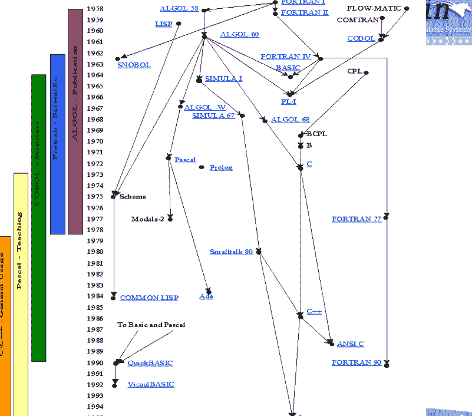

## 程序

- 程序=算法+数据结构（N. Wirth, 1975）
- 数据结构指的是数据的组织形式
- 算法关注于如何将指令组织成程序来解决某个特定的问题
- 算法通过数据结构来访问数据

## 数据

- 1/2 杯黄油
- 1 杯糖
- 2 个鸡蛋
- ...

## 算法

- 奶油
- 逐渐加糖
- 打鸡蛋
- ...

## 程序


## 程序设计方法：过程化程序设计方法

- 一个问题可直接由一组算法来建立模型
- Fortran、C 和 Pascal 是三种著名的过程语言，C++也支持过程化程序设计单独的过程

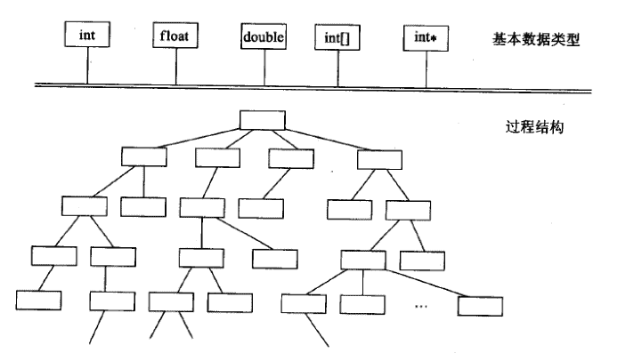

- Example:
- 公共图书馆的资料借阅/登记（check out/check in）系统

```
void check_in();
void check_out ();
void over_due ();
void fine ();

int main(){
    check_in();
    check_out();
    over_due();
    fine();
}
```

- 程序 = 算法+抽象数据类型
- 抽象数据类型
- 数据结构+对数据的相关操作（读入、输出、打印...）
- 在对象化程序设计过程中，人们需要采用抽象数据类型描述数据结构
- 可维护性、可重用性...
- 算法是基于抽象数据类型的

- 例如：将日期作为一个抽象的数据类型
- 日期的数据类型描述
- 日期 的内在的数据组织
- 年、月、日
- 日期 的外在操作
- 设定日期
- 读取日期
- 比较日期
- 判断日期合法性
- 输出日期
- 算法1：为某项活动预定日程
- 算法2：为某项活动更改日程

## 面向对象的程序设计

- 程序=（对象，对象，对象，...）
- C++、Java语言
- 类与对象

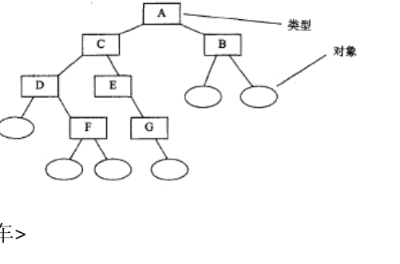

- Example:
- 汽车系统=（汽车<前进，倒车>
- 车轮1<加速，中速，减速>
- 车轮2<加速，中速，减速>
- 发动机<打火，熄火>
- 车灯<开、关>
- 控制按钮<...>...)


以五子棋游戏为例：

## 过程化程序设计方法

- 1、开始游戏
- 2、黑子先走
- 3、绘制画面
- 4、判断输赢
- 5、轮到白子
- 6、绘制画面
- 7、判断输赢
- 8、返回步骤2
- 9、输出最后结果

## 对象化程序设计方法

- 1、黑白双方，这两方的行为是一模一样的
- 2、棋盘系统，负责绘制画面
- 3、规则系统，负责判定诸如犯规、输赢等


- 火星探测器、动画、图形处理、Photoshop、图形化界面、操作系统、编译器、幻灯片、芯片设计、芯片制造、半导体工具等等。
  - www.research.att/~bs/applications.html

```
// ...

int main() {
    cout << " Hello, world!\n "; // 输出是13个字符 Hello, world!
    // 后面跟着一个换行符
    return 0; // 返回表示成功的字符
}

// 引号界定了字符串常量的范围
// 注意： “智慧” 引号 “ ” 将引发编译器错误
// 因此，应该使用 " " 风格的引号
// \n 表示换行符
// main() 是 C++ 程序开始的地方
```

```
// 第一个程序：

// 获取现在所需的库工具
#include <iostream>
using namespace std;

int main()
{
    cout << " Hello, world!\n ";// 输出是13个字符 Hello, world!
    // 后面跟着一个换行符
    return 0;            // 返回表示成功的字符
}

// 注意分号； 它们表示语句终止
// 花括号 { ... } 将若干条语句群组到一个块中
// main( ) 是不接受任何引元的函数
// 并返回一个整数 int (整数值) 表示成功或失败
```

## 第一个程序 - 完整版

```
// 第一个程序：

// 获取现在所需的库工具
#include "../../std_lib_facilities.h"

int main()          // main() 是 C++ 程序开始的地方
{
    cout << " Hello, world!\n ";// 输出是13个字符 Hello, world!
                            // 后面跟着一个换行符
    return 0;           // 返回表示成功的字符
}

// 注意分号； 它们表示语句终止
// 花括号 { ... } 将若干条语句群组到一个块中
// main( ) 是不接受任何引元的函数
// 并返回一个整数 int (整数值) 表示成功或失败
```

## 表达式与语句

- 在C++中动作被称为表达式
  `a+1, a++`
- 以分号结尾的表达式被称作语句，语句是C++程序中最小的程序单位
  `int book_count = 0;`
  `book_count = books_on_shelf + books_on_order;`
  `cout << "The value of book_count: " << book_count;`

- 把语句按逻辑语义分组，就形成了一些函数
  ```
  void readIn() { cout << "readIn()\n"; }
  void sort() { cout << "sort()\n"; }
  void compact() { cout << "compact()\n"; }
  void print() { cout << "print()\n"; }
  ```
- 在C++中，每个程序必须包含一个被称作main()的函数，它是由程序员提供的，并且只有这样的程序才能运行
- C++程序从main()函数的第一条语句开始执行

```
// 修改之后用于Windows控制台模式的程序：

// 获取现在所需的库工具
#include "../../std_lib_facilities.h"

int main()
{
    cout << "Hello, world\n";  // 输出是13个字符 Hello, world!
                           // 后面跟着一个换行符
    keep_window_open();     // 等待按键
    return 0;               // 返回表示成功的字符
}

// 如果没有keep_window_open()，输出窗口将立即关闭
// 你可能还来不及看清输出（在 Visual C++ 2003上）
```

- “Hello world” 是非常重要的程序
  - 其目的是让我们熟悉工具
    - 编译器
    - 程序开发环境
    - 程序执行环境
  - 书写程序需要十分仔细
    - 在调试好程序后，可以尝试如下错误，然后看看工具的反应
      - 忘记写头文件
      - 忘记写字符串终止标志
      - return拼写错了，例如写成retrun
      - 忘记分号
      - 忘记{或}
      - ...

- 这个程序看起来像在套用“样板"
  - 只有 cout << "Hello, world!\n" 是在做具体的事情
- 这很正常
  - 我们自己写的大部分代码和使用的大部分系统也都可以使其他的代码更加优雅或高效
- “样板”
  - 即能够使我们的代码更加简单、可理解、可信和高效的符号、类库和其他工具等
  - 你是否愿意自己编写1,000,000 行的机器码？
- 这意味着我们不应该只是 “完成任务”
  - 还应该考虑如何以更好的、正确的，并能够使其他软件更方便地创建的方式，来完成任务

## 风格至关重要！

```
int main(){
    opening_Ceremony();
    swimming();
    diving();
    ............
    closing_Ceremony();
}
```

```
void swimming_men_400(){
    cout<< " Swimming men 400m, date: ..., place: ... "
}

void swimming_men_100(){
    cout<< " Swimming men 400m, date: ..., place: ... "
}
...
void swimming(){
    swimming_men_400();
    swimming_men_200();
    swimming_women_400();
    ...
}
...
```

```
void diving() {
    diving_men_3_springboard();
    diving_men_10_plateform();
    ...
}

void opening_Ceremony() {
    cout<<" Opening Ceremony-date: 8.8, place: bird nest\n ";
}

void closing_Ceremony() {
    cout<<" Closing Ceremony-date: 8.24, place: bird nest\n";
}
```

## 程序书写结构

- 程序应该按照合理的结构来书写，例如：

```
/*
 * File: PowersOfTwo.cpp
 * -------------------------
 * This program generates a list of the powers of
 * two up to an exponent limit entered by the user.
 */
#include <iostream>
using namespace std;

/* Function prototypes */
int raiseToPower(int n, int k);
```

Program comments

Library inclusions

Function prototype

```
/* Main program */
int main() {
    int limit;
    cout << "This program lists powers of two." << endl;
    cout << "Enter exponent limit: ";
    cin >> limit;
    for (int i = 0; i <= limit; i++) {
        cout << "2 to the " << i << " = "
             << raiseToPower(2, i) << endl;
    }
    return 0;
}
```

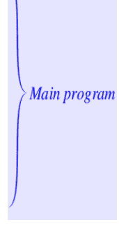


## 程序书写结构

```
/*
 * Function: raiseToPower
 * Usage: int p = raiseToPower(n, k);
 * -----------------------------
 * Returns the integer n raised to the kth power.
 */
int raiseToPower(int n, int k) {
    int result = 1;
    for (int i = 0; i < k; i++) {
        result *= n;
    }
    return result;
}
```

函数注释

函数定义

## 程序开发的步骤

- 程序开发步骤是什么？

1. 编辑（写程序）→
2. 编译（将单独的程序文件变成目标代码）→
3. 链接（将多个编译好的目标代码整合成可执行程序）→
4. 调试执行（查找程序中的错误并运行）

## Java

脚本语言

JavaScript、VBScript

## 程序开发的步骤

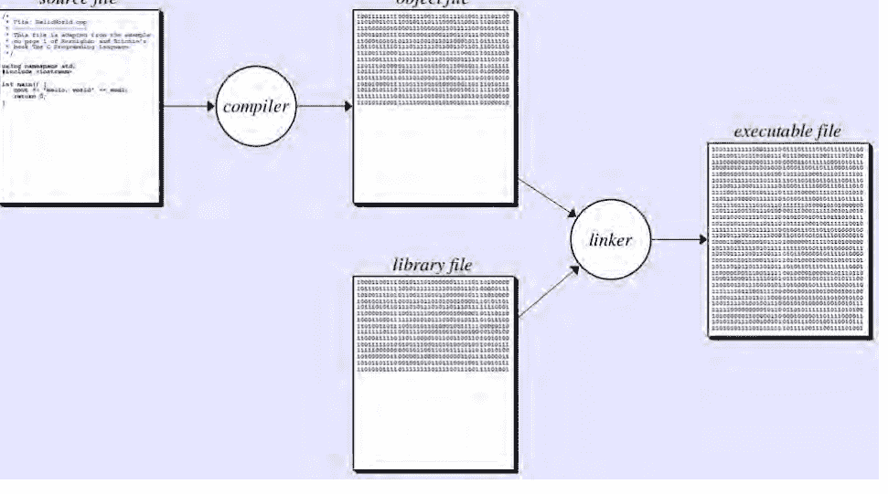

源文件

目标文件

可执行文件

库文件

编译器

链接器

```
File: HelloWorld.cpp
// This file is adapted from the example
// code of "Programming and Problem Solving with C++"
// Book "C++ Programming Language"

using namespace std;
#include <iostream>

int main() {
  cout << "Hello, world!" << endl;
  return 0;
}
```

## 编程操作流程

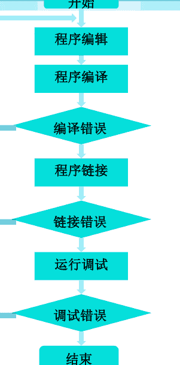

## 程序编辑

- 源程序
  - 程序员编辑的程序，存放在*.cpp文件中
  - .h文件是头文件，用来提供函数声明、常量定义、全局数据声明等等
    - #include 指示符读入指定文件的内容，头文件通过include 预处理器指示符而成为我们程序的一部分。
      - `#include <some_file.h>`
      - `#include "my_file.h"`
  - 预处理器指示符用#号标识，这个符号将放在程序中该行的最起始一列上。处理这些指示符的程序被叫做预处理器
    - `#include, #ifdef, #define`

## 程序编辑

- Example: 头文件与#include
  - a.h
  - a.cpp

```
/*A header file*/
```

```
#include "a.h"
int main() { return 0; }
```

→

```
/*A header file*/
int main(){ return 0; }
```

## 程序编译

- 预处理
- 编译
  - 程序被编译后，会生成目标代码，存放在目标文件*.obj中。
  - 目标代码即机器代码，是计算机能够识别的指令集合。

## 程序链接

- 目标代码不能在计算机上运行
  - 目标代码只是个独立的程序段，程序段之间还没有彼此呼应，程序段中用到的C++库代码和其他资源还没挂上
- 为了将成组的目标代码转换为可执行程序，必须进行链接，即将目标代码整合成可执行文件*.exe

- 调试(Debug)
  - 搜索并消除程序中的错误

- 程序员执行目标代码，检查输出结果是否与预期结果一致，从而可以发现程序中的错误。

- 传统定义
  - 确切地告诉 “一个运行速度极快的白痴” 它应该做些什么
  - 在计算机上解决问题的计划
  - 指定程序执行的顺序
    - 但是现代程序通常包含上百万条代码
    - 并且以数据操作为中心

- 我们使用的定义
  - 指定程序的结构和行为，并测试该程序是否能够正确地执行其任务，并具有可接受的性能
    - 时刻牢记要检查 “它” 能否正常工作

- 软件 == 一个或多个程序

- 编程相当简单
  - 只是声明机器该做些什么
- 那么为什么编程又那么难呢？
  - 我们想让 “机器” 做更复杂的事情
    - 计算机又是非常挑剔、无情和愚蠢的东西
  - 世界远比我们想象的要复杂
    - 因此我们不能总是知道我们想要的意味着什么
  - “编程需要领悟”
    - 当你对某个任务编程时，你首先需要理解它
    - 当你编程时，你需要花大量的时间去理解想要自动化执行的任务
  - 编程需要理论联系实践
    - 如果只是实践，那就会产生不可扩展和不可维护的程序
    - 如果只是理论，那就只能编写出过家家一样的程序

## 总结

- 软件概念
- 问题解决策略
- 低级、高级程序设计语言
- 程序
- 过程化程序设计方法
- 对象化程序设计方法
- C++地位与角色
- Hello World程序
- 程序开发步骤


## 第2课
对象、类型和值

## Episode Two

## Objects, Types, and Values


- 大多数编程任务都涉及对数据的操作，本章将
  - 描述如何输入输出数据
  - 介绍持有(存储)数据的变量这个概念
  - 介绍核心概念：类型 和 类型安全

- 字符串与字符串I/O

- 整数与整数I/O

- 类型与对象

- 类型安全

## 输入和输出

- 真正的程序需要获得输入，并产生相应的输出
- 计算机内存中放置输入值的空间被称为对象(Object)
  - 对象是内存中的一块区域，它具有某种类型(type)
  - 类型指定了在该区域中可以放置何种信息
- 具名的对象被称为变量(variable)
  - string变量和int变量
  - 变量中存储的数据项称为值(value)


## 输入和输出

```cpp
// 读入 first name:
#include "std_lib_facilities.h"        // 课程头文件

int main()
{
    cout << "Please enter your first name (followed " << "by 'enter'):\n";
    string first_name;
    cin >> first_name;
    cout << "Hello, " << first_name << "\n ";
}
```

// 注意：一行语句可以输出多个值  
// 引入变量的语句称为声明(declaration)  
// 变量持有指定类型的值  
// 最后的 return 0; 在 main() 中是可选的  
// 但是最好加上它以避免编译器报错

std_lib_facilities.h:

接口到库
(声明)

Myfile.cpp:

```
#include "std_lib_facilities.h"

My code
My data
(定义)
```

- "std_lib_facilities.h" 是课程中用到的头文件

## 变量

- 计算机内存中放置输入值的空间被称为对象(Object)
  - 具名的对象被称为变量(variable)
  - 变量具有某种类型(type)
  - 变量中存储的数据项称为值(value)

定义变量的语句被称为变量定义(definition)

- 定义变量时将在内存中分配一块空间给标量
- 定义变量时可以给变量赋初值（这往往是个好习惯）

```
string name = "Annemarie ";
int number_of_steps = 39;
```

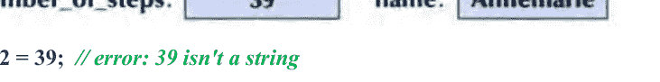

```
string name2 = 39; // error: 39 isn't a string
int numbe_of_steps = "Annemarie "; // error: "Anne marie" is not an int
```


- C++提供了大量的类型，但是常用的就是五种
  `int number_of_steps = 39; // int用于整数`
  `double flying_time = 3.5; // double用于浮点数`
  `char decimal_point = '.'; // char用于单个字符`
  `string name = "Annemarie"; // string表示字符串`
  `bool tap_on = true; // bool用于逻辑变量`
- 类型定义了
  - 数据的存储方式
  - 和对该类型数据可执行的操作

## 头像/任务
- 任务项目 1
- 任务项目 2
- 任务项目 3

这是任务详情描述文本，用于说明该任务的具体内容和要求。

| 参数 | 值 |
| --- | --- |
| A | 1 |
| B | 2 |

> > 这是一段引用文本

## 二进制及运算
- 这个世界上10种人，一种懂二进制，一种不懂二进制
- 十进制整型数据（32位）的二进制补码
- 二进制补码表示的数中，最高位是符号位（0为正，1为负）。
- 正整数转换为二进制数据
- 35 = 00000000, 00000000, 00000000, 00100011₂
- 负整数转换为二进制数据
- 先将对应的正整数转换为二进制数据，然后取补（取反加1）
- -35 = 11111111, 11111111, 11111111, 11011101₂

## 二进制及运算
- 二进制整数的运算
  - 加法
    - $35+12=00100011_2+00001100_2=00101111_2=47$
  - 减法
    - $3-5=3+（-5）=00000011_2+11111101_2=11111110_2=-2$
  - 乘法
    - $3*5=00000011_2*00000101_2=00000011_2*00000100_2+00000011_2*00000001_2=00001100_2+00000011_2=00001111_2=15$
  - 除法
    - $13÷3=00001101_2÷00000011_2=（00001100_2+00000001_2）÷00000011_2=00000100_2=4$

## 整值类型
- 整数文字常量可以被写成十进制、八进制或者十六进制的形式
  - 20 // 十进制
  - 024 // 八进制
  - 0x14 // 十六进制
- 整值类型：字符型char，短整型short，整型int，长整型long
  - 典型情况下
  - char以一个字节表示
  - short 以半个机器字表示
  - int 以一个机器字表示
  - 而long 为一个或两个机器字
  - 什么是机器字？

## 整值类型
- 在文字常量后面加一个 L 或 l，将其指定为 long 类型
  - 1024UL 1024LU
- 符号位：整值类型可以有符号位，也可以无符号位
  - 如果在整型文字常量的后面加上 u 或 U，其为一个无符号数。
    - int x=2147483648;
    - unsigned int x=2147483648u;

## 浮点数
- 二进制浮点数
  - 十进制浮点数转换成二进制浮点数
    - 10.6=2³+2¹+2⁻¹+2⁻⁴+...=1010.1001₂
  - 二进制浮点数的规格化及阶码
    - 1010.1001₂=(1).0101001...₂ * 2³
  - 二进制浮点数的机内表示
    - 浮点数的阶码：-126~127
    - 阶码需要做一个+127的偏移
      - 10.6= 1010.10011001100110011001₂
        ➔0,10000010, 01010011001100110011001
- 浮点数表示的两个例外
  - 0 = 0,00000000,00000000000000000000000
  - +∞ = 0,11111111,00000000000000000000000
  - -∞ = 1,11111111,00000000000000000000000

## 浮点数
◆ 999.99和-999.99的二进制浮点数是多少？

999.99:
0100, 0100, 0111, 1001, 1111, 1111, 0101, 1100
阶码为9，9+127=136=10001000₂
规格化数为 999.99/512=1.95310546875
=1.1111 0011 1111 1110 1011 100₂

-999.99
1011, 1011, 1000, 0110, 0000, 0000, 1010, 0100
负数的这种设计可以满足999.9+(-999.9)=0

999.99和-999.99的二进制浮点数是多少？

float的999.99真的是999.99吗？

999.99/512=1.95310546875
=1.11110011111100110011010₂
=1.953105449676513671875

1.953105449676513671875*512=999.989990234375

浮点数精度问题！

2阶码*2^-23
2^-23= 0.00000011920928955078125
512*2^-23= 0.00006103515625

## 浮点数
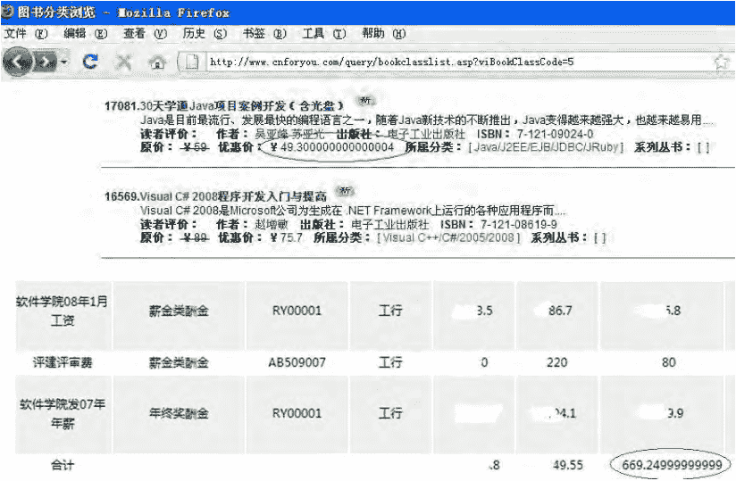

**17081.30天学通 Java项目案例开发（含光盘）**

Java是目前最流行、发展最快的编程语言之一，随着Java技术的不断推出，Java变得越来越强大，也越来越易用。

读者评价：作者：吴军；出版社：电子工业出版社；ISBN：7-121-09024-0
原价：¥69.8　优惠价：¥48.300000000000004　所属分类：[Java]/J2EE/EB/DB/CRM/Ruby

**16569.Visual C# 2008程序开发入门与提高**

Visual C# 2008是Microsoft公司为生成在.NET Framework上运行的各种应用程序而设计的编程工具。

读者评价：作者：赵峰；出版社：电子工业出版社；ISBN：7-121-08619-9
原价：¥88　优惠价：¥75.7　所属分类：[Visual C++/C#/2005/2008]

| 项目 | 摘要 | 科目编号 | 银行 | 数值1 | 数值2 | 数值3 |
|---|---|---|---|---:|---:|---:|
| 软件学院08年1月工资 | 薪金调整金 | RY00001 | 工行 | 3.5 | 86.7 | 5.8 |
| 评建评审费 | 薪金调整金 | AB509007 | 工行 | 0 | 220 | 80 |
| 软件学院08年7年奖金 | 年终奖奖金 | RY00001 | 工行 | — | 44.1 | 3.9 |
| 合计 |  |  |  | 8 | 49.55 | 669.2499999999999 |

## 字符型
- 字符型char
  - 通常用来表示单个字符和小整数，可以用一个机器字节（8bit）来表示
  - 字符型常量、变量对应了ASCII字符集（128个字符）中的字符
    - `int a = 65; char b = 65; //b='A'`
  - 可打印的文字字符常量可以写成用单引号括起来的形式
    - `'a'，'2'，','，' '（空格）`
  - 一部分不可打印的字符可以用转义序列来表示

## (ASCII码)
美国信息交换标准代码

| Dec | Hex | Char | Dec | Hex | Char | Dec | Hex | Char | Dec | Hex | Char |
|---|---|---|---|---|---|---|---|---|---|---|---|
| 0 | 00 | Null | 32 | 20 | Space | 64 | 40 | @ | 96 | 60 | ` |
| 1 | 01 | Start of heading | 33 | 21 | ! | 65 | 41 | A | 97 | 61 | a |
| 2 | 02 | Start of text | 34 | 22 | " | 66 | 42 | B | 98 | 62 | b |
| 3 | 03 | End of text | 35 | 23 | # | 67 | 43 | C | 99 | 63 | c |
| 4 | 04 | End of transmit | 36 | 24 | $ | 68 | 44 | D | 100 | 64 | d |
| 5 | 05 | Enquiry | 37 | 25 | % | 69 | 45 | E | 101 | 65 | e |
| 6 | 06 | Acknowledge | 38 | 26 | & | 70 | 46 | F | 102 | 66 | f |
| 7 | 07 | Audible bell | 39 | 27 | ' | 71 | 47 | G | 103 | 67 | g |
| 8 | 08 | Backspace | 40 | 28 | ( | 72 | 48 | H | 104 | 68 | h |
| 9 | 09 | Horizontal tab | 41 | 29 | ) | 73 | 49 | I | 105 | 69 | i |
| 10 | 0A | Line feed | 42 | 2A | * | 74 | 4A | J | 106 | 6A | j |
| 11 | 0B | Vertical tab | 43 | 2B | + | 75 | 4B | K | 107 | 6B | k |
| 12 | 0C | Form feed | 44 | 2C | , | 76 | 4C | L | 108 | 6C | l |
| 13 | 0D | Carriage return | 45 | 2D | - | 77 | 4D | M | 109 | 6D | m |
| 14 | 0E | Shift out | 46 | 2E | . | 78 | 4E | N | 110 | 6E | n |
| 15 | 0F | Shift in | 47 | 2F | / | 79 | 4F | O | 111 | 6F | o |
| 16 | 10 | Data link escape | 48 | 30 | 0 | 80 | 50 | P | 112 | 70 | p |
| 17 | 11 | Device control 1 | 49 | 31 | 1 | 81 | 51 | Q | 113 | 71 | q |
| 18 | 12 | Device control 2 | 50 | 32 | 2 | 82 | 52 | R | 114 | 72 | r |
| 19 | 13 | Device control 3 | 51 | 33 | 3 | 83 | 53 | S | 115 | 73 | s |
| 20 | 14 | Device control 4 | 52 | 34 | 4 | 84 | 54 | T | 116 | 74 | t |
| 21 | 15 | Neg. acknowledge | 53 | 35 | 5 | 85 | 55 | U | 117 | 75 | u |
| 22 | 16 | Synchronous idle | 54 | 36 | 6 | 86 | 56 | V | 118 | 76 | v |
| 23 | 17 | End trans. block | 55 | 37 | 7 | 87 | 57 | W | 119 | 77 | w |
| 24 | 18 | Cancel | 56 | 38 | 8 | 88 | 58 | X | 120 | 78 | x |
| 25 | 19 | End of medium | 57 | 39 | 9 | 89 | 59 | Y | 121 | 79 | y |
| 26 | 1A | Substitution | 58 | 3A | : | 90 | 5A | Z | 122 | 7A | z |
| 27 | 1B | Escape | 59 | 3B | ; | 91 | 5B | [ | 123 | 7B | { |
| 28 | 1C | File separator | 60 | 3C | < | 92 | 5C | \ | 124 | 7C | | |
| 29 | 1D | Group separator | 61 | 3D | = | 93 | 5D | ] | 125 | 7D | } |
| 30 | 1E | Record separator | 62 | 3E | > | 94 | 5E | ^ | 126 | 7E | ~ |
| 31 | 1F | Unit separator | 63 | 3F | ? | 95 | 5F | _ | 127 | 7F | DEL |


| 符号 | 表示 |
| --- | --- |
| 换行符 | \n |
| 水平制表键 | \t |
| 垂直制表键 | \v |
| 退格键 | \b |
| 回车键 | \r |
| 反斜杠键 | \\ |
| 单引号 | \' |
| 双引号 | \" |
| 1~3位八进制数 | \ddd |
| 1~2位十六进制数 | \xhh |
| 问号 | \? |

## 字符串

- 字符串字面常量由零个或多个用双引号括起来的字符组成
- 不可打印字符可以由相应的转义序列来表示
- 一个字符串文字可以扩展到多行，在一行的最后加上一个反斜杠表明字符串文字在下一行继续

- "" (空字符串)
- "a"
- "\nCC\toptions\tfile.[cC]\n"
- "a multi-line \
string literal signals its \
continuation with a backslash "
- cout << "\nCC\toptions\tfile.[cC]\n";

## bool型

- 单词true 和 false 是bool型的字面常量

- 内置类型
- 布尔类型
  - bool
- 字符类型
  - char
- 整数类型
  - int
  - and short and long
- 浮点数类型
  - double
  - and float
- 标准库类型
  - string

- 布尔字面常量
- true false
- 字符字面常量
- 'a', 'x', '4', '\n', '$'
- 整数字符常量
- 0, 1, 123, -6, 0x34, 0xa3
- 浮点数字符常量
- 1.2, 13.345, 0.3, -0.54, 1.2e3, 0.3F
- 字符字面常量
- "asdf", "Howdy, all y'all!"

- 在前面的程序中，我们读入了一个变量的值
  - 这里是 first_name
- 读入的变量具有类型
  - 这里是 string
- 变量类型确定了在变量上可以执行何种操作
  - 这里是 cin >> first_name;
  - 即读入字符直至遇到空白符(whitespace)
  - 空白符：空格( space)、制表符(tab)、换行(newline) ...

## 字符串输入

```cpp
// 读入 first和second:
int main()
{
    cout << "please enter your first and second names\\n";
    string first;
    string second;
    cin >> first >> second;                 // 读入两个字符串
    string name = first + ' ' + second;     // 连接字符串，用空格分开
    cout << "Hello, " << name << '\\n';
}

// 省略了 #include “std_lib_facilities.h” 以节省空间
// 在实际代码中不要忘记
```

```
// 读入名字和年龄
int main()
{
    cout << "please enter your first name and age\n";
    string first_name;        // 字符串变量
    int age;                  // 整数变量
    cin >> first_name >> age;    // 读入
    cout << "Hello, " << first_name << " age " << age << '\n';
}
```

- >> 是对类型敏感的
  - 根据读入的变量类型来读取输入值
  - 输入 22 Carlos 会如何？
  - 对变量赋初值可以防止这种错误

```
// 简单的算术运算

int main()
{
    cout << "please enter a floating-point number: ";
    double n;                         // 浮点数变量
    cin >> n;
    cout << "n == " << n
         << "\nn+1 == " << n+1          // '\n' 表示“换行"
         << "\nthree times n == " << 3*n
         << "\ntwice n == " << n+n
         << "\nn squared == " << n*n
         << "\nhalf of n == " << n/2
         << "\nsquare root of n ==" << sqrt(n)   // 库函数
         << endl;                        // 换行的另一个名字
}
```

## 数字与字符串

- **字符串**
  - `cin >>` 读入（直至遇到空白符）
  - `cout <<` 写出
  - `+` 连接
  - `+= s` 将字符串 s 追加到末尾
  - `++` 不支持该操作
  - `--` 不支持该操作
  - `...`

- **整数与浮点数**
  - `cin >>` 读入一个数字
  - `cout <<` 写出
  - `+` 加
  - `+= n` 加上 int n
  - `++` 自增 1
  - `--` 减法
  - `...`

变量的类型决定了哪些操作是合法的，以及这些操作对于该类型具有何种含义

> （这被成为“重载 overloading”或“操作符重载 operator overloading”）

```
string a = "alpha";

a = "beta";

string b = a;

b = a + "gamma";

a = a + "delta";
```

a: alpha

a: beta

a: beta
b: beta

a: beta
b: betagamma

a: betadelta
b: betagamma

```
int main()
{
    string previous = " ";    // 初值
    string current;
    while (cin>>current) {    // 读入单词流
        if (previous == current) // 检查新输入单词是否与最后一个输入单词相同
            cout << "repeated word: " << current << '\n';
        previous = current;
    }
}
```

- 探测是否连续输入了相同的词
  - While

## 简单计算

```
int main()
{
    const double cm_per_inch = 2.54;    // 1英寸=2.54厘米
    int length = 1;                    // 英寸长度
    while (length != 0)                // 英寸长度如果为 0，则终止
    {
        cout << "Please enter a length in inches: ";
        cin >> length;
        cout << length << "in. = "
             << cm_per_inch*length << "cm.\n";
    }
}
```

- while语句重复执行，直至条件为假

## 复合赋值操作符

++counter → counter = counter + 1

```
a += 7;  // means a = a+7
b -= 9;  // means b = b-9
c *= 2;  // means c = c*2
```

a oper= b → a = a oper b

+=, -=, *= , /=, %=

```
int a = 7;    // int 类型变量 a，初始化为整数值 7
```

7

```
a = 9;    // 赋值: 现在将 a 的值改为 9
```

9

```
a = a+a;    // 赋值: now double a's value
```

18

```
a += 2;    // 自增 a 的值 2
```

20

```
++a;    // 自增 a 的值 1
```

21


- 在C++程序中的名字
  - 以字母开头，包含字母、数字和下划线
    - x, number_of_elements, Fourier_transform, z2
  - 不合法的名字
    - 12x
    - time$to$market
    - main line
  - 不要以下划线开头: _foo
    - 这类名字为保留名
  - 用户使用关键字来定义名字
    - 例如:
      - int
      - if
      - while
      - double

- 选择有意义的名字
  - 缩写容易误导人
    - mtbf, TLA, myw, nbv
  - 短名字也可以有含义
    - 惯例用法:
      - x 是局部变量
      - i 是循环索引
  - 不要使用过长的名字
    - Ok:
      - partial_sum
      - element_count
      - staple_partition
    - Too long:
      - the_number_of_elements
      - remaining_free_slots_in_the_symbol_table
  - 不要使用中文做名字
    - 包括文件名、变量名、函数名、常量名等

```
int a = 7;
```

```
int b = 9;
```

```
char c = 'a';
```

```
double x = 1.2;
```

```
string s1 = "Hello, world";
```

```
string s2 = "1.2";
```

a: 7

b: 9

c: 'a'

x: 1.2

s1: 12 | "Hello, world"

s2: 3 | "1.2"

## 类型

- C++ 提供了一组类型
  - 例如 bool, char, int, double
  - 称为“内置类型”
- C++ 程序员可以定义新类型
  - 称为“用户定义类型”
- C++ 标准库提供了一组类型
  - 例如 string, vector, complex
  - 技术上讲，这些也是用户定义类型

## 对象

- 对象是持有给定类型值的内存
- 变量是具名对象
- 变量声明对变量进行命名

```
int a = 7;
```

```
char c = 'x';
```

```
complex<double> z(1.0,2.0);
```

```
string s = "qwerty";
```

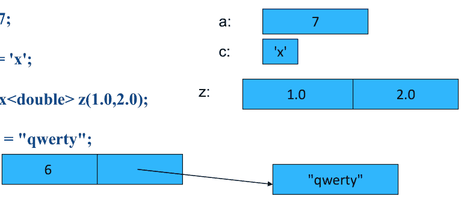

## 类型安全

- 语言规则：类型安全
  - 每一个对象都将根据其类型使用
    - 变量只有被初始化之后才能使用
    - 只有为变量声明的类型而定义的操作采用应用其上
    - 为变量定义的每个操作在执行后，该变量都将获得一个有效的值
- 理想：静态类型安全
  - 违反类型安全的程序将无法通过编译
    - (在理想系统中)编译器会报告所有这类违反类型安全的问题
- 理想：动态类型安全
  - 如果编写的程序违反了类型安全，在运行时刻可以探测到
    - (在理想系统中)某些代码(通常是“运行时系统”)会探测编译器没有发现的所有违规情况

## 类型安全

- 类型安全事关重大
  - 要十分仔细，不能违反它
  - 在编程时，编译器是最好的朋友
- C++ 不是(完全)静态类型安全
  - 没有一种广泛使用的语言是(完全)静态类型安全的
  - 要做到完全静态类型安全，可能会影响你表达思想
- C++ 不是(完全)动态类型安全
  - 许多语言都是动态类型安全的
  - 要做到完全静态类型安全，可能会影响你表达思想
  - 并且经常会使得产生的代码量很大或者运行速度很慢
- 这里要学习的大多数内容都是类型安全
  - 我们会提到所有类型不安全的做法

## 类型安全准则－隐式窄化

```cpp
// 当心: C++ 不会阻止你将一个可能导致溢出的值赋给一个变量
// 尽管编译器有可能会警告

int main()
{
    int a = 20000;
    char c = a;
    int b = c;
    if (a != b)              // != 表示“不等于”
        cout << "oops!: " << a << " != " << b << '\n';
    else
        cout << "Wow! We have large characters\n";
}
```

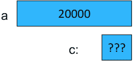

- 练习：在你的机器上运行一下，看看 b 会是什么值

// 当心: C++ 不会阻止你在初始化变量之前使用它
// (尽管编译器通常会警告)

```
int main()
{
    int x;        // x 得到一个“随机”初始值
    char c;       // c 得到一个“随机”初始值
    double d;     // d 得到一个“随机”初始值
                  //   — 并非每一种位模式对浮点数都是有效的
    double dd = d;      // 潜在错误: 某些实现无法复制无效的浮点数
    cout << " x: " << x << " c: " << c << " d: " << d << "\n";
}
```

- 总是初始化变量

- 安全转换
  - bool → char
  - bool → int
  - bool → double
  - char → int
  - char → double
  - int → double

- 不安全转换
  - double → int
  - double → char
  - double → bool
  - int → char
  - int → bool
  - char → bool

## 技术细节

- 在内存中一切都是 bit，类型是赋予这些 bit 的意义
  - (bits/binary) 01100001 是 int 97 也是 char 'a'
  - (bits/binary) 01000001 是 int 65 也是 char 'A'
  - (bits/binary) 00110000 是 int 48 也是 char '0'

```
char c = 'a';
cout << c;    // 打印字符c的值，其值为 a
int i = c;
cout << i;    // 打印字符c的整数值，其值为97
```

- 这就是“真实的世界”:
  - “42” 什么意思？
  - 除非你知道如何使用它们，否则你不知道它的意思
    - 米？英尺？摄氏度？$？门牌号？高度？...

## 效率

- 到目前为止，不用担心“效率”
  - 聚焦在代码的正确性和简洁性上
- C++ 是从 C 派生的，而 C 是一种系统编程语言
  - C++的内置类型直接映射到计算机的主存上
    - 一个 `char` 存储在一个 byte 中
    - 一个 `int` 存储在一个 word 中
    - 一个 `double` 适合浮点寄存器
  - C++的内置操作直接映射到机器指令上
    - 一个整数 `+` 是由一个整数加法操作实现的
    - 一个整数 `−` 是由一个复制操作实现的
  - C++ 提供对大部分现代硬件设备提供的工具进行直接访问的能力
- C++ 帮助用户使用内置类型和操作构建更安全、更优雅、更高效的新类型和新操作
  - 例如：字符串 string
  - 最终，我们将展示它是如何做到的

## 编程哲学

- 到目前为止，不用担心“效率”
  - 聚焦在代码的正确性和简洁性上
- 编程与其他类型的工程相似点之一就是要权衡
- 你必须有理想，但是它们经常互相冲突，因此你必须确定哪些对程序是最重要的
  - 类型安全
  - 运行时性能
  - 在指定平台上运行的能力
  - 在多种平台上运行出相同结果的能力
  - 与其他代码和系统的兼容性
  - 构建的难易度
  - 维护的难易度
- 不要敷衍对待正确性与测试
- 缺省情况下的目标应该是类型安全和可移植性


- 程序设计 I
- *Programming I*

谢谢！


## 程序设计 1

# *Programming and Data Structure I*

## 第3课
计算

## 第三集
计算

翻译自Bjarne Stroustrup的课件

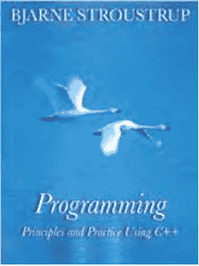

- 计算
  - 什么是可计算的？如何最佳地计算它？
  - 抽象、算法、启发、数据结构
- 语言结构和思想
  - 执行的先后顺序
  - 表达式和语句
  - 选择
  - 迭代
  - 数组和向量vector
  - 函数

- 已经学过的内容：
  - 如何进行算术运算
    - d = a+b*c
  - 如何选择
    - “if 是 true, 这样做; 否则做 else ”
  - 如何“迭代”
    - “做某事直至完成” while
    - “做100次”
  - 如何调用函数
    - “go ask Joe and bring back the answer”
    - “hey Joe, calculate this for me and send me the answer”
- 本章内容将主要介绍上述内容的细节

- 输入：从键盘、文件、其他输入设备、其他程序、同一个程序的其他部分
- 计算：程序对输入进行处理以产生输出
- 输出：到屏幕、文件、其他输出设备、其他程序、同一个程序的其他部分

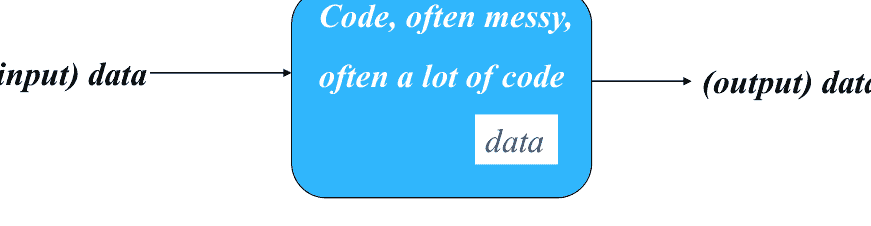

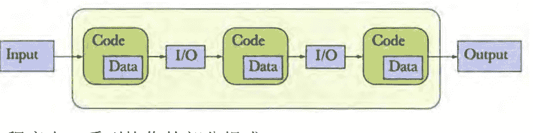

- 程序由一系列协作的部分组成
- 它们互相之间共享数据，这些数据
  - 存储在内存中
  - 存储在持久性介质中(例如硬盘)
  - 通过网络传输
- 它们的输入成为引元(argument)，输出成为结果(result)

## 语言特性

- 编程语言的每个特性都是为了表达基本的思想，例如
  - `+`：加法
  - `*`：乘法
  - `if (expression) statement else statement;`：选择
  - `while (expression) statement;`：迭代
  - `f(x);`：函数/操作
  - `…`

➢ 我们组合这些语言特性就编写出来程序

## 表达式

```
// 计算面积:
int length = 20;                 // 最简单的表达式: 字面常量 (这里的 20)
// (这里初始化了一个变量)
int width = 40;
int area = length*width;          // 一个乘法
int average = (length+width)/2;  // 加法和除法
```

- 计算将遵循常见的数学意义上的运算次序
  `a*b+c/d` 表示 `(a*b)+(c/d)` 而不是 `a*(b+c)/d`
- 如果有质疑，就加括号；如果计算复杂，也加括号
- 但是，不要书写过于复杂的表达式:
  `a*b+c/d*(e-f/g)/h+7`  // 太复杂了！
- 常量表达式：选择有意义的名字表示常量
  `const pi = 3.1415926;`

## 操作符

- 表达式是由操作符(operator)和操作数(operand)构成的
  - 操作符指定要做什么
  - 操作数指定操作符操作的数据

- 布尔类型: bool (true 和 false)
  - 判等操作符: == (相等), != (不等)
  - 逻辑操作符: && (与), || (或), ! (非)
  - 关系操作符: < (小于), > (大于), <=, >=

- 字符类型: char (e.g., ‘a’, ‘7’, 与 '@')

- 整数类型: short, int, long
  - 算术操作符: +, -, *, /, % (取余)

- 浮点类型: e.g., float, double (e.g., 12.45 and 1.234e3)
  - 算术操作符: +, -, *, /

## 操作符

- 许多操作符，基本上都有等价的简洁操作符，例如
  - a += c    表示    a = a+c
  - a *= scale    表示    a = a*scale
  - ++a    表示    a += 1
    或者    a = a+1
- “简洁操作符”通常更适合使用
  - 更清晰、更直接地表达思想
  - 执行效率和普通操作符是一样的
    - 编译器会编译出一致的代码

## 类型转换

- 在同一个表达式中，可以混合多种类型
  - 2.5/2   double/int 等于1.25
  - 5/2     int/int 等于2而不是2.5
  - 'a'+1   char+int 等于int('a')+1
  - 编译器将 int 提升转换为 double，将 char 提升转换为 int

- 初始化或赋值操作都会涉及类型转换
  - double d = 2.5;
  - int i=2;
  - double d2 = d/i;      //d2 == 1.25
  - int i2 = d/i;         // i2 == 1
  - d2 = d/i;             //d2 == 1.25
  - i2 = d/i;             // i2 == 1

- 语句是
  - 以分号结尾的表达式
  - 或者是声明
  - 或者是确定控制流的控制语句
- 例如
  - a = b;
  - double d2 = 2.5;
  - if (x == 2) y = 4;
  - while (cin >> number) numbers.push_back(number);
  - int average = (length+width)/2;
  - return x;

## 选择(if else)

- 有时，我们必须在备选项中选择
- 例如，假设要识别两个数中的较大值，可以使用下面的if语句
- if 语句的语法

```
if (a<b)      // Note: 这里没有分号
    max = b;
else          // Note: 这里没有分号
    max = a;
```

```
if (condition)
    statement-1    // 如果条件为真，则执行 statement-1
else
    statement-2    //如果条件为假，则执行 statement-2
```

- 当选择是基于一组常量值进行比较时
  - 使用多个嵌套的 if 语句会降低程序的可读性
  - 可以使用 switch 语句
- Switch 语句包含多个 case 语句
  - 用于 switch 的必须是整数类型、字符类型，或枚举类型，但不能是字符串类型
  - case 标号里面必须是常量表达式，不能使用变量
  - 每个 case 标号表明一种选择
  - 两个 case 标号中不能使用相同的值
  - 多个 case 标号可以使用相同的代码
  - 每个 case 标号后面应该紧跟 break 语句
  - break 语句用于终止 switch 的执行
  - default 表示不属于任何一个 case 的情况

```
cout << "Please enter a digit\n";
char a;
cin >> a;

switch (a) {
case '0': case '2': case '4': case '6': case '8':
    cout << "is even\n";
    break;
case '1': case '3': case '5': case '7': case '9':
    cout << "is odd\n";
    break;
default:
    cout << "is not a digit\n";
    break;
}
```


## 迭代(while循环)

+   世界上第一个在存储程序的计算机上运行的“真正的程序”
+   (David Wheeler, Cambridge, May 6, 1949)

```
// 计算并打印 0-99 的平方表格:
int main()
{
    int i = 0;
    while (i<100) {
        cout << i << '\t' << square(i) << '\n';
        ++i;    // increment i
    }
}
// (当时并非用 C++ 编写的☺.)
```

## 迭代(for循环)

+   - 另一种迭代形式： for 循环
+   - 将所有控制信息都集中在一个位置，即 for 的顶部，这样看得更清楚

```
for (int i = 0; i<100; ++i) {
    cout << i << '\t' << square(i) << '\n';
}
```

即：

```
for (initialize; condition ; increment )
controlled statement
```

注意: 什么是 square(i)?

## 数组类型

+   - 数组用来存储相同类型的一组数据
+     - int test_scores[];
+   - 数组元素是从0 开始计数的

```
int main()
{
    const int array_size = 10;
    int ia[ array_size ];
    for ( int ix = 0; ix < array_size; ++ix )
        ia[ ix ] = ix;
}
```

## 数组类型

+   - 维数值必须是常量表达式——即必须能在编译时确定值
+     extern int get_size();
+     const int buf_size = 512, max_files = 20;
+     int staff_size = 27;
+   
+     char input_buffer[ buf_size ];
+     char *fileTable[ max_files - 3 ];
+     double salaries[ staff_size ]; // 错误: 非const 变量
+     int test_scores[ get_size() ]; // 错误，非const 表达式

## 数组类型

+   - 数组可以被显式地用一组数来初始化
+     - `const int array_size = 3;`
+       `int ia[array_size] = { 0, 1, 2 };`
+     - `int ia[] = { 0, 1, 2 };`
+     - `const int array_size = 5;`
+       `int ia[array_size] = { 0, 1, 2 };`  // `ia[] = { 0, 1, 2, 0, 0 }`
+     - `const char ca1[] = { 'C', '+', '+' };`  // 维数是3
+     - `const char ca2[] = "C++";`  // 维数是4
+     - `const char ch3[6] = "Daniel";`  // 错误: "Daniel"是7个元素

## 数组类型

+   - 一个数组不能被另外一个数组初始化，也不能被赋值给另外一个数组，而且C++不允许声明一个引用数组
+   
```
const int array_size = 3;
int ix, jx, kx;
int *iap [] = { &ix, &jx, &kx };      // ok: 类型为int*的指针的数组
int &iar[] = { ix, jx, kx };          // 错误: 不允许引用数组
int ia2[] = ia;                       // 错误: 不能用另一个数组来初始化一个数组
```

+   - 要把一个数组拷贝到另一个中去，必须按顺序拷贝每个元素

## 数组类型

+   - C++没有提供编译时刻对数组下标的范围检查。
```
char str[4]="abc";
cout<<str[4]<<endl;
```
```
char str[4]="abc";
int len=3;
++len;
cout<<str[len]<<endl;
```
```
char str[4]="abc";
cout<<str[3+1]<<endl;
```

+   - 定义
+     - `int ia[4][3]={{0},{1},{2},{3}}`
+     - `int ia[4][3]={{0,0,0},{1,0,0},{2,0,0},{3,0,0}}`
+     - `int ia[4][3]={0,0,0,1,0,0,2,0,0,3,0,0}`


+   - 使用
+     - `ia[2][2]=1`

```
int ia[4][3][2]={
{{0,1},{0,3},{0,5}},
{{1,0},{0,2},{0,4}},
{{2,3},{3,0},{6,0}},
{{3,7},{0,9},{0,2}}}
```

| 0 | 1 | 0 | 3 | 0 | 5 | 1 | 0 | 0 | 2 | ... | ... |

在执行某些任务时，我们需要在 一组数据上操作，此时可以将这些数据存储在vector里。例如：

//从一个vector中读取存于其中的温度：
```
int main()
{
    vector<double> temps;    // 声明一个double类型的vector用于存储温度
    double temp;             // 用于表示单个温度值的变量
    while (cin>>temp)        // cin读入一个值并存储到temp里面
        temps.push_back(temp);   // 将temp的值存入vector中
    // ... do something ...
}
// cin>>temp 将在遇到文件结束符或不是double类型的输入，例如单词 “end”时结束
```

+   - vector 是最有用的标准库数据类型
+     - vector<T> 持有 一个数值序列，它们都是 T 类型的数值
+     - 以这种方式考虑 vector
+       被命名为 v 的 vector 实例包含 5 个元素 {1, 4, 2, 3, 5}:

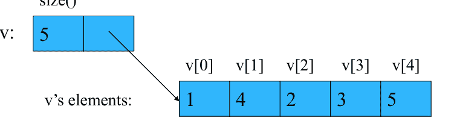

## Vector的增长

```
vector<int> v;  // 空vector
```

v:

```
v.push_back(1); // 增加一个元素，值为1
```

v:

```
v.push_back(4); // 增加一个元素在末尾，值为4
```

v:

```
v.push_back(3); // 增加一个元素在末尾，值为
```

v:

v[0] v[1] v[2]

+   一旦将数据存入vector，就很容易地操作它们

```
// 计算温度的平均值和中位值
int main()
{
    vector<double> temps;
    double temp;
    while (cin>>temp) temps.push_back(temp);

    double sum = 0;
    for (int i = 0; i< temps.size(); ++i)
        sum += temps[i]; // 对温度求和

    cout << "Mean temperature: " << sum/temps.size() << endl;
    sort(temps.begin(),temps.end());
    cout << "Median temperature: " << temps[temps.size()/2] << endl;
}
```

## 组合语言特性

+   - 通过组合使用语言特性、内置类型，以及用户定义类型，就可以编写出许多新程序
+     - 到目前为止，我们可以掌握的有：
+       - bool, char, int, double类型的变量和字面常量
+       - vector, push_back(), [](下标)
+       - !=, ==, =, +, -, +=, <, &&, ||, !
+       - max(), sort(), cin>>, cout<<
+       - if, for, while
+     - 用这些语言特性就可以编写出大量的程序了


```
vector<string> words;
string s;
while (cin>>s && s != "quit")
    words.push_back(s);

sort(words.begin(), words.end());  // 对读入的单词排序

for (int i=0; i<words.size(); ++i)
    cout<<words[i]<< "\n";

/*
    读入一组字符串到vector中，然后将它们按照字典顺序排序
    然后输出这些单词
*/

// 前面的程序中，重复单词会出现多次
// 例如 “the the the”，我们现在剔除重复词

```
vector<string> words;
string s;
while (cin>>s && s!= "quit") words.push_back(s);

sort(words.begin(), words.end());

for (int i=1; i<words.size(); ++i)
    if(words[i-1]==words[i])
        "get rid of words[i]"  // (伪代码)
for (int i=0; i<words.size(); ++i) cout<<words[i]<<"\n";
```

// 有很多种方式可以实现 “get rid of words[i]”;
// 作为程序员，我们选择一种非常简洁的方式来实现
// 它可以节省运行时间和内存消耗

```
//通过只复制与众不同的单词来剔除重复词
vector<string> words;
string s;
while (cin>>s && s!= "quit")  words.push_back(s);
sort(words.begin(), words.end());
vector<string>w2;
if (0<words.size()) {
    w2.push_back(words[0]);
    for (int i=1; i<words.size(); ++i)
        if(words[i-1]!=words[i])
            w2.push_back(words[i]);
}
cout<< "found " << words.size()-w2.size() << " duplicates\n";
for (int i=0; i<w2.size(); ++i) cout << w2[i] << "\n";
```

## 函数

- 前面程序中的square(i)是什么？
- 对函数square()的调用

```
int square(int x)
{
    return x*x;
}
```

- 定义函数可以将部分计算分离出来，因为它
- 在逻辑上是独立的
- 通过对计算命名，可以使程序更加清晰
- 在程序的多个地方使用
- 使得测试、人力部署和维护更加容易

```
int main()
{
```

```
i=0;
```

```
while (i<100)
```

```
{
```

```
square(i)
```

```
i==100
```

```
}
```

```
}
```

```
int square(int x)
{
```

```
return x * x;
```

```
}
```

i<100

- 我们的函数

```
int square(int x)
{
    return x*x;
}
```

是一个下面函数定义的实例

```
Return_type function_name ( Parameter list )
    // (type name, etc.)
{
    // use each parameter in code
    return some_value;        // of Return_type
}
```

在前面查询两个数中较大值的操作可以写成一个函数

```
int max(int a, int b) // this function takes 2 parameters
{
    if (a<b)
        return b;
    else
        return a;
}
```

```
int x = max(7, 9);    // x becomes 9
int y = max(19, -27); // y becomes 19
int z = max(20, 20);  // z becomes 20
```

## 程序设计的基本思路

- 解决任何大型问题的基本范例
- 分而治之
- 分解程序是指将程序分解为更小的程序（片段），它们可以通过简单的、定义良好的方式彼此交互
- 函数签名
- 接口
- 人们有不同的分解方式

## 分解的方式

- 每个子问题在详细程度上处于同一个水平
- 每个子问题都可以独立地解决
- 子问题的解决方案结合在一起就构成了对原始问题的解

- ◆ 过程化程序设计方法
1、开始游戏
2、黑子先走
3、绘制画面
4、判断输赢
5、轮到白子
6、绘制画面
7、判断输赢
8、返回步骤2
9、输出最后结果

- ◆ 对象化程序设计方法
1、黑白双方，这两方的行为是一模一样的
2、棋盘系统，负责绘制画面
3、规则系统，负责判定诸如犯规、输赢等

- 分解并非包治百病的万灵药
- 分解并非总是正确的
- 对问题的不正确或不全面的理解
- 假设由一组编剧编写一个剧本
- 给出所有角色的列表和每一幕的轮廓
- 每位作者写一个角色所对应的故事线
- 最后将所有的故事线合在一起很难构成剧本

## 抽象

- 如何有效地分解？
- 抽象-不断地变化要考虑的细节程度
- 编写剧本可以确定它包含多少幕
- 分解
- 用来将软件分离成多个部分，它们组合起来就可以解决最初的问题
- 抽象
- 协助我们做出关于分解的正确（良好）选择

## 抽象

- 抽象的过程可以被看作是一种“多对一”的映射
- 忽略某些信息，将不同的事物看作是相同的事物处理

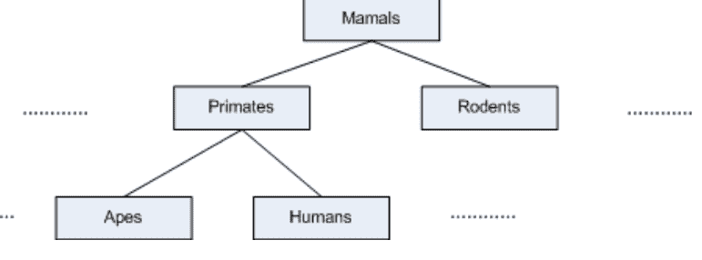

```
found = false;
for (int i = 0; i < a.length; i++)
    if (a[i] == e) {
        z = i;
        found = true;
    }
```

```
found = false;
for (int i a.length - 1; i >= 0; i--)
    if (a[i] == e) {
        z = i;
        found = true;
    }
```

- 这两段代码的行为相同，如果有isIn和indexOf()这样的函数就好了！

```
found = a.isIn(e);
if (found)
    z = a.indexOf(e);
```

- 依赖于语言必须提供这样的函数

- 我们可以构建自己的抽象，因此需要有函数机制

- 输入一个字符串，该字符串全部由数字构成。将字符串以每3个字符进行分割，可以得到若干个百位数，如果最后一个数字位数不满，则后面填补0。写一个函数来计算这些百位数中的最大数字，并在main()函数内检查输入输出。

- 例子：
- 输入：34025003792488035904。该字符串可被分割为：340，250，037，924，880，359，040
- 输出：924（前面位数为0的最大数字需要舍弃0，如097，则输出97）

## 实例

- 分解与抽象
- 输入
- 补齐0
- 分割比较
- 删除前导0
- 输出

```cpp
#include <iostream>
#include <string>
using namespace std;

string FillZero(string str)；
string DelZero(string str);
string GetMaxNumber(string str);

int main(){
    string str;
    cin >> str;
    string result;
    result = FillZero(str);
    result = GetMaxNumber(result);
    result = DelZero(result);
    cout << result.c_str();
}
```


```cpp
string FillZero(string str) {
    if(str.size()%3==1){
        str+="00";
    }else if (str.size()%3==2){
        str+="0";
    }
    return str;
}

string DelZero(string str) {
    if(str[0]=='0')
        str = str.substr(1);
    if(str[0]=='0')
        str = str.substr(1);
    return str;
}
```

```cpp
string GetMaxNumber(string str){
    string max_number=str.substr(0,3);
    str=str.substr(3);

    while(str.size()!=0)
    {
        string current_number=str.substr(0,3);
        if(max_number.compare(current_number)<0){
            max_number=current_number;
        }
        str=str.substr(3);
    }

    return max_number;
}
```

- 我们只有了一个简单的算法
- 算法是 (引自Google search)
  - “a logical arithmetical or computational procedure that, if correctly applied, ensures the solution of a problem.” – Harper Collins
  - “a set of rules for solving a problem in a finite number of steps, as for finding the greatest common divisor.” – Random House
  - “a detailed sequence of actions to perform or accomplish some task. Named after an Iranian mathematician, Al-Khawarizmi. Technically, an algorithm must reach a result after a finite number of steps, ...The term is also used loosely for any sequence of actions (which may or may not terminate).” – Webster’s
- 通过对第一个vector排序，使得重复词彼此毗邻，然后只将与其前驱不同的单词复制到第二个vector中，就剔除了重复单词

- 程序设计 I
- *Programming I*

Thank You!


## 程序设计 1
## Programming and Data Structure I
## 第4课
编程实例1
## Episode Four
Programming Examples 1


- 质数
  - 也是称为素数 Prime Number
  - 只能被1和它自身整除的数字
- 问题1:
  - 请找出1-100之内的所有质数

- 第一个版本
`#include "std_lib_facilities.h"`
```
int main()
{
  for (int i=2;i<=100;i++){
    bool pn=true;
    for (int j=2;j<i;j++)
      if (i%j == 0)
        pn=false;
    if (pn==true)
      cout << "Prime Number:" << i << endl;
  }
  keep_window_open();
}
```

- 第二个版本
#include "std_lib_facilities.h"

```
int main()
{
    for (int i=2;i<=100;i++){
        bool pn=true;
        for (int j=2;j<i;j++)
            if (i%j == 0){
                pn=false;
                break;
            }
        if (pn==true)
            cout << "Prime Number:" << i << endl;
    }
    keep_window_open();
}
```

## 实例-计算质数

- 第三个版本
#include "std_lib_facilities.h"

```
int main()
{
    for (int i=2;i<=100;i++){
        bool pn=true;
        for (int j=2;j<=i/2;j++)
            if (i%j == 0){
                pn=false;
                break;
            }
        if (pn==true)
            cout << "Prime Number:" << i << endl;
    }
    keep_window_open();
}
```

## 实例-计算质数

```
第四版本
#include <math.h>
#include "std_lib_facilities.h"

int main()
{
    for (int i=2;i<=100;i++){
        bool pn=true;
        for (int j=2; j<=sqrt((double)i); j++)
            if (i%j == 0){
                pn=false;
                break;
            }
        if (pn==true)
            cout << "Prime Number:" << i << endl;
    }
    keep_window_open();
}
```

## 实例-计算质数

- 第五版本

```
#include <math.h>
#include "std_lib_facilities.h"

int main()
{
    int primeNumbers[50];
    int sizeOfPn = 0;
    for (int i=2;i<=100;i++){
        bool pn=true;
        for (int j=2; j<=sqrt((double)i); j++)
            if (i%j == 0) {
                pn=false;
                break;
            }
        if (pn==true){
            primeNumbers[sizeOfPn] = i;
            sizeOfPn++;
        }
    }
    keep_window_open();
}
```

- 第六版本

```
#include <math.h>
#include "std_lib_facilities.h"

int main()
{
    int primeNumbers[50];
    int sizeOfPn = 0;
    for (int i=2;i<=100;i++){
        bool pn=true;
        for (int j=2;j<=sqrt((double)i);j++)
            if (i%j == 0) {
                pn=false;
                break;
            }
        if (pn==true){
            primeNumbers[sizeOfPn++] = i;
        }
    }
    keep_window_open();
}
```


第七版本
```cpp
#include <math.h>
#include <vector>
#include "std_lib_facilities.h"

vector<int> primeNumbers;
for (int i=2;i<=100;i++){
    bool pn=true;
    for (int j=2;j<sqrt((double)i);j++)
        if (i%j == 0){
            pn=false;
            break;
        }
    if (pn==true)
        primeNumbers.push_back(i);
}

for (int i=0; i<primeNumbers.size();i++)
    cout << "Prime Number:" << primeNumbers[i] << endl;
```

- 第八版本
```cpp
#include <vector>
#include "std_lib_facilities.h"

vector<int> primeNumbers;
for (int i=2;i<=100;i++){
    bool pn=true;
    for (int j=0;j<primeNumbers.size();j++)
        if (i%primeNumbers[j] == 0){
            pn=false;
            break;
        }
    if (pn==true)
        primeNumbers.push_back(i);
}
for (int i=0; i<primeNumbers.size();i++)
    cout << "Prime Number:" << primeNumbers[i] << endl;
```

- 第九版本
```cpp
#include "std_lib_facilities.h"

int main()
{
    int primeNumbers[50];
    int sizeOfPn = 0;
    for (int i=2;i<=100;i++){
        bool pn=true;
        for (int j=0; j<sizeOfPn ;j++)
            if (i%primeNumbers[j] == 0) {
                pn=false;
                break;
            }
        if (pn==true)
            primeNumbers[sizeOfPn++] = i;
    }
}
```

- 质数
  - 也是称为素数 Prime Number
  - 只能被1和它自身整除的数字
- 问题3:
  - 请找出1-n之内的所有质数，并把它们存储起来，以备后用
  - n是由用户指定的

- 第十版本
```cpp
#include <vector>
#include "std_lib_facilities.h"

int n;
cout << "Please input the upper bound:";
cin >> n;
vector<int> primeNumbers;
for (int i=2;i<=n;i++){
    bool pn=true;
    for (int j=0;j<primeNumbers.size();j++)
        if (i%primeNumbers[j] == 0){
            pn=false;
            break;
        }
    if (pn==true)
        primeNumbers.push_back(i);
}
```

- 质数
  - 也是称为素数 Prime Number
  - 只能被1和它自身整除的数字
- 问题4:
  - 请找出1-n之内的所有质数，并把它们存储起来，以备后用
  - n是由用户指定的
  - 程序可以重复使用，输入-1时结束

## 实例-计算质数

- 第一版本
```cpp
#include <vector>
#include "std_lib_facilities.h"

int n = 0;
while (n != -1){
    cout << "Please input the upper bound:";
    cin >> n;
    vector<int> primeNumbers;
    ......
}
```

- 质数
  - 也是称为素数 Prime Number
  - 只能被1和它自身整除的数字
- 问题5:
  - 请找出1-n之内的所有质数，并把它们存储起来，以备后用
  - n是由用户指定的
  - 程序可以重复使用，输入-1时结束
  - 对输入的负数进行检查，除-1外，其他负数不做处理，程序继续运行

- 第十二版本
```cpp
#include <vector>
#include "std_lib_facilities.h"

int n = 0;
while (n!=-1){
    cout << "Please input the upper bound:";
    if (n<0) continue;
    cin >> n;
    vector<int> primeNumbers;
    ......
}
```

- 程序设计 I
- *Programming I*

Thank You!


## 程序设计 1

*Programming and Data Structure I*

## 第5课

## 函数

Episode Five

## Function

部分翻译自Bjarne Stroustrup的课件

部分来自于《C++ Primer》

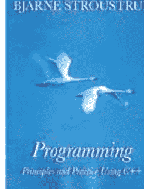

- 指针与引用
- 函数
  - 声明和定义
  - 引元
- 按值调用、按引用调用和按常量引用调用
  - 指针与引用
- 函数调用
- 递归函数和内联函数

## 指针类型

- C++可以在运行时获取变量或者对象的地址，并且通过地址操纵数据
- 指针定义
  int *ip1, *ip2;
  string *pstring;
  double *dp;
  long *lp, lp2;
  
  int *ip1;
  int i = 255;
  ip1 = &i;

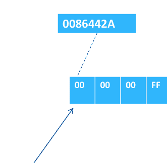

## Example 1: 指针
```cpp
int i=255;
int *pi = &i;
*pi = *pi + 2;
// i 加2 (i = i + 2)
pi = pi + 2;
// 加到pi 包含的地址上
```

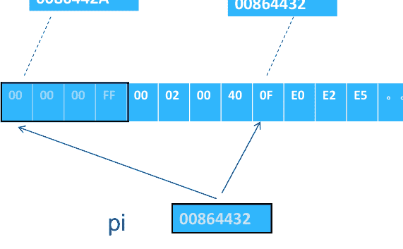

## 指针赋值

- 指针不能被初始化或赋值为其他类型对象的地址值（&obj）
  int *pi = 0;
  double dval;
  pi = &dval;  //error,无效的类型赋值: int* ← double*

- 空（void*）类型指针表明这个是个指针，但是指向的数据类型不明。因此可以被任何数据指针类型的地址值赋值。
  void *pv = pi;
  pv = pd;

## Example 1: 指针
```cpp
int i, j, k;
int *pi = &i;
*pi = *pi + 2;
// i 加2 (i = i + 2)
pi = pi + 2;
// 加到pi 包含的地址上
```

## Example 2: 指针
```cpp
int ia[10];
int *iter = &ia[0];
int *iter_end = &ia[10];

while ( iter != iter_end ) {
    do_something_with_value(*iter);
    // 现在iter 指向下一个元素
    ++iter;
}
```


## 常量指针与指针常量

- 指针常量指指针指向不能改变的指针
  - `int * const cp`
  - `int errNumb=0;`
    `int *const curErr=&errNumb;`
    `if (*curErr) {`
    `    errorHandler();`
    `    *curErr = 0;` //OK
    `}`
    `curErr = &myErrNumb;` //Error

- 常量指针指指向常量的指针
  - `const int * cp` 或者 `int const * cp`
  - `const int * const cp;` //常量指针常量
    `*cp=+2;` //Error

- 引用又叫别名
  - 引用类型由类型标识符和一个取地址操作符&来定义。
- 引用必须被初始化
  ```
  int ival = 1024;
  int &refVal = ival;  // ok: refVal 是一个指向ival 的引用
  int &refVal2;        // Error
  ```
- 引用与指针的主要区别
  - 同一指针可以指向不同实体，而引用在被初始化后，与实体之间的联系则已经建立，不能修改
  - 使用引用访问数据变得更加安全

## 引用类型

```cpp
• Example: references
int ival = 1024;
int &refVal = &ival;       // 错误，refVal 是int 类型，不是int*
int *pi = &ival;
int *&ptrVal2 = pi;        // ok: refPtr 是一个指向指针的引用

int min_val = 0;
refVal = min_val;          // ival 被设置为min_val的值
                           // refVal 并没有引用到min_val 上
refVal += 2;

int ii = refVal;           // 把与 ival 相关联的值赋给 ii
int *pi = &refVal;         // 用ival 的地址初始化pi
```

- 引用类型主要被用作函数的形式参数
  
  `bool get_next_value( int &next_value );`
  `// 返回访问状态,将值放入参数`
  
  `Matrix operator+( const Matrix&, const Matrix& );`
  `// 重载加法操作符`

## 数组类型

- 一个数组不能被另外一个数组初始化，也不能被赋值给另外一个数组，而且C++不允许声明一个引用数组
  
  ```
  const int array_size = 3;
  int ix, jx, kx;
  int *iap [] = { &ix, &jx, &kx };      // ok: 类型为int*的指针的数组
  int &iar[] = { ix, jx, kx };          // 错误: 不允许引用数组
  int ia2[] = ia;                       // 错误: 不能用另一个数组来初始化一个数组
  ```

- 要把一个数组拷贝到另一个中去，必须按顺序拷贝每个元素

- 数组与指针类型关系
  - int ia[]={...}    //ia代表了数组的第一个元素的地址
  - *ia==ia[0]
  - ia+1==&ia[1]
  - ia[5] == *(ia+5)

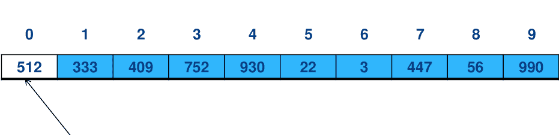

## 多维数组

- **定义**
  - `int ia[4][3]={{0},{1},{2},{3}}`
  - `int ia[4][3]={{0,0,0},{1,0,0},{2,0,0},{3,0,0}}`
  - `int ia[4][3]={0,0,0,1,0,0,2,0,0,3,0,0}`

| 0 | 0 | 0 | 1 | 0 | 0 | 2 | 0 | 0 | 3 | 0 | 0 |
|---|---|---|---|---|---|---|---|---|---|---|---|

- **使用**
  - `ia[2][2]=1`  ➔  `*(ia[2]+2)=1`

## 函数定义

```
int abs( int iobj ){ return( iobj < 0 ? -iobj : iobj ); }

int min( int p1, int p2 ){ return( p1 < p2 ? p1 : p2 ); }

int gcd( int v1, int v2 ){     // 返回最大公约数
    while ( v2 ) {
        int temp = v2;
        v2 = v1 % v2;
        v1 = temp;
    }
    return v1;
}
```

- 函数需要先定义再使用

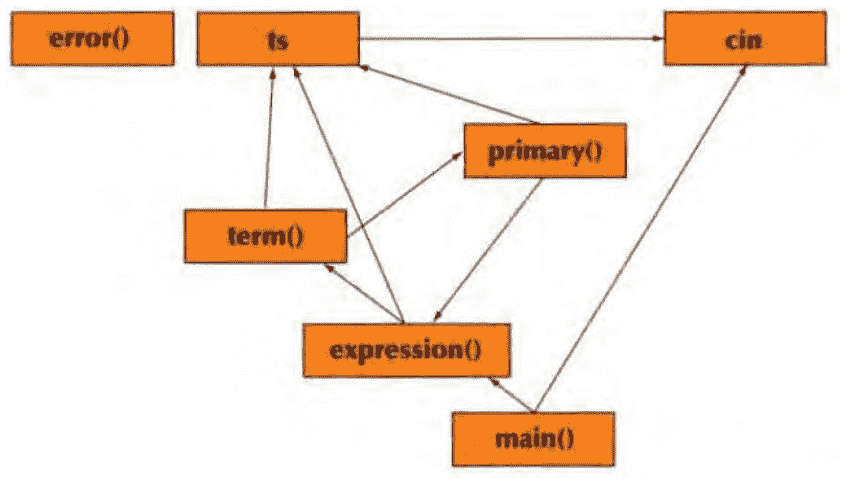

## 函数声明

- 函数声明可以使得函数被提前使用
- 函数声明由函数返回类型、函数名和形式参数表构成。
  ```
  bool IsPrimer( int x);        //函数声明，判断x是否为素数
  int main(){
      for(int i=2; i<10000; i++)
      if(IsPrimer(i))    //函数使用
          cout<<i;
  }
  ```
- 函数声明中的参数名不是必需的
  ```
  bool IsPrimer( int x);        //函数声明，判断x是否为素数
  bool IsPrimer( int );         //函数声明，判断参数是否为素数
  ```

bool look_up( int *, int );

int count( const string &, char );

void sum( vector<int> &, int );

class Date { /* 定义 */};
Date& calendar( const char* );

int[10] foo_bar(); ➜ int* foo_bar();

const bool is_equal( vector<int> v1, vector<int> v2 );

## 函数声明的主要作用

- 如果程序中需要使用一个函数，可以先声明该函数

- 函数声明为函数定义提供了一个对外的接口。
  - 只要函数的接口不变，无论函数定义修改多么频繁，也无需改变我们的代码（使用函数），如

- 函数在程序中只能被定义一次，因而不能被其它文件所使用；而函数可以被声明多次。
  - 函数声明可以被放在头文件中。这些头文件可以被include在每个调用该函数的文件中.

//Global.h
bool IsPrimer(int x);

//Global.cpp
#include Global.h
bool IsPrimer(int x){...}

//A.cpp
#include Global.h
...if (Isprimer(val)) ...

//B.cpp
#include Global.h
...if (Isprimer(val)) ...

//C.cpp
#include Global.h
...if (Isprimer(val)) ...

## 函数调用

- 函数在运行时被调用。
  - 程序控制权被传送给被调用的函数，而当前活动函数的执行被挂起。
  - 函数在执行完函数体的最后一条语句或遇到返回语句后完成。
  - 当被调用的函数完成时，主调函数在调用语句之后的语句上恢复执行。


## 函数调用

- 调用带参数的函数时就需要为这些参数提供实参（实际参数）。
  - 形式参数表 ↔ 实际参数表
  - int gcd(int x1, int x2) ↔ x = gcd(379, 542);

- Example:

```
int abs( int iobj );
int min( int p1, int p2 );
int gcd( int v1, int v2 );
int main(){
    int i, j;
    ...
    cout << "\nmin: " << min(i,j) << endl;
    i = abs(i);
    j = abs(j);
    cout << "gcd: " << gcd(i,j) << endl;
}
```

## 函数：按值调用

```
// call-by-value (send the function a copy of the argument's value)
int f(int a) { a = a+1; return a; }
```

```
int main()
{
    int xx = 0;
    cout << f(xx) << endl; // writes 1
    cout << xx << endl; // writes 0; f() doesn't change xx
    int yy = 7;
    cout << f(yy) << endl; // writes 8; f() doesn't change yy
    cout << yy << endl; // writes 7
}
```

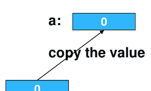

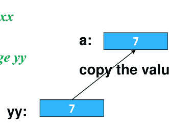

// call-by-reference (pass a reference to the argument)
int f(int& a) { a = a+1; return a; }

int main()
{
    int xx = 0;
    cout << f(xx) << endl; // writes 1
    // f() changed the value of xx
    cout << xx << endl;    // writes 1
    int yy = 7;
    cout << f(yy) << endl; // writes 8
    // f() changes the value of yy
    cout << yy << endl;    // writes 8
}

a:
1st call (refer to xx)
xx: 0
2nd call (refer to yy)
yy: 7

## 函数

- 尽量避免(非常量)引用参数
  - 在你忘记那些引元可以修改时，它们会导致难以琢磨的缺陷
  - `int incr1(int a) { return a+1; }`
  - `void incr2(int& a) { ++a; }`
  - `int x = 7;`
  - `x = incr1(x); // pretty obvious`
  - `incr2(x); // pretty obscure`

- 那么为什么需要引用参数呢?
  - 有时，它们很有用
    - 例如，用于修改多个值
    - 用于操作容器，例如vector
  - 常量引用参数显得很有用

## 按值/常量引用/引用调用

```
```cpp
void f(int a, int& r, const int& cr) { ++a; ++r; ++cr; } // error: cr is const
void g(int a, int& r, const int& cr) { ++a; ++r; int x = cr; ++x; } // ok

int main()
{
    int x = 0;
    int y = 0;
    int z = 0;
    g(x,y,z); // x==0; y==1; z==0
    g(1,2,3); // error: reference argument r needs a variable to refer to
    g(1,y,3); // ok: since cr is const we can pass “a temporary”
}
```
```

const references are very useful for passing large objects

- 对非常小的对象使用按值传递
- 对大对象使用按常量引用传递
- 优先使用返回结果而不是通过引用参数来修改对象
- 只有在必需时才使用按引用调用
- 例如
  class Image { /* objects are potentially huge */ };
  void f(Image i); ... f(my_image); // oops: this could be s-l-o-o-o-w
  void f(Image& i); ... f(my_image); // no copy, but f() can modify my_image
  void f(const Image&); ... f(my_image); // f() won"t mess with my_image

```
class Image { /* objects are potentially huge */ };
void f(Image i); ... f(my_image); // oops: this could be s-l-o-o-o-w
void f(Image& i); ... f(my_image); // no copy, but f() can modify my_image
void f(const Image&); ... f(my_image); // f() won"t mess with my_image
```

- 形式：
  - 用在返回类型为void 的函数——return;（可以被省略）
  - 用在返回类型不为void 的函数中： return expression;

## Example：return

```
```cpp
bool is_equal( const Matrix &m1, const Matrix &m2 ){
    if ( m1.colSize() != m2.colSize() )
        return;

    if ( m1.rowSize() != m2.rowSize() )
        return;

    //遍历每个 matrix 直到不相等,或所有元素都检查完毕
    for ( int row = 0; row < m1.rowSize(); ++row )
        for ( int col = 0; col < m1.colSize(); ++col )
            if ( m1[row][col] != m2[row][col] )
                return false;

    //return true is necessary!
}
```
```

## 返回

- 返回多个值
  - 方法1: 将某些函数参数声明为引用
  - 方法2: 函数的返回类型是一个可以包含一组返回值的类（如指针）或某种容器类型

## 返回

- 缺省情况下，函数的返回值是按值传递的
- 一个函数可以被声明为返回一个指针或一个引用

- 如果：返回一个指向局部对象的引用

```
Matrix& add( Matrix &m1, Matrix &m2 ){
    Matrix result;
    if( m1.isZero() )
        return m2;
    if( m2.isZero() )
        return m1;
    ...// 将两个Matrix对象的内容相加
    return result;
}
```

- 函数可以通过两种机制进行通信
  - 使用函数参数表和返回值
  - 使用全局对象具有如下缺点
    - 使用全局对象的函数依赖于全局对象的存在和类型，这使得在不同上下文环境中重用该函数更加困难
    - 如果程序必须被修改，则全局依赖增加了引入错误的可能性，而且即使只对局部做修改也要求程序员必须理解整个程序
    - 如果全局对象得到一个不正确的值，则必须查找整个程序以判断错误发生的位置
    - 当一个函数使用全局对象时，递归更加难以正确完成，递归在程序调用自身时才发生
    - 在线程存在的情况下，我们必须做特殊的编码，以便同步各个线程对于全局对象的读和写操作


```cpp
double expression(Token_stream& ts){
    double left = term(ts);
    Token t =ts.get();
    //...
}
```

```cpp
double primary(Token_stream& ts){
    Token t = ts.get();
    switch(t.kind){
    case '(' :
        double d = expression(ts);
        //...
        //...
    }
}
```

```cpp
double term(Token_stream& ts){
    double left = primary(ts);
    Token t = ts.get();
    //...
    case '/' :
        double d = primary(ts);
        //...
    //...
}
```

当函数被调用时，语言实现会设置一块内存空间，用于存放包含所有参数和局部变量副本的数据结构

调用 expression()：

|  |
|---|
| ts |
| left |
| t |
| 实现细节 |

- 实现细节是函数返回到调用者和将值返回给调用者所需的信息
- 上面的数据结构称为函数激活记录
- 从函数的角度看，参数只是一个局部变量而已

## 参数传递

- 参数传递是指用函数调用的实参值来初始化函数参数存储区的过程。
- 程序运行栈
  - 与一个函数相关的存储区被称为**活动记录**，活动记录是在程序运行栈中分配的存储区。该存储区一直保持与该函数相关联，直到函数结束为止。
  - 系统在函数的活动记录中为函数的每个参数都提供了存储区，参数的存储长度由它的类型来决定

调用 expression()：

|  |  |
|---|---|
| ts |  |
| left |  |
| t |  |
| 实现细节 |  |
| ts |  |
| left |  |
| t |  |
| d |  |
| 实现细节 |  |

调用 term()：

栈增长方向

## 函数调用实现

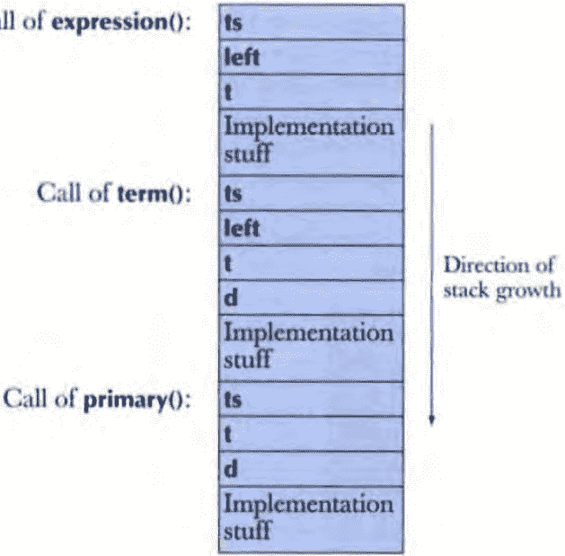

## 函数调用实现

|  |  |
|---|---|
| 调用 expression()： | ts |
|  | left |
|  | t |
|  | 实现细节 |
| 调用 term()： | ts |
|  | left |
|  | t |
|  | d |
|  | 实现细节 |
| 调用 primary()： | ts |
|  | t |
|  | d |
|  | 实现细节 |
| 调用 expression()： | ts |
|  | left |
|  | t |
|  | 实现细节 |

栈增长方向

## 递归函数

- 直接或间接调用自己的函数被称为递归函数
  - 递归函数必须定义一个停止条件

```cpp
int rgcd( int v1, int v2 )
{
    if ( v2 != 0 )
        return rgcd( v2, v1%v2 );
    return v1;
}
```

- 调用一般函数比简单计算要慢
  ```c
  int min( int v1, int v2 )
  {
      return( v1 < v2 << v1 : v2 );
  }
  ```
- 若一个函数被指定为内联函数，则它的函数体可能在编译期间，在程序中每个调用点上被内联地展开
  `int minVal2 = min(i, j); ⇒ int minVal2 = i < j << i : j;`
- 内联机制用来优化小的、只有几行的、经常被调用的函数。
- 对同一程序的不同文件，如果使用同一个内联函数，该内联函数必须在不同的文件中被定义，并且定义一致
  - 建议把内联函数的定义放到头文件中

- 程序设计 I
- *程序设计 I*

谢谢！


## 程序设计 1

*程序设计与数据结构 I*

## 第6课

## 作用域

第六课

## 作用域

部分翻译自Bjarne Stroustrup的课件

部分来自于《C++ Primer》

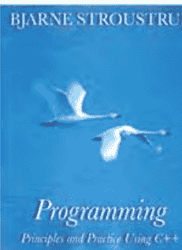

## 概览

- 技术细节
- 声明
  - 定义
  - 头文件和预处理器
- 作用域
  - 全局作用域
  - 局部作用域
- 名字空间
  - “Using” 语句

## 技术细节

- 是不可或缺的“祸端”
  - 编程语言是一门外语
  - 在学习一门外语时，我们必须学习其文法和词汇
- 因为：
  - 程序必须准确而完备地编写
    - 计算机是非常傻(尽管它很快)的机器
    - 计算机无法猜测你的实际意图(也不该去猜测)
  - 因此我们必须知道这些规则
    - 了解其中的核心部分 (C++ 标准有 782 页)
- 但是，不要忘了
  - 我们学习的是编程
  - 我们的输出是程序/系统
  - 编程语言只是一个工具而已

## 技术细节

- 不要花时间在不重要的语法和语义问题上，条条大路通罗马
  - 就像英语一样
- 大多数设计和编程概念都是相通的，或者至少被主流的编程语言广泛支持
  - 因此使用 C++ 学到的知识可以用于许多其他的语言
- 技术细节与具体的语言相关
  - 但是这里描述的 C++ 的特性在 C、Java 和 C# 中都有相对应的特性

## 声明

- “声明”将名字引入到作用域中
- “声明”还指定了具名对象的类型
- 有时声明还包含一个初始化器
- 在C++程序中，名字在使用之前必须先声明
- 例如:
  - int a = 7; // 声明了一个名为‘a’的int变量
  - const double cd = 8.7; // 一个双精度浮点常量
  - double sqrt(double); // 一个接受double参数并返回double结果的函数
  - vector<Token> v; // 一个存放Token的vector变量

## 声明

- 声明经常会通过头文件引入到程序中
  - 头文件就是包含了声明的文件，这些声明可以为程序中的其他部分提供接口

- 这使得抽象成为可能–我们不必为了使用cout而了解其细节诸如

- 只要在代码中添加

  ```cpp
  #include "../../std_lib_facilities.h"
  ```

  在std_lib_facilities.h 文件中的声明就都可用了（包括cout）

## 定义

- 完整指定所声明实体的声明被称为定义
  - 例如
    int a = 7;
    int b; // an int with the default value (0)
    vector<double> v; // an empty vector of doubles
    double sqrt(double) { ... }; // i.e. a function with a body
    struct Point { int x; int y; };
  - 不是定义的声明
    double sqrt(double); // function body missing
    struct Point; // class members specified elsewhere
    extern int a; // extern means “not definition”
    // “extern” is archaic; we will hardly use it


## 声明与定义

- 不能对同一事物定义两次
  - 定义是在说明这是什么事物
  - 例如

```cpp
int a;        // definition
int a;        // error: double definition
double sqrt(double d) { ... }        // definition
double sqrt(double d) { ... }        // error: double definition
```

- 可以对同一事物声明两次
  - 声明是在说明事物可以如何使用

```cpp
int a = 7;        // definition (also a declaration)
extern int a;        // declaration
double sqrt(double);        // declaration
double sqrt(double d) { ... }        // definition (also a declaration)
```

```cpp
double sqrt(double d);
```

```cpp
double sqrt(double d);
```

```cpp
extern int x;
```

```cpp
extern int x;
```

```cpp
double sqrt(double d)
{
    // calculate the
    // square root of d
}
```

```cpp
int x = 7;
```

## 为什么既有声明又有定义？

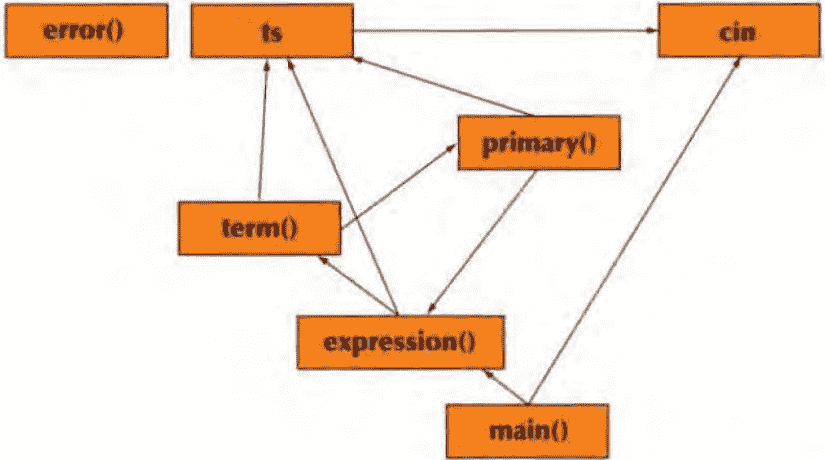

## 声明的类型

- 变量
  - `int a;` // no initializer
  - `double d = 7;` // initializer using the = syntax
  - `vector<int> vi(10);` // initializer using the () syntax
- 常量
  - `const int x = 7;` // initializer using the = syntax
  - `const int x2(9);` // initializer using the () syntax
  - `const int y;` // error: no initializer
- 函数(§ 8.5)
- 名字空间(§ 8.7)
- 类型(类和枚举；第9章)
- Templates (第19章)

## 头文件和预处理器

- 头文件持有函数、类型、常量和其他程序组成部分的声明
- 下面的结构：
  - `#include "../../std_lib_facilities.h"` 是一个“预处理器指令”，它会将声明添加到程序中
  - 典型地，头文件只是一个文本(源代码)文件
- 头文件赋予我们对在自己的代码中需要访问的函数和类型的访问权
  - 通常，我们不需要关心这些函数和类型是如何编写的
  - 实际的函数和类型是在其它源文件中定义的
    - 经常是库的一部分

```cpp
#include "../../std_lib_facilities.h"
```

a.h:

```cpp
// declarations:
int get();
void set(int);
...
```

a.cpp:

```cpp
#include "a.h"
// definitions:
int get(){/* ... */}
void set(int i){/* ... */}
...
```

b.cpp:

```cpp
#include "a.h"
...
set(get());
...
```

- 头文件 (a.h)定义了用户代码和实现代码之间的接口
- 在两个.cpp文件中使用相同的 `#include` 声明可以方便一致性检查

## 源文件-陷阱

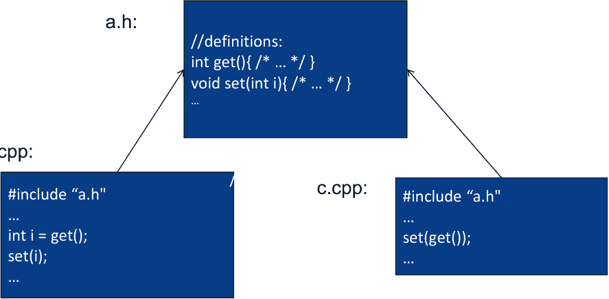

```cpp
// a.h
// definitions:
int get(){ /* ... */ }
void set(int i){ /* ... */ }
...
```

```cpp
// b.cpp
#include "a.h"
...
int i = get();
set(i);
...
```

```cpp
// c.cpp
#include "a.h"
...
set(get());
...
```

- 头文件 (a.h) 定义了用户代码和实现代码之间的接口的**实现**
- 在两个 .cpp 文件中使用相同的 `#include` 声明会造成**重复定义**

## 作用域

- 作用域是一个程序文本区域
  - 例如
    - 全局作用域 (在任何语言结构的外部)
    - 类作用域 (在类的内部)
    - 局部作用域 (在 { ... } 之间)
    - 语句作用域 (例如，`for` 语句)
- 在一个作用域中的名字可以在这个作用域中以及嵌套在其中的作用域中被访问
  - 在名字被声明之后（“无法向前看 can't look ahead”规则）
- 作用域可以让“事物”保持局部性
  - 防止我的变量和函数等与你的变量和函数之间互相干扰
  - 记住：真实的程序可能会有成千上万的实体
  - 局部性非常好！
    - 尽量使名字是局部的

## 作用域

- 全局作用域
  - 程序的最外层的名字空间域
- 名字空间域
  - 用户可以自定义名字空间
- 局部作用域
  - 包含在函数定义或者函数块中的程序文本部分
  - 包含在复合语句中的程序文本部分
- 类作用域
  - 包含在类的定义中的程序文本部分

```cpp
const int notFound = - 1;

int binSearch( const vector<int> &vec, int val ) {
    int low = 0;
    int high = vec.size() - 1;

    while ( low <= high ){
        int mid = ( low + high ) / 2;
        if ( val == vec[ mid ] ) return mid;
        if ( val < vec[ mid ] ) high = mid - 1;
        else low = mid + 1;
    }

    return notFound;
}
```

局部域

局部域

全局域

## 名字解析

- 函数、变量名需要先声明再使用
  - 该声明对于名字的使用者来说必须是可见的
- 名字解析
  - 把程序中的一个名字与某一个声明相关联
  - 名字解析过程依赖于该名字是如何被使用的以及使用该名字的域

## 局部域内的名字解析过程

- 首先查找使用该名字的域，如果找到一个声明，则该名字被解析；如果没有找到，则查找包含该域的域。这个过程会一直继续下去，直到找到一个声明或已经查找完整个全局域。
- 如果查找完整个全局域还没有找到该名字的声明，则这个名字的用法将被标记为错误
- 同一个域内的名字不能重复
- 在外围域中的声明被嵌套域中的同名声明所隐藏

```cpp
int low;

int binSearch( const vector<int> &vec, int val ){
    int low = 0;
    ...
    while ( low <= high ){ ... }
    ...
}
```

## 名字解析

```cpp
for ( int index = 0; index < vecSize; ++index )
{
    // index 只在这里可见
    if ( vec[ index ] == someValue )
        break;
}

// 错误：index 在这里不可见
if ( index != vecSize ) // 找到的元素
```


```cpp
if ( int *pi = getValue() )
{
    pi != 0;  // 这里可以使用*pi
    int result = calc(*pi);

    // ...
}
else
{
    // pi 在这里也可见
    pi == 0
    cout << "error: getValue() failed" << endl;
}
```

## 名字解析

```cpp
void fooBar( int *ia, int sz )
{
    for (int i=0; i<sz; ++i) ... // ok
    for (int i=0; i<sz; ++i) ... // ok: 不同的 i
    for (int i=0; i<sz; ++i) ... // ok: 不同的 i
}
```

## 全局对象和函数

- 一次定义法则
  - 全局对象和非inline 全局函数只有一个定义

- 全局域中的函数声明、对象声明
  - 函数声明指定了该函数的名称以及函数的返回类型和参数表
  - `void f();`
  - 关键字extern 为声明但不定义一个对象提供了一种方法，它承诺了该对象会在其他地方被定义
  - `extern int x;`
  - `extern int x = 0;  //对象定义`

## 全局函数、对象的声明的匹配

- 存在函数、对象声明的差异

- 类型的安全链接
  - 在C++中通过类型安全链接机制，可以把函数参数的类型和数目编码在函数名中。类型安全链接可用来帮助捕捉不同文件中函数声明不匹配的情况，从而为文件之间的函数调用提供了类型检查手段

```
// --- token.C 中 ---
int addToken( unsigned char tok ) { /* ... */ }
```

```
// --- lex.C 中 ---
extern int addToken( char );
```

- 由于类型安全链接，在lex.C 中声明的addToken()将会被标记为未定义的函数，而token.C 中的定义则被视为定义了另外一个函数

## 头文件

- 头文件为所有 extern 对象声明、函数声明以及 inline 函数定义、常量定义提供了一个集中的位置
  - 目的：声明局部化
  - 保证所有文件都包含同一个全局对象或函数的同一份声明
  - 保证了如果需要修改声明，则只需改变头文件的声明

- 头文件也可以在设计阶段规定接口，使得可以清楚地看出，某个程序文件提供了什么服务
  - Java语言中的接口文件(interface)

## 一般头文件内容

- 注释
  - //This file is created on April 1st by Tom
- 预编译指令
  - #include <iostream>
- 全局数据声明
  - extern int n;
  - extern int a[];
- 全局常量定义
  - const float pi=3.14;
- 函数声明
  - void fn();

- 内联函数定义
  - inline void fn(){...};
- 类型声明
  - class A;
- 类型定义
  - enum COLOR{...};
  - class A{...};
- 命名空间定义
  - namespace N{...}
- 模板声明和定义
  - template <class T> class A{...};

## 局部对象

- 自动对象
  - 自动对象所在存储区从声明它的函数被调用时开始，一直直到该函数结束为止。
- 寄存器对象
  - 寄存器对象是一种自动对象它支持对其值的快速存取
- 局部静态对象
  - 局部静态对象的存储区在该程序的整个执行期间一直存在

## 自动对象

- 自动对象所在存储区从声明它的函数被调用时开始，一直直到该函数结束为止
  - 自动对象的存储分配发生在定义它的函数被调用时，分配给自动变量的存储区来自于程序的运行栈
    - 自动对象需要被显式初始化，未经初始化的变量的值可能是任意的
  - 在函数结束时，它的活动记录被从运行栈中弹出，与该自动对象相关联的存储区被真正释放，它包含的任何值都被抛弃
    - 自动对象的地址不应该被作为函数的返回值。
    - 当一个自动变量的地址被存储在一个生命周期长于它的指针时，该指针被称为空悬指针

```
Matrix* trouble( Matrix *pm ){
    Matrix res;
    ...
    return &res;      //error
}
int main()
{
    Matrix m1;
    // ...
    Matrix* mainResult = trouble( &m1 ); //悬空指针
    // ...
}
```

## 寄存器对象

- 寄存器对象是一种自动对象，它支持对其值的快速存取。
  - 如果变量被频繁使用，则寄存器变量可以提高程序的运行速度
  - 关键字register 对编译器来说只是一个建议

```
for ( register int ix = 0; ix < sz; ++ix )
    // ...

for (register int *p = array ; p < arraySize; ++p )
    // ...

bool find( register int *pm, int val ) {
    while ( *pm )
        if ( *pm++ == val ) return true;
    return false;
}
```

## 静态局部对象

- 静态局部对象的存储区在该程序的整个执行期间一直存在，但其可见性在局部域内
  - 与全局变量类似，静态局部变量会被程序自动初始化

## 静态局部对象

```
#include <iostream>
int traceGcd( int v1, int v2 )
{
    static int depth = 1;
    cout << "depth #" << depth++ << endl;
    if ( v2 == 0 ) {
        depth = 1;
        return v1;
    }
    return traceGcd( v2, v1%v2 );
}
```

假设 v1 = 15, v2 = 123

| Times | depth | depth' | v1 | v2 |
|---|---|---|---|---|
| 1 | 1 | 2 | 15 | 123 |
| 2 | 2 | 3 | 123 | 15 |
| 3 | 3 | 4 | 15 | 3 |
| 4 | 4 | 5 | 3 | 0 |

## 名字空间

- 考虑下面代码中来自Jack 和Jill头文件中的参数类型
- class Glob {/*...*/};      // in Jack"s header file jack.h
- class Widget {/*...*/};      // also in jack.h
  
- class Blob {/*...*/};      // in Jill"s header file jill.h
- class Widget {/*...*/};      // also in jill.h
  
- #include "jack.h";      // this is in your code
- #include "jill.h";      // so is this
- void my_func(Widget p)      // oops! – error: multiple definitions of Widget
- {
-     // ...
- }

## 名字空间

- 名字空间是一个具名作用域
- :: 语法用来指定你使用的是哪个名字空间，以及你引用的是具有相同名字对象的哪一个
- 例如, cout 在名字空间std中，你可以写:
- std::cout << "Please enter stuff... \n";


## 名字空间

+   - 所有可以出现在全局名字空间域中的声明都可以被放在用户声明的名字空间中
+     - 类
+     - 变量（带有初始化）
+     - 函数（带有定义）
+     - 模板

+   - 同一个名字空间的定义可以不连续，也可以跨越几个不同的程序文本文件。
+     - 使我们的库具有模块化特性，这种特性是“向用户隐藏实现细节”所必需的

```
// 名字空间的这部分定义了库接口
namespace cplusplus_primer {
    class matrix { /* ... */ };
    const double pi = 3.1416;
    matrix operator+ ( const matrix &m1, const matrix &m2 );
    void inverse ( matrix & );
}
```

```
// 名字空间的这部分定义了库实现
namespace cplusplus_primer {
    void inverse ( matrix &m )
    { /* ... */ }
    matrix operator+ ( const matrix &m1, const matrix &m2 )
    { /* ... */ }
}
```

```
// --- primer.h ---
namespace cplusplus_primer {
    class matrix { /*...*/ };
    const double pi = 3.1416;
    matrix operator+ ( const matrix &m1, const matrix &m2 );
    void inverse( matrix & );
}

// --- primer.C ---
#include "primer.h"
namespace cplusplus_primer {
    void inverse( matrix &m ) { /*...*/ }
    matrix operator+ ( const matrix &m1, const matrix &m2 ){ /*...*/ }
}

// --- user.C ---
#include "primer.h"
void func( cplusplus_primer::matrix &m )
{
    cplusplus_primer::inverse( m );
}
```

## 嵌套名字空间

```
namespace cplusplus_primer {
    namespace MatrixLib {
        class matrix {/* ... */};
        ...
    }
    namespace AnimalLib {
    }
}
```

```
cplusplus_primer::MatrixLib::matrix
```

+   - 用未命名的名字空间声明一个局部于当前文件的实体

```
// ---- SortLib.C ----
namespace {
    void swap( double *d1, double *d2 ) {/* ... */}
}

// 四个排序函数的定义，其中使用了 swap函数
void quickSort( double *d1, double *d2 ) {/* ... */}
void bubbleSort( double *d1, double *d2 ) {/* ... */}
void mergeSort( double *d1, double *d2 ) {/* ... */}
void heapSort( double *d1, double *d2 ) {/* ... */}
```

+   为了避免下面这种冗长的写法
+   ```
+   std::cout << "Please enter stuff... \n";
+   ```
+   可以写一条 “using 声明”
+   ```
+   using std::cout; // when I say cout, I mean std::cout
+   cout << "Please enter stuff... \n"; // ok: std::cout
+   cin >> x; // error: cin not in scope
+   ```

+   或者可以写一条 “using 指示符”
+   ```
+   using namespace std; // “make all names from namespace std available”
+   cout << "Please enter stuff... \n"; // ok: std::cout
+   cin >> x; // ok: std::cin
+   ```

## using声明

+   - 在使用的位置上引入名字空间成员，类似于定义

```
namespace blip {
    int bi = 16, bj = 15, bk = 23;
}
int bj = 0;
void manip() {
    using blip::bi;
    ++bi;                         // 设置 blip::bi 为 17
    using blip::bj;               // 隐藏全局域中的 bj
    ++bj;                         // 设置 blip::bj 为 16
    int bk;                       // bk 在局部域中声明
    using blip::bk;      // 错误：在 manip() 中重复定义 bk
}
```

## using指示符

```
namespace blip {int bi = 16, bj = 15, bk = 23;}
int bj = 0;
void manip() {
    using namespace blip;
    ++bi;        // 设置 blip::bi 为 17
    ++bj;        // 错误: 二义性
    ++::bj;      // ok: 设置全局 bj 为 1
    ++blip::bj;  // ok: 设置 blip::bj 为 16
    int bk = 97; // 局部 bk，隐藏 blip::bk
    ++bk;        // 设置局部 bk 为 98
}
```

+   - 名字空间域
+     - 用户可以自定义名字空间
+   - 全局域：程序的最外层的名字空间域
+   - 局部域
+     - 包含在函数定义或者函数块中的程序文本部分。
+     - 包含在复合语句中的程序文本部分。
+   - 在不同的域中声明的对象、函数有不同的生命周期
+     - 全局对象、函数
+     - 局部对象
+     - 动态分配的对象

+   - 程序设计 I
+   - *编程 I*

谢谢！


## 程序设计 1

*编程与数据结构 I*

## 第7课

## 错误

第七集

## 错误

翻译自Bjarne Stroustrup的课件

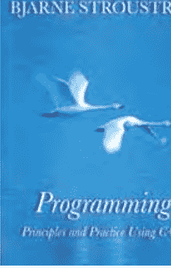

## 概览

+   - 错误的种类
+   - 引元检查
+     - 错误报告
+     - 错误探测
+     - 异常
+   - 调试
+   - 测试

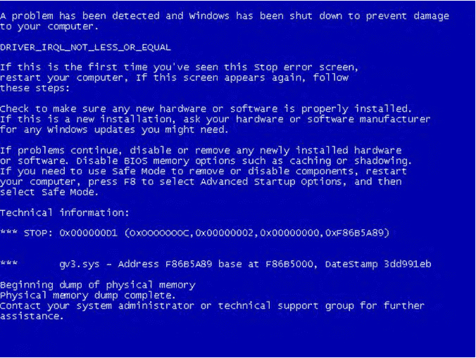

> “... I realized that from now on a large part of my life would be spent finding and correcting my own mistakes.”  
> — Maurice Wilkes, 1949
> “... 我意识到从现在开始，我生活的很大一部分将花费在寻找和纠正我自己的错误上。”  
> — Maurice Wilkes, 1949

+   - 当我们编写程序时，出错是很自然的，也是很难避免的
+   - 问题是：如何处理它们呢？
+     - 将软件组织好，以最小化错误
+     - 消除大部分错误
+       - 调试
+       - 测试
+     - 确保遗留的错误不严重

+   - Bjarne Stroustrup 估计避免、查找和纠正错误的代价占到重要软件的开发总代价的95%以上
+     - 在小程序开发中你可以做得更好
+       - 也可能更差，如果你偷懒的话


- 编译时错误
  - 语法错误
  - 类型错误
- 连接时错误
  - 库文件不存在等原因引起
- 运行时错误
  - 由计算机探测到 (崩溃)
  - 由库探测到 (异常)
  - 由用户代码探测到
- 逻辑错误
  - 由程序员探测到 (代码可以运行，但是产生不正确的输出)

## 程序

- 1. 应该对所有合法输入都产生想要的结果
- 2. 应该对所有非法输入都给出合理的错误信息
- 3. 不需要担心硬件故障
- 4. 不需要担心系统软件故障
- 5. 允许在发现错误之后终止

• 3, 4, 和5 在初学者的代码中都能满足；但是，在真正的软件中我们却经常要担心

## 错误的来源

- 规格说明书(specification)不充分
  - “这个软件要做什么?” – 自然语言内在的歧义性
- 不完善的程序
  - “但是明天之前我是不会有时间完善了” – 赶任务
- 意外的引元
  - “但是我们假设不会使用-1作为引元去调用sqrt()的” – 假设并不成立
- 意外的输入
  - “但是我们假设用户是会输入一个整数的” – 假设并不成立
- 意外的状态
  - “因此修正它!”
- 逻辑错误
  - “错误的输出结果!”

## 编译时错误

- 编译器只能发现十分简单的问题
  - 拼写错误
  - 语句不完整

- 语法错误
  - `int area(int length, int width);` // 计算矩形的面积
  - `int s1 = area(7;` // error: ) 缺失
  - `int s1 = area(7)` // error: ; 缺失
  - `Int s3 = area(7);` // error: Int 不是一种类型
  - `int s4 = area('7);` // error: 非终止字符 ' 缺失

## 编译时错误

- 编译器只能发现十分简单的问题
  - 拼写错误
  - 语句不完整
- 类型错误
  - int area(int length, int width); // 计算矩形的面积
  - int x0 = arena(7); // error: 未声明的函数
  - int x1 = area(7); // error: 错误的引元数量
  - int x2 = area("seven",2); // error: 第一个引元类型错误

## 编译时错误

- 编译器只能发现十分简单的问题
  - 拼写错误
  - 语句不完整

- 警告错误
  - `int area(int length, int width);` // 计算矩形的面积

```
int x4 = area(10,-7); // OK: 但是宽度为-7的矩形面积是多少呢？
int x5 = area(10.7,9.3); // OK: 会以area(10,9)的形式调用
char x6 = area(100,9999); // OK: 但是会对结果截尾
```


## 连接时错误

- 程序由多个彼此分离的通过编译的部分构成
  - 连接时会发生错误

- 连接时错误
  `int area(int length , int width); // 计算矩形面积`
  
  `int main()`
  `{`
  `    int x = area(2,3);`
  `}`

- area是库函数
  - 如果找不到，就会报错

- 没有编译时错误和连接时错误的程序就可以运行了

```
int area(int length, int width)      // 计算矩形面积
{ return length*width; }
int framed_area(int x, int y)        // 计算边框内的面积
{ return area(x-2,y-2); }
int main()
{
    int x = -1;
    int y = 2;
    int z = 4;
    int area1 = area(x,y);
    int area2 = framed_area(1,z);
    int area3 = framed_area(y,z);
    double ratio = double(area1)/area3; // 转型为double 执行浮点除法
}
```

## 运行时错误

- 处理area()的引元错误
  - area()的调用者处理引元错误
  - area()自身处理引元错误
- 调用者处理引元错误
  `if (x<=0) error("non-positive x");`
  `if (y<=0) error("non-positive y");`
  `int areal = area(x,y);`
  
  `if (z<=2)`
  `    error("non-positive 2nd area() argument called by framed_areaO ");`
  `int area2 = framed_area(l , z);`
  `if (y<=2 || z<=2)`
  `    error(" non-positive area() argument called by framed_areaO");`
  `int areaJ = framed_area(y,z);`

- 处理area()的引元错误
  - area()的调用者处理引元错误
  - area()自身处理引元错误
- 被调用者处理引元错误
  ```
  int framed_area(int x, int y) //计算框内面积
  {
      const int frame_width = 2;
      if (x-frame_width<=0 || y- frame_width<=0)
          error(" non-positive area() argument called by framed_area()");
      return area(x-frame_width, y-frame_width);
  }
  ```

## 运行时错误

- 报告错误
  - 返回错误值
  - 缺点
    - 被调用函数和调用程序都需要进行测试
    - 调用者可能会忘记测试
    - 许多函数没有合适的值用来表示错误

```
int area(int length, int width)
{
    if (length<=0 || width <=0) return -1;
    return length*width;
}
```

- C++提供了异常机制 exception
  - 用于处理错误
- 异常处理非常普通
  - 不能忘记异常：在异常没有得到处理时，程序将终止
  - 每一种错误都可以用异常来报告 try catch
- 必须为每一个异常设计处理方式
  - 要处理程序中抛出 throw 的每一个异常
  - 错误处理 Error handling 从来都不简单

- try块
  - 处理 “正常” 情况
  - 潜在有错误倾向的代码
- catch块
  - 处理 “异常” 情况
- 如果异常被成功处理(在catch 块中)
  - 程序就会从catch语句块后的第一条语句继续执行
- 否则，异常机会被传播到
  - 外部语句块(如果有的话)
  - 或者调用这段代码的函数，如果没有任何外部语句块

- 如果异常被传播给了 main() 的调用者
  - 程序就退出
- 示例：
  ```
  void foo()
  {
    try {
      <block>
    }
    catch(type var) {
      <block>
    }
  }
  ```


## 错误引元

```cpp
class Bad_area {}; // 用于从area函数报告错误的类型

// 计算矩形面积；
// 在输出错误引元的情况下抛出一个 Bad_area 异常
int area(int length, int width)
{
    if (length<=0 || width <=0) throw Bad_area();
    return length*width;
}
```

```cpp
int main(){
    try {
        int x = -1;
        int y = 2;
        int z = 4;
        //......
        int area1 = area(x,y);
        int area2 = framed_area(1,z);
        int area3 = framed_area(y,z);
        double ratio = area1/area3;
    }
    catch (Bad_area) {
        cout << "Oops! bad arguments to area()\n";
    }
}
```

- 尝试运行下面的程序
  ```cpp
  vector<int> v(10);  // 具有10个int的vector
  // 每一个初始化为0
  // 引用方式为v[0]..v[9]
  for (int i = 0; i<v.size(); ++i) v[i] = i;  // 设置值
  for (int i = 0; i<=10; ++i)               // 打印10个值 (???)
      cout << "v[" << i << "] == " << v[i] << endl;
  ```

- 如果使用了 #include "std_lib_facilities.h"
  - vector 的操作符 [] (下标操作符) 就会报告错误的索引
  - 抛出 Range_error 错误
  - 缺省行为会有差异

```cpp
int main()
    try {
        vector<int> v;  // 一个int类型的 vector
        int x;
        while (cin >> x) v.push_back(x);  // 设置值
        for (int i = 0; i<=v.size(); ++i)    // 打印值
            cout << "v["<< i <<"]" << v[i] << endl;
    } catch (out_of_range_error) {
        cerr << "Oops! Range error\n";
        return 1;
    } catch (...) {  // 捕获其他所有异常
        cerr << "Exception: something went wrong\n";
        return 2;
    }
}
```

```cpp
double some_function()
{
    double d = 0;
    cin>> d;
    if (!cin) error("couldn't read a double in 'some_function()' ");
    // do something useful
}
void error(string s)
{
    throw runtime_error(s);
}
void error(string s1, string s2)
{
    throw runtime_error(s1+s2);
}
```

## 错误输入

```cpp
int main(){
    try {
        // 我们的程序
        return 0; // 0表示成功
    }
    catch (runtime_error& e) {
        cerr << "runtime error: " << e.what() << '\n';
        keep_window_open();
        return 1; // 1表示失败
    }
    catch (...) {
        cerr << "Oops: unknown exception!\n";
        keep_window_open();
        return 2; // 2表示失败
    }
}
```

## 类型窄化错误

```cpp
int x=2.9;
char c = 1066;

int x1 = narrow_cast<int>(2.9);      // throws
int x2 = narrow_cast<int>(2.0);      // OK
char c1 = narrow_cast<char>(1066);   // throws
char c2 = narrow_cast<char>(85);     // OK
```

- narrow_cast 在 std_lib_facilities.h 中定义
- 进行转型
- 使用了 error()函数

## 逻辑错误

```cpp
int main(){
    vector<double> temps; // 温度
    double temp = 0;
    double sum = 0;
    double high_temp = 0;
    double low_temp = 0;
    while (cin>>temp) temps.push_back(temp);   // 读入温度
    for (int i = 0; i<temps.size(); ++i) {
        if(temps[i] > high_temp) high_temp = temps[i]; // 找到最高温度
        if(temps[i] < low_temp) low_temp = temps[i];  // 找到最低温度
        sum += temps[i];   // 计算总和
    }
    cout << "High temperature: "  << high_temp << endl;
    cout << "Low temperature: "  << low_temp << endl;
    cout << "Average temperature: " << sum/temps.size() << endl;
}
```

## 逻辑错误

```cpp
int main(){
    vector<double> temps; // 温度
    double temp = 0;
    double sum = 0;
    double high_temp = -1000;
    double low_temp = 1000;
    while (cin>>temp) temps.push_back(temp);   // 读入温度
    for (int i = 0; i<temps.size(); ++i) {
        if(temps[i] > high_temp) high_temp = temps[i]; // 找到最高温度
        if(temps[i] < low_temp) low_temp = temps[i]; // 找到最低温度
        sum += temps[i];   // 计算总和
    }
    cout << "High temperature: "   << high_temp << endl;
    cout << "Low temperature: "   << low_temp << endl;
    cout << "Average temperature: " << sum/temps.size() << endl;
}
```

## 如何查找错误

- 当你写完程序之后，它就包含了错误(常称为“缺陷 bug”)
  - 它将执行某些操作，但不是你所期望的
  - 如何发现它实际上将会做什么？
  - 如何纠正它？
  - 这个过程称为“调试 (debugging)”

## 调试

- 如何做到？
  `while (program doesn’t appear to work) { // 伪代码`
  `Randomly look at the program for something that “looks odd”`
  `Change it to “look better”`
  `}`
- 关键问题
  我怎么会知道程序确实会正确地工作？


## 调试

- 按照指定的步骤通查程序
  - 假设你就是执行程序的计算机
  - 输出是否与你的预期匹配？
  - 如果输出信息不够，可以添加一些调试用的输出语句
  `cerr << "x == " << x << ", y == " << y << '\n';`
- 非常仔细地
  - 检查程序程序指定的行为，而不是你认为它应该表现的行为
    - 听起来容易，做起来难
  `for (int i=0; 0<month.size(); ++i) {        // oops!`
  `for( int i = 0; i<=max; ++j) {        // oops! (twice)`

## 调试

- 在编写程序时，插入一些对变量是否具有合理值的检查
  - 函数引元检查是最典型的例子
  - 设计这种检查，即使在认为程序正确之后，还可以留在代码中
    - 对程序来说，程序停止总比给出错误结果要好

```
if (number_of_elements<0)
    error("impossible: negative number of elements");

if (largest_reasonable<number_of_elements)
    error("unexpectedly large number of elements");

if (x<y) error("impossible: x<y");
```

- 特别注意“两端 end cases”(开头和结尾 beginnings and ends)
  - 是否初始化了每个变量？
    - 初始化成合理的值
  - 函数是否得到了正确的引元？
    - 函数是否返回了正确的值？
  - 是否正确处理了第一个元素？
    - 最后一个元素？
  - 是否正确处理了空值情况？
    - 无元素
    - 无输入
  - 是否正确地打开了文件？
    - 第11章将详细讨论
  - 是否真的读取了输入？
    - 写出了输出？

## 调试

- “如果你看不到缺陷，那你就是在错误的位置查找？”
  - 人们很容易确信自己知道问题在哪里，并固执地在错误的地方查找原因
  - 不要只是猜，让输出来引导你
    - 从你确信代码是正确的位置开始，向前查找
      - 接下来会发生什么？为什么？
    - 从产生错误输出的位置开始，向后查找
      - 这是怎么发生的？
- 一旦你找到了bug，仔细考虑如何修改它已解决整个问题
  - “快速修复”通常会引入新的bug
- “我发现了最后一个bug”
  - 这是程序员的玩笑

- 错误处理远比 “普通代码” 的编写难度高
  - 基本上只有一种正确运行的方式
  - 但是却有许多种出错的方式
- 使用某个程序的人越多，其错误处理机制就必须越好
  - 如果你的代码给自己用，那你就是自己揍着
    - 学会打碎牙往肚里咽
  - 如果你的代码要给你的朋友用，那么未捕获的错误就可能让你失去这些朋友
    - 朋友遇到杀手从背后给了一刀，转身道：“你是？！”
    - 朋友遇到你从背后给了一刀，转身道：“是你？！”
  - 如果你的代码要给陌生人用，那么未捕获的错误就可能会引起巨大痛苦
    - 他们可能没法恢复
    - 坑爹！坑得爹没法把神马都当做浮云！

## 前置条件

- 函数对其引元的要求是什么？
  - 这样的需求称为前置条件
  - 有时，对其检查是个好注意

```
int area(int length, int width) // 计算矩形面积
    // 长度和宽度都必须是正数
{
    if (length<=0 || width <=0) throw Bad_area();
    return length*width;
}
```

## 后置条件

- 当函数返回时，必须满足什么条件？
  - 这种条件称之为后置条件

```
int area(int length, int width) // 计算矩形面积
// 长度和宽度都必须是正数
{
    if (length<=0 || width <=0) throw Bad_area();
    // 结果必须是正整数
    // 没有任何变量的值会改变
    return length*width;
}
```

- 如何测试程序？
  - 系统化
    - “pecking at the keyboard”对非常小的程序和非常初级的测试是可行的，但是对于真实的系统是不充分的
  - 在启动时就考虑测试和正确性
    - 只要条件允许，就独立地测试程序的各个部分
      - 例如，当编写复杂的函数时，在将其放入真正的程序中时，可以编写一个小程序，用大量的引元直接调用调用它，然后独立地测试其行为

- 程序设计 I
- *程序设计 I*


谢谢！

## 程序设计 1

*程序设计与数据结构 I*

## 第8课
递归函数

第八集

## 递归

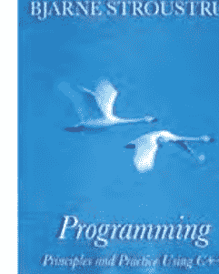

## 递归

请出示您的护照好吗？

## 递归

请出示您的护照好吗？

## 递归

请出示您的护照好吗？

你站在桥上看风景
看风景的人在楼上看你
明月装饰了你的窗子
你装饰了别人的梦
- 卞之琳

山上有座庙，庙里有个和尚在看报，看的是什么呢？看的是：

山上有座庙，庙里有个和尚在看报，看的是什么呢？看的是：

……

## 概览

- 递归的本性
- 递归函数
- 递归的执行
- 尾递归
- 递归和迭代

## 递归示例

- 计算一个非负整数的二进制表示中“1”的个数

- 在数字 0 中没有“1”
  - 基本情况（base case）- 递归终止条件

- 对于其他数字，考虑其二进制表示的方式：
  - int 类型有 32 位，高位在前，低位在后：
    - `bit₃₁ bit₃₀.....bit₁ bit₀`
  - 其值的表示方式为：
    - `bit₀ + 2*(bit₁) + 4*(bit₂) + 8*(bit₃) + ... + 2³¹*(bit₃₁)`

## 递归示例

- 这种二进制表示有两个特性：
  - 如果 n 是奇数，其最低位为 1；n 是偶数，其最低位为 0
  - 偶数被 2 除之后的结果与其原值有相同数量的 1

- n 被 2 除等价于将其所有的 bit **向右移 1 位**
  - 最低位被移出去弃
  - 最高位补充 0（研究对象是非负整数）

- 针对这些特性，给出函数 numOnes的定义如下：
  - numOnes(n) =
    - 0 如果 n = 0（基本情况）
    - numOnes(n/2) 如果 n > 0，且 n 是偶数
    - 1 + numOnes((n-1)/2) 如果 n > 0，且 n 是奇数
    - 后两种情况属于归纳步骤(inductive step)
- 要点：
  - 函数numOnes的值依赖于其自身

## 递归问题

- 凡是引用其自身的事物都具有递归属性

- 递归问题具备以下特征：
  - 有一个或多个无需再分解的基本情况
  - 其他情况可以由更小的问题实例来定义
    - 首先解决更小的问题
    - 然后执行简单的计算

- 递归问题可以通过简单优雅的形式解决
  - 通常可以通过递归函数来高效地解决
  - 遵循归纳证明的结构


## 递归函数

- 直接或间接调用自己的函数被称为递归函数
- 递归函数必须定义一个停止条件（基本情况）

```
int rgcd( int v1, int v2 )
{
    if ( v2 != 0 )
        return rgcd( v2, v1%v2 );
    return v1;
}
```

## 递归函数

- 例如，考虑阶乘函数
- C++（以及绝大多数别的编程语言中）没有阶乘操作符
- 必须以编写函数的方式来实现

- 首先，考察阶乘的数学定义：

$$factorial(n)=\prod_{i=1,n}i\quad(for\ n>0)$$

- 例如，factorial(3) 的计算如下：

$$factorial(3)=\prod_{i=1,n}i=(1\times2\times3)$$

## 递归函数

- 阶乘还有另外一种定义形式：
$$factorial(n) = \begin{cases} 1 & n = 0 \\ n \times factorial(n-1) & n > 0 \end{cases}$$

- 这是阶乘的递归定义
- 阶乘函数是使用阶乘自身来定义的

## 递归函数

- 这个定义有两个特性：
- 首先，它有一个无需计算的终止情况

$factorial(0)=1$

- 其次，其他情况可以按照如下方式解决：
- 先解决更小的问题，它更接近终止情况
- 再在这个更小问题的处理结果上执行简单的附加操作，得到“更大”的结果
- 这就是递归步骤（recursive step），或称为归纳步骤

## 递归解决方案

- 阶乘函数

```
int factorial(int n)
// REQUIRES: n >= 0 // EFFECTS: computes n!
1 {
2   if (n==0) {
3     return 1; // This is the base case---trivial!
4   } else {
5     return n*factorial(n-1); // This is the recursive step
6   }
7 }
```

## 递归的执行

- 假设我们以如下方式调用阶乘函数

```
int main()
1 {
2   int x;
3   x = factorial(3);
4 }
```

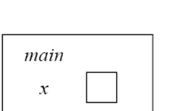

## 递归的执行

- 主函数用参数 3 调用阶乘函数，调用时：
- 计算实参的值
- 创建一条活动记录
- 将实参的值复制给形参
- 赋值发生在主函数的第三行

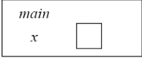

- 在阶乘函数体中：
- n 不等于 0
- 于是执行 if 语句的另一条分支
- `return 3*factorial(2)`

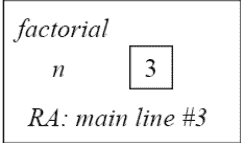

因此，阶乘函数必须调用它自身

## 递归的执行

- 在阶乘函数调用阶乘函数时：
- 对新的阶乘函数实例创建一条新的活动记录

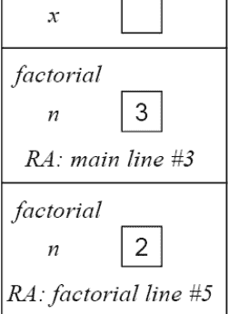

发生在阶乘函数的第5行

- n 仍就 不等于 0:
- 所以再次计算执行的 if 分支
return 2*factorial(1)

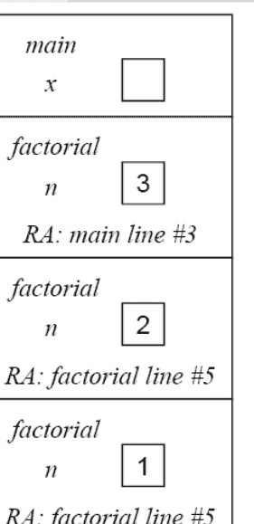

- n 再次调用时为 0:
- 执行 if 分支
return 1

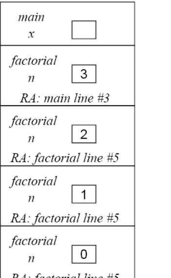

- 从栈中弹出最近的活动记录：

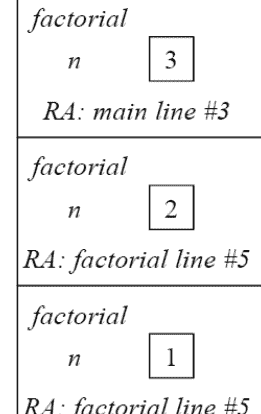

## 递归的执行

- 弹出的活动记录对应的调用是：
return 1*factorial(0)
- 现在已经知道 factorial(0) 的值为1，因此直接可知
return 1*1 ➔ return 1;
- 然后依次再弹出栈一个活动记录：

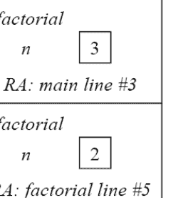

- 同理，执行：
return 2*factorial(1) ➔ return 2*1 ➔ return 2
- 再弹出栈一个活动记录：
- 接着，解决最后一个未完成的乘法
return 3*factorial(2) ➔ return 3*2 ➔ return 6
- 至此，执行完毕

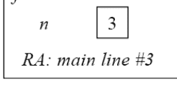

## 递归的问题

- 递归程序中每一次递归调用都需要占用栈中的一帧
- 这种方式代价有可能会很大
- 可能需要很多内存空间
- 这潜在地会导致栈溢出
- 递归版本的函数在内存空间使用上显得效率很低
- 是否存在一种方案可以降低对内存空间的要求呢？

- 我们来跟踪计算2的阶乘的调用情况：
- 对比两个版本

新版本

旧版本

```
factorial(2)
→ fact_helper(2, 1)
→ fact_helper(1, 2)
→ fact_helper(0, 2)
← 2
← 2
← 2
```

```
factorial(2)
→ 2 * factorial(1)
→ 1 * factorial(0)
← 1
← 1*1 (==1)
← 2*1 (==2)
← 2
```

## 尾递归

- 两个递归过程看起来是相同的
- 但是，它们存在本质区别：
- 新版本做的工作更少
- 它从最深层调用直接返回最终结果到最顶层
- 而旧版本在每一层都需要拿到返回结果后再做处理
- 这到底有什么不同呢？

## 尾递归

- 新版本中我们优化了对栈的使用
- 函数的活动记录只有在计算未处理完的情况下才需要
- 只要函数返回值已知，那么活动记录就可以丢弃
- 这就意味着对内存空间的使用更有效率

- 在新版本中，具体的返回值是未知的
- 在每次递归调用时未知

- 但是，每个调用都知道，无论它产生的递归调用返回什么：
- 该返回值也就是这个调用要返回的值

- 这意味着再也不需要为调用者在栈中分配帧
- 我们可以将其丢弃

- 这就是“尾递归（tail-recursion）”

- 由于在每个递归步骤中都不再执行未完成的计算
- 我们可以重用活动记录而不是创建新的活动记录

- 新版本按如下方式工作：

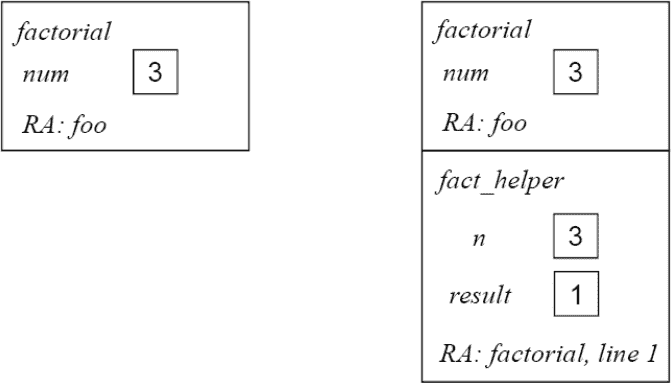

## 尾递归

- n 不等于0，因此执行：
return fact_helper(2,3)

- 这是一个尾递归调用
- fact_helper调用了它自己
- 并且在递归调用返回时，
不需要再做额外的工作

- 因此，我们可以重用栈中的帧
- 并返回其地址

| factorial | |
| 参数 | 3 |
| 返回地址：foo | |
| fact_helper | |
| n | 2 |
| 结果 | 3 |
| 返回地址：factorial，第1行 | |


- 同理，执行：

```
return fact_helper(1,6)
```

接着

```
return fact_helper(0,6)
```

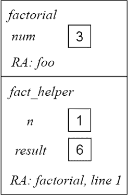

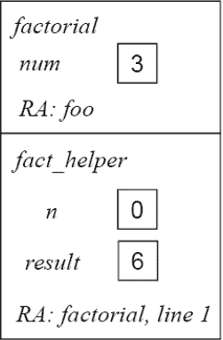

- 将新版本转换成迭代版本：
```c
int fact_helper(int n, int result){
    if (n == 0) {
        return result;
    }
    else {
        return fact_helper(n-1, result * n);
    }
}
```

问题：递归不变式是什么？
 n! * result = num!

```
int factorial(int num)
{
    return fact_helper(num, 1);
}
```

## 递归→迭代

- 1 复制函数类型签名
- 迭代版本与递归版本必须有完全一致的类型签名

```
int factorial(int num)
{
    ......
}
```

## ◆ 2 标识“循环变量”

- 在helper 函数中有两个形式参数：`n` 和 `result`
  - 这些形参在每次递归调用时都会变化

- 因此，在迭代版本中有两个循环变量：

```
int factorial(int num)
{
    int n = ...;
    int result = ...;
    ......
}
```

- ◆ 3 编写初始化代码
  
  - 循环变量只是形参
  - 对 helper 函数的第一次调用来自 “主” 递归函数
    - 主递归函数选择的初始值就是我们要来初始化的值：
```c
int factorial(int num)
{
    int n = num;
    int result = 1;
    ......
}
```

## 4 终止/返回

- 首先确定使用哪种循环
- 循环语句之间没有本质差异
- 对于尾递归来说，while循环是最容易实现的
- 尾递归中的基本情况就是循环的终止条件
- 基本思想：
  - 循环遍历问题的每个实例
  - 在基本情况下终止

## 5 循环体

- 将条件语句中的递归分支转换为循环体
- 首先，必须理解
- 尾递归调用被调用时实际做了些什么
- 再次检查递归中调用栈的情况：

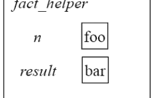

## 5 循环体

- 实际上，n和result被重新赋值
  n = n - 1
  result = n * result
- 直接照搬这两条语句到循环体中是否可以？
  - n 如果先递减，那么result将使用n递减后的值

## 5 循环体

- 在递归重新赋值中：
  - 先一次性计算所有新值
  - 然后赋值给变量
  - 这就是函数调用的语义
  - 但是，在C++语句中，每次只能计算一个

- 为了解决这个问题
  - 需要构建这些赋值语句的依赖图（dependency graph）
  - 这个图可以说明新值与旧值之间的依赖

## 5 循环体

- 构建依赖图：
  - 每个变量表示为一个顶点
  - 如果在计算变量 foo 的新值时读取了 bar 的值，则
    - 画一条从 foo 到 bar 的有向边
    - 不要画顶点到自身的边，例如 i = i + 1

## 5 循环体

- 构建依赖图:
  - 在阶乘例子中:
    - 在计算 n 的新值时，只读取了 n 自身的值
    - 而在计算 result 的新值时，读取了 result 自身和 n 的值
  - 我们忽略自引用，因此依赖图为:
    - n ← result

## 5 循环体

- 依赖图处理:
  - 如果对于一个变量，没有任何边以它为终点
    - 可以编码对其赋值，
    - 并删除它以及以它为起点的边

## ◆ 5 循环体

- 依赖图处理：

编写循环体第一行代码

```
int factorial(int num)
{
    int n = num; result = 1;
    while (n!=0) {
        result *= n;
        ....
    }
    return result;
}
```

## 5 循环体

- 依赖图处理：
  - 在阶乘例子中：
    - result 被删除，与result相关的边被删除
    - 依赖图变为：
      - n

## 5 循环体

- 依赖图处理：
  - 没有任何边以顶点n为起点，因此编写循环体第二行代码

```
int factorial(int num) {
    int n = num; result = 1;
    while (n!=0) {
        result *= n;
        n--;
    }
    return result;
}
```

## 5 循环体

- 依赖图处理：
  - 现在依赖图为空，编程完成
  - 棘手情况：
    - 依赖图中有环
    - 例如：

```
foo_helper(int bar, int baz){
    ...
    foo_helper(baz-1, bar-1);
}
```

## ◆ 5 循环体

- 依赖图处理：
  - bar 和 baz 互相依赖：`bar ↔ baz`
  - 不能先更新其中任何一个
  - 解决办法：
    - 引入“影子”变量，在赋值之前保存“新”值

```
int bar_new = baz-1;
int baz_new = bar-1;
bar = bar_new;
baz = baz_new;
```

## 5 循环体

- 依赖图处理：
  - 通过引入“影子”变量可以解决问题
    - 将依赖图中的环打破
  - 但是，影子变量增加了程序的阅读难度
    - 应该尽量避免使用

- 循环是非常强大的构建程序解决方案的方法
- 尾递归：
  - 无需对递归调用返回的结果再执行挂起的操作
- 普通递归
  - 与尾递归情况不同
- 例如，下面的函数就是尾递归：
  `int f(int x) { return f(x-1); }`
- 但是下面的函数就不是：
  `int f(int x) { return f(x) - 1; }`

- 尾递归解决方案的本质：
  - 只需要“常量内存空间”
    - 无论要解决的问题多“大”，只需要固定数量的栈内存帧
- 对于迭代解决方案也是如此
- 实际上，两个版本的factorial()非常相似
- 这种相似性不是偶然的
- 对于任何尾递归函数，都可编写出等价的迭代版本
- 换句话说，尾递归“只是”迭代

## 总结

- 这种等价性对于普通递归程序来说并不成立
  - 特别是，有些递归程序不能用常量内存空间来解决，例如，树的遍历问题

- 应该尽量以尾递归方式编写递归程序
- 如果某个递归不是尾递归（就像第一个版本的 factorial）
  - 必须引入一个助手函数，将其改写成尾递归

- 程序设计 I
- *Programming I*

Thank You!


## 程序设计 1
*程序设计与数据结构 I*

## 第9课
## 编程实例2
第九集
## 编程实例 2

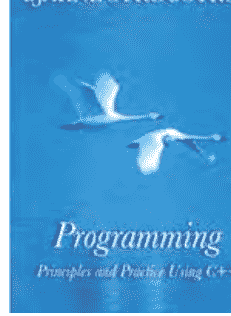

## 实例-排序
- 问题1:
  - 对于一组给定的整数，进行从小到大的排序
  - 算法可以推广到浮点数
  - 给定的数字中可以有重复数字
  - int a[10] = {2,4,6,8,10,1,3,5,7,9};
  - int b[10] = {2,4,6,8,10,2,4,6,8,10};
  - 排序后
  - int a[10] = {1,2,3,4,5,6,7,8,9,10};
  - int b[10] = {2,2,4,4,6,6,8,8,10,10};

## 冒泡排序

```
void BubbleSort(int* r,int length){
    int i,j,tmp;
    for(i = 0; i < length; i++){
        for(j = i+1; j < length; j++)
            if(r[i] > r[j]){
                tmp = r[i];
                r[i] = r[j];
                r[j] = tmp;
            }
    }
}

int main(){
    int a[10] = {2,4,6,8,10,1,3,5,7,9};
    BubbleSort(a,10);
}
```

## 选择排序

```
void SelectionSort(int* r,int length){
    int i,j,k,tmp;
    for(i = 0; i < length-1; i++){
        k = i;
        for(j = i+1; j < length; j++)
            if(r[k] > r[j])
                k = j;
        tmp = r[i];
        r[i] = r[k];
        r[k] = tmp;
    }
}
```

## 插入排序

```
void InsertSort(int* r, int length){
    int i, j, tmp;
    for(i = 1; i < length; i++){
        tmp = r[i];
        for(j = i - 1; j >= 0; j--)
            if(tmp < r[j])
                r[j+1] = r[j];
            else
                break;
        r[j+1] = tmp;
    }
}
```

```
void qs(int* a, int begin,int end) {
    int compare=a[begin], left = begin, right = end;
    if (left > right)
        return;
    while (left < right){
        while ((left < right) && a[right] >= compare)
            right--;
        swap(a[left],a[right]);
        while ((left < right) && a[left] < compare)
            left++;
        swap(a[right],a[left]);
    }
    qs(a,begin,right-1);
    qs(a,right+1,end);
}

void QuickSort (int* r, int length){
    qs(r,0,length-1);
}
```

## 实例-排序
- 问题2:
  - 对于已经排好序的一组数字，如何进行查找
  - 可以确定是否能够找到
  - 找到时返回在这组数字中的位置

```
int LinearSearch(int *arr,int length,int num)
{
    for(int i=0;i<length;i++)
        if(arr[i] == num)
            return i;
    return -1;
}

int main(){
    int a[10] = {2,4,6,8,10,1,3,5,7,9};
    BubbleSort(a,10);

    int num = 9;
    cout << "The number " << num << " is a[" << LinearSearch(a,10,num) << "]";
}
```

## 二分搜索

```
int BinarySearch(int *arr,int length,int num){
    int begin = 0;
    int end = length - 1;
    int mid;
    while(begin <= end){
        mid = begin + (end - begin)/2;
        if (arr[mid] == num)
            return mid;
        if (arr[mid] < num)
            begin = mid + 1;
        else
            end = mid - 1;
    }
    return -1;
}
```

## 二分搜索 - 递归

```cpp
int RBS(int *arr,int begin,int end, int num){
    int mid = begin + (end - begin)/2;
    if (begin <= end){
        if (arr[mid] == num)
            return mid;
        if (arr[mid] < num)
            begin = mid + 1;
        else
            end = mid - 1;
        RBS(arr,begin, end, num);
    }else
        return -1;
}
int RecursiveBinarySearch(int *arr,int length,int num){
    return RBS(arr, 0, length-1, num);
}
```

- 程序设计 I
- *程序设计 I*

Thank You!
谢谢！


## 程序设计 1
*程序设计与数据结构 I*

## 第10课
函数重载

第十集
## 重载


## 本节内容
- 重载函数声明
- 重载解析的三个步骤

## 重载函数声明
- 函数重载 function overloading
  - 允许多个函数共享同一个函数名
  - 但是针对不同参数类型提供共同的操作
  - 1 + 3
  - 1.0 + 3.0
  - "1.0" + "3.0"

## 为什么要重载一个函数名
- 我们希望定义一组函数
  - 它们执行同样的一般性动作
  - 但是应用在不同的参数类型上
  - int i_max( int, int );
  - int vi_max( const vector<int> & );
  - int matrix_max( const matrix & );
  - int max( int, int );
  - int max( const vector<int> & );
  - int max( const matrix & );

- 编译器按如下步骤解释多次出现的函数名
- 如果两个函数的参数表中参数的个数或类型不同，则认为这两个函数是重载的
  ```
  void print( const string & );
  void print( vector<int> & );
  ```
- 如果两个函数的返回类型和参数表精确匹配，则第二个声明被视为第一个的重复声明（编译不报错）
  ```
  void print( const string &str );
  void print( const string & );
  ```


## 怎样重载一个函数名

- 编译器按如下步骤解释多次出现的函数名
  - 如果两个函数的参数表相同，但是返回类型不同，则第二个声明被视为第一个的错误重复声明，会被标记为编译错误。（编译报错）

```
unsigned int max( int i1, int i2 );
int max( int, int ); //错误：只有返回类型不同
```

  - 如果在两个函数的参数表中只有缺省实参不同，则第二个声明被视为第一个的重复声明（编译不报错）

```
int max( int *ia, int sz );
int max( int *, int = 10 );
```

## 怎样重载一个函数名

- typedef 名为现有的数据类型提供了一个替换名
  ```cpp
  typedef double DOLLAR;  // typedef并不引入新的类型
  extern DOLLAR calc( DOLLAR );
  extern int calc( double ); //错误：只有返回类型不同（编译报错）
  ```

- 在识别函数声明是否相同时，并不考虑const和volatile修饰符
  ```cpp
  void f( int );
  void f( const int ); //同一函数重复声明（编译不报错）
  ```

## 怎样重载一个函数名

- 如果把 `const` 或 `volatile` 应用在指针或引用参数指向的类型上，则在判断函数声明是否相同时，就要考虑 `const` 和 `volatile` 修饰符

```
void f( int* );
void f( const int* );

void f( int& );
void f( const int& );
```

## 重载与域

- 重载函数集合中的全部函数都应在同一个域中声明

```
#include <string>
void print( const string & );
void print( double ); // overloads print()
void fooBar( int ival )
{
    // 独立的域隐藏print()的两个实例
    extern void print( int );
    // 错误: print( const string & )在这个域中被隐藏
    print( "Value : " );
    print( ival ); // ok: print( int ) 可见
}
```

## 重载与域

- 也可以在一个类中声明一组重载函数，因为每个类都维护着自己的一个域，所以两个不同类的成员函数不能相互重载（类在后续课程中介绍）

- 也可以在一个名字空间内声明一组重载函数，每个名字空间也都维护着自己的一个域，作为不同名字空间成员的函数，不能相互重载例如
  ```
  #include <string>
  namespace IBM {
      extern void print( const string );
      extern void print( double ); // 重载 print()
  }
  namespace Disney {
      // 独立的域:
      // 没有重载 IBM 的 print()
      extern void print( int );
  }
  ```

## 重载与域

```
namespace libs_R_us {
    int max( int, int );
    int max( double, double );
    extern void print( int );
    extern void print( double );
}
// using 声明
using libs_R_us::max;
using libs_R_us::print( double ); // 错误
void func()
{
    max( 87, 65 ); // 调用 libs_R_us::max( int, int )
    max( 35.5, 76.6 ); // 调用 libs_R_us::max( double, double )
}
```

```
#include <string>
namespace libs_R_us {
    extern void print( int );
    extern void print( double );
}
extern void print( const string & );
// libs_R_us::print( int ) 和 libs_R_us::print( double )
// 重载 print( const string & )
using libs_R_us::print;
void fooBar( int ival )
{
    print( "Value: " ); // 调用全局 print( const string & )
    print( ival ); // 调用 libs_R_us::print( int )
}
```

## 重载与域

```
namespace libs_R_us {
    void print( int );
    void print( double );
}

void print( int );
using libs_R_us::print; // 错误: print(int) 的重复声明

void fooBar( int ival )
{
    print( ival ); // 哪一个 print? ::print 还是 libs_R_us::print?
}
```

```
#include <string>
namespace libs_R_us {
    extern void print(int );
    extern void print( double );
}
extern void print( const string & );
// using 指示符:
// print(int), print(double) 和 print(const string &)
// 是重载函数集的一部分
using namespace libs_R_us;
void fooBar( int ival )
{
    print( "Value: " ); // 调用 global print(const string &)
    print( ival ); // 调用 libs_R_us::print(int)
}
```

## 本节内容

- 重载函数声明
- 重载解析的三个步骤

- 函数重载解析
  - function overload resolution
  - 把函数调用与重载函数集合中的一个函数相关联的过程
  - 在存在多个同名函数的情况下，根据函数调用中指定的实参选择其中一个函数

```
T t1, t2;
void f( int, int );
void f( float, float );
int main() {
    f( t1,t2 );
    return 0;
}
```

## 函数重载解析

- 函数重载解析的过程有三个步骤

```
void f();
void f( int );
void f( double, double = 3.4 );
void f( char*, char* );
int main() {
    f( 5.6 );
    return 0;
}
```

- 确定函数调用考虑的重载函数的集合，确定函数调用中实参表的属性
- 候选集合
- f()
- f(int)
- f(double, double)
- f(char*, char*)

## 函数重载解析

- 函数重载解析的过程有三个步骤

```
void f();
void f( int );
void f( double, double = 3.4 );
void f( char*, char* );
int main() {
    f( 5.6 );
    return 0;
}
```

- 从重载函数集合中选择函数，该函数可以在给出实参个数和类型的情况下调用中指定的实参进行调用

- 可行函数
  - f(int)
  - f(double, double)

- 也有可能出现无匹配情况


- 函数重载解析的过程有三个步骤
void f();
void f( int );
void f( double, double = 3.4 );
void f( char*, char* );
int main() {
  f( 5.6 );
  return 0;
}

- 最佳可行函数
- 应用在实参上的转换不比调用其他可行函数所需的转换差
- 在某些实参上的转换要比其他可行函数对该参数的转换好
- f(double, double)

- 程序设计 I
- *Programming I*

Thank You!


## 程序设计1

## *Programming I*

## 第11章
输入/输出流

## Chapter Eleven
Input/Output Streams

翻译自Bjarne Stroustrup的课件


## 概览

- 基本 I/O 概念
- 文件
  - 打开
  - 读写流
- I/O 错误
- 读取单个整数

data source:

input device

device driver

input library

our program

data destination:

output library

device driver

output device


## 流模型


- ostream
  - 将各种类型的值转换成为字符序列
  - 将这些字符发送到某处
    - 例如，控制台、文件、主存、其他的计算机

- istream
  - 将字符序列转换为各种类型的值
  - 从某处获取这些字符
    - 例如, 控制台、文件、主存、其他的计算机


## 流模型

- 读和写
  - 具有类型的实体
    - `<<`（输出）和`>>`（输入），以及其他操作
    - 类型安全
    - 格式化
  - 通常作为文本存储（键入、打印等）
    - 但是并非是必需的（第11章的二进制流）
  - 是可扩展的
    - 可以为自己的类型定义自己的I/O操作
  - 流可以附着在其他流或存储设备上


## 文件

- 计算机会经常开关
  - 主存里的内容是瞬时的
  
- 但是我们希望能够保存数据
  - 因此，我们将想要保存的数据存储到硬盘上或其他持久性介质上
  
- 文件是存储在持久性介质上的字节序列
  - 文件有名字
  - 文件中的数据具有某种格式
  
- 我们可以读/写文件
  - 只要我们知道它的名字和格式


- 在最底层，文件是从0开始向上计数的一个字节序列
- 其他概念由解释“文件格式”的程序提供
  - 例如，6个字节的“123.45”可以被解释成浮点数123.45

- 通用模型

disk

Main memory

I/O system

iostreams

Files
(sequences of bytes)

Objects
(of various types)

- 为了读文件
  - 必须知道文件名
  - 必须打开它(读方式)
  - 然后才能读
  - 之后必须关闭它
    - 这通常是隐式完成的
- 为了写文件
  - 必须为其命名
  - 必须打开它(写方式)
    - 或者创建具有该名字的新文件
  - 然后才能写
  - 之后必须关闭它
    - 这通常是隐式完成的

## 读模式打开文件

```
// ...
int main()
{
    cout << "Please enter input file name: ";
    string name;
    cin >> name;
    ifstream ist(name.c_str());      // ifstream is an "input stream from a file"
                                 // c_str() gives a low-level ("system"
                                 // or C-style) string from a C++ string

                                 // defining an ifstream with a name string
                                 // opens the file of that name for reading
    if (!ist) error("can't open input file ", name);
    // ...
```

## 从文件中读

- 假设某个文件包含一个数值对序列，这个数值对由表示小时和温度的数值构成
  0 60.7
  1 60.6
  2 60.3
  3 59.22

- 小时取值范围为 0..23

- 没有更多的格式要求
  - 也许可以做得更好(但是不是现在)

- 终止
  - 到达文件末尾就终止读操作
  - 在文件中读到任何预期数值之外的內容，就终止读操作
    - 例如, q

## 从文件中读

```
struct Reading {      // a temperature reading
    int hour; // hour after midnight [0:23]
    double temperature;
    Reading(int h, double t) :hour(h), temperature(t) { }
};

vector<Reading> temps;      // create a vector to store the readings

int hour;
double temperature;
while (ist >> hour >> temperature) {                      // read
    if (hour < 0 || 23 < hour) error("hour out of range");   // check
    temps.push_back( Reading(hour,temperature) );            // store
}
```

## I/O错误处理

- 错误源
  - 人犯错
  - 文件不符合规格说明
  - 规格说明与现实不匹配
  - 程序错误
  - 等等

- `iostream` 将所有错误归纳为四种状态之一
  - `good()`  // *the operation succeeded*
  - `eof()`   // *we hit the end of input (“end of file”)*
  - `fail()`  // *something unexpected happened*
  - `bad()`   // *something unexpected and serious happened*

```cpp
void fill_vector(istream& ist, vector<int>& v, char terminator)
{
    // read integers from ist into v until we reach eof() or terminator
    int i = 0;
    while (ist >> i) v.push_back(i);    // read and store in v until “some failure”
    if (ist.eof()) return;              // fine: we found the end of file
    if (ist.bad()) error("ist is bad"); // stream corrupted; let’s get out of here!

    if (ist.fail()) {    // clean up the mess as best we can and report the problem
        ist.clear();     // clear stream state, so that we can look for terminator
        char c;
        ist >> c;        // read a character, hopefully terminator
        if (c != terminator) {    // unexpected character
            ist.unget();           // put that character back
            ist.clear(ios_base::failbit); // set the state back to fail()
        }
    }
}
```


## 对于bad()抛出异常

```
// How to make ist throw if it goes bad:
ist.exceptions(ist.exceptions()|ios_base::badbit);
```

```
// can be read as
// "set ist's exception mask to whatever it was plus badbit"
// or as "throw an exception if the stream goes bad"
```

- 如果这样做了，我们在输入循环就可以不再检查是否是bad状态了，从而可以简化输入循环

## 简化输入循环

```
void fill_vector(istream& ist, vector<int>& v, char terminator)
{
    // read integers from ist into v until we reach eof() or terminator
    int i = 0;
    while (ist >> i) v.push_back(i);
    if (ist.eof()) return;      // fine: we found the end of file

    // not good() and not bad() and not eof(), ist must be fail()
    ist.clear();                // clear stream state
    char c;
    ist>>c;                     // read a character, hopefully terminator
    if (c != terminator) {      // ouch: not the terminator, so we must fail
        ist.unget();            // maybe my caller can use that character
        ist.clear(ios_base::failbit); // set the state back to fail()
    }
}
```

## 处理所有情况：**超级复杂！**

```cpp
cout << "Please enter an integer in the range 1 to 10 (inclusive):\n";
int n = 0;
while (n==0) {       // Spot the bug!
    cin >> n;
    if (cin) {       // we got an integer; now check it:
        if (1<=n && n<=10) break;
        cout << "Sorry, " << n << " is not in the [1:10] range; please try again\n";
    }
    else if (cin.fail()) {       // we found something that wasn’t an integer
        cin.clear();             // we’d like to look at the characters
        cout << "Sorry, that was not a number; please try again\n";
        char ch;
        while (cin>>ch && !isdigit(ch)) ;       // throw away non-digits
        if (!cin) error("no input");       // we didn’t find a digit: give up
        cin.unget();       // put the digit back, so that we can read the number
    }
    else
        error("no input");       // eof or bad: give up
}
// if we get here n is in [1:10]
```

## 复杂性来源于试图解决所有问题

- 问题：我们将所有操作混在了一起
  - 读值
  - 提示用户输入
  - 写错误消息
  - 跳过“不良”输入字符
  - 测试输入是否落在有效范围之内
- 解决方案：将其拆解为逻辑上互相分离的部分

## 我们希望做什么？

- 我们希望有哪些逻辑部分？

```
int get_int(int low, int high);  // read an int in [low..high] from cin

int get_int();                    // read an int from cin
                                  // so that we can check the range int

void skip_to_int();               // we found some “garbage” character
                                  // so skip until we find an int
```

- 将逻辑上分离的动作拆分成函数

## 跳过“垃圾”

```cpp
void skip_to_int()
{
    if (cin.fail()) {          // we found something that wasn’t an integer
        cin.clear();            // we’d like to look at the characters
        char ch;
        while (cin>>ch) {       // throw away non-digits
            if (isdigit(ch)) {
                cin.unget();    // put the digit back,
                                // so that we can read the number
                return;
            }
        }
    }
    error("no input");         // eof or bad: give up
}
```

## 获取任意整数

```
int get_int()
{
    int n = 0;
    while (true) {
        if (cin >> n) return n;
        cout << "Sorry, that was not a number; please try again\n";
        skip_to_int();
    }
}
```

## 获取某个范围内的整数

```
int get_int(int low, int high)
{
    cout << "Please enter an integer in the range "
         << low << " to " << high << " (inclusive):\n";
    while (true) {
        int n = get_int();
        if (low<=n && n<=high) return n;
        cout << "Sorry, "
             << n << " is not in the [" << low << ':' << high
             << "] range; please try again\n";
    }
}
```

```
int n = get_int(1,10);
cout << "n: " << n << endl;
```

```
int m = get_int(2,300);
cout << "m: " << m << endl;
```

- 问题：
- “对话”是在读操作中构建的

```
int get_int(int low, int high, const string& greeting, const string& sorry)
{
    cout << greeting << ": [" << low << ':' << high << "]\n";
    while (true) {
        int n = get_int();
        if (low<=n && n<=high) return n;
        cout << sorry << ": [" << low << ':' << high << "]\n";
    }
}
```

- 不完整的参数化：get_int() 仍旧“不靠谱”
  - “使用工具函数utility functions” 不应该产生自己的错误消息
  - 严谨的库函数压根不会产生错误消息
    - 它们会抛出异常（可能包含错误消息）


- 通常很简单

```cpp
ostream& operator<<(ostream& os, const Date& d)
{
    return os << '(' << d.year()
        << ',' << d.month()
        << ',' << d.day() << ')';
}
```
- 我们经常使用多种不同的方式来输出一个值
  - 适应各种不同的对输出布局和细节的喜好

## 用法

```cpp
void do_some_printing(Date d1, Date d2)
{
    cout << d1;          // means operator<<(cout,d1);

    cout << d1 << d2;
                         // means (cout << d1) << d2;
                         // means (operator<<(cout,d1)) << d2;
                         // means operator<<((operator<<(cout,d1)), d2);
}
```

```cpp
istream& operator>>(istream& is, Date& dd)
// Read date in format: ( year , month , day )
{
    int y, d, m;
    char ch1, ch2, ch3, ch4;
    is >> ch1 >> y >> ch2 >> m >> ch3 >> d >> ch4;
    if (!is) return is;        // we didn't get our values, so just leave
    if (ch1!='(' || ch2!=' ,' || ch3!=' ,' || ch4!=')') {        // oops: format error
        is.clear(ios_base::failbit);    // something wrong: set state to fail()
        return is;                // and leave
    }
    dd = Date(y,Month(m),d);        // update dd
    return is;                // and leave with is in the good() state
}
```

- 程序设计 I
- *程序设计 I*

谢谢！


## 程序设计1

*程序设计 I*

## 第12章

## 定制I/O

## 第十二章

## 定制I/O

翻译自Bjarne Stroustrup的课件


- 输入：连续输入一组字符串，以空格分割；（10%）
- 输出：
  - 输出该组字符串中具有最大长度的某一个字符串（50%）
  - 考虑到可能有多个最长的字符串，如果你完成了上述任务，请输出具有最大长度的多个字符串（10%）
  - 如果你完成了任务1~2，则请将所有字符串按照长度从小到大排序输出（10%）
  - 如果你完成了任务1~3，则将所有字符串按照长度从小到大排序输出过程中，对于长度一致的字符串，按照字母顺序排序输出（5%）

```cpp
#include <iostream>
#include <string>
#include <vector>
#include <algorithm>
using namespace std;

int main() {
    vector<string> inputs;
    vector<int> sizes;
    string temp;
    while (cin >> temp) {
        inputs.push_back(temp);
        sizes.push_back(temp.size());
    }
}
```

```
//此处完成任务1:
//输出该组字符串中具有最大长度的某一个字符串
int max = -1;
for (int i = 0; i < sizes.size(); i++) {
    if (sizes[i] > max)
        max = sizes[i];
}

for (int i = 0; i < inputs.size(); i++) {
    if (inputs[i].size() == max) {
        cout << inputs[i] << endl;
        break;
    }
}
```

```
//此处完成任务2：考虑到可能有多个最长的字符串，
//如果你完成了上述任务，请输出具有最大长度的多个字符串

for (int i = 0; i < inputs.size(); i++) {
    if (inputs[i].size() == max) {
        cout << inputs[i] << endl;
    }
}
```

```
//此处完成任务3：将所有字符串按照长度从小到大排序输出

for (int i = 1; i <= max; i++) {
    for (int j = 0; j < inputs.size(); j++) {
        if (inputs[j].size() == i)
            cout << inputs[j]<<endl;
    }
}
```

```
//此次完成任务4：将所有字符串按照长度从小到大排序输出过程中，
//对于长度一致的字符串，按照字母顺序排序输出

for (int i = 1; i <= max; i++) {
    vector<string> temps;
    for (int j = 0; j < inputs.size(); j++) {
        if (inputs[j].size() == i)
            temps.push_back(inputs[j]);
    }
    sort(temps.begin(), temps.end());

    for (int j = 0; j < temps.size(); j++)
        cout << temps[j] << endl;
}
```

## 概览

- 输入和输出
- 数字型输出
  - 整数
  - 浮点数
- 文件模式
  - 二进制 I/O
  - 定位
- 字符串流
- 面向行的输入
  - 字符输入
  - 字符分类

## I/O种类

- 单个值
  - 查看第4章第10节
- 流
  - 查看第10-11章
- 图形和图形化用户界面GUI
  - 查看第12-16章
- 文本
  - 键盘输入驱动的格式化信息
  - 面向行的
  - 单个的字符
- 数字
  - 整数
  - 浮点数
  - 用户定义类型

## 评述

- 作为程序员，我们偏好规则性和简单性
  - 但是，我们的工作是满足用户需求
- 用户对输出的呈现方式非常讲究/特殊/挑剔
  - 他们经常有非常充足的理由要这么做
  - 惯例/传统使然
    - 123,456 意味着什么？
    - (123) 意味着什么？
  - (输出格式的) 世界千奇百怪，超乎想象

- 我们可以改变“基数"
  - 基数10 == 十进制；数字：0 1 2 3 4 5 6 7 8 9
  - 基数8 == 八进制；数字：0 1 2 3 4 5 6 7
  - 基数16 == 十六进制；数字：0 1 2 3 4 5 6 7 8 9 a b c d e f

```
// simple test:
    cout << dec << 1234 << "\t(decimal)\n"
        << hex << 1234 << "\t(hexadecimal)\n"
        << oct << 1234 << "\t(octal)\n";
```

// 't' 字符是 "tab"（"制表符"的缩写）

// 结果：

- 1234    (十进制)
- 4d2     (十六进制)
- 2322    (八进制)


## 数字的基数输出
- 我们可以改变“基数”
  - 基数10 == 十进制; 数字: 0 1 2 3 4 5 6 7 8 9
  - 基数8 == 八进制; digits: 0 1 2 3 4 5 6 7
  - 基数16 == 十六进制; 数字: 0 1 2 3 4 5 6 7 8 9 a b c d e f

```
// simple test:
cout << 1234 << '\t'
    << hex << 1234 << '\t'
    << oct << 1234 << '\n';
cout << 1234 << '\n';    // the octal base is still in effect
```

// results:

1234    4d2    2322
2322

- 我们可以改变“基数”
  - 基数10 == 十进制; 数字: 0 1 2 3 4 5 6 7 8 9
  - 基数8 == 八进制; digits: 0 1 2 3 4 5 6 7
  - 基数16 == 十六进制; 数字: 0 1 2 3 4 5 6 7 8 9 a b c d e f

```cpp
// simple test:
cout << 1234 << '\t'
     << hex << 1234 << '\t'
     << oct << 1234 << endl;             // '\n'
cout << showbase << dec;  // show bases
cout << 1234 << '\t'
     << hex << 1234 << '\t'
     << oct << 1234 << '\n';

// results:
     1234      4d2       2322
     1234      0x4d2     02322
```

## 浮点数指示符
- 可以修改浮点数输出格式
  - 普通格式– iostream 选择使用n位的最佳格式 (这也是缺省格式)
  - 科学计数法– 在小数点前有1位，小数点后面有n位，加上一个指数
  - 固定位数– 没有指数; 小数点后 n 位

```
// simple test:
cout << 1234.56789 << "\t\t(general)\n" // \t\t to line up columns
    << fixed << 1234.56789 << "\t\t(fixed)\n"
    << scientific << 1234.56789 << "\t\t(scientific)\n";
```

// results:

- 1234.57          (general)
- 1234.567890      (fixed)
- 1.234568e+003    (scientific)

- 精度(缺省为位)
  - 普通格式- 精度是所有数字的个数
    - 注意: 普通指示符不是标准规定的, 只是在std_lib_facilities.h中规定的
  - 科学计数法- 精度是小数点之后的位数
  - 固定位数- 精度是小数点之后的位数

```
// example:
cout << 1234.56789 << '\t' << fixed << 1234.56789 << '\t'
    << scientific << 1234.56789 << '\n';
cout << general << setprecision(5)
    << 1234.56789 << '\t' << fixed << 1234.56789 << '\t'
    << scientific << 1234.56789 << '\n';
cout << general << setprecision(8)
    << 1234.56789 << '\t' << fixed << 1234.56789 << '\t'
    << scientific << 1234.56789 << '\n';
```

// results (note the rounding):
1234.57      1234.567890      1.234568e+003
1234.6       1234.56789       1.23457e+003
1234.5679            1234.56789000   1.23456789e+003

## 输出字段的宽度
- 宽度是用于下一个输出操作的字符数
  - 注意: 宽度只应用于下一个输出
    - 不像精度、基数和浮点数格式中具有“粘滞性”
  - 注意: 输出永远都不会被截尾以适应域
    - 错误的格式好于错误的值

```
// example:
cout << 123456 << "|" << setw(4) << 123456 << "|"
    << setw(8) << 123456 << "|" << 123456 << "\n";
cout << 1234.56 << "|" << setw(4) << 1234.56 << "|"
    << setw(8) << 1234.56 << "|" << 1234.56 << "\n";
cout << "asdfgh" << "|" << setw(4) << "asdfgh" << "|"
    << setw(8) << "asdfgh" << "|" << "asdfgh" << "\n";
```

// results:

123456|123456| 123456|123456|
1234.56|1234.56| 1234.56|1234.56|
asdfgh|asdfgh|  asdfgh|asdfgh|


- 在最底层，文件是从0开始向上计数的一个字节序列
- 其他概念由解释“文件格式”的程序提供
  - 例如，6个字节的“123.45”可以被解释成浮点数123.45

## 文件打开模式
- 缺省地，ifstream 会打开一个文件，用于读操作
- 缺省地，ofstream会打开一个文件，用于写操作
- 或者：
  - ios_base::app // append (i.e., add to the end of the file)
  - ios_base::ate // “at end” (open and seek to end)
  - ios_base::binary // binary mode – beware of system specific behavior
  - ios_base::in // for reading
  - ios_base::out // for writing
  - ios_base::trunc // truncate file to 0-length

- 文件模式可以在文件名之后指定：
  - ofstream of1(name1); // defaults to ios_base::out
  - ifstream if1(name2); // defaults to ios_base::in
  - ofstream ofs(name, ios_base::app); // append rather than overwrite
  - fstream fs("myfile", ios_base::in|ios_base::out); // both in and out

## 文本 vs. 二进制文件
123 as characters:


12345 as characters:


123 as binary:


In binary files, we use sizes to delimit values

12345 as binary:


In text files, we use separation/termination characters

123456 as characters:


123 456 as characters:


## 文本 vs.二进制文件

+   - 在使用文本文件时，我们可以
+     - 读文本 (不需要复杂的程序)
+     - 可以更加容易地调试程序
+     - 文本可以在不同的系统之间移植
+     - 大部分信息可以用文本来表示
+   - 在下列情况下必须使用二进制文件
+     - 例如，图像文件、声音文件

## 二进制文件

```cpp
int main()
// use binary input and output
{
    cout << "Please enter input file name\\n";
    string name;
    cin >> name;
    ifstream ifs(name.c_str(),ios_base::binary);        // note: binary
    if (!ifs) error("can't open input file ", name);

    cout << "Please enter output file name\\n";
    cin >> name;
    ofstream ofs(name.c_str(),ios_base::binary);        // note: binary
    if (!ofs) error("can't open output file ", name);

    // “binary” tells the stream not to try anything clever with the bytes
}
```


```
fstream fs(name.c_str());    // open for input and output
// ...
fs.seekg(5);    // move reading position ('g' for 'get') to 5 (the 6th character)
char ch;
fs>>ch;    // read and increment reading position
cout << "character[6] is " << ch << '(' << int(ch) << ")\n";
fs.seekp(1);    // move writing position ('p' for 'put') to 1 (the 2nd character)
fs<<'y';    // write and increment writing position
```

+   - 无论何时，你都可以
+     - 使用简单的流机制
+       - 流/流机制是非常重要的概念
+       - 在你的大部分代码中都是用“普通的”istream 和ostream来编码
+     - 定位非常容易出错
+       - 对文件结尾位置的处理是与系统相关的，并且基本上不受检查

## 字符串流

+   - 非常有用
+     - 格式化固定尺寸的空间 (例如图形化界面 GUI)
+     - 从字符串中抽取具有类型的对象

## 类型 vs. 行

+   - 读一个字符串

```
string name;
cin >> name;        // input: Dennis Ritchie
cout << name << '\n';  // output: Dennis
```

+   - 读一行

```
string name;
getline(cin,name);       // input: Dennis Ritchie
cout << name << '\n';    // output: Dennis Ritchie
// now what?
// maybe:
istringstream ss(name);
ss>>first_name;
ss>>second_name;
```

## 字符

+   - 我们也可以读入单个字符

```
char ch;
while (cin>>ch) {    // read into ch, skipping whitespace characters
    if (isalpha(ch)) {
        // do something
    }
}
```

```
while (cin.get(ch)) { // read into ch, don't skip whitespace characters
    if (isspace(ch)) {
        // do something
    }
    else if (isalpha(ch)) {
        // do something else
    }
}
```

## 字符

• 如果使用字符输入，经常需要使用下面的函数（在头文件 `<ctype>` 中）：

+   - `isspace(c)` — *c 是否为空白字符？(' ', '\t', '\n' 等)*  
+   - `isalpha(c)` — *c 是否为字母？('a'..'z', 'A'..'Z') 注意：不包括 '_'*
+   - `isdigit(c)` — *c 是否为十进制数字？('0'..'9')*
+   - `isupper(c)` — *c 是否为大写字母？*
+   - `islower(c)` — *c 是否为小写字母？*
+   - `isalnum(c)` — *c 是否为字母或十进制数字？*

+   - 读入下面的行
+     - As planned, the guests arrived; then,
+     - 会得到
+       As
+       planned,
+       the
+       guests
+       arrived;
+       then,
+     - 实际上我们希望得到
+       As
+       planned
+       the
+       guests
+       arrived
+       then

## 使用非标准的分隔符

```
string line;
getline(cin,line);      // read into line
for (int i=0; i<line.size(); ++i) // replace each punctuation character by a space
    switch(line[i]) {
    case ',': case '.': case ';': case '?': case '!':
        line[i] = ' ';
    }

stringstream ss(line);    // make an istream ss reading from line
vector<string> vs;
string word;
while (ss>>word)          // read words without punctuation characters
    vs.push_back(word);
```

## 使用非标准的分隔符

```
int main()
{
    Punct_stream ps(cin);
    ps.whitespace(";,:.? !\"{}<>\/&$@#%^*|~"); // note \" means " in string
    ps.case_sensitive(false);

    cout << "please enter words\n";
    vector<string> vs;
    string word;
    while (ps>>word) vs.push_back(word);  // read words

    sort(vs.begin(),vs.end());        // sort in lexicographical order
    for (int i=0; i<vs.size(); ++i)    // write dictionary
        if (i==0 || vs[i]!=vs[i-1]) cout << vs[i] << endl;
}
```

```
class Punct_stream { // like an istream, but the user can add to
    // the set of whitespace characters
public:
    Punct_stream(istream& is) : source(is), sensitive(true) { }

    void whitespace(const string& s) { white = s; }   // make s the whitespace set
    void add_white(char c) { white += c; } // add to the whitespace set
    bool is_whitespace(char c);       // is c in the whitespace set?

    void case_sensitive(bool b) { sensitive = b; }
    bool is_case_sensitive() { return sensitive; }

    Punct_stream& operator>>(string& s);
    operator bool();
```


## 使用非标准的分隔符

```
class Punct_stream { // like an istream, but the user can add to
    // the set of whitespace characters
public:
    //...
private:
    istream& source;      // character source
    istringstream buffer; // we let buffer do our formatting
    string white;         // characters considered "whitespace"
    bool sensitive;       // is the stream case sensitive?
};
```

## 使用非标准的分隔符

```
Punct_stream& Punct_stream::operator>>(string& s)
{
    while (!(buffer>>s)) {    // try to read from buffer
        if (buffer.bad() || !source.good()) return *this;
        buffer.clear();
        string line;
        getline(source,line); // get a line from source
        // do character replacement as needed:
        for (int i =0; i<line.size(); ++i)
            if (is_whitespace(line[i]))
                line[i] = ' ';
            else if (!sensitive)
                line[i] = tolower(line[i]);
        buffer.str(line);     // put string into stream
    }
    return *this;
}
```

```
bool Punct_stream::is_whitespace(char c)
{
    for (int i = 0; i<white.size(); ++i) if (c==white[i]) return true;
    return false;
}
```

```
Punct_stream::operator bool()
{
    return !(source.fail() || source.bad()) && source.good();
}
```

- 程序设计 I
- *程序设计 I*

谢谢！


## 概览

- 一些软件开发的思想
- 计算机
- 使用文法
- 表达式计算
- 程序组织

## 构建程序

- 分析
  - 精化我们对问题的理解
    - 考虑程序最终的使用方式
- 设计
  - 创建程序的总体结构
- 实现
  - 编写代码
  - 调试
  - 测试
- 重复上述过程

- 程序要解决什么问题？
  - 问题的描述是否清楚？
  - 问题在给定的时间、技能和可用的工具下是否是可管理的？
- 将程序分解为可管理的若干部分
  - 是否有工具和库等可以帮助我们解决问题？
    - 肯定有！例如 iostreams, vector 等.
- 构建一个小型的有限的可以解决问題核心部分的版本(原型)
  - 按照我们的理解、想法和工具来揭示问题
  - 可能会改变问题描述的细节以使得它更容易管理
- 如果这个原型无法正常工作
  - 将这个版本丢弃，再开发新的版本
  - 直至发现一个满意的原型为止
- 构建完整的解决方案
  - 理想状态下，能够使用初始版本的各个部分

- 分阶段构建程序时，总是会伴随着许多“典型的错误"
  - 即使有经验的程序员也会犯错误
    - 犯许多错误，这是成长的代价
  - 设计优秀的程序相当困难
  - 让编译器探测错误比在一开始就仔细确保每个细节都正确要快捷得多
    - 我们应该集中精力在重要的设计选择上
  - 构建简单的、不完备的版本可以使我们能够进行试验和反馈
    - 优秀的程序也是“逐渐成长起来”的

- 从键盘输入指定的表达式，计算它们，然后输出结果值
  - 例如
    - Expression: 2+2
    - Result: 4
    - Expression: 2+2*3
    - Result: 8
    - Expression: 2+3-25/5
    - Result: 0
- 下面，我们细化这个问题...

- 第一个想法：

```
int main()
{
    variables                         // pseudo code
    while (get a line) {              // what's a line?
            analyze the expression    // what does that mean?
            evaluate the expression
            print the result
    }
}
```

- 如何将 45+5/7 表示成数据？
- 如何从输入字符串中发现 45 + 5 / 和 7？
- 如何确保 45+5/7 表示 45+(5/7) 而不是 (45+5)/7？
- 我们是否允许进行浮点数运算（必需的!）
- 我们是否可以定义变量？ v=7; m=9; v*m（以后就可以运算它们）

- 等一下！
  - 我们只不过在做毫无意义的重复性工作！
  - 书中还有许多走入死胡同的例子

- 专家们会做什么？
  - 计算机能够计算表达式已经超过50年了
  - 肯定已经有解决方案了！
  - 专家们都做了些什么？
    - 阅读文献
    - 咨询有经验的朋友和同事，这与靠自己琢磨相比，要更加有效、轻松并节约时间

```
int main()
{
    cout << "Please enter expression (we can handle + and -): ";
    int lval = 0;
    int rval;
    char op;
    int res;
    cin>>lval>>op>>rval;    // 读入表达式，例如1 + 3
    if(op=='+')
        res = lval + rval;  // 加法
    else if(op=='-')
        res = lval - rval;  // 减法
    cout << "Result: " << res << "\n";
    keep_window_open();
    return 0;
}
```

## 一个简单的计算器-第二个版本

```
int main()
try
{
    cout << "Please enter expression (we can handle +, -, *, and /): ";
    int lval = 0;
    int rval;
    char op;
    cin>>lval;        // 读入最左边的操作数
    if (!cin) error("no first operand");
    while (cin>>op) {    // 重复读入操作符和右操作数
        cin>>rval;
        if (!cin) error("no second operand");
```

```
default:      // not another operator: print result
    cout << "Result: " << lval << '\n';
    keep_window_open();
    return 0;
  }
}
error("bad expression");
}
catch (exception& e) {
  cerr << "error: " << e.what() << '\n';
  return 1;
}
catch (...) {
  cerr << "Oops: unknown exception!\n";
  return 2;
}
```


## 表达式语法

- 编写一种文法-专家的做法：
- Expression :
- Term
- Expression ‘+’ Term        e.g., 1+2,  (1-2)+3,  2*3+1
- Expression ‘-’ Term
- Term :
- Primary
- Term ‘*’ Primary           e.g., 1*2,  (1-2)*3.5
- Term ‘/’ Primary
- Term ‘%’ Primary
- Primary :
- Number                     e.g., 1,  3.5
- ‘(’ Expression ‘)’         e.g., (1+2*3)
- Number :
- floating-point literal     e.g., 3.14, 0.274e1

- 程序就是由符号(token) 构建出来的(e.g., numbers and operators).

- 什么是文法(grammar)?
  - 关于表达式的一系列(语法)规则
  - 这些规则描述了如何分析(“解析parse”)表达式
  - 有些就像是我们脑子中固有的一样
  - 例如，我们知道下面表达式的意义
    - 2*3+4/2
    - birds fly but fish swim
  - 我们知道下面的表达式是错误的
    - 2 * + 3 4/2
    - fly birds fish but swim
  - 为什么表达式是正确的/错误的?
  - 我们如何知道的?
  - 我们如何将所知道的教给计算机呢?

## Parsing a simple English sentence

Sentence :
Noun Verb
Sentence Conjunction Sentence

Conjunction :
"and"
"or"
"but"

Noun :
"birds"
"fish"
"C++"

Verb :
"rules"
"fly"
"swim"


## Parsing the number 2

Expression:
  Term
  Expression "+" Term
  Expression "-" Term
Term:
  Primary
  Term "*" Primary
  Term "/" Primary
  Term "%" Primary
Primary:
  Number
  "(" Expression ")"
Number:
  floating-point-literal

Expression
↑
Term
↑
Primary
↑
Number
↑
floating-point-literal
↑
2

## Parsing the expression 2 + 3

- Expression:
- Term
- Expression " + " Term
- Expression " - " Term
- Term:
- Primary
- Term " * " Primary
- Term " / " Primary
- Term " % " Primary
- Primary:
- Number
- " ( " Expression " ) "
- Number:
- floating-point-literal


## Parsing the expression 45 + 11.5 * 7

Expression:
  Term
  Expression "+" Term
  Expression "-" Term
Term:
  Primary
  Term "*" Primary
  Term "/" Primary
  Term "%" Primary
Primary:
  Number
  "(" Expression ")"
Number:
  floating-point-literal

Expression
  Expression          Term
    Term                Term
      Primary            Primary
        Number            Number
          45               11.5
                              *
                              7
  +

- 编写文法的方式很直接：
- 1. 区分规则和符号
- 2. 将规则按顺序排列
- 3. 表达可选模式
- 4. 表达重复模式
- 5. 识别文法规则
- list:
- "{" Sequence "}"
- Sequence:
- Element
- Element "," Sequence
- Element:
- "A"
- "B"
- {A}
- {B}
- {A,B}
- {A,A,A,A,B}
- {}
- A
- {A,A,A,A,B
- {A,A,C,A,B}
- {A B C}
- {A,A,A,A,B,}

## 用于解析的函数

- 我们需要下面的函数来匹配文法规则
- get() // 读入字符，并组装符号
- // 调用 cin 输入
- expression() // 处理 + 和 -
- // 调用 term() 和 get()
- term () // 处理 *, / 和 %
- // 调用 primary() 和 get()
- primary() // 处理数字和括号
- // 调用 expression() 和 get()

- 注意：每个函数处理表达式中的特定部分，并将其他部分留给其他函数处理，这可以简化每个函数

- 类比：将一组人群聚在一起解决复杂问题时，每个人指出了他的专业部分，将其他部分留给同事处理

## 函数返回类型

- 这些解析函数应该返回什么呢？
- 返回结果是什么？

```
Token get();        // 读入字符，并组装符号
double expression(); // 处理 + 和 -
//        返回和(或差)
double term ();      // 处理 *,/ 和 %
//        返回乘积(或商和余数)
double primary();    // 处理数字和括号
//        返回值
```

- 什么是符号？

## 什么是符号

- 我们可以将输入看做是一个符号流
- 我们读入字符 1 + 4*(4.5-6)（包含13个字符，其中2个是空格）
- 在这个表达式中包含 9 个符号: 1 + 4 * ( 4.5 - 6 )
- 6种符号: 数字 + * ( - )

- 我们认为每一个符号都包含两个部分
- “种类”; e.g., 数字 number
- 值; e.g., 4.5


- 我们需要一种类型来表示“符号”
- get_token() 从输入中获取下一个符号
- t.kind 获取符号的类型
- t.value 获取符号的值

## 什么是符号

- 我们需要一种类型来存储 “种类” 和 “值”

```cpp
class Token {
public:
    char kind;      // 符号的种类
    double value;   // 用于数字: 数值
    Token(char ch)  // 从一个字符创建符号
        :kind(ch), value(0) {}
    Token(char ch, double val)  // 从一个字符和一个double创建一个
        :kind(ch), value(val) {}
};
```

- 构造函数与类名相同，定义了如何创建类的对象
- Token('+');        // 使用 “kind” 值 ‘+’ 来创建对象
- Token('8',4.5);    // 使用 “kind” 值 ‘8’ 和值 4.5 来创建对象


## Expression:
- Term
- Expression '+' Term
- Expression '-' Term

// Note: 每个Expression都是以 Term 开始的

```
double expression()
{
    double left = expression();    // 读入和计算Expression
    Token t = get_token();         // 获取下一个符号
    switch (t.kind) {              // 查看符号的种类
        case '+': return left + term();    // 读入并计算Term，然后执行加法
        case '-': return left - term();    //读入并计算Term，然后执行减法
        default:
            return left;               // 返回Expression的值
    }
}
```

## 处理 + 和 - —— 第二个版本

Expression:
- Term
- Expression '+' Term
- Expression '-' Term

// Note: 每个Expression都是以 Term 开始的

```
double expression()
{
    double left = term();        // 读入并计算 Term
    Token t = get_token();       // 获取下一个符号
    switch (t.kind) {            // 查看符号的种类
        case '+': return left + expression(); // 读入并计算Expression，然后执行加法
        case '-': return left - expression(); // 读入并计算Expression，然后执行减法
        default:
            return left; // 返回Expression的值
    }
}
```

## 处理 + 和 - ——第三个版本

Expression:
Term
Expression '+' Term    // Note: 每个Expression都是以 Term 开始的
Expression '-' Term

```
double expression()    // 读入和计算Expression: 1  1+2.5  1+2+3.14  etc.
{
    double left = term();                // 获取开头的Term
    while (true) {
        Token t = get_token();            // 获取下一个符号...
        switch (t.kind) {                 // ...并对其执行正确的操作
            case '+': left += term(); break;
            case '-': left -= term(); break;
            default: return left;         // 返回Expression的值
        }
    }
}
```

## 处理 `*`、`/` 和 `%`——第二个版本

Term：
Primary
Term `'*'` Primary　　// Note: 每个Term都是以Primary开始的
Term `'/'` Primary

```
double term()    // 就像 expression() 一样，但是用于处理 *、/、和%
{
    double left = primary();                  // 获取Primary
    while (true) {
        Token t = get_token();                 // 获取下一个符号...
        switch (t.kind) {
            case '*':          left *= primary(); break;
            case '/':          left /= primary(); break;
            default:           return left;                 // 返回值
        }
    }
}
```

```
Term :
    Primary
    Term '*' Primary      // Note: 每个Term都是以 Primary开始的
    Term '/' Primary
double term()    // 就像 expression()一样，但是用于处理 *,/ 和%
{
    double left = primary();          // 获取Primary
    while (true) {
        Token t = get_token();        // 获取下一个符号...
        switch (t.kind) {
            case '*':    left *= primary(); break;
            case '/':    { double d = primary();
                if (d==0) error("divide by zero");
                left /= d; break; }
            default:
                return left;          // 返回值
        }
    }
}
```

```
Primary:
    Number
    '( Expression )'
double primary() // 数字 ‘( Expression )’
{
    Token t = get_token();
    switch (t.kind) {
    case '(':                 // 处理 ‘(expression )’
    {
        double d = expression();
        t = get_token();
        if (t.kind != ')') error("')' expected");
        return d;
    }
    case '8':                 // 我们使用 ‘8’ 表示种类为数字
        return t.value;       // 返回数字的值
    default:
        error("primary expected");
    }
}
```

Token

get_token()

error()

primary()

term()

expression()

main()

istream
cin
>>

ostream
cout
<<

```
#include "std_lib_facilities.h"

// Token 部分(下节课介绍)

double expression(); // 这里声明是为了让 primary() 可以调用expression()

double primary() {/* ... */}      // 处理数字和括号
double term() {/* ... */}         // 处理 * 和 / (不包括%)
double expression() {/* ... */}   // 处理 + 和-

int main() {/* ... */}            // 下一页
```

## 程序

```
int main()
try {
    while (cin)
        cout << expression() << "\n";
    keep_window_open();
}
catch (exception& e) {
    cerr << e.what() << endl;
    keep_window_open();
    return 1;
}
catch (...) {
    cerr << "exception \n";
    keep_window_open();
    return 2;
}
```

运行
2
3
4
2
5+6
5
X
Bad token
1 2 3 4+5 6+7 8+9 10 11 12
1
4
6
8
10


## 表达式：

- Term
- Expression ‘+’ Term
- Expression ‘-’ Term

// Note: 每个Expression都是以 Term 开始的

```
double expression() // 读入和计算Expression: 1  1+2.5  1+2+3.14  etc.
{
    double left = term(); // 获取开头的Term
    while (true) {
        Token t = get_token(); // 获取下一个符号...
        switch (t.kind) { // ...并对其执行正确的操作
            case '+': left += term(); break;
            case '-': left -= term(); break;
            default: return left; // 返回Expression的值
        }
    }
}
```

- 因此，我们需要某种方式能够将符号“放回去”！
  - 放回到哪里？
  - 当然是“输入”；也就是说，我们需要一种特殊的符号输入流

```
double expression()      // 处理+ 和-
{
    double left = term();
    while (true) {
        Token t = ts.get();    // 从“符号流”获取下一个符号
        switch (t.kind) {
        case '+':   left += term(); break;
        case '-':   left -= term(); break;
        default:    ts.putback(t); // 将未使用的符号放回到输入流中
                    return left;
        }
    }
}
```

## 处理 *, / 和 %

- 现在以同样的方式修改 term()

```
double term()    // 处理 * 和 /
{
    double left = primary();
    while (true) {
        Token t = ts.get();// 从输入中获取下一个符号
        switch (t.kind) {
        case '*':
            // 处理*
        case '/':
            // 处理/
        default:
            ts.putback(t);    // 将未使用的符号放回到输入流中
            return left;
        }
    }
}
```

如何告知表达式输入结束和退出程序？

```
int main()
{
    double val = 0;
    while (cin) {
        Token t = ts.get(); // 不是使用get_token()
        if (t.kind == 'q') break;                // 'q' for "quit"
        if (t.kind == ';')                       // ';' for "print now"
            cout << val << '\n';                // print result
        else
            ts.putback(t);                      // 将符号放回到输入流中
        val = expression();                      // 计算
    }
    keep_window_open();
}
// ... 异常处理...
```

## 符号流

- Token_stream 读入字符，按照需要产生Token
- 我们可以将一个Token 放回到 Token_stream 以备后用
- 一个 Token_stream 使用 “缓存” 来保存放回的符号

Token_stream buffer: empty

Input stream: 1+2*3;

- 对于 1+2*3; expression() 调用 term()，后者会读入 1，然后读入 +，确定 + 是 “其他函数” 的工作，然后将 + 放回到 Token_stream 中
- 稍后 expression() 会找到它

Token_stream buffer: Token('+')

Input stream: 2*3;

- 自定义类型Token_stream
  - get()和putback()

```
class Token_stream {
public:
    Token_stream(); //创建一个从cin读入的 Token_stream
    Token get();     // 获取一个符号 (get() 是在其他地方定义的)
    void putback(Token t);  // 将一个符号放回
private:
    bool full;       // 这个符号在缓存中吗？
    Token buffer;    // 我们将使用putback()放回的符号放在这里
};
```

- 构造器
  - 与所属的类具有相同的名字

```
Token_stream::Token_stream()
:full(false), buffer(0)  // 没有 Token 在缓存中
{
}
```

- 将类的函数在类的内部声明，在类的外部定义
  - *class_name::member_name*

```
void Token_stream::putback(Token t)
{
    if (full) error("putback() into a full buffer");
    buffer = t;    // 将 t 放入 buffer
    full = true;   // buffer 现在满了
}
```

```
Token Token_stream::get()
{
    if (full) {    // 我们是否已经有一个符号在buffer中?
        // 如果有，就将 buffer 中的符号移出
        full=false;
        return buffer;
    }

    char ch;
    cin >> ch;  // >> 会跳过空白字符 (space, newline, tab, etc.)

    switch (ch) {
    case ';':  // 用于"打印"
    case 'q':  // 用于"退出"
    case '(': case ')': case '+': case '-': case '*': case '/':
        return Token(ch);      // 每个字符表示自身
    case '.':
    case '0': case '1': case '2': case '3': case '4':
    case '5': case '6': case '7': case '8': case '9':
    { cin.putback(ch);    // 将数字放回到输入流中
        double val;
        cin >> val;         // 读入一个浮点数
        return Token('8',val); // 用'8'表示"数字"
    }
    default: error("Bad token");
    }
}
```

## 程序结构


```
#include "std_lib_facilities.h"
class Token {/*......*/}
class Token_stream {/*......*/}

Token_stream::Token_stream():full(false), buffer(0) {/*......*/}
void Token_stream::putback(Token t) {/*......*/}
Token Token_stream::get() {/*......*/}

Token_stream ts;
double expression();

double primary() {/*......*/}
double term() {/*......*/}
double expression() {/*......*/}

int main() {/*......*/}
```


- Programming I
- *程序设计 I*

感谢！


## 程序设计 I

程序设计 I

## 第十四章
完成程序

第十四章

## 完成程序

翻译自 Bjarne Stroustrup 的课件


- 输入和输出
- 错误处理
- 负数
- 取余 %
- 清理代码
  - 提示符
  - 程序组织
    - 常量
  - 从错误中恢复
  - 编写注释
  - 代码复审
  - 测试
- 复杂性和难易性讨论
  - 变量

- 我们可以不断地完善它
  - 风格——代码的清晰度
    - 注释
    - 命名
    - 函数的使用
    - ...
  - 功能——它能做什么
    - 更好的提示符
    - 从错误中恢复
    - 负数
    - %（取余）
    - 预定义表征值
    - 变量
    - ...

为什么没有采用下面的方式：
表达式：
结果：

表达式：2+3；5*7；2+9；
结果：5
表达式：结果：35
表达式：结果：11
表达式：

为什么采用了下面的方式：
2+3;
=5

5*7;
=35

2+3; 5*7; 2+9;
=5
=35
= 11

## 增加输入提示符和输出指示符

```
double val = 0;
cout << "> ";                         // print prompt
while (cin) {
    Token t = ts.get();
    if (t.kind == 'q') break;              // check for “quit”
    if (t.kind == ';')
        cout << "=" << val << "\n> ";    // print “= result” and prompt
    else
        ts.putback(t);
    val = expression();                    // read and evaluate expression
}
```

```
> 2+3; 5*7; 2+9;  //the program doesn’t see input before you hit “enter/return”
= 5
> = 35
> = 11
>
```

## 错误处理

- ➢ 反复测试程序

```
catch (exception& e) {
    cerr << e.what() << endl;
    keep_window_open();
    return 1;
}
```

- ➢ 可以使程序在捕获异常之后继续保持窗口打开

我们的计算机还不支持负数运算

- -1+2

初级表达式：
  数字
  "(" 表达式 ")"

修改为：

初级表达式：
  数字
  "(" 表达式 ")"
  "-" 初级表达式
  "+" 初级表达式

## 负数

```
double primary()
{ Token t = ts.get();
  switch (t.kind) {
  case '(':        // handle '(' expression ')'
    { double d = expression();
      t = ts.get();
      if (t.kind != ')') error("')' expected");
      return d;
    }
  case '8':        // we use '8' to represent a number
    return t.value;  // return the number's value
  case '-':
    return - primary();
  case '+':
    return primary();
  default:
    error("primary expected");
  }
}
```

- 将 % 添加到 Token 集合中
- 将 `double` 转型为 `int`，以支持 %

```
case '%':
{
    double d = term();
    int i1 = int(left);
    if (i1 != left) error ("left-hand operand of % not int");
    int i2 = int(d);
    if (i2 != d) error ("right-hand operand of % not int");
    if (i2 == 0) error("%: divide by zero");
    left = i1%i2;
    t = ts.get();
    break;
}
```

## 代码开始变得杂乱

- Bug 在杂乱的角落中茁壮成长
- 是时候清理代码了！
  - 仔细通读所有代码
    - 尽量系统化（“是否看过所有代码？”）
  - 改善注释
  - 将含混的名字替换为更好的名字
  - 改善函数的使用
    - 增加函数以简化杂乱的代码
  - 移除“魔幻常量”
    - 例如 ‘8’（‘8’ 表示什么？为什么是 8？）
- 一旦完成清理，让朋友或同事复审代码（“代码复审”）

```
// In Token_stream::get():

case '.':
case '0': case '1': case '2': case '3': case '4':
case '5': case '6': case '7': case '8': case '9':
  { cin.putback(ch);        // put digit back into the input stream
    double val;
    cin >> val;             // read a floating-point number
    return Token(number,val); // rather than Token('8',val)
  }

// In primary():

case number: // rather than case '8':
  return t.value;   // return the number's value

```
// In main():

while (cin) {
    cout << prompt;        // rather than "> "
    Token t = ts.get();
    while (t.kind == print) t=ts.get();    // rather than ==';'
    if (t.kind == quit) {    // rather than == 'q'
        keep_window_open();
        return 0;
    }
    ts.putback(t);
    cout << result << expression() << endl;
}
```

## 移除魔幻常量

- 但是，“魔幻常量”有什么错呢？
  - 每个人都知道 3.14159265358979323846264、12、-1、365、24、2.7182818284590、299792458、2.54、1.61、-273.15、6.6260693e-34、0.5291772108e-10、6.0221415e23 和 42！
  - 不，当然不是
- “魔幻”对身心健康不利！
  - 让你没完没了地熬夜找 Bug
  - 让你走向自我否定和自我毁灭
- 如果一个“常量”可能发生变化（在程序维护期间），或者某人不认识它，那么就使用表征常量
  - 精度变化是经常遇到的一种变化：3.14 != 3.14159265
  - 0 和 1 通常不需要解释，但是 -1 和 2 就需要解释
  - 12 可能可行（一年中月份的数量），但也可能不行（参见第 10 章）。
- 如果某个常量会用到多次，那么它就应该是表征常量
  - 这样我们就只需要在一个地方进行修改


## 移除魔幻常量

- 关键问题是
  - 现在你已经看到了我们前面的代码是多么丑陋
    - 回去看看吧
  - 因为我们忘记了，所以编写了这样的代码
    - “清理代码”是非常重要的活动
      - 不只针对学生
      - 当你做出修改之后，一定要再次测试
    - 我们应该经常先停止增加新功能，返回去复审代码
      - 这样更节约时间

## 使用函数

- 通过使用函数，使每个函数职责都更加明晰

```
void calculate()  // expression evaluation loop
{
    while (cin) {
        cout << prompt;
        Token t = ts.get();
        while (t.kind == print) t=ts.get(); // first discard all "prints"
        if (t.kind == quit) return;      // quit
        ts.putback(t);
        cout << result << expression() << endl;
    }
}
```

```
int main()
try {
    calculate();
    keep_window_open();  // cope with Windows console mode
    return 0;
}
catch (runtime_error& e) {
    cerr << e.what() << endl;
    keep_window_open("~~");
    return 1; }
catch (...) {
    cerr << "exception \n";
    keep_window_open("~~");
    return 2; }
```

```
switch (ch) {
    case quit:
    case print:
    case '(':
    case ')':
    case '+':
    case '-':
    case '*':
    case '/':
    case '%':
        return Token(ch); // let each character represent itself
    case '.':      // a floating-point literal can start with a dot
```

## 代码外观布局

```
case '0': case '1': case '2': case '3': case '4':
case '5': case '6': case '7': case '8': case '9':  // numeric literal
{
    cin.putback(ch); // put digit back into the input stream
    double val;
    cin >> val;  // read a floating-point number
    return Token(number,val); // "a number"
}
default:
    error("Bad token");
}
}
```

```
/* Simple calculator
Revision history:
    Revised by Bjarne Stroustrup May 2007
    Revised by Bjarne Stroustrup August 2006
    Revised by Bjarne Stroustrup August 2004
    Originally written by Bjarne Stroustrup
      (bs@cs.tamu.edu) Spring 2004.
This program implements a basic expression calculator.
Input from cin; output to cout.
The grammar for input is:
    Statement:
      Expression
      ......
Input comes from cin through the Token_stream called ts.
*/

## 从错误中恢复

- 任何用户错误都会终止程序
  - 这并不理想
  - 代码结构

```
int main()
try {
  // ... do "everything" ...
}
catch (exception& e) {  // catch errors we understand something about
  // ...
}
catch(...) {  // catch all other errors
  // ...
}
```

- 将计算任务从main()中分离
  - main() 只执行初始化和清理

```
int main()    // step 1
try {
    calculate();
    keep_window_open();        // cope with Windows console mode
    return 0;
}
catch (exception& e) {        // errors we understand something about
    cerr << e.what() << endl;
    keep_window_open("~~");
    return 1;
}
catch (...) {                 // other errors
    cerr << "exception \n";
    keep_window_open("~~");
    return 2;
}
```

- 将读入和计算循环放入calculate() 中，可以简化代码

```
void calculate()
{
    while (cin) {
        cout << prompt;
        Token t = ts.get();
        while (t.kind == print) t=ts.get();    // first discard all "prints"
        if (t.kind == quit) return;            // quit
        ts.putback(t);
        cout << result << expression() << endl;
    }
}
```

- 将处理异常的代码从error() 移入calculate()

```
int main()    // step 2
try {
    calculate();
    keep_window_open();    // cope with Windows console mode
    return 0;
}
catch (...) {    // other errors (don’t try to recover)
    cerr << "exception \n";
    keep_window_open("~~");
    return 2;
}
```

```
void calculate()
{
    while (cin)
    try {
        cout << prompt;
        Token t = ts.get();
        while (t.kind == print) t=ts.get();    // first discard all "prints"
        if (t.kind == quit) return;            // quit
        ts.putback(t);
        cout << result << expression() << endl;
    }
    catch (exception& e) {
        cerr << e.what() << endl;             // write error message
        clean_up_mess();                      // <<< The tricky part!
    }
}
```

- 第一次尝试

```
void clean_up_mess()
{
    while (true) {        // skip until we find a print
        Token t = ts.get();
        if (t.kind == print) return;
    }
}
```

- 但是，这不能很好地工作。为什么？

- 考虑输入为：1@$z; 1+3;

- 当因为碰到了@而调用clean_up_mess()时，会调用get，此时得到$，再次是一个“Bad token”，于是错误抛给了main，程序终止

- 在处理错误的代码中不能产生新的错误


## 从错误中恢复

- 经典问题：程序的高层不能从低层错误中很好地恢复
  - 只有 Token_stream 了解字符的细节

- 我们必须深入到字符级别去
  - 解决方案是必须修改 Token_stream:

```
class Token_stream {
    bool full;          // is there a Token in the buffer?
    Token buffer;       // here is where we keep a Token put back using putback()
public:
    Token get();        // get a Token
    void putback(Token t);   // put back a Token
    Token_stream();     // make a Token_stream that reads from cin
    void ignore(char c);     // discard tokens up to and including a c
};
```

```
```cpp
void Token_stream::ignore(char c)
    // skip characters until we find a c; also discard that c
{
    // first look in buffer:
    if (full && c==buffer.kind) {    // && means and
        full = false;
        return;
    }
    full = false;    // discard the contents of buffer
    // now search input:
    char ch = 0;
    while (cin>>ch)
        if (ch==c) return;
}
```
```

- clean_up_mess() 现在很简单了
  - 并且能够工作

```
void clean_up_mess()
{
    ts.ignore(print);
}
```

- 注意我们所做的和我们如何做的区别:
  - clean_up_mess() 是用户看到的，它清理了混乱情况
    - 用户对如何清理并不感兴趣
  - ts.ignore(print) 是我们实现clean_up_mess()的方式
    - 我们可以修改或完善清理的方式，而不影响用户

- 改进我们的计算器
  - 支持位数更长的计算
  - 支持科学计算，记录 pi 和 e 的值
- 增加变量和常量是对计算器的主要扩展

- 变量和内置常量的关键是
  - 保存(name, value)对，使得我们可以使用名字来访问值

```
class Variable {
public:
string name;
double value;
Variable (string n, double v) :name(n), value(v) { }
};
```

存储多个变量Variable
vector<Variable> var_table;

```
double get_value(string s)  // return the value of the Variable names s
{
    for (int i = 0; i<var_table.size(); ++i)
        if (var_table[i].name == s) return var_table[i].value;
    error("get: undefined variable ", s);
}
```

```
void set_value(string s, double d)  // set the Variable named s to d
{
    for (int i = 0; i<var_table.size(); ++i)
        if (var_table[i].name == s) {
            var_table[i].value = d;
            return;
        }
    error("set: undefined variable ", s);
}
```

```
double statement()
{
    Token t = ts.get();
    switch (t.kind) {
    case let:
        return declaration();
    default:
        ts.putback(t);
        return expression();
    }
}
```

```
void calculate()
{
    while (cin)
        try {
            cout << prompt;
            Token t = ts.get();
            while (t.kind == print) t=ts.get();
            if (t.kind == quit) return;
            ts.putback(t);
            cout << result << statement() << endl;
        }
        catch (exception& e) {
            cerr << e.what() << endl;
            clean_up_mess();
        }
}
```

## 变量

```
```cpp
bool is_declared(string var)
    // is var already in var_table?
{
    for (int i = 0; i<var_table.size(); ++i)
        if (var_table[i].name == var) return true;
    return false;
}

double define_name(string var, double val)
    // add (var,val) to var_table
{
    if (is_declared(var)) error(var, "declared twice");
    var_table.push_back(Variable(var,val));
    return val;
}
```
```

```
double declaration()
    // handle: name = expression
    // declare a variable called "name" with the initial value "expression"
{
    Token t = ts.get();
    if (t.kind != name) error ("name expected in declaration");
    string var_name = t.name;

    Token t2 = ts.get();
    if (t2.kind != '=') error("= missing in declaration of ", var_name);

    double d = expression();
    define_name(var_name,d);
    return d;
}
```

- 缺少关于 =、 let 和 name 的Token处理

```
const char name = 'a';  // name token
const char let  = 'L';  // declaration token
const string declkey = "let";  // declaration keyword
```

```
class Token {
public:
    char kind;      // what kind of token
    double value;   // for numbers: a value
    string name;    // for names: name itself
    Token(char ch) : kind(ch), value(0) {}
    Token(char ch, double val) : kind(ch), value(val) {}
    Token(char ch, string n)  : kind(ch), name(n)  {}
};
```


Token Token_stream::get() // read characters from cin and compose a Token
{
    if (full) { full=false;  return buffer; }
    char ch;
    cin >> ch;      // note that >> skips whitespace (space, newline, tab, etc.)
    switch (ch) {
    default:
        if (isalpha(ch)) {
            string s;
            s += ch;
            while (cin.get(ch) && (isalpha(ch) || isdigit(ch))) s+=ch;
            cin.putback(ch);
            if (s == declkey) return Token(let); // keyword "let"
            return Token(name,s);
        }
        error("Bad token");
    }
}

int main()
try {  // predefine names:
    define_name("pi",3.1415926535);
    define_name("e",2.7182818284);
    calculate();
    keep_window_open();  // cope with Windows console mode
    return 0;
}
catch (exception& e) {
    cerr << e.what() << endl;
    keep_window_open("~~");
    return 1;
}
catch (...) {
    cerr << "exception \n";
    keep_window_open("~~");
    return 2;
}

- 程序设计 I
- *Programming I*

Thank You!


程序设计1

Programming I

## 第15章
技术细节：类

Chapter Fifteen

## Class

翻译自Bjarne Stroustrup的课件


## 概览

- 类
  - 实现与接口
  - 构造函数
  - 成员函数
- 枚举
- 操作符重载
- 抽象数据类型

- 思想
  - 类表示的是程序中的概念
    - 如果可以将“事物”当做单独的实体看待，那么它就可以是一个类或者是一个类的对象
    - 例如: vector, matrix, input stream, string, FFT, valve controller, robot arm, device driver, picture on screen, dialog box, graph, window, temperature reading, clock
  - 类是(用户定义)类型，它指定了其对象可以如何创建和使用
  - 在 C++ (以及大多数现代语言)中，类是构造大型程序的关键组成部分
    - 对小程序也非常有用
  - 这个概念最初是在 Simula67 中引入的

## 成员和成员访问

- 看待类的方式
  ```cpp
  class X {        // this class'name is X
  // data members (they store information)
  // function members (they do things, using the information)
  };
  ```
- 例如
  ```cpp
  class X {
  public:
  int m;  // data member
  int mf(int v) { int old = m; m=v; return old; }  // function member
  };
  
  X var;                // var is a variable of type X
  var.m = 7;            // access var's data member m
  int x = var.mf(9);    // call var's member function mf()
  ```

- 类是用户定义类型

```
class X {      // this class’s name is X
public:        // public members -- that’s the interface to users
               //              (accessible by all)
    // functions
    // types
    // data (often best kept private)
private:       // private members -- that’s the implementation details
               //               (accessible by members of this class only)
    // functions
    // types
    // data
};
```

## Struct和类

- 类成员缺省情况下是私有的private:
  ```
  class X {
      int mf();
      // ...
  };
  ```
- 这表示
  ```
  class X {
  private:
      int mf();
      // ...
  };
  ```
- 所以
  ```
  X x;          // variable x of type X
  int y = x.mf();  // error: mf is private (i.e., inaccessible)
  ```

- struct 是其成员缺省情况下为公有 (public)的类:
  ```
  struct X {
    int m;
    // ...
  };
  ```
- 这表示
  ```
  class X {
  public:
    int m;
    // ...
  };
  ```
- Struct 主要用于其成员可以接受任何值的数据结构

```
// simplest Date (just data)
struct Date {
    int y,m,d;    // year, month, day
};

Date my_birthday;        // a Date variable (object)

my_birthday.y = 12;
my_birthday.m = 30;
my_birthday.d = 1950;    // oops! (no day 1950 in month 30)
// later in the program, we’ll have a problem

my_birthday: Date:
y
d
m
```

```
// simple Date (with a few helper functions for convenience)
struct Date {
    int y,m,d;    // year, month, day
};

Date my_birthday;        // a Date variable (object)

// helper functions:
void init_day(Date& dd, int y, int m, int d); // check for valid date and initialize
void add_day(Date&, int n);        // increase the Date by n days
// ...
init_day(my_birthday, 12, 30, 1950); // run time error: no day 1950 in month 30
```


// simple Date
//     guarantee initialization with constructor
//     provide some notational convenience

struct Date {
    int y,m,d;            // year, month, day
    Date(int y, int m, int d);  // constructor: check for valid date and initialize
    void add_day(int n);        // increase the Date by n days
};
// ...
Date my_birthday;               // error: my_birthday not initialized
Date my_birthday(12, 30, 1950); // oops! Runtime error
Date my_day(1950, 12, 30);      // ok
my_day.add_day(2);              // January 1, 1951
my_day.m = 14;                  // ouch! (now my_day is a bad date)

my_birthday: Date:

|   |   |
|---|---|
| y | 1950 |
| d | 12 |
| m | 30 |

// simple Date (control access)
class Date {
    int y,m,d;    // year, month, day
public:
    Date(int y, int m, int d); // constructor: check for valid date and initialize

    // access functions:
    void add_day(int n);    // increase the Date by n days
    int month() { return m; }
    int day() { return d; }
    int year() { return y; }
};

// ...
Date my_birthday(1950, 12, 30);    // ok
cout << my_birthday.month() << endl;    // we can read
my_birthday.m = 14;    // error: Date::m is private

- “有效日期”是有 效值这一概念的重要特例
- 我们尝试设计自己的类型，以保证值都是有效的
  - 或者必须随时随刻检查有效性
- 构成有效值的规则被称为“不变式”
  - Date 的不变式 (“Date 必须表示过去、现在或将来的某个日期”) 非常难准确地描述出来
    - 例如，闰年的二月只有 28 天
- 如果我们无法设计出良好的不变式，那么有可能正在处理的只是普通数据
  - 如果是这样，就使用 struct
  - 努力尝试为你的类设计良好的不变式
    - 这可以 将你从 bug 遍地的代码中拯救出来

// simple Date (some people prefer implementation details last)
class Date {
public:
    Date(int y, int m, int d); // constructor: check for valid date and initialize
    void add_day(int n);       // increase the Date by n days
    int month();
    // ...
private:
    int y,m,d;                 // year, month, day
};

Date::Date(int yy, int mm, int dd)    // definition; note :: "member of"
    :y(yy), m(mm), d(dd) { /* ... */ };  // note: member initializers

void Date::add_day(int n) { /* ... */ };  // definition


// simple Date (some people prefer implementation details last)  d
class Date {
public:
    Date(int y, int m, int d);  // constructor: check for valid date and initialize
    void add_day(int n);        // increase the Date by n days
    int month();
    // ...
private:
    int y,m,d;      // year, month, day
};

int month() { return m; }   // error: forgot Date:::
                            // this month() will be seen as a global function
                            // not the member function, can't access members

int Date::season() {/* ... */}      // error: no member called season

// simple Date (what can we do in case of an invalid date?)
class Date {
public:
    class Invalid {};
    Date(int y, int m, int d); // check for valid date and initialize
    // ...
private:
    int y,m,d;               // year, month, day
    bool check(int y, int m, int d);  // is (y,m,d) a valid date?
};

Date:: Date(int yy, int mm, int dd)
    : y(yy), m(mm), d(dd)      // initialize data members
{
    if (!check(y,m,d)) throw Invalid();   // check for validity
}

- 为什么要有 public 和 private 的区别呢？
- 为什么不能所有东西都是 public 的？
  - 为了提供整洁的接口
    - 数据和复杂的函数可以设成 private 的
  - 为了维护不变式
    - 只有固定的函数集可以访问数据
  - 为了使调试更加容易
    - 只有固定的函数集可以访问数据
    - (称为“围捕嫌犯”技术)
  - 为了允许类的表示的变更
    - 只需要变更固定的函数集
    - 不用确切知道谁在使用 public 的成员

## 枚举

- enum (枚举)是非常简单的用户自定义类型，它指定了取值集 (枚举数)
- 例如:
```
enum Month {
    jan=1, feb, mar, apr, may, jun, jul, aug, sep, oct, nov, dec
};

Month m = feb;
m = 7;                 // error: can't assign int to Month
int n = m;             // ok: we can get the numeric value of a Month
Month mm = Month(7);   // convert int to Month (unchecked)
```

- 简单常数列表:

```
enum { red, green };       // the enum { } doesn’t define a scope
int a = red;              // red is available here
enum { red, blue, purple }; // error: red defined twice
```

- 具有常数列表的类型

```
enum Color { red, green, blue, /* ... */ };
enum Month { jan, feb, mar, /* ... */ };

Month m1 = jan;
Month m2 = red;       // error: red isn’t a Month
Month m3 = 7;         // error: 7 isn’t a Month
int i = m1;           // ok: an enumerator is converted to its value, i == 0
```


## 枚举-取值

- 缺省
  // 第一个枚举器的值为 0，
  // 下一个枚举器的值为
  // “前一个枚举器的值加一”
  enum { horse, pig, chicken };          // horse==0, pig==1, chicken==2

- 你可以控制计数方式
  enum { jan=1, feb, march /* ... */ };          // feb==2, march==3
  enum stream_state { good=1, fail=2, bad=4, eof=8 };
  int flags = fail+eof;          // flags==10
  stream_state s = flags; // 错误：不能将 int 赋给 stream_state
  stream_state s2 = stream_state(flags);   // 显式转换 (小心!)

```
class Date {
public:
    // ...
    int day() const { return d; }      // const member: can't modify
    void add_day(int n);              // non-const member: can modify
    // ...
};

Date d(2000, Date::jan, 20);
const Date cd(2001, Date::feb, 21);

cout << d.day() << " - " << cd.day() << endl;      // ok
d.add_day(1);    // ok
cd.add_day(1);   // error: cd is a const
```

```
// 
Date d(2004, Date::jan, 7);        // a variable
const Date d2(2004, Date::feb, 28); // a constant
d2 = d;        // error: d2 is const
d2.add(1);     // error d2 is const
d = d2;        // fine
d.add(1);      // fine

d2.f(); // should work if and only if f() doesn't modify d2
// how do we achieve that? (say that's what we want, of course)
```

## Const成员函数

```
// Distinguish between functions that can modify (mutate) objects
// and those that cannot ("const member functions")
class Date {
public:
    // ...
    int day() const;        // get (a copy of) the day
    // ...
    void add_day(int n);    // move the date n days forward
    // ...
};

const Date dx(2008, Month::nov, 4);
int d = dx.day();  // fine
dx.add_day(4);     // error: can't modify constant (immutable) date
```

- 设计良好的接口是什么样的？
  - 最小化
    - 尽可能小
  - 完备
    - 并且不能更小了
  - 类型安全
    - 要意识到参数顺序可能引起的混乱
  - Const 使用正确

- 主要操作
  - 缺省构造函数 (缺省情况：无参数)
    - 如果声明了任何其他的构造函数，就不会有缺省构造函数
  - 复制构造函数 (缺省情况：复制成员)
  - 赋值 (缺省情况：复制成员)
  - 析构器 (缺省情况: 无参数)
  - 例如

```
Date d;      // error: no default constructor
Date d2 = d; // ok: copy initialized (copy the elements)
d = d2;      // ok: copy assignment (copy the elements)
```

- 保持类的接口（public 函数集）最小化
  - 简化理解
  - 简化调试
  - 简化维护
- 在保持类的接口简洁和最小化时，需要在类外部的额外的“助手函数 (非成员函数)
  - 例如 == (相等), != (不等)
  - next_weekday(), next_Sunday()

## 助手函数

```
Date next_Sunday(const Date& d)
{
    // access d using d.day(), d.month(), and d.year()
    // make new Date to return
}
```

```
Date next_weekday(const Date& d) {/* ... */}
```

```
bool operator==(const Date& a, const Date& b)
{
    return a.year()==b.year()
        && a.month()==b.month()
        && a.day()==b.day();
}
```

```
bool operator!=(const Date& a, const Date& b) { return !(a==b); }
```

- 可以为一个类或枚举操作数定义几乎所有的 C++ 操作符
  - 这被称为“操作符重载 operator overloading”
  ```
  enum Month {
    jan=1, feb, mar, apr, may, jun, jul, aug, sep, oct, nov, dec
  };
  
  Month operator++(Month& m)    // prefix increment operator
  {
    m = (m==dec) ? jan : Month(m+1);    // “wrap around”
    return m;
  }
  ```
  ```
  Month m = nov;
  ++m;    // m becomes dec
  ++m;    // m becomes jan
  ```

- 例如，对于下面的结构 game_t:
  ```c
  struct game_t {
      board_t board;
      deck_t chance;
      deck_t chest;
      unsigned int numPlayers; // Total number of players
      player_t players[MAXPLAYERS];
      unsigned int rounds  // Rounds remaining to play
      bool isSim; // True->no move-by-move output
  };
  ```
  - 每个函数都确切地知道所有有关游戏是如何表示的细节
  - 对游戏定义的修改需要重新编译所有代码
    - 有可能会引起贯穿整个程序的修改

## 类型的角色

- 与函数进行对比：
- 函数给出的规格说明(Specification)
  - 描述了函数要 “做什么”
  - 但是没有描述 “怎样做”
- 例如，如果找到了一种更快的计算阶乘的方式
  - 只需将原有实现替换为新的实现
  - 程序中任何别的组成部分都无需了解这个细节
- 要想解决此问题，就需要定义抽象数据类型
  - 抽象数据类型，ADT


## 抽象数据类型

- 抽象数据类型提供了值和操作的“抽象”描述
- “抽象”意味着程序员不了解其细节
- 抽象数据类型的定义必须包含：
- 该类型表示“何种”值的描述
- 以及这些值可以“如何”被操作的描述
- 当我们使用ADT时，有关细节部分并不去考虑

- 抽象数据类型具有下面 3 个优势：
- 信息隐藏
- 我们不必了解对象如何被表示的细节
- 也不必了解这些对象上的操作是如何实现的
- 封装
- 对象及其操作是在同一位置定义的
- 抽象数据类型将数据与操作组合在同一个实体中
- 语言中立
- 可以用许多种语言实现
- C++的类定义了抽象数据类型

## 抽象数据类型

- 这使得抽象数据类型具有与函数抽象相同的优点：
- 抽象数据类型的的值是本地化的(local)，只需要查看抽象数据类型的定义即可理解它们；
- 抽象数据类型是可替换的(可以修改具体实现而不需要告知任何用户)
- 如果我们想了解抽象数据类型的具体实现，怎么办？

## 类型实现细节

- 我们将类型实现细节称为
- “具体表示(concrete representation)”
- 有时也仅称为“表示”

- 但是，我们希望确保：
- 只有为该类型定义的操作能够直接访问该表示
- 其他的操作都只能通过成员函数来访问/修改其状态

- 两项任务：
- 确定哪些具体数据元素将被用来表示各个值
- 为每一个函数提供一个实现

- 程序设计 I
- *Programming I*

谢谢！


## 程序设计1
*Programming I*

## 第16章
子类型与子类

Chapter Sixteen
Subtype and Subclass


## C++类

- C++提供了一种“真正”的封装机制
- 称为“类(Class)”

- 类的基本思想是提供一个单一实体：
- 它定义了对象的属性
- 以及在这类对象上能够执行的操作

- 这些操作有时被称为“成员函数(member function)”
- 或“方法(method)” - java

- 对于面向对象编程是必需的
- 关注于对象
- 对象(Object)：包含数据和操作
- 在C++中，class类型的变量就是对象

- 例如：
class DayOfYear ←name of new class type
public:
void output();  ←member function!
int month;
int day;
};
- 注意，这里只有成员函数的原型
- 函数的实现在其他地方

## C++类

- 我们要注意以下几点：
- 类的声明中包含：
- 数据成员(int bar)
- 以及成员函数/方法(get_value 和 set_value)
- 每个声明的函数都必须有一个相应的规格说明
- set_value声明要 “修改” this
- this 对于 “本对象(this object)” 来说是一个通用名字
- 也可以给它起一个具有形式化意义的名字

## C++类

- 缺省情况下，类的所有成员都是私有的(private)
- 私有成员只对该类的其他成员可视(visible)
- 但是，如果所有成员都是私有的，那么：
- 这个类就没什么用！
- 因此，public关键字就被用来标识
- 在其后出现的所有成员对任何观察这个类声明的代码都是可视的
- 不仅仅只是这个类的成员

## 成员函数

- 这个声明并不完整
- 必须定义或 “实现(implement)” 类成员函数

- 就像其他函数定义一样
- 可以在main()定义之后出现

- 必须指定类：

- ::是作用域解析操作符(recall: namespace)
- 指示编译器这个成员属于 “哪个类”
- ::之前的项称为类型限定符(type qualifier)

- anInt中的成员函数定义如下：
```
int anInt::get_value()
{
    return v;
}
void anInt::set_value(int newValue)
{
    v = newValue;
}
```

## 成员函数

- 我们可以定义anInt类型的对象：
anInt foo;
anInt bar;

- 这会产生一个包含两个对象的内存环境


## 类成员访问

- 不做任何处理的话，这些值是未定义的
- 没有任何初始值
- 稍后可以看到若干种方式来为数据成员设置初始值
- 此刻，我们可以调用set_value成员函数
- foo.set_value(1);
- 这条语句会调用foo的set_value()函数
- 这里有一个非常重要的事实:
- 这个成员对该对象的其他成员也是可视的

- 这是为什么呢？因为，在C++中规定：
- 代码可以看到在其自己的语句块中定义的变量，以及在将其括起来的语句块中定义的变量
- 由于成员函数是在类定义的内部声明的
- 因此，它能够访问在类定义语句块中定义的成员变量
- 于是，这个方法将对foo的v进行赋值


## 类成员访问

- 不能直接访问v
`cout << foo.v;`
`// Compile-time error because v is private`
- 但是，可以通过get_value()函数来访问：
`cout << foo.get_value(); // OK`

## 对象传递

- 类的对象也可以像其他变量一样地传递
- 并且，像其他变量一样（除数组），是按值传递的

## 对象传递

- 下面的代码会产生什么样的结果呢？
```
void add_one(anInt i){
    i.set_value(i.get_value()+1);
}

int main(){
    anInt foo;
    foo.set_value(0);
    add_one(foo);
    cout << foo.get_value() << endl;
    return 0;
}
```

- 如果想按引用传递对象:
- 就需要使用指针或引用作为参数

```
void add_one(anInt *ip){
    ip->set_value(ip->get_value() + 1);
}
```

## IntSet示例

- 假设我们需要构建一个抽象数据类型
- 它可以持有 一个可变(mutable)整数集(set)
- “set” 的数学含义：
- 包含0个或多个整数的集合，其中不包含重复元素
- “mutable” 的含义：
- 我们可以在数集中插入或删除对象

- 在这个集上我们定义4个操作：
- 在集中插入一个值
- 在集中移除一个值
- 查询一个值是否在集中
- 计算集中的元素个数


- 下面是这个抽象数据类型的“不完整”的定义：
```
class IntSet {
    // OVERVIEW: a mutable set of integers
public:
    void insert(int v);  // MODIFIES: this
                    // EFFECTS: this = this + {v}
    void remove(int v); // MODIFIES: this
                    // EFFECTS: this = this - {v}
    bool query(int v);   // EFFECTS: returns true if v is in this
    int size();          // EFFECTS: returns |this|
}
```

- 这个类不完整是因为我们还没有为这个集选择一种表示法
- 选择表示法涉及到：
  - 确定什么样的具体数据元素将被用来表示集中的值
  - 为每个方法提供一个实现
- 即便如此，这个不完整的定义也已经为IntSet的用户提供了所需了解的全部内容：
  - 这个抽象数据类型的概况
  - 以及每个方法的规格说明

- 首先，从set自身的表示法开始
- 使用数组：
  - 将尺寸为N的集表示成为一个无序的整数数组
  - 由于没有重复元素，所以存储在这个数组的前N个槽位(slot)中
- int numElts: 表示数组中当前的元素个数
- 红色的两句话被称为表示不变式( representation invariants)

## IntSet示例

- 表示不变式:
  - 在任何方法执行前和执行后都必须遵守的规则
- 由于是数组，并且数组具有最大尺寸，因此:
  - 我们需要选择最大尺寸，并修改类的概述
  - // OVERVIEW: a mutable set of integers, |set| <= 100
  - 我们还需要修改insert函数的effect注释
  - // EFFECTS: this = this + {v} if room, throws int 100 otherwise

## IntSet示例

```cpp
const int MAXELTS = 100;
class IntSet { // a mutable set of integers, |set| <= MAXELTS
int elts[MAXELTS];
    int numElts;
  public:
    void insert(int v); // MODIFIES: this
                      // EFFECTS: this = this + {v} if room,
                      //throws int MAXELTS otherwise
    void remove(int v); // MODIFIES: this
                       // EFFECTS: this = this - {v} if v is in this
                       // throws int v otherwise.
    bool query(int v); // EFFECTS: returns true if v is in this, false otherwise
    int size();        //EFFECTS: returns |this|
};
```

- 在这样的表示法和不变式下，可以很容易地写出各个方法
- 从最容易的size()开始：
- 由于不变式要求numElts 始终表示集的尺寸，因此可以立即返回它：

```
int IntSet::size()
{
    return numElts;
}
```

## IntSet示例

- 接下来考虑其他三个函数
  - query: 在数组中查找某个指定的数字
  - remove: 在数组中查找某个数字，如果该数字存在，则移除它
  - insert: 在数组中查找某个数字，如果该数字不存在，则插入它
- 所有这些函数的共同点就是都有“查找”部分
- 大家可能会想到使用 query 来编写 insert 和 remove
  - 但是这对 remove 行不通
  - query 只能告诉我们元素是否存在，但是不能告诉我们其位置
- 因此，我们还需要一个方法
  - indexOf(int v): 如果 v 在集中，则返回 v 在集合中的位置

```
const int MAXELTS = 100;
class IntSet { // OVERVIEW: a mutable set of integers, |set| <= MAXELTS
    int elts[MAXELTS];
    int numElts;
    int indexOf(int v); // EFFECTS: returns the index of v if it exists in the array
                        // MAXELTS otherwise

    void insert(int v); // MODIFIES: this
                        // EFFECTS: this = this + {v}, throws int MAXELTS otherwise
    void remove(int v); // MODIFIES: this
                        // EFFECTS: this = this - {v} if v is in this; throws int v otherwise
    bool query(int v); // EFFECTS: returns true if v is in this, false otherwise
    int size();        // EFFECTS: returns |this|
}
```

## IntSet示例

- indexOf(int v)必须是private的
- 这是因为它暴露了具体表示的细节
- 这些细节向这个类的客户暴露是不恰当的

```
int IntSet::indexOf(int v)
{
    for (int i = 0; i < numElts; i++) {
        if (elts[i] == v) {
            return i;
        }
    }
    return MAXELTS;
}
```

- 有了 indexOf， query 就容易编写了：
```
bool IntSet::query(int v)
{
  return (indexOf(v) != MAXELTS);
}
```
- insert 也不会困难多少：
  - 首先查找待插入元素的索引
  - 如果不存在，则需要插入该元素
  - 插入的方式是在数组末尾添加

## IntSet示例

- 由于**numElts**存储了数组中元素的个数
  - 当前的末尾就是
- 将待插入元素插入到这个槽位，然后更新numElts
- 唯一的例外就是当 numElts 等于MAXELTS时，插入失败

```
void IntSet::insert(int v){
    if (indexOf(v) == MAXELTS) {
    if (numElts == MAXELTS) throw MAXELTS;
    elts[numElts++] = v;
    }
}
```

- **remove 工作方式类似**
  - 如果元素在集中，则移除
- 移除后在数组中留下了一个“洞”
- 消除“洞”的方式之一：
  - 将空洞之后的所有元素都向左移动 1 个槽位
- 我们选择更好的方式：
  - 将当前最后一个元素移动到这个洞中
- 这个操作同样会违反有关numElts的不变式，因此需要订正

## IntSet示例

```
void IntSet::remove(int v){
    int victim = indexOf(v);
    if (victim != MAXELTS) {
        elts[victim] = elts[numElts-1];
        numElts--;
    } else {
        throw v;
    }
}
```

- 这就是完整的IntSet版本了吗？


## IntSet 示例

- 思考：当我们新创建一个整数集时  
  `IntSet s;`
- `s` 的数据成员还没有初始化
- 这意味着 `numElts` 可以是任何值
  - 但是表示不变式规定它现在必须是 `0`！
- 因此，必须定义一个特殊的成员函数，称为“构造函数（constructor）”
- 构造函数（实际上是默认构造函数）具有下面的签名：  
  `IntSet(); // EFFECTS: creates an empty IntSet`

```cpp
const int MAXELTS = 100;
class IntSet { // OVERVIEW: a mutable set of integers, |set| <= MAXELTS
    int elts[MAXELTS];
    int numElts;
    int indexOf(int v);
    public:
    IntSet();          // EFFECTS: creates an empty IntSet
    void insert(int v);  // MODIFIES: this, EFFECTS: this = this + {v}
    void remove(int v); // this=this-{v} if v is in this; throws int v otherwise.
    bool query(int v);   // EFFECTS: returns true if v is in this, false otherwise
    int size();          // EFFECTS: returns |this|
}
```

## IntSet 示例

- 这个函数没有任何返回类型，因为它不需要返回任何值
- 在这个例子中，它也没有参数
- 但是可以保证它是第一个被调用的函数
  - 在创建对象后立即被调用
  - 并且向其提供了未初始化的 `IntSet`
  - 用于构建一个满足表示不变式的 `IntSet`
- 下面是构造函数的代码：

```cpp
IntSet::IntSet(): numElts(0)
{
}
```

- 这种语法被称为“初始化语法（initialization syntax）”

- 我们也可以按照下面的方式编写构造函数：
```cpp
IntSet::IntSet()
{
    numElts = 0;
}
```
- 但是，这种方式被认为不符合 C++ 编程惯例

## IntSet 示例

- 这个类展示了聚合的优点：
  - 如果我们要将一个数组传递给函数
  - 就必须同时传递数组以及数组中的元素个数  
  `void add_one (int a[], int elts);`
- 这使得代码编写的工作量增加了
- 而且如果传递的 `elts` 值有误，则会产生危害
  - 数组访问越界

## IntSet 示例

- 通过将数据聚合到类中，我们可以编写下面的函数：

`void add_one (IntSet& set);`

- 这使得代码编写更加简单
  - 我们不用担心计数值与数组彼此分离了

## 圆点操作符与作用域解析操作符

- 用于指定成员
- 圆点操作符：
  - 指定特定对象的成员
  - 与 `struct` 中的用法相同
- 作用域解析操作符：
  - 指定函数定义出自哪个类

## 类的地位

- 类是“完整类型（full-fledged type）”
  - 就像 `int` 和 `double` 等数据类型
- 变量可以具有 `class` 类型
  - 我们称其为对象（object）
- 参数也可以具有 `class` 类型
  - 按值传递
  - 按引用传递

- 可以像使用其他任何类型一样使用 `class` 类型

- 任何数据类型都包括：
  - 数据（数据的范围）
  - 操作（可以在数据上执行的操作）
- 例如：`int` 数据类型具有
  - 数据：`-2³¹` 到 `2³¹-1`
  - 操作：`+`、`-`、`*`、`/`、`%`、逻辑运算等
- 类也是如此
  - 类由类的定义者指定数据，以及允许在数据上执行的操作

## 面向对象编程（OOP）原则

- 信息隐藏
  - 操作的细节对类的用户来说是不可见的
- 数据抽象
  - 数据如何组装到类中对用户来说是不可见的
- 封装
  - 将数据与操作组合在一起，同时隐藏实现细节

- 类中的数据通常被声明为类定义内的私有成员！
  - 维护了 OOP 的原则
  - 向用户隐藏了数据
  - 只允许通过操作来处理数据
    - 即通过成员函数来处理数据

- 公有成员（通常是成员函数）是用户可访问的（user-accessible）

## 私有与公有实例

- 修改关于日期的类：
```cpp
class DayOfYear {
    public:
        void input();
        void output();
    private:
        int month;
        int day;
};
```
- 数据现在是私有的
- 对象不能直接访问数据

## 私有与公有实例

- 假设对于前面的示例，声明变量：  
  `DayOfYear today;`

- 对象 `today` 只能访问公有成员  
  `cin >> today.month; // NOT ALLOWED!`  
  `cout << today.day; // NOT ALLOWED!`

## 私有与公有实例

- 取而代之的是，必须调用公有操作：  
  `today.input();`  
  `today.output();`
- 执行方法的过程与执行函数一样：
  - 计算传入参数
  - 创建内存帧
  - 传递传入参数
  - 执行函数
  - 销毁内存帧

## 私有与公有风格

- 可以混合使用公有成员与私有成员
- 通常先声明 `public` 成员
  - 给使用该类的程序员一个清晰的视图，说明他可以“使用”什么
  - `private` 数据是“隐藏”的，因此与用户无关
- 在类定义的外部，不能改变（甚至不能访问）`private` 数据

## 访问器和修改器函数

- 用户需要使用对象的数据执行处理
- 调用访问器（accessor）成员函数
  - 允许读取对象的数据
  - 也被称为“getter”成员函数
  - 执行获取成员数据的操作
- 调用修改器（mutator）成员函数
  - 允许修改对象的数据
  - 根据不同的应用执行不同的操作
  - 也被称为“setter”成员函数

## 分离接口与实现

- 类的用户不需要知道类的实现细节
  - OOP 原则 → 封装
- 用户只需要“规则”
  - 称为类的接口（interface）
  - 在 C++ 中是公有成员函数与相关注释
- 类的实现被隐藏
  - 成员函数的定义位于其他地方
  - 用户不需要看到它们

## 类的优点

- 聚合的优点  
  `void add_one (int a[], int elts);`
  - 丑陋！
  - 危险：如果 `elts` 值有误怎么办？
  
  `void add_one (IntSet& set);`
  - 计数值和数组不再分离
  - 隐藏了集合的表示

## 结构与类

- 结构是不同类型的数据集合
- 类用来将数据和函数组合到单个单元中 → 对象（object）
- 成员变量和成员函数
  - 可以是公有的 → 可以在类的外部被访问
  - 可以是私有的 → 只能在成员函数的定义内被访问
- 类类型和结构类型都可以作为函数的形参


## 结构与类

- 结构
  - 典型地，所有成员都是public的
  - 没有成员函数
- 类
  - 典型地，所有数据成员都是private的
  - 接口成员函数都是public的

## 对对象的思考

- 聚焦程序设计上的变化
  - 之前→算法为中心
  - OOP → 数据为中心
- 算法依然存在
  - 它们聚焦在数据上
  - 被“制造”出来去“适应”数据
- 设计软件解决方案
  - 定义各种各样的对象以及它们之间的交互

## 子类型

- 如果编写的程序被证明非常好，但是想在其中添加新特性，这时怎么办？
  - 直接修改这个程序吗？
  - 或者创建该程序的一个副本，然后在这个副本上修改
  - 以使得该程序可以被复用？
- 在现实生活中，我们都想将一样事物扩展为另一样事物
- 在程序设计中
  - 我们通过子类型化(sub-typing)来实现此目的

## 子类型

- 如果我们有两个类型 S 和 T
- S 是 T 的子类型，记作 S<:T，当且仅当：
  - 对于希望是 T 类型对象的任何实例
  - 都可以向其提供 S 类型的对象
    - 不需要修改原来的任何计算代码以保证程序的正确性
- 如果 S 是 T 的子类型，那么：
  - T 类型的对象可以被 S 类型的对象所替换
    - 并没有改变程序的任何属性，例如正确性

- 如果 S<:T，那么也可以说：
  - T 是 S 的超类型(supertype)
- 超类型 不能 替换 子类型
  - 所有的苹果都是水果，但是并非所有水果都是苹果
- 这与类型转换不同
- 例如：
  - 当需要 double 类型时
  - 可以将 int 转换为 double，从而改变 int 的物理表示
- 在需要使用超类型的地方使用子类型
  - 并不会将其转换为超类型，而是将其当做超类型使用

## 子类型示例代码

- `istream` 是 `ifstream` 的超类型，`ifstream` 是 `istream` 的子类型
  - `ifstream` 可以替换 `istream`，并且不会改变程序的正确性

```
void add(istream &source) {
    int n1, n2;
    source >> n1 >> n2;
    cout << n1+n2;
}
```

- 下面两种情况都是合法的：
  1. `add(cin);`
  2. `ifstream inFile;`
     `add(inFile);`

- C++拥有支持子类型化的机制
  - 成为子类化(subclassing)，有时也称为继承(inheritance)
- 其基本思想是：
  - 如果有一个ADT类foo
  - 并且需要创建其子类型bar，那么就可以声明：
- 这在声明：
  - bar是一个foo，可能还包含额外的状态
  - 并且可能还包含新的或重定义的成员函数

- 例如：
```cpp
class MaxIntSet : public IntSet {
// OVERVIEW: a set of non-negative integers, |set| <= 100
public:
int max();
// REQUIRES: set is non-empty
// EFFECTS: returns the largest element in set
};
```

## MaxIntSet

- 这是一个拥有IntSet所有行为的新类型
  - 并且还增加了一个操作
    - 返回最大的元素
- 我们声明这个MaxIntSet是一个“导出类(derived class)”
  - 并且是从IntSet导出的
- 它自动继承了IntSet的所有方法和数据成员

## 如何定义MaxIntSet

- 必须实现MaxIntSet::max()
- 但是，MaxIntSet::max()不是IntSet的成员
- IntSet的定义如下：
```
class IntSet  // OVERVIEW: a mutable set of integers
public:
    void insert(int v);  // MODIFIES: this
                        // EFFECTS: this = this + {v}
    void remove(int v); // MODIFIES: this
                        // EFFECTS: this = this - {v}
    bool query(int v);   // EFFECTS: returns true if v is in this
    int size();          // EFFECTS: returns |this|
;
```
- IntSet的所有数据成员都是私有的

## 如何定义MaxIntSet

- 私有意味着它们只对这个类的其他成员是可见的
- IntSet中的所有数据成员对于下列成员是不可访问的
  - MaxIntSet类的成员实现
  - 特别是MaxIntSet::max()
- max()不是IntSet的一部分
  - 它只是MaxIntSet的一部分

## 如何定义MaxIntSet

- 我们仍旧可以实现下面这个版本：

```
int MaxIntSet::max() {
    int i;
    for (i=INT_MAX; i>=INT_MIN; i--) {
        if (query(i)) return i;
    }
}
```

- 这是一个非常搞笑的实现！


- 如果一个成员是protected的，那就意味着：
  - 它可以被这个类以及所有的导出类的成员访问

```
const int MAXELTS = 100;
class IntSet {
    // a mutable set of integers, |set| <= MAXELTS
    protected:
    /* all of the data members plus indexOf */
    int elts[MAXELTS];
    int numElts;
    public:
    /* the public interface */
};
```

```
int MaxIntSet::max(){
    return elts[numElts-1];
}
```

- MaxIntSet定义如下:
  class MaxIntSet : public IntSet {
  // OVERVIEW: a mutable set of integers, |set| <= 100
  public:
      int max();
      // REQUIRES: set is non-empty
      // EFFECTS: returns the largest element in set

## 对于有序的IntSet

- 一切看起来都不错了
  - 是否的确如此呢?
- 天下没有免费的午餐

- 如果将IntSet的实现暴露给MaxIntSet
  - 那么改变其实现就会导致MaxIntSet也会随之变化
- 例如
  - 如果我们将IntSet从有序的实现版本转换到无序的版本
  - MaxIntSet::max()就会返回错误的值
  - 更糟糕的是，它可以正确地编译，你无法知道这一点
- Protected 数据成员使得导出类变得异常脆弱
  - 这使得我们需要好好考虑是否值得这么做

## 扩展功能

- 如果需要多个方法该怎么办呢？
- 例如，我们希望能够在MaxIntSet中处理空集合
- 通过修改新的导出类中的方法
  - 或者重载/重定义这些方法


## 扩展功能

- 子类型必须遵守替换原则
- 这就意味着新方法必须执行旧方法中的所有操作
  - 但是可以做更多的事情
- 类似地，它对调用者的要求不能比旧方法多
  - 但是可以更少
- 换句话说，能够正常使用超类型的代码
  - 必须仍旧能够正常使用超类型

## 子类不是子类型

```
class PosIntSet : public IntSet {
    // OVERVIEW: a subclass, but not a subtype
public:
    void insert(int v);
    // EFFECTS: if v is non-negative and s has room to include it, s=s+{v}
    // if v is negative throw int -1; if s is full thrown int MAXELTS
};

void PosIntSet::insert(int v) {
    if (v < 0) throw -1;
    IntSet::insert(v);
}
```

## 子类不是子类型

- 能够正确使用IntSet的代码在使用PosIntSet时有可能会失败
  - 它并没有遵守替换原则
- C++使用的是“子类”替换，而不是“子类型”替换
- 这意味着编译器允许子类：
  - 用于任何希望使用超类型的地方
  - 即使它不可替换的
- 例如，下面的代码是完全合法的：

```
PosIntSet s;
IntSet& r = s;
```

## 明显类型和实际类型

- 当代码中包含引用时，需要区分明显类型和实际类型
  - 明显类型 vs. 实际类型
- 明显类型：引用的声明类型
- 实际类型：引用的真实类型
- 注意：即使编译器“看到”这种赋值
  - 它也不认为它了解的比“声明”更多
- 在这个例子中，r = s 不会改变 r 的明显类型
  - 这对于方法选择有十分重要的含义

```
PosIntSet s;
IntSet& r = s;
```

- C++静态地选择要运行的方法
  - 基于在编译时了解的情况
  - 或者基于明显类型
  PosIntSet s;
  IntSet& r = s;
- 打破了 s 集合的表示不变式，这十分糟糕
- 静态
  - 在程序执行之前编译器即知道
- 动态
  - 不能静态地知道，只有在运行时才能了解到

## 静态与动态实例

```
void foo(IntSet &bar);
IntSet s;
PosIntSet p;
foo(s);
foo(p);
```

- 由于同一个引用同时指向了IntSet和PosIntSet
  - 所以编译器无法选择

- 有办法解决吗？
  - 有，通过使用虚函数强制编译器在运行时选择

## 链式初始化

- 如果我们正在创建一个导出类的实例
  - 基类的构造函数将先被调用
  - 然后导出类的构造函数才被调用
- 这条规则可以递归地作用
  - 知道我们到达导出链的根类(root class)

## 链式初始化

- 因此，如果我们有下面的类：

```
class foo {
    int f;
    public:
        foo();
};

class bar : public foo {
    int r;
    public:
        bar();
};
```

```
class baz : public bar {
    int z;
    public:
        baz();
}
```

```
baz *bz p = new baz;
```

## 链式初始化

- 将会指向下面的操作
  - 为baz创建内存空间(三个整数，z、r和f)
  - 调用foo()的构造函数()
  - 调用bar()的构造函数()
  - 调用baz()的构造函数()
- 这意味着导出类的构造函数可以认为:
  - 它已经是其基类的一个“正确(proper)”实例了

- 程序设计 I
- *程序设计 I*

谢谢！


## 程序设计1

*程序设计 I*

## 第17章
虚函数

第十七章

## 虚函数


## 内容提纲

- 虚函数
- 虚函数示例
- 扩展的类型兼容性
- 向下转型与向上转型


## 静态与动态实例

```
void foo(IntSet &bar);
IntSet s;
PosIntSet p;
foo(s);
foo(p);
```

- 由于同一个引用同时指向了IntSet和PosIntSet
  - 所以编译器无法选择

- 有办法解决吗？
  - 有，通过使用虚函数强制编译器在运行时选择

- 在函数声明前增加关键字"virtual"
  class IntSet {
      ...
      public:
      ...
      virtual void insert(int v);
      ...
  };

## 虚函数

- 告知编译器某个类可能会覆盖我的实现：
  - 总是在运行时检查需要调用哪个版本
- 在PosIntSet的定义中不需要加上virtual关键字
  - 因为“虚”是可继承的，就像别的成员一样

## 虚表

- 对于拥有虚函数的类
  - 编译器将创建一个“vtable”，即“虚表(virtual table)”
  - 其中包含一组函数指针
  - 每个指针指向一个虚函数
- 这些指针都将初始化为指向恰当的实现


## 虚方法很特殊

- 具有虚方法的类的每个实例都拥有类的状态
  - 以及一个指向恰当的vtable的指针
- 所使用的虚函数的实现是与调用函数的对象所对应的实现

foo
elts
numElts
vtable
IntSet vtable
bar
elts
numElts
vtable
MaxIntSet vtable

## 虚函数

- 虚函数在编译之前必须实现
- 否则，在编译时会失败，并报类似下面的错误消息
  - 对 Class_Name 虚表的未定义引用

- 当然，我们可以为虚函数提供一些简单的定义，然后再准备好定义“真正的”版本时，在替换其定义

- 但是这种做法不能应用于纯虚函数
  - 纯虚函数不必要定义

- 虚函数强制编译器
  - 将选择函数实现的工作延迟到运行时
- 这种函数选择的延迟成为延迟绑定(late binding)
- 这种将一个函数的多个实现关联起来的机制
  - 称为多态(Polymorphism)
- 多态、延迟绑定、虚函数实际上是一回事

## Figure 类

- 用于表示若干种图形
  - 矩形、圆形、椭圆形等
  - 每个图形都是不同的类
    - 矩形数据：高、宽、中心点
    - 圆形数据：圆心、半径
- 所有类都是从同一个父类 Figure 导出的
- 所需的函数： draw()
  - 每种图形都有不同方式

## Figure 类

- 每个类都需要不同的draw函数
- 在每个类中都称为draw:
  rectangle r;
  circle c;
  r.draw(); //调用rectangle类的draw
  c.draw(); //调用circle类的draw
- 目前为止，还没有任何新知识点


## Figure 类:center()

- 父类Figure包含可以应用于所有图形的函数
- 考虑：
  - center():将图形移动到屏幕的中央
  - 先擦除，然后再重绘
  - 因此Figure::center() 将使用draw()来重绘
- 事情变得复杂了！
  - 应该使用哪个类的draw()函数呢？
- 虚函数可以解决这个问题
  - 目前为止，仍旧没有任何新知识点

- 考虑新增一类图形：
  - 从Figure类中导出Triangle类
- 函数center()继承自Figure
  - 它在三角形中能工作吗？
  - 它使用了draw()，而draw()对每种图形都是不一样的！
  - 它将使用Figure::draw()，而这个函数不适用于三角形
- 我们希望继承的center()函数将使用
  - Triangle::draw()而不是Figure::draw()
- 但是Triangle类编写Figure::center()的时候还不存在呢
  - Figure::center()不知道三角形的存在！

## 虚函数实例

- 汽车零配件商店的销售记录跟踪程序
  - 跟踪所有的销售情况
  - 不知道会有多少种销售方式
  - 先实现：产品按原价销售
  - 以后实现：打折销售，邮件订单等
  - 考虑价格和税等之外的因素

## 虚函数实例

- 程序必须：
  - 计算每天的总销售金额
  - 计算最大/最小销售额的日期
  - 可能需要计算日平均销售额
- 所有数据都来自一张张的账单
  - 但是许多计算账单的函数都将在“以后”添加进来
    - 当添加不同类型的销售方式时
- 因此“计算账单”的函数需要是虚函数

```
class Sale
{
    public:
        Sale();
        Sale(double thePrice);
        double getPrice() const;
        virtual double bill() const;
        double savings(const Sale& other) const;
    private:
        double price;
};
```

const 表示不能修改数据成员

## savings成员函数和 < 操作符

```
double Sale::savings(const Sale& other) const
{
    return (bill() - other.bill());
}
```

```
bool operator < (const Sale& first, const Sale& second)
{
    return (first.bill() < second.bill());
}
```

- 注意：它们都使用了成员函数bill()!

- 表示销售单件商品，没有任何额外的打折或费用
- 注意在bill成员函数的声明中使用保留词 “virtual”
- 影响：
  - Sale的导出类可以定义它们自己的bill版本
  - Sale的其他成员函数将使用导出类对象提供的bill版本
  - 它们不会自动使用Sale的版本

```
class DiscountSale : public Sale {
    public:
        DiscountSale();
        DiscountSale(double thePrice, double theDiscount);
        double getDiscount() const;
        void setDiscount(double newDiscount);
        double bill() const;
    private:
        double discount;
};
```

## DiscountSale导出类

- DiscountSale的成员bill()的实现与Sale不同
  - 特别加入了“打折”
- 成员函数savings和操作符<
  - 对DiscountSale类的所有对象都将使用bill()的这个定义
  - 而不是缺省地使用Sale类中的版本

- 回想一下在导出类DiscountSale之前编写的Sale
  - 成员savings和"<"是在没有DiscountSale之前编译的
- 但是，在像下面的调用中：
  DiscountSale d1, d2;
  d1.savings(d2);
- 在savings()中对函数bill()的调用仍旧知道应该使用来自DiscountSale类的bill()定义
- 很强大！

## 为什么不把所有方法都变成虚函数？

- 虚函数的优点已经很明显了
- 但是它也有缺点！
- 主要缺点之一：开销
  - 使用了更多的存储空间
  - 延迟绑定是 “操作中处理(on the fly)” 的，因此程序运行较慢
- 因此，虚函数如果不是必需的，则不应该使用

## 扩展类型兼容性

- 假如：
- Derived是Base的导出类
  - Derived对象可以赋值给Base类型的对象
  - 但是反之不可以！
- 考虑前面的例子：
  - DiscountSale 是一个Sale，但是反之不然

```
class Pet {
    public:
        string name;
        virtual void print() const;
};
```

```
class Dog : public Pet {
    public:
        string breed;
        virtual void print() const;
};
```

- 成员 name 和 breed 是公有的，这只是为了举例，属非典型

## 使用Pet和Dog类

- 现在假设有如下声明:
  Dog vdog;
  Pet vpet;

- 任何是狗的对象都是宠物:
  vdog.name = "Tiny";
  vdog.breed = "Great Dane";
  vpet = vdog;

- 这些语句是允许的

- 子类型可以赋值给父类型，但是反之不然
  - 宠物不都(必须)是狗

- 注意，赋值给 vpet 的对象，就丢失了其breed域：
  cout << vpet.breed;
- 这称为切片问题
- 看起来似乎是合适的
  - Dog被当做了Pet变量，因此它不应该被当做Dog
    - 因此也就不需要有 “dog” 特有的属性
- 但是对于严谨的计算机科学家来说，这么做是有问题的
  - 因为信息丢失了

## 切片问题修正

- 在C++中，切片问题是令人讨厌的
  - 它仍旧是一条纯种的狗
  - 我们希望在它被当做Pet时仍旧可以引用到其breed属性
- 有什么方法可以实现这个目的吗？
- 是的，虚函数！
- 但是如何做呢？
  - 可以将虚函数与指向动态变量的指针结合使用

## 切片问题示例

```
Pet *ppet;
Dog *pdog;
pdog = new Dog;
pdog->name = "Tiny";
pdog->breed = "Great Dane";
ppet = pdog;
```

- 不能访问ppet指针指向的对象的breed域
  cout << ppet->breed; //ILLEGAL!

## 切片问题示例

- 必须使用虚成员函数：
- `ppet->print();`

- 调用Dog类中的print成员函数
  - 因为它是虚函数

- C++在绑定调用前会先观察ppet指向何种对象

- 考虑:
  Pet vpet;
  Dog vdog;
  ...
  vdog = static_cast<Dog>(vpet); //ILLEGAL!
- 不能将Pet转型为Dog，但是:
  vpet = vdog; // Legal!
  vpet = static_cast<Pet>(vdog); //Also legal!
- 是可以的，因为向上转型是合法的
  - 向上转型（Upcast）是指从子孙类型转型成祖先类型


## 向下转型 Downcast

- 有什么方法可以合法地向下转型吗？
- 即从祖先类型转型为子孙类型
- 有的，使用动态转型的指针！  
  `Pet *ppet; ppet = new Dog;`  
  `Dog *pdog = dynamic_cast<Dog*>(ppet);`
- 上面的转型是合法的，但是是危险的！
  - 假设信息是“添加”的
- 由于这个缺陷，向下转型很少使用
  - 必须跟踪所有添加的信息
  - 一个或多个成员函数必须是虚函数

- 程序设计 I
- *Programming I*

谢谢！


## 程序设计 1

程序设计 I

## 第 18 章  
纯虚函数

第十八章

## 纯虚函数


## 内容提纲

- 继承
- 纯虚函数
- 纯接口
- 为接口类提供实现

- 对于拥有虚函数的类
  - 编译器将创建一个 “vtable”，即 “虚表（virtual table）”
  - 其中包含一组函数指针
  - 每个指针指向一个虚函数
- 这些指针都将初始化为指向恰当的实现

## IntSet 虚表


## MaxIntSet 虚表


- 继承以现有的类为基础，复制它，然后通过添加和修改这个副本来创建新类
- 继承使用基类和派生类的概念表示了类型之间的相似性。一个基类包含其所有派生类共享的特性和行为。


## 继承：复用接口

- 当继承现有类型时，也就创造了新的类型。
  - 这个新的类型不仅包括现有类型的所有成员
    - 尽管 `private` 成员被隐藏了起来，并且不可访问
  - 而且更重要的是它复制了基类的接口。

通过继承而产生的类型等价（type equivalence）是理解面向对象程序设计方法内涵的重要门槛。


## 继承：复用接口

- 第二种以及其他使派生类和基类之间产生差异的方法是改变现有基类的方法的行为
- 这被称为覆盖（overriding）


## is-a 关系

- 对于继承可能会引发某种争论：

- 继承应该只覆盖基类的方法（而并不添加在基类中没有的新方法）吗？

- 如果这样做，就意味着派生类和基类是完全相同的类型，因为它们具有完全相同的接口

- 结果可以用一个派生类对象来完全替代一个基类对象。这可以被视为“纯粹替代（pure substitution）”，通常称之为“替代法则（substitution principle）”

## is-a 关系

- 在某种意义上，这是一种处理继承的理想方式
  - 我们经常将这种情况下的基类与派生类之间的关系称为“is-a”关系
  - 因为可以说“一个圆形就是一个几何形状”
- 判断是否继承
  - 就是要确定你是否可以用 `is-a` 来描述类之间的关系
  - 并使之具有实际意义

## is-like-a 关系

- 有时你必须在派生类型中添加新的接口元素，这样也就扩展了接口并创建了新的类型
- 这个新类型仍然可以替代基类，但是这种替代并不完美
  - 因为基类无法访问你新添加的方法
- 这种情况我们可描述为 “is-like-a” 关系
  - 新类型具有旧类型的接口，但是它还包含其他方法，所以你不能说它们完全相同

## is-like-a 关系


**恒温器**  
`lowerTemperature()`

控制

**冷却系统**  
`cool()`

**空调**  
`cool()`

**热泵**  
`cool()`  
`heat()`

## 与多态性相伴的可互换对象

- 将派生类看作是其基类称为向上转型（upcasting）
  - “转型（cast）”这个名称的灵感来自于模型铸造的塑模动作，而“向上（up）”这个词来源于继承图的典型布局方式：通常基类在顶部，而派生类在其下部散开。
  - 因此，转型为一个基类就是在继承图中向上移动，即“向上转型（upcasting）”


## 类机制的问题

- 在类定义中包含这些内容有两个副作用
  - 它使类定义变得复杂了
    - 使得它较难被阅读和理解
    - 考虑一下使用数组的 `IntSet` 实现
  - 它将部分信息暴露给了程序员
    - 而这些内容不应该暴露给程序员

- 第二个问题会产生非常严重的后果

## 类机制的问题

- 例如：
- 如果使用这个类的程序员错误地
  - 做出假设，认为我们的实现应该会提供某种“操作”
  - 但是这个类的接口并没有做出这样的承诺
- 那么我们就会陷入麻烦之中
- 我们有什么办法吗？

- 我们希望提供这样的类定义：
  - 不会将任何实现细节暴露给客户端程序员
  - 只包含接口信息
- 但是，因为类必须包括其数据成员
  - 因此，这意味着类根本就不能有任何实现
- 这没问题，因为我们可以使用纯接口类作为基类
  - 具体实现可以从这个类中派生
- 这样的基类被称为抽象基类
  - 或者有时被称为虚基类（virtual base class）
  - 因为我们利用了虚方法实现这一目的

## 抽象基类 abstract base class

- 下面是其具体工作机制
- 首先，要提供一个纯接口的 `IntSet` 定义
- 这个类永远都不会被实例化
  - 因为没有任何实现与其关联

- 因为这些方法没有任何实现
  - 所以我们要以特殊的方式声明它们
- 首先，我们将它们都声明成为 `virtual` 方法
- 其次，为这些虚方法赋值 `0`

## 抽象基类 abstract base class

```
class IntSet {
    // OVERVIEW: a mutable set of bounded size containing integers
public:
    virtual void insert(int v) = 0;
    // MODIFIES: this
    // EFFECTS: set = set + {v} if room, throws IntSetFull otherwise
    virtual void remove(int v) = 0;
    // MODIFIES: this
    // EFFECTS: set = set - {v}
    virtual bool query(int v) = 0;
    // EFFECTS: returns true if v is in set, false otherwise
    virtual int size() = 0; // EFFECTS: returns |set|
};
```


## 纯虚函数

- 这些函数被称为纯虚函数(pure virtual function)
- 我们在它们还不存在的情况下提前进行了声明
- 可以这样考虑它们： 它们是一组函数指针
  - 每个指针都指向NULL
- 注意： 纯虚函数与虚函数并不一样

- 纯虚函数不需要任何定义
  - 强制所有的导出类去定义“它们自己的”版本

## 抽象类

- 包含一个或多个纯虚函数的类就是抽象类(abstract class)
- 我们不能创建抽象类的实例
  - 因为它还没有任何实现
- 例如，下面的代码会导致编译错误：
- 但是，可以定义指向抽象类的指针和引用
- 因此，下面两个变量声明都是合法的：
- 当然，如果没有IntSet的导出类提供实际的实现
  - 这些变量也就没什么实际用处

## 抽象类

- 具体实现可以由导出类提供：
```
const int MAXELTS = 100;
class IntSetImpl : public IntSet {
    int elts[MAXELTS];
    int numElts;
public:
    IntSetImpl();
    void insert(int v);
    void remove(int v);
    bool query(int v);
    int size();
};
```

## 抽象类

- 典型地，接口在公共头文件(*.h)中定义
  - 客户端可以引入(include)这个文件
- 然后，实现在源文件(*.cpp)中定义
  - 客户端只能链接(link)这个文件
- 因此，IntSet抽象类的客户端永远都不能看到IntSetImpl类的定义

- 剩下唯一的事情是
  - 向客户端提供创建新的IntSet的方式
- 他们不能像通常方式那样做
  - IntSet s;
- 因为他们不能创建抽象类的实例
- 但是，他们也不能创建导出类的实例
  - 因为导出类的定义对他们是不可视的
- 我们怎么办？

## 抽象类

- 如果某个特定的类只有一个实例，那就有了办法了
- .h 文件可以包含下面的访问函数原型：
  IntSet *getIntSet();
  // EFFECTS: returns a pointer to the IntSet
- 源文件可以定义其实现的单个静态的实例
  - 以及访问函数的函数体
  static IntSetImpl i;
  IntSet *getIntSet() { return &i; }
- 如果可以有多于一个的实例，那么就需要提供动态创建它们的函数

## 抽象类

- `.h` 文件中的函数要定义成 static 的：
  
  ```cpp
  static IntSet *getIntSet();
  ```
  
  ```cpp
  // EFFECTS: returns a pointer to the IntSet
  ```

- Static 作用于类的成员
  - 数据成员和函数成员
  - 表示这些成员不属于某个特有的对象
  - 而是所有这个类的对象都具有的属性
  - 因此，不需要创建任何对象，即可在类上调用
  - `IntSet* s = IntSet::getIntSet()`

- 抽象类是不完整的类
  - 它可以包含不是纯虚函数的成员函数
  - 只能当做基类使用
  - 不能从中创建任何对象
    - 因为它没有所有成员的完整定义
- 抽象类的导出类自动是抽象类
  - 除非它提供了所有纯虚函数的定义
  - 并且不会引入新的纯虚函数

## 要点

- 除了为了设计一个纯接口类之外，还有其他情况也需要使用纯虚函数
- 基类对于某些成员来说没有“有意义的”定义
  - 其目的只是为了让其他类导出
- 回忆Figure类
  - 所有图形都是导出类的对象
  - 包括矩形、圆形、三角形等
  - Figure 类不知道如何绘制draw
- 可以将其声明成纯虚函数：

## 总结

- 延迟绑定将调用哪个函数实现的决定延迟到了运行时
- 纯虚函数没有任何定义
  - 具有至少一个纯虚函数的类是抽象类
  - 从抽象类中不能创建任何对象
  - 其用法严格限制为只能作为基类供其他类导出
- 导出类对象可以赋值给基类对象
  - 成员会丢失，切片问题
- 指针赋值和动态对象
  - 可以修复切片问题
- 将所有析构器都设成是virtual的
  - 确保内存会被正确释放

- 程序设计 I
- *Programming I*

Thank You!


## 程序设计 1

Programming and Data Structure I

## 第19课
编程实例3

Episode Nineteen

## Programming Examples 3


- 本练习和接下来的几个练习要求你设计并实现一个 Book 类，就像可以想象为图书馆软件的一部分。
- Class Book 应该
  - 具有 ISBN、标题、作者和版权日期的成员。还存储书籍是否已借出的信息。
  - 创建用于返回这些数据值的函数。
  - 创建用于借出和归还书籍的函数。
  - 对输入到 Book 中的数据进行简单验证；例如，仅接受形如 n-n-n-x 的 ISBN，其中 n 为整数，x 为数字或字母。

```cpp
class Book {
    string isbn;
    string title;
    string author;
    Date date;
    bool borrowed;
    bool is_valid(string isbnin);

public:
    Book(string isbnin, string titlein, string authorin, Date datein, bool borrowedin);

    string get_isbn(){return isbn;}
    string get_title(){return title;}
    string get_author(){return author;}
    Date get_date(){return date;}
    bool get_borrowed(){return borrowed;}

    bool borrow_book();
    bool return_book();
};
```

```
struct Date {
    int d,m,y;
    Date(int dd, int mm, int yy): d(dd), m(mm), y(yy){};
    Date(){d=0; m=0; y=0;}
};
```

```
Book::Book(string isbnin, string titlein, string authorin, Date datein, bool borrowedin){
    if (!is_valid(isbnin)) error ("bad ISBN");
    isbn=isbnin;
    title=titlein;
    author= authorin;
    date= datein;
    borrowed= borrowedin;
};
```


```cpp
bool Book::borrow_book(){
    if(!borrowed)
        borrowed= true;
    else
        error("you can not borrow a borrowed book!");
    return borrowed;
};
```

```cpp
bool Book::return_book(){
    if(borrowed)
        borrowed= false;
    else
        error("you can not return a returned book!");
    return borrowed;
};
```

```cpp
bool Book::is_valid(string isbnin){
    istringstream ss(isbnin);
    int temp = 0;
    char c = '';
    if(ss>>temp){
        ss >> c;
        if(c=='-')
            if(ss>>temp){
                ss >> c;
                if(c=='-')
                    if(ss>>temp) {
                        ss >> c;
                        if(c=='-') {
                            ss >> c;
                            if(isalnum(c))
                                return true;
                        }
                    }
            }
    }
    return false;
};
```

- 为 Book 类添加运算符。
  - 让 == 运算符检查两本书的 ISBN 号是否相同。
  - 让 != 也比较 ISBN 号。
  - 让 << 逐行打印标题、作者和 ISBN。

```cpp
bool operator==(Book& a, Book& b)
{
    if (a.get_isbn()==b.get_isbn())
        return true;
    return false;
}

bool operator!=(Book& a, Book& b)
{
    if (a.get_isbn()!=b.get_isbn())
        return true;
    return false;
}

ostream& operator<<(ostream& os, Book& b)
{
    cout<< "Title:"<< b.get_title() << endl << " Author:" << b.get_author()
        << endl << " ISBN:"<<b.get_isbn() << endl;
    return os;
}
```

- 为 Book 类创建一个枚举类型 Genre。
  - 类型为 fiction、nonfiction、periodical、biography、children。
  - 为每本书指定一个 Genre 并对 Book 构造函数和成员函数做出相应修改。

```cpp
enum Genre{fiction, nonfiction, periodical, biography, children};

class Book {
    string isbn;
    string title;
    string author;
    Date date;
    bool borrowed;
    Genre genre;
    bool is_valid(string isbnn);
public:
    Book(string isbnn, string titlein, string authorin, Date datein, bool borrowedin, Genre genrein);
    string get_isbn(){return isbn;}
    string get_title(){return title;}
    string get_author(){return author;}
    Date get_date(){return date;}
    bool get_borrowed(){return borrowed;}
    Genre get_genre(){return genre;}
    bool borrow_book();
    bool return_book();
};
```

```cpp
struct Date {
    int d,m,y;
    Date(int dd, int mm, int yy): d(dd), m(mm), y(yy){};
    Date(){d=0; m=0; y=0;}
};

Book::Book(string isbnin, string titlein, string authorin, Date datein, bool borrowedin, Genre genrein){
    if (!is_valid(isbnin)) error ("bad ISBN");
    isbn=isbnin;
    title=titlein;
    author= authorin;
    date= datein;
    borrowed= borrowedin;
    genre= genrein;
};
```

- 为图书馆创建 Patron 类。
- 该类将
  - 拥有用户的姓名、图书卡号和欠费金额。
  - 拥有访问这些方法的函数，以及一个设置用户欠费的函数。
  - 拥有一个辅助方法，根据用户是否欠费返回布尔值。

## 实例-Library

```cpp
class Patron{
    string name;
    string number;
    int owing;
public:
    Patron(string namein, string numberin, int owingin){
        name=namein;
        number=numberin;
        owing=owingin;
    }
    string get_name(){return name;}
    string get_number(){return number;}
    int get_owing(){return owing;}
    void set_owing(int owingin){ owing= owingin;}
    bool is_owed(){
        if (owing < 0)
            return true;
        return false;
    }
};
```

```cpp
bool operator==(Patron& a, Patron& b)
{
    if (a.get_number()==b.get_number())
        return true;
    return false;
}
```

```cpp
ostream& operator<<(ostream& os, Patron& p){
    cout<<"Name:"<<p.get_name()<<" Number:"<<p.get_number()
        <<" Owing:"<<p.get_owing()<<endl;
    return os;
};
```


- 创建一个 Library 类。
  - 包含 Books 和 Patrons 的向量。
  - 包含一个名为 Transaction 的结构体。
    - 让它包含一个 Book、一个 Patron 和一个 Date
  - 创建一个 Transactions 的向量。
  - 创建向图书馆添加书籍、向图书馆添加读者以及检查所有书籍的函数。
- 每当用户借阅一本书时，让图书馆确保该用户和该书都在图书馆中。
  - 如果不在，则报告错误。
  - 然后检查用户是否未欠费。
  - 如果用户欠费，则报告错误。如果没有，则创建 Transaction，并将其放入 Transactions 向量中。
  - 还创建一个方法，该方法将返回一个包含所有欠费读者的姓名的向量。

```
struct Transaction{
    Book* book;
    Patron* patron;
    Date date;
    Transaction(Book* bb, Patron* pp, Date dd): book(bb), patron(pp), date(dd){};
};
```

```
ostream& operator<<(ostream& os, Transaction& t){
    cout <<"Transaction:" <<endl;
    cout << (*t.book) << " is borrowed by" << (*t.patron);
    return os;
};
```

```
class Library{
public:
    vector<Book> books;
    vector<Patron> patrons;
    vector<Transaction> transactions;

    void add_book(Book book){books.push_back(book);}
    void add_patron(Patron patron){patrons.push_back(patron);}
    void borrow_book(Book* book, Patron* patron);
    vector<Patron*> all_bad_guys();
};
```

```
void Library::borrow_book(Book* book, Patron* patron){
    unsigned int i;
    for (i = 0; i<books.size(); i++)
        if ((*book)==books[i]) break;
    if (i==books.size()) error("No such a book! ");

    for (i = 0; i<patrons.size(); i++)
        if ((*patron)==patrons[i]) break;
    if (i==patrons.size()) error("No such a patron! ");

    if ((*patron).get_owing()<0) error("You owe me money!");

    Transaction* transaction = new Transaction (book, patron, Date());
    transactions.push_back(*transaction);
    cout << (*transaction);
};
```

```
vector<Patron*> Library::all_bad_guys(){
    vector<Patron*> bad_guys;
    for (unsigned int i = 0; i<patrons.size(); i++)
        if (patrons[i].get_owing()<0)
    bad_guys.push_back(&patrons[i]);
    return bad_guys;
};
```

Library library;

- void input_books();
- void check_same_books();
- void input_patrons();
- void check_same_patrons();
- void print_bad_guys()

```
void input_books(){
    char c;
    string isbn;
    string title;
    string author;
    Date date(27,11,2012);
    int g;
    cout<<"Input Books:"<<endl;
    while((cin>>c) &&(c!='q')){
        try{
            cin >> isbn >> title >>author>>g;
            Book book(isbn,title,author,date,false,Genre(g));
            library.add_book(book);
            cout << book;
        }catch (exception& e) {
            cerr << "error: " << e.what() << '\n';
        }catch (...) {
            cerr << "Oops: unknown exception!\n";
        }
    }
};
```

## 实例-Library

```
void input_patrons(){
    char c;
    string name;
    string number;
    int owing;
    cout<<"Input Patrons:" << endl;
    while((cin>>c) &&(c!='q')){
        try{
            cin >> name >> number >>owing;
            Patron patron(name, number, owing);
            library.add_patron(patron);
            cout << patron;
        }catch (exception& e) {
            cerr << "error: " << e.what() << '\n';
        }catch (...) {
            cerr << "Oops: unknown exception!\n";
        }
    }
};
```

```
void check_same_books(){
    for(unsigned int i = 0; i<books.size();i++)
    for (unsigned int j = i+1; j<books.size();j++){
        if (books[i] == books[j])
        cout<<"Same books: Book" << i << " and Book" << j <<endl;
    }
}

void check_same_patrons(){
    for(unsigned int i = 0; i<patrons.size();i++)
    for (unsigned int j = i+1; j<patrons.size();j++){
        if (patrons[i] == patrons[j])
        cout<<"Same patrons: Patron" << i << " and Patron" << j <<endl;
    }
}
```


```cpp
void print_bad_guys(){
    vector<Patron*> patrons = library.all_bad_guys();
    for(unsigned int i = 0; i<patrons.size();i++)
        cout << (*patrons[i]);
};
```

```cpp
void input_contents(){
    Book book1("1-11-111-x","C++","Master",Date(),false, Genre(0));
    Book book2("2-22-222-y","Java","Doctor",Date(),false, Genre(1));
    Book book3("3-33-333-z","PHP","Bachelor",Date(),false, Genre(2));
    Book book4("4-44-444-x","Python","Master",Date(),false, Genre(3));
    Book book5("5-55-555-y","XML","Doctor",Date(),false, Genre(4));
    library.add_book(book1);
    library.add_book(book2);
    library.add_book(book3);
    library.add_book(book4);
    library.add_book(book5);

    Patron patron1("Wang Er","001",0);
    Patron patron2("Zhang San","002",-100);
    Patron patron3("Li Si","003",-10);
    library.add_patron(patron1);
    library.add_patron(patron2);
    library.add_patron(patron3);
};
```

```cpp
void borrow_books(){
    for(unsigned int i=0; i<library.books.size();i++)
    for(unsigned int j=0; j<library.patrons.size();j++)
        try{
            Book* book = &library.books[i];
            Patron* patron = &library.patrons[j];
            library.borrow_book(book,patron);
        }catch (exception& e) {
            cerr << "error: " << e.what() << '\n';
        }catch (...) {
            cerr << "Oops: unknown exception!\n";
        }
};
```

```cpp
int main()
{
    input_contents();
    print_bad_guys();
    borrow_books();

    return 0;
}
```

## A.Java

```java
package PolyJava;

public class A {
    public int a;
    void print(){
        System.out.println("This is A");
    }
}
```

## B.Java

```java
package PolyJava;

public class B extends A {
    public int b;
    void print(){
        System.out.println("This is B");
    }
}
```

## C.Java

```java
package PolyJava;

public class C extends B {
    public int c;
    void print(){
        System.out.println("This is C");
    }
}
```

## Poly.Java

```java
package PolyJava;

public class Poly {
    static void foo(A x){
        x.print();
        x.a = 1;
    }

    public static void main(String[] args) {
        A a = new A();
        B b = new B();
        C c = new C();
```

```java
a.print();
b.print();
c.print();
A p1 = a;
A p2 = b;
A p3 = c;
p1.print();
p2.print();
p3.print();
System.out.println(p1.a);
foo(p1);
System.out.println(p1.a);
foo(p2);
foo(p3);
}
```

IntSet.java
```java
package PolyJava;
public abstract class IntSet {
    public abstract void insert(int v) throws IntSetException;
    // MODIFIES: this
    // EFFECTS: set = set + {v} if room, throws IntSetFull otherwise
    public abstract void remove(int v) throws IntSetException;
    // MODIFIES: this
    // EFFECTS: set = set - {v}
    public abstract boolean query(int v);
    // EFFECTS: returns true if v is in set, false otherwise
    public abstract int size();
    // EFFECTS: returns |set|
    public abstract IntSet getIntSet();
    // EFFECTS: returns instance of IntSet
}
```

## IntSetException.java

```java
package PolyJava;
public class IntSetException extends Exception{}
```

## MaxIntSet.java

```java
package PolyJava;
public class MaxIntSet extends IntSet {
    private final int MAXELTS = 100;
    private int elts[] = new int[MAXELTS];
    private int numElts = 0;
    public static MaxIntSet i;
```

MaxIntSet.java
```java
public int indexOf(int v)
{
    for (int i = 0; i < numElts; i++) {
        if (elts[i] == v)
            return i;
    }
    return MAXELTS;
}
public void insert(int v) throws IntSetException{
    if (indexOf(v) == MAXELTS)
    if (numElts == MAXELTS) throw new IntSetException();
    elts[numElts++] = v;
}
// MODIFIES: this
// EFFECTS: set = set + {v} if room, throws IntSetFull otherwise
```

## MaxIntSet.java

```java
public void remove(int v) throws IntSetException{
    int victim = indexOf(v);
    if (victim != MAXELTS) {
        elts[victim] = elts[numElts-1];
        numElts--;
    } else {
        throw new IntSetException();
    };
}
// MODIFIES: this
// EFFECTS: set = set - {v}
```


MaxIntSet.java
public boolean query(int v){
    return (indexOf(v) != MAXELTS);
}
// EFFECTS: returns true if v is in set, false otherwise

public int size(){
    return numElts;
}
// EFFECTS: returns |set|

public IntSet getIntSet(){
    return new MaxIntSet();
}
// EFFECTS: returns instance of IntSet
}

## Poly.Java

```
package PolyJava;

public class Poly {
    public static void main(String[] args) {
        try{
            IntSet s = new MaxIntSet();
            s.insert(3);
            System.out.printf(new Boolean(s.query(3)).toString());
        }catch(Exception e){
            e.printStackTrace();
        }
    }
}
```

IntSet.java
package PolyJava;
public interface IntSet {
    public void insert(int v) throws IntSetException;
    // MODIFIES: this
    // EFFECTS: set = set + {v} if room, throws IntSetFull otherwise
    public void remove(int v) throws IntSetException;
    // MODIFIES: this
    // EFFECTS: set = set - {v}
    public boolean query(int v);
    // EFFECTS: returns true if v is in set, false otherwise
    public int size();
    // EFFECTS: returns |set|
    public IntSet getIntSet();
    // EFFECTS: returns instance of IntSet
}

MaxIntSet.java
package PolyJava;
public class MaxIntSet implements IntSet {
...................

- 程序设计 I
- *Programming I*

Thank You!


## 程序设计 1

*Programming and Data Structure I*

## 第20课

## 一个显示模型

Episode Twenty

## A display model


- 为什么要使用图形用户界面?
- 一个图形模型
- 例子

## 为什么要讲图形？

- 图形很常用
  - 常规PC应用程序的必备
- 图形的确很有用
  - 即时反馈
  - 绘图功能
  - 显示结果
- 可用以说明一些有用的概念及技术

## 为什么要讲图形?

- 设计实例丰富,可供学习设计策略与设计技术
- 图形提供了很多有趣的代码实例
- 利于解释面向对象程序设计的关键概念及语言特征
  - 图形不是魔法,其实是一些非常易于理解的面向对象设计
  - 因此值得教学
- 图形很有趣!

## 为什么要使用图形用户界面？

- WYSIWYG
  - What you see (in your code) is what you get (on your screen)
  - 所见即所得
- 概念、代码和输出三者之间的直接一致性

## 一个显示模型


- 对象Objects (如Shape) 被附着到Windows对象
- “显示引擎” 为Windows中的对象调用draw()指令 (例如 “从点x到点y画一条直线”)
- 对象（如Square）包含一组lines、text等，需要绘制在窗口中

- 一个例子
```
int main()
{
    using namespace Graph_lib;        // use our graphics interface library
    
    Point tl(100,200);               // a point (obviously)
    Simple_window win(tl,600,400,"Canvas"); // make a simple window
    
    Polygon poly;                    // make a shape (a polygon, obviously)
    poly.add(Point(300,200)); // add three points
    poly.add(Point(350,100));
    poly.add(Point(400,200));
    
    poly.set_color(Color::red); // make the polygon red (obviously)
    win.attach(poly);    // connect poly to the window
    
    win.wait_for_button();    // give control to the display engine
}
```

- 你将会用到GUI库中已经写好的一些接口类
  - 使用流行的GUI 工具包
    - GUI == Graphical User Interface
    - FLTK: www.fltk.org // Fast Light Tool Kit
  - 安装等事宜
    - 参考附录D+多问多学
      - FLTK
      - 我们的GUI 和图形类
      - 工程设置
- 该模型比一般的工具包接口要简单得多
  - 最简单的FLTK 文档也达370页
  - 我们的接口类<20 个类，不到500 行代码
  - 可以用这些类写很多代码
    - 你能创造些什么？

- 代码可方便地移植到任何使用FLTK的平台
  - Windows, Unix, Mac等
- 该模型易于扩展到大多数常用图形及GUI应用
- 所给出的这些概念可用于任何一个流行的GUI工具包
  - 一旦理解了这些图形类，就会很容易学会任何其他的GUI/图形库
    - 通常这些库都很庞大

Our code

Our interface library

A graphics/GUI library
(here FLTK)

The operating system
(e.g. Windows or Linux)

Our screen

即所谓的“分层体系结构”


## 坐标系Coordinates


- Y坐标正向向下// right, down
- 坐标系标识屏幕窗口中的各个像素pixel
- 可用 x_max() and y_max()改变窗口的尺寸

- 箭头线 ⟶ 表示“是…的一种 is a kind of”
- Color、Line_style、Point 都是“工具类”，可供其他类使用
- Window 是访问GUI库的接口 (与屏幕交互的用户界面)

## 接口类

- 目前包括
  - Color, Line_style, Font, Point,
  - Window, Simple_window
  - Shape, Text, Polygon, Line, Lines, Rectangle, ...
  - Axis
- 很容易就可以添加
  - Grid, Block_chart, Pie_chart, etc.
- 稍后可以再扩展, GUI
  - Button, In_box, Out_box, ...

```
// Getting access to the graphics system (don’t forget to install):
#include "Simple_window.h"      // stuff to deal with your system’s windows
#include "Graph.h"              // graphical shapes

using namespace Graph_lib;      // make names available

// in main():

Simple_window win(Point(100,100),600,400,"Canvas");
    // screen coordinate (100,100) top left of window
    // window size(600*400)
    // title: Canvas
win.wait_for_button();   // Display!
```

## Demo code 2

```
Axis xa(Axis::x, Point(20,300), 280, 10, "x axis");  // make an Axis
// an axis is a kind of Shape
// Axis::x means horizontal
// starting at (20,300)
// 280 pixels long
// 10 “notches”
// text “x axis”
win.set_label("Canvas #2");
win.attach(xa);      // attach axis xa to the window
win.wait_for_button();
```

## 添加 X 轴

Canvas #2

Next

x axis

```
win.set_label("Canvas #3");

Axis ya(Axis::y, Point(20,300), 280, 10, "y axis");
ya.set_color(Color::cyan);      // choose a color for the axis
ya.label.set_color(Color::dark_red);  // choose a color for the text

win.attach(ya);
win.wait_for_button();
```


```
win.set_label("Canvas #4");

Function sine(sin,0,100,Point(20,150),1000,50,50);  // sine curve
// plot sin() in the range [0:100)
// with (0,0) at (20,150)
// using 1000 points
// scale x values *50, scale y values *50

win.attach(sine);
win.wait_for_button();
```

## 添加一条正弦曲线

Canvas #4

y axis

x axis

Next


## Demo code 5

```
win.set_label("Canvas #5");

sine.set_color(Color::blue);      // I changed my mind about sine’s color

Polygon poly;                  // a polygon, a Polygon is a kind of Shape
poly.add(Point(300,200)); // three points makes a triangle
poly.add(Point(350,100));
poly.add(Point(400,200));

poly.set_color(Color::red); // change the color
poly.set_style(Line_style::dash);   // change the line style

win.attach(poly);
win.wait_for_button();
```

## Canvas #5

y axis

x axis

Next

```
win.set_label("Canvas #6");

Rectangle r(Point(200,200), 100, 50);

win.attach(r);
win.wait_for_button();
```

## Canvas #6

y axis

x axis

Next


//Add a shape that looks like a rectangle-绘制封闭的折线组

```
Closed_polyline poly_rect;
poly_rect.add(Point(100,50));
poly_rect.add(Point(200,50));
poly_rect.add(Point(200,100));
poly_rect.add(Point(100,100));

win.set_label("Canvas #6.1");
```

//只是看上去像，并不是真正的矩形

- 给伪矩形加一个点会怎样？
  
  `poly_rect.add(Point(50,75);   // now poly_rect has 5 points`
  
  `win.set_label("Canvas #6.2");`
  
- “看起来像”并不等于“是”

## 成了多边形 Polygon

## Canvas #6.2

y axis

x axis

Next

## Demo code 7

- 填充与线型

```
r.set_fill_color(Color::yellow);    // color the inside of the rectangle
poly.set_style(Line_style(Line_style::dash,4));    // make the triangle fat

poly_rect.set_fill_color(Color::green);
poly_rect.set_style(Line_style(Line_style::dash,2));

win.set_label("Canvas #7");
```

## Canvas #7

y axis

Next

x axis

- 想加点文字说明

```
Text t(Point(100,100),"Hello, graphical world!"); // add text
win.set_label("Canvas #8");
```

## Canvas #8

y axis

Next

Hello, graphical world!

x axis


- 改变字体和大小

```
t.set_font(Font::times_bold);
t.set_font_size(20);
```

## Canvas #9

y axis

x axis

Hello, graphical world!

Next

- 添加图像

```
Image ii(Point(100,50),"image.jpg");  // 打开一个图像文件
win.attach(ii);
win.set_label("Canvas #10");
```

## Canvas #10

y axis

Next

x axis

## Canvas #11

y axis

Next

Hello, graphical world!

x axis

```
Circle c(Point(100,200),50);

Ellipse e(Point(100,200), 75,25);
e.set_color(Color::dark_red);

Mark m(Point(100,200),'x');

ostringstream oss;
oss << "screen size: " << x_max() << "*" << y_max() << "; window size: " << win.x_max() << "*" << win.y_max();
Text sizes(Point(100,20),oss.str());

Image cal(Point(225,225),"snow_cpp.gif"); // 320*240 pixel gif
cal.set_mask(Point(40,40),200,150);                // display center of image

win.set_label("Canvas #12");
win.wait_for_button();
```

## Canvas #12

y axis

screen size: 1400*1020, window size: 600*400

Next

Hello, graphical world!

x

x axis

```
#include "Graph.h"      // header for graphs
#include "Simple_window.h"   // header containing window interface

int main ()
try
{
    // the main part of your code
}
catch(exception& e) {
    cerr << "exception: " << e.what() << '\n';
    return 1;
}
catch (...) {
    cerr << "Some exception\n";
    return 2;
}
```

## 基元与算法

- 例程只是说明如何使用图形库中的基元
  - 仅仅是图形基元
  - 仅仅是使用
- 显示内容通常是
  - 算法 algorithms 的处理结果
  - 读取数据 data 之后的结果
- 教材后续章节
  - 13: 图形类
  - 14: 图形类设计
  - 15: 绘图函数及数据
  - 16: 图形用户界面

FLTK headers

FLTK code

Point.h:

```
struct Point { ... };
```

Graph.h:

```
// Graphing interface:
struct Point { ... };
...
```

Window.h:

```
// window interface:
class Window {...};
...
```

GUI.h:

```
// GUI interface:
struct In_box { ... };
...
```

Graph.cpp:

Graph code

Window.cpp:

Window code

GUI.cpp:

GUI code

chapter12.cpp:

```
#include "Graph.h"
#include "Window.h"
int main() { ... }
```

- 程序设计 I
- *Programming I*

Thank You!


程序设计1

*Programming I*

## 第21章
图形类设计

## Chapter Twenty-first
Graphics Classe Design

翻译自Bjarne Stroustrup的课件


- 绘图
  - 模型
  - 代码组织
- 接口类
  - Point
  - Line
  - Lines
  - Grid
  - Open Polylines
  - Closed Polylines
  - Color
  - Text
  - Unnamed objects

- > 对象Objects (如图形) 被附着（“放到”）到窗口对象
> “显示引擎”为窗口中的图形对象调用绘制指令(例如“从点x到点y画一条直线”)
> 对象（如Rectangle）包含一组的lines, text等需要在窗口中绘制


## FLTK headers

## FLTK code

Point.h:

```
struct Point { ... };
```

Graph.h:

```
// Graphing interface:
struct Point { ... };
...
```

Graph.cpp:

Graph code

Window.h:

```
// window interface:
class Window {...};
...
```

Window.cpp:

Window code

GUI.h:

```
// GUI interface:
struct In_box { ... };
...
```

GUI.cpp:

GUI code

chapter12.cpp:

```
#include "Graph.h"
#include "Window.h"
int main() { ... }
```

- 理想的程序设计应能够直接在代码中表达概念
  - 要格外重视这一理想
- 例如：
  - 窗口 Window – 我们所见到的屏幕上的一个窗口
    - 不同的操作系统窗口的样式不同 (这与我们无关)
  - 直线 Line – 屏幕窗口中的一条直线
  - 点 Point – 一个坐标点
  - 形状 Shape – 通常概念的形状
  - 颜色 Color – 屏幕上所见到的色彩

## 点 Point

```
namespace Graph_lib // our graphics interface is in Graph_lib
{
    struct Point // 一个点就是简单的一对 ints (坐标)
    {
        int x, y;
        Point(int xx, int yy) : x(xx), y(yy) {}
    };
                    // 注意分号
}
```

```
struct Shape {
    // 存储由点对表示的线段
    // 知道如何显示线段
};

struct Line : Shape // 两点确定一条线段
{
    Line(Point p1, Point p2);
};

Line::Line(Point p1, Point p2) // 构造一条从p1 到 p2的线段
{
    add(p1);    // 添加 p1 到该形状 (add() 函数由Shape类提供)
    add(p2);    // 添加 p2 到该形状
}
```

每条线段都是独立的

```
horizontal.set_color(Color::red);
vertical.set_color(Color::green);
```


## 线段组 Lines

```
struct Lines : Shape {
    // 一个Lines对象是一组线段
    // 可以象操作单个形状一样操作一组形状，例如：同时移动所有形状
    void add(Point p1, Point p2);   // 添加一条从p1到p2的线段
    void draw_lines() const;        // 由Window调用用来绘制Lines
};
```

- ➢ **术语解释**
  
  - Lines is “derived from” Shape　Lines是从Shape派生的
  - Lines “inherit from” Shape　 Lines继承自Shape
  - Lines is “a kind of” Shape　 Lines是一种Shape
  - Shape is “the base” of Lines　 Shape是Lines的基类

➢ 这就是所谓“面向对象编程object-oriented programming”的关键所在

```
Lines x;
x.add(Point(100,100), Point(200,100));    // 水平线
x.add(Point(150,50), Point(150,150));    // 垂直线

win.attach(x);        // 将 Lines x 附着到窗口 win
win.wait_for_button();  // 绘制!
```

## Lines 示例


- - 看上去和两个Line的例子很像

```
void Lines::add(Point p1, Point p2)    // 调用Shape类的 add()函数
{
    Shape::add(p1);
    Shape::add(p2);
}

void Lines::draw_lines() const    // 从Shape中被调用的函数
{
    for (int i=1; i<number_of_points(); i+=2)
        fl_line(point(i-1).x,point(i-1).y,point(i).x,point(i).y);
}
```

## 注解

- - fl_line() 是图形库 FLTK中画线段的库函数
- - FLTK 在我们的类中被当做实现使用，但是并不在我们的类的接口中
- - FLTK 可以被其他图形库替换

```
// Lines 对象可以持有多条相关的线段
// 这里是构造一个网格:

int x_size = win.x_max();
int y_size = win.y_max();
int x_grid = 80;
int y_grid = 40;

Lines grid;

for (int x=x_grid; x<x_size; x+=x_grid)  // vertical lines
    grid.add(Point(x,0),Point(x,y_size));
for (int y = y_grid; y<y_size; y+=y_grid)  // horizontal lines
    grid.add(Point(0,y),Point(x_size,y));

win.attach(grid); //将网格附着到视窗上(注意grid是一个对象)
```

## 绘制网格


```
struct Color {  // 映射 FLTK 中的颜色，并确定其作用域;
// 处理可视性和透明度
    enum Color_type { red=FL_RED, blue=FL_BLUE, /* ... */ };

    enum Transparency { visible=0, invisible=255 };

    Color(Color_type cc) :c(Fl_Color(cc)), v(visible) {}
    Color(int cc) :c(Fl_Color(cc)), v(visible) {}
    Color(Color_type cc, Transparency t) :c(Fl_Color(cc)), v(t) {}

    int as_int() const { return c; }

    Transparency visibility() { return v; }
    void set_visibility(Transparency t) { v = t; }
private:
    Fl_Color c;
    Transparency v;      // 可视性(透明度还未实现)
};
```

```
grid.set_color(Color::red);
```


```
struct Line_style {
    enum Line_style_type {
        solid=FL_SOLID,        // ------
        dash=FL_DASH,          // - - - -
        dot=FL_DOT,            // ......
        dashdot=FL_DASHDOT,    // - . - . .
        dashdotdot=FL_DASHDOTDOT, // -..-..
    };

    Line_style(Line_style_type ss) :s(ss), w(0) {}
    Line_style(Line_style_type lst, int ww) :s(lst), w(ww) {}
    Line_style(int ss) :s(ss), w(0) {}

    int width() const { return w; }
    int style() const { return s; }
private:
    int s;
    int w;
};
```

## 示例：着色的宽破折号网格

```
grid.set_style(Line_style(Line_style::dash,2));
```


## 折线组 Polylines

```
struct Open_polyline : Shape {  // 非封闭的lines序列
    void add(Point p) { Shape::add(p); }
};
```

```
struct Closed_polyline : Open_polyline {  // 封闭的lines序列
    void draw_lines() const
    {
        Open_polyline::draw_lines(); // 绘制线条(封闭直线组除外)
        // 绘制线段封闭折线组
        fl_line(point(number_of_points()-1).x,
                point(number_of_points()-1).y,
                point(0).x,point(0).y );
    }
    void add(Point p) { Shape::add(p); }
};
```

```
Open_polyline opl;
opl.add(Point(100,100));
opl.add(Point(150,200));
opl.add(Point(250,250));
opl.add(Point(300,200));
```


```
Closed_polyline cpl;
cpl.add(Point(100,100));
cpl.add(Point(150,200));
cpl.add(Point(250,250));
cpl.add(Point(300,200));
```


```
cpl.add(Point(100,250));
```


- - 一个封闭直线组并不是一个多边形
  - 看上去象
  - 多边形是一组封闭折线，并且任意两条线段都不相交
    - Polygon 比 Closed_polyline 具有更强的不变式约束


```cpp
struct Text : Shape {
    Text(Point x, const string& s) // 点x是第一个字母的左下点位置
        : lab(s),
        fnt(fl_font()),     // 缺省的字体
        fnt_sz(fl_size())   // 缺省的字体大小
    { add(x); }             // 将 x 存储在Text继承的 Shape 部分中

    void draw_lines() const;

    // ... 常见的get 和set 成员函数 ...
private:
    string lab;     // 标签
    Font fnt;       // 标签的字体
    int fnt_sz;     // 字体大小
};
```

```cpp
Text t(Point(200,200), "A closed polyline that isn’t a polygon");
t.set_color(Color::blue);
```


```cpp
void Text::draw_lines() const
{
    fl_draw(lab.c_str(), point(0).x, point(0).y);
}
```

- fl_draw() 是底层图形库FLTK 中的一个文本绘制函数

## 比色表 Color matrix


- 绘制一个比色表
  - 看看我们常用的颜色
  - 了解一下二维寻址的烦琐程度
  - 看看如何避免给几百个对象命名

## 比色表 Color Matrix (16*16)

```cpp
Simple_window win20(pt,600,400,"16*16 color matrix");

Vector_ref<Rectangle> vr; // 和标准库 vector类似，但持有对象的引用
for (int i = 0; i<16; ++i) {        // i 是水平坐标
    for (int j = 0; j<16; ++j) {    // j 是垂直坐标
        vr.push_back(new Rectangle(Point(i*20,j*20),20,20));
        vr[vr.size()-1].set_fill_color(i*16+j);
        win20.attach(vr[vr.size()-1]);
    }
}
```

- new 操作创建一个对象交给Vector_ref
- Vector_ref 虽然是使用 std::vector 构建的,但其并不在标准库中

书中第13章还有更多实例和图形类

- 我们程序设计的理念是用代码直接描述应用领域中的概念
  - 如果你理解应用领域，你就能理解代码，反之亦然。例如：
    - Window – 一个视窗，就像操作系统呈现的窗口一样
    - Line – 一条线，就如你在屏幕上所见
    - Point – 一个坐标点
    - Color – 颜色，就如你在屏幕上所见
    - Shape – 以我们的图形/GUI视角来看待世界时，所见到的所有形状的统称
  - 最后一个例子Shape与其他例子不同
    - 我们不能创建一个仅仅是Shape的对象
    - 它是泛化的纯抽象概念

- 对于每一个类,
  - draw_lines() —— 画线操作
  - move(dx,dy) —— 移动操作
  - s.add(x) —— 添加某个x(比如，一个点)到shape s中
- 对于一个Shape的每个性质 x,
  - x() —— 给出目前的值
  - set_x() —— 设置新的值
  - e.g.,
    Color c = s.color();
    s.set_color(Color::blue);

```cpp
Lines ln;
Point p1(100,200);
Point p2(200,300);
ln.add(p1,p2);
win.attach(ln);

// add points to ln (make copies)
// attach ln to window
```

- 为什么不使用win.add(ln)?
  - add() 是拷贝副本; attach() 是采用引用方式（共享单一对象）
  - 我们能在在使用attach 连接之后，改变显示的对象，而add不能


## 相同的暴露策略

- 数据应该是私有的（private）
  - 数据隐藏 – 所以数据不会在不经意间被改变
  - 使用私有数据和一对公共访问权限的函数就可以得到值并进行设置
    ```
    c.set_radius(12);                 // set radius to 12
    c.set_radius(c.radius()*2); // double the radius (fine)
    c.set_radius(-9);                 // set_radius() could check for negative,
                                      // but doesn’t yet
    double r = c.radius();            // returns value of radius
    c.radius = -9;                    // error: radius is a function (good!)
    c.r = -9;                         // error: radius is private (good!)
    ```
  - 函数可以私有(private)也可以公共(public)
    - Public用于接口
    - Private用于仅仅在类的内部使用的函数

## Private的好处

- 在发布之后，我们仍能修改我们的实现
- 我们不向用户暴露在表示中使用到的 FLTK类型
  - 我们可以在不影响用户代码的情况下，用其他的库来替换FLTK
- 我们可以在访问函数中提供检查功能
  - 但是我们还没有系统化地实现这一功能(以后完成?)
- 功能性接口对阅读和使用都显得更加友好化
  - 比如, s.add(x) 比 s.points.push_back(x) 更友好
- 我们强制执行shape的不变性
  - 仅仅是颜色和风格的变化;而不是点的相对位置的改变
  - const 成员函数
- 这种封装性的价值因应用领域的不同而有所不同
  - 经常会变得更有价值
  - 它是一种理念
  - 隐藏表示，除非你有充分的理由不这么做

```cpp
Line ln(Point(100,200),Point(300,400));
Mark m(Point(100,200), 'x');      // display a single point as an 'x'
Circle c(Point(200,200),250);

// Alternative (not supported):
Line ln2(x1, y1, x2, y2);          // from (x1,y1) to (x2,y2)

// How about? (not supported):
Square s1(Point(100,200),200,300);     // width==200 height==300
Square s2(Point(100,200),Point(200,300)); // width==100 height==100

Square s3(100,200,200,300); // is 200,300 a point  or a width plus a height?
```

- 类和函数的集合表示它们要一起使用
  - 就像用于应用中的构建模块一样
  - 去构建更多的这种“构建模块”
- 一个好的库会对一个领域的某个方面建模
  - 它并非试图去做所有的事情
  - 我们的库的目标是:
    - 针对根据数据绘图和绘制简单的图形用户界面这个需求而言
    - 要拥有简单性和较小的尺寸
- 我们不能孤立的定义每一个库的类和函数
  - 一个好的库要采用统一的风格(“规范性”)


## Shape类

- 所有我们的shapes都是基于Shape类
  - 比如, 多边形是一种 Shape


- 我们不能创建一个“普通的”Shape
  protected:
  Shape();  // protected to make class Shape abstract
  例如
  Shape ss;  // error: cannot construct Shape
  - Protected 意味着 “只能在派生类中使用”

- 相反地，我们应该使用Shape作为基类
  struct Circle : Shape {  // “a Circle is a Shape”
  // ...
  };

- Shape 将我们的图形对象联系到屏幕上
  - Window “知道” Shape
  - 所有的图形对象都是某种Shape
- Shape 是一个类，用来处理颜色和风格
  - 它有 Color 和 Line_style 两个成员
- Shape 可以持有多个点(Point)
- Shape 包含如何绘制直线的基本概念
  - Shape 将其持有的Point 连接起来

- Shape 处理颜色和风格
  - 它保持其数据的私有性，并提供访问函数
    void set_color(Color col);
    Color color() const;
    void set_style(Line_style sty);
    Line_style style() const;
    // ...
    private:
    // ...
    Color line_color;
    Line_style ls;

- Shape 存储点(Points)
  - 它保持数据的私有化和提供访问函数
    Point point(int i) const;      // read-only access to points
    int number_of_points() const;
    // ...
  protected:
    void add(Point p);      // add p to points
    // ...
  private:
    vector<Point> points;      // not used by all shapes

## Shape类

- Shape 本身可以直接访问点(point):

```
void Shape::draw_lines() const        // draw connecting lines
{
    if (color().visible() && 1<points.size())
        for (int i=1; i<points.size(); ++i)
            fl_line(points[i-1].x,points[i-1].y,points[i].x,points[i].y);
}
```

- 其他类(含派生类) 需要使用 point() 和number_of_points()
  - 为什么？

```
void Lines::draw_lines() const        // draw a line for each pair of points
{
    for (int i=1; i<number_of_points(); i+=2)
        fl_line(point(i-1).x, point(i-1).y, point(i).x, point(i).y);
}
```

## Shape类 (绘图的基本思路)

```
void Shape::draw() const
// Shape类的真正核心函数 (同时也是我们图形界面系统的核心)
// 只能由 Window 调用
{
// ... save old color and style ...
// ... set color and style for this shape...

// ... draw what is specific for this particular shape ...
// ... Note: this varies dramatically depending on the type of shape ...
// ... e.g. Text, Circle, Closed_polyline

// ... reset the color and style to their old values ...
}
```

## Shape类 (绘图的实现)

```
void Shape::draw() const
// The real heart of class Shape (and of our graphics interface system)
// called by Window (only)
{
    Fl_Color oldc = fl_color();      // save old color
    // there is no good portable way of retrieving the current style (sigh!)
    fl_color(line_color.as_int());   // set color and style
    fl_line_style(ls.style(),ls.width());

    draw_lines(); // call the appropriate draw_lines()
                  // a “virtual call”
                  // here is what is specific for a “derived class” is done

    fl_color(oldc);      // reset color to previous
    fl_line_style(0);    // (re)set style to default
}
```

## Shape类

- Shape类
  virtual void draw_lines() const;  // draw the appropriate lines
- Circle类
  void draw_lines() const { /* draw the Circle */ }
- Text 类
  void draw_lines() const { /* draw the Text */ }
- Circle、Text 和其他的类
  - “派生自” Shape
  - 可以 “覆盖” draw_lines()

## Shape类

```
class Shape {      // deals with color and style, and holds a sequence of lines
public:
    void draw() const;                     // deal with color and call draw_lines()
    virtual void move(int dx, int dy); // move the shape +=dx and +=dy

    void set_color(Color col);            // color access
    int color() const;
    // ... style and fill_color access functions ...

    Point point(int i) const;             // (read-only) access to points
    int number_of_points() const;
protected:
    Shape();                              // protected to make class Shape abstract
    void add(Point p);                    // add p to points
    virtual void draw_lines() const;      // simply draw the appropriate lines
private:
    vector<Point> points;                 // not used by all shapes
    Color lcolor;                         // line color
    Line_style ls;                        // line style
    Color fcolor;                         // fill color
    // ... prevent copying ...
};
```


## 完成的显示模型


## 语言机制

- 常用的面向对象编程的定义：
  - OOP == inheritance + polymorphism + encapsulation
- 基类和派生类(Base and derived classes) // 继承
  - struct Circle : Shape { ... };
  - 也称为“继承inheritance”
- 虚函数(Virtual functions) //多态
  - virtual void draw_lines() const;
  - 也称为“运行时多态”或者“动态分派”
- 私有和受保护（Private and protected） // 封装
  - protected: Shape();
  - private: vector<Point> points;

- 我们选择使用一个简单的类层次结构
  - 基于Shape


- 派生类的成员数据直接添加到基类的后面
  - Circle 是拥有半径的 Shape

Shape:
points
line_color
ls

Circle:
points
line_color
ls
----------------
r

## 继承的优点

- 接口继承
  - 需要 Shape 对象参数(通常作为一个引用参数 Shape &) 的函数可接受任何 Shape 派生类对象作为参数
  - 使用简单
    - 有时候，这种简化很明显
  - 我们可以将从 Shape 派生的类添加到一个程序，而无需重新编写用户代码
    - 添加新的代码而无须触碰老的代码，这对编程而言是一项 “必杀技”
- 实现继承
  - 简化派生类的实现
    - 可以在一处提供公共的功能
    - 一处改变全局生效
      - 另一项 “必杀技”


- 成员（数据、函数或类型成员）或基类可以是
  - 私有的（Private）、受保护的（protected）或者公开的（public）

## 纯虚函数

- 通常，在接口中函数是无法实现的
  - 比如，所需的数据在派生类中被隐藏
  - 我们必须保证派生类实现这些函数
  - 使它成为纯虚函数 (=0)

- 以下代码说明了我们如何定义真正的抽象接口（纯接口）

```
struct Engine {        // interface to electric motors

    // no data

    // (usually) no constructor

    virtual double increase(int i) = 0;   // must be defined in a derived class

    // ...

    virtual ~Engine(); // (usually) a virtual destructor
};

Engine eee;  // error: Collection is an abstract class
```

- 纯接口可以被当作基类使用
  - 构造函数和解析函数

```
Class M123 : public Engine { // engine model M123
    // representation
public:
    M123();  // construtor: initialization, acquire resources
    double increase(int i) {/* ... */}   // overrides Engine ::increase
    // ...
    ~M123(); // destructor: cleanup, release resources
};

M123 window3_control;     // OK
```

- 如果你不知道怎么复制一个对象，那就不要去复制
  - 抽象类通常不应该复制

```
class Shape {
    // ...
private:
    Shape(const Shape&);                // don't copy construct
    Shape& operator=(const Shape&); // don't copy assign
};

void f(Shape& a)
{
    Shape s2 = a;      // error: no Shape copy constructor (it's private)
    a = s2;            // error: no Shape copy assignment (it's private)
}
```

## 技术细节：覆盖

- 如果想覆盖一个虚函数，你需要：
  - 一个虚函数
  - 完全相同的名称
  - 完全相同的类型

```
struct B {
    void f1(); // not virtual
    void f2(char);
    void f3(char) const;
    void f4(int);
};
```

```
struct D : B {
    void f1();        // doesn't override
    void f2(int);     // doesn't override
    void f3(char);    // doesn't override
    void f4(int);     // overrides
};
```

- 程序设计 I
- *Programming I*

Thank You!


程序设计1

Programming I

## 第22章
绘图与图形化界面

Chapter Twenty-second

## Graphing and GUI

翻译自Bjarne Stroustrup的课件


- 这门课程是关于编程的
  - 所有示例，例如图形的示例，都是很简单的
    - 有用的编程技巧
    - 有用的构建真正程序的工具
  - 仔细查看示例的构建方式，然后各个击破？
    - 如何将大问题分解成一组小问题，然后各个击破？
    - 类是如何被定义和使用的
      - 是否存在敏感的数据成员？
      - 是否存在有用的成员函数？
    - 变量的使用
      - 是否太少？
      - 太多？
      - 怎样命名它们会更好？

## 用图绘制函数

- 我们从简单的开始
  - 总是 “Hello, World!”
- 我们可以用图绘制函数
  - 这些函数根据一个参数算出一个值
  - Plot (x, f(x))   x 在区间[r1,r2)内取值
- 让我们来绘制下面三个简单的函数：
  - double one(double x) { return 1; }    // y==1
  - double slope(double x) { return x/2; }    // y==x/2
  - double square(double x) { return x*x; }    // y==x*x

```
double one(double x) { return 1; }    // y==1
double slope(double x) { return x/2; }    // y==x/2
double square(double x) { return x*x; }    // y==x*x
```


```
Simple_window win0(Point(100,100),xmax,ymax,"Function graphing");
Function s(one,-10,11,orig,n_points,x_scale,y_scale);
Function s2(slope,-10,11,orig,n_points,x_scale,y_scale);
Function s3(square,-10,11,orig,n_points,x_scale,y_scale);

win0.attach(s);
win0.attach(s2);
win0.attach(s3);

win0.wait_for_button();
```

要绘制的函数

绘图范围

使图形适合窗口的设置


## 我们需要一些常量

```
const int xmax = 600;                 // window size
const int ymax = 400;

const int x_orig = xmax/2;
const int y_orig = ymax/2;
const Point orig(x_orig, y_orig);      // position of (0,0) in window

const int r_min = -10;                 // range [-10:11) == [-10:10] of x
const int r_max = 11;

const int n_points = 400;              // number of points used in range

const int x_scale = 20;                // scaling factors
const int y_scale = 20;

// Choosing a center (0,0), scales, and number of points can be fiddly
// The range usually comes from the definition of what you are doing
```

## 函数图 - 但是它们的含义是什么？


- 问题出在哪里？
- 没有坐标轴(没有刻度)
- 没有标签


```
Text ts(Point(100,y_orig-30),"one");
Text ts2(Point(100,y_orig+y_orig/2-10),"x/2");
Text ts3(Point(x_orig-90,20),"x*x");
```


- 我们可以使用坐标轴去表示点 (0,0)和刻度
  - Axis x(Axis::x, Point(20,y_orig), xlength/x_scale, "one notch == 1 ");
  - Axis y(Axis::y, Point(x_orig, ylength+20, ylength/y_scale, "one notch == 1");

## 使用颜色（适度）


```
s.set_color(Color::green);    x.set_color(Color::red);  
y.set_color(Color::red);      ts.set_color(Color::green);
```

- 我们需要为指定待绘制函数的参数定义一种类型
  - typedef 可以用于声明一个新的类型名
    - `typedef int Color;` // now Color means int
  - 定义所需参数的类型
    - `typedef double Fct(double);` // now Fct means function
    // taking a double argument
    // and returning a double
  - 具有Fct类型的函数的示例:
    - `double one(double x) { return 1; }` // y==1
    - `double slope(double x) { return x/2; }` // y==x/2
    - `double square(double x) { return x*x; }` // y==x*x

```
struct Function : Shape    // Function is derived from Shape
{
    // all it needs is a constructor:
    Function(
        Fct f,                 // f is a Fct (takes a double, returns a double)
        double r1,             // the range of x values (arguments to f) [r1:r2)
        double r2,
        Point orig,            // the screen location of (0,0)
        int count,             // number of points used to draw the function
                             // (number of line segments used is count-1)
        double xscale ,        // the location (x,f(x)) is (xscale*x,yscale*f(x))
        double yscale
    );
};
```

## 函数的实现

```
Function::Function( Fct f,
    double r1, double r2,    // range
    Point xy,
    int count,
    double xscale, double yscale )
{
    if (r2-r1<=0) error("bad graphing range");
    if (count <=0) error("non-positive graphing count");
    double dist = (r2-r1)/count;
    double r = r1;
    for (int i = 0; i<count; ++i) {
        add(Point(xy.x+int(r*xscale), xy.y-int(f(r)*yscale)));
        r += dist;
    }
}
```

## 缺省参数

- 7个参数就太多了！
  - 太多
  - 只会造成混淆和错误
  - 为某些参数提供缺省值
    - 缺省参数在构造函数中很有用

```
struct Function : Shape {
    Function( Fct f, double r1, double r2, Point xy,
        int count = 100, double xscale = 25, double yscale=25 );
};
```

```
Function f1(sqrt, 0, 11, orig, 100, 25, 25 ); // ok (很明显)
Function f2(sqrt, 0, 11, orig, 100, 25);      // ok: 和f1相同
Function f3(sqrt, 0, 11, orig, 100);           // ok: 和f1相同
Function f4(sqrt, 0, 11, orig);                // ok: 和f1相同
```

## Function

- Function是一个完美的类吗？？
  - 不
    - 为什么不是？
  - 你会如何处理所有的位置和刻度？
    - 见 15.6.3
  - 如果你不能做到真正聪明，那就做得简单些，这样用户可以自己去做任何需要的事情
    - 例如，添加参数使得调用方可以进行控制

```
#include<cmath>      // standard mathematical functions

// You can combine functions (e.g., by addition):
double sloping_cos(double x) { return cos(x)+slope(x); }

Function s4(cos,-10,11,orig,400,20,20);
s4.set_color(Color::blue);
Function s5(sloping_cos,-10,11,orig,400,20,20);
```

## Function graphing: more functions


## 标准数学函数（<cmath>）

- double abs(double); // 绝对值
- double ceil(double d); // 大于等于 d 的最小整数
- double floor(double d); // 小于等于 d 的最大整数
- double sqrt(double d); // d 必须为非负数
- double cos(double);
- double sin(double);
- double tan(double);
- double acos(double); // 结果为非负数；“a”表示“反”
- double asin(double); // 返回最接近 0 的结果
- double atan(double);
- double sinh(double); // “h”表示“双曲”
- double cosh(double);
- double tanh(double);

## 标准数学函数（<cmath>）

- double exp(double); // 底数为 e
- double log(double d); // 自然对数（底数为 e）；d 必须为正数
- double log10(double); // 底数为 10 的对数
- double pow(double x, double y); // x 的 y 次幂
- double pow(double x, int y); // x 的 y 次幂
- double atan2(double x, double y); // atan(x/y)
- double fmod(double d, double m); // 浮点余数 // 符号与 d%m 相同
- double ldexp(double d, int i); // d*pow(2,i)

- 因为我们可以通过图形观察到的东西，比通过一组数字观察到的东西要更直观更明显
  - 如果你从来没有看到过正弦曲线，你怎么去理解正弦呢？
- 可视化
  - 在很多领域都是帮助人们进行理解的关键
  - 在很多研究领域和商业领域都有应用
    - 科学、医学、商业、电信、大规模系统的控制

## 一个例子：e^x

e^x == 1
    + x
      + x^2/2!
        + x^3/3!
          + x^4/4!
            + x^5/5!
              + x^6/6!
                + x^7/7!
                  + ...

! 表示阶乘 (比如， 4! == 4*3*2*1)

```
double fac(int n) {/* ... */}    // factorial

double term(double x, int n)    // x^n/n!
{
    return pow(x,n)/fac(n);
}

double expe(double x, int n)    // sum of n terms of x
{
    double sum = 0;
    for (int i = 0; i<n; ++i) sum+=term(x,i);
    return sum;
}
```

## 一个简单的算法去近似e^x

- 但是，我们只能绘制只有一个参数的函数，那么我们如何能够对不同的n 绘制expe(x,n)呢？

```
int expN_number_of_terms = 6; // nasty sneaky argument to expN

double expN(double x)  // sum of expN_number_of_terms terms of x
{
    return expe(x, expN_number_of_terms);
}
```

```
for (int n = 0; n<50; ++n) {
    ostringstream ss;
    ss << "exp approximation; n==" << n ;
    win.set_label(ss.str().c_str());
    expN_number_of_terms = n;      // nasty sneaky argument to expN

    // next approximation:
    Function e(expN,r_min,r_max,orig,200,x_scale,y_scale);

    win.attach(e);
    wait_for_button();      // give the user time to look
    win.detach(e);
}
```

## 演示

- 接下来的截图成功的使用expe(x,n)完成对exp(x)的近似


exp approximation; n==1

1==20pixels

1==20pixels

Next


## 演示 n = 3


## 演示 n = 4


## 演示 n = 5


## 演示 n = 6


## 演示 n = 8

exp approximation; n==8

1==20pixels

1==20pixels

Next


## 演示 n = 18


## 演示 n = 19


## 为什么图形变得不可控?

- 浮点数是对实数的近似
  - 仅仅是近似
  - 实数可以任意大，或者任意小
    - 浮点数有固定的大小
  - 有时候，这种近似并不如我们想象中的那么好
  - 这里，小的不精确的误差(比如,四舍五入)造成很大的误差
- 我们总是应该
  - 对计算抱有怀疑的态度
  - 检查结果
  - 期许误差是明显的
    - 在任何人使用之前，我们希望我们的代码尽早崩溃

## 用图绘制数据


- 通常，我们是对数据进行绘图，而不是对一个定义良好的数学函数进行绘图
- 这里，我们使用三个Open_polyline来绘制


## 用图绘制数据


- 仔细设计我们的屏幕布局

## 关于坐标轴的代码

```cpp
struct Axis : Shape {
    enum Orientation { x, y, z };
    Axis(Orientation d, Point xy, int length,
        int number_of_notches=0,    // default: no notches
        string label = ""          // default : no label
    );

    void draw_lines() const;
    void move(int dx, int dy);

    void set_color(Color); // in case we want to change the color of all parts at once

    // line stored in Shape
    // orientation not stored (can be deduced from line)
    Text label;
    Lines notches;
};
```

```cpp
Axis::Axis(Orientation d, Point xy, int length, int n, string lab)
:label(Point(0,0),lab)
{
    if (length<0) error("bad axis length");
    switch (d){
    case Axis::x:
    {
        Shape::add(xy);                         // axis line begin
        Shape::add(Point(xy.x+length,xy.y));    // axis line end
        if (1<n) {
            int dist = length/n;
            int x = xy.x+dist;
            for (int i = 0; i<n; ++i) {
                notches.add(Point(x,xy.y),Point(x,xy.y-5));
                x += dist;
            }
        }
        label.move(length/3,xy.y+20);  // put label under the line
        break;
    }
    // ...
}
```

## GUI 概览

- 内容
  - 输入/输出 I/O
  - 图形用户界面 GUI
  - 软件的分层
- GUI 例子
- GUI 代码
  - 回调函数

- 标题 / 文本
  - 名字
  - 提示
  - 用户说明
- 域 / 对话框
  - 输入
  - 输出
- 按钮
  - 让用户激发动作
  - 让用户在一组选项中选择
    - 比如：是/否，蓝/绿/红，等等。

## 常见的图形用户界面任务

- 显示结果
  - 形状
  - 文本和数字
- 使窗口“看起来恰当”
  - 风格和颜色
    - 注意：我们的窗口在不同的系统中看起来是不同的并且是恰当的
- 更高级的操作
  - 跟踪鼠标
  - 拖放
  - 手绘

- 从编程的角度来看，图形用户界面是基于两种技术
  - 面向对象编程
    - 负责用通用接口和通用动作将各个程序部分组织在一起
  - 事件
    - 负责将一个事件（比如鼠标点击）和程序动作联系起来

## 软件分层


## 层的实例

- 提供服务
- 使用服务

- 窗口
  - 有两个按钮Button、两个输入框In_box和一个输出框Out_box


## GUI 实例


- 在输入框In_box中输入一个点


- 当用户点击 ‘next point’ 按钮时候，这个当前的位置变成(x,y)，同时在输出框Out_box中显示


- 添加另外的点，这样就形成了一条直线


- 三个点就形成了两条线
  - 显然，我们在构造折线


- 以此类推，直到点击 Quit 为止

## 界面元素和实现

- 我们在窗口中看到按钮，输入框和输出框
  - 我们如何定义一个窗口？
  - 我们如何定义按钮？
  - 我们如何定义输入框和输出框？
- 点击按钮，然后相应事件发生
  - 我们如何对动作进行编码？
  - 我们如何将代码和按钮连接到一起？
- 用户在输入框中输入信息
  - 我们如何在代码中得到输入的信息？
  - 我们如何将字符串转换成数字？
- 我们看到了输出框里的输出
  - 我们如何将值输出到那里？
- 线段出现在窗口中
  - 我们如何保存线段？
  - 我们如何绘制线段？

## 映射

- 我们将自己的想法映射到传统的图形/GUI思想的FLTK版本上

```cpp
struct Lines_window : Window    // Lines_window inherits from Window
{
    Lines_window(Point xy, int w, int h, const string& title); // declare constructor
    Open_polyline lines;

private:
    Button next_button;                // declare some buttons – type Button
    Button quit_button;
    In_box next_x;                     // declare some i/o boxes
    In_box next_y;
    Out_box xy_out;

    void next();                       // what to do when next_button is pushed
    void quit();                       // what to do when quit_button is pushed

    static void cb_next(Address, Address window);    // callback for next_button
    static void cb_quit(Address, Address window);    // callback for quit_button
};
```


- 窗口
  - 有两个按钮、两个输入框和一个输出框

## Lines_window 构造函数

```cpp
Lines_window::Lines_window(Point xy, int w, int h, const string& title)
:Window(xy,w,h,title),
    // construct/initialize the parts of the window:
    // location        size        name        action
    next_button(Point(x_max()-150,0), 70, 20, "Next point", cb_next),
    quit_button(Point(x_max()-70,0), 70, 20, "Quit", cb_quit),    // quit button
    next_x(Point(x_max()-310,0), 50, 20, "next x:"),                // io boxes
    next_y(Point(x_max()-210,0), 50, 20, "next y:"),
    xy_out(Point(100,0), 100, 20, "current (x,y):")
{
    attach(next_button);    // attach the parts to the window
    attach(quit_button);
    attach(next_x);
    attach(next_y);
    attach(xy_out);
    attach(lines);          // attach the open_polylines to the window
}
```


## 控件、按钮和回调函数

- 控件是在窗口中看到的事物，每个控件都有一个动作与其关联
- 按钮就是一种控件，它在屏幕上显示为一个带标签的矩形
- 当用户点击按钮时，回调函数会被触发
- 回调函数将按钮和某个或某些函数（要执行的动作）连接起来

```c++
// A widget is something you see in the window
// which has an action associated with it

// A Button is a Widget that displays as a labeled rectangle on the screen;
// when you click on the button, a Callback is triggered
// A Callback connects the button to some function

struct Button : Widget {
    Button(Point xy, int w, int h, const string& s, Callback cb)
    :Widget(xy,w,h,s,cb) {}
};
```

Describe where the button is  
Describe what the button looks like  
Register Button’s callback

Window

Our code

FLTK

Attach Button

Call “callback” when Button is pressed


- 添加另外的点，这样就形成了一条直线

- 按钮是一种控件
  - 在屏幕上显示为一个带标签的矩形
  - 当用户点击按钮的时候，回调函数被触发

```c++
struct Button : Widget {
  Button(Point xy, int w, int h, const string& s, Callback cb)
  :Widget(xy,w,h,s,cb) { }
};
```

## 回调函数

- 回调函数是对“系统”的接口的一部分
  - 在大多数的GUI中，函数和控件的连接都显得很复杂混乱
  - 它不应该这样，但是
    - “系统”并不“了解”C++
    - 这种风格（混乱）产生自用C/汇编编写的，或者用于C/汇编的系统
    - 主流的系统一般都采用多种语言，这是一个关于如何跨越语言障碍的例子
  - 回调函数是从系统惯例映射回 C++

```c++
void Lines_window::cb_quit(Address, Address pw)
    // Call Lines_window::quit() for the window located at address pw
{
    reference_to<Lines_window>(pw).quit();    // now call our function
}
```

将引用中的地址映射到存储在该地址的对象类型上，以后章节会详细解释。

## 执行动作的代码

```c++
// The action itself is simple enough to write

void Lines_window::quit()
{
    // here we can do just about anything with the Lines_window
    hide();      // peculiar FLTK idiom for "get rid of this window"
}
```

```c++
// our action for a click ("push") on the next button
void Lines_window::next()
{
    int x = next_x.get_int();
    int y = next_y.get_int();

    lines.add(Point(x,y));

    // update current position readout:
    stringstream ss;
    ss << '(' << x << ',' << y << ')';
    xy_out.put(ss.str());

    redraw(); // now redraw the screen
}
```

```c++
// An In_box is a widget into which you can type characters
// It's "action" is to receive characters

struct In_box : Widget {
    In_box(Point xy, int w, int h, const string& s)
        :Widget(xy,w,h,s,0) {}
    int get_int();
    string get_string();
};

int In_box::get_int()
{
    // get a reference to the FLTK FL_Input widget:
    Fl_Input& pi = reference_to<Fl_Input>(pw);
    // use it:
    return atoi(pi.value());      // get the value and convert
                                  // it from characters (alpha) to int
}
```

## 总结

- 我们已经学习了
  - 按钮的动作
  - 交互式 I/O
    - 文本输入
    - 文本输出
    - 图形输出
- 遗漏
  - 菜单（见 16.7）
  - 窗口和控件（见附录 E）
  - 跟踪鼠标的操作
    - 拖放
    - 悬停
    - 手绘
- 对未讲解的内容，你可以选择自己需要的内容再进行学习

- 程序设计 I
- *Programming I*

Thank You!


## 图形化编程实例

- 计算器
  - 参照教材第6章、第7章代码实现计算功能
  - 实现图形化操作界面
  - 支持加减乘除四则混合运算


## 设计


- CalculatorGUI
  - 负责从图形化界面接受用户的输入
  - 将表达式字符串组装成Token-stream对象并传递给Calculator处理
- Calculator负责表达式计算
  - 接受Token_stream对象
  - 封装所有计算器的计算功能
  - 通过对第6、7章程序改造而得到
- Token_stream需要改造
  - 从CalculatorGUI接受一个字符串流
  - 从该字符串流而不是cin读入Token对象

- 程序设计 I
- *Programming I*

Thank You!


程序设计 I

Programming I

## 第24章 自由存储

Chapter Twenty-four

## New and Delete


## 内容提纲

- 固定尺寸结构
- 全局与局部变量
- 动态尺寸结构
- 新建和删除
- 堆
- 函数重载
- 析构器

## 固定尺寸结构

- 目前为止我们构建的数据结构都能够存放“至多N个”元素
- 例如：
  - 大富翁棋盘至多有40个格子
  - 各种 IntSet 实现至多能存放100个不同的整数
  - 扑克牌游戏中至多存放52张牌
- 因此，我们希望能够扩展它们的尺寸
  - 但目前我们只了解如何创建静态的、固定尺寸的结构
- 我们必须声明这些类型的变量能够存放多大的数据
  - 并且需要编写代码处理溢出的情况（例如IntSet）


## 固定尺寸结构

- 有时，我们建模的处理存在物理极限
- 这使得静态的、固定尺寸的结构是合理的选择
- 例如，扑克牌的牌面有52种情况
- 因此，它就有一個明确的上限

## 固定尺寸结构

- 但是，上限有时是没有意义的
- 对于一个“整数集”来说，限制其上限没有任何意义
- 因此，无论我们将这个集的容量设置成多大
- 某个应用最终可能还是需要更大的容量
- 这个问题对于分配内存空间是至关重要的
- 例如，对变量分配空间
- 有两类这样的变量
- 全局变量和局部变量

## 全局变量

- 在函数定义之外定义的变量
- 在程序开始执行之前，会为这些变量预留内存空间
- 并将一直保留这些空间，直至程序执行完毕
- 这部分空间是在编译时刻保留的

## 局部变量

- 在块(block)中定义的所有变量
- 包括函数参数
- 它们就像是在函数最外层的块中定义的变量一样
- 当执行到相关的块时，会为这些变量预留内存空间
- 并将一直保留这些空间，直至块执行完毕
- 这部分空间是在运行时刻保留的，但是编译器知道其尺寸

## 静态信息

- 全局变量和局部变量都是静态的
- 因为编译器必须知道它们的确切尺寸
- 静态信息必须由程序员声明

## 动态尺寸结构

- 例如：
- IntSet的尺寸应该能够根据用户的需求变大
- 仅受制于物理机器的上限
- IntSet的生命周期应该和用户的需求一样长
- 用户负责销毁
- 这是通过语言机制中动态存储设施(Dynamic Storage Facilities)实现的

## 动态存储设施

- 这些设施包含两种操作：
- new
- 为某种类型的对象保留内存空间
- 初始化对象
- 并返回指向该对象的指针
- delete
- 传递给它一个指向用new创建的对象的指针
- 销毁该对象
- 并释放该对象先前占用的内存空间

## new 和 delete

- 下面是一个示例:
- int *ip = new int;
- 这将为一个整数创建新的内存空间
- 并返回指向该空间的地址，将其赋给ip
- 注意，我们还未对该整数做任何初始化
- 任何随机的适合int表示的整数都是合法的值

## new 和 delete

- 可以使用 “初始化器(initializer)” 强制初始化
- int *ip = new int(5);

- 这样会为新的整数创建内存空间，并将其初始化为5
- 然后返回指向这个空间的指针

- 这里容易混淆的地方：
- 在上面的语句中包含两个对象

## new 和 delete

1. ip，一个指向整数的指针类型的变量
2. ip指向的对象，它具有整数类型
   - 这是一个动态分配的内存空间
   - 并且存活于某个地方
   - 它没有自己的名字——它就是由ip指向的整数


## 对象创建

- 从堆中分配足够的内容去持有一个 `IntSet` 对象
- 这需要用到 `IntSet` 类的定义
- 一个包含 100 个整数的数组（`elts`）
- 一个持有集合尺寸的整数（`numElts`）

- 在这个“新生”的对象上调用构造器 `IntSet::IntSet()`
- 在 `IntSet` 的具体实现中，构造器将 `numElts` 设置为 0
- 表明 `elts` 数组中还没有任何元素

## 对象删除

- 我们也可以销毁用new创建的ADT类型
- delete isp;
- 在此例中(删除一个IntSet)
- IntSet只包含普通类型的成员变量(int和int数组)
- 因此也不需要做任何额外的操作去销毁它
- 但是，并非所有的ADT实例销毁事件都是如此
- 因此，我们会发现
- 就像使用构造函数创建对象一样
- 我们有时需要使用析构器(destructor)来恰当地销毁对象

## 对象删除

- 注意：
- 对象的生命周期完全在程序的控制之下
- 它一直生存到明确地销毁它(或者到程序结束)
- 即便你忘记了指向该对象的指针，也会如此
- 例如
  ```
  int *p1 = new int(1);
  int *p2 = new int(2);
  p1 = p2;
  ```
- 这会使内存像右图一样


## 对象删除

- 两个指针指向对象"2"
- 并且没有任何指针指向对象"1"
- 没有任何方式释放"1"占用的内存了
- 并且，更糟糕的是：
  delete p1;
  delete p2;
- 将"释放"2占用的内存两次
- 这几乎可以肯定会带来不良的后果

## 对象删除

- 注意，这里有个概念需要区分
- 指针变量的生命周期
- 与它指向的对象的生命周期不同!
- 在前面的例子中
- 退出定义p1的语句块会导致局部变量p1消失
- 但是它所指向的动态对象仍旧存在
- 这会留下一个动态分配的对象
- 没有任何方式可以回收它

## 内存泄露

- 这称为内存泄露 (*memory leak*)
- 如果它发生的频率足够频繁
- 那么程序就可能会到达一种状态
- 在该状态，程序将再也不能分配新的动态对象

- 用于通过new()创建的对象的内存空间来自于
- 内存中被称为堆的地方
- 首先探讨典型的C++进程所使用的内存模型
- 每个运行的程序都有一个地址空间
- 该程序可以访问的一组内存位置
- 地址空间对于一个运行的程序是私有的
- 其他任何运行的程序都不能访问/修改它

## 地址空间

- 在地址空间中，典型地有5个部分，被成为段 “segments”：

|  | address MAX |
|---|---|
| stack (grows down) | |
| big void | |
| heap (grows up) | |
| globals
(fixed size) | |
| text (the program)
(fixed size) | |
| the little void | address 0 |

## 地址空间

- 由编译过的程序构成的代码位于文本段 text segment
- 它位于地址空间中非常低的地址
- 但是通常不是从地址 0 开始
- 紧挨其上是编译器为全局变量分配的空间
- 必要时会对其进行初始化
- 对于通过 new() 分配的对象，位于堆中
- 它可以向上扩展
- 当函数被调用时，会在栈上创建栈内存帧
- 它可以向下扩展

## 尺寸未知的对象

- 目前为止，我们动态创建的对象都具有确定的尺寸
- 编译器知道该尺寸
- 例如：
- 持有 一个整数所需的内存数量很容易计算
- 只要给出恰当的类型定义即可
- 但是，我们也可以创建尺寸未知的对象
- 编译器不了解其尺寸
- 可以通过创建动态数组来实现

## 动态数组

- 创建动态数组的语法与创建单个元素的语法很相似
- 内存分配工作正如我们所期望的那样
  `int *ia = new int[5]`
- 这会在堆中创建一个包含5个整数的数组
- 并在ia中存储一个指向该数组第一个元素的指针
- 与单个整数一样
- 整数数组不必初始化


## 动态数组

- 释放一个数组的工作与释放单个对象略有差异
- 释放数组：
  `delete[] ia;`
- 如果分配了一个 T 类型的数组，那么
  - 必须使用 delete[] 操作符来释放它
  - 一般的 delete 操作符无法实现此目的
- 概念上讲，数组分配器与单例分配器
  - 完全不同
  - 混用会导致未定义的行为

- 这是因为
  - 语言的运行时系统必须跟踪数组的尺寸
    - 因为通常编译器无法知晓
  - 这个信息是动态的
- 当 new 操作符发现需要分配数组时
  - 它会将数组的尺寸和数组一起存储
- 它会从数组的空间中辟出一块


- 在数组之前的空间中记录了数组中元素的位置
- 返回的指针指向数组的首元素
- 现在，如果只是 delete ia
  - delete 操作符就会认为它只需要释放足够在堆上存放一个整数的空间即可
- delete[] 操作符则可以看到紧挨指针之前的信息
  - 即看到需要将多少元素的内存返回给堆


## 使用动态数组的IntSet

- 我们可以构建一个新的 IntSet 版本
  - 它可以让用户指定集的容量应该有多大
- 数据成员将会进行一些修改：

```
class IntSet {
    int *elts;    // pointer to dynamic array
    int sizeElts; // capacity of array
    int numElts; // current occupancy
    public:
    ...
};
```

## 使用动态数组的IntSet

- 现在，不是明确地持有 一个数组
  - 而是持有 一个指针，它指向动态创建的数组
- sizeElts 表示分配的数组尺寸
  - 它现在不必是 MAXELTS 了
- numElts 仍旧表示实际上包含多少元素
- 所有这些改动都基于对集中元素不排序的假设

- 除了缺省构造函数
  - 我们还可以编写一个可替代构造函数
- 它与缺省构造函数具有相同的名字
  - 但是具有不同的类型签名
  - `IntSet::IntSet(int size); // constructor w/ explicit capacity`
  - `// REQUIRES: size > 0`
  - `// EFFECTS: create a set with size capacity`
  - `...`

```
class IntSet {
    int *elts; // pointer to dynamic array
    int sizeElts  // capacity of array
    int numElts; // current occupancy
    public:
    IntSet::IntSet(); // default constructor
    // EFFECTS: create a set with MAXELTS capacity
    IntSet::IntSet(int size); // constructor w/ explicit capacity
    // REQUIRES: size > 0
    // EFFECTS: create a set with size capacity
    ...
```

## 构造函数重载

- 重载的构造函数将创建一个具有指定尺寸的数组：
  `IntSet::IntSet(int size)`
  ```
  {
    elts = new int[size];
    sizeElts = size;
    numElts = 0;
  }
  ```
- 这属于函数重载

## 构造函数重载

- 由于编译器知道引元的具体类型
  - 在创建新对象时，它会选择正确的构造函数

- 例如：
  IntSet is1; // No arguments---calls the default constructor
  IntSet is2(200); // An integer argument---calls alternate

- 注意，这两个构造函数几乎一样
  - 唯一的差别是我们是否使用缺省尺寸 MAXELTS

## 构造函数重载

- 这种代码显得比较浪费！
- 因为我们在重复编码
  - 此时应该使用参数泛化机制(parametric generalization)
- 解决此问题的一种方法被称为
  - 缺省引元(default argument)
- 要实现此目的，我们可以只定义一个构造器
  - 但是它的引元是可选的

- 我们仍然有一个问题没解决
- 如果定义了一个局部 IntSet，当函数返回时，会发生什么？
- 为什么这个问题在使用静态数组的 IntSet 版本中不存在呢？

```
void foo()
{
    IntSet is2(300) // Work with is2 in some way
}
```

## 析构器(Destructor)

- 要解决由此引发的内存泄露
  - 必须执行整数数组的资源回收操作
  - 当拥有它的 IntSet 对象被销毁时
- 可以通过析构器来实现此目的
- 析构器是构造器的对立面
- 构造器确保
  - 对象是合法的类的实例
- 析构器的工作于此相反

## 析构器(Destructor)

- 在许多类中，析构器不必做任何事
- 但是，在构造函数(或其他方法)分配了动态存储空间的类中
  - 析构器就必须负责回收这些空间
- 析构器可以声明为:
  `~IntSet(); // Destroy this IntSet`

- 解析器编码如下：
  ```cpp
  IntSet::~IntSet()
  {
  delete[] elts;
  }
  ```
- 注意，必须使用基于数组的 delete 操作符
  - 不能使用标准的 delete 操作符
- 因为用 new[] 创建的对象只能用 delete[] 删除

## 带有析构器的IntSet

- 现在，当 IntSet 被销毁时
  - 数组元素将首先被删除

- 注意：
  - 任何在代码块内局部声明的 ADT 对象，其析构器都
    - 会在块执行结束的时候自动被调用
    - 变量作用域结束

- 新的 IntSet 定义可以动态地创建和销毁
  - 就像其他类型一样
- 因此：
  IntSet *ip = new IntSet(50); // a non-standard size
  // do stuff
  delete ip; // Destroys the IntSet

## 带有析构器的IntSet

- 当在带有析构器的类的对象上调用 delete 时
  - 或者在这种实例的数组上调用 delete[] 时
  - 析构器会首先被调用
  - 然后这个对象自身被删除

- 回收 IntSet(一个指针和两个整数)
  - 调用析构器会回收由 50 个数组构成的数组

## 自由存储小结

- 使用 new 来分配空间
  - new 会在自由存储上创建一个对象，有时候对象会被初始化，并且返回指向这个对象的指针。
  - 如果分配工作无法完成，new 将抛出一个 bad_alloc 异常

```
int* pi = new int;      // 默认初始化 (值未知)
char* pc = new char('a'); // 显式初始化
double* pd = new double[10]; // 分配未初始化数组
```


## 自由存储小结

- 使用delete和delete[]释放空间
  - delete和delete[]把使用new操作分配的内存空间还给自由存储，释放的空间可以用于新的分配
  - `delete pi; // 释放单个对象`
  - `delete pc; // 释放单个对象`
  - `delete[] pd;     // 释放数组`
  - 释放零值的指针（null指针）的操作不会做任何事情
  - `char* p = 0;`
  - `delete p; // 无害的`

- void*指的是“指向那些编译器不知道是什么类型内容的指针”
- 我们使用void*，可以在两端相互不知道对方类型的代码片段间传递内存地址——当然程序员自己得知道具体的类型
  - 例: 一个回调函数的参数
- 没有void类型的对象
  `void v;    // 错误
  void f();   // f() 什么都不返回 - f() 不会返回void类型的对象`
- 指向任何类型的指针都可以被赋值给void*
  `int* pi = new int;
  double* pd = new double[10];
  void* pv1 = pi;
  void* pv2 = pd;`

- 使用void*时，我们必须自己告诉编译器它到底指向的是什么

```
void f(void* pv)
{
    void* pv2 = pv;      // 拷贝没有问题 (拷贝就是void* s用途)
    double* pd = pv;     // 错误： 不能将void*转化成double*
    *pv = 7;             // 错误： 不能对void*解引用
                         // int 7 不能像double那样用7.0表示
    pv[2] = 9;            // 错误： 不能对void*使用下标
    pv++;                 // 错误： 不能自增
    int* pi = static_cast<int*>(pv);    // ok: 显示转换
    // ...
}
```

- static_cast能够被用于显式将指针转化到某个对象类型
  - “static cast”是故意为一个危险的操作取的名字——只有当万不得已时才使用它

## 指针和引用

- 可以把引用认为是一个会自动解引用的指针
  - 或者认为是“一个对象的别名”
  - 引用必须被初始化
  - 引用的值在初始化以后就无法改变
  `int x = 7;
  int y = 8;
  int* p = &x;
  *p = 9;
  p = &y;    // ok
  int& r = x;
  x = 10;
  r = &y;    // 错误(其他试图改变r的指向的操作也会出错)`

- 程序设计 I
- *Programming I*

Thank You!


## 内容提纲

- 浅复制 vs. 深复制
- 复制构造函数
- 复制赋值
- 三大规则
- 调整数组尺寸

执行下面的代码会发生什么？

```
void foo(IntSet x) {
    // do something
}
int main() {
    IntSet s;
    s.insert(5);
    foo(s);
    s.query(5);
}
```

- 类是按值传递的，就像struct一样
- 它们是逐位复制的，就像struct一样

- 当 foo 执行结束后，x 被删除
- 同时会删除x指向的动态数组
- 这使得 s.elts 成为了悬空指针
- 不良事件！

## 潜在风险

- 下面的代码将出现相同的情况：

```
void foo()
{
    IntSet s(5);
    s.insert(7);
    {
        IntSet x = s;
    }
    s.query(7); // Undefined!
}
```

## 潜在风险

- 那么，这是怎么回事呢？
- 按值传递参数和赋值操作的语法要求：
  - 应该将s的内容复制给x
- 但是，实际情况并非如此
  - 最终这两个对象共享了elts[]数组
- 我们真正想要的是：
  - 除了复制元素外，还要复制这个数组

- C++有两种机制来实现深复制
- 复制构造函数：
  - 一块无形(formless)内存空间(blob，二进制字节大对象)，以及一个样本实例
  - 创建这个样本的一个blob副本
- 复制构造函数与其他构造函数所起的作用是一致的

- 我们可以声明为IntSet声明一个复制构造函数

```
class IntSet {
    int *elts; // array of elements
    int numElts; // number of elements in array
    int sizeElts; // capacity of array
public:
    IntSet(int size = MAXELTS); // client optionally names size
    IntSet(const IntSet &is); // copy constructor
    ...
};
```

## 带有复制构造器的IntSet

```
class IntSet {
    int *elts; // array of elements
    int numElts; // number of elements in array
    int sizeElts; // capacity of array
    void copyFrom(const IntSet &is);
    // REQUIRES: this has enough capacity to hold is
    // MODIFIES: this
    // EFFECTS: copies is contents to this
public:
    IntSet(int size = MAXELTS); // client optionally names size
    IntSet(const IntSet &is); // copy constructor
    ...
```

## copyFrom函数

- 在编写这个函数前
  - 考虑copyFrom函数应该做些什么
- 首先， copyFrom 应该像别的方法一样
  - 在调用它之前表示不变式必须得到满足
- 其次， copyFrom 要求源集合与目标集合具有相同的容量

## 复制构造器的实现

- 将复制构造器与缺省的复制方法相比较
  - 缺省的复制方法只做了一件事，即复制elts/numElts/sizeElts域
- 复制构造器跟踪指针
  - 并复制了指针指向的对象
  - 而不是仅仅只复制了指针
- 这就被称为深复制
  - 与浅复制的缺省行为形成了对比

## 赋值操作符

- 我们如何处理赋值呢？
  IntSet s1(5);
  IntSet s2(10);
  s1 = s2; // assign s2 to s1

- 缺省的C++编译器在执行这个赋值操作时仍旧会使用浅复制

- 这与复制构造器的工作紧密相关

- 就像复制构造器一样
  - 赋值必须使用 rvalue 到 lvalue 的深复制


## 赋值操作符

- 但是，左值的类实例必须先被销毁
  - 否则会造成内存泄露
- 要实现这个目的，需要为IntSet类重新定义赋值操作符
- 这称为操作符重载

- 赋值操作符
  - 向其提供目标实例和源实例
  - 将目标实例变成源实例的一个副本

- 下面是我们定义的赋值操作符：

```
class IntSet {
    // data elements
    ...
public:
    // Constructors
    ...
    IntSet& operator= (const IntSet& is);
    ...
};
```

- 就像复制构造函数一样
  - 赋值操作符接受一个指向常量实例的引用，将其传递给copyFrom
- 但是，它会返回一个指向拷贝而来的对象的引用
- 考虑下面的C++表达式
  - `x=y=z`
- 这是一个复合表达式
  - 由于“=”是自右向左结合的
  - 因此，首先将z赋值给y，这个表达式产生了新的“y”值
  - 然后再赋值给x

- 基本课程中，我们不需要知道：
  - 为什么赋值操作符会返回左值的引用
  - 只需要知道它就是这样做的即可
- 这里“酷”的是
  - 由于我们已经写好了 copyFrom
  - 所以赋值操作符很容易实现
- 我们只需直接使用 copyFrom 即可

```
IntSet& IntSet::operator=(const IntSet &is)
{
    if (sizeElts != is.sizeElts) {
        delete [] elts;
        numElts = is.numElts;
        elts = new int[numElts];
    }
    copyFrom(is);
    return *this;
}
```

- 最后一行显得有些奇怪
- 每个方法都有一个隐式局部变量 this
  - this是一个指针，指向在其上调用该方法的当前实例
  - 这一行会对该指针解引用，并返回它所指向对象的引用
- 我们不能只返回this
  - 因为指针与引用并不完全一样
- 但是，我们必须返回被赋值对象的引用
  - 而不是赋值来源对象的引用

## 数组增长

- 我们需要定义 `grow()`
- `grow` 不需要接受任何引元或返回任何值
- 它也从来不需要在类的外部被调用
  - 因此，我们将其作为 private 方法添加到类中
  - 不接受任何引元并且返回 `void`

```
class IntSet {

    // data members ...
    void grow();
    // EFFECTS: enlarge array, preserving current contents

public:
    // ...
}
```

- 增长看起来很像赋值操作符
- 它必须执行下面的步骤:
  - 分配一个更大的数组
  - 复制较小的数组到较大的数组中
  - 销毁较小的数组
  - 修改elts/sizeElts的值为新数组的状态

## grow函数

```
void grow()
{
    int *tmp = new int[sizeElts + 1];
    for (int i = 0; i < numElts; i++) {
        tmp[i] = elts[i];
    }
    delete [] elts;
    elts = tmp;
    sizeElts += 1;
}
```

- 这个函数的思想是：
- 如果数组为空，并且我们想插入新对象
- 那么就创建一个足够大到能够放下新对象的数组
- 复制数组中的元素，然后继续

## grow函数的缺陷

- 有可能会导致执行大量的复制操作
- 假设用户创建了一个容量为 1 的IntSet
  - 然后向其中插入 N 个元素
- 在将持有整数个数的上限设置得很紧凑时
  - 在最坏情况下，这个函数在不停地进行复制
- 那么，当我们将数组扩展到可以包括第 N 个元素时
  - 必须将前 N-1 个元素复制到数组中
- 当我们将数组扩展到可以包括第 N-1 个元素时
  - 必须将前 N-2 个元素复制到数组中

- 怎样才能改善这种情况呢？
- 直觉告诉我们
  - 我们没有在每次复制数组时扩展足够多的空间
- 我们是复制了N个元素，但是只多扩展了一个空位
- 因此，可以为需要复制的N个元素扩展更多的空位
- 这就可以极大地减少执行复制的次数

- 下面是一个新版本的grow函数
  - 它只是对旧版本进行了稍微的改动
  - 但是其性能特性就完全不同了

```
void grow()
{
    int *tmp = new int[sizeElts * 2];
    for (int i = 0; i < numElts; i++) {
        tmp[i] = elts[i];
    }
    delete [] elts;
    elts = tmp;
    sizeElts *= 2;
}
```

- 唯一的不同就是数组扩展了两倍而不是一个空位

- 在最坏情况下，我们要复制N-1个元素以便插入第N个元素
- 但是，在此次复制之前的那次复制中
  - 我们为了插入第 N/2 个元素，复制了前(N/2-1)个元素
- 依此类推，总共的复制数量为：
  - T=(N-1)+(N/2-1)+(N/4-1)+(N/8-1)+......
- 我们可以将每一步的"-1"项省略
  - T< N+N/2+N/4+N/8+......

- 因此，这里的根本问题是
  - 在公式右边终结前到底有多少项
- 公式右边最终会终结
  - 因为我们只复制了有限个数的整数
- 从合并项开始计算：
  - T < N+(N/2+N/4)+N/8+...
  - < N+3N/4+N/8+...
  - < N+(3N/4+N/8+...
  - < N+7N/8+...

- 依此类推

- 公式T < N + N/2 + N/4 + N/8 + ...
- 右边是一个等比数列
  - 每一项都是前一项的1/2
- 等比数列的前n项和为

$$\sum_{i=0}^{n-1} a * r^{i} = a * \frac{1 - r^{n}}{1 - r}$$

- 其中 a=N， r=1/2
- 当 n 变大时， r^n 项就会变小，所以可以忽略它
- 这样，就可得 T < N(1)/(1-1/2) = N*2

- 程序设计 I
- *程序设计 I*


谢谢！

程序设计 I

程序设计 I

## 第26章 模板1


- 模板定义
  - 定义函数模板
  - 定义类模板
  - 模板形参
  - 模板类型形参
  - 非类型模板形参
  - 编写泛型程序
- 实例化
  - 模板实参推断
  - 函数模板的显式实参指定

- 模板是创建类或函数的蓝图
  - 标准库定义了一个类模板，该模板定义了 `vector` 的含义
  - 它可以用于产生任意数量的特定类型的 `vector`
    - `vector<int>`
    - `vector<string>`

## 定义函数模板

- 除了形参类型不同，两个函数完全一样
  - 为每种需要比较的类型都编写重复的函数体会显得很麻烦
- 而且，如果事先不知道函数要作用于哪些类型
  - 函数有可能会作用于未知类型
  - 重复函数体的策略就不适合了
- 此时，可以定义函数模板 function template

- 模板形参表
  - 表示在函数中可以使用的类型或值
  - `compare` 函数声明了名为 `T` 的类型形参
  - `compare` 内部可以使用 `T` 引用一个类型
  - `T` 表示哪个实际类型由编译器根据所用的函数确定

- 使用函数模板时
  - 编译器会推断哪个模板实参绑定到模板形参
  - 一旦编译器确定了实际的模板实参，就称它实例化了函数模板的一个实例
  - 编译器使用实参代替形参产生并编译该版本的函数
  - 编译器为使用的每种类型编写函数

## 定义类模板

- Queue 类

```cpp
template <class Type> class Queue {
public:
    Queue();
    Type &front();
    const Type &front() const;
    void push(const Type &);
    bool empty() const;
private:
    // ...
};
```

## Const的用法

- 2. 用 `const` 修饰函数的返回值
- 该返回值只能被赋给加 `const` 修饰的同类型指针
- 例如函数
- `const char * GetString(void);`
- 如下语句将出现编译错误：
- `char *str = GetString(); //error`
- 正确的用法是
- `const char *str = GetString();`
- 如果函数返回值采用“值传递方式”，由于函数会把返回值复制到外部临时的存储单元中，加 `const` 修饰没有任何价值

- 3. `const` 成员函数
- 任何不会修改数据成员的函数都应该声明为 `const` 类型
- 如果在编写 `const` 成员函数时，不慎修改了数据成员，或者调用了其它非 `const` 成员函数，编译器将指出错误，这无疑会提高程序的健壮性
- `const` 成员函数的声明看起来怪怪的：`const` 关键字只能放在函数声明的尾部，大概是因为其它地方都已经被占用了

## 定义类模板

- 类模板也是模板
  - 以 `template` 开头
  - 后接模板形参表
- 在使用类模板时，必须为模板形参显式指定实参

```cpp
Queue<int> qi;
Queue<vector<double>> qc;
Queue<string> qs;
```

- 编译器使用实参来实例化这个类的特定类型版本
  - 编译器用用户提供的实际特定类型代替 `Type`，重新编写 `Queue` 类

## 模板形参

- 模板形参的名字没有本质含义
  - 如果是类型形参，则表示未知类型
  - 如果是非类型形参，则表示是未知值

```cpp
template <typename Glorp>
int compare(const Glorp &v1, const Glorp &v2)
{
    if (v1 < v2) return -1;
    if (v2 < v1) return 1;
    return 0;
}
```

- 模板形参的名字可以
  - 在声明为模板形参之后
  - 直到模板声明或定义的末尾处使用
- 模板形参遵循常规的名字屏蔽规则

```cpp
typedef double T;

template <class T> T calc(const T &a, const T &b)
{
    T tmp = a; // which T ?!
    return tmp;
}
```

- 将 `T` 定义为 `double` 的全局类型别名，被命名为 `T` 的类型形参所屏蔽
- 用作模板形参的名字不能在模板内部重用：

```cpp
template <class T> T calc(const T &a, const T &b)
{
    typedef double T;
    T tmp = a;
    return tmp;
}
```

- 模板形参的名字只能在同一个模板形参中使用一次

```cpp
template <class V, class V> V calc(const V&, const V&);
```

- 模板形参的名字可以在不同的模板中重用

```cpp
template <class T> T calc(const T&, const T&);
template <class T> int compare(const T&, const T&);
```

- 模板可以只声明不定义
  - `template <class T> int compare(const T&, const T&);`
- 同一模板的声明和定义中，模板形参的名字不必相同
  - `template <class T> T calc(const T&, const T&);`
  - `template <class U> U calc(const U&, const U&){ ... };`
- 每个模板类型形参前面必须带上关键字 `class` 或 `typename`
- 每个非类型形参前面必须带上类型名字
- 省略关键字或类型说明符都是错误的
  - `template <class T, U> T calc(const T&, const U&);`

## 模板类型形参

- 由关键字 `class` 或 `typename` 后接说明符构成
- 模板类型形参可以作为类型说明符用在模板中任何地方
- `typename` 和 `class` 具有相同含义，可以互换使用
  - `template <typename T, class U> T calc(const T&, const U&)`
- `typename` 看起来更加直观
  - 内置类型，即非类类型，也可以作为实际的类型形参

## 模板非类型形参

- 在调用函数时，非类型形参将用值代替
- 值的类型在模板形参表中指定

```cpp
template <class T, size_t N> void array_init(T (&parm) [N])
{
    for (size_t i = 0; i != N; ++i)
        parm[i] = 0;
}
int x[42];
double y[10];
array_init(x);
array_init(y);
```

`size_t` 是无符号的整数类型，并且和操作系统无关

- 类型等价性
  - 求值结果相同的表达式被认为是等价的

```cpp
int x[42];
const int sz = 40;
int y[sz+2];
array_init(x);
array_init(y);
```


## 编写泛型程序

- 编写模板程序可以不针对特定类型
- 但是对所使用的类型还是要做一些假设
```
if (v1 < v2) return -1;
if (v2 < v1) return 1;
return 0;
```
- 隐含条件即被测试的对象支持 < 操作
- 如果被调用的对象是不支持 < 操作的，上述操作将无效
- 泛型程序要保证在模板中使用操作作用于实参时可以正常运行

- 编写模板代码时，应该对实参类型的要求尽可能少
```
if (v1 < v2) return -1;
if (v2 < v1) return 1;
return 0;
```
```
if (v1 < v2) return -1;
if (v1 > v2) return 1;
return 0;
```
- 函数体只使用 < 操作显然对实参的要求更少

## 实例化

- 模板本身不是类或函数
- 编译器用模板产生指定的类或函数的特定类型版本
- 产生模板的特定类型实例的过程称为实例化

- 模板在使用时实例化
- 类模板在引用实际模板类类型时实例化
- 函数模板在调用它或用它对函数指针进行初始化或赋值时实例化

## 类的实例化

- 当编写Queue<int> qi时
- 编译器自动创建名为Queue<int>的类
- 用类型int替换模板形参的每次出现

```
template <class Type> class Queue<int> {
public:
    Queue();
    int &front();
    const int &front() const;
    void push(const int &);
    bool empty() const;
private:
    // ...
};
```

- 要使用类模板，就必须显式指定模板实参：
Queue qs; // error
- 类模板不定义类型，特定的实例才定义类型
- 用模板类定义的类型总是包含模板实参
- Queue不是类型
- Queue<int> 或 Queue<string>是类型

- 使用函数模板时，编译器通常会为我们推断模板实参：
```
int main(){
    compare(1,0);
    compare(3.14,2.7);
}
```
- 编译器会实例化两个compare版本，分别用int和double替代模板中的T
```
int compare(const int &v1, const int &v2)
int compare(const double &v1, const double &v2)
```

## 模板实参推断

- 从函数实参确定模板实参的类型和值的过程叫做模板实参推断（template argument deduction）
- 模板类型形参可以用于一个以上函数形参的类型

```
template <typename T>
int compare(const T &v1, const T &v2)
{
    if (v1 < v2) return -1;
    if (v2 < v1) return 1;
    return 0;
}
```
- 必须为每个对应的函数实参产生相同的模板实参类型

```
short si;
compare(si, 1024)  // error
```

```
template <typename A, typename B>
int compare(const A &v1, const B &v2)
{
    if (v1 < v2) return -1;
    if (v2 < v1) return 1;
    return 0;
}
```
- 函数必须用两个类型形参来定义可转换的类型
short si;
compare(si, 1024)

## 类型形参的实参受限转换

```
short s1, s2;
int i1, i2;
compare(i1, i2);
compare(s1, s2);
```
- 第一个调用将T绑定到int的实例
- 第二个调用将T绑定到short的实例
- 如果compare(int,int)是普通的非模板函数，第二个调用会匹配这个函数，short被转型为int
- compare是一个模板，因此将实例化一个新函数，将类型形参绑定到short上

## 应用于非模板实参的类型转换

- 用普通类型定义的形参可以使用常规转换
```cpp
template <class Type> Type sum(const Type &op1, int op2)
{
    return op1 + op2;
}
```
- 由于op2的类型是固定的，在调用sum的时候，可以对传递给op2的实参应用常规转换
double d = 3.14;
string s1("hiya"), s2("world");
sum(1024, d); // OK: instantiates sum(int, int), converts d to int
sum(1.4, d);  // OK: instantiates sum(double, int), converts d to int
sum(s1, s2);  // error: s2 cannot be converted to int

- 有时无法确定返回值的形参类型
`template <class T, class U> ??? sum(T, U);`
`sum(3, 4L);`
`sum(3L, 4);`
- 指定返回类型的一种方法是引入第三个模板形参
`template <class T1, class T2, class T3>`
`T1 sum(T2 &a , T3 &b){`
`    return a + b;`
`}`
`int i = 1;`
`long lng = 2;`
`long val = sum<long>(i, lng);`
`long val1 = sum<long, int, long>(i, long);`

- 《C++ Primer（第四版）》， Stanley B. Lippman、 Barbara E. Moo、 Josée LaJoie著，李师贤等人译，人民邮电出版社

- 程序设计 I
- *程序设计 I*


谢谢！

## 程序设计1

程序设计 I

## 第27章

## 模板2

第二十七章

## 模板 II


## 内容提纲

- 类模板成员
- 类模板成员函数
- 友元声明
- 非类型形参的模板实参
- 类模板中的友元声明
- Queue和QueueItem的友元声明

## 定义类模板

- Queue类
template <class Type> class Queue {
  public:
    Queue();
    Type &front();
    const Type &front() const;
    void push(const Type &);
    bool empty() const;
  private:
    // ...
};

- Queue类的实现
- 使用链表来实现
- 分成两个类
- QueueItem类：表示Queue链表中的节点
- 包含两个数据成员：item和next
- item保存Queue中元素的值，它的类型随Queue的每个实例而变化
- next是指向队列中下一个元素的指针
- Queue中的每个元素保存在一个QueueItem对象中
- Queue类：表示队列
- 包含两个数据成员：head和tail
- 都是指向QueueItem类型的指针


## 定义类模板

- Queue类的实现
  - 使用链表来实现


- QueueItem类
  ```
  template <class Type> class QueueItem{
  // private class: no public section
  QueueItem(const Type &t):item(t),next(0){};
  Type item;   // value stored in this element
  QueueItem *next; // pointer to next element in the Queue
  };
  ```

- QueueItem是个类模板
  - 使用模板形参指定item成员的类型
  - 每实例化一个Queue时，也会实例化相应的QueueItem
  - QueueItem是私有类，没有公共接口

- 允许特定的非成员函数访问一个类的私有成员
  - 同时仍然阻止一般的访问

- 友元机制允许一个类将对其非公有成员的访问权授予指定的函数或类
  - 友元的声明以关键字friend开始，只能出现在类定义内部

- 友元声明可以出现在类中的任何地方
  - 友元不是授予友元关系的那个类的成员
  - 所以它们不受其声明出现部分的访问控制影响

- Screen类表示显示器屏幕
- Window_Mgr类表示窗口管理器，管理给定显示器上的一组 Screen
```
class Screen {
    friend class Window_Mgr;
    ......
}
```
- Window_Mgr的成员可以直接访问Screen的私有成员

- 为了正确地构造类，需要注意友元声明与友元定义之间的互相依赖
- 类Window_Mgr必须先定义
  - 否则，Screen类就不能将Window_Mgr函数指定为友元
  - 只有在定义Screen之后，才能定义relocate函数
    - 友元访问了Screen的成员
- 更一般地讲，必须先定义包含成员函数的类，才能将成员函数设为友元
  - 另一方面，不必预先声明类和非成员函数来将它们设为友元

- 类必须将重载函数集中每一个希望设为友元的函数都声明为友元：

```
extern std::ostream& storeOn(std::ostream&, Screen&);
extern BitMap& storeOn(BitMap&, Screen&);
class Screen {
    friend std::ostream& storeOn(std::ostream&, Screen&)

```
- 类Screen将接受一个ostream&的storeOn版本设为自己的友元，接受一个BitMap&的版本对Screen没有特殊访问权

- Queue类
```cpp
template <class Type> class Queue{
public:
    // empty Queue
    Queue():head(0),tail(0) {};
    //copy control to manage pointers to QueueItems in the Queue
    Queue(const Queue &Q):head(0),tail(0) {copy_elems(Q);};
    Queue& operator= (const Queue&);
    ~Queue(){destroy();};
```

## 定义类模板

```
// return element from head of Queue
// unchecked operation: front on an empty Queue is undef
Type &front() {return head->item;};
const Type &front() const {return head->item;};

void push(const Type &);  // add element to back of Queue
void pop();               // remove element from head of Queue

bool empty()const {       // true if no elements in the Queue
    return head == 0;
};
```

```
private:
    QueueItem<Type> *head; // pointer to first element in Queue
    QueueItem<Type> *tail;   // pointer to last element in Queue

    // utility functions used by copy constructor,
    // assignment, and destructor
    void destroy();  // delete all the elements
    // copy elements from parameter
    void copy_elems(const Queue&);
};
```

## 类模板成员函数

- 类模板成员函数的定义：
  - 必须以关键字template开头，后接类的模板形参表
  - 必须指出它是哪个类的成员
  - 类名必须包含其模板形参

- 在类外定义的Queue类的成员函数的开头应该是：

```
template <class T> return-type Queue<T>:: member-name
```

- destroy函数：
```cpp
template <class Type> void Queue<Type>:: destroy()
{
    while (!empty())
        pop();
}
```
- 用名为Type的类型形参定义一个函数模板；
- 它返回void
- 它是在类模板Queue<Type>的作用域中

## 类模板成员函数

- pop函数：
```cpp
template <class Type> void Queue<Type>:: pop(){
// pop is unchecked: Popping off an empty
// Queue is undefined
QueueItem<Type>* p = head; //keep pointer to head
head = head->next; //head now points to next element
delete p; //delete old head element
}
```
- pop函数假设用户不会在空Queue上调用pop
- pop的工作是除去Queue的头元素

## 类模板成员函数

- push函数：
```cpp
template <class Type> void Queue<Type>:: push(const Type& val) {
// allocate a new QueueItem Object
QueueItem<Type>* pt = new QueueItem<Type>(val);
//put item onto existing queue
if (empty())
    head = tail = pt; //the queue now has only one element
else{
    tail->next = pt; //add new element to end of the queue
    tail = pt;
}
}
```

- push函数分配新的QueueItem对象，用传递的值初始化它

- 如果Queue为空，则head和tail都应该指向这个新元素


## 类模板成员函数

- **copy_elems函数：**
```cpp
template <class Type>
void Queue<Type>:: copy_elems(const Queue &orig){
// copy elements from orig into this Queue
// loop stops when pt == 0, which happens when we
// reach orig.tail
for(QueueItem<Type> *pt = orig.head; pt; pt = pt->next)
    push(pt->item); // copy the element
}
```
- copy_elems函数将orig的元素复制到这个Queue中

## 类模板成员函数

- 类模板的成员函数本身也是函数模板
  - 需要实例化
  - 实例化类模板成员函数时，编译器不执行模板实参推断
  - 模板形参由调用该函数的对象的类型确定

- 当调用 Queue<int> 类型对象的push成员时
  - 实例化的push函数为
    void Queue<int>::push(const int &val)

- 对象的模板实参能够确定成员函数模板形参
  - 调用类模板成员函数比调用类似函数模板更灵活

## 类模板成员函数

- 用模板形参定义的函数形参的实参允许进行常规转换：
Queue<int> qi; // instantiates class Queue<int>
short s = 42;
int i = 42;
// ok: s converted to int and passed to push
qi.push(s); // instantiates Queue<int>::push(const int&)
qi.push(i); // uses Queue<int>::push(const int&)
f(s); // instantiates f(const short&)
f(i); // instantiates f(const int&)

## 类模板成员函数

- 类模板的成员函数只有为程序所用才进行实例化
  - 如果某函数从未使用，则不会实例化该成员函数

- 定义模板类型的对象时，该定义导致实例化类模板
  - 定义对象也会实例化用于初始化该对象的构造函数
  - 以及该构造函数调用的任意成员

```
// instantiates Queue<string> class and Queue<string>::Queue()
Queue<string> qs;
qs.push("hello"); //instantiates Queue<string>::push
```

## 非类型形参的模板实参

```
Screen类
template<int hi, int wid> class Screen{
    public:..
    Screen():screen(hi*wid, ‘#’ ), cursor (0),
        height(hi), width(wid) {}
    // ......
    private:
    std::string screen;
    std::string::size_type cursor;
    std::string::size_type height, width;
};
```

- 在类模板中可以出现三种友元声明
  - 普通非模板类或函数的友元声明
    - 将友元关系授予明确指定的类或函数
  - 类模板或函数模板的友元声明
    - 授予对友元所有实例的访问权
  - 只授予对类模板或函数模板的特定实例的访问权的友元声明

## 类模板中的友元声明

- 普通友元
  - 非模板类或非模板函数可以是类模板的友元
```cpp
template<class Type> class Bar{
  friend class FooBar;
  friend void fcn();
  //....
}
```
  - FooBar的成员和fcn函数可以访问Bar类的任意实例的private成员和protected成员

## 类模板中的友元声明

- 一般模板友元关系
  - 友元可以是类模板或函数模板
  - `template<class Type> class Bar{
    template <class Type> friend class Foo1;
    template <class Type> friend void templ_fcn1(const T&);
    //....
  }`
  - Foo1的任意实例都可以访问Bar的任意实例的私有元素
  - templ_fcn1的任意实例可以访问Bar的任意实例
  - 对Bar的每个实例而言，Foo和templ_fcn1的所有实例都是友元

## 类模板中的友元声明

- 特定的模板友元关系
  - 类可以只授予对特定实例的访问权
```
template<class Type> class Foo2;
template<class Type> void templ_fcn2(const T&);
template<class Type> class Bar{
    friend class Foo2<char*>;
    friend void templ_fcn2<char*>(char* const &);
    //....
}
```
  - 友元关系只扩展到Foo2的形参类型为char*的特定实例
  - 只有形参类型为char*的templ_fcn2实例是Bar类的友元

## 类模板中的友元声明

- 特定的模板友元关系
  - 类可以只授予对特定实例的访问权
  - Bar的特定实例与使用同一模板实参的Foo3或templ_fcn3的实例之间是友元关系
  - Foo3<int>可以访问Bar<int>的私有部分，但是不能访问Bar的其他实例的私有部分

```
template<class Type> class Foo3;
template<class Type> void templ_fcn3(const T&);
template<class Type> class Bar{
    friend class Foo3<Type>;
    friend void templ_fcn3<Type>(const T&);
    //....
}
```

## 类模板中的友元声明

- 声明依赖性
  - 编译器将友元声明当做类或函数的声明对待
- 要想限制对特定实例化的友元关系，必须在可以用于友元声明之前声明类或函数

```
template <class T> class A;
template <class T> class B{
public:
    friend class A<T>; //ok: A is known to be a template
    friend class C;    //ok: C must be an ordinary, nontemplate class
    template <class S> friend class D; //ok: D is a template
    friend class E<T>; //error: E wasn’t declared as a template
    friend class F<int>; //error: F wasn’t declared as a template
}
```

## Queue和QueueItem的友元声明

- QueueItem类应该将友元关系授予所有的Queue类实例，还是只授予特定实例？

- Queue类和QueueItem类之间应该是一对一映射
```
template <class Type> class Queue;
template <class Type> class QueueItem {
    friend class Queue<Type>;
}
```


## Queue和QueueItem的友元声明

- 增加输出Queue对象的内容的能力
- 重载输出操作符，并将输出操作符设为模板

```
template <class Type>
ostream& operator<< (ostream &os, const Queue<Type> &q){
    os << "<";
    QueueItem<Type> *p;
    for(p = q.head; p; p = p->next)
        os << p->item << " ";
    os << ">";
    return os;
}
```

## Queue和QueueItem的友元声明

- 输出操作符需要成为Queue类和QueueItem类的友元

```cpp
template <class T> std::ostream& operator<<
(std::ostream &, const Queue<Type>);
```

```cpp
template <class Type> class QueueItem{
    friend class Queue<Type>;
    friend std::ostream& operator<<
        (std::ostream &, const Queue<Type>);
}
```

```cpp
template <class Type> class Queue{
    friend std::ostream& operator<<
        (std::ostream &, const Queue<Type>);
}
```

## Queue和QueueItem的友元声明

- Queue类的operator<<输出操作符依赖于item对象的operator<<实际输出每个元素：
  os << p->item << " ";
- 绑定到Queue且使用Queue输出操作符的每种类型本身也必须有输出操作符
- 没有语言机制指定或强制Queue自身定义中的依赖性
- 为没有定义输出操作符的类创建Queue对象是合法的，但是输出保存这种类型的Queue对象会发生编译时或链接时错误

- 《C++ Primer（第四版）》， Stanley B. Lippman、 Barbara E. Moo、 Josée LaJoie著，李师贤等人译，人民邮电出版社

Thank You!


## 程序设计1

Programming I

## 第28章
模板3

## Chapter Twenty-eight
Template III


## 内容提纲

- 成员模板
- 类模板的static成员
- 模板特化
- 重载与函数模板

## 成员模板

- 任意类->模板或非模板
  - 都可以拥有本身为类模板或函数模板的成员
  - 这种成员成为成员模板(member template)
- 在不同(或相同)类型的容器内，元素类型不相同但是互相兼容，则赋值运算必须使用assign函数
  - assign的第一个版本用一对迭代器来指定赋值的范围
  slist1.assign(slist2.begin(), slist2.end());
  - assign的第二个版本指定赋值的元素个数和新元素的值
  slist1.assign(10, "Hiya!");

## 成员模板

- 使用迭代器进行初始化的构造函数
```
list<string> slist(svec.begin(), svec.end());
vector<string>::iterator mid = svec.begin() + svec.size()/2;
deque<string> front(svec.begin(),mid);
deque<string> back(mid, svec.end());
```
- assign成员和上面的构造函数使我们能够从不同但兼容的元素类型序列，或不同容器类型建立容器

- Queue类的复制构造函数
  Queue(const Queue &Q):head(0),tail(0){copy_elems(Q);}
- 从vector对象中复制元素创建Queue对象无法实现
  - 它接受的形参是Queue<Type>的引用
  - 没有从vector到Queue的转换
  - 要想从Queue<short>复制元素到Queue<int>也是不行
  - 对于赋值操作符也是这样
- 复制构造器和赋值操作符固定了容器和元素的类型

- 我们将定义构造函数和assign函数成员
  - 它们接受一对在其他序列中指明范围的迭代器
  - 这些函数将有一个表示迭代器类型的模板类型形参

```
template <class Type> class Queue{
public:
    // construct a Queue from a pair of iterators on some sequence
    template <class It> Queue(It beg, It end):
        head(0),tail(0){copy_elems(beg,end);}
    // replace current Queue by contents delimited by the iterators
    template <class Iter> void assign(Iter beg, Iter end){
private:
    // version of copy to be used by assign to copy elems from iterator range
    template <class Iter> void copy_elems(Iter, Iter);
}
```

## 成员模板

- 成员模板可以定义在包含它的类或类模板定义的内部或外部

- 在类模板作用域外部定义成员模板时，必须包括两个模板形参表：

```
template <class T> template <class Iter>
void Queue<T>::assign(Iter beg, Iter end)
{
    destory();  // remove existing elements in this Queue
    copy_elems(beg, end);
}
```

- 第一个模板形参表是类模板的，第二个模板形参表是成员模板的

## 成员模板

- 成员模板遵循与任意其他类成员一样的访问控制
  - private vs. public

- 与其他成员一样，成员模板只有在程序中使用时才实例化
  - 类模板的成员模板的实例化 比 类模板的普通成员函数的实例化要复杂一些
  - 成员模板有两种模板形参
    - 由类定义的和由成员模板本身定义的
    - 类模板形参由调用函数的对象的类型确定
    - 成员定义的模板形参的行为与普通函数模板一样
    - 这些形参都是通过常规模板实参推断而确定

## 成员模板

- 成员模板实例化
  short a[4] = {0,3,6,9};
  // instantiates Queue<int>::Queue(short*, short*)
  Queue<int> qi(a, a+4); // copies elems from a into qi
  vector<int> vi(a, a+4);
  // instantiates Queue<int>::assign(vector<int>::iterator,
  //                 vector<int>::iterator)
  qi.assign(vi.begin(), vi.end());

## 类模板的static成员

- 类模板可以声明static成员
```
template <class T> class Foo {
public:
    static std::size_t count() {return ctr;}
    .....
private:
    static std::size_t ctr;
    .....
}
```

- Foo类的每个实例都有自己的static成员

- 给定实例的所有对象都共享一个static成员

- Foo<int>的static成员有别于Foo<string>的static成员


## 类模板的static成员

- 可以通过类类型的对象访问类模板的 static 成员
- 也可以通过使用作用域操作符直接访问成员

```cpp
Foo<int> fi, fi2; // instantiates Foo<int> class
size_t ct = Foo<int>::count(); // instantiates Foo<int>::count
ct = fi.count(); // ok: uses Foo<int>::count
ct = fi2.count(); // ok: uses Foo<int>::count
ct = Foo::count(); // error: which template instantiation?
```

- 像使用任意其他 static 数据成员一样，必须在类外部出现数据成员的定义
- 在类模板含有 static 成员的情况下，成员定义必须指出它是类模板的成员

```cpp
template <class T>
size_t Foo<T>::ctr = 0; // define and initialize ctr
```

## 模板特化

- 某些情况下，通用模板定义对于某个类型可能是错误的

```cpp
template <typename T>
int compare(const T &v1, const T &v2)
{
    if (v1 < v2) return -1;
    if (v2 < v1) return 1;
    return 0;
}
```

- 如果用两个 `const char*` 实参调用这个模板定义，函数将比较指针值，而不是比较指针所指向的数组的内容
- 为了能够将 `compare` 函数用于 C 风格字符串
  - 必须提供一个知道如何比较 C 风格字符串的特殊定义
  - 这个版本是特化的，对模板的用户透明
  - 用于调用特化函数或使用特化类，与使用从通用模板实例化的版本没有区别

## 函数模板特化

- 模板特化（template specialization）
  - 一个或多个模板形参的实际类型或实际值是指定的

```cpp
template <>
int compare<const char*>( const char* const & v1,
  const char* const &v2)
{  return strcmp(v1,v2);
}
```

- 特化的声明必须与对应的模板相匹配

```cpp
const char *cp1 = "world", *cp2 = "hi";
int i1, i2;
compare(cp1, cp2); // calls the specialization
compare(i1, i2); // calls the generic version inst. with int
```

- 模板特化的作用域

```cpp
template <class T>

int compare(const T& t1, const T& t2) { ...... }

int main() {
    // uses the generic template definition
    int i = compare("hello", "world");
}

// invalid program: explicit specialization after call
template <>
int compare<const char*>( const char* const & v1,
                          const char* const &v2)
{ ...... }
```

## 类模板特化

- 支持 C 风格字符串的 Queue

```cpp
template <> class Queue<const char*> {
public:
    void push(const char*);
    void pop() { real_queue.pop(); }
    bool empty() const { return real_queue.empty(); }
    // note: return type does not match template parameter type
    std::string front() { return real_queue.front(); }
    const std::string front() const { return real_queue.front(); }
private:
    Queue<std::string> real_queue; // forward calls to it
};
```

- 在类特化外部定义成员时，成员之前不能加 `template<>` 标记

```cpp
void Queue<const char*>::push(const char* val)
{
    return real_queue.push(val);
}
```

- 这个函数隐式地复制了 `val` 指向的字符数组
  - 该调用从 `const char*` 实参创建了一个新的 `string` 对象
  - `const char*` 实参使用了以 `const char*` 为参数的 `string` 构造函数
  - `string` 构造函数将 `val` 所指的数组中的字符复制到未命名的 `string` 对象
  - 该对象被存储在 `push` 到 `real_queue` 的元素中

## 特化成员

- Queue 的特化可以简化
  - 只特化 `push` 和 `pop` 函数
  - `push` 特化为复制字符数组
  - `pop` 特化为释放副本所用的内存

```cpp
template <>
void Queue<const char*>::pop(){
    QueueItem<const char*> *p = head;
    // delete the array allocated in push
    delete head->item;
    head = head->next;
    delete p;
}
```

```cpp
template <>
void Queue<const char*>::push(const char* const &val){
    char* new_item = new char[strlen(val)+1];
    strncpy(new_item, val, strlen(val)+1);
    QueueItem<const char*>* pt =
        new QueueItem<const char*>(new_item);
    if (empty())
        head = tail = pt;
    else{
        tail->next = pt;
        tail = pt;
    }
}
```

- 类类型 `Queue<const char*>` 将从通用类模板定义实例化而来
  - `push` 和 `pop` 函数例外
- 调用 `Queue<const char*>` 对象的 `push` 和 `pop` 函数时
  - 将调用特化版本
  - 调用任意其他成员时，将从类模板为 `const char*` 实例化一个通用版本

## 类模板的部分特化

- 特化某些模板形参而非全部

```cpp
template <class T1, class T2>
class some_template {
    .....
}
template <class T1>
class some_template <T1, int> {
    .....
}
```

- 类模板的部分特化本身也是模板
- 部分特化的模板形参表只列出未知模板实参的那些形参
- 部分特化是在程序中使用时隐式实例化的

```cpp
some_template <int, string> foo; // uses template
some_template <string, int> bar; // uses partial template
```

- 形参为 `string` 和 `int` 的 `some_template` 既可以从普通类模板定义实例化，也可以从部分特化实例化
  - 编译器将为实例化选择最特化的模板定义
  - 部分特化的定义与通用模板的定义完全不会冲突


## 重载与函数模板

- 函数模板可以重载
  - 可以定义具有相同名字但形参数目或类型不同的多个函数模板
  - 也可以定义与函数模板有相同名字的普通非模板函数
- 声明一组重载函数模板不保证可以成功调用它们
  - 重载的函数模板可能会导致二义性

- 如果重载函数中既有普通函数又有函数模板，确定函数调用的步骤如下：
  - 为这个函数名建立候选函数集合，包括：
    - 与被调用函数名字相同的任意普通函数
    - 任意函数模板实例化，在其中，模板实参推断发现了与调用中所用函数实参相匹配的模板实参
  - 确定哪些普通函数是可行的；候选集合中的每个模板实例都是可行的，因为模板实参推断保证函数可以被调用
  - 如果需要转型来进行那个调用，根据转型的种类排列可行函数；调用模板函数的实例所允许的转型是有限的
    - 如果只有一个函数可选，就调用这个函数
    - 如果调用有二义性，从可行函数集合中去掉所有函数模板实例
  - 重新排列去掉函数模板实例的可行函数
  - 如果只有一个函数可选，就调用这个函数
  - 否则，调用有二义性

- 考虑下面的普通函数与函数模板的重载集合

```cpp
// compares two objects
template <typename T> int compare(const T&, const T&);
// compares elements in two sequences
template <class U, class V> int compare(U, U, V);
// plain functions to handle C-style character strings
int compare(const char*, const char*);
```

```cpp
// calls compare(const T&, const T&) with T bound to int
compare(1, 0);

// calls compare(U, U, V), with U and V bound to
// vector<int>::iterator
vector<int> ivec1(10), ivec2(20);
compare(ivec1.begin(), ivec1.end(), ivec2.begin());

// calls compare(U, U, V), with U bound to int*
// and V bound to vector<int>::iterator
int ia1[] = {0, 1, 2, 3, 4, 5, 6, 7, 8, 9};
compare(ia1, ia1 + 10, ivec1.begin());
```

```cpp
// calls the ordinary function taking const char* parameters
const char const_arr1[] = "world", const_arr2[] = "hi";
compare(const_arr1, const_arr2);

// calls the ordinary function taking const char* parameters
char ch_arr1[] = "world", ch_arr2[] = "hi";
compare(ch_arr1, ch_arr2);
```

- 当重载集合中既有模板又有非模板版本时，设计正确工作的重载函数是困难的

```cpp
char *p1 = ch_arr1, *p2 = ch_arr2;
compare(p1, p2);
```

- 将 T 绑定到 char* 的函数模板与该调用完全匹配
- 普通版本仍然需要从 char* 到 const char* 的转换
- 所以优先选择函数模板

- 如果 compare 有如下模板：

```cpp
template <typename T> int compare(T, T);
```

- 如果有一个普通类型的数组，无论传递数组本身，还是传递指针，都将调用模板版本
- 调用非模板版本的唯一途径是在实参是 const char 数组或者 const char* 指针数据的时候

```cpp
// calls compare(T, T) with T bound to char*
compare(ch_arr1, ch_arr2);

// calls compare(T, T) with T bound to char*
compare(p1, p2);

// calls ordinary function taking const char* parameter
compare(const_arr1, const_arr2);

const char *cp1 = const_arr1, *cp2 = const_arr2;
// calls ordinary function taking const char* parameter
compare(cp1, cp2);
```

## 模板小结

- 模板是 C++ 标准库的基础，是独立于类型的蓝图，编译器可以用它产生多种特定类型的实例
- 我们只需编写一次模板，编译器将为使用模板的不同类型实例化模板
- 既可以编写函数模板，又可以编写类模板

- 显式模板实参能够固定一个或多个模板形参的类型或值
- 模板特化定义了模板的不同版本，将一个或多个形参绑定到特定类型或特定值

- 《C++ Primer（第四版）》，Stanley B. Lippman、Barbara E. Moo、Josée LaJoie 著，李师贤等人译，人民邮电出版社

Thank You!


