# 上海交通大学软件工程106 程序设计2


## 新闻

- 阿里集团2014校园招聘要招1000多人，同时正在推进一项A-star(阿里星)人才计划，面向应届毕业生吸纳技术培训生。“年薪60万上不封顶、解决北京户口”
- “光大自己开发了订单生成系统存在严重的程序设计错误，错误地将“买入个股函数”写成“买入ETF一篮子股票函数”，错误地将市价委托订单的股票买入价格默认为“0”。”
- 光大证券程序员对交易系统、尤其是其自行设计的订单系统进行了修改。而其意图或是想把相关责任都推到铭创软件公司身上？

## 值语义

- C++ 以 *值语义* 处理用户定义类型变量。
- 对象在各种上下文中会被 **隐式** 复制

```
class person
{
    std::string name;
    int age;

    public:

        person(const std::string& name, int age) : name(name), age(age)
        {
        }
};
int main()
{
    person a("Bjarne Stroustrup", 60);
    person b(a);  // What happens here?
        copy constructor for a fresh object
    b = a;      // And here?
        copy assignment operator for an existing object
}
```

## 隐式定义（练习）

```
// 1. copy constructor
person(const person& that) : name(that.name), age(that.age)
{
}

// 2. copy assignment operator
person& operator=(const person& that)
{
    name = that.name;
    age = that.age;
    return *this;
}

// 3. destructor
~person()
{
}
```

## 管理资源

- 那么在什么情况下我们应该显式声明这些特殊成员函数？
  - 当我们的类 *管理一个资源* 时，即当类的对象对该资源 *负责* 时。
  - 这通常意味着资源在构造函数中 *获取*（或传入构造函数），并在析构函数中 *释放*。

## 预标准 C++

```
class person
{
    char* name;
    int age;
public:

    // the constructor acquires a resource:
    // in this case, dynamic memory obtained via new[]
    person(const char* the_name, int the_age)
    {
        name = new char[strlen(the_name) + 1];
        strcpy(name, the_name);
        age = the_age;
    }
    // the destructor must release this resource via delete[]
    ~person()
    {
        delete[] name;
    }
};
```

## 问题

- 通过 a 所做的更改可通过 b 观察到。
- 一旦 b 被销毁，a.name 就是一个悬空指针。
- 如果 a 被销毁，删除该悬空指针会导致未定义行为。
- 由于赋值操作没有考虑到赋值前 name 指向的内容，迟早你会在各处遇到内存泄漏。

## 显式定义（挑战）

```cpp
// 1. copy constructor
person(const person& that)
{
    name = new char[strlen(that.name) + 1];
    strcpy(name, that.name);
    age = that.age;
}
// 2. copy assignment operator
person& operator=(const person& that)
{
    if (this != &that)
    {
        delete[] name;
        // This is a dangerous point in the flow of execution!
        // We have temporarily invalidated the class invariants,
        // and the next statement might throw an exception,
        // leaving the object in an invalid state :(
        name = new char[strlen(that.name) + 1];
        strcpy(name, that.name);
        age = that.age;
    }
    return *this;
}
```

## 优化

```
// 2. copy assignment operator
person& operator=(const person& that)
{
    char* local_name = new char[strlen(that.name) + 1];
    // If the above statement throws,
    // the object is still in the same state as before.
    // None of the following statements will throw an exception
    :)
    strcpy(local_name, that.name);
    delete[] name;
    name = local_name;
    age = that.age;
    return *this;
}
```

## 不可复制资源

- private:
  person(const person& that);
  person& operator=(const person& that);
- in C++ 2011
  person(const person& that) = delete;
  person& operator=(const person& that) =delete;

## 三法则

- 如果你需要自己显式声明析构函数、拷贝构造函数或拷贝赋值运算符中的任何一个，那么你很可能需要显式声明全部三个。

http://stackoverflow.com/questions/4172722/what-is-the-rule-of-three


## 好消息
- 你不需要自己管理资源，
  - 因为现有类（如 std::string）已经为你完成了这项工作。
- 只要远离裸指针成员
  - 三法则就不太可能涉及你自己的代码。

## 先修课程与教材
- 教材
  - Eric S. Roberts. Programming Abstractions in C++. [简称PAC]
  - 邹恒明，《数据结构：炫动的0、1之弦》，[简称DS]
- 参考书
  - Stanley B. Lippman and Josée Lajoie. C++ Primer, 3rd or 4th ed.

## 课程网址
[http://tcloud.sjtu.edu.cn/courses/se106/](http://tcloud.sjtu.edu.cn/courses/se106/)


## 连接测试平台
- 对于学生
  - 将他们的学号发送给管理员。
  - 登录名是他们的学号，默认密码为 `hello`。
  - 强烈建议学生
    - 为了安全更改密码。
      - yppasswd
    - 在测试平台启用免密登录。

## 测试平台的编程环境
- C/C++
  - 4.1.2
  - 可升级到 4.8 以支持新规范。
- Java
  - 1.7.0_04
- Python
  - 默认 2.4.3（yum 依赖 Python）
  - Python26（位于 $PATH 中，所有节点均可用）
  - Python 2.7.2（仅头节点）
    - `/usr/local/python2.7.2/`
- Matlab
  - `/opt/MATLAB/`
- Hadoop（使用本地发布版，忽略全局系统）

## 讨论组
- [http://tcloud.sjtu.edu.cn/courses/se106/qa/](http://tcloud.sjtu.edu.cn/courses/se106/qa/)


## 参考书目
- D.E.Knuth， The Art of Computer Programming(Volume I ~ III)， 国防工业出版社。
- Sartej Sahni，译者：汪诗林等， Data Structures, Algorithms, and Applications in C++， 机械工业出版社
- Clifford A. Shaffer, 张铭译等译， 数据结构与算法分析(C++版)第二版,电子工业出版社
- Absolute C++
- Think in C++
- C++ Primer

## 相关顶级会议
- **POPL** - 程序设计语言原理研讨会
- **PLDI** - SIGPLAN 程序设计语言设计与实现会议
- ECOOP - 欧洲面向对象编程会议
- CAV - 计算机辅助验证
- OOPSLA - 面向对象编程系统、语言和应用会议
- **ICSE** - 国际软件工程会议

## 作业
- 家庭作业：每周一次。
- 实验：每月一次（共4个实验）
- 项目：仅一个（可推迟至寒假完成）
- 习题课：（每两周一次）

## 评分
- **成绩构成**
  - 课堂参与：10%
  - 作业和实验：30%
  - 项目：20%
  - 期末考试：40%
- **迟交与重新评分政策**
  - 迟交的作业或项目将获得部分或零分。
  - 重新评分必须在返还后一周内提交
- **作弊**
  - 零容忍！
  - 该作业记零分，并可能导致其他后果

## 荣誉守则
1. **规则1：** 你必须在提交中注明你所获得的任何帮助。
2. **规则2：** 你不得与其他学生分享实际程序代码。
3. **规则3：** 你不得查看发布在网络上或往年的解决方案。
4. **规则4：** 你必须准备好解释你提交的任何程序代码。

## 相关课程
- MIT 6.851：高级数据结构
- Stanford：cs106 A/B/L 标准 C++ 编程实验室 (*)
- Berkeley CS 61B：数据结构
- CMU CS 15-121：数据结构导论
- CMU CS 15-211：基础数据结构与算法
- UIUC CS 225：数据结构与编程原则

## 计算机语言的演化
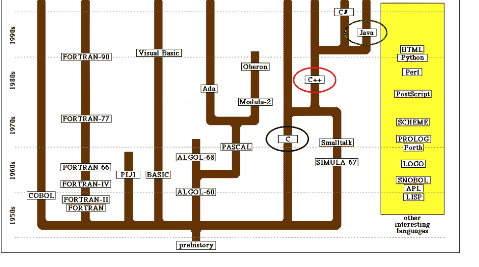

## 语言中的规模与复杂性
Karel

C

C 库

Java

Java 库

C++

C++ 库

## 本质复杂性与偶然复杂性
> 要想预知软件技术能有多快的进步，让我们审视一下该技术的难点。遵循亚里士多德的分类，我将它们分为*本质*——软件本质固有的困难，和*偶然*——当今伴随软件生产但并非固有的困难。……
>
> 软件的复杂性是其本质属性，而非偶然属性。因此，对软件实体的描述如果忽略了其复杂性，往往也就忽略了其本质。
>
> ——Fred Brooks  
> “No Silver Bullet”  
> *IEEE Computer*, April 1987


谢谢！

## C++ 回顾

## 历史
- C++ 是 C 的面向对象扩展
- C 由 Dennis Ritchie 在贝尔实验室设计
  - 用于编写 Unix，基于 BCPL
- C++ 由 Bjarne Stroustrup 在贝尔实验室设计
  - 他在贝尔的最初兴趣是仿真研究
  - 对 C 的早期扩展主要基于 Simula
  - 在 1980 年代早期被称为“C with classes”
  - 在 1980 年代后期和 1990 年代早期流行度增加
  - 特性是逐步添加的
    类、模板、异常、多重继承、类型测试...

## 设计目标
- 在基于 C 的语言中提供面向对象特性，同时不损害效率
  - 与 C 向后兼容
  - 更好的静态类型检查
  - 数据抽象
  - 对象和类
  - 在可能的情况下优先考虑编译代码的效率
- 重要原则
  - 如果你不使用某个特性，你的编译代码应与该语言不包含该特性时一样高效。 （与 Smalltalk 相比）

## 成功程度如何？
- 鉴于设计目标和约束，
  - 这是一种设计非常好的语言
- 用户众多——取得了巨大的流行成功
- 然而，设计非常复杂
  - 许多特性之间存在复杂交互
  - 难以从基本原则预测
  - 大多数严肃用户选择了语言的子集
    - 完整语言复杂且不可预测
  - 许多实现相关的属性
  - 冒险游戏爱好者的语言

## 重要约束
- C 有特定的机器模型
  - 访问底层架构
- 没有垃圾回收
  - 与效率目标一致
  - 需要显式管理对象内存
- 局部变量存储在激活记录中
  - 对象被视为结构体的一种泛化
    - 对象可以分配在栈上并被视为左值
    - 栈/堆差异对程序员可见

## C++ 概述

### 与对象无关的添加和更改
- type bool
- 传引用
- 用户定义的重载
- 函数模板
- ...

## C++ 对象系统

### 面向对象特性
- 类
- 对象，具有虚拟函数的动态查找
- 继承
  - 单继承和多重继承
  - 公有和私有基类
- 子类型
  - 与继承机制绑定
- 封装

## 一些好的决策
- 公有、私有、受保护的可见性级别
  - Public: 在任何地方都可见
  - Protected: 在类和子类声明内
  - Private: 仅在声明的类内可见
- 友元函数和类
  - 对可见性和数据抽象的细致关注
- 允许继承而不进行子类型化
  - 比没有私有基类时对子类型有更好的控制

## 一些问题区域
- **Casts**
  - 有时是无操作，有时不是（例如，多重继承）
- **缺乏垃圾回收**
  - 内存管理容易出错
    - 构造函数、析构函数是有帮助的
- **对象分配在栈上**
  - 更好的效率，与异常的交互
  - 但是赋值工作不佳，可能出现悬空指针
- **Overloading**
  - 代码选择机制太多？
- **Multiple inheritance**
  - 为效率而做的努力导致行为复杂

## 示例类：一维点

```
class Pt {
    public:
        Pt(int xv);
        Pt(Pt* pv);
        int getX();
        virtual void move(int dx);
    protected:
        void setX(int xv);
    private:
        int x;
};
```

重载构造函数
对私有数据的公有读访问
虚拟函数
受保护的写访问
私有成员数据

## 虚拟函数
- 成员函数要么是
  - 虚拟的，如果显式声明或继承为虚拟
  - 否则为非虚拟
- 虚拟函数
  - 通过对象中的指针间接访问
  - 可以在派生（子）类中重新定义
- 非虚拟函数
  - 以通常的方式调用。 *只是普通函数。*
  - 不能在派生类中重新定义（除重载外）
- 只有在使用虚拟函数时才支付开销


## 示例派生类

```
class ColorPt: public Pt {
    public:
        ColorPt(int xv,int cv);
        ColorPt(Pt* pv,int cv);
        ColorPt(ColorPt* cp);
        int getColor();
        virtual void move(int dx);
        virtual void darken(int tint);
    protected:
        void setColor(int cv);
    private:
        int color;
};
```

公有基类提供超类型
重载的构造函数
非虚函数
虚函数
受保护的写访问
私有成员数据

## 运行时表示

Point 对象

Point vtable

Code for move

vptr
x
3

ColorPoint 对象

ColorPoint vtable

Code for move

vptr
x
5
c
blue

Code for darken

数据在相同偏移处

函数指针在相同偏移处

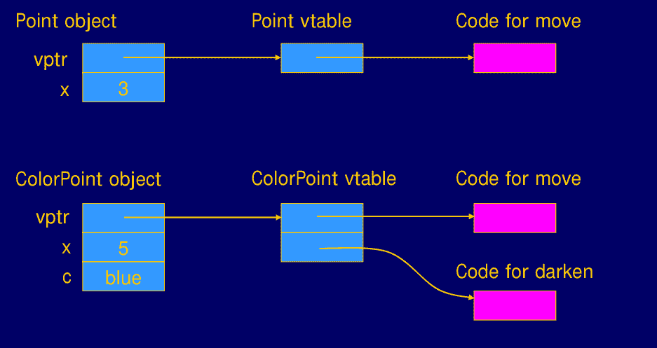

## 与 Smalltalk 比较

Point 对象
Point class
Template
Method dictionary
ColorPoint 对象
ColorPoint class
Template
Method dictionary

## 为什么 C++ 查找更简单？

- Smalltalk 没有静态类型系统
  - Code p message:pars 可能会引用任何对象
  - 需要使用来自对象的指针查找方法
  - 不同类会将方法放在方法字典的不同位置

- C++ 类型为编译器提供一些超类
  - 数据、函数指针在子类和超类中偏移相同
  - 数据和函数指针的偏移在编译时已知
  - 代码 p->move(x) 编译为 (* (p->vptr[1]))(p,x) 的等价形式，如果 move 是 vtable 中的第一个函数

向成员函数传递的数据；见下一张幻灯片

## 查找方法，第 2 部分

Point 对象

Point vtable

Code for move

vptr
x
3

ColorPoint 对象

ColorPoint vtable

Code for move

vptr
x
5
c
blue

darken()

Code for darken

```
Point cp = new ColorPt(5,blue);
cp->move(2);    // (* (cp->vptr[0]))(cp,2)
```

## 对虚函数的调用

- 一个成员函数可能会调用另一个

```
class A {
    public:
        virtual int f(int x);
        virtual int g(int y);
};
int A::f(int x) { ... g(i) ...;}
int A::g(int y) { ... f(j) ...;}
```

- 函数 f 的主体如何调用正确的 g？

- 如果 g 在派生类 B 中被重新定义，则继承的 f 必须调用 B::g

## "This" 指针（类似于 Smalltalk 中的 self）

- 代码被编译为使成员函数将“对象本身”作为第一个参数接收

```
Code      int A::f(int x) { ... g(i) ...;}
compiled as  int A::f(A *this, int x) { ... this->g(i) ...;}
```

- "this" 指针可在成员函数中使用

- 可用于返回指向对象本身的指针，将指向对象本身的指针传递给另一个函数，...

## 非虚函数

- 非虚函数的代码如何找到？
- 与普通“非成员”函数相同的方式：
  - 编译器生成函数代码并分配地址
  - 代码地址被放置在符号表中
  - 在调用点，地址从符号表中取出并放置在编译代码中
  - *但* 类有一些特殊的限定规则
- 重载
  - 记住：重载在编译时解析
  - 这与虚函数的运行时查找不同

## C++ 中的作用域规则

- **作用域限定符**
  - 二元 `::` 运算符、`->` 和 `.`
  - `class::member`, `ptr->member`, `object.member`
- **函数或类外部的名称，**
  - 未以一元 `::` 为前缀且未限定的名称指的是全局对象、函数、枚举器或类型。
- **在 `X::`、`ptr->` 或 `obj.` 之后的名称**
  - 我们假设 ptr 是指向类 X 的指针，obj 是类 X 的对象
  - 指的是类 X 或 X 的基类的成员

## 虚函数与重载函数

```
class parent { public:
    void printclass() {printf("p ");};
    virtual void printvirtual() {printf("p ");};  };
class child : public parent { public:
    void printclass() {printf("c ");};
    virtual void printvirtual() {printf("c ");};  };
main() {
    parent p; child c; parent *q;
    p.printclass(); p.printvirtual(); c.printclass(); c.printvirtual();
    q = &p; q->printclass(); q->printvirtual();
    q = &c; q->printclass(); q->printvirtual();
}
```

输出：p p c c p p ? ?


## 虚函数与重载函数

```
class parent { public:
    void printclass() {printf("p ");};
    virtual void printvirtual() {printf("p ");};  };
class child : public parent { public:
    void printclass() {printf("c ");};
    virtual void printvirtual() {printf("c ");};  };
main() {
    parent p; child c; parent *q;
    p.printclass(); p.printvirtual(); c.printclass(); c.printvirtual();
    q = &p; q->printclass(); q->printvirtual();
    q = &c; q->printclass(); q->printvirtual();
}
```

输出：p p c c p p p c

## 子类型

## 原则上的子类型

- A <: B 如果每当需要一个 B 对象时，每个 A 对象都可以在不产生类型错误的情况下使用
- 示例：

```
Point:
  int getX();
  void move(int);
```

公共成员

```
ColorPoint:
  int getX();
  int getColor();
  void move(int);
  void darken(int tint);
```

公共成员

## C++：如果类 A 具有公共基类 B，则 A <: B

- 这比必要的更弱 为什么？

## 独立类不是子类型

```
class Point {
    public:
        int getX();
        void move(int);
    protected:  ...
    private:    ...
};
```

```
class ColorPoint {
    public:
        int getX();
        void move(int);
        int getColor();
        void darken(int);
    protected:  ...
    private:    ...
};
```

C++ 不将 ColorPoint <: Point 视为如上所述

- 需要公共继承 ColorPoint : public Point
- 为什么？？

## 为什么是 C++ 设计？

- ◆ 客户端代码仅依赖于公共接口
  - 原则上，如果 ColorPoint 接口包含 Point 接口，则任何客户端都可以使用 ColorPoint 代替 point
  - 然而 -- 虚函数表中的偏移可能不同
  - 失去实现效率（像 Smalltalk）

- ◆ 没有继承的链接
  - 子类型导致实现效率的损失

- ◆ 还有封装问题：
  - 基于继承的子类型在基类修改下得以保留 ...

## 示例

- ◆ 如果 circle <: shape，则

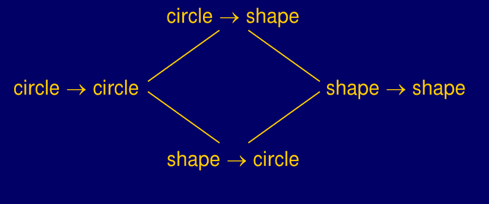

C++ 编译器识别有限形式的函数子类型

## 函数的子类型

```
class Point {
public:
    int getX();
    virtual Point * move(int);
protected:    ...
private:      ...
};
```

```
class ColorPoint: public Point {
public:
    int getX();
    int getColor();
    ColorPoint * move(int);
    void darken(int);
protected:    ...
private:      ...
};
```

继承，但为清晰起见在此重复

- **原则上：** 可以有 `ColorPoint <: Point`
- **实践中：** 有些编译器允许，其他则没有

这是协变情况；逆变是另一个故事

## 抽象类

- 抽象类：
  - 一个没有完整实现的类
  - 通过 =0 声明（多么棒的语法！）
  - 有用因为它可以有派生类
    由于 C++ 中子类型遵循继承，使用抽象类来构建子类型层次结构。
  - 建立虚函数表（vtable）的布局

- 示例
  - 读者附录中的几何类
    - Shape 是 circle、rectangle 等的抽象超类型

## 多重继承

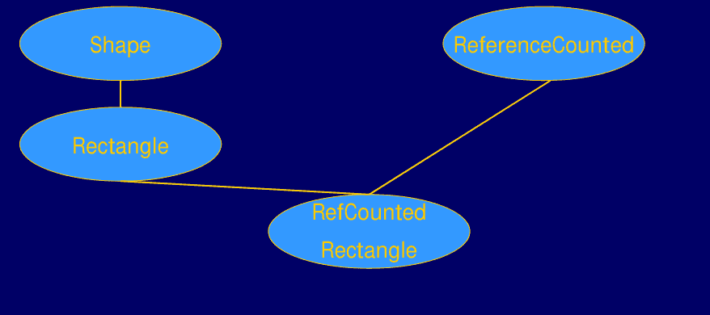

从独立类继承独立功能

## 问题：名称冲突

```
class A {
    public:
        void virtual f() { ... }
};
class B {
    public:
        void virtual f() { ... }
};
class C : public A, public B { ... };
...
    C* p;
    p->f();    // error
```

在 2 个基类中同名

## 名称冲突的可能解决方案

- 三种通用方法
  - 隐式解析
    - 语言用任意规则解决名称冲突
  - 显式解析
    - 程序员必须显式解决名称冲突
  - 禁止名称冲突
    - 程序不允许包含名称冲突

- 没有解决方案总是最好

- C++ 使用显式解析


## 对前例的修复

- 重写类 C 以显式调用 A::f

```cpp
class C : public A, public B {
    public:
        void virtual f() {
            A::f();  // Call A::f(), not B::f();
        }
};
```

- 合理的解决方案
  - 这消除了歧义
  - 保留了对 A 的依赖
    - 对 A::f 的更改会改变 C::f

## 多重继承的 vtable

```cpp
class A {
    public:
        int x;
        virtual void f();
};
class B {
    public:
        int y;
        virtual void g();
        virtual void f();
};

class C: public A, public B {
    public:
        int z;
        virtual void f();
};
C *pc = new C;
B *pb = pc;
A *pa = pc;
```

三个指针指向同一对象，但静态类型不同。

## 对象和类

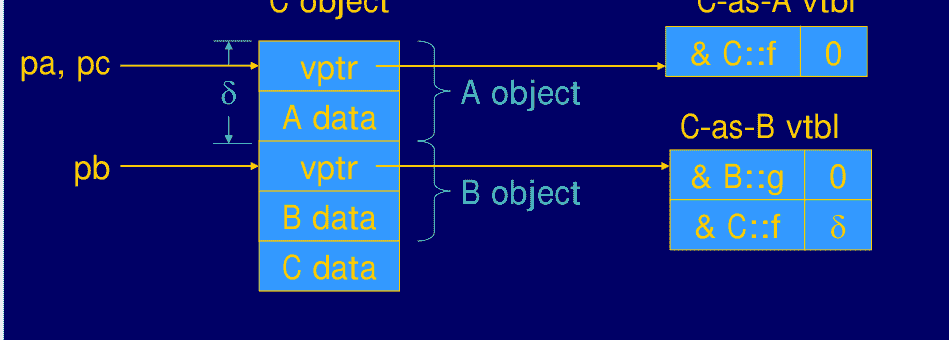

- 在调用 pb->f 时使用 vtbl 中的偏移量 δ，因为 C::f 可能引用位于指针 pb 之上的 A 数据
- 对 pc->g 的调用可以通过 C-as-B vtbl 进行

## 多重继承“菱形”

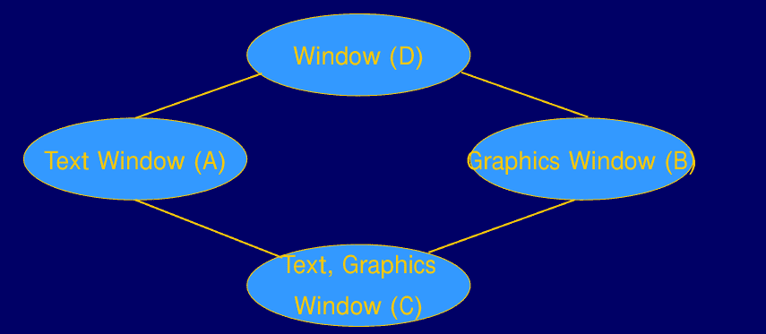

- 接口或实现是否被继承两次？
- 如果定义冲突怎么办？

## C++ 中的菱形继承

- 标准基类
  - D 的成员在 C 中出现两次
- 虚基类
  - `class A : public virtual D { ... }`
  - 避免基类成员的重复
  - 需要额外的指针，以便 D 部分的 A、B 部分的对象可以共享

C++ 多重继承之所以复杂，部分原因是希望保持高效的查找

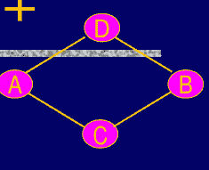

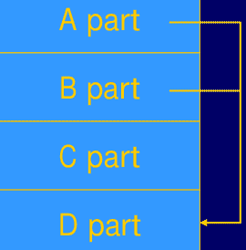

## C++ 总结

- 对象
  - 由类创建
  - 包含成员数据和指向类的指针
- 类：虚函数表
- 继承
  - 公有和私有基类，多重继承
- 子类型化：仅在使用公有基类时发生
- 封装
  - 成员可以声明为 public、private、protected
  - 对象初始化部分强制执行

## C++ vs. Java：偶然差异

- 布尔变量的类型是 `bool` 而不是 `boolean`。
- 类型 `char` 表示 8 位 ASCII 字符而不是 16 位 Unicode 字符。
- C++ 程序通过调用名为 `main` 的函数开始，该函数返回一个整数状态，成功完成时为 0。
- C++ 程序中使用的所有函数都必须先于一个 *prototype*，该原型定义了其参数结构。
- `string` 类导出的许多方法存在偶然差异。例如，C++ `substr` 方法的第二个参数是 *length* 而不是 *ending position*。
- 用于控制台 I/O 的学科有显著不同，但本质上并非如此。

## C++ vs. Java：本质差异

- C++ 允许你非常接近机器的内部工作。Java 保护你免受这些细节的影响。
- C++ 支持 *call by reference*。
- C++ 允许程序员以比 Java 更多的方式修改语言。特别是，C++ 类可以重新定义 + 或 << 等运算符的含义。
- C++ 没有 Java 那样的垃圾回收器。因此，*你* 有责任释放在堆上分配的任何内存。
- Java 中的对象始终在堆上分配。在 C++ 中，对象通常存储在栈上以简化内存管理任务。
- C++ 支持 *multiple inheritance*，这意味着类可以从多个超类继承行为。

## 应用

- 主页
- 联系人
- 电话
- 浏览器
- ...

## 应用框架

- Activity 管理器
- Window 管理器
- 内容提供者
- 视图系统
- 通知管理器
- 包管理器
- 电话管理器
- 资源管理器
- 位置管理器
- GTalk 服务

## 库

- Surface 管理器
- 媒体框架
- SQLite
- OpenGL ES
- FreeType
- WebKit
- SGL
- SSL
- libc

## Android 运行时

- 核心库
- Dalvik 虚拟机

## Linux 内核

- 显示驱动
- 相机驱动
- 蓝牙驱动
- 闪存驱动
- Binder（IPC）驱动
- USB 驱动
- 按键驱动
- WiFi 驱动
- 音频驱动
- 电源管理


## 下一讲：模板

## 感谢

## 模板结构

Zhengwei QI

Some slides from Eric Roberts, CS 106B, Stanford

## 第一部分：模板结构

## 函数中的模板

- 模板可以在函数定义之前使用，以创建一个可应用于各种类型值的通用函数集合。
- 例如，下面的代码创建了一个模板，用于对任意元素类型的数组调用选择排序：

  ```cpp
  template <typename ElemType>
  void Sort(ElemType array[], int n) {
      for (int i = 0; i < n; i++) {
          int minIndex = i;
          for (int j = i + 1; j < n; j++) {
              if (array[j] < array[minIndex]) minIndex = j;
          }
          ElemType temp = array[i];
          array[i] = array[minIndex];
          array[minIndex] = temp;
      }
  }
  ```

## 类定义中的模板

- 模板更常用于定义通用类。当以这种方式使用时，`template` 关键字必须出现在类定义之前，并且出现在每个成员函数实现的之前。
- 使用模板创建通用类的最不方便之处在于，除非编译器同时可以访问接口和实现，否则无法正确处理它们。
- 为了强调接口与相关实现之间的概念分离，使用 `#include` 关键字将实现代码包含进来而无需在接口文件中实际出现该代码是很有用的，在那里它可能会让随意阅读者感到困惑。

## 实现模板类

- 实现模板类所需的最后一步更改是在每个方法实现中添加 **template** 结构，如以下构造函数更新版本所示：

  ```cpp
  template <typename ElemType>
  Vector<ElemType>::Vector() {
      capacity = INITIAL_CAPACITY;
      count = 0;
      elements = new ElemType[capacity];
  }
  ```

- 方法的新实现需要作为 **vector.h** 头文件的一部分包含进来。为了避免代码对客户端可见，我在这本书中采用的策略是将代码放在名为 **vecimpl.cpp** 的文件中，然后在接口定义末尾包含该文件。

## 实现选择括号

- C++ 的另一个强大功能（但也容易被滥用）是能够重新定义标准运算符，使其调用类中的特定方法。
- C++ 中的每个运算符都有一个对应的标识符，通常由关键字 `operator` 后跟组成运算符的字符构成。
- 例如，通常用于表示加法的 + 运算符的标识符名称是 `operator+`。通过定义名为 `operator+` 的方法，C++ `string` 类可以使用同一个运算符来表示连接。
- 对于 `Vector` 类，提供 `operator[]` 的方法定义很方便，`operator[]` 是括号选择运算符。这样就可以在 `Vector` 对象上使用数组选择记法。

## 重新定义 operator []

```cpp
/*
 * Implementation notes: Vector selection
 * ----------------------------------------
 * The following code implements traditional array selection using
 * square brackets for the index.  The name of the method is
 * indicated by specifying the C++ keyword "operator" followed by
 * the operator symbol.  To ensure that this operator returns an
 * assignable value, this method uses an & to return the result
 * by reference.
 */

template <typename ElemType>
ElemType & Vector<ElemType>::operator[](int index) {
    if (index < 0 || index >= count) {
        Error("Vector selection index out of range");
    }
    return elements[index];
}
```

## 通过引用返回

- 前一页幻灯片中 `operator[]` 的实现使用了 C++ 的一个新特性，称为 *通过引用返回*，它表示返回值与调用者共享而不是复制。
- 通过引用返回的语法与通过引用调用的语法类似，涉及在返回类型和方法名之间添加 `&` 标记，如原型所示

  ```cpp
  ElemType & Vector<ElemType>::operator[] (int index);
  ```

- 通过引用返回一个值意味着结果是一个 *左值*，即可以在赋值左侧使用的表达式。这种解释使得使用类似

  ```cpp
  vec[i] = 17;
  ```

  的表达式为向量元素赋新值成为可能。


## 警告说明

- C++ 的返回引用特性充满了问题，容易让粗心的程序员陷入陷阱。
- 最重要的警告是，你*绝不能*对存在于当前方法栈帧中的值使用返回引用。如果你这样做，C++ 会将该值的地址返回给调用者，但此时该对象以及它所在的栈帧早已消失。
- 作为一般规则，最好将返回引用的使用限制在本质上类似于向量选择括号的情况：即你希望从调用者提供的抽象结构中选择一个字段的情形。

## 赋值和拷贝构造函数

- 关于创建新的抽象类，还有一个在实践中极其重要的问题尚未解决，即当你使用赋值或通过按值传递给方法参数来复制此类对象时，它们的行为如何。
- 当前版本的文本并未讨论这些问题，尽管新文本会讨论。鉴于这些概念在 C++ 类设计中出现的频率如此之高，似乎有必要在此加以说明。
- 问题的核心在于，复制一个抽象数据对象通常需要复制底层数据，而不仅仅是对象中直接可访问的字段。不幸的是，C++ 的默认解释只是复制顶层字段，这可能导致严重错误。

## 浅拷贝 vs 深拷贝

- 假设你有一个现有的 Vector<int>，其中包含三个元素，如右侧图所示。
- 浅拷贝为对象本身分配新的字段并复制原始信息。不幸的是，动态数组被复制为地址，而不是数据。
- 深拷贝也会复制动态数组的内容，因此创建了两个独立的结构

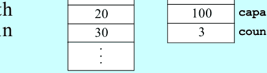

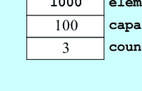

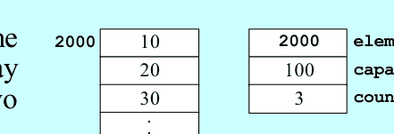

## 实现深拷贝语义

- 当你在 C++ 中定义新的抽象数据类型时，通常需要定义两个方法以确保拷贝得到正确处理：
  - 运算符 `operator=`，负责处理赋值
  - *拷贝构造函数*，负责处理按值参数
- 这些方法具有明确定义的签名和结构，最简单的做法就是直接复制下一张幻灯片上的代码，根据需要对其进行调整以适应底层表示中需要复制的具体实例变量。
- C++03 性能上被长期被诟病的其中之一，就是其耗时且不必要的深度拷贝

## 实现深拷贝的代码

```
/* Code to support deep copying for the Vector class */

template <typename ElemType>
const Vector<ElemType> & Vector<ElemType>::operator=(const Vector & rhs) {
    if (this != &rhs) {
        clear();
        copyInternalData(rhs);
    }
    return *this;
}

template <typename ElemType>
Vector<ElemType>::Vector(const Vector & rhs) {
    copyInternalData(rhs);
}

template <typename ElemType>
void Vector<ElemType>::copyInternalData(const Vector & other) {
    elements = new ElemType[other.count];
    for (int i = 0; i < other.count; i++) {
        elements[i] = other.elements[i];
    }
    count = other.count;
    capacity = other.count;
}
```

## 第二部分：泛型编程

## 布局

- Template
  - 3 Solutions
  - Iterator
  - Algorithm / Functor(仿函数)
- Morphiosm
  - Static / Dynamic
  - Efficiency
  - Evolution

## 方案1：宏

- C的宏来实现通用容器（Linux 内核广泛使用）
- 宏是模板的超集——因为宏不仅可以参数化类型，宏实质上可以参数化一切文本
- 宏的最大的缺点就是它并不工作在C++的语法解析层面
  - 预处理器文本替换，类型安全问题
  - 编译错误
  - 不支持调试

## 方案1：宏改进

- Linux 内核采用

```
struct list_head {
    struct list_head *next, *prev;
};
```

- #define LIST_HEAD_INIT(name) { &(name), &(name) }
- #define LIST_HEAD(name) struct list_head name = LIST_HEAD_INIT(name)
- #define INIT_LIST_HEAD(ptr) do { \
    (ptr)->next = (ptr); (ptr)->prev = (ptr); \
  } while (0)
- 参见：杨沙洲，国防科技大学计算机学院，深入分析 Linux 内核链表


## 方案2: 继承

- 它要求任何能存放在容器内的类型都继承自一个 NodeBase
- NodeBase里面有pre和next指针，通过这种方式，就可以将任意类型链入一个链表内了。
- 致命缺点是
  - (1)它是侵入性的，每个能够放在该容器内的类型都必须继承自NodeBase基类。
  - (2)它不支持基本内置类型（int、double等），因为内置类型并不，也不能继承自NodeBase。
  - (3)这还姑且不说它是类型不安全的，以及效率问题。

## 方案3：模板

泛型编程最初诞生于C++中，由Alexander Stepanov和David Musser创立。目的是为了实现C++的STL（标准模板库）。其语言支持机制就是模板（Templates）

- 模板的精神其实很简单：参数化类型。
- template<class RandomAccessIterator, class Compare>
  void sort(RandomAccessIterator first, RandomAccessIterator last, Compare comp);

迭代器和前开后闭区间都是STL的核心概念。

- 迭代器建模的是内建指针的接口（解引用、递增、递减等）
- 前开后闭区间是一个简单的数学概念，表示从first（含first）到last（不含last）的区间内的所有元素。
- comp是一个仿函数（functor）。
  - 仿函数也是STL的核心概念，仿函数是建模的内建函数的接口
  - 一个仿函数可以是一个内建的函数
  - 也可以是一个重载了operator()的类对象，只要是支持函数调用的语法形式就可以成为一个仿函数。

## C++语法支持

- 通过操作符重载
  - C++允许了自定义类型具有跟内建类型同样的使用接口；
- 通过模板这样的参数化类型机制
- C++允许了一个算法或类定义，能够利用这样的接口一致性来对自身进行泛化。
  - 例如，一个原本操作内建指针的算法，被泛化为操纵一切迭代器的算法。
  - 一个原本使用内建函数指针的算法，被泛化为能够接受一切重载了函数调用操作符（operator()）的类对象的算法。
  - 仿函数：用于代替函数指针

## qsort 模板

```
template<class RandomAccessIterator, class Compare>
void sort(RandomAccessIterator first,
RandomAccessIterator last, Compare comp);
```

- 1. 类型安全性：如果你调用std::sort(arr, arr + n, comp);那么comp的类型就必须要和arr的数组元素类型一致，否则编译器就会帮你检查出来。而且comp的参数类型再也不用const void*这种不直观的表示了，而是可以直接声明为对应的数组元素的类型。
- 2. 通用性：std::sort可以用于一切迭代器，其compare函数可以是一切支持函数调用语法的对象。如果你想要将std::sort用在你自己的容器上的话，你只要定义一个自己的迭代器（严格来说是一个随机访问迭代器，STL对迭代器的访问能力有一些分类，随机访问迭代器具有建模的内建指针的访问能力），如果需要的话，再定义一个自己的仿函数类即可。
- 3. 接口直观性：跟qsort相比，std::sort的使用接口上没有多余的东西，也没有不直观的size参数。一个有待排序的区间，一个代表比较标准的仿函数，仅此而已[4]。
- 4. 效率：如果你传给std::sort的compare函数是一个自定义了operator()的仿函数。那么编译器就能够利用类型信息，将对该仿函数的operator()调用直接内联。消除函数调用开销

## 动态多态与静态多态

- 泛型编程的核心活动是抽象：将一个特定于某些类型的算法中那些类型无关的共性抽象出来，
  - 在STL的概念体系里面，是一个数组还是一个链表，反正都是一个区间，这就是一层抽象。
  - 是一个内建函数还是一个自定义类，反正都是一个Callable（可调用）的对象（在C++里面通过仿函数来表示），这就是一层抽象。
  - 泛型编程的过程就是一个不断将这些抽象提升（lift）出来的过程，最终的目的是形成一个最大程度上通用的算法或类。

## 抽象

Abstract：计算科学的重要思想
那为什么不用基于多态的面向对象抽象呢？

- 比如STL的std::for_each，用Java的多态机制也可以解决：

```
interface IUnaryFun
{
    void invoke(Object o);  // 对应伪函数
}
```

```
interface IInputIter    // 对应迭代器
{
    InputIter preIncrement();
    boolean equals(IInputIter otherIter);
    ... // other methods
}
```

```
IUnaryFun for_each(IInputIter first, IInputIter last, IUnaryFun func)
{
    for(!first.equals(last); first.preIncrement())    // 对应遍历
        func.invoke(*first);    // 对应调用
    return func;
}
```

## 效率问题：

面向对象的动态多态引入了间接调用

- 但当能够利用编译期类型信息的时候，为什么要付出不必要的间接调用开销呢？
- for_each，利用接口来实现其通用性，就付出了所谓的“抽象惩罚”（abstraction penalty）。
- 利用模板编写的std::for each，对于每一个特定的参数类型组合都有一个独立的，最高效的实例化版本
- 就跟你手写一个特定于这些类型的专门的for_each算法一样。于是抽象惩罚消失了，而这也正是C++模板库能够真正被工业界广泛用在C++最擅长的领域（重视效率的领域）的重要原因之一。
- 对于每一组参数类型组合实例化一个版本出来的做法增加了代码空间，这是一个典型的以空间换时间的例子
- 由于在抽象的时候不用总想着要建立的接口，所以泛型算法编写起来也更为直观。

## 另外一个优点：非侵入性

跟面向对象编程的基于继承和虚函数的运行时多态机制不同，C++模板是非侵入性的
你不需要让你你的类继承自某个特定的接口才能用于某个算法，只要支持特定的语法接口就行了（比如只要支持begin()调用）。
这也被称为结构一致性（Structural Conformance），意即只要语法结构一致即可。
基于接口继承的面向对象多态则必须显式地声明继承自一个接口，这就是所谓的名一致性（Named Conformance）。

## 静态vs动态

泛型支持的静态多态和虚函数支持的动态多态并没有任何程度上绝对的优劣之分。

- 当类型信息可得的时候，利用编译期多态能够获得最大的效率和灵活性

当具体的类型信息不可得，就必须诉诸运行期多态了。

Bjarne Stroustrup曾经用了一个典型的例子来澄清这个区别：

```
std::vector<Shape*> v;
... // fill v
std::for_each(v.begin(), v.end(), std::mem_fun(&Shape::draw));
```

v里面到底将来会存放什么类型的Shape，编译期无法知道，因而必须求助于动态多态。

另一方面，编译器倒的确知道它们都继承自Shape

for_each只有一份模板实现，然而根据传给它的第三个参数（本例中是std::mem_fun(&Shape::draw)）的不同，for_each的行为也不同（这里最终被for_each调用的是Shape::draw，但实际上你可以包装任何函数，只要这个函数接受一个Shape*型的参数），for_each这种行为不同是发生在编译期的，所以是静态多态。--动中有静

## 多态

模板是非侵入的。

- 这是C++泛型与面向对象的多态机制的本质区别之一。
- 面向对象未必就意味着一定要用接口来实现动态的多态。一些动态类型的脚本语言，如Ruby，它的多态机制就既是运行期（动态）的，又是非侵入性的（不用通过继承自某个特定的接口来达到复用）。人们把这个叫做Duck Typing。
- 如果不是因为效率问题，其实这样的多态机制才是最直观的。从使用方面来说，它既有非侵入性，又没有只能工作在编译期的限制。
- 但效率至少在可见的将来，在某些领域仍是一个顾虑。因此像C++这种区分编译期和运行期多态的语言，仍有其独特的优势。
- 泛型编程的类型安全优势也让它从C++走入了其它主流的静态类型语言当中，尤其是C家族的Java和C#，在前几年相继接纳泛型。


## 特化，图灵完备性，元编程

- 模板元编程最初由Erwin Unruh在1994年的一次会议上提出；当时他写了一个程序，在编译错误里面打印出一个素数序列。
- 这个事件在C++历史上的地位就仿佛哥伦布发现新大陆。用Bjarne Stroustrup的话来说就是当时他当时和其他几个人觉得太神奇了。
- 实际上，这个事情正标志了C++模板系统的图灵完备性被发现；后来Todd Veldhuizen写了一篇论文，用C++模板构建了一个元图灵机，从而第一次系统证明了C++模板的图灵完备性。

## 泛型程序设计

- 泛型程序设计，简单地说就是使用模板的程序设计法。
  - 将一些常用的数据结构（比如链表，数组，二叉树）和算法（比如排序，查找）写成模板，以后则不论数据结构里放的是什么对象，算法针对什么样的对象，则都不必重新实现数据结构，重新编写算法。

- 标准模板库 (Standard Template Library) 就是一些常用数据结构和算法的模板的集合。主要由 Alex Stepanov 开发，于1998年被添加进C++标准

- 有了STL 或Boost等标准库，不必再从头写大多标准数据结构和算法，并且可获得非常高的性能。

## 回顾：是否忘记一些了？

```cpp
template <class T> class vector {
    T* v;
    int sz;
public:
        vector(int);
        T& operator[](int);
        T& elem(int i) { return v[i]; }
    // ...
};
```

Q：是不是有比这些还要底层和泛用的东西？
A：涉及到程序语言的基本理论，请参照POPL上的学术会议论文，不过全是公式，不太好懂。也有一些入门的知识，例如图灵机、类型理论、lambda演算等。


## 进化

1. 史前： C 时代
void qsort(void *base, size_t nmemb, size_t size,
int (*compar)(const void *, const void *));

2. 面向对象：Java 单根继承 / 接口时代
IUnaryFun for_each(IInputIter first, IInputIter last, IUnaryFun func)
{
    for(!first.equals(last); first.preIncrement())   // 对应遍历
        func.invoke(*first);   // 对应调用
    return func;
}

3. 模板：非侵入静态多态时代
template<class RandomAccessIterator, class Compare>
void sort(RandomAccessIterator first, RandomAccessIterator last, Compare comp);

4. 进化：让编译器理解模板 / 迭代器 / 容器 ：
概念！

## 结束

## 智能指针

Zhengwei QI

部分幻灯片来自互联网

## 第一部分：概念

## 三法则

- 如果你需要自己显式声明析构函数、拷贝构造函数或拷贝赋值运算符，那么你可能需要将三者全部显式声明。

http://stackoverflow.com/questions/4172722/what-is-the-rule-of-three

## 智能指针*

作者：格伦·惠勒 和 穆罕默德·谢赫

## 智能指针

- 简介
- 它们是什么？
- 智能指针示例
- 智能指针的优点
- 结论

## 引言

在编程中，指针的使用是开发代码时错误（或缺陷）的主要来源。

发现的主要问题是内存泄漏的发生，这是由于指针与内存交互的方式（如分配和释放）造成的；如果这些操作执行效率低下，会导致指针悬挂（或游离，即指针指向一个先前已移除的对象）。

解决这一困境的办法是使用智能指针。

## 什么是智能指针？

智能指针看起来与普通指针相同，并利用相同的接口操作，如解引用（*）和间接访问（->），但还具有其他功能。

智能指针通过自动化方法减少错误、保持效率并控制内存管理。

## 什么是智能指针？

这些自动化方法适用于资源的分配和释放等操作，以消除内存泄漏。

```
template <class T> class auto_ptr
{
    T* ptr;
public:
    explicit auto_ptr(T* p = 0) : ptr(p) {}
    ~auto_ptr()           {delete ptr;}
    T& operator*()        {return *ptr;}
    T* operator->()       {return ptr;}
};
```

## 智能指针示例

在标准 C++ 库中，有一个非常简单的智能指针实现示例。

这个示例 `auto_ptr` 演示了内存管理，位于 `memory` 头文件中。

## 智能指针示例

```
template <class T> class auto_ptr
{
    T* ptr;
public:
    explicit auto_ptr(T* p = 0) : ptr(p) {}
    ~auto_ptr()             {delete ptr;}
    T& operator*()          {return *ptr;}
    T* operator->()         {return ptr;}
};
```

## 智能指针示例

因此，与其编写...

因此，用户编写...

```
void foo()
{
MyClass* p(new MyClass);
p->DoSomething();
delete p;
}
```

```
void foo()
{
auto_ptr<MyClass> p(new MyClass);
p->DoSomething();
}
```


## 智能指针示例

以下是说明 **悬空指针** 情况的代码示例…

```
MyClass* p(new MyClass);  
MyClass* q = p;  
delete p;  
p->DoSomething();  // Watch out! p is now dangling!  
p = NULL;           // p is no longer dangling  
q->DoSomething();  // Ouch! q is still dangling!
```

对于 auto_ptr，其指针在被复制时会被设为 NULL 来解决这个问题：

```
template <class T>
auto_ptr<T>& auto_ptr<T>::operator=(auto_ptr<T>& rhs)
{
    if (this != &rhs)
    {
        delete ptr;
        ptr = rhs.ptr;
        rhs.ptr = NULL;
    }
    return *this;
}
```

## 智能指针的优点

正如前面所述，使用智能指针的主要、显而易见的优点是相比普通指针，内存管理的效率更高。

这种效率体现在智能指针的三个主要能力上，即自动化初始化、悬空指针的处理以及自动清理。

自动化初始化消除了将智能指针设为 NULL 的需求，因此也无需编写该代码，这在某种程度上与自动清理的好处类似。

自动清理功能意味着智能指针会自动清理，减少需要编写的代码量，进而降低出现 bug 的可能性。

智能指针的主要优点是其对悬空指针的处理。这些所谓的悬空指针是一个非常常见的问题，是由指针指向已被删除的对象引起的。

软件程序员面临的另一个问题是程序中可能出现异常错误。

如果指针内部发生异常，则其后的剩余代码将不会被执行，进而指针不会被删除，可能导致内存泄漏。

然而使用智能指针将消除这一威胁，因为指针会自动清理，指针会在超出作用域时被清理，无论是在正常执行路径中还是在异常期间。

这种解决方案也可以为普通指针编写；然而使用智能指针实现要简单得多

## 结论

如前所述，智能指针非常适合
高效的内存管理。

它们可用于更高效地利用
可用内存，缩短分配和
释放时间，并防止由
标准指针引起的 bug。

Auto_ptr：最简单的智能指针使用方法。适用于
没有特殊要求的情况。

## 第二部分：C++ 11 智能指针

## C++ 内存管理惯用法

- 惯用法是语言中的可重用设计技术
- 我们将在 C++ 中查看 4 个重要的惯用法

- 用于赋值的拷贝构造函数技巧
- 确保释放现有资源和获取新资源要么同时成功，要么同时失败

- RAII（又名 Guard）
- 将动态资源绑定到其他（尤其是自动）作用域

- 引用计数
- 将动态生命周期绑定到一组引用

- 写时复制
- 允许更高效地管理多个别名

## 用于赋值的拷贝构造函数技巧

- 清理/赋值要么同时成功，要么同时失败

```
class Array {
public:
  Array(unsigned int) ;
  Array(const Array &); // assume copy constructor makes a deep copy
  ~Array();
  Array & operator=(const Array &a);
private:
  int * ints_;
  size_t size_;
};

Array & Array::operator=(const Array &a) {
  if (&a != this) {
    Array temp(a);
    std::swap(temp.ints_, ints_);
    std::swap(temp.size_, size_);
  }
  return *this;
}
```

## C++11 智能指针

- C++11 弃用了一个旧的智能指针模板
- **auto_ptr**：可以保护动态分配的内存并在周围传递所有权，但不能与 STL 容器一起使用并且有其他限制
- C++11 改为提供了 3 个新的智能指针模板
- **shared_ptr**：一种通用用途的引用计数动态内存保护器（我们将在本课程中主要使用它）
- **weak_ptr**：在不增加引用计数的情况下访问由 shared_ptr 保护的资源（可用于防止因循环引用导致的内存泄漏）
- **unique_ptr**：一种更复杂但可能非常高效的安全转移动态内存所有权的方式（实现了 C++11“移动语义”）


## 资源获取即初始化（RAII）

- 也称为“守护惯用法”
- 然而，“RAII”这一术语在 C++ 中更为常用
- 依赖于这样一个事实：在 C++ 中，当栈帧弹出时，栈对象的析构函数会被调用
- 思想：我们可以使用栈对象来持有堆对象或任何其他需要显式清理的资源的所有权
  - 在资源分配时初始化栈对象
  - 在栈对象的析构函数中释放资源

## RAII 示例：守护新分配的对象

```
shared_ptr<Foo> createAndInit() {
  Foo *f = new Foo;
  shared_ptr<Foo> p(f);
  init(f); // may throw exception
  return p;
}

int run () {
  try {
    shared_ptr<Foo> spf =
        createAndInit();
    cout << "*spf is " << *spf;
  } catch (...) {
    return -1
  }
  return 0;
}
```

- 通过 **shared_ptr** 类模板展示的 RAII 惯用法示例
  - `#include <memory>`
  - `using namespace std;`
- **shared_ptr<X>** 假定并维护对别名 **X** 的所有权
- 可以通过它（`*spf`）访问别名 **X**
- 当安全时（依据接下来讨论的引用计数惯用法），**shared_ptr** 析构函数会对所拥有的 **X** 的指针调用 `delete`
- 与其他内存惯用法结合得很好

## 引用计数简介

- 基本问题
  - 资源共享通常比复制更高效
  - 但很难判断所有使用者何时用完某个资源
  - 必须避免过早删除
  - 必须避免泄漏
- 解决方法
  - 共享资源的同时也共享一个计数器
  - 每个新引用都会使计数器递增
  - 当一个引用用完时，计数器递减
  - 当计数降至零时，删除资源和计数器
  - “最后离开的人关灯”

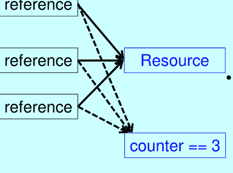

## 写时复制简介

- 基本问题
  - 引用计数实现了安全高效的共享
  - 但如果对资源进行了修改怎么办？
  - 可能希望拥有逻辑上独立的资源副本
- 解决方法
  - 从引用计数开始
  - 写入者检查计数是否大于 1
    - 复制引用和计数器
    - 更新两个计数器
    - 执行写入
  - 所有读取者共享一个副本，每个写入者可以拥有自己的副本

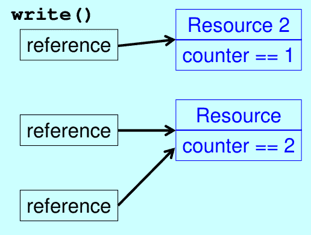

## 总结：内存管理技巧

- 了解内存中什么内容放在哪里
- 理解栈和堆分配的机制
- 注意简单（和复杂）的生命周期错误
- 考虑浅拷贝与深拷贝（问题和性能权衡）
- 掌握 C++ 内存管理的有用惯用法
  - 学习它们的工作原理
  - 理解何时应用它们
  - 在实验课及其他地方寻找应用它们的方法
  - C++11 智能指针（尤其是 shared_ptr）非常有用

## 结束

## STL

## 第一部分：STL
（容器、迭代器和算法）

Bjarne Stroustrup
www.stroustrup.com/Programming

## 摘要

- 本讲及下一讲介绍 STL——C++ 标准库中的容器和算法部分
- STL 是一个可扩展的框架，用于处理 C++ 程序中的数据。
- 首先，我将介绍总体理念，然后是基本概念，最后是容器和算法的示例。
- 还将介绍用于将数据与算法（用于通用处理）联系起来的*序列*和*迭代器*这两个关键概念。

## 概述

- 常见任务与理念
- 泛型编程
- 容器、算法和迭代器
- 最简单的算法：find()
- 算法的参数化
  - find_if() 与函数对象
- 序列容器
  - vector 和 list

## 常见任务

- 将数据收集到容器中
- 组织数据
  - 用于打印
  - 用于快速访问
- 检索数据项
  - 按索引（例如，获取第 N 个元素）
  - 按值（例如，获取第一个值为 "Chocolate" 的元素）
  - 按属性（例如，获取满足 “age<64” 的第一个元素）
- 添加数据
- 删除数据
- 排序和搜索
- 简单的数值运算


## 观察

我们可以（已经）编写出与所用数据类型无关的非常相似的程序

- 使用 **int** 与使用 **double** 并没有太大区别
- 使用 **vector<int>** 与使用 **vector<string>** 并没有太大区别

## 理想

我们希望编写通用的编程任务，这样每当我们找到一种新的数据存储方式或一种稍微不同的数据解释方式时，都不必重做工作

- 在 **vector** 中查找一个值与在链表或数组中查找一个值并没有多大不同
- 忽略大小写地查找 **string** 与不忽略大小写地查找 **string** 并没有多大不同
- 用精确值绘制实验数据与用舍入值绘制数据并没有多大不同
- 复制文件与复制 vector 并没有多大不同

## 理想（续）

- 代码应当
  - 易读
  - 易修改
  - 规整
  - 简短
  - 快速
- 对数据的统一访问
  - 与存储方式无关
  - 与类型无关
- ...

## 理想（续）

- ...
- 类型安全的数据访问
- 方便的数据遍历
- 紧凑的数据存储
- 快速
  - 数据检索
  - 数据添加
  - 数据删除
- 最常见算法的标准版本
  - 复制、查找、搜索、排序、求和……

## 示例

- 对字符串 vector 排序
- 根据姓名在电话簿中查找号码
- 查找最高温度
- 查找所有大于 800 的值
- 查找值 17 的首次出现
- 按单元编号对遥测记录排序
- 按时间戳对遥测记录排序
- 查找第一个大于 “Petersen” 的值？
- 目前看到的最大数量是多少？
- 查找两个序列之间的第一个差异
- 计算两个序列元素的成对乘积
- 一个月中每天的最高温度是多少？
- 最畅销的前 10 名是什么？
- “C++” 的条目是什么（比如说在 Google 中）？
- 元素的总和是多少？

## 泛型编程

- 泛化算法
  - 有时称为“提升算法”
- 目标（对于最终用户）是
  - 提高正确性
    - 通过更好的规格说明
  - 更广的使用范围
    - 可复用的可能性
  - 更好的性能
    - 通过更广泛地使用经过调优的库
    - 不必要地慢的代码最终会被丢弃
- 从具体走向更抽象
  - 反过来通常会导致臃肿

## 提升示例（具体算法）

```
double sum(double array[], int n)    // one concrete algorithm (doubles in array)
{
    double s = 0;
    for (int i = 0; i < n; ++i) s = s + array[i];
    return s;
}
```

```
struct Node { Node* next; int data; };
```

```
int sum(Node* first)    // another concrete algorithm (ints in list)
{
    int s = 0;
    while (first) {
        s += first->data;
        first = first->next;
    }
    return s;
}
```

## 提升示例（抽象数据结构）

// 两个算法更通用版本的伪代码

```
int sum(data)      // somehow parameterize with the data structure
{
    int s = 0;               // initialize
    while (not at end) {     // loop through all elements
        s = s + get value;   // compute sum
        get next data element;
    }
    return s;                // return result
}
```

- 我们需要（对数据结构的）三个操作：
  - 未到达末尾
  - 获取值
  - 获取下一个数据元素

## 提升示例（STL 版本）

// 两个算法更通用版本的 STL 风格代码

```
template<class Iter, class T>    // Iter should be an Input_iterator
// T should be something we can + and =
T sum(Iter first, Iter last, T s)    // T is the "accumulator type"
{
    while (first!=last) {
        s = s + *first;
        ++first;
    }
    return s;
}
```

让用户初始化累加器

```
float a[] = { 1,2,3,4,5,6,7,8 };
double d = 0;
d = sum(a,a+sizeof(a)/sizeof(*a),d);
```


## 提升示例

- 几乎就是标准库中的 accumulate
  - 为了简洁我稍微简化了一下
  - （更多通用性和细节参见 21.5）
- 适用于
  - 数组
  - 向量
  - 列表
  - 输入流
  - ...
- 运行速度与“手工编写”的代码一样快
  - 在良好的内联条件下
- 代码对其数据的要求变得明确
  - 我们能更好地理解代码

## STL

- 是 ISO C++ 标准库的一部分
- 大部分是非数值的
  - 只有 4 个标准算法专门进行数值计算
    - Accumulate、inner_product、partial_sum、adjacent_difference
  - 处理文本数据以及数值数据
    - 例如 string
  - 涉及代码和数据的组织
    - 内置类型、用户自定义类型和数据结构
- 优化磁盘访问是其最初的用途之一
  - 性能始终是一个关键问题

## STL


- 由 Alex Stepanov 设计
- 总体目标：以最通用、最高效、最灵活的方式表示概念（思想、算法）
  - 在代码中分别表示不同的概念
  - 在有意义的地方自由组合概念
- 总体目标是让编程“像数学一样”
  - 甚至“良好的编程就是数学”
  - 适用于整数、浮点数、多项式等……

## 基本模型

- 算法
  - sort、find、search、copy 等……

- 容器
  - vector、list、map、hash_map 等……


- 关注点分离
  - 算法操作数据，但不知道容器的存在
  - 容器存储数据，但不知道算法的存在
  - 算法和容器通过迭代器交互
  - 每个容器都有自己的迭代器类型

## STL

- 一个 ISO C++ 标准框架，包含约 10 个容器和约 60 个算法，通过迭代器连接在一起
  - 其他组织也提供更多遵循 STL 风格的容器和算法
    - Boost.org、Microsoft、SGI 等……
- 可能是目前最著名、应用最广泛的泛型编程示例

## STL

- 如果你了解了基本概念和几个示例，就可以使用其余部分
- 文档
  - SGI
    - http://www.sgi.com/tech/stl/ （推荐，因为清晰）
  - Dinkumware
    - http://www.dinkumware.com/refxcpp.html （注意有多个库版本）
  - Rogue Wave
    - http://www.roguewave.com/support/docs/sourcepro/stdlibug/index.html
- 更易获取但不太完整的文档
  - 附录 B

## 基本模型

- 一对迭代器定义了一个序列
  - 起始迭代器（指向第一个元素——如果有的话）
  - 结束迭代器（指向最后一个元素之后的位置）

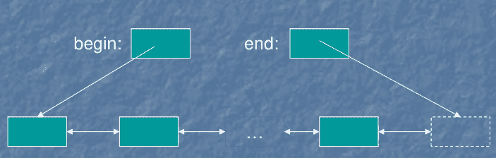

- 迭代器是一种支持“迭代器操作”的类型
  - ++ 转到下一个元素
  - * 获取值
  - == 这个迭代器是否与那个迭代器指向同一个元素？
- 一些迭代器支持更多操作（例如 --、+ 和 [ ]）

## 最简单的算法：**find()**


> _// 查找等于某个值的第一个元素_

```
template<class In, class T>
In find(In first, In last, const T& val)
{
    while (first!=last && *first != val) ++first;
    return first;
}
```

```
void f(vector<int>& v, int x)      // find an int in a vector
{
    vector<int>::iterator p = find(v.begin(),v.end(),x);
    if (p!=v.end()) { /* we found x */ }
    // ...
}
```

我们可以忽略（“抽象掉”）容器之间的差异

## find()

对元素类型和容器类型均通用

```
void f(vector<int>& v, int x)          // works for vector of ints
{
    vector<int>::iterator p = find(v.begin(),v.end(),x);
    if (p!=v.end()) {/* we found x */}
    // ...
}
```

```
void f(list<string>& v, string x)        // works for list of strings
{
    list<string>::iterator p = find(v.begin(),v.end(),x);
    if (p!=v.end()) {/* we found x */}
    // ...
}
```

```
void f(set<double>& v, double x)         // works of set of doubles
{
    set<double>::iterator p = find(v.begin(),v.end(),x);
    if (p!=v.end()) {/* we found x */}
    // ...
}
```


## 算法与迭代器

- 迭代器指向（引用、表示）序列中的一个元素
- 序列的末尾是“最后一个元素之后的位置”
  - *而不是*“最后一个元素”
  - 这对于优雅地表示空序列是必要的
  - “最后一个元素之后的位置”不是元素
    - 你可以将指向它的迭代器进行比较
    - 你不能解引用它（读取它的值）
- 返回序列的末尾是“未找到”或“未成功”的标准惯用法

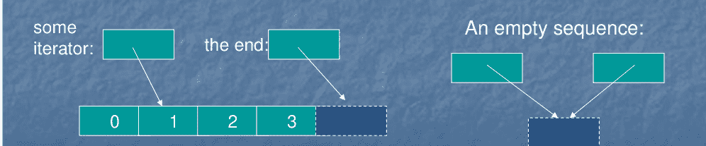

## 谓词

- 谓词（单参数）是一个函数或函数对象，它接受一个参数并返回 `bool`
- 例如
  - 一个函数

```cpp
bool odd(int i) { return i % 2; } // % is the remainder (modulo) operator
odd(7);                            // call odd: is 7 odd?
```

  - 一个函数对象

```cpp
struct Odd {
    bool operator()(int i) const { return i % 2; }
};

Odd odd;        // make an object odd of type Odd
odd(7);         // call odd: is 7 odd?
```

## 函数对象

- 一个使用状态的具体示例

```
template<class T> struct Less_than {
    T val;     // value to compare with
    Less_than(int x) : val(x) { }
    bool operator()(const T& x) const { return x < val; }
};

// find x < 43 in vector<int>:
p=find_if(v.begin(), v.end(), Less_than(43));

// find x “perfection” in list<string>:
q=find_if(ls.begin(), ls.end(), Less_than("perfection"));
```

## 函数对象

- 一种非常高效的技术
  - 内联非常容易
    - 并且对当前的编译器非常有效
  - 比等价的函数更快
    - 而且有时你无法编写等价的函数
- STL 中策略参数化的主要方法
- 在 C++ 中模拟函数式编程技术的关键

## 策略参数化

- 每当你有一个有用的算法，你最终都会希望通过“策略”将其参数化。
  - 例如，我们需要按比较标准对 sort 进行参数化

```
struct Record {
  string name;      // standard string for ease of use
  char addr[24];    // old C-style string to match database layout
  // ...
};

vector<Record> vr;
// ...
sort(vr.begin(), vr.end(), Cmp_by_name());    // sort by name
sort(vr.begin(), vr.end(), Cmp_by_addr());    // sort by addr
```

## 比较

```cpp
// Different comparisons for Rec objects:

struct Cmp_by_name {
    bool operator()(const Rec& a, const Rec& b) const
        { return a.name < b.name; }        // look at the name field of Rec
};

struct Cmp_by_addr {
    bool operator()(const Rec& a, const Rec& b) const
        { return 0 < strncmp(a.addr, b.addr, 24); }        // correct?
};

// note how the comparison function objects are used to hide ugly
// and error-prone code
```

## vector

```
template<class T> class vector {
    T* elements;
    // ...
    typedef ??? iterator; // the type of an iterator is implementation defined
    // and it (usefully) varies (e.g. range checked iterators)
    // a vector iterator could be a pointer to an element

    typedef ??? const_iterator;

    iterator begin();                // points to first element
    const_iterator begin() const;
    iterator end();                  // points one beyond the last element
    const_iterator end() const;

    iterator erase(iterator p);      // remove element pointed to by p
    iterator insert(iterator p, const T& v); // insert a new element v before p
};
```

## 从 vector 中 erase()

```
p = v.erase(p); // leaves p pointing at the element after the erased one
```

- 当你 insert() 或 erase() 时，vector 的元素会移动
- 指向 vector 的迭代器会因 insert() 和 erase() 而失效

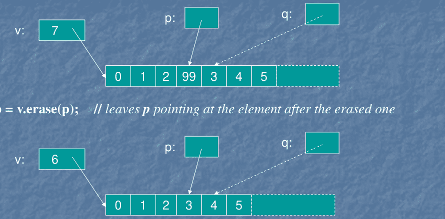


## list

```
template<class T> class list {
    Link* elements;
    // ...
    typedef ??? iterator;  // the type of an iterator is implementation defined
                           // and it (usefully) varies (e.g. range checked iterators)
                           // a list iterator could be a pointer to a link node
    typedef ??? const_iterator;

    iterator begin();                 // points to first element
    const_iterator begin() const;
    iterator end();                   // points one beyond the last element
    const_iterator end() const;

    iterator erase(iterator p);       // remove element pointed to by p
    iterator insert(iterator p, const T& v); // insert a new element v before p
};
```

## insert() into list

```
list<int>::iterator p = v.begin(); ++p; ++p; ++p;
list<int>::iterator q = p; ++q;
```

```
v = v.insert(p,99);    // leaves p pointing at the inserted element
```

- Note: q is unaffected
- Note: No elements moved around

## erase() from list

```
p = v.erase(p);  // leaves p pointing at the element after the erased one
```

- Note: list elements do not move when you insert() or erase()

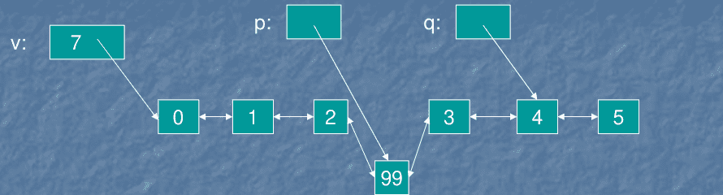


## Ways of traversing a vector

```
```cpp
for(int i = 0; i<v.size(); ++i)              // why int?
    ...  // do something with v[i]

for(vector<int>::size_type i = 0; i<v.size(); ++i)    // longer but always correct
    ...  // do something with v[i]

for(vector<int>::iterator p = v.begin(); p!=v.end(); ++p)
    ...  // do something with *p
```
```

- know both ways (iterator and subscript)
  - The subscript style is used in essentially every language
  - The iterator style is used in C (pointers only) and C++
  - The iterator style is used for standard library algorithms
  - The subscript style doesn’t work for lists (in C++ and in most languages)
- use either way for vectors
  - There are no fundamental advantage of one style over the other
  - But the iterator style works for all sequences
  - Prefer `size_type` over plain `int`
    - pedantic, but quiets compiler and prevents rare errors

## Some useful standard headers

- `<iostream>` I/O streams, cout, cin, ...
- `<fstream>` file streams
- `<algorithm>` sort, copy, ...
- `<numeric>` accumulate, inner_product, ...
- `<functional>` function objects
- `<string>`
- `<vector>`
- `<map>`
- `<list>`
- `<set>`

## 主要内容

- 泛型程序设计
- 迭代器
- 顺序容器
- 关联容器
- 函数对象
- 算法
- 深度探索

## 泛型程序设计

- 编写不依赖于具体数据类型的程序
- 将算法从特定的数据结构中抽象出来，成为通用的
- C++的模板为泛型程序设计奠定了关键的基础
- 几个术语
  - 概念（concept）：用来界定具备一定功能的数据类型，如“支持 `<` 运算符”的数据类型构成Comparable这一概念；
  - 模型（model）：符合一个概念的数据类型称为该概念的模型，如int型是Comparable概念的模型。


## STL程序实例(例10-1)

```
```cpp
//包含的头文件略去……
using namespace std;
int main() {
    const int N = 5;
    vector<int> s(N);
    for (int i = 0; i < N; i++)
        cin >> s[i];
    transform(s.begin(), s.end(),
              ostream_iterator<int>(cout, " "), negate<int>());
    cout << endl;
    return 0;
}
```
```

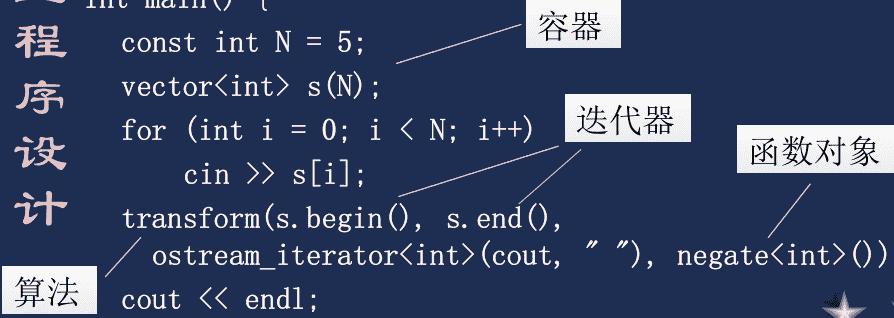

## STL的组成部分

STL是泛型程序设计的一个范例

- 容器（container）
- 迭代器（iterator）
- 算法（algorithms）
- 函数对象（function object）

泛型程序设计

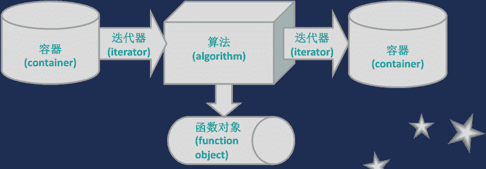

## 输入流迭代器和输出流迭代器

- 输入流迭代器
  - istream_iterator<T>
  - 以输入流（如cin）为参数构造
  - 可用*(p++)获得下一个输入的元素
- 输出流迭代器
  - ostream_iterator<T>
  - 构造时需要提供输出流（如cout）
  - 可用(*p++) = x将x输出到输出流
- 二者都属于适配器
  - 适配器是用来为已有对象提供新的接口的对象
  - 输入流适配器和输出流适配器为流对象提供了迭代器的接口

迭代器

## 例10-2

迭代器

```
//包含的头文件略去……
using namespace std;
double square(double x) {
    return x * x;
}
int main() {
    transform(istream_iterator<double>(cin),
        istream_iterator<double>(),
        ostream_iterator<double>(cout, "\t"), square);
    cout << endl;
    return 0;
}
```


## 迭代器的概念图

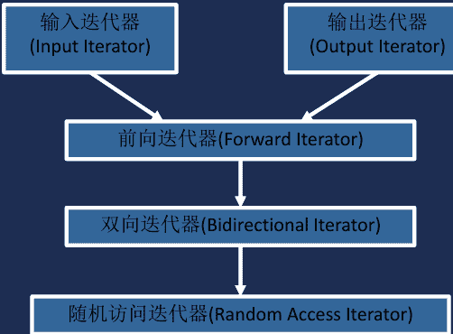

## 迭代器的区间

- 两个迭代器表示一个区间：[p1, p2)
- **STL** 算法常以迭代器的区间作为输入，传递输入数据
- 合法的区间
  - p1经过n次(n > 0)自增(++)操作后满足p1 == p2
- 区间包含p1，但不包含p2

## 容器

- 容器类是容纳、包含一组元素或元素集合的对象。
- 七种基本容器：
  - 向量（vector）、双端队列（deque）、列表（list）、集合（set）、多重集合（multiset）、映射（map）和多重映射（multimap）

## 容器的概念图

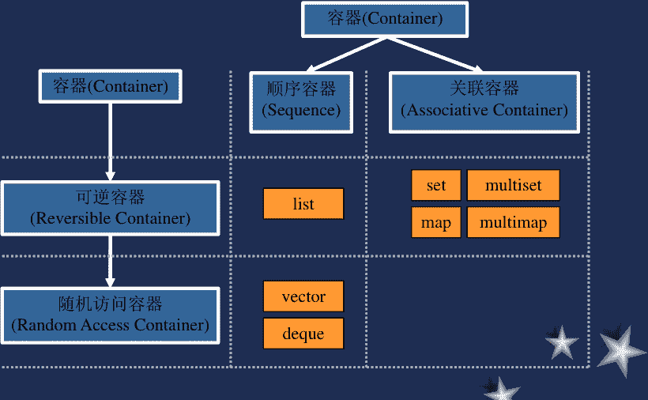

容器 (Container)

容器 (Container)

顺序容器 (Sequence)

关联容器 (Associative Container)

可逆容器 (Reversible Container)

- list
- set
- multiset
- map
- multimap

随机访问容器 (Random Access Container)

- vector
- deque

## 容器的通用功能

- 容器的通用功能
  - 用默认构造函数构造空容器
  - 支持关系运算符：==、!=、<、<=、>、>=
  - begin()、end(): 获得容器首、尾迭代器
  - clear(): 将容器清空
  - empty(): 判断容器是否为空
  - size(): 得到容器元素个数
  - s1.swap(s2): 将s1和s2两容器内容交换
- 相关数据类型（S表示容器类型）
  - S::iterator: 指向容器元素的迭代器类型
  - S::const_iterator: 常迭代器类型

容
器

## 可逆容器、随机访问容器

- 可逆容器
  - S::reverse_iterator: 逆向迭代器类型
  - S::const_reverse_iterator: 逆向常迭代器类型
  - rbegin(): 指向容器尾的逆向迭代器
  - rend(): 指向容器首的逆向迭代器
- 随机访问容器
  - s[n]: 获得容器s的第n个元素

容

器

## 顺序容器

- 顺序容器的接口
  - 赋值
    - assign
  - 插入函数
    - insert, push_front（只对list和deque），push_back
  - 删除函数
    - erase, clear, pop_front（只对list和deque），pop_back
  - 其他顺序容器访问函数
    - front, back
  - 改变大小
    - resize

## 例10-4

```cpp
//包含的头文件略去……
template <class T>
void printContainer(const char* msg, const T& s) {
    cout << msg << ": ";
    copy(s.begin(), s.end(), ostream_iterator<int>(cout, " "));
    cout << endl;
}
int main() {
    deque<int> s;
    for (int i = 0; i < 10; i++) {
        int x;
        cin >> x;
        s.push_front(x);
    }
}
```


```
printContainer("deque at first", s);
//用s容器的内容的逆序构造列表容器l
list<int> l(s.rbegin(), s.rend());
printContainer("list at first", l);
//将列表容器l的每相邻两个容器顺序颠倒
list<int>::iterator iter = l.begin();
while (iter != l.end()) {
    int v = *iter;
    iter = l.erase(iter);
    l.insert(++iter, v);
}
printContainer("list at last", l);
//用列表容器l的内容给s赋值，将s输出
s.assign(l.begin(), l.end());
printContainer("deque at last", s);
return 0;
}
```

## 向量(vector)

顺序容器

- 特点
  - 一个可以扩展的动态数组
  - 随机访问、在尾部插入或删除元素快
  - 在中间或头部插入或删除元素慢

- 向量的容量
  - 容量(capacity): 实际分配空间的大小
  - s.capacity(): 返回当前容量
  - s.reserve(n): 若容量小于n，则对s进行扩展，使其容量至少为n

## 双端队列(deque)

顺序容器

特点

- 在两端插入或删除元素快
- 在中间插入或删除元素慢
- 随机访问较快，但比向量容器慢

## 列表(List)

- **特点**
  - 在任意位置插入和删除元素都很快
  - 不支持随机访问
- **接合(splice)操作**
  - `s1.splice(p, s2, q1, q2)`：将s2中[q1, q2)移动到s1中p所指向元素之前

## 顺序容器的适配器

以顺序容器为基础构建一些常用数据结构

- 栈(stack): 最先压入的元素最后被弹出
- 队列(queue): 最先压入的元素最先被弹出
- 优先级队列(priority_queue): 最“大”的元素最先被弹出

顺序容器

## 关联容器的一般特性

关联容器

- 关联容器的特点
  - 每个关联容器都有一个键(key)
  - 可以根据键高效地查找元素
- 接口
  - 插入： insert
  - 删除： erase
  - 查找： find
  - 定界： lower_bound、 upper_bound、 equal_range
  - 计数： count

## 关联容器概念图

关联容器

关联容器
(Associative Container)

单重关联容器
(Unique Associative Container)

多重关联容器
(Multiple Associative Container)

关联容器
(Associative Container)

简单关联容器
(Simple Associative Container)

二元关联容器
(Pair Associative Container)

set

multiset

map

multimap

## 单重关联容器与多重关联容器

## 关联容器

- 单重关联容器(set和map)
  - 键值是唯一的，一个键值只能对应一个元素
- 多重关联容器(multiset和multimap)
  - 键值是不唯一的，一个键值可以对应多个元素


## 简单关联容器和二元关联容器

- 简单关联容器(set和multiset)
  - 容器只有一个类型参数，如set<K>、multiset<K>，表示键类型
  - 容器的元素就是键本身
- 二元关联容器(map和multimap)
  - 容器有两个类型参数，如map<K,V>、multimap<K,V>，分别表示键和附加数据的类型
  - 容器的元素类型是pair<K,V>，即由键类型和元素类型复合而成的二元组


## 例10-10

关联容器

```cpp
int main() {
    map<string, int> courses;
    //将课程名称和学分插入courses映射中
    courses.insert(make_pair("CSAPP", 3));
    courses.insert(make_pair("C++", 2));
    courses.insert(make_pair("CSARCH", 4));
    courses.insert(make_pair("COMPILER", 4));
    courses.insert(make_pair("OS", 5));

    int n = 3;      //剩下的可选次数
    int sum = 0;    //学分总和
```

```cpp
while (n > 0) {
    string name;
    cin >> name;      //输入课程名称

    map<string, int>::iterator iter
        = courses.find(name); //查找课程
    if (iter == courses.end()) {  //判断是否找到
        cout << name << " is not available" << endl;
    } else {
        sum += iter->second; //累加学分
        courses.erase(iter); //将刚选过的课程从映射中删除
        n--;
    }
}
    cout << "Total credit: " << sum << endl;//输出总学分
    return 0;
}
```

## 函数对象

- 函数对象
  - 一个行为类似函数的对象
  - 可以没有参数，也可以带有若干参数
  - 其功能是获取一个值，或者改变操作的状态
- 例
  - 普通函数就是函数对象
  - 重载了 “()” 运算符的类的实例是函数对象

函数对象

## 例10-13、例10-14

函数对象

- 使用两种方式定义表示乘法的函数对象
  - 通过定义普通函数（例10-13）
  - 通过重载类的“()”运算符（例10-14）

- 用到以下算法：
  - template<class InputIterator, class Type, class BinaryFunction>
    Type accumulate(InputIterator first, InputIterator last, Type val, BinaryFunction binaryOp);
    - 对[first, last)区间内的数据进行累“加”，binaryOp为用二元函数对象表示的“加”运算符，val为累“加”的初值

```cpp
#include <iostream>
#include <numeric>    //包含数值算法头文件
using namespace std;

//定义一个普通函数
int mult(int x, int y) { return x * y; };

int main() {
    int a[] = { 1, 2, 3, 4, 5 };
    const int N = sizeof(a) / sizeof(int);
    cout << "The result by multiplying all elements in a is "
         << accumulate(a, a + N, 1, mult)
         << endl;
    return 0;
}
```

例10-13：使用普通函数

```cpp
#include <iostream>
#include <numeric>  //包含数值算法头文件
using namespace std;

class MultClass {
public:
    int operator()(int x, int y) const { return x * y; }
};

int main() {
    int a[] = { 1, 2, 3, 4, 5 };
    const int N = sizeof(a) / sizeof(int);
    cout << "The result by multiplying all elements in a is "
         << accumulate(a, a + N, 1, MultClass())
         << endl;
    return 0;
}
```

例10-14: 重载“()”运算符

## 函数对象概念图

函数对象

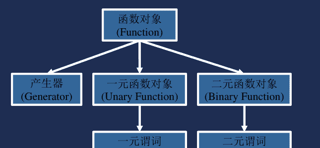

## 函数适配器

函数对象

- 绑定适配器
  - 将n元函数对象的指定参数绑定为一个常数，得到n-1元函数对象：bind1st、bind2nd
- 组合适配器
  - 将指定谓词的结果取反：not1、not2
- 指针函数适配器
  - 对一般函数指针使用，使之能够作为其它函数适配器的输入：ptr_fun
- 成员函数适配器
  - 对成员函数指针使用，把n元成员函数适配为n + 1元函数对象，该函数对象的第一个参数为调用该成员函数时的目的对象：ptr_fun、ptr_fun_ref

## 例10-17

```cpp
//包含的头文件略去……
int main() {
    int intArr[] = { 30, 90, 10, 40, 70, 50, 20, 80 };
    const int N = sizeof(intArr) / sizeof(int);
    vector<int> a(intArr, intArr + N);
    vector<int>::iterator p = find_if(a.begin(), a.end(),
        bind2nd(greater<int>(), 40));
    if (p == a.end())
        cout << "no element greater than 40" << endl;
    else
        cout << "first element greater than 40 is: " << *p << endl;
    return 0;
}
```


## 算法

- STL算法本身是一种函数模板
  - 通过迭代器获得输入数据
  - 通过函数对象对数据进行处理
  - 通过迭代器将结果输出
- STL算法是通用的，独立于具体的数据类型、容器类型
- STL算法分类
  - 不可变序列算法
  - 可变序列算法
  - 排序和搜索算法
  - 数值算法

## 可变序列算法

- 可变序列算法
  - 可以修改它们所操作的容器对象
  - 包括对序列进行复制、删除、替换、倒序、旋转、交换、变换、分割、去重、填充、洗牌的算法及生成一个序列的算法
- 例：
  ```
  template<class ForwardIterator, class T>
  InputIterator find_if(ForwardIterator first,
    ForwardIterator last, const T& x);
  ```
  把[first, last)区间内的元素全部改写为x

算法

## 排序和搜索算法

算法

- 排序和搜索算法
  - 对序列进行排序
  - 对两有序序列进行合并
  - 对有序序列进行搜索
  - 有序序列的集合操作
  - 堆算法

- 例：
  template <class RandomAccessIterator , class UnaryPredicate>
  void sort(RandomAccessIterator first, RandomAccessIterator last, UnaryPredicate comp);
  以函数对象comp为“<”，对 [first, last)区间内的数据进行排序


## 数值算法

- 数值算法
  - 求序列中元素的“和”、部分“和”、相邻元素的“差”或两序列的内积
  - 求“和”的“+”、求“差”的“-”以及求内积的“+”和“.”都可由函数对象指定
- 例：

```
template<class InputIterator, class OutputIterator, class BinaryFunction>
OutputIterator partial_sum(InputIterator first, InputIterator last, OutputIterator result, BinaryFunction op);
```

对[first, last)内的元素求部分“和”（所谓部分“和”，是一个长度与输入序列相同的序列，其第n项为输入序列前n个元素的“和”），以函数对象op为“+”运算符，结果通过result输出，返回的迭代器指向输出序列最后一个元素的下一个元素

## 算法

## swap高效的执行方式

以vector<int>型对象为例

深度探索

堆空间

交换后

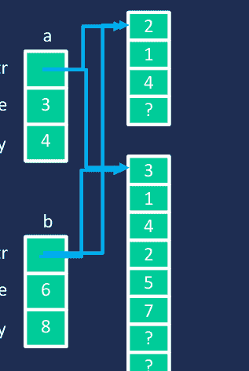

## STL组件的类型特征

深度探索

- 思考
  - 在一个以迭代器为输入的算法中，如何表示迭代器所指向元素的类型？
- 类型特征
  - 通过类型特征可以获得与一个类型相关联的其它数据类型
  - 通过函数对象的类型特征可以得到函数对象的参数和返回值类型
  - 通过迭代器的类型特征可以得到迭代器指向元素的类型

## 函数对象的类型特征

深度探索

- STL提供的二元函数对象皆继承自以下结构体：
  - template<class Arg1, class Arg2, class Result>
  - struct binary_function {
  - typedef Arg1 first_argument_type;
  - typedef Arg2 second_argument_type;
  - typedef Result result_type;
  - };

- 若Type为一个符合二元函数对象的类型参数，则可通过typename Type::first_argument_type表示它的第一个参数类型

- 对于普通函数，使用ptr_fun也可得到具备类型参数的函数对象

## 例10-26

利用类型特征实现算法：

```
//将来自输入迭代器p的n个数值排序，将结果通过输出result输出
template <class InputIterator, class OutputIterator>
void mySort(InputIterator first, InputIterator last, OutputIterator result) {
//通过输入迭代器p将输入数据存入向量容器s中
vector<typename iterator_traits<InputIterator>::value_type> s(first, last);
//对s进行排序，sort函数的参数必须是随机访问迭代器
sort(s.begin(), s.end());
//将s序列通过输出迭代器输出
copy(s.begin(), s.end(), result);
}
```

## 小结与复习建议

- **主要内容**
  - 泛型程序设计、与标准模板库有关的概念和术语、迭代器、容器、函数对象、算法、

- **达到的目标**
  - 初步了解泛型程序设计的概念，学会 C++ 标准模板库（STL）的使用方法

## 5 递归

Eric Roberts
CS 106B

## 第三部分：回溯与游戏

## 在分支结构中搜索

- 在迷宫中寻找解路径的递归结构出现在各种各样的应用中，其特点是在一系列选择点中的每一个都需要探索一系列可能性。
- 在这些问题中使用递归的主要优点是这样做大大简化了记账工作。递归算法的每一层都考虑一个选择点。关于哪些选择已经被测试过以及哪些选择仍需进一步探索的历史知识会自动保存在执行栈中。
- 许多这样的应用都像迷宫求解算法一样，过程*搜索*分支结构以找到特定解。然而，其他应用则使用相同的[content]

## 数值算法

- 数值算法
  - 求序列中元素的“和”、部分“和”、相邻元素的“差”或两序列的内积
  - 求“和”的“+”、求“差”的“-”以及求内积的“+”和“.”都可由函数对象指定
- 例：

```
template<class InputIterator, class OutputIterator, class BinaryFunction>
OutputIterator partial_sum(InputIterator first, InputIterator last, OutputIterator result, BinaryFunction op);
```

对[first, last)内的元素求部分“和”（所谓部分“和”，是一个长度与输入序列相同的序列，其第n项为输入序列前n个元素的“和”），以函数对象op为“+”运算符，结果通过result输出，返回的迭代器指向输出序列最后一个元素的下一个元素

## 算法

## swap高效的执行方式

以vector<int>型对象为例

深度探索

堆空间

交换后


## STL组件的类型特征

深度探索

- 思考
  - 在一个以迭代器为输入的算法中，如何表示迭代器所指向元素的类型？
- 类型特征
  - 通过类型特征可以获得与一个类型相关联的其它数据类型
  - 通过函数对象的类型特征可以得到函数对象的参数和返回值类型
  - 通过迭代器的类型特征可以得到迭代器指向元素的类型

## 函数对象的类型特征

深度探索

- STL提供的二元函数对象皆继承自以下结构体：
  - template<class Arg1, class Arg2, class Result>
  - struct binary_function {
  - typedef Arg1 first_argument_type;
  - typedef Arg2 second_argument_type;
  - typedef Result result_type;
  - };

- 若Type为一个符合二元函数对象的类型参数，则可通过typename Type::first_argument_type表示它的第一个参数类型

- 对于普通函数，使用ptr_fun也可得到具备类型参数的函数对象

## 例10-26

利用类型特征实现算法：

```
//将来自输入迭代器p的n个数值排序，将结果通过输出result输出
template <class InputIterator, class OutputIterator>
void mySort(InputIterator first, InputIterator last, OutputIterator result) {
//通过输入迭代器p将输入数据存入向量容器s中
vector<typename iterator_traits<InputIterator>::value_type> s(first, last);
//对s进行排序，sort函数的参数必须是随机访问迭代器
sort(s.begin(), s.end());
//将s序列通过输出迭代器输出
copy(s.begin(), s.end(), result);
}
```

## 小结与复习建议

- **主要内容**
  - 泛型程序设计、与标准模板库有关的概念和术语、迭代器、容器、函数对象、算法、

- **达到的目标**
  - 初步了解泛型程序设计的概念，学会 C++ 标准模板库（STL）的使用方法

## 5 Recursion

Eric Roberts
CS 106B

## Part III: Backtracking and Games

## Searching in a Branching Structure

- The recursive structure for finding the solution path in a maze comes up in a wide variety of applications, characterized by the need to explore a range of possibilities at each of a series of choice points.
- The primary advantage of using recursion in these problems is that doing so dramatically simplifies the bookkeeping. Each level of the recursive algorithm considers one choice point. The historical knowledge of what choices have already been tested and which ones remain for further exploration is maintained automatically in the execution stack.
- Many such applications are like the maze-solving algorithm in which the process *searches* a branching structure to find a particular solution. Others, however, use the same basic strategy to explore *every* path in a branching structure in some systematic way.

## Exercise: Generating Subsets

- Write a function

  `Vector<string> generateSubsets(string set);`

  that generates a vector showing all subsets of the set formed from the letters in set.

- For example, calling `generateSubsets("abc")` should return a vector containing the following eight strings, in some order:

  `""`      `"a"`      `"ab"`      `"abc"`
  `"b"`      `"ac"`
  `"c"`      `"bc"`

- The solution process requires a branching structure similar to that used to solve a maze. At each level of the recursion, you can either exclude or include the current letter from the list of subsets, as illustrated on the following slide.

## The Subset Tree

The set of all subsets of { a, b, c } is

Those that don’t include 'a'

Those that do include 'a'

Has no 'b'

Has a 'b'

Has no 'b'

Has a 'b'

Has no 'c'

Has a 'c'

Has no 'c'

Has a 'c'

Has no 'c'

Has a 'c'

Has no 'c'

Has a 'c'

{ }

{ c }

{ b }

{ b, c }

{ a }

{ a, c }

{ a, b }

{ a, b, c }

## The Eight Queens Problem

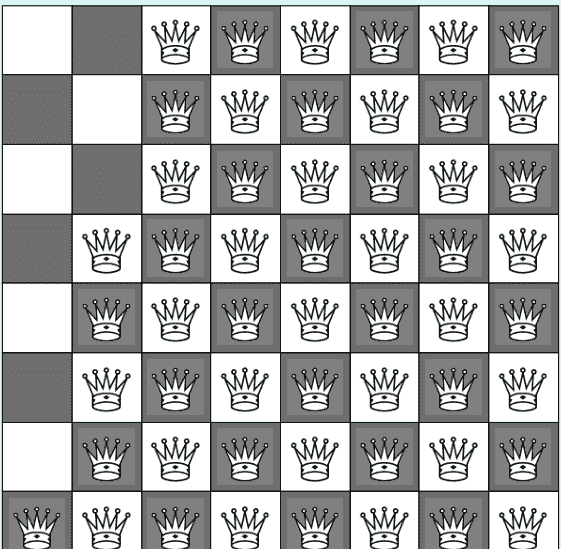

## What Most Students Want to Do

```
bool solveNQueens(Grid<char> & board) {
    int n = board.numRows();
    for (int c1 = 0; c1 < n; c1++) {
        board[0][c1] = 'Q';
        for (int c2 = 0; c2 < n; c2++) {
            board[1][c2] = 'Q';
            for (int c3 = 0; c3 < n; c3++) {
                board[2][c2] = 'Q';

                ...

                if (solutionFound(board)) return true;

                ...

                board[2][c2] = ' ';
            }
            board[1][c2] = ' ';
        }
        board[0][c2] = ' ';
    }
    return false;
}
```


## Deep Blue 战胜加里·卡斯帕罗夫

1997 年，IBM 的 Deep Blue 程序击败了当时世界人类冠军加里·卡斯帕罗夫。1996 年，卡斯帕罗夫在某种程度上更具启发性的对局中获胜。

第 6 局

卡斯帕罗夫
30. b6

Deep Blue
30. Bb8 ??

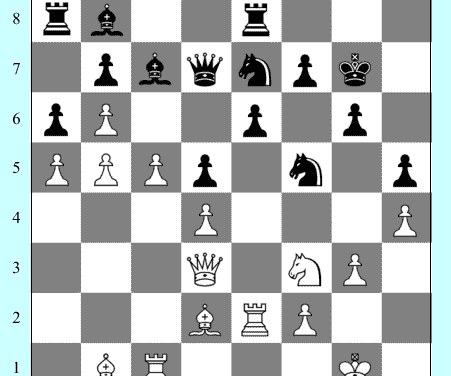

## 递归与游戏

- 1950 年，克劳德·香农在 *Scientific American* 上发表了一篇文章，描述了如何编写一个下棋的计算机程序。
- 香农的策略是让计算机尝试白方所有可能的走法，然后是黑方所有的回应，再然后是白方对这些走法的回应，以此类推。
- 即使使用现代计算机，也不可能对整盘棋使用这种策略，因为可能性太多。

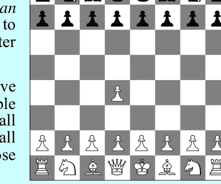

*Positions evaluated: ~10^53*

... millions of years later ...

## 一个更简单的游戏

- 国际象棋复杂到无法作为有用的例子。文本使用了一个更简单的游戏叫做 *Nim*，它代表了一大类双人游戏。
- 在 Nim 中，游戏开始时两名玩家之间有一堆硬币。起始硬币数可以变化，因此在程序中应易于更改。
- 在交替回合中，每位玩家从中央的堆中取走一枚、两枚或三枚硬币。
- 取走最后一枚硬币的玩家输掉。

## 一局 Nim 示例

还剩下 11 枚硬币。
我取 2 枚。
还剩下 9 枚硬币。
你的回合：1
还剩下 8 枚硬币。
我取 3 枚。
还剩下 5 枚硬币。
你的回合：2
还剩下 3 枚硬币。
我取 2 枚。
只剩下 1 枚硬币了。
你输了。


## 好走法与坏位置

- Nim 程序背后的核心洞见包含在以下相互递归的定义中：
  - *好走法*是指使对手处于坏位置的走法。
  - *坏位置*是指没有好走法的局面。
- Nim 游戏的实现实际上只是将这些定义翻译成代码而已。

## 编码 Nim 策略

```
/*
 * Looks for a winning move, given the specified number of coins.
 * If there is a winning move in that position, findGoodMove returns
 * that value; if not, the method returns the constant NO_GOOD_MOVE.
 * This implementation depends on the recursive insight that a good move
 * is one that leaves your opponent in a bad position and a bad position
 * is one that offers no good moves.
 */

int findGoodMove(int nCoins) {
    int limit = (nCoins < MAX_MOVE) ? nCoins : MAX_MOVE;
    for (int nTaken = 1; nTaken <= limit; nTaken++) {
        if (isBadPosition(nCoins - nTaken)) return nTaken;
    }
    return NO_GOOD_MOVE;
}

/*
 * Returns true if nCoins is a bad position.  Being left with a single
 * coin is clearly a bad position and represents the simple case.
 */

bool isBadPosition(int nCoins) {
    if (nCoins == 1) return true;
    return findGoodMove(nCoins) == NO_GOOD_MOVE;
}
```

## Minimax 算法

- Nim 之类的游戏足够简单，可以在相对较短的时间内完全解决。
- 对于更复杂的游戏，有必要在某一点切断分析，然后评估局面， presumably 使用某个函数查看局面并返回该局面的 *评级*。正评级对轮到行动的玩家有利；负评级则不利。
- 当你的游戏玩家搜索树以寻找最佳走法时，它不能简单地选择评级最高的走法，因为你只能控制一半的对局。
- 你想要做的是选择使对手可获得的最大评级最小化的走法。这种策略称为 *minimax* 算法。

## Minimax 说明

- 假设两回合后的评级如图所示。
- 从你的角度来看，+9 最初看起来很有吸引力。
- 不幸的是，你无法到达那里，因为 -5 对你的对手更好。
- 你能做的最好的就是选择导致 -2 的走法。

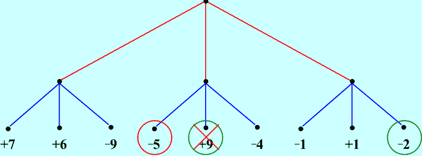


## 练习：三堆 Nim

- 作为今天的最后练习，我想通过使用书中简单的 Nim 程序作为起点，来演示如何实现一个更复杂的 Nim 版本。
- 在这个版本中，有三行硬币，通常的初始配置如下：
- 一次行动包括拿走任意数量的硬币，但它们必须全部来自同一行。


## 递归回溯

- 将问题表述为决策点
  - 识别需要做出的决策
  - 识别每个决策可用的选项
  - 递归调用做出一个决策，并对剩余决策进行递归
- 回溯方法
  - 设计递归函数返回成功/失败
  - 在每次调用时，选择一个选项并执行
  - 递归继续并观察结果
  - 如果成功，很好，否则撤销选择并重试
  - 如果没有选项可行，返回失败从而触发回溯
- 启发式方法可能提高效率
  - 通过剪枝尽早消除死路
  - 优先尝试最可能的选项

## 回溯伪代码

```
bool Solve(configuration conf)
{
    if (no more choices) // BASE CASE
        return (conf is goal state);

    for (all available choices) {
        try one choice c;
        // solve from here, if works out, you're done
        if (Solve(conf with choice c made)) return true;
        unmake choice c;
    }

    return false; // tried all choices, no solution found
}
```

## 第四部分：递归 VS 迭代

Jingyu Zhou

## 递归 vs 迭代

- 迭代：
  - 将问题分解为*序列*的典型情况
  - 识别典型情况（主体）
  - 识别到下一个情况的*增量*步骤
  - 识别继续或停止的*条件*
  - 识别*初始化*

- 递归：(简单)
  - 将问题分解为*第一*部分和*剩余*部分
  - 识别第一种情况
  - 识别对剩余部分的递归调用
  - 识别何时应进行递归调用。
    - 确保有停止情况（*基本情况*）
  - 可能需要包装方法进行*初始化*

## 递归示例：幂运算

- 回顾预定义函数 pow()：
  result = pow(2.0,3.0);
  - 返回 2 的 3 次方（8.0）
  - 接受两个 double 参数
  - 返回 double 值
- 我们来递归地编写
  - 对于简单示例

## power() 函数定义

```
int power(int x, int n)
{
    if (n<0)
    {
        cout << "Illegal argument";
        exit(1);
    }
    if (n>0)
        return power(x, n-1)*x;
    else
        return 1;
}
```

## 调用 power() 函数

- 更大的示例：
  power(2,3);
  → power(2,2)*2
  → power(2,1)*2
  → power(2,0)*2
  → 1

- 到达基本情况

- 递归停止

- 值“返回”回栈中

## 递归思考

- 忽略细节
  - 忘记栈如何工作
  - 忘记挂起的计算
  - 是的，这是一个“抽象”原则！
  - 也是封装原则！
- 让计算机做“记账”
  - 程序员只需思考“大局”

## 递归思考：power

- 再次考虑 power()
- power() 的递归定义：

`power(x, n)`

返回：

`power(x, n - 1) * x`

- 只需确保“公式”正确
- 并确保基本情况会被满足

## 递归设计技术

- 不要追踪整个递归序列！
- 只检查 3 个属性：
  - 无无限递归
  - 停止情况返回正确值
  - 递归情况返回正确值

## 递归设计检查：power()

检查 power() 是否符合 3 个属性：

- 1. 无无限递归：
  - 第二个参数每次调用减少 1
  - 最终必须到达 1 的基本情况

- 2. 停止情况返回正确值：
  - power(x,0) 是基本情况
  - 返回 1，这对 x0 是正确的

- 3. 递归调用正确：
  - 对于 n>1，power(x,n) 返回 power(x,n-1)*x
  - 代入值 → 正确


## 尾递归 vs 嵌套递归

- **尾递归：**
  - 递归调用是方法中的最后一步。
  - 更容易理解，因为调用后不需要“返回”。

- **嵌套递归：**
  - 递归调用在中间。
  - 需要返回到之前的调用以完成它
  - 示例：打印一个“洋葱”：( ( ( ( ( ( ) ) ) ) ) )

```
void onion(int layers) {
    cout<<"(";
    if (layers > 1) onion(layers-1);
    cout<<")";
}
```

## 替代可视化

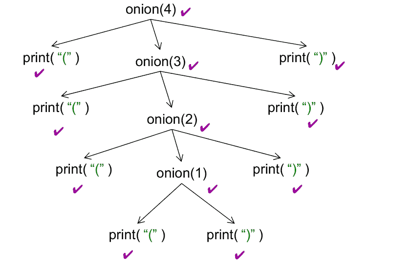

## power() 是尾递归的吗？

```
int power(int x, int n)
{
    if (n>0)
        return power(x, n-1)*x;
    else
        return 1;
}
```

- 从递归调用返回时，仍有一个待处理的运算（乘法）。
  - 因此，power 不是一个尾递归函数。

## 将 power() 转换为尾递归

```
int power_helper(int x, int n, int result)
{
    if (n>0)
        return power_helper(x, n-1, x*result);

    return result;
}
int power(int x, int n)
{
    return power_helper(x, n, 1);
}
```

- 一个非尾递归方法可以通过使用一个“辅助”参数来形成结果的方式转换为尾递归方法。

- 该技术通常与“辅助”函数一起使用。

## 尾递归的优势

- 函数的激活记录只需要保留到还有计算剩余为止
  - 一旦返回值已知——激活记录就可以被丢弃
- 对于尾递归
  - 递归后不需要计算
  - 因此，原来的栈帧其实并不需要
  - 递归被调用方可以重用调用方的栈帧——节省空间

## 递归的类型

- 尾递归 vs 嵌套递归
  - 尾递归：递归调用是方法中的最后一步
    ⇒ 不需要“返回”再做更多事。
  - 嵌套递归：递归调用在中间
    ⇒ 动作 … 递归调用 … 更多动作

- 单递归 vs 多递归
  - 单递归：方法只进行一次递归调用
  - 多递归：方法进行一次以上递归调用

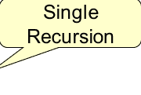

## 有多少只兔子？

- 兔子永不死亡
- 一只兔子可以在出生后的第三个月开始繁殖
- 兔子总是成雌雄一对出生。每个月开始时，每只成熟的雌兔都会生下一对雌雄兔。
- 所以，如果我们从 1 对新生兔子开始：
  - 第 1 个月：1 对
  - 第 2 个月：1 对
  - 第 3 个月：2 对——原始的这对生了
  - 第 4 个月：3 对——原始的这对再次生了
  - 第 5 个月：5 对——原始的这对和它的第一个后代都生了
  - 第 6 个月：8 对——第 4 个月存活的 3 对生了

## 斐波那契数

- 定义
  - Fₙ = Fₙ₋₁ + Fₙ₋₂
  - F₀ = F₁ = 1
- 我们如何递归求解？
  - 计算 fibonacci(n-1)
  - 计算 fibonacci(n-2)
  - 将两者相加
- 问题被简化为更小的问题
- 有明确的停止点

```
int fibonacci (int n) {
    int f1, f2;
    if (n <= 1) {
        return (1);
    } else {
        f1 = fibonacci(n-1);
        f2 = fibonacci(n-2);
        return (f1+f2);
    }
}
```

## 将非尾递归转换为尾递归

- 一个尾递归的斐波那契方法可以通过使用两个辅助参数来累积结果来实现。

auxiliary parameters!

```
int fib_aux ( int n , int next, int result)
{
    if (n == 0)
        return result;
    return fib_aux(n - 1, next + result, next);
}
```

要计算 fib(n)，调用 fib_aux(n,1,0)

## 将尾递归转换为迭代

```
F(x)
{
    if (P(x))
        return G(x);
    return F(H(x));
}
```

P(x) 为真时，F(x) 的值是某个其他函数 G(x) 的值。否则，F(x) 的值是函数 F 在某个其他值 H(x) 上的值

```
F(x) {
    int temp_x = x;
    while (P(x) is not true) {
        temp_x = x;
        x = H(temp_x);
    }
    return G(x);
}
```


## 将尾递归转换为迭代

```
int fib_aux (int n , int next, int result)
{
    if (n == 0) return result;
    return fib_aux(n - 1, next + result,next);
}
```

```
F(x) {
    if (P(x)) return G(x);
    return F(H(x));
}
```

函数 F 就是 fib_aux

x 由三个参数 n、next 和 result 组成

P(n, next, result) 的值就是 (n == 0) 的值

G(n, next, result) 的值就是 result

H(n, next, result) 的值就是 (n - 1, next+result, next)

```
int fib_iter(int n)
{
    int temp_next, temp_result;
    int next = 1, result = 0;
    while (n != 1) {
        temp_next = next;
        temp_result = result;
        n--;
        result = temp_next;
        next = temp_next + temp_result;
    }
    return result;
}
```

```
F(x)
{
    int temp_x = x;
    while (P(x) is not true)
    {
        temp_x = x;
        x = H(temp_x);
    }
    return G(x);
}
```

## 间接递归

- 如果 X 对 X 自身进行递归调用，则称为直接递归。
- 间接递归方法通过调用其他方法来间接调用自身。
- 一般来说，间接递归是两个或多个递归调用构成的循环序列：X1 --> X2 --> ... --> X1。

## 间接递归示例

- 判断一个整数是偶数还是奇数：
- 我们如何知道一个数是否为偶数？
  - 我们知道 0 是偶数。
  - 我们知道如果 n 是偶数，那么 n-1 一定是奇数。
```
static boolean is_even(int n)
{
    if (n==0) return true;
    else return(is_odd(n-1));
}
```
- 我们如何知道一个数是否为奇数？它不是偶数！
```
static boolean is_odd(int n)
{
    return (!is_even(n));
}
```

## 总结

- 将问题分解为同一问题的更小实例 -> 递归解决方案
- 递归算法有两种情况：
  - 基本/终止情况
  - 递归情况
- 确保不会无限递归
- 使用标准来判断递归的正确性
  - 三个基本属性
- 通常解决“更一般”的问题

## 结束

## 排序与效率

Eric Roberts
CS 106B

## 递归的用途

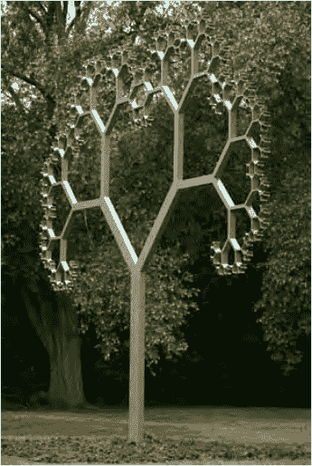

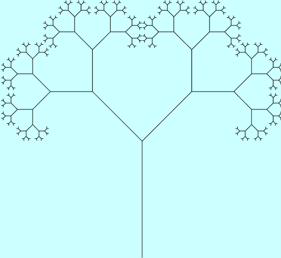

“Y”——Mark Wallinger 作品

牛津大学莫德林学院

## 排序

- 在计算机科学家研究的所有算法问题中，实际影响最广的无疑是*排序问题*，即按顺序排列数组或向量元素的问题。
- 例如，排序问题出现在按字母顺序排列电话簿、按目录编号排列图书馆记录以及按邮政编码组织大宗邮件等场景中。
- 有很多算法可以用来对数组排序。由于这些算法的效率差异巨大，因此选择一个好的算法至关重要，尤其是当应用程序需要处理大型数组时。

## 概述

- 排序：内部排序：全部记录都可以同时调入内存进行的排序。
  外部排序：文件中的记录太大，无法全部将其同时调入内存进行的排序。

- 定义：设有记录序列：{ R₁、R₂ ........ Rₙ } 其相应的关键字序列为：
  { K₁、K₂ ........ Kₙ }；若存在一种确定的关系： Kₓ <= Kᵧ <= ... <= K_z
  则将记录序列 { R₁、R₂ ........ Rₙ } 排成按该关键字有序的序列：
  { Rₓ、Rᵧ ........ R_z } 的操作，称之为排序。
  关系是任意的，如通常经常使用的小于、大于等关系或任意的关系。

- 稳定与不稳定：若记录序列中的任意两个记录 Rₓ、Rᵧ 的关键字 Kₓ = Kᵧ ；如果在排序之前和排序之后，它们的相对位置保持不变，则这种排序方法是稳定的，否则是不稳定的。

## 选择排序算法

- 在众多排序算法中，最容易描述的是*选择排序*，它在文本中如下所示：

```
void sort(Vector<int> & vec) {
    int n = vec.size();
    for (int lh = 0; lh < n; lh++) {
        int rh = lh;
        for (int i = lh + 1; i < n; i++) {
            if (vec[i] < vec[rh]) rh = i;
        }
        int temp = vec[lh];
        vec[lh] = vec[rh];
        vec[rh] = temp;
    }
}
```

- 将此算法编码为单个函数对于效率来说是有意义的，但会使分析变得复杂。接下来的两张幻灯片将选择排序分解为一组函数，使操作更易于理解。


## sort 函数的分解

```
/*
 * Function: sort
 * -------------
 * Sorts a Vector<int> into increasing order.  This implementation
 * uses an algorithm called selection sort, which can be described
 * in English as follows.  With your left hand (lh), point at each
 * element in the vector in turn, starting at index 0.  At each
 * step in the cycle:
 *
 * 1. Find the smallest element in the range between your left
 *    hand and the end of the vector, and point at that element
 *    with your right hand (rh).
 *
 * 2. Move that element into its correct position by swapping
 *    the elements indicated by your left and right hands.
 */

void sort(Vector<int> & vec) {
    for ( int lh = 0 ; lh < vec.size() ; lh++ ) {
        int rh = findSmallest(vec, lh, vec.size() - 1);
        swap(vec[lh], vec[rh]);
    }
}
```

```
/*
 * Function: findSmallest
 * ----------------------
 * Returns the index of the smallest value in the vector between
 * index positions p1 and p2, inclusive.
 */
int findSmallest(Vector<int> & vec, int p1, int p2) {
    int smallestIndex = p1;
    for ( int i = p1 + 1 ; i <= p2 ; i++ ) {
        if (vec[i] < vec[smallestIndex]) smallestIndex = i;
    }
    return smallestIndex;
}

/*
 * Function: swap
 * -------------
 * Exchanges two integer values passed by reference.
 */
void swap(int & x, int & y) {
    int temp = x;
    x = y;
    y = temp;
}
```

## 模拟选择排序

```cpp
int main() {

void sort(Vector<int> & vec) {
    for ( int lh = 0 ; lh < vec.size() ; lh++ ) {
        int rh = findSmallest(vec, lh, vec.size() - 1);
        swap(vec[lh], vec[rh]);
    }
}
```

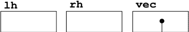


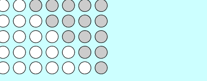


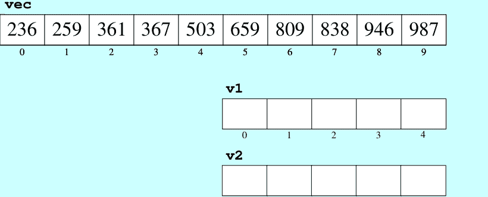

```
| 809 | 503 | 946 | 367 | 987 | 838 | 259 | 236 | 659 | 361 |
|---:|---:|---:|---:|---:|---:|---:|---:|---:|---:|
| 0 | 1 | 2 | 3 | 4 | 5 | 6 | 7 | 8 | 9 |

## 选择排序的效率

- 今天的主要问题是如何评估像选择排序这样的算法的效率。
- 一种策略是测量不同大小的数组实际运行所需的时间。在 C++ 中，你可以通过调用 `time` 函数来测量经过的时间，该函数以毫秒为单位返回当前时间。不过，使用这种策略需要注意以下几点：
  - `time` 函数通常过于粗糙，无法进行精确测量。因此，合理的做法是将多次运行合在一起测量，然后将总时间除以重复次数。
  - 大多数算法会因数据的不同而表现出一定差异。为避免失真，你应该使用不同的数据运行多次独立试验，并对结果取平均值。
  - 某些测量结果可能严重偏离，因为计算机需要运行一些后台任务。在处理分析时，必须丢弃这些数据点。

## 测量排序时间

下表显示了选择排序算法在剔除与均值相差超过两个标准差的离群试验后的平均时间。标记为 μ（希腊字母 mu，是均值的标准统计符号）的列是对运行时间的合理估计。

|  | 试验 1 | 试验 2 | 试验 3 | 试验 4 | 试验 5 | 试验 6 | 试验 7 | 试验 8 | 试验 9 | 试验 10 | μ | σ |
|---|---|---|---|---|---|---|---|---|---|---|---|---|
| N = 10 | .0021 | .0025 | .0022 | .0026 | .0020 | .0030 | .0022 | .0023 | .0022 | .0025 | .0024 | .00029 |
| 20 | .006 | .007 | .008 | .007 | .007 |  | .007 | .007 | .007 | .007 | .007 | .00036 |
| 30 | .014 | .014 | .014 | .015 | .014 | .014 | .014 | .014 | .014 | .014 | .014 | .00013 |
| 40 | .028 | .024 | .025 | .026 | .023 | .025 | .025 | .026 | .025 | .027 | .025 | .0014 |
| 50 | .039 | .037 | .036 | .041 | .042 | .039 |  | .039 | .034 | .038 | .039 | .0025 |
| 100 | .187 | .152 | .168 | .176 | .146 | .146 | .165 | .146 | .178 | .154 | .162 | .0151 |
| 500 | 3.94 | 3.63 | 4.06 | 3.76 | 4.11 | 3.51 | 3.48 | 3.64 | 3.31 | 3.45 | 3.69 | 0.272 |
| 1000 | 13.40 | 12.90 | 13.80 | 17.60 | 12.90 | 14.10 | 12.70 |  | 16.00 | 15.50 | 14.32 | 1.69 |
| 5000 | 322.5 | 355.9 | 391.7 | 321.6 | 388.3 | 321.3 | 321.3 | 398.7 | 322.1 | 321.3 | 346.4 | 33.83 |
| 10000 | 1319. |  | 1327. | 1318. | 1331. | 1336. | 1318. | 1335. | 1325. | 1319. | 1326. | 7.50 |

## 选择排序的运行时间

- 许多操作向量的算法，其运行时间与数组的大小成正比。如果你将值的数量乘以十，你会期望这些算法花费的时间增加十倍。
- 如前一页幻灯片上的运行时间所示，选择排序的情况非常不同。右侧的表格显示了将选择排序应用于 10、100、1000 和 10000 个值时的平均运行时间。
- 作为粗略的近似——特别是在使用较大的 N 值时——数组大小每增加十倍，选择排序所需的时间大约增加 100 倍。

| N | time |
|---|------|
| 10 | .0024 |
| 100 | 0.162 |
| 1000 | 14.32 |
| 10000 | 1332. |

## 计数操作

- 估计运行时间的另一种方法是计算对大小为 N 的数组进行排序所需的运算次数。
- 在选择排序的实现中，执行频率最高、因此对运行时间贡献最大的代码部分是 `findSmallest` 方法的主体。对 `findSmallest` 的每次调用所涉及的运算次数会随着算法的进行而变化：
  - 第一次调用 `findSmallest` 时考虑 N 个值。
  - 第二次调用时考虑 N − 1 个值。
  - 第三次调用时考虑 N − 2 个值，以此类推。
- 在数学记法中，`findSmallest` 中考虑的值的数量可以表示为一个求和，然后可以将其转换为一个简单的公式：
  1 + 2 + 3 + ⋯ + (N − 1) + N = ∑_{i=1}^{N} i = (N × (N + 1)) / 2

## 一个几何直观

- 你可以通过几何思考来确信

  1 + 2 + 3 + ⋯ + (N − 2) + (N − 1) + N = \frac{N \times (N + 1)}{2}

- 左侧公式中的项可以排列成一个三角形，如本幻灯片底部所示，N = 6 的情况。
- 如果你复制该三角形并将其旋转 180°，你会得到一个矩形，在本例中包含 6 × 7 个点，其中一半属于每个三角形。
## 二次增长

- 选择排序运行时间快速增长的原因变得清晰，如果你制作一个表格，显示各种 N 值下 $\frac{N \times (N + 1)}{2}$ 的值：
- 右列的增长模式与选择排序算法测量的运行时间相似。随着 N 的值增加十倍，$\frac{N \times (N + 1)}{2}$ 的值大约增加 100 倍，即 $10^2$。运行时间与问题规模的平方成比例增长的算法被称为 *二次*。

| N | $\frac{N \times (N + 1)}{2}$ |
|---|---|
| 10 | 55 |
| 100 | 5050 |
| 1000 | 500,500 |
| 10000 | 50,005,000 |

## 大 O 记法

- 表示计算复杂度的最常见方法是使用 *大 O 记法*，该记法由德国数学家 Paul Bachmann 于 1892 年引入。
- 大 O 记法由字母 *O* 加上一个公式组成，该公式对运行时间作为问题规模的函数进行定性评估，传统上用 *N* 表示。例如，线性搜索的计算复杂度为

  $O(N)$

  而选择排序的计算复杂度为

  $O(N^2)$
- 如果你大声读出这些公式，你会读作“大 O 的 *N*”和“大 O 的 *N*²”。

## 大 O 的常见简化

- 鉴于大 O 记法旨在提供定性评估，将括号内的公式尽可能简化非常重要。
- 当你写大 O 表达式时，你应该始终进行以下简化：
  1. 消除随着 N 变大，其对运行时间的贡献不再显著的任何项。
  2. 消除任何常数因子。
- 因此，选择排序的计算复杂度为

  $O(N^2)$

  而不是

  $O\left(\frac{N \times (N+1)}{2}\right)$
## 从代码中推导复杂度

- 在很多情况下，你可以直接从代码的结构中推导出程序的计算复杂度。
- 进行这类分析的标准方法是先寻找程序中比其它部分执行得更频繁的代码段。只要算法中涉及的各个操作耗时大致相同，执行最频繁的操作就会主导整体运行时间。
- 例如，在选择排序的实现中，执行最频繁的语句是 `findSmallest` 方法内部的 `if` 语句。该语句位于两个 `for` 循环中，一个在 `findSmallest` 自身，另一个在 `Sort` 中。它的总执行次数为

1 + 2 + 3 + ⋯ + (N − 1) + N

即 O(N²)。

## 寻找更高效的策略

- 只要数组规模较小，选择排序就是一种完全可行的策略。即便有 10,000 个元素，选择排序的平均运行时间也刚刚超过一秒。
- 然而，选择排序的平方级行为使其在处理商业应用中常见的大型数组时缺乏吸引力。假设平方级增长模式在表格报告的耗时之外持续成立，那么对 100,000 个值进行排序需要两分钟，对 1,000,000 个值进行排序则需要三个多小时。
- 不过，选择排序算法的计算复杂度仍然带来了一些希望：
  - 排序两倍数量的元素需要四倍的时间。
  - 排序一半数量的元素只需要四分之一的时间。
  - 有没有办法把“排序半个数组”作为递归解决排序问题的一个子任务呢？

## 归并排序的思路

1. 将向量分为两半：v1 和 v2。
2. 递归地对 v1 和 v2 分别排序。
3. 清空原向量。
4. 在每一轮循环中从 v1 或 v2 中选出最小的元素，合并回原向量。
## 归并排序的实现

```
/*
 * The merge sort algorithm consists of the following steps:
 *
 * 1. Divide the vector into two halves.
 * 2. Sort each of these smaller vectors recursively.
 * 3. Merge the two vectors back into the original one.
 */
void sort(Vector<int> & vec) {
    int n = vec.size();
    if (n <= 1) return;
    Vector<int> v1;
    Vector<int> v2;
    for (int i = 0; i < n; i++) {
        if (i < n / 2) {
            v1.add(vec[i]);
        } else {
            v2.add(vec[i]);
        }
    }
    sort(v1);
    sort(v2);
    vec.clear();
    merge(vec, v1, v2);
}
```

## 归并排序的实现

```
/*
 * Function: merge
 * -------------
 * This function merges two sorted vectors (v1 and v2) into the
 * vector vec, which should be empty before this operation.
 * Because the input vectors are sorted, the implementation can
 * always select the first unused element in one of the input
 * vectors to fill the next position.
 */

void merge(Vector<int> & vec, Vector<int> & v1, Vector<int> & v2) {
    int n1 = v1.size();
    int n2 = v2.size();
    int p1 = 0;
    int p2 = 0;
    while (p1 < n1 && p2 < n2) {
        if (v1[p1] < v2[p2]) {
            vec.add(v1[p1++]);
        } else {
            vec.add(v2[p2++]);
        }
    }
    while (p1 < n1) vec.add(v1[p1++]);
    while (p2 < n2) vec.add(v2[p2++]);
}

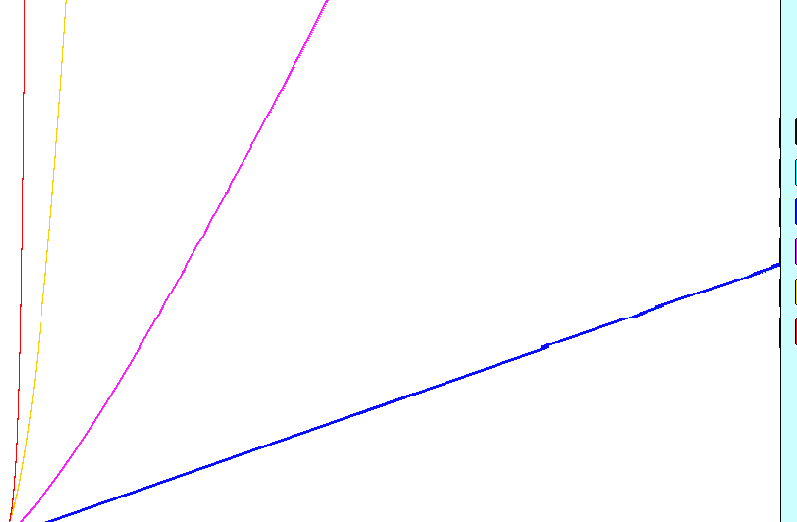

```

## 归并排序的复杂度

排序 8 个元素

需要

两次对 4 个元素的排序

这又需要

四次对 2 个元素的排序

这又需要

八次对 1 个元素的排序

每一层完成的工作量（即该层所有调用完成工作量的总和）与向量的大小成正比。因此，运行时间与 N 乘以层数成正比。

## 一共有多少层？

- 归并排序分解中的层数，等于把原始向量不断对半分割直到只剩一个元素所需的次数。换句话说，你需要找到满足以下方程的 $k$ 值：

$$1 = N / 2 / 2 / 2 / 2 / \cdots / 2$$

*（除以 2 共 $k$ 次。）*

- 你可以用基础数学简化这个公式：

$$1 = N / 2^k$$
$$2^k = N$$
$$k = \log_2 N$$

- 因此，归并排序的复杂度为 $O(N \log N)$。

## 比较 *N*² 和 *N* log *N*

- *O(N²)* 和 *O(N log N)* 之间的差异对于较大的 *N* 值来说是巨大的，如下表所示：

| *N* | *N*² | *N* log₂ *N* |
|---:|---:|---:|
| 10 | 100 | 33 |
| 100 | 10,000 | 664 |
| 1,000 | 1,000,000 | 9,966 |
| 10,000 | 100,000,000 | 132,877 |
| 100,000 | 10,000,000,000 | 1,660,964 |
| 1,000,000 | 1,000,000,000,000 | 19,931,569 |

- 根据这些数字，使用归并排序代替选择排序对包含 1,000,000 个值的向量进行排序的理论优势因子将超过 50,000。

## 标准复杂度类

- 特定算法的复杂度往往落入少数几个标准复杂度类之一：

| constant | O(1) | Finding first element in a vector |
| logarithmic | O(log N) | Binary search in a sorted vector |
| linear | O(N) | Summing a vector; linear search |
| N log N | O(N log N) | Merge sort |
| quadratic | O(N²) | Selection sort |
| cubic | O(N³) | Obvious algorithms for matrix multiplication |
| exponential | O(2^N) | Tower of Hanoi solution |

- 通常，理论计算机科学家认为任何复杂度无法表示为多项式的问题都是 *intractable*。

## 复杂度类的图

running time

problem size

Constant

Logarithmic

Linear

NLogN

Quadratic

Exponential
## 冒泡排序

- 最简单的排序算法
- 思路：
  - 1. 设置 flag = false
  - 2. 遍历数组并比较成对的两个元素
    - 1.1 如果 E1 ≤ E2 - OK
    - 1.2 如果 E1 > E2 则 Switch(E1, E2) 并设置 flag = true
  - 3. 如果 flag = true goto 1.
- 会发生什么？

## 冒泡排序

1   1  23  2  56  9  8  10  100

2   1  2  23  56  9  8  10  100

3   1  2  23  9  56  8  10  100

4   1  2  23  9  8  56  10  100

5   1  2  23  9  8  10  56  100

---- finish the first traversal ----

----     start again     ----

1   1  2  23  9  8  10  56  100

2   1  2  9  23  8  10  56  100

3   1  2  9  8  23  10  56  100

4   1  2  9  8  10  23  56  100

---- finish the second traversal ----

----     start again     ----

Why Bubble Sort ?

.................

## 使用数组实现冒泡排序

```
void bubbleSort (Array S, length n) {
    boolean isSorted = false;
    while(!isSorted) {
        isSorted = true;
        for(i = 0; i<n; i++) {
            if(S[i] > S[i+1]) {
                int aux = S[i];
                S[i] = S[i+1];
                S[i+1] = aux;
                isSorted = false;
            }
        }
    }
}

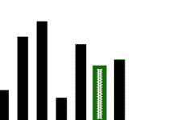

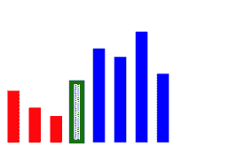

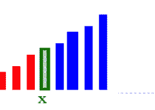


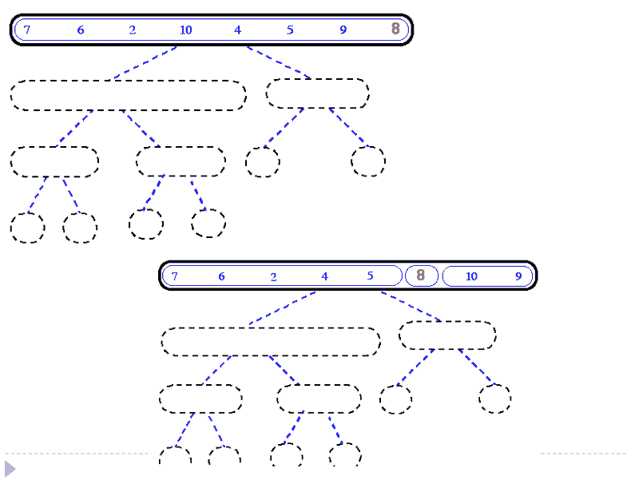


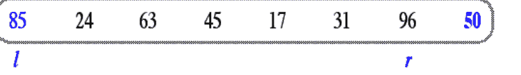


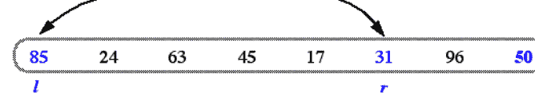

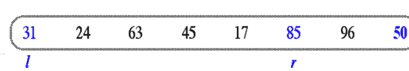


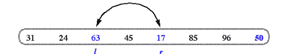

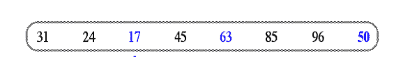

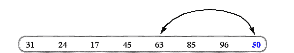


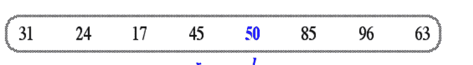


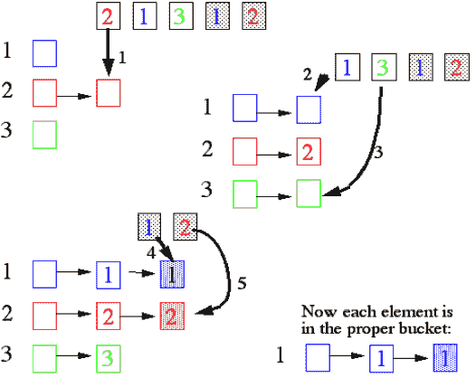


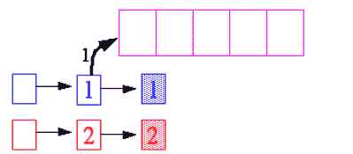

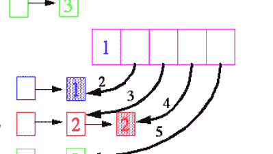


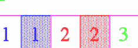

```

## 冒泡排序的运行时间

- 一次遍历 = 将最大元素移动到末尾
- 第 i 次遍历 : n − i + 1 operations
- 运行时间：
  (n − 1) + (n − 2) + ... + 1 = (n − 1) n / 2 = O(n²)
- 最坏情况何时发生？
- 最佳情况？

## 快速排序

- 另一种分治排序算法

- 思路：

1) **Divide** : 如果序列 S 有 2 个或更多元素，从 S 中选择一个元素 x 作为你的 **pivot**（例如，最后一个），并将其分为 3 个序列：
L, 包含小于 x 的 S 的元素
E, 包含等于 x 的 S 的元素
G, 包含大于 x 的 S 的元素

2) **Recurse**: 递归排序 L 和 G

3) **Conquer**: 最后，为了将元素按顺序放回 S 中，首先插入 L 的元素，然后是 E 的元素，最后是 G 的元素。

## 快速排序的思路

- 1) **Select**: 选择一个元素
- 2) **Divide**: 重新排列元素使 x 移动到其最终位置 E
- 3) **Recurse and Conquer**: 递归排序
## 快速排序树
## 原地快速排序

Divide 步骤：l 从左侧扫描序列。r 从右侧扫描。
当 l 位于大于枢轴的元素处且 r 位于小于枢轴的元素处时执行交换
## 原地快速排序（续）
一次最终的与枢轴的交换完成了划分步骤
## 运行时间分析

- 平均情况分析
- 最坏情况分析
- 快速排序的最坏情况是什么？
- 运行时间？

## 快速排序运行时间

- 最坏情况：当枢轴没有将序列分成两部分时
  - 在每一步，序列的长度仅减少 1
  - 总运行时间
  - $$\sum_{i=n}^{1} length(S_i) = O(n^2)$$
- 一般情况：
  - 树中第 i 层的花费时间为 O(n)
  - 运行时间：O(n) * O(height)
- 平均情况：
  - O(n log n)

## 该怎么办？

- 选择不同的枢轴
  - 计算实际中位数
    - 存在 O(N) 算法保证 50/50 分割
  - “三数取中”
    - 用第一个、最后一个、中间的近似中位数
  - 随机
    - 最坏情况可能发生，但不太可能

## 更多排序算法

- 桶排序
- 基数排序
- 稳定排序
  - 一种排序算法，其中具有相同键的元素在最终序列中的顺序不会改变
  - 冒泡排序稳定吗？
  - 归并排序稳定吗？

## 桶排序

- **桶排序**
  - 假设：键在范围 [0, N) 内
  - 基本思想：
    1. 创建 N 个链表（桶）将区间 [0,N) 分成大小为 1 的子区间
    2. 将每个输入元素添加到适当的桶中
    3. 连接桶
  - 预期总时间为 O(n + N)，其中 n = 原始序列的大小
    - 如果 N 是 O(n) → O(n) 的排序算法！

## 桶排序

数组的每个元素被放入 N 个“桶”之一
现在每个元素都在正确的桶中：

## 桶排序

现在，从桶中取出元素放入数组
最后，排序好的数组
（以稳定方式排序）：
## 它适用于实数吗？

- 如果键不是整数怎么办？
  - 假设：输入是 [0, 1) 中的 n 个实数
  - 基本思想：
    - 创建 N 个链表（桶）将区间 [0,1) 分成大小为 1/N 的子区间
    - 将每个输入元素添加到适当的桶中并用插入排序对桶进行排序
  - 均匀输入分布 → O(1) 桶大小
    - 因此预期总时间为 O(n)
  - 键在桶中的分布与 .... 类似？

## 基数排序

- 直观上，你可能会按最高有效位排序，然后是第二位，等等。
- 问题：需要跟踪大量中间的卡片堆
- 关键思想：先排序*最低*有效位

```
RadixSort(A, d)
    for i=1 to d
        StableSort(A) on digit i


```

## 1、基数排序：

e.g: B = 5、2、9、7、18、17、52 用基数排序法进行排序。

B = 5、2、9、7、18、17、52

口袋

- B₀
- B₁
- B₂
- B₃
- B₄
- B₅
- B₆
- B₇
- B₈
- B₉

根据 所指向的数，进行分配动作，将其分配到相应的口袋。

## 1、基数排序：

e.g: B = 5、2、9、7、18、17、52 用基数排序法进行排序。

B = 5、2、9、7、18、17、52

口袋

- B₀
- B₁
- B₂
- B₃
- B₄
- B₅
- B₆
- B₇
- B₈
- B₉

5

根据 所指向的数，进行分配动作，将其分配到相应的口袋。

## 7、基数排序

1、基数排序：

e.g: B = 5、2、9、7、18、17、52 用基数排序法进行排序。

B = 5、2、9、7、18、17、52

口袋

根据 所指向的数，进行分配动作，将其分配到相应的口袋。

B₀
B₁
B₂
B₃
B₄
B₅ 5
B₆
B₇
B₈
B₉

## 7、基数排序

1、基数排序：

e.g: B = 5、2、9、7、18、17、52 用基数排序法进行排序。

B = 5、2、9、7、18、17、52

根据 所指向的数，进行分配动作，将其分配到相应的口袋。

口袋

- B₀
- B₁
- B₂  2
- B₃
- B₄
- B₅  5
- B₆
- B₇
- B₈
- B₉

## 7、基数排序

## 1、基数排序：

e.g: B = 5、2、9、7、18、17、52 用基数排序法进行排序。

B = 5、2、9、7、18、17、52

根据所指向的数，进行分配动作，将其分配到相应的口袋。
## 7、基数排序

### 1、基数排序：

e.g: B = 5、2、9、7、18、17、52 用基数排序法进行排序。

B = 5、2、9、7、18、17、52

口袋

B₀

B₁

B₂   2

B₃

B₄

B₅   5

B₆

B₇

B₈

B₉   9

根据 所指向的数，进行分配动作，将其分配到相应的口袋。

口袋

- B₀
- B₁
- B₂  2
- B₃
- B₄
- B₅  5
- B₆
- B₇  7
- B₈
- B₉  9

根据 所指向的数，进行分配动作，将其分配到相应的口袋。

- B₀
- B₁
- B₂：2
- B₃
- B₄
- B₅：5
- B₆
- B₇：7
- B₈
- B₉：9

根据 ↑ 所指向的数，进行分配动作，将其分配到相应的口袋。

B₀

B₁

B₂  2

B₃

B₄

B₅  5

B₆

B₇  7

B₈  18

B₉  9

- B₀
- B₁
- B₂  2
- B₃
- B₄
- B₅  5
- B₆
- B₇  7
- B₈  18
- B₉  9

- B₀
- B₁
- B₂  2
- B₃
- B₄
- B₅  5
- B₆
- B₇  7  17
- B₈  18
- B₉  9

- B₀
- B₁
- B₂  2
- B₃
- B₄
- B₅  5
- B₆
- B₇  7  17
- B₈  18
- B₉  9

口袋

- B₀
- B₁
- B₂  2   52
- B₃
- B₄
- B₅  5
- B₆
- B₇  7   17
- B₈  18
- B₉  9
分配完毕，按照红色箭头所指的方向进行收集动作。注意：收集后的序列已经按照右起第一位（个位数字）排好序了。

收集后的序列：2、52、5、7、17、18、9、

B = 2、52、5、7、17、18、9（第一次收集的结果）

根据 所指向的数，进行分配动作，将其分配到相应的口袋。和第一次不同，这次根据右起第二位数字（十位数字）进行分配。

口袋

- B₀
- B₁
- B₂
- B₃
- B₄
- B₅
- B₆
- B₇
- B₈
- B₉

口袋

- B₀ 2
- B₁
- B₂
- B₃
- B₄
- B₅
- B₆
- B₇
- B₈
- B₉

根据 所指向的数，进行分配动作，将其分配到相应的口袋。和第一次不同，这次根据右起第二位数字（十位数字）进行分配。

根据 所指向的数，进行分配动作，将其分配到相应的口袋。和第一次不同，这次根据右起第二位数字（十位数字）进行分配。

口袋

- B₀ 2
- B₁
- B₂
- B₃
- B₄
- B₅ 52
- B₆
- B₇
- B₈
- B₉

口袋

- B₀ 2
- B₁
- B₂
- B₃
- B₄
- B₅ 52
- B₆
- B₇
- B₈
- B₉

根据 所指向的数，进行分配动作，将其分配到相应的口袋。和第一次不同，这次根据右起第二位数字（十位数字）进行分配。

B = 2、52、5、7、17、18、9 （第一次收集的结果）

口袋

B₀ 2 5

B₁

B₂

B₃

B₄

B₅ 52

B₆

B₇

B₈

B₉

根据 所指向的数，进行分配动作，将其分配到相应的口袋。和第一次不同，这次根据右起第二位数字（十位数字）进行分配。

口袋

B₀    2    5
B₁
B₂
B₃
B₄
B₅    52
B₆
B₇
B₈
B₉

根据 所指向的数，进行分配动作，将其分配到相应的口袋。和第一次不同，这次根据右起第二位数字（十位数字）进行分配。

口袋

B₀    2   5   7
B₁
B₂
B₃
B₄
B₅    52
B₆
B₇
B₈
B₉

根据 所指向的数，进行分配动作，将其分配到相应的口袋。和第一次不同，这次根据右起第二位数字（十位数字）进行分配。

根据 所指向的数，进行分配动作，将其分配到相应的口袋。和第一次不同，这次根据右起第二位数字（十位数字）进行分配。

- B₀   2 5 7
- B₁
- B₂
- B₃
- B₄
- B₅   52
- B₆
- B₇
- B₈
- B₉

## 7、基数排序

- 1、基数排序：

例如：B = 5、2、9、7、18、17、52 用基数排序法进行排序。

B = 2、52、5、7、17、18、9（第一次收集的结果）
根据箭头所指向的数，进行分配动作，将其分配到相应的口袋。和第一次不同，这次根据右起第二位数字（十位数字）进行分配。

口袋：

| 口袋 | 数据 |
|------|------|
| B₀ | 2、5、7、9 |
| B₁ | 17、18 |
| B₂ |  |
| B₃ |  |
| B₄ |  |
| B₅ | 52 |
| B₆ |  |
| B₇ |  |
| B₈ |  |
| B₉ |  |

分配完毕，按照红色箭头所指的方向进行第二次收集动作。注意：收集后的序列已经按照右起第一位（个位数字）、右起第二位（十位数字）排好序了。

收集后的序列：2、5、7、9、17、18、52 已是排好序的序列。

## 基数排序

- *我们能证明它是有效的吗？*
- 归纳论证：
  - 假设低位数字 {j: j<i} 已排序
  - 证明对下一位数字 i 排序后数组仍然正确排序
    - 如果位置 i 上的两个数字不同，则按该数字对数字进行排序是正确的（低位数字无关紧要）
    - 如果它们相同，则数字已经在低位数字上排好序。由于我们使用稳定排序，数字会保持正确顺序

## 基数排序

- *我们将使用哪种排序来对数字位进行排序？*
- 桶排序是个好选择：
  - 将 *n* 个数字按取值范围为 1..*N* 的数字位进行排序
  - 时间：O(*n* + *N*)
- 对具有 *d* 位的 *n* 个数字进行每趟排序需要 O(*n*+*k*) 时间，因此总时间为 O(*d n*+*d k*)
  - 当 *d* 为常数且 *k*=O(*n*) 时，需要 O(*n*) 时间

## 基数排序示例

- **问题：对 100 万个 64 位数字进行排序**
  - 将它们视为四位基数为 2^16 的数字
  - 只需四趟基数排序即可完成！
  - 运行时间：4(100 万 + 2^16) ≈ 400 万次操作
- **与典型的 O(n lg n) 比较排序相比**
  - 每个被排序的数字大约需要 lg n = 20 次操作
  - 总运行时间 ≈ 2000 万次操作

## 基数排序

- 一般来说，基于桶排序的基数排序是
  - 渐近快速的（即 O(n)）
  - 编码简单
  - 一个好选择
- *基数排序可以用于浮点数吗？*

## 总结：基数排序

- 基数排序：
  - 假设：输入有 *d* 位数字，范围从 0 到 *k*
  - 基本思想：
    - 从*最低*有效位开始，按位对元素进行排序
    - 每个阶段使用稳定排序（如桶排序）
  - 对具有 1 位的 *n* 个数字进行每趟排序需要 O(*n*+*k*) 时间，因此总时间为 O(*d n*+*d k*)
    - 当 *d* 为常数且 *k*=O(*n*) 时，需要 O(*n*) 时间
  - 快速、稳定、简单
  - 不能原地排序

## 排序算法：运行时间

- 假设输入序列长度为 n
  - 冒泡排序
  - 插入排序
  - 选择排序
  - 归并排序
  - 快速排序
  - 桶排序
  - 基数排序

## 排序算法：原地排序

- 如果满足以下条件，则称排序算法是*原地*的：
  - 它不使用辅助数据结构（但允许 O(1) 辅助变量）
  - 它仅通过 replaceElement 和 swapElements 操作更新输入序列
- 到目前为止所见的排序算法中，哪些可以原地工作？
  - 冒泡、插入、选择、归并、快速、桶、基数

## Maps and Hashing

Eric Roberts
CS 106B

## Part I: Basic Concepts

## An Illustrative Mapping Application

- 假设你想编写一个程序，根据两位邮政缩写显示州名。
- 这个程序是 Map 类的理想应用，因为你需要的是两位代码与州名之间的映射。每个两位代码唯一标识一个特定的州，因此可作为 Map 的键；州名是对应的值。
- 要在 C++ 中实现此程序，你需要执行以下步骤，这些步骤在下一张幻灯片中进行了说明：
  1. 创建一个 Map<string, string> 包含键/值对。
  2. 读取要翻译的两位缩写。
  3. 调用 Map 上的 get 来查找州名。
  4. 打印出州名。

## The PostalLookup Program

```
int main() {
    Map<string,string> stateMap;
    initStateMap(stateMap);
    while (true) {
        cout << "Enter two-letter state abbreviation: ";
        string code = getLine();
        if (code == "") break;
        if (stateMap.containsKey(code)) {
            cout << code << " = " << stateMap.get(code) << endl;
        } else {
            cout << code << " = ???" << endl;
        }
    }
}
```

PostalLookup
Enter two-letter state abbreviation: HI
HI = Hawaii
Enter two-letter state abbreviation: WI
WI = Wisconsin
Enter two-letter state abbreviation: VE
VE = ???
Enter two-letter state abbreviation:

- AL=Alabama
- AK=Alaska
- AZ=Arizona
- ...
- FL=Florida
- GA=Georgia
- HI=Hawaii
- ...
- WI=Wisconsin
- WY=Wyoming

## A Simplified Version of the Map Class

| Method | Description |
|---|---|
| `map.size()` | Returns the number of key/value pairs in the map. |
| `map.isEmpty()` | Returns **true** if the map is empty. |
| `map.clear()` | Removes all key/value pairs from the map. |
| `map.put(key, value)` | Makes an association between **key** and **value**, discarding any existing one. |
| `map.get(key)` | Returns the most recent value associated with **key**. |
| `map.containsKey(key)` | Returns **true** if there is a value associated with **key**. |

## Implementation Strategies for Maps

There are several strategies you might choose to implement the map operations `get` and `put`. Those strategies include:

- 1. *Linear search*. Keep track of all the name/value pairs in an array. In this model, both the `get` and `put` operations run in O(N) time.

## Exercise: Linear Search Map

As our programming exercise, we’ll build the linear search version of the map. We start with the `PostalLookup.cpp` program and the `map.h` interface. What we need to write are the following files:

- The `mappriv.h` file that describes the representation.
- The `mapimpl.cpp` file that implements the public methods.

## Implementation Strategies for Maps

There are several strategies you might choose to implement the map operations `get` and `put`. Those strategies include:

- 1. *Linear search*. Keep track of all the name/value pairs in an array. In this model, both the `get` and `put` operations run in O(N) time.
- 2. *Binary search*. If you keep the array sorted by the two-character code, you can use binary search to find the key. Using this strategy improves the performance of `get` to O(log N).
- 3. *Table lookup in a grid*. In this specific example, you can store the state names in a 26×26 `Grid<string>` in which the first and second indices correspond to the two letters in the code. Because you can now find any code in a single step, this strategy is O(1), although this performance comes at a cost in memory space.

## The Idea of Hashing

- 前一幻灯片中的第三种策略表明，可以使 `get` 和 `put` 操作运行得非常快，甚至达到查找键的成本与表中键的数量无关。 这种 $O(1)$ 性能只有在你知道在哪里查找特定键时才可能实现。
- 为了了解在实践中如何实现这一目标，有助于思考你在字典中查找单词的方式。大多数字典都有拇指标签，指示每个字母出现的位置。以 $A$ 开头的单词在 $A$ 部分，依此类推。
- 最常见的映射实现使用一种称为 *hashing* 的策略，其概念上类似于字典中的拇指标签。关键思想是，如果你使用键来确定查找位置，则可以极大地提高性能。


## Hash Codes

- 今天剩余的讲座重点关注斯坦福库中 `HashMap` 类的实现，该实现使用了哈希策略。
- `HashMap` 类需要存在一个名为 `hashCode` 的自由函数，它将键转换为非负整数。哈希码告诉实现应该在哪里查找特定键，从而大幅减少搜索时间。
- 今天，我将重点关注键为字符串的情况。关于哈希码需要记住的重要事项是：
  1. 每个字符串都有一个哈希码，即使你不知道它是什么。
  2. 任何特定字符串的哈希码始终相同。
  3. 如果两个字符串相等（*i.e.*，它们包含相同的字符），它们具有相同的哈希码。

## The hashCode Function for Strings

```
const int HASH_SEED = 5381;      /* Starting point for first cycle    */
const int HASH_MULTIPLIER = 33;  /* Multiplier for each cycle          */
const int HASH_MASK = unsigned(-1) >> 1; /* All bits except the sign */

/*
 * Function: hashCode
 * Usage: int code = hashCode(key);
 * --------------------------------
 * This function takes a string key and uses it to derive a hash code,
 * which is nonnegative integer related to the key by a deterministic
 * function that distributes keys well across the space of integers.
 * The general method is called linear congruence, which is also used
 * in random-number generators.  The specific algorithm used here is
 * called djb2 after the initials of its inventor, Daniel J. Bernstein,
 * Professor of Mathematics at the University of Illinois at Chicago.
 */

int hashCode(string str) {
    unsigned hash = HASH_SEED;
    int nchars = str.length();
    for (int i = 0; i < nchars; i++) {
        hash = HASH_MULTIPLIER * hash + str[i];
    }
    return (hash & HASH_MASK);
}
```

## The Bucket Hashing Strategy

- 实现映射的一种常见策略是使用每个键的哈希码来选择一个数组索引，该数组将包含具有该哈希码的所有键。数组的每个元素通常称为 **bucket**。
- 实际上，桶数组小于哈希码的数量，因此有必要将哈希码转换为桶索引，通常通过执行类似以下语句来实现

```
int index = hashCode(key) % nBuckets;
```

- 鉴于不同键可能落入同一桶的可能性，桶数组中每个元素的值不能是单个键/值对。这种情况称为 **collisions**。
- 为了考虑碰撞的可能性，桶数组的每个元素都是落入该桶的键的链表，如下一张幻灯片所示。

## Simulating Bucket Hashing

Suppose you call stateMap.get("HI")
hashCode("HI") → 2305
2305 % 7 → 2

The key "HI" must therefore be in bucket 2 and can be located by searching the chain.

## Achieving O(1) Performance

- 前一侧的模拟仅使用七个桶来强调碰撞发生时发生的情况：桶的数量越少，碰撞越可能发生。
- 实际上，`HashMap` 的实现使用 `nBuckets` 的更大值来最大程度地减少碰撞的机会。如果桶的数量明显大于键的数量，大多数桶链将为空或恰好包含一个键/值对。
- 键的数量与桶的数量之比称为映射的 *load factor*。由于映射只有在负载因子很小时才能实现 O(1) 性能，因此 `HashMap` 的库实现会在表变得太满时增加桶的数量。此过程称为 *rehashing*。

## The hashmap.h Interface

```
/*
 * File: hashmap.h
 * -------------
 * This interface exports the HashMap class, which maintains a collection
 * of key/value pairs using a hashtable as the underlying data structure.
 */

#ifndef _hashmap_h
#define _hashmap_h

#include <string>

/*
 * Class: HashMap<KeyType,ValueType>
 * ---------------------------------
 * The HashMap class maintains an association between keys and values.
 * The types used for keys and values are specified as template parameters,
 * which makes it possible to use this structure with any data type.
 */

template <typename KeyType, typename ValueType>
class HashMap {

public:
```


## The hashmap.h Interface

```
/*
 * Constructor: HashMap
 * Usage: HashMap<KeyType,ValueType> map;
 * ----------------------------------------
 * Initializes a new empty map that associates keys and values of the
 * specified types.  The type used for the key must define the == operator,
 * and there must be a free function with the following signature:
 *
 *     int hashCode(KeyType key);
 *
 * that returns a positive integer determined by the key.  This interface
 * exports hashCode functions for string and the C++ primitive types.
 */

HashMap();

/*
 * Destructor: ~HashMap
 * Usage: (usually implicit)
 * ----------------------------
 * Frees any heap storage associated with this map.
 */

~HashMap();
```

## The hashmap.h Interface

```
/*
 * Method: size
 * Usage: int nEntries = map.size();
 * --------------------------------
 * Returns the number of entries in this map.
 */

int size();

/*
 * Method: isEmpty
 * Usage: if (map.isEmpty()) ...
 * --------------------------------
 * Returns true if this map contains no entries.
 */

bool isEmpty();

/*
 * Method: clear
 * Usage: map.clear();
 * ----------------
 * Removes all entries from this map.
 */

void clear();
```

## The hashmap.h Interface

```
/*
 * Method: put
 * Usage: map.put(key, value);
 * --------------------------------
 * Associates key with value in this map.  Any previous value associated
 * with key is replaced by the new value.
 */
    void put(KeyType key, ValueType value);

/*
 * Method: get
 * Usage: ValueType value = map.get(key);
 * --------------------------------
 * Returns the value associated with key in this map.  If key is not
 * found, the get method signals an error.
 */
    ValueType get(KeyType key);

/*
 * Method: containsKey
 * Usage: if (map.containsKey(key)) . . .
 * --------------------------------
 * Returns true if there is an entry for key in this map.
 */
    bool containsKey(KeyType key);
```

## The `hashmap.h` Interface

```cpp
#include "hashmappriv.h"

};

#include "hashmapimpl.cpp"

/*
 * Function: hashCode
 * Usage: int hash = hashCode(key);
 * ------------------------------------------------------
 * Returns a hash code for the specified key, which is always a
 * nonnegative integer. This function is overloaded to support
 * all of the primitive types and the C++ <code>string</code> type.
 */

int hashCode(std::string key);
int hashCode(int key);
int hashCode(char key);
int hashCode(long key);
int hashCode(double key);

#endif
```

## The hashmappriv.h File

```
/*
 * File: hashmappriv.h
 * -------------------
 * This file contains the private section of the hashmap.h interface.
 */

private:

/* Type definition for cells in the bucket chain */

struct Cell {
    KeyType key;
    ValueType value;
    Cell *link;
};

/* Instance variables */

Cell **buckets;    /* Dynamic array of pointers to cells */
int nBuckets;      /* The number of buckets in the array */
int count;         /* The number of entries in the map */
```

## The hashmappriv.h File

```
/*
 * Private method: findCell
 * Usage: Cell *cp = findCell(bucket, key);
 * ----------------------------------------
 * Finds a cell in the chain for the specified bucket that matches key.
 * If a match is found, the return value is a pointer to the cell containing
 * the matching key.  If no match is found, the function returns NULL.
 */

Cell *findCell(int bucket, ValueType key) {
    Cell *cp = buckets[bucket];
    while (cp != NULL && key != cp->key) {
        cp = cp->link;
    }
    return cp;
}
```

## The hashmapimpl1.cpp Implementation

```
/*
 * File: hashmapimpl1.cpp
 * ----------------------
 * This file contains the private section of the hashmap.cpp interface.
 * Because of the way C++ compiles templates, this code must be
 * available to the compiler when it reads the header file.
 */

#ifndef _hashmap_h

#include "error.h"

/*
 * Implementation notes: HashMap class
 * -----------------------------------
 * In this map implementation, the entries are stored in a hashtable.
 * The hashtable keeps an array of buckets, where each bucket is a
 * linked list of elements that share the same hash code.  If two or
 * more keys have the same hash code (which is called a "collision"),
 * each of those keys will be on the same list.  Ideally, however, the
 * number of such collisions will be small, so that all of the operations
 * can run in constant time.  To achieve that goal, it is necessary to
 * expand the number of buckets when the lists start to fill up.  That
 * operation (called "rehashing") is not implemented here and is instead
 * left as an exercise.
 */
```


## The hashmapimpl1.cpp Implementation

```
/* Constant definitions */
const int INITIAL_BUCKET_COUNT = 101;

/*
* Implementation notes: constructor and destructor
* --------------------------------------------------
* The constructor allocates the array of buckets and initializes
* each bucket to the empty list.  The destructor must free the memory,
* but the clear function already takes care of that.
*/

template <typename KeyType,typename ValueType>
HashMap<KeyType,ValueType>::HashMap() {
    nBuckets = INITIAL_BUCKET_COUNT;
    buckets = new Cell*[nBuckets];
    for (int i = 0; i < nBuckets; i++) {
        buckets[i] = NULL;
    }
    count = 0;
}

template <typename KeyType,typename ValueType>
HashMap<KeyType,ValueType>::~HashMap() {
    clear();
}

template <typename KeyType,typename ValueType>
int HashMap<KeyType,ValueType>::size() {
    return count;
}

template <typename KeyType,typename ValueType>
bool HashMap<KeyType,ValueType>::isEmpty() {
    return count == 0;
}

template <typename KeyType,typename ValueType>
void HashMap<KeyType,ValueType>::clear() {
    for (int i = 0; i < nBuckets; i++) {
        Cell *cp = buckets[i];
        while (cp != NULL) {
            Cell *oldCell = cp;
            cp = cp->link;
            delete oldCell;
        }
    }
    count = 0;
}

template <typename KeyType,typename ValueType>
void HashMap<KeyType,ValueType>::put(KeyType key, ValueType value) {
    int bucket = hashCode(key) % nBuckets;
    Cell *cp = findCell(bucket, key);
    if (cp == NULL) {
        cp = new Cell;
        cp->key = key;
        cp->link = buckets[bucket];
        buckets[bucket] = cp;
    }
    cp->value = value;
}

template <typename KeyType,typename ValueType>
ValueType HashMap<KeyType,ValueType>::get(KeyType key) {
    int bucket = hashCode(key) % nBuckets;
    Cell *cp = findCell(bucket, key);
    if (cp == NULL) error("get: No value for key");
    return cp->value;
}

template <typename KeyType,typename ValueType>
bool HashMap<KeyType,ValueType>::containsKey(KeyType key) {
    int bucket = hashCode(key) % nBuckets;
    return findCell(bucket, key) != NULL;
}

#endif


```

## Part II: Advanced Concepts

Jingyu Zhou

## Map

- 一个非常有用的抽象
  - 任何类型的字典、查找表、索引、数据库等。
- 存储键值对
  - 通过键快速访问
  - 需要优化的操作：put, get

## Basic Idea

- 使用 *hash function* 将键映射到 *hash table* 中的位置
- 如果元素 *e* 的键为 *k* 且 *h* 为哈希函数，则 *e* 存储在表的位置 *h(k)*
- 要搜索 *e*，计算 *h(k)* 以定位位置。如果没有元素，则字典不包含 *e*。

理想情况下

## Example

- 字典 学生记录
  - 键为学号（951000 - 952000），不超过 100 名学生
  - 哈希函数：h(k) = k-951000 将 ID 映射到不同的表位置 0-1000
  - `array table[1001]`
## Analysis (Ideal Case)

- 初始化哈希表需要 O(b) 时间（b 为哈希表中位置或桶的数量）
- 执行 *insert*、*remove*、*search* 需要 O(1) 时间

## Ideal Case is Unrealistic

- 可用于实现字典，但许多应用的键范围太大，无法在桶和键之间建立 1-1 映射！

示例：

- 假设键的取值范围为 0 .. 65,535（2 字节无符号整数）
- 预计任何时候约有 1,000 条记录
- 使用 65,536 个槽的哈希表不切实际！

## Hash Functions

- 如果键范围太大，使用更少的桶的哈希表，并使用哈希函数将多个键映射到同一桶：
  h(k₁) = β = h(k₂)：k₁ 和 k₂ 在槽 β 处发生 **collision**
- 流行的哈希函数：除法哈希
  h(k) = k%D，其中 D 为哈希表中的桶数
- 示例：哈希表有 11 个桶
  h(k) = k%11
  80 → 3（80%11 = 3），40 → 7，65 → 10
  58 → 3 发生冲突！

## 冲突解决策略

- 两个类别：
  1. 开放哈希，又称分离链接
  2. 闭合哈希，又称开放寻址
- 区别在于冲突是存储在*表外*（开放哈希）还是冲突导致记录存储在表的*另一个槽位*中（闭合哈希）

## 闭合哈希

- 与闭合哈希相关的是*再哈希策略*：
  “如果我们尝试将 x 放入桶 h(x) 中并发现已被占用，则寻找替代位置 h₁(x)、h₂(x) 等。按顺序尝试每个位置，如果都无空闲则表已满，” 
- h(x) 称为*主桶*
- 最简单的再哈希策略称为*线性哈希*
  hᵢ(x) = (h(x) + i) % D
- 一般来说，冲突解决策略是生成可容纳记录的哈希表槽序列（探测序列）；测试每个槽直到找到空槽（探测）

## 示例线性（闭合）哈希

- D=8，键 a,b,c,d 的哈希值为 h(a)=3, h(b)=0, h(c)=4, h(d)=3
  - 我们把 d 插入哪里？3 已被填满
  - 使用线性哈希的探测序列：
    - h1(d) = (h(d)+1)%8 = 4%8 = 4
    - h2(d) = (h(d)+2)%8 = 5%8 = 5*
    - h3(d) = (h(d)+3)%8 = 6%8 = 6
    - 等等。
    - 7, 0, 1, 2
  - 在表的开头处回绕！

| Index | Value |
|---:|:---:|
| 0 | b |
| 1 |  |
| 2 |  |
| 3 | a |
| 4 | c |
| 5 | d |
| 6 |  |
| 7 |  |

## 使用线性哈希的操作

- 成员资格测试：*findItem*
  - 检查 h(k)、h₁(k)、h₂(k)、…，直到找到 k 或空桶或主桶
- 如果不允许删除，该策略有效！
- 如果允许删除怎么办？
  - 如果到达空桶，就不能确定 k 是否在别处，而空桶在 k 插入时曾被占用
  - 需要特殊占位符 *deleted*，以区分从未使用过的桶和曾经存放过值的桶
  - 删除过多后可能需要重新组织表

## 性能分析 - 最坏情况

- 初始化：O(b)，b 为桶的数量
- 插入和搜索：O(n)，n 为表中的元素数量；所有 n 个键值具有相同的主桶
- 对于维护字典，不比线性列表更好！

## 性能分析 - 平均情况

- 区分成功和不成功的搜索
  - 删除 = 成功搜索待删除的记录
  - 插入 = 沿其探测序列的不成功搜索
- 哈希的期望成本是表填充程度的函数：负载因子 α = n/b
- 已证明线性哈希（探测）下的平均成本为：
  - 插入：1/2(1 + 1/(1 - α)²)
  - 删除：1/2(1 + 1/(1 - α))

## 改进的冲突解决

- 线性探测：hᵢ(x) = (h(x) + i) % D
  - 在探测序列返回主位置之前，表中的所有桶都将成为插入新记录的候选
  - 记录聚集，导致探测序列变长
- 跳跃线性探测：hᵢ(x) = (h(x) + i c) % D
  - c 为 1 以外的常数
  - 主桶相邻的记录不会遵循相同的探测序列
- （伪）随机探测：hᵢ(x) = (h(x) + rᵢ) % D
  - rᵢ 是从 1 到 D-1 的数字随机排列中的第 i 个值
  - 插入和搜索使用相同的“随机”数字序列

## 示例

**I**

| Bucket | Record |
|---:|---:|
| 0 | 1001 |
| 1 | 9537 |
| 2 | 3016 |
| 3 |  |
| 4 |  |
| 5 |  |
| 6 |  |
| 7 | 9874 |
| 8 | 2009 |
| 9 | 9875 |
| 10 |  |

- 1. 如果下一个元素的主桶为 0 怎么办？
  → 转到桶 3
  主桶为 1 或 2 的元素也一样！
  只有主位置为 3 的记录才会保留。
  ⇒ p = 4/11 下一个记录会进入桶 3
- 2. 同理，哈希到 7、8、9 的记录最终会进入 10
- 3. 只有哈希到 4 的记录才会进入 4（p=1/11）；5 和 6 也是如此

insert 1052 (h.b. 7)

**II**

| Bucket | Record |
|---:|---:|
| 0 | 1001 |
| 1 | 9537 |
| 2 | 3016 |
| 3 |  |
| 4 |  |
| 5 |  |
| 6 |  |
| 7 | 9874 |
| 8 | 2009 |
| 9 | 9875 |
| 10 | 1052 |

下一个元素在桶 3 中，p = 8/11

## 哈希函数 - 数值

- **考虑：**
  - 分布较差，不够随机
  - 仅依赖于键的最低有效四位

- 更好的方法：*平方取中法*
  - 如果键是 0, 1, …, K 范围内的整数，选取整数 C，使得 D·C² 约等于 K²，则 `h(x) = ⌊x²/C⌋ % D` 提取 x² 的中间 *r* 位，其中 2^r = D（一个 D 进制数位）
  - 更好，因为键的大部分或所有位都对结果有贡献

## 哈希函数 – 字符串

- 折叠法：

  ```java
  int h(String x, int D) {
      int i, sum;
      for (sum=0, i=0; i<x.length(); i++)
          sum+= (int)x.charAt(i);
      return (sum%D);
  }
  ```

  - 将字符串中字母的 ASCII 值求和
  - 字母 "A" 的 ASCII 值为 65；对于 10 个大写字母，总和将在 650-900 范围内；例如当 D 约为 100 时效果良好
  - 字符串中字符的顺序不影响结果

- 更好的方法：循环移位

  ```java
  static long hashCode(String key, int D)
  {
      int h=0;
      for (int i=0; i<key.length(); i++){
          h = (h << 4) | ( h >> 27);
          h += (int) key.charAt(i);
      }
      return h%D;
  }


  ```

## 哈希方法

查找及其分析：

查找方法同哈希函数的产生方法。

随机探测再散列、二次探测再散列和哈希法的成功与不成功查找的平均查找长度分析：

设哈希函数是均匀的，处理冲突后产生的地址也是均匀的。哈希表的长度为 m。

- 查找不成功的平均查找长度

  $$U_n=\sum_{i=1}^{n+1} i\times q_i$$

  其中：$q_i$ = 经过 i 次探测确定某结点不在哈希表中的概率。

  = 一直到第 i-1 次探测，由于冲突而失败的概率及第 i 次探测找到空单元的概率。

  $$q_i=\frac{n}{m}\times\frac{n-1}{m-1}\times\frac{n-2}{m-2}\times\cdots\times\frac{n-i+2}{m-i+2}\left(1-\frac{n-(i-1)}{m-(i-1)}\right)$$

  其中：$1\le i\le n+1$

  可推出：$U_n=\sum_{i=1}^{n+1}i\times q_i=1/(1-n/(m+1))\approx\frac{1}{1-\alpha}$，其中 $\alpha=n/m$。

- 查找成功的平均查找长度：

  - 成功地找到某一个 **键** 所需要的探测次数恰等于将这个 **键** 插入到散列表中所需要的探测次数。
  - 将 n 个键插入到散列表中所需要的探测次数
    - = 表空时进行插入时的探测次数
    - + 表中有一个结点时进行插入时的探测次数
    - + 表中有二个结点时进行插入时的探测次数
    - + 表中有三个结点时进行插入时的探测次数
    - + 表中有 n-1 个结点时进行插入时的探测次数

  所以：

  $$S_n=\frac{1}{n}\sum_{i=0}^{n-1}U_i=\frac{1}{n}\sum_{i=0}^{n-1}\frac{1}{1-i/m}$$

  $$=\frac{1}{n}\int_0^n\frac{1}{1-i/m}\,di=\frac{m}{n}\int_0^\alpha\frac{1}{1-x}\,dx=-\frac{1}{\alpha}\ln(1-\alpha)$$

## 开散列法（链地址法）

- 哈希表中的每个桶都是链表的表头
- 所有哈希到某个特定桶的元素都放在该桶的链表中
- 桶内的记录可以按多种方式排序
  - 按插入顺序、按键值顺序，或按访问频率顺序
## 分析

- 当哈希表保存在主存中，并使用标准的内存链表实现时，开散列法最为合适
- 我们希望每个桶中的元素数量大致相等，从而使链表较短
- 如果集合中有 *n* 个元素，那么每个桶大约有 *n/D* 个元素
- 如果我们能估计 *n* 并选择 *D* 与 n 大致一样大，那么平均每个桶将只有一两个成员

每次字典操作的平均时间：

- *D* 个桶，字典中有 *n* 个元素 ⇒ 平均每个桶有 *n/D* 个元素
- *插入*、*查找*、*删除* 操作各需要 O(1+n/D) 时间
- 如果我们能选择 D 约为 n，则为常数时间
- 假设每个元素等可能地被哈希到任意桶，运行时间为常数，与 n 无关

## 与闭散列法（开放定址法）的比较

- 两者的最坏情况性能均为 O(n)
- 哈希的操作次数
  - 23 6 8 10 23 5 12 4 9 19
  - D=9
  - h(x) = x % D

## 哈希函数

- 哈希函数表示为
  - $h: \{0,1\}^* \to \{0,1\}^n$
  - 其中 n 是安全参数，例如 128、160、256 或 512。
- 通俗地说：
  - 一个适用于任意大小数据的函数。
  - 它产生固定长度、通常较短的输出。
- 3 类安全要求：
  - 单向性：给定输出 z，很难找到 x，使得 z = h(x)。
  - 弱抗碰撞性：给定 x，很难找到 y ≠ x，使得 h(y) = h(x)。
  - 强抗碰撞性：很难找到任意一对 (x, y)，使得 h(x) = h(y)。
- 注意：强抗碰撞性 ⇒ 弱抗碰撞性 ⇒ 单向性
- 设 m 为某个消息。h(x) 称为消息摘要。

## 生日攻击

- **生日悖论：**
  - 如果房间里有 23 个人，那么至少两个人同一天生日的概率略高于 50%。如果有 30 个人，概率约为 70%。
- 这个过程类似于将 k 个球随机扔进 n 个箱子，并检查是否某个箱子中至少有两个球。
- 若要有超过一半的机会在同一个箱子中找到至少两个球，  
  k ≈ 1.17 n^{1/2}
  - 例如：n = 365 ⇒ k ≈ 23
## 对哈希函数的生日攻击

- 利用生日悖论寻找哈希函数的碰撞。
  1. 随机选择 k 条消息 x₁, x₂, ..., xₖ
  2. 检查是否存在一对消息，比如 xᵢ 和 xⱼ，使得 h(xᵢ) = h(xⱼ)。若存在，则找到了一个碰撞。
- 这种生日攻击对消息摘要的长度施加了下限。
- 例如，40 位的消息摘要将非常不安全，因为在略多于 2²⁰（约一百万）次随机哈希后，找到碰撞的概率至少为 ½。

## 消息摘要 / 哈希值的大小

- h : {0,1}\* → {0,1}^n
  - 如果 n = 64，在尝试略多于 2^32 次随机哈希后，找到碰撞的概率将高于一半。
  - 如果有一台机器每秒能执行 100,000 次哈希，那么以高于一半的概率找到第一个碰撞需要 12 小时。
- 推荐的消息摘要长度（以位为单位）：128（MD5）、160（SHA-1）、256（SHA-256）或 512（SHA-512）
- 对于这些推荐长度，由于可能的哈希数量非常庞大，偶然找到碰撞的概率小到可以忽略不计（对于 SHA-1，为 2^80 分之一）。

## 示例：MD5 和 SHA-1

### MD5

- MD——消息摘要，由 Ron Rivest 于 1992 年设计。
- 可在 [http://www.ietf.org/rfc/rfc1321](http://www.ietf.org/rfc/rfc1321) 获取
- 输出长度：128 位
- 生日攻击可通过 2⁶⁴ 次尝试发起。

### SHA-1

- 由 NIST 于 1995 年基于 MD4（MD5 的前身）开发
- 可在 [http://www.itl.nist.gov/fipspubs/fip180-1.htm](http://www.itl.nist.gov/fipspubs/fip180-1.htm) 获取
- 输出长度：160 位
- 发起生日攻击更困难：需要 2⁸⁰ 次尝试。

### SHA-2（SHA 256/384/512）

- 基于 SHA-1，但具有更长的哈希值

## 关于寻找 SHA-1 碰撞的一些细节

问：*找到 SHA-1 碰撞有多难？*

答：已报道的攻击估计需要约 2^69（约 5.9 × 10^20）次哈希计算的工作量。尽管这远远超出了普通计算机当前可行的范围，但对于拥有专用硬件的攻击者来说，可能可行。例如，如果有 10,000 个定制 ASIC，每个每秒可执行 20 亿次哈希运算，攻击大约需要一年时间。摩尔定律预测的计算性能提升将随时间推移使这种攻击变得更加可行，例如，一种广泛传播的互联网病毒也可能利用被攻陷的计算机来发起此类攻击。一旦找到一个碰撞，只需将数据拼接到匹配的消息上，就能轻而易举地找到其他碰撞。
## 计算机程序设计艺术（第三卷）

插入

搜索
## 结束

## 我们接下来要做什么？

- 在作业 #3 中，你的任务是实现一个针对 BASIC 编程语言的解释器。在这个过程中，你会对解释器和编译器的工作方式有所了解，这几乎肯定对你编写自己的程序很有帮助。

## 我们接下来要做什么？

- 在作业 #5 中，你的任务是实现一个针对 BASIC 编程语言的解释器。在这个过程中，你会对解释器和编译器的工作方式有所了解，这几乎肯定对你编写自己的程序很有帮助。
- 接下来两次课的目标是让你了解编译器如何理解像

  `y = 3 * (x + 1)`
- 为了实现这一目标，我将讨论几个最初看起来可能无关的想法：
  - 树结构
  - 类层次结构
  - 表达式的递归性质
- 综合来看，这些想法将使得定义表示算术表达式的数据结构成为可能。

## Trees

- 在本文中，我用来说明树结构的第一个例子是诺曼王朝 (诺曼王朝 (1066年–1135)) 的皇室家谱：
- 这个例子有助于定义术语：
  - William I 是树的*root*。
  - Adela 是 William I 的 *child* 并且是 Stephen 的 *parent*。
  - Robert、William II、Adela 和 Henry I 是 *siblings*。
  - Henry II 是 William I、Henry I 和 Matilda 的 *descendant*。
  - William I 是此树中其他所有人的 *ancestor*。

## Family Trees

- 英格兰皇室的家谱可能变得非常复杂。例如，右边的树就展示了玫瑰战争时期的皇室血统，涵盖了金雀花王朝、约克家族和兰开斯特家族。
- 这种树状图非常有帮助，例如，如果你想理解莎士比亚的历史剧。
## Family Trees

而这里是我最喜欢的来自 J. R. R. Tolkien（《指环王》）的家谱：
## Trees Are Everywhere

- 进化树的结构在恩斯特·海克尔 1866 年的生命之树图示中体现得更为清晰。
- 过去 150 年间，进化树图的细节发生了显著变化，但其总体结构——从单一根部开始并分支形成新的谱系——保持不变。
## Representing Family Trees

- 编写处理树的程序的第一步是设计合适的数据结构。
- 在图表形式中，目标是将树状图转换为如下所示的内部表示：
## A Recursive Definition for Trees

- 当你以表示其内部结构为目的思考树时，以下定义非常有用：
  - 一个 *tree* 是一个指向节点的指针。
  - 一个 *node* 是一个包含若干棵树的结构，通常还包含一些额外的数据。
- 尽管这个定义明显是循环的，但它不一定是无限的，因为
  - 树指针可以是 `NULL` 表示空树。
  - 节点可以包含一个空的子列表。
- 在 C++ 中，程序员通常定义一个结构或对象类型来表示节点，然后使用显式的指针类型来表示树。

## The familytree.h Interface

```
/*
 * File: familytree.h
 * -------------
 * This file is an interface to a simple class that represents
 * an individual person in a family tree.
 */

#ifndef _familytree_h
#define _familytree_h

#include <string>
#include "vector.h"

/*
 * Class: PersonNode
 * -------------
 * This class defines the structure of an individual in the family
 * tree, which consists of a name and a vector of children.
 */

class PersonNode {
public:
```

## The familytree.h Interface

```
/*
 * Constructor: PersonNode
 * Usage: PersonNode *person = new PersonNode(name);
 * ------------------------------------------------
 * This function constructs a new PersonNode with the specified
 * name. The newly constructed entry has no children, but clients
 * can add children by calling the addChild method.
 */
PersonNode(std::string name);

/*
 * Method: getName
 * Usage: string name = person->getName();
 * ------------------------------------------------
 * Returns the name of the person.
 */
std::string getName();

/*
 * Method: addChild
 * Usage: person->addChild(child);
 * ------------------------------------------------
 * Adds child to the end of the list of children for person, and
 * makes person the parent of child.
 */
void addChild(PersonNode *child);
```


## The familytree.cpp Implementation

```
/*
 * File: familytree.cpp
 * ---------------------
 * This program implements the familytree.h interface.
 */

#include <string>
#include "vector.h"
#include "familytree.h"
using namespace std;

PersonNode::PersonNode(string name) {
    this->name = name;
    this->parent = NULL;
}

string PersonNode::getName() {
    return name;
}

void PersonNode::addChild(PersonNode *child) {
    children.add(child);
    child->parent = this;
}
```

```
PersonNode *PersonNode::getParent() {
    return parent;
}

Vector<PersonNode *> PersonNode::getChildren() {
    return children;
}


```

## 树和类层次结构

- 在很大程度上，像 C++ 和 Java 这样的面向对象语言中的类是作为一棵树来组织的。
- 面向对象范式的一个决定性特征是类形成 *层次结构*。任何类都可以被指定为某个其他类的 *子类*，后者称为其 *超类*。正如本周讲义中所指出的那样，尽管 C++ 允许更复杂的结构，但大多数类层次结构都是树状的。
- 一个类代表其超类的 *特化*。如果你创建一个是某个类的实例的对象，那么该对象也是其超类链中层次结构上方所有其他类的实例。
- 当你在 C++ 中定义一个新类时，该类会自动 *继承* 其超类的行为。

## 表达式的递归结构

- 在大多数编程语言中，*表达式* 是一种递归结构，可以包含子表达式。
- 在我第 17 章使用的模型中，每个表达式都属于以下形式之一：
  - 一个整数常量
  - 包含整数值的变量名
  - 由运算符连接的两个表达式
  - 用括号括起来的表达式
- 这种结构可以用 *语法* 的形式表示。

**E** → *constant*
**E** → *identifier*
**E** → **E** *op* **E**
**E** → ( **E** )

## 解析树

当 C++ 编译器查看一个表达式时，它需要通过将其翻译成内部形式来理解表达式的含义。这个过程通常包括两个步骤：

- *词法分析*，其中源文本被分解为称为 *标记* 的单元。
- *解析*，其中标记被组装成一个递归结构，称为 *解析树*，体现其结构。
## 表达式类层次结构

- 由于表达式有多种形式，表示表达式的 C++ 类最容易用类层次结构来表示，其中每种表达式类型都是一个单独的子类，如下图所示：
## C++ 中继承的表示

- 创建 C++ 子类的第一步是在头行上指明超类，使用以下语法：

```
class subclass: public superclass {
    body of class definition
}
```

- 与 Java 不同，子类不会自动覆盖其超类中方法的定义。为了允许这种覆盖，两个类都必须用关键字 `virtual` 标记该方法的原型。

- *抽象类* 是一种实际上不代表任何对象的类，而是仅作为 *具体类* 的共同超类，这些具体类确实对应于对象。在 C++ 中，抽象类中始终由具体子类实现的方法是通过在原型行上的分号前包含 `= 0` 来表示的。

## exp.h 接口

```
/*
 * File: exp.h
 * ---------
 * This interface defines a class hierarchy for expressions,
 * which allows the client to represent and manipulate simple
 * binary expression trees.
 */

#ifndef _exp_h
#define _exp_h

#include <string>
#include "evalstate.h"

/*
 * Type: ExpressionType
 * --------------------
 * This enumerated type is used to differentiate the three different
 * expression types: CONSTANT, IDENTIFIER, and COMPOUND.
 */

enum ExpressionType { CONSTANT, IDENTIFIER, COMPOUND };
```


## exp.h 接口

```
/*
 * Class: Expression
 * -----------------
 * This class is used to represent a node in an expression tree.
 * Expression is an example of an abstract class, which defines the
 * structure and behavior of a set of classes but has no objects of its
 * own.  Any object must be one of its three concrete subclasses:
 *
 * 1. ConstantExp   -- an integer constant
 * 2. IdentifierExp -- a string representing an identifier
 * 3. CompoundExp   -- two expressions combined by an operator
 *
 * The abstract class defines an interface common to all Expression objects;
 * each subclass provides its own implementation of the common interface.
 */

class Expression {
public:
    Expression();
    virtual ~Expression();
    virtual int eval(EvalState & state) = 0;
    virtual std::string toString() = 0;
    virtual ExpressionType type() = 0;
};
```

只能被重写的函数用 = 0 这样标记。

在 C++ 中，任何可以被其子类重写的方法都必须标记为 virtual。

## exp.h 接口

```
/*
 * Class: ConstantExp
 * ----------------
 * This subclass represents a constant integer expression.
 */

class ConstantExp: public Expression {
public:
    ConstantExp(int val);

    virtual int eval(EvalState & state);
    virtual std::string toString();
    virtual ExpressionType type();

    int getValue();

private:
    int value;
};
```

## exp.h 接口

```
/*
 * Class: IdentifierExp
 * ---------------------
 * This subclass represents a expression corresponding to a variable.
 */

class IdentifierExp: public Expression {
public:
    IdentifierExp(string name);
    virtual int eval(EvalState & state);
    virtual std::string toString();
    virtual ExpressionType type();
    string getName();

private:
    std::string name;
};
```

## `exp.h` 接口

```cpp
/*
 * Class: CompoundExp
 * -------------------
 * This subclass represents a compound expression.
 */

class CompoundExp: public Expression {

public:

    CompoundExp(char op, Expression *lhs, Expression *rhs);
    virtual ~CompoundExp();

    virtual int eval(EvalState & state);
    virtual std::string toString();
    virtual ExpressionType type();

    std::string getOp();
    Expression *getLHS();
    Expression *getRHS();

private:

    std::string op;
    Expression *lhs, *rhs;

};

#endif
```

## `evalstate.h` 接口

```
/*
 * File: evalstate.h
 * ------------------
 * This interface exports the EvalState class, which keeps track of
 * information required by the evaluator, such as the values of variables.
 */

#ifndef _evalstate_h
#define _evalstate_h

#include <string>
#include "map.h"

class EvalState {

public:

    EvalState();
    ~EvalState();
    void setValue(std::string var, int value);
    int getValue(std::string var);
    bool isDefined(std::string var);

private:

    Map<int> symbolTable;

};

#endif
```

## eval 方法的代码

```
int ConstantExp::eval(EvalState & state) {
    return value;
}

int IdentifierExp::eval(EvalState & state) {
    if (!state.isDefined(name)) error(name + " is undefined");
    return state.getValue(name);
}

int CompoundExp::eval(EvalState & state) {
    if (op == "=") {
        if (lhs->getType() != IDENTIFIER) error("Illegal lhs in assignment");
        int val = rhs->eval(state);
        state.setValue(((IdentifierExp *) lhs)->getName(), val);
        return val;
    }
    int left = lhs->eval(state);
    int right = rhs->eval(state);
    if (op == "+") return left + right;
    if (op == "-") return left - right;
    if (op == "*") return left * right;
    if (op == "/") return left / right;
    if (op == "%") return left % right;
    error("Illegal operator in expression");
    return 0;
}


```

## 示例

- 有8个阿拉伯数字，值均为8。现在要用四则运算符 造一批数学表达式，要求每个表达式都等于100（可以使用括号），请写出所有表达式的算法。
- ①任两个阿拉伯数字之间必须有运算符。即不能出现（888+8）/8的情况。
- ②表达式不能有重复。
- ③请写出算法思路及伪代码。

## 结束

## 解析策略

## 郑伟 齐

大部分幻灯片来自 Eric Roberts，CS 106B，斯坦福大学

## 更新后的就业前景幻灯片
> 我们对来自这所大学的学生非常满意……我们只是希望能雇佣到两到三倍于他们的数量。
> ——比尔·盖茨在斯坦福大学，2008年2月19日

## 今日大纲

- 1. 回顾表达式层次结构
- 2. 逐步演示一个简单的求值过程
- 3. 探索解析与文法之间的关系
- 4. 查看 `parser.cpp` 的最终版本
- 5. 逐步演示解析器运行的示例
- 6. 回顾 Basic 作业的结构

## 表达式层次结构

- 在上一门课程中，我定义了一个抽象的 `Expression` 类，包含三个具体的子类，每个对应一种表达式类型：
## eval 方法的代码

```
int ConstantExp::eval(EvalState & state) {
    return value;
}

int IdentifierExp::eval(EvalState & state) {
    if (!state.isDefined(name)) error(name + " is undefined");
    return state.getValue(name);
}

int CompoundExp::eval(EvalState & state) {
    if (op == "=") {
        if (lhs->getType() != IDENTIFIER) error("Illegal lhs in assignment");
        int val = rhs->eval(state);
        state.setValue(((IdentifierExp *) lhs)->getName(), val);
        return val;
    }
    int left = lhs->eval(state);
    int right = rhs->eval(state);
    if (op == "+") return left + right;
    if (op == "-") return left - right;
    if (op == "*") return left * right;
    if (op == "/") return left / right;
    if (op == "%") return left % right;
    error("Illegal operator in expression");
    return 0;
}


```

## 练习：求值表达式

- 假设 **x** 绑定为 3，追踪求值步骤

y = ( 9 - x ) * 7
## 解析问题

- 在上一门课程中，我指出形成表达式的规则可以用 **文法** 的形式表达，如下所示：

E → constant
E → identifier
E → E op E
E → ( E )

- 将表达式从字符串翻译为其内部形式的过程称为 **解析**。

## 两级文法

- 通过将文法改为具有两级的文法，可以简化解析表达式的问题：
  - 一个 *表达式* 要么是一个 *项*，要么是由运算符连接的两个表达式。
  - 一个 *项* 要么是常量，要么是标识符，要么是用括号括起来的表达式。

- 这种设计反映在以下修订后的文法中。

```
E → T
E → E op E

T → constant
T → identifier
T → ( E )


```

## 解析结构中的歧义

- 尽管上一张幻灯片中的两级文法可以识别任何表达式，但它是 *歧义* 的，因为同一个输入字符串可以生成多个解析树。
- 文法中的歧义通常通过为解析器提供有关运算符 *优先级* 的信息来解决。文本描述了两种策略：*Iversonian precedence*，其中运算符全部向右结合，以及 *operator precedence*，其中每个运算符都关联一个整数，定义其在优先级层次结构中的位置。

## 练习：解析表达式

- 绘制输入字符串生成的表达式树

odd = 2 * n + 1
## parser.cpp 实现

```
/*
 * Implementation notes: readE
 * Usage: exp = readE(scanner, prec);
 * --------------------------------
 * This function reads the next expression from the scanner by
 * matching the input to the following ambiguous grammar:
 *
 *     E -> T
 *     E -> E op E
 *
 * This version of the method uses precedence to resolve ambiguity.
 */

Expression *readE(TokenScanner & scanner, int prec) {
    Expression *exp = readT(scanner);
    string token;
    while (true) {
        token = scanner.nextToken();
        int newPrec = precedence(token);
        if (newPrec <= prec) break;
        Expression *rhs = readE(scanner, newPrec);
        exp = new CompoundExp(token, exp, rhs);
    }
    scanner.saveToken(token);
    return exp;
}
```


## The parser.cpp Implementation

```
/*
 * Function: readT
 * Usage: exp = readT(scanner);
 * -------------------------
 * This function reads a single term from the scanner.
 */

Expression *readT(TokenScanner & scanner) {
    string token = scanner.nextToken();
    TokenType type = scanner.getTokenType(token);
    if (type == WORD) return new IdentifierExp(token);
    if (type == NUMBER) return new ConstantExp(stringToInteger(token));
    if (token != "(") error("Illegal term in expression");
    Expression *exp = readE(scanner);
    if (scanner.nextToken() != ")") {
        error("Unbalanced parentheses in expression");
    }
    return exp;
}
```

## The parser.cpp Implementation

```
/*
 * Function: precedence
 * Usage: prec = precedence(token);
 * --------------------------------
 * This function returns the precedence of the specified operator
 * token.  If the token is not an operator, precedence returns 0.
 */

int precedence(string token) {
    if (token == "=") return 1;
    if (token == "+" || token == "-") return 2;
    if (token == "*" || token == "/") return 3;
    return 0;
}
```

## Tracing the Precedence Parser

```
int main() {
    TokenScanner scanner = new TokenScanner();
    scanner.setInput("odd = 2 * n + 1");
    scanner.ignoreWhitespace();
    Expression *exp = readE(scanner);
    ...
}
```

scanner
odd = 2 * n + 1

exp

## Tracing the Precedence Parser

```
int main() {
Expression *readE(TokenScanner & scanner, int prec) {
Expression *exp = readT(scanner);
string token;
while (true) {
token = scanner.nextToken();
int newPrec = precedence(token);
if (newPrec <= prec) break;
Expression *rhs = readE(scanner, newPrec);
exp = new CompoundExp(token, exp, rhs);
}
scanner.saveToken(token);
return exp;
}
```

| scanner | prec | newPrec | token | exp | rhs |
| odd = 2 * n + 1 | 0 |  |  |  |  |

## Tracing the Precedence Parser

```
int main() {
Expression *readE(TokenScanner & scanner, int prec) {
Expression *readT(TokenScanner & scanner) {
string token = scanner.nextToken();
TokenType type = scanner.getTokenType(token);
if (type == WORD) return new IdentifierExp(token);
if (type == NUMBER) return new ConstantExp(stringToInteger(token));
if (token != "(") error("Illegal term in expression");
Expression *exp = readE(scanner);
if (scanner.nextToken() != ")") {
error("Unbalanced parentheses in expression");
}
return exp;
}
}
```

| scanner | type | token | exp |
| odd = 2 * n + 1 | WORD | odd |  |

## Tracing the Precedence Parser

```
int main() {
    Expression *readE(TokenScanner & scanner, int prec) {
        Expression *exp = readT(scanner);
        string token;
        while (true) {
            token = scanner.nextToken();
            int newPrec = precedence(token);
            if (newPrec <= prec) break;
            Expression *rhs = readE(scanner, newPrec);
            exp = new CompoundExp(token, exp, rhs);
        }
        scanner.saveToken(token);
        return exp;
    }
    scanner    prec    newPrec    token    exp    rhs
    odd ^ = 2 * n + 1    0    1    =    •


```
## Tracing the Precedence Parser

```
int main() {
Expression *readE(TokenScanner & scanner, int prec) {
Expression *readE(TokenScanner & scanner, int prec) {
Expression *exp = readT(scanner);
string token;
while (true) {
token = scanner.nextToken();
int newPrec = precedence(token);
if (newPrec <= prec) break;
Expression *rhs = readE(scanner, newPrec);
exp = new CompoundExp(token, exp, rhs);
}
scanner.saveToken(token);
return exp;
}


```

| scanner | prec | newPrec | token | exp | rhs |
| odd = 2 * n + 1 | 1 |  |  |  |  |
## Tracing the Precedence Parser

```
int main() {
Expression *readE(TokenScanner & scanner, int prec) {
Expression *readE(TokenScanner & scanner, int prec) {
Expression *readT(TokenScanner & scanner) {
string token = scanner.nextToken();
TokenType type = scanner.getTokenType(token);
if (type == WORD) return new IdentifierExp(token);
if (type == NUMBER) return new ConstantExp(stringToInteger(token));
if (token != "(") error("Illegal term in expression");
Expression *exp = readE(scanner);
if (scanner.nextToken() != ")") {
error("Unbalanced parentheses in expression");
}
return exp;
}
}
```

| scanner | type | token | exp |
| odd = 2 * n + 1 | NUMBER | 2 |  |

ID
odd


## 跟踪优先级解析器

```
int main() {
Expression *readE(TokenScanner & scanner, int prec) {
Expression *readE(TokenScanner & scanner, int prec) {
Expression *readT(TokenScanner & scanner) {
string token = scanner.nextToken();
TokenType type = scanner.getTokenType(token);
if (type == WORD) return new IdentifierExp(token);
if (type == NUMBER) return new ConstantExp(stringToInteger(token));
if (token != "(") error("Illegal term in expression");
Expression *exp = readE(scanner);
if (scanner.nextToken() != ")") {
error("Unbalanced parentheses in expression");
}
return exp;
}
}
```

scanner
type
token
exp

ID
odd

## 跟踪优先级解析器

```
int main() {
Expression *readE(TokenScanner & scanner, int prec) {
Expression *readE(TokenScanner & scanner, int prec) {
Expression *exp = readT(scanner);
string token;
while (true) {
token = scanner.nextToken();
int newPrec = precedence(token);
if (newPrec <= prec) break;
Expression *rhs = readE(scanner, newPrec);
exp = new CompoundExp(token, exp, rhs);
}
scanner.saveToken(token);
return exp;
}
}


```

| scanner | prec | newPrec | token | exp | rhs |
| odd = 2 ^ ^ n + 1 | 1 | 3 | * | • |  |
## 跟踪优先级解析器

```
int main() {
Expression *readE(TokenScanner & scanner, int prec) {
Expression *readE(TokenScanner & scanner, int prec) {
Expression *readE(TokenScanner & scanner, int prec) {
Expression *exp = readT(scanner);
string token;
while (true) {
token = scanner.nextToken();
int newPrec = precedence(token);
if (newPrec <= prec) break;
Expression *rhs = readE(scanner, newPrec);
exp = new CompoundExp(token, exp, rhs);
}
scanner.saveToken(token);
return exp;
}
}


```

| scanner | prec | newPrec | token | exp | rhs |
|---|---|---|---|---|---|
| odd = 2 * n + 1 | 3 |  |  |  |  |
## 跟踪优先级解析器

```
int main() {
Expression *readE(TokenScanner & scanner, int prec) {
Expression *readE(TokenScanner & scanner, int prec) {
Expression *readE(TokenScanner & scanner, int prec) {
Expression *readT(TokenScanner & scanner) {
string token = scanner.nextToken();
TokenType type = scanner.getTokenType(token);
if (type == WORD) return new IdentifierExp(token);
if (type == NUMBER) return new ConstantExp(stringToInteger(token));
if (token != "(") error("Illegal term in expression");
Expression *exp = readE(scanner);
if (scanner.nextToken() != ")") {
error("Unbalanced parentheses in expression");
}
return exp;
}
```

| scanner | type | token | exp |
| odd = 2 * n + 1 | WORD | n |  |

ID
odd

CONST
2

## 跟踪优先级解析器

```
int main() {
```

```
Expression *readE(TokenScanner & scanner, int prec) {
```

```
Expression *readE(TokenScanner & scanner, int prec) {
```

```
Expression *readE(TokenScanner & scanner, int prec) {
```

```
Expression *readT(TokenScanner & scanner) {
string token = scanner.nextToken();
TokenType type = scanner.getTokenType(token);
if (type == WORD) return new IdentifierExp(token);
if (type == NUMBER) return new ConstantExp(stringToInteger(token));
if (token != "(") error("Illegal term in expression");
Expression *exp = readE(scanner);
if (scanner.nextToken() != ")") {
error("Unbalanced parentheses in expression");
}
return exp;
}
```

scanner

type

token

exp

ID
odd

CONST
2

## 跟踪优先级解析器

```
int main() {
Expression *readE(TokenScanner & scanner, int prec) {
Expression *readE(TokenScanner & scanner, int prec) {
Expression *readE(TokenScanner & scanner, int prec) {
Expression *exp = readT(scanner);
string token;
while (true) {
token = scanner.nextToken();
int newPrec = precedence(token);
if (newPrec <= prec) break;
Expression *rhs = readE(scanner, newPrec);
exp = new CompoundExp(token, exp, rhs);
}
scanner.saveToken(token);
return exp;
}


```

| scanner | prec | newPrec | token | exp | rhs |
| odd = 2 * n + 1 | 3 | 2 | + | • |  |
## 追踪优先级解析器

```
int main() {
Expression *readE(TokenScanner & scanner, int prec) {
Expression *readE(TokenScanner & scanner, int prec) {
Expression *readE(TokenScanner & scanner, int prec) {
    Expression *exp = readT(scanner);
    string token;
    while (true) {
        token = scanner.nextToken();
        int newPrec = precedence(token);
        if (newPrec <= prec) break;
        Expression *rhs = readE(scanner, newPrec);
        exp = new CompoundExp(token, exp, rhs);
    }
    scanner.saveToken(token);
    return exp;
}
    scanner    prec    newPrec    token    exp    rhs
```

ID
odd

CONST
2

ID
n

## 追踪优先级解析器

```
int main() {
Expression *readE(TokenScanner & scanner, int prec) {
    Expression *readE(TokenScanner & scanner, int prec) {
        Expression *exp = readT(scanner);
        string token;
        while (true) {
            token = scanner.nextToken();
            int newPrec = precedence(token);
            if (newPrec <= prec) break;
            Expression *rhs = readE(scanner, newPrec);
            exp = new CompoundExp(token, exp, rhs);
        }
        scanner.saveToken(token);
        return exp;
    }
}


```

| 扫描器 | 优先级 | 新优先级 | 标记 | 表达式 | 右操作数 |
|---|---|---|---|---|---|
| odd = 2 * n + 1 | 1 | 2 | + | • | • |
## 追踪优先级解析器

```
int main() {
Expression *readE(TokenScanner & scanner, int prec) {
Expression *readE(TokenScanner & scanner, int prec) {
Expression *readE(TokenScanner & scanner, int prec) {
Expression *exp = readT(scanner);
string token;
while (true) {
token = scanner.nextToken();
int newPrec = precedence(token);
if (newPrec <= prec) break;
Expression *rhs = readE(scanner, newPrec);
exp = new CompoundExp(token, exp, rhs);
}
scanner.saveToken(token);
return exp;
}
}


```

| 扫描器 | 优先级 | 新优先级 | 标记 | 表达式 | 右操作数 |
|---|---|---|---|---|---|
| odd = 2 * n + 1 | 2 |  |  |  |  |
## 追踪优先级解析器

```
int main() {
Expression *readE(TokenScanner & scanner, int prec) {
Expression *readE(TokenScanner & scanner, int prec) {
Expression *readE(TokenScanner & scanner, int prec) {
Expression *readT(TokenScanner & scanner) {
string token = scanner.nextToken();
TokenType type = scanner.getTokenType(token);
if (type == WORD) return new IdentifierExp(token);
if (type == NUMBER) return new ConstantExp(stringToInteger(token));
if (token != "(") error("Illegal term in expression");
Expression *exp = readE(scanner);
if (scanner.nextToken() != ")") {
error("Unbalanced parentheses in expression");
}
return exp;
}
}
```

| 扫描器 | 类型 | 标记 | 表达式 |
| odd = 2 * n + 1 | NUMBER | 1 |  |

## 追踪优先级解析器

```
int main() {
Expression *readE(TokenScanner & scanner, int prec) {
Expression *readE(TokenScanner & scanner, int prec) {
Expression *readE(TokenScanner & scanner, int prec) {
Expression *exp = readT(scanner);
string token;
while (true) {
token = scanner.nextToken();
int newPrec = precedence(token);
if (newPrec <= prec) break;
Expression *rhs = readE(scanner, newPrec);
exp = new CompoundExp(token, exp, rhs);
}
scanner.saveToken(token);
return exp;
}
}
```

| 扫描器 | 优先级 | 新优先级 | 标记 | 表达式 | 右操作数 |
|---|---|---|---|---|---|
| odd = 2 * n + 1 | 2 | 0 |  | • |  |

## 追踪优先级解析器

```
int main() {
Expression *readE(TokenScanner & scanner, int prec) {
Expression *readE(TokenScanner & scanner, int prec) {
Expression *readE(TokenScanner & scanner, int prec) {
    Expression *exp = readT(scanner);
    string token;
    while (true) {
        token = scanner.nextToken();
        int newPrec = precedence(token);
        if (newPrec <= prec) break;
        Expression *rhs = readE(scanner, newPrec);
        exp = new CompoundExp(token, exp, rhs);
    }
    scanner.saveToken(token);
    return exp;
}
    scanner    prec    newPrec    token    exp    rhs
```


## 追踪优先级解析器

```
int main() {
Expression *readE(TokenScanner & scanner, int prec) {
Expression *exp = readT(scanner);
string token;
while (true) {
token = scanner.nextToken();
int newPrec = precedence(token);
if (newPrec <= prec) break;
Expression *rhs = readE(scanner, newPrec);
exp = new CompoundExp(token, exp, rhs);
}
scanner.saveToken(token);
return exp;
}
}


```

| scanner | prec | newPrec | token | exp | rhs |
| odd = 2 * n + 1 | 1 | 0 |  | • | • |
## 追踪优先级解析器

```
int main() {
Expression *readE(TokenScanner & scanner, int prec) {
    Expression *exp = readT(scanner);
    string token;
    while (true) {
        token = scanner.nextToken();
        int newPrec = precedence(token);
        if (newPrec <= prec) break;
        Expression *rhs = readE(scanner, newPrec);
        exp = new CompoundExp(token, exp, rhs);
    }
    scanner.saveToken(token);
    return exp;
}
}


```
## 追踪优先级解析器

```
int main() {
    Expression *readE(TokenScanner & scanner, int prec) {
        Expression *exp = readT(scanner);
        string token;
        while (true) {
            token = scanner.nextToken();
            int newPrec = precedence(token);
            if (newPrec <= prec) break;
            Expression *rhs = readE(scanner, newPrec);
            exp = new CompoundExp(token, exp, rhs);
        }
        scanner.saveToken(token);
        return exp;
    }
}
```

| scanner | prec | newPrec | token | exp | rhs |
|---|---|---|---|---|---|
| odd = 2 * n + 1 | 0 | 0 |  | • | • |

## 追踪优先级解析器

```
int main() {
    TokenScanner scanner = new TokenScanner();
    scanner.setInput("odd = 2 * n + 1");
    scanner.ignoreWhitespace();
    Expression *exp = readE(scanner);
    ...
}


```

scanner
odd = 2 * n + 1
^

exp
## 基础入门项目

## Starter 文件夹中的模块

Basic.cpp
你来写这个，但它很短。

exp.h
exp.cpp
你不需要修改这些。

evalstate.h
evalstate.cpp
你需要做一个小的扩展。

parser.h
parser.cpp
你需要移除 = 运算符。

program.h
programpriv.h
program.cpp
你被提供了接口，但需要同时设计数据结构和实现。

statement.h
statement.cpp
你被提供了接口，需要提供实现。

## 语句类层次结构

- 学生需要构建一个语句形式层次结构，其结构与表达式类平行：
```
#include <iostream>
#include "exp.h"
#include "map.h"
#include "parser.h"
#include "simpio.h"
#include "tokenscanner.h"

/* Function prototypes */
string convertToRPN(Expression *exp);

/* Main program */
int main() {
    cout << "This program converts expressions to RPN." << endl;
    TokenScanner scanner;
    scanner.ignoreWhitespace();
    scanner.scanNumbers();
    while (true) {
        cout << ">> ";
        string line = getLine();
        if (line == "quit") break;
        scanner.setInput(line);
        Expression *exp = parseExp(scanner);
        cout << convertToRPN(exp) << endl;
    }
    return 0;
}


```

## 示例

- 编写一个简化正则表达式的解析器
- 在字母表 [a-z] 上，简化正则表达式比普通正则表达式简单得多。
- 它只有两个元字符：'.' 和 '*'。
- '.' -- 精确匹配一个任意字符。
- '*' -- 匹配零个或多个任意字符。

## 结束

## 二叉搜索树

## 郑伟 齐

大部分幻灯片来自 Eric Roberts，CS 106B，斯坦福大学

## 大纲

- 1. 哈希表策略的局限性
- 2. 有序数组中的二分查找
- 3. 有序数组中的插入
- 4. 查找链表中间元素的问题
- 5. 二叉搜索树登场
- 6. 二叉搜索树的简单实现
- 7. 构建二叉搜索树
- 8. 遍历策略
- 9. 平衡问题

## 哈希表的局限性

- 我们之前介绍的哈希表策略是实践中迄今为止最常用的映射实现。
- 尽管它有许多优点——尤其是其非凡的效率——哈希表实现并不一定是所有应用的最佳策略。
- 哈希表策略具有以下局限性：
  - 哈希表依赖于能够对某个键计算哈希函数。将哈希函数的思想扩展到适用于字符串以外的类型可能很微妙。
  - 在哈希表上使用 `foreach` 不会按任何合理的顺序返回键。即使键具有自然顺序（例如字符串使用的字符编码顺序），哈希表的 `foreach` 实现也无法利用这一事实。

## 有序数组中的二分查找

- 假设不使用映射，而是将所有的州缩写（连同它们的名称）输入到一个数组中，并让这些缩写按字母顺序排列：
- 查找一个州缩写（例如 "GA"）需要多少次操作（作为规模 N 的函数）？

- 有序数组中的查找操作运行时间为 O(log N)。

## 有序数组中的插入

- 但添加新键又如何呢？例如，假设波多黎各（PR）成为一个州：
- 数组末尾的所有单元都需要移动以腾出空间。

- 有序数组中的添加操作运行时间为 O(N)。

## 查找中间元素的问题

- 在处理编辑器缓冲区时，我们通过使用链表而不是数组来解决插入问题。
- 不幸的是，将有序数组转换为链表后，就无法应用二分查找，因为没有办法找到中间元素。
- 但如果能在链表中指向中间元素呢？这个想法似乎不太可能，但正是找到一种对查找和添加操作都能提供 O(log N) 性能的数据结构的关键。

## 二叉搜索树

- 最终解决这个问题的结构称为*二叉搜索树*（简称 *BST*）。BST 中的每个节点恰好有两个子树：一个*左子树*，包含当前节点之前的所有节点；一个*右子树*，包含当前节点之后的所有节点。这两个子树中的一个或两个都可以为 `NULL`。
- 二叉搜索树的经典示例使用了沃尔特·迪士尼的*白雪公主与七个小矮人*中的名字：
## 一个简单的 BST 实现

- 为了理解二叉搜索树的工作原理，从一个简单设计入手会很有帮助，该设计中的键始终是字符串。
- 这样，树中的每个节点就是一个包含一个键和两个子树的结构，每个子树要么为 **NULL**，要么是指向其他某个节点的指针。这一设计给出了以下定义：

  ```
  struct Node {
      string key;
      Node *left, *right;
  };
  ```

- 在树中查找节点的代码首先会比较目标键和根节点中的键。如果字符串匹配，就找到了正确的节点；如果不匹配，只需根据你要查找的键是在当前节点之前还是之后，递归调用自身处理左子树或右子树。

  ```
  /*
   * Function: findNode
   * Usage: Node *node = findNode(t, key);
   * ----------------------------------------
   * Finds a node with the specified key in the binary search tree rooted
   * at t. If a node matching key appears in the tree, findNode returns
   * a pointer to that node. If the key does not appear, findNode
   * returns NULL.
   */

  Node *findNode(Node *t, string key) {
      if (t == NULL) return NULL;
      if (key == t->key) return t;
      if (key < t->key) {
          return findNode(t->left, key);
      } else {
          return findNode(t->right, key);
      }
  }
  ```


## 一个简单的 BST 实现

```
/*
 * Function: insertNode
 * Usage: insertNode(t, key);
 * -----------------------------
 * Inserts the specified key at the appropriate location in the
 * binary search tree rooted at t.  Note that t must be passed
 * by reference, since it is possible to change the root.
 */

void insertNode(Node * & t, string key) {
    if (t == NULL) {
        t = new Node;
        t->key = key;
        t->left = t->right = NULL;
        return;
    }
    if (key == t->key) return;
    if (key < t->key) {
        insertNode(t->left, key);
    } else {
        insertNode(t->right, key);
    }
}
```

## 练习：构建二叉搜索树

绘制执行以下代码后得到的 BST：

```
Node *colors = NULL;
insertNode(colors, "red");
insertNode(colors, "orange");
insertNode(colors, "yellow");
insertNode(colors, "green");
insertNode(colors, "blue");
insertNode(colors, "indigo");
insertNode(colors, "violet");


```
## 遍历策略

- 编写一个对二叉搜索树中每个键执行某些操作的函数很容易，因为递归使得将该操作应用于每个子树变得简单。
- 键的处理顺序取决于相对于递归调用何时处理当前节点：
  - 如果在任一递归调用之前处理当前节点，结果是 *前序遍历*。
  - 如果在对左子树的递归调用之后但在对右子树的递归调用之前处理当前节点，结果是 *中序遍历*。在这种使用字符串作为键的简单 BST 实现中，键将按字典顺序出现。
  - 如果在完成两个递归调用之后才处理当前节点，结果是 *后序遍历*。后序遍历在尝试释放树中的所有节点时特别有用。

## 练习：前序遍历
```
void preorderTraversal(Node *t) {
    if (t != null) {
        cout << t->key << endl;
        preorderTraversal(t->left);
        preorderTraversal(t->right);
    }
}


```
## 练习：中序遍历
```
void inorderTraversal(Node *t) {
    if (t != null) {
        inorderTraversal(t->left);
        cout << t->key << endl;
        inorderTraversal(t->right);
    }
}


```
## 练习：后序遍历
```
void postorderTraversal(Node *t) {
    if (t != null) {
        postorderTraversal(t->left);
        postorderTraversal(t->right);
        cout << t->key << endl;
    }
}


```
## 平衡问题

- 理想情况下，包含迪士尼七个小矮人名字的二叉搜索树应该看起来像这样：
- 然而，如果你恰好按字母顺序输入名字，这棵树最终会变成一个简单的链表，其中所有左子树都为 NULL，右链接形成一条简单的链。在该树上运行的算法将以 O(N) 时间运行而不是 O(log N) 时间。
- 二叉搜索树是 *平衡* 的，如果其左右子树的高度相差最多为一，并且这两个子树本身也是平衡的。
## 说明 AVL 算法

- H
- He
- Li
- Be
- B
- C
## 说明 AVL 算法

H

He

Li

Be

B

C
## 说明 AVL 算法

- H
- He
- Li
- Be
- B
- C
## 图解 AVL 算法

- H
- He
- Li
- Be
- B
- C
## 图解 AVL 算法

- H
- He
- Li
- Be
- B
- C
## 图解 AVL 算法

- H
- He
- Li
- Be
- B
- C

左旋
## 图解 AVL 算法

- H
- He
- Li
- Be
- B
- C
## 图解 AVL 算法

- H
- He
- Li
- Be
- B
- C
## 图解 AVL 算法

- H
- He
- Li
- Be
- B
- C
## 图解 AVL 算法

- H
- He
- Li
- Be
- B
- C
## 图解 AVL 算法

- H
- He
- Li
- Be
- B
- C
## 图解 AVL 算法

- H
- He
- Li
- Be
- B
- C
## 图解 AVL 算法

- H
- He
- Li
- Be
- B
- C
## 图解 AVL 算法

右旋

- H
- He
- Li
- Be
- B
- C
## 树的平衡算法

AVL 算法是最早的树平衡策略，已被在实践中更有效的新算法所取代。这些算法包括：

- 红黑树
- 2-3 树
- AA 树
- 斐波那契树
- 伸展树

在本课程中，需要了解的重点是：在插入结点的过程中保持二叉树平衡是可行的，从而确保查找操作在 O(log N) 时间内完成。如果你对这类算法非常感兴趣，后续课程将为你提供更深入学习它们的机会。

## 结束

## 平衡二叉排序树（AVL树）

## Zhengwei QI

参考资料：

Hengming Zou 所著的《数据结构》

Yanping Dou 所著的《数据结构（C++）》
## 平衡二叉排序树（AVL树）

- 平衡二叉排序树
- 平衡因子（平衡度）：节点的平衡度是节点的左子树的高度 - 右子树的高度。
- 平衡二叉树：每个节点的平衡因子都为 +1、-1、0 的二叉树。或者说每个节点的左右子树的高度最多差一的二叉树。
- 注意：满树必为平衡树，平衡树不一定是满树。
## 平衡二叉排序树（AVL树）

- 平衡二叉排序树
- 平衡树的 Adelson 算法的本质特点：
- 以插入为例：

在左图所示的平衡树中插入数据域为 2 的结点。
插入之后仍应保持平衡二叉排序树的性质不变。
如何用最简单、最有效的办法保持平衡二叉排序树的性质不变？

## 平衡二叉排序树（AVL树）

- 平衡二叉排序树
- 平衡树的 Adelson 算法的本质特点：
- 以插入为例：

在左图所示的平衡树中插入数据域为 2 的结点。
插入之后仍应保持平衡二叉排序树的性质不变。
如何用最简单、最有效的办法保持平衡二叉排序树的性质不变？

解决方案：

- 不涉及到危机结点的父亲结点，即以危机结点为根的子树的高度应保持不变（左图为 3）。
- 新结点插入后，找到第一个平衡度不为 0 的结点（如左图结点 9）即可。新插入的结点和第一个平衡度不为 0 的结点（也可能是危机结点）之间的结点，其平衡度皆为 0
- 在调整中，仅调整那些在平衡度变化的路径上的结点（如：3 5 9），其它结点不予调整。
- 仍应保持二叉排序树的性质不变。

## 平衡二叉排序树（AVL树）

- 平衡二叉排序树
- 平衡树的 Adelson 算法的本质特点：
- 以插入为例：

在左图所示的平衡树中插入数据域为 2 的结点。
插入之后仍应保持平衡二叉排序树的性质不变。
如何用最简单、最有效的方法保持平衡二叉排序树的性质不变？
不可以以结点 7 为子树的根结点！！虽然，对本例来说是可以行得通的。

## 平衡二叉排序树（AVL树）

- 平衡二叉排序树
- 平衡树的 Adelson 算法的本质特点：
- 以插入为例：

在左图所示的平衡树中插入数据域为 2 的结点。
插入之后仍应保持平衡二叉排序树的性质不变。
> 关键：将导致出现危机结点的情况全部分析清楚，就可以使得平衡二叉排序树的性质保持不变！！

## 平衡二叉排序树（AVL树）

- 平衡二叉排序树
- 左改组（新插入结点出现在危机结点的左子树上进行的调整）的情况分析：

## 1、LL 情况：（LL：表示新插入结点在危机结点的左子树的左子树上），左旋还是右旋？

插入一个新节点到根节点的左子树（Left）的左子树（Left），导致根节点的平衡因子由1变为2
改组前：高度为 h + 1

中序序列： B_L B B_R A A_R

改组后：高度为 h + 1

中序序列： B_L B B_R A A_R

注意：改组后 B A 平衡度为 0

## 平衡二叉排序树（AVL树）

· 平衡二叉排序树

· 左改组（新插入结点出现在危机结点的左子树上进行的调整）的情况分析：

**2、LR 情况：**（LR：表示新插入结点在危机结点的左子树的右子树上）导致根节点的平衡因子由1变为2
情况A：

改组前：
高度为 h + 1
中序序列：B_L  B  C_L  C  C_R  A  A_R

改组后：
高度为 h + 1
中序序列：B_L  B  C_L  C  C_R  A  A_R

注意：改组后 B、C、A 平衡度为 0,0,-1

## 平衡二叉排序树（AVL树）

+   - 平衡二叉排序树
+   - 左改组（新插入结点出现在危机结点的左子树上进行的调整）的情况分析：

2、LR 情况：（LR：表示新插入结点在危机结点的左子树的右子树上）

情况B：
改组前：
高度为 h + 1
中序序列：
改组后：
高度为 h + 1
中序序列：
注意：改组后 B C A 平衡度为 +1,0,0

## 平衡二叉排序树（AVL树）

+   - 平衡二叉排序树
+   - 右旋组（新插入结点出现在危机结点的右子树上进行的调整）的情况分析：

**1、RR** 情况。（**RR**：表示新插入结点在危机结点的**右子树的右子树上**）

　　处理图形和 LL 镜象相似；见下图的处理方法。

+   **2、RL** 情况：（**RL**：表示新插入结点在危机结点的**右子树的左子树上**）
+   
+   　　A、处理图形和 **LRA** 镜象相似
+   　　B、处理图形和 **LRB** 镜象相似
+   　　C、处理图形和 **LRC** 镜象相似

## 平衡二叉排序树（AVL树）

• 左改组（新插入结点出现在危机结点的左子树上进行的调整）的情况分析：

**LL 情况：**（LL：表示新插入结点在危机结点的左子树的左子树上）
• 右改组（新插入结点出现在危机结点的右子树上进行的调整）的情况分析：

**RR 情况：**（RR：表示新插入结点在危机结点的右子树的右子树上）
# 四种情况总览

Root 是失去平衡的树的根节点。Pivot 是旋转后重新平衡的树的根节点。
# 情况总结：

有四种情况可能导致二叉查找树不平衡，分别为：

+   （1）LL：插入一个新节点到根节点的左子树（Left）的左子树（Left），导致根节点的平衡因子由1变为2
+   （2）RR：插入一个新节点到根节点的右子树（Right）的右子树（Right），导致根节点的平衡因子由-1变为-2
+   （3）LR：插入一个新节点到根节点的左子树（Left）的右子树（Right），导致根节点的平衡因子由1变为2
+   （4）RL：插入一个新节点到根节点的右子树（Right）的左子树（Left），导致根节点的平衡因子由-1变为-2

针对四种情况可能导致的不平衡，可以通过旋转使其变平衡。有两种基本的旋转：

+   （1）左旋转：将根节点旋转到（根节点的）右孩子的左孩子位置
+   （2）右旋转：将根节点旋转到（根节点的）左孩子的右孩子位置

## 平衡二叉排序树（AVL树）

· 平衡二叉分类树的查找分析：

定理：具有 N 个结点的平衡树，高度 h 满足：log₂(N+1) <= h <= 1.44log₂(N+1) - 0.328；最大高度通常可以认为是：logα((N+1)×sqr(5)) - 2；这里 α = (1+sqr(5))/2。

证明：1、高度为 h 的二叉树最多有 2ʰ - 1 个结点，平衡树的结点个数不会超过 2ʰ - 1 个。

即：N <= 2ʰ - 1；N + 1 <= 2ʰ；N + 1 <= 2ʰ，所以：log₂(N+1) <= h
如：高度 2 的平衡树，丰满树结点个数最多为 2² - 1 个。

2、为了证第二步，构造一系列平衡树，T₁、T₂、T₃、……Tₕ；这种树的高度分别为 1、2、3、……h。且是具有高度为 1、2、3、……H 的平衡树中结点个数最少的二叉树，或者是用同样的结点构造的尽可能高的二叉树。即 h <= H。
注意：sqr(5) 表示 5 的平方根，余此类推。

## 平衡二叉排序树（AVL树）

· 平衡二叉分类树的查找分析：
2、为了证第二步，构造一系列平衡树， T₁、T₂、T₃、……T_H；这种树的高度分别为1、2、3、……H。且是具有高度为1、2、3、……H的平衡树中结点个数最少的二叉树，或者是用同样的结点构造的尽可能高的二叉树。即 h <= H。

T₁ 高度 H = 1 结点个数最少

T₂ 高度 H = 2 结点个数最少

T₃ 高度 H = 3 结点个数最少
对照

对照

## 平衡二叉排序树（AVL树）

+   平衡二叉分类树的查找分析：

T₃ 高度 H = 3 节点个数最少

对照
T₄ 高度 H = 4 节点个数最少

对照
T_H 高度 H 节点个数最少的平衡树
左子树为 T_{H-1} 右子树为 T_{H-2}

## 平衡二叉排序树（AVL树）

· 平衡二叉分类树的查找分析：

定理：具有 N 个结点的平衡树，高度 h 满足： log₂(N+1) <= h <= 1.44log₂(N+1) - 0.328；

最大高度通常可认为是： logₐ((N+1)× sqrt(5)) - 2； 这里 α = (1+sqrt(5))/2。

证明：2、设 t(H) 是高度 H 的平衡树 T_H 的结点个数，可以得出：

+   t(1) = 1;
+   t(2) = 2;
+   t(3) = 4;
+   t(4) = 7;
+   ...
+   t(H) = t(H-1) + t(H-2) + 1 for H >= 3

该数的序列为 1、2、4、7、12、20、33、54、88 ……

而 Fibonacci 数列为： 0、1、1、2、3、5、8、13、21、34、55、89……

所以： t(H) = f(H+2) - 1；于是转化为求 Fibonacci 数的问题。 *注意： f(H+2)-1 最少结点数

由于： f(H+2) = (α^{H+2} - β^{H+2}) / sqrt(5)；这里 α = (1+sqrt(5))/2； β = (1−sqrt(5))/2

在一般情况下： N >= f(H+2) - 1 而 f(H+2) > α^{H+2} / sqrt(5) − 1 * 可以证明得到。

所以， N > α^{H+2} / sqrt(5) − 2

注意：由上式可得： f(H+2)-1 > α^{H+2} / sqrt(5) −2，从而得左式。

所以， N >= α^{H+2} / sqrt(5) − 1

根据上式可求出： h <= 1.44log₂(N+1) - 0.328

## 平衡二叉排序树（AVL树）

- 删除具有给定关键字的结点：
  - 操作：删除左子树中最大的结点，按照在二叉排序树中的规则进行删除。
  - 若删除右子树中的最小结点，方法类似。参见下图，删除关键字为 122 的结点。
被删结点

替身

删除替身

- 注意：替身被删除之后，它的父亲结点的右子树的高度将减少 1。

## 平衡二叉排序树（AVL树）

### 2、调整

- 操作：沿着替身节点到根结点的路径，进行调整。在最坏情况下，调整动作可能进行到根结点为止。
- 另外，有可能导致整个二叉排序树的高度降低一层。

下面以删除操作发生在左侧时为例，来分析在调整过程中遇到的各种情况。

- 情况A：调整后，不需继续调整了。因为子树调整前后的高度都为 h+1。
- 情况B：调整后，需继续调整。因为子树调整后的高度减少 1。
## 平衡二叉排序树（AVL树）

### 2、调整

- 操作：沿着替身节点到根结点的路径，进行调整。在最坏情况下，调整动作可能进行到根结点为止。
- 另外，有可能导致整个二叉排序树的高度降低一层。

下面分析在调整过程中遇到的各种情况：

- 情况C.1: 调整后，不需继续调整。因为子树调整前后的高度都为 h+1。
- 情况C.2: 调整后，必须继续调整。因为子树调整后的高度减少了 1。
## 平衡二叉排序树（AVL树）

### 2、调整

- 操作：沿着替身节点到根节点的路径，进行调整。在最坏情况下，调整动作可能进行到根节点为止。
- 另外，有可能导致整个二叉排序树的高度降低一层。

下面分析在调整过程中遇到的各种情况：

- 情况C.3a：调整后，必须继续调整。因子树调整后的高度减少了 1。
调整后
## 平衡二叉排序树（AVL树）

### 2、调整

- 操作：沿着替身节点到根节点的路径，进行调整。在最坏情况下，调整动作可能进行到根节点为止。
- 另外，有可能导致整个二叉排序树的高度降低一层。

下面分析在调整过程中遇到的各种情况：

- 情况C.3b: 调整后，必须继续调整。因子树调整后的高度减少了1。
调整后
## 平衡二叉排序树（AVL树）

### 2、调整

- 操作：沿着替身节点到根节点的路径，进行调整。在最坏情况下，调整动作可能进行到根节点为止。
- 另外，有可能导致整个二叉排序树的高度降低一层。

下面分析在调整过程中遇到的各种情况：

情况C.3c: 调整后，必须继续调整。因子树调整后的高度减少了1。
## 练习：AVL树

插入序列为：50, 25, 10, 5, 7, 3, 30, 20, 8, 15，请给出每一步插入后的AVL树。

例如：1,2,3,4,5,6,7
## 示例

- 100个节点的AVL树最多多少层？
- AVL树查找的时间复杂度是多少？

## 结束

## 目录

## 树及二叉树

- 1 树的定义和术语
- 2 二叉树:定义、性质、存储
- 3 二叉树的遍历
- 4 二叉树遍历的迭代器类
- 5 中序穿线树
- 6 最优二叉树及其应用
- 7 树和森林

## 1、树、森林的概念

- 基本概念
  - 树：n > 0 个结点的集合，根、其余结点分为 m >= 0 个集合，每一个集合本身又是一棵树（子树）
  - 度、叶子、父结点、儿子结点、祖先结点、层次、高度(从根或子树的根向下看)
  - 有序树及无序树
  - 森林 m >= 0 棵互不相交树的集合

例如：高度为 4、度为 3 的树
其它表示方法：
(A(B(L,E),C(F),D(G(I),H)))
还有其它表示方法，如：类似于书籍的目录表示法。

高度定义为层数或层数-1，都可以；这里定义为层数。

## 1、树、森林的概念

• 树的 ADT

## ADT 5.1：树的ADT

**数据及关系：**

具有相同数据类型的数据元素或结点的有限集合。树的二元组形式为：

\(T=(D,R)\)

其中D为树T中结点的集合，R为树中结点之间关系的集合。

\(D=\{Root\}\cup D_F\)

其中，Root为树T的根结点，\(D_F\)为树的根Root的子树集合。

\(R=\{(Root,r_i)\mid i=1,2,\ldots,m\}\)

其中，\(r_i\)是树T的根结点Root的子树T_i的根结点。

**操作：**

**构造函数：**

前提：已知根结点的数据元素之值。

结果：创建一棵树。

**获取根结点：**

前提：已知一棵树。

结果：得到树的根结点。

**获取第一个儿子结点：**

前提：已知树中的某一指定结点 p。

结果：得到结点 p 的第一个儿子结点。

**获取下一个兄弟结点：**

前提：已知树中的某一指定结点 p 和它的一个儿子结点 u。

结果：得到结点 p 的儿子结点 u 的下一个兄弟结点 v。

## 2、二叉树

### 1、定义

空或有一个根，根有左子树、右子树；而左和右子树本身又是二叉树。

和树的区别：可为空

左右子树有序，不可颠倒

例如：二叉树
例如：结点总数为3时的所有二叉树的形状
## 2、二叉树

### 2、性质：

- • 性质1：在二叉树的第 i 层上至多有 2^{i-1} 个结点
1层：结点个数 2^{1-1}=2^0 个

2层：结点个数 2^{2-1}=2^1 个

3层：结点个数 2^{3-1}=2^2 个

证：k=1 时成立，设 k=i-1 时成立 则当 k=i 时在二叉树的第 i 层上至多有 2^{i-1-1} *2 =2^{i-1} 个结点

- • 性质2：高度为 K 的二叉树至多有 2^{k} -1 个结点

证：利用性质 1，将第 1 层至第 k 层的最多的结点数进行相加： 1 + 2 + 2^2 + ............ + 2^{k-2} + 2^{k-1} = 2^{k} -1
- • 性质3：二叉树的叶子结点数 n0 等于度为 2 的结点数 n2 +1

证：设度为 1 的结点数为 n1，树枝的总数为 B 则： B = n-1 = n0 + n1 + n2 -1

又 B = n1 + 2×n2； 原命题得证。

## 2、二叉树

•满二叉树：

每层结点
数最多

•完全二叉树：

- 1、满二叉树
- 2、从满二叉树
- 最底层从右向左
- 依次去掉若干结点形成的
性质4：具有 n 个结点的完全二叉树高度为 ⌈log₂n⌉ + 1

证：根据性质 2 和完全二叉树的定义：设其高度为 k

2^{k-1}-1 < n <= 2^{k} -1

2^{k-1} < n + 1 <= 2^{k}

2^{k-1} <= n < 2^{k}

故：k-1 <= log₂n < k；原命题得证。

## 2、二叉树

性质5: 对一棵有 n 个结点的完全二叉树按照从第一层（根所在的层次）到最后一层，并且每一层都按照从左到右的次序进行编号。根结点的编号为 1，最后一个结点的编号为 n。

- 1: 对任何一个编号为 i 的结点而言，它的左孩子的编号为 2i(若 2i <= n),而右孩子的编号为 2i+1(若 2i +1 <= n)。
- 2: 对任何一个编号为 j 的结点而言，它的父亲结点的编号为 ⌊j/2⌋。根结点无父结点。

证：
## 2、二叉树

3、二叉树的存储结构：

- • 顺序存储结构：

特殊情况：
|  | data | left | right |
|---|---|---|---|
| 0 |  |  |  |
| 1 | A | 2 | 3 |
| 2 | B | 4 | 5 |
| 3 | C | 6 | 7 |
| 4 | D | 8 | 9 |
| 5 | E | 10 | 0 |
| 6 | F | 0 | 0 |
| 7 | G | 0 | 0 |
| 8 | H | 0 | 0 |
| 9 | I | 0 | 0 |
| 10 | L | 0 | 0 |

应用范围：适用于完全二叉树，且结点个数已知。

## 2、二叉树

3、二叉树的存储结构：

- • 顺序存储结构：

特殊情况：若不是完全二叉树，许多数据场为空，不合算。如下例所示：
## 2、二叉树

3、二叉树的存储结构：

- - 链接存储结构：
## 2、二叉树

·二叉树的 ADT:

```
template <class Type> class BinaryTree; // 二叉树类 BinaryTree 的向前说明
template <class Type> class BinaryNode {
friend class BinaryTree < Type>;
public:
    BinaryNode ( ) : left(NULL), right(NULL) { }  // 二叉树节点的构造函数。
    BinaryNode ( Type item, BinaryNode < Type> * L = NULL, BinaryNode < Type> *
                 R = NULL ) : data(item), left(L), right(R) { }
    ~BinaryNode ( ) { }
    Type GetData ( ) const { return data; }   // 得到二叉树节点的数据值。
    BinaryNode<Type> * GetLeft( ) const { return left; }
    //得到二叉树节点的左儿子地址。
    BinaryNode<Type> * GetRight( ) const { return right; }
    //得到二叉树节点的右儿子地址。
    void SetData ( const Type & item ) { data = item; }
    // 设置二叉树节点的数据值。
    void SetLeft (BinaryNode < Type> * L ) { left = L; }
    // 设置二叉树节点的左儿子地址。
    void SetRight (BinaryNode < Type> * R ) { right = R; }
    // 设置二叉树节点的右儿子地址。
```

## 2、二叉树

二叉树的 ADT:

```
template <class Type> class BinaryTree; // 二叉树类 BinaryTree 的向前说明

template <class Type> class BinaryNode {
friend class BinaryTree < Type>;
public:
    :
    :
    :
void PrintPreOrder() const; // 按前序打印二叉树的节点的数据值。
void PrintPostOrder() const;    // 按后序打印二叉树的节点的数据值。
void PrintInOrder() const;      // 按中序打印二叉树的节点的数据值。
BinaryNode<Type> * Duplicate() const; // 复制二叉树中的所有节点。
private:
    BinaryNode < Type> * left , * right ; // 节点的左、右儿子的地址
    Type data;                            // 节点的数据信息
};
```

## 2、二叉树

二叉树的 ADT:

```
template <class Type> class BinaryTree {
public:
    BinaryTree( ) : root( NULL) { }  // 构造空二叉树
    BinaryTree ( const Type & value )
        { root = new BinaryNode<Type> ( value ); }
    ~BinaryTree ( ) { DelTree ( root ); }
    int IsEmpty ( ) const { return root == NULL; }
        // 二叉树为空，返回非0，否则为0。
    const BinaryNode<Type> * Getroot( ) const { return root; }
    int MakeEmpty ( ) { DelTree( root ); root = NULL; }  // 使二叉树为空。
    const BinaryTree<Type> & operator = ( const BinaryTree<Type> & T );
private:
    BinaryNode<Type> * root; // 二叉树的根结点。
    BinaryTree( const BinaryTree<Type> & );
    void DelTree( BinaryNode<Type> * T );
};
template <class Type>
const BinaryTree<Type> & BinaryTree<Type> :: operator = ( const
    BinaryTree<Type> & T ) {
    if ( this != &T )
        { DelTree(root);  // 其具体实现，见程序5.1。
          if ( T.root != NULL ) root = T.root->Duplicate( );
        }
}
```

## 2、二叉树

·二叉树的 ADT: 求二叉树的节点个数和高度以及删除一棵二叉树。

```
template <class Type>
Type Max( const Type u, const Type v )
{ if ( u > v ) return u; else return v;}
template <class Type>
int BinaryNode < Type> :: Size ( const BinaryNode <Type> * T ) const {
    // 得到以 T 为根的二叉树或子树的节点个数。
    if ( T == NULL ) return 0;
    else return 1 + Size( T->left ) + Size( T->right);
}
template <class Type>
int BinaryNode < Type> :: Height ( const BinaryNode < Type> * T ) const {
    // 得到以 T 为根的二叉树的高度。
    if ( T == NULL ) return 0;
    else return 1 + Max( Height( T->left ),Height( T->right));
}
```

## 2、二叉树

二叉树的 ADT： 求二叉树的节点个数和高度以及删除一棵二叉树。

```
template <class Type>
void BinaryTree<Type> :: DelTree ( BinaryNode < Type> * T ) {
    // 删除以 T 为根的二叉树的所有结点。
    if ( T != NULL ) {
        DelTree( T->left );
        DelTree( T->right );
        delete T;
    }
}


```

## 3、二叉树遍历

1、遍历二叉树：设 N 代表根节点，L 代表左子树，R 代表右子树。

- a. 前序（或先序）：如果二叉树为空，则操作为空；否则访问根结点；前序遍历左子树；前序遍历右子树。记为：NLR。
- b. 中序：如果二叉树为空，则操作为空；否则中序遍历左子树；访问根结点；中序遍历右子树。记为：LNR。
- c. 后序：如果二叉树为空，则操作为空；否则后序遍历左子树；后序遍历右子树；访问根结点。记为：LRN。

前序： A、L、B、E、C、D、W、X
中序： B、L、E、A、C、W、X、D
后序： B、E、L、X、W、D、C、A
1、遍历二叉树：续

- a. 前序分析：节点的左儿子、左孙子、左后代、……将连续输出。节点的右儿子将在节点、节点的左子树全部输出之后才输出。
- b. 中序分析：最先输出的节点是根节点的最左的左后代。将二叉树中的节点投影到水平轴线上，则得到中序遍历的序列。
- c. 后序分析：根节点（或子树的根节点）将在它的左、右子树的节点输出之后。因此，根节点（或子树的根节点）在中序序列中的序号等于它的左右子树的节点个数＋左右子树中的最先被访问的节点的序号。注意，节点、右父亲、右祖父、……将连续输出。
1、遍历二叉树：续

•前序的程序实现：

- 1、根结点进栈
- 2、结点出栈，被访问
- 3、结点的右、左儿子（非空）进栈
- 4、反复执行 2、3，至栈空为止。
A进栈

A出栈 访问

C、L 进栈

L出栈 访问

E、B 进栈

B出栈 访问

E出栈 访问

C出栈 访问

D进栈

D出栈访问后，栈空结束
分析：p的前序的直接后继q：1、p有左儿子，则q=该左儿子 2、p无左儿子，有右儿子，则q=该右儿子 3、p无左儿子、右儿子，搜索其祖先结点的右儿子送q。找不到结束。

## 遍历递归算法– Too easy!

```
void BiTree::Preorder(NodeType*p)
{ if(p!=NULL)
  {  cout<<p->data<<" ";
    preorder(p->lch);
    preorder(p->rch);
  }
}
```

```
void BiTree::inorder(NodeType*p)
{if(p!=NULL)
  { inorder(p->lch);
    cout<<p->data<<" ";
    inorder(p->rch);
  }
}
```

```
void BiTree::Postorder(NodeType*p)
{ if(p!=NULL)
  { preorder(p->lch);
    preorder(p->rch);
    cout<<p->data<<" ";
  }
}
```

## 4、二叉树遍历的迭代器类

- 二叉树的迭代器： Tree Iterator

```
ADT 5.3: 二叉树的迭代器类。
template <class Type> class TreeIterator {
public:
    TreeIterator ( const BinaryTree < Type > & BT ) : T( BT ), current( NULL) { }
    virtual ~TreeIterator ( ) { }
    virtual void First ( ) = 0;      // 第一个被访问的结点地址送current
    virtual void operator ++ ( ) = 0; // 下一个被访问的结点地址送current
    int operator + ( ) const{ return current != NULL;} //当前结点为空吗，为空返回 True
    const Type & operator ( ) ( ) const;
        // 返回当前结点指针 current 所指向的结点的数据值。
protected:
    const BinaryTree <Type > & T;
    const BinaryNode<Type > * current; // 指向当前结点的指针。
private:
    TreeIterator ( const TreeIterator & ) { }
    const TreeIterator & operator = ( const TreeIterator & );
};

template <class Type>
const Type & TreeIterator <Type> :: operator ( ) ( ) const {
    Exception( current == NULL, "This node is NULL!" );
    return current->GetData();
}
```

遍历二叉树： Tree Iterator： 前序的实现。

```
template <class Type> class Preorder : public TreeIterator < Type > {
public:
    Preorder( const BinaryTree < Type > & R );
    ~Preorder() {}
    void First();
    void operator ++ ();
    void Preorder_NLR ();
protected:
    Stack < const BinaryNode <Type > * > s;
};

template <class Type>
Preorder<Type> :: Preorder( const BinaryTree <Type> & R )
    : TreeIterator<Type > ( R ) { s.Push( T.Getroot() ); }

template <class Type>
void Preorder <Type> :: First () {
    s.MakeEmpty (); if ( T.Getroot() ) s.Push( T.Getroot() );
    operator ++ ();
}
    // 堆栈清空。若二叉树T非空，则根结点进栈，并得到当前结点。


```

• 遍历二叉树：设根节点初始时非空
• 后序算法：1、节点（初始时为根）进栈（标志0），沿左指针查找左儿子（标志1）
2、左儿子非空，返回1。
3、退栈。若为标志1转4，否则标志2，转5。
4、进栈转向右子树（标志2），如有右儿子非空，则转向1；空转向3。
5、标志改为3，访问节点，返回3
6、反复1到5，至栈空为止。

e.g:
后序：E、L、D、C、A

- 分析：1、二叉树最先被访问的节点是二叉树中最左方的叶子。
- 2、p的后序的直接后继q：1、p是父节点的右儿子，则q=该父节点。2、p是父节点的左儿子，如果有右子树，则q=该右子树中最左的叶子。如果，无右子树，q=父节点。
- 3、p无父节点，那么q == NULL。

遍历二叉树： Tree Iterator 后序的实现

```
template <class Type> struct StNode {
    const BinaryNode<Type> * Node;
    int TimesPop;
    StNode( const BinaryNode <Type > * N = NULL ) : Node(N), TimesPop(0) { }
};
template <class Type> class Postorder : public TreeIterator < Type > {
public:
    Postorder( const BinaryTree < Type > & R );
    ~Postorder() { }
    void First();      // 后序遍历时的第一个节点的地址。
    void operator ++ (); // 后序遍历时的下一个节点的地址。
protected:
    Stack < StNode<Type> > s;
};
template <class Type>
Postorder<Type> :: Postorder(const BinaryTree<Type> & R) : TreeIterator<Type> (R)
{ s.Push( StNode<Type>( T.Getroot() ) ); }
template <class Type>
void Postorder <Type> :: First () {    // 得到第一个访问的结点地址
    s.MakeEmpty (); if ( T.Getroot() ) s.push ( StNode<Type>( T.Getroot() );
    operator ++ ();
}
// 根结点地址及标志 0 进栈, 去寻找第一个被访问的最左方的叶子。


## 4、二叉树遍历的迭代器类

- 遍历二叉树： Tree Iterator 后序的实现

```
template <class Type>
void Postorder <Type>:: operator ++ ( ) {
    if ( s.IsEmpty() )      // 当栈空且 current 也为空时，遍历结束。
        if ( current == NULL ) { cerr << "Advanced past end " << endl; exit( 1 ); }
        current = NULL; return; } // 置当前指针为空，结束。
    StNode<Type> Cnode;
    for ( ; ; ) {
        Cnode = s.Pop();
        if ( ++ Cnode.TimePop == 3 )
        { current = Cnode.Node; return; } //其左右子树处理完毕，该结点可访问。
        s.Push( Cnode );
        if ( Cnode.TimesPop == 1 )   // 转向访问左子树。
        { if ( Cnode.Node -> GetLeft ( ) != NULL )  // 有左孩子，进栈。
            s.Push(StNode<Type>( Cnode.Node -> GetLeft ( ) ));
        }
        else { // Cnode.TimePop == 2 访问左结束，转向访问右子树。
            if ( Cnode.Node -> GetRight ( ) != NULL )
            s.Push(StNode<Type>( Cnode.Node -> GetRight ( ) ));
        }
    }
}
```

## 4、二叉树遍历的迭代器类

遍历二叉树：

中序的程序实现：注意当标志变为 2 即可访问，而后序要等到 标志变为 3 才可。因此，可以利用这一点，使中序遍历的程序得到简化。

- 1、节点（初始时是根节点）进栈，沿左指针查找左孩子。
- 2、若有左孩子，返回第一步。
- 3、若无左孩子，判栈空？空则结束。非空，栈顶节点出栈访问。转向右子树，返回1。

e.g:


中序：B、L、E、A、C、W、X、D

分析：

- 1、二叉树最先被访问的节点是二叉树中最左方的的左后代。
- 2、p的中序的直接后继q: 1、p有右子树，则q=p的右子树的最左方的左后代。
- 2、p无右子树，如p是父结点的左儿子，则q=该父结点。
- 3、p无右子树，如p是父结点的右儿子 则以p的父结点为根的子树访问完毕。如该子树为其祖先结点的左子树，那么q=其根。否则，继续寻找，找不到结束。

## 5、中序穿线树

- 中序穿线树
- 为什么采用中序穿线树：二叉树中的空指针场多达 n + 1 个。
- 简单证明：设二叉树中结点的总数为 n，度为 2 的结点总数为 n2。空指针场用 方框代表。增加了方框结点的二叉树称之为扩展二叉树。在该二叉树之中，原来的 n 个结点全部成为度为 2 的结点，方框结点成为叶子。根据二叉树的性质 3，原命题得证。

e.g.: n = 8 的二叉树


怎样利用这 n + 1 个空指针场？
- 中序穿线树
- 后序穿线树

## 5、中序穿线树

- 中序穿线树

- 中序穿线树（中序中序穿线树）的实现：

在二叉树的结点的标准形式中，增加两个标志域，用于区别是否是穿线。如下所示：（注意：在顺序存储一颗二叉树时，可不必使用额外的空间；见下页）

| leftchild | leftThread | data | rightThread | rightright |
|---|---|---|---|---|

其中 data 为数据场， leftThread = 0 时， leftchild 扬指向本结点的真正的左儿子

leftThread = 1 时， leftchild 扬指向本结点的按中序遍历序列的前驱结点(穿线)

rightThread = 0 时， rightchild 扬指向本结点的真正的右儿子

rightThread = 1 时， rightchild 扬指向本结点的按中序遍历序列的后继结点(穿线)

e.g: n = 6

的二叉树


中序穿线树

无前驱结点

无后继结点

## 5、中序穿线树

- 中序穿线树的结点的顺序存储结构：


|  | data | left | right |
|---|---|---|---|
| 0 |  |  |  |
| 1 | A | 2 | 5 |
| 2 | L | 3 | 4 |
| 3 | B | 0 | -2 |
| 4 | E | -2 | -1 |
| 5 | C | 0 | 6 |
| 6 | D | 7 | 0 |
| 7 | W | -5 | 8 |
| 8 | X | -7 | -6 |

## 5、中序线索树

中序线索树

- 在中序线索树上进行中序遍历、不用堆栈的算法及程序要点：
  1、最先输出最左的左后代结点
  2、结点无右后件，则该结点的中序的后继结点，由右儿子的指针场给出。但要注意以下情况：
  3、结点有右儿子，则该结点的中序的后继结点，是它的右子树中的最左的左后代结点。
  4、最先输出的结点无前驱结点，最后输出的结点无后继结点。


指向当前结点

指向后继结点

## 5、中序穿线树

中序穿线树遍历的实现算法。

```
template <class Type>
int InorderThreadTree<Type> :: First ( ) {
current = root; if ( !current ) return current;//为0是中序穿线二叉树空的标志。
while( arr[current].left >0 ) current = arr[current].left;
return current; // 在中序次序下第一个被访问的结点的下标地址。
}
```

```
template <class Type>
int InorderThreadTree<Type> :: Next ( ) {
aftcurrent = arr[current].right;
if ( aftcurrent <= 0 ) { current = - aftcurrent; return current; }
// 为0是中序遍历结束的标志，否则是中序次序下的下一个结点的地址。
while( arr[aftcurrent].left > 0 ) aftcurrent = arr[aftcurrent].left;
current = aftcurrent; return current; //在中序次序下的下一个被访问的结点的地址。
}
```

```
template <class Type>
void InorderThreadTree<Type> :: Inorder ( ) { 
int p = First();
while( p != 0 ) { cout << arr[p].data << endl; p = Next(); } return;
}
```


## 5、中序穿线树

· 中序穿线树在中序穿线树上插入新的结点的操作

本节中建立的实际上是中序线索二叉排序树，所以新插入时必须寻找到插入位置，即某父结点。仅举新插入的结点为父结点的右儿子的情况。新插入的结点为父结点的左儿子的情况，类似。


新插入结点 D 作为叶子结点，其父结点的右儿子指针指向非正数。


新插入结点 D 作为叶子结点，其父结点的右儿子指针指向非正数。


## 5、中序穿线树

```
template <class Type>
Istream & operator >> (istream & in, InorderThreadTree<Type> & x) {
int size, j, k = 2;Type ele;
cout << "Enter size of your InorderThreadTree array! " << endl;
in >> size; if (size > x.MaxSize ) { cout << "Error: out of spaces!"; return in; }
cout << " Enter data of every element one by one!" << endl;
in >> ele;
if (ele == x.flag) { cout << "Input data end!" << endl; return in; }
x.arr[1].setdata (ele); x.root = 1; // 根节点单独生成。
while ( in >> ele, ele != x.flag) {
    j = x.root; x.arr[k].setdata (ele);
    while(1) { if ( x.arr[k].data < x.arr[j].data )
        if ( x.arr[j].left > 0) j = x.arr[j].left;
        else { x.arr[k].left = x.arr[j].left; x.arr[k].right = -j;
            x.arr[j].left = k; break;
        } // 新节点 k 插入后为结点 j 的左孩子，是叶子。
    else
        if ( x.arr[j].right > 0) j = x.arr[j].right;
        else { x.arr[k].right = x.arr[j].right; x.arr[k].left = -j;
            x.arr[j].right = k; break;
        } // 新节点 k 插入后为结点 j 的右孩子，是叶子。
    }
    k++;
}
return in;
}
```

## 目录

## 树及二叉树

最优二叉树及其应用
树和森林

## 6、最优二叉树及其应用

### 1、最优二叉树（赫夫曼树）

- 路径长度：结点之间的树枝的总数
- 树的路径长度：从根到每一结点的路径长度之和
- 树的带权路径长度：叶子结点的带权路径长度之和。设有 n 片叶子，它们的权值分别为 $w_1、w_2、……w_n$，相应的路径长度分别为 $L_1、L_2、……L_n$。

则树的带权路径长度可记为：

$$WPL=\sum_{k=1}^{n}w_kL_k$$


• 最优二叉树或赫夫曼树：树的带权路径长度 WPL 最小的二叉树。

## 6、最优二叉树及其应用

- 1、最优二叉树（赫夫曼树）

• 赫夫曼算法（产生最优二叉树的算法）的实现：

1、给定一个具有 n 个权值 {w1,w2,……wn} 的结点的集合 F={T1,T2,……Tn}。

2、初始时，设 A=F。

3、执行 i=1 至 n-1 次循环，在每次循环时，做以下事情：
从当前集合中选取权值最小、次最小的两个结点，以这两个结点作为内部结点 b_i 的左右孩子，b_i 的权值为其左右孩子权值之和。在集合中删除这两个权值最小、次最小的结点。这样，在集合 A 中，结点个数便减少了一个。

例如：权值（此处为使用概率）分别为 {2,7,4,5} 的结点集合 F={C,A,S,T} 已知。请利用赫夫曼算法产生最优二叉树。

1、A= C,2 A,7 S,4 T,5

2、A= b1,6 A,7 T,5

3、A= A,7 b2,11

4、A= b3,18

## 算法证明

定理：设T为带权 ω₁ ≤ ω₂ ≤ … ≤ ωₙ 的最优二叉树，则

1) 带权 ω₁，ω₂ 的叶子 vω₁，vω₂ 是兄弟。

2) 以叶子 vω₁，vω₂ 为孩子的分支点，其路径长度最长。

证明：设在带权 ω₁，ω₂，…，ωₙ 的最优二叉树中，v 是路径长度最长的分支点，v 的孩子分别带权 ωₓ 和 ωᵧ，故有：

L(ωₓ) ≥ L(ω₁)
L(ωᵧ) ≥ L(ω₂)

若 L(ωₓ) > L(ω₁)，将 ωₓ 与 ω₁ 对调，得到新树 T′，则

ω(T′) − ω(T) = (L(ωₓ)·ω₁ + L(ω₁)·ωₓ) − (L(ωₓ)·ωₓ + L(ω₁)·ω₁)
= L(ωₓ)(ω₁−ωₓ) + L(ω₁)(ωₓ−ω₁)
= (ωₓ−ω₁)(L(ω₁)−L(ωₓ))
< 0

即 ω(T′) < ω(T)，与 T 是最优二叉树的假定矛盾。故 L(ωₓ)=L(ω₁)。

同理可证 L(ωₓ)=L(ω₂)。因此 L(ω₁)=L(ω₂)=L(ωₓ)=L(ωᵧ)。

分别将 ω₁，ω₂ 与 ωₓ，ωᵧ 对调得到一棵最优二叉树，其中带权 ω₁，ω₂ 的叶子是兄弟。

## 算法证明

定理：设T为带权 ω₁ ≤ ω₂ ≤ … ≤ ωᵢ 的最优二叉树，若将以带权 ω₁ 和 ω₂ 的叶子为孩子的分支点改为带权 ω₁+ω₂ 的叶子，得到一棵新树T′，则T′也是最优二叉树。

证明：根据题设，有

ω(T) = ω(T′) + ω₁ + ω₂

若T′不是最优二叉树，则必有另一棵带权 ω₁+ω₂， ω₃， …， ωᵢ 的最优二叉树T″。对T″中带权 ω₁+ω₂ 的叶子v_{ω₁+ω₂}生成两个儿子，得到新树T̂，则

ω(T̂) = ω(T″) + ω₁ + ω₂

因为T″是带权 ω₁+ω₂， ω₃， …， ωᵢ 的最优二叉树，故

ω(T″) ≤ ω(T′)

如果 ω(T″) < ω(T′)，则 ω(T̂) < ω(T)，与T是带权 ω₁， ω₂， …， ωᵢ 的最优二叉树的假设矛盾，因此，

ω(T″) = ω(T′)

T′是带权 ω₁+ω₂， ω₃， …， ωᵢ 的最优二叉树。

## 6、最优二叉树及其应用

### 2、赫夫曼编码

- 赫夫曼算法用于通信中的字符的编码。将权值当着使用概率。赫夫曼树的左分支 标记为 1，而右分支标记为0；这从根到每一个叶子节点（字符）的路径上标记的字符组成的字符 串，即为该字符的赫夫曼编码。

例如：权值（此处为使用概率）分别为 {2, 7, 4, 5} 的节点集合 F= { C, A, S, T } 已知。请利用赫夫曼算法产生最优二叉树。


## 赫夫曼编码：

- A: 0
- T: 10
- C: 110
- S: 111

## 赫夫曼编码优点：

- 占用二进制位数少
- 例如：左图发送长度为 n 的字符串，等长表示需 2n 个比特。因共有四个字符，表示每个字符需二个比特。
- 采用赫夫曼编码后，总的比特数 35n/18，因：
- A: 1*7n/18
- T: 2*5n/18
- S: 3*4n/18
- C: 3*2n/18

## 最小化堆简介

3、赫夫曼算法的实现：首先简单介绍一下最小化堆以及最小化堆的使用。

- 堆的定义：n 个元素的序列 {k₁, k₂, …… , kₙ}，当且仅当满足以下关系时，称之为堆：
  { kᵢ <= k₂ᵢ
    kᵢ <= k₂ᵢ₊₁ } 或 { kᵢ >= k₂ᵢ
    kᵢ >= k₂ᵢ₊₁ }
  (i = 1,2,……, ⌊n/2⌋)
  且分别称之为最小化堆和最大化堆。

例如：序列 {96,83,27,11,9} 最大化堆

{ 12, 36, 24, 85, 47, 30, 53, 91} 最小化堆


## 最小元素

在最小化堆中，最小元素总是位于根节点


## 堆可以存储
在数组中


## 创建原始堆之后

|  | 值 |
|---|--------|
| [1] | 7 |
| [2] | 16 |
| [3] | 62 |
| [4] | 24 |
| [5] | 50 |
| [6] | 88 |
| [7] | 77 |


- 时间复杂性的分析：
- 建堆的时间耗费：比较次数 - 4n 次 O(n) 级

| 序号 | 数值 |
|---|---:|
| [1] | 7 |
| [2] | 16 |
| [3] | 62 |
| [4] | 24 |
| [5] | 50 |
| [6] | 88 |
| [7] | 77 |


- 时间复杂性的分析：
- 建堆的时间耗费：比较次数 - 4n 次 O(n) 级

## 数组 h

|   | 数组 h |
|[1]| 50 |
|[2]| 16 |
|[3]| 62 |
|[4]| 24 |
|[5]| 7 |
|[6]| 88 |
|[7]| 77 |

root

符合堆的定义，不需调整。即建立小堆。建立的第一个小堆的堆顶的下标为 n/2

叶子结点，符合堆的定义。


- 时间复杂性的分析：
- 建堆的时间耗费：比较次数 - 4n 次 O(n) 级

| 数组 h |
|---|---|
| [1] | 50 |
| [2] | 16 |
| [3] | 62 |
| [4] | 24 |
| [5] | 7 |
| [6] | 88 |
| [7] | 77 |

不合堆的定义，需调整。建立以L[2]为堆顶的正确的最大化小堆。


- 时间复杂性的分析：
- 建堆的时间耗费：比较次数 - 4n 次 O(n) 级

## 数组 h

|  | 数组 h |
|---|---|
| [1] | 50 |
| [2] | 7 |
| [3] | 62 |
| [4] | 24 |
| [5] | 16 |
| [6] | 88 |
| [7] | 77 |

不合堆的定义，需调整。建立以L[2]为堆顶的正确的最大化小堆。


- 时间复杂性的分析：
- 建堆的时间耗费：比较次数 - 4n 次 O(n) 级

| 数组 h |
| [1] | 50 |
| [2] | 7 |
| [3] | 62 |
| [4] | 24 |
| [5] | 16 |
| [6] | 88 |
| [7] | 77 |

root

不合堆的定义，需调整。建立以 L[1] 为堆顶的正确的最大化堆。


- 时间复杂性的分析：
- 建堆的时间耗费：比较次数 - 4n 次 O(n) 级

|  | 数组 h |
|---|---|
| [1] | 7 |
| [2] | 50 |
| [3] | 62 |
| [4] | 24 |
| [5] | 16 |
| [6] | 88 |
| [7] | 77 |

不合堆的定义，需调整。建立以 H[1] 为堆顶的正确的最大化堆。


- 建堆的时间耗费：比较次数 - 4n 次 O(n) 级

## 数组 h

|  | 数组 h |
|[1]|7|
|[2]|16|
|[3]|62|
|[4]|24|
|[5]|50|
|[6]|88|
|[7]|77|

root

不合堆的定义，需调整。建立以 L[1] 为堆顶的正确的最大化堆。


## 时间复杂性的分析：

- 时间耗费的代价：建堆的时间耗费 + 排序的时间耗费
- 建堆的时间耗费：设树根处于第1层，该堆共有 h 层。建堆从第 h-1 层开始进行。只要知道了每一层的结点数（建的小堆的个数），和建每一个小堆所需的比较次数，就以求得建堆的时间耗费。
- 建的小堆的性质：第 i 层上小堆的个数 = 第 i 层上结点的个数 = 最多 2^(i-1)
  第 i 层上小堆的高度 = h-i+1
  建第 i 层上每个小堆最多所需的比较次数 = 2 × (h-i) 次
- 建堆的时间耗费：

T(n) <= Σ (i=h-1 to 1) 2^(i-1) × (h-i) × 2 = Σ (i=h-1 to 1) 2^(i-1) × (h-i) = Σ (j=1 to h-1) 2^(h-j) × j = 2^h Σ (j=1 to h-1) j/2^j

注意：即使是高度为 h 的完全的二叉树，满足以下式子：

2^(h-1) <= n <= 2^h -1 故：2^h <= 2n

又： Σ (j=1 to ∞) j/2^j < 2

所以：建堆的时间复杂性为 4n=O(n) 级

## 时间复杂性的分析：

- 时间复杂性的分析：建堆的时间耗费 + 排序的时间耗费
- 排序的时间耗费：

| 节点个数 | 高度 | 比较次数最多 |
|---|---|---|
| j=2 | ⌊log2⌋ + 1 | <= 2×⌊log2⌋ |
| j=3 | ⌊log3⌋ + 1 | <= 2×⌊log3⌋ |
| j=4 | ⌊log4⌋ + 1 | <= 2×⌊log4⌋ |
| ... | ... | ... |
| j=n | ⌊logn⌋ + 1 | <= 2×⌊logn⌋ |

所以： T(n) <= 2( log2 + log3 + ...... + logn ) = 2log(n!)

T(n) = O ( nlogn )

## 4、选择排序和堆排序

- 堆排序的时间代价分析推导： In place, O ( n logn )

## 求 y=logx 的积分的示意图


```
log(n-1)! = Σ_{j=2}^{n-1} logj ≤ ∫_{1}^{n} logx dx
```

不难求出上述积分的值为： nlogn - nloge + loge ≥ nlogn - nloge。注意到： loge = 1.44。

## 6、最优二叉树及其应用

3、赫夫曼算法的实现：使用最小化堆挑出最小的结点。

```
template<class Type>
void BestBinaryTree ( Type weight[], int n, node<Type> BestBinaryTree[], int m ) {
    // weight[1] 到 weight[n] 保存权值，weight[0] 不用。BestBinaryTree[1] 到
    // BestBinaryTree[2n-1] 保存最优二叉树，BestBinaryTree[0] 不用，m 应为 2n-1.
    node<Type> * minptr = new node<Type>; // 暂存最小值结点。
    MinHeap< node< Type > > MinHp(n); // 建立最小化堆，容量为 n 个单元，0 号单元不用。
    int j, k = m;
    for ( j = 1; j <= n; j++ )
        { minptr->setdata( weight[j] ); minptr->setorder( j ); MinHp.Insert( *minptr ); }
    for ( j = n+1; j <= m; j++ ) {
        MinHp.DeleteMin ( *minptr ); BestBinaryTree[k] = *minptr;
        MinHp.DeleteMin ( *minptr ); BestBinaryTree[k-1] = *minptr ;
        minptr->setdata( BestBinaryTree[k].data + BestBinaryTree[k-1].data, k, k -1 );
        minptr->setorder();
        k -= 2; MinHp.Insert( *minptr ); // 内部结点 b_j 插入最小化堆。
    }
    MinHp.DeleteMin ( *minptr ); BestBinaryTree[1] = *minptr; // 插入根结点。
}
```


## 6、最优二叉树及其应用

3、赫夫曼算法的实现：求得赫夫曼编码。

算法：在后序遍历的程序基础上进行改进，注意到当访问到叶子节点时，其父节点全部在堆栈中，通过堆栈中节点之间的关系，可以方便地得到该叶子节点的赫夫曼编码，如右图。

注意：访问到叶子C时，只需检查C和b₁、b₁和b₂、b₂和b₃之间的关系，即可得出叶子C的赫夫曼编码110。


## 7、树和森林
### 1、树的存储结构

- 标准形式：树中的每个结点除有数据场之外，还有 K 个指针场；其中 K 为树的度数。

| 数据场 | 第一个孩子结点的地址 | 第二个孩子结点的地址 | 第 K 个孩子结点的地址 | 父亲结点的地址 |
|---|---|---|---|---|


- 广义标准形式：在标准形式的基础上，再增加指向父亲结点的指针场。

E.g: 度数 K = 3 的树


用数组表示左图的树

|  | A | 1 | 2 | 3 | -1 |
|---|---|---|---|---|---|
| 0 | A | 1 | 2 | 3 | -1 |
| 1 | B | 9 | 4 | -1 | 0 |
| 2 | C | 5 | -1 | -1 | 0 |
| 3 | D | 6 | 7 | -1 | 0 |
| 4 | E | -1 | -1 | -1 | 1 |
| 5 | F | -1 | -1 | -1 | 2 |
| 6 | G | 8 | -1 | -1 | 3 |
| 7 | H | -1 | -1 | -1 | 3 |
| 8 | I | -1 | -1 | -1 | 6 |
| 9 | P | -1 | -1 | -1 | -1 |

-1 表示空
缺点：空指针场太多，多达 (K-1)×n +1 个。
改进：结点中设立度数场，指针场依度数定。但操作麻烦。
采用左孩子、兄弟表表示法。

- 左儿子、兄弟表示法：树中的每个节点有数据场、指向它的第一棵子树树根的指针场、指向它的兄弟节点的指针场。实质上是用二叉树表示一棵树。

第一棵子树根节点的地址 数据场 下一个亲兄弟节点的地址


E.g: 度数 K = 3 的树

### 2、树、森林于二叉树的转换

- 树转换成相对应的二叉树：
  1. 保留每个结点的最左面的分支，其余分支都被删除。
  2. 同一父结点下面的结点成为它的左方结点的兄弟。

E.g: 度数 K = 3 的树


- 森林转换成为相对应的二叉树：

增加一个虚拟的根结点，它的儿子为各棵树的根。

那么，就变成了树转换成为二叉树的问题。

E.g: 3 棵分别以B、C、D为根的树

相应的二叉树


### 3、树、森林的遍历

树的先序、后序遍历：

- 1、类似于二叉树的前序遍历：NLR；N:根；L：左子树（第一棵子树），R：其余的那些子树，遍历方向由第二棵子树至最后一棵子树

- 2、类似于二叉树的后序遍历：LRN：L：左子树（第一棵子树），R：其余的那些子树，遍历方向由第二棵子树至最后一棵子树，N:根


前序：A、B、L、E、C、F、D、G、I、H

后序：L、E、B、F、C、I、G、H、D、A

- 森林的前序、中序遍历：

- 前序遍历类似于树的前序遍历。增加一个虚拟的根结点，它的儿子为各棵树的根。那么对这棵树进行前序遍历，即得到森林的前序序列（不含树根结点）

- 中序遍历类似于树的后序遍历。增加一个虚拟的根结点，它的儿子为各棵树的根。那么对这棵树进行后序遍历，即得到森林的中序遍历（去掉树根结点）


前序：B、L、E、C、F、D、G、I、H

中序：L、E、B、F、C、I、G、H、D

- 树的先序、后序遍历序列和相应的二叉树的前序、中序遍历序列一一对应：

- 前序序列和相应的二叉树的前序序列完全一致。

E、G: 左图的树的根A, 及它的子结点B、C、D在树的的前序序列和相应的二叉树中前序序列中的序号。

根A: 1      1

结点B: 2      2

结点C: 5      5

结点D: 7      7

以 C 为例：

在树中：

序号 = 根节点数 + 第一棵子树节点数 + 1 = 5

在二叉树中：

序号 = 根节点数 + 左儿子数 + 左子树节点数 + 1 = 5

- 树的先序、后序遍历序列和相应的二叉树的前序、中序遍历序列一一对应：

- 后序序列和相应的二叉树的中序序列完全一致。

E、G：左图的树的根A，及它的孩子结点B、C、D在树的的后序序列和相应的二叉树的中序序列中的序号。

根A： 10
10
结点B： 3
3
结点C： 5
5
结点D： 9
9

以 C 为例：

在树中：

序号 = 第一棵子树的结点数 + C 的子树的结点数 + 1 = 5

在二叉树中：

序号 = B 的左子树的结点数 + B 的结点数 + C 的左子树结点数 + 1 = 5

后序： L、E、 B、 F、 C、 I、 G、 H、 D、 A

中序： L、E、 B、 F、 C、 I、 G、 H、 D、 A


- 森林的前序、中序（当作后序更好理解）和相应的二叉树的前序、中序遍历序列一一对应

E.g: 3棵分别以B、
C、D为根的树


- 注意：本书介绍了森林的后序，一般用的很少。

- 另外：本书介绍了层次访问，也很简单。只需采用队列，即可实现。

## 8、树的计数
### 1、二叉树的确定

- 前序（后序）+中序唯一确定一棵二叉树

e.g: 前序：A、B、D、E、F、C
中序：D、B、E、F、A、C

确定过程：1、定根A

2、在中序序列中找到A

3、中序序列中的A的左部为A的左子树上的所有结点，A的右部为A的右子树中的所有结点。

4、根据A的左子树的所有节点的前序序列确定A的左子树的根节点，它是A的左儿子。

5、根据A的右子树的所有节点的前序序列确定A的右子树的根节点，它是A的右儿子。

6、在左、右子树中反复以上过程。至所有节点处理完毕。结束

前序：A、B、D、E、F、C
中序：D、B、E、F、A、C

前序：A、B、D、E、F、C
中序：D、B、E、F、A、C

前序：B、D、E、F
中序：D、B、E、F

前序：E、F
中序：E、F


- 前序（后序）+ 中序 唯一确定一棵二叉树

e.g: 前序: A、B、D、E、F、C
中序: D、B、E、F、A、C

## 确定过程:

- 1、定根 A

- 2、在中序序列中找 到 A

- 3、中序序列中的 A 的左部为 A 的左子树上的所有结点，A 的右部为 A 的右子树中的所有结点。

- 4、根据 A 的左子树的所有节点的前序序列确定 A 的左子树的根节点，它是 A 的左儿子。

- 5、根据 A 的右子树的所有节点的前序序列确定 A 的右子树的根节点，它是 A 的右儿子。

- 6、在左、右子树中反复以上过程。至所有节点处理完毕。结束

前序: A、B、D、E、F、C
中序: D、B、E、F、A、C


前序: A、B、D、E、F、C
中序: D、B、E、F、A、C


前序: B、D、E、F
中序: D、B、E、F


前序: E、F
中序: E、F

### 1、互不相似的二叉树的棵数的计算

计算要点：

- 设二叉树的前序的序列为 1、2、3 …… n
- 不同的中序序列的对应着不同树形的二叉树
- 不同的中序序列的总数是不同树形的二叉树的总和
- 不同的中序序列在中序周游时和相应的进出栈序列一一对应。
- 不同的进出栈序列的总数是不同树形的二叉树的总和

实例：

e.g: 当二叉树的结点个数 n = 3

前序序列为 1、2、3 时


- 1、进栈
- 2、进栈
- 3、进栈
- 3、出栈
- 2、出栈
- 1、出栈

- 1、进栈
- 2、进栈
- 2、出栈
- 3、进栈
- 3、出栈
- 1、出栈

- 1、进栈
- 2、进栈
- 2、出栈
- 1、出栈
- 3、进栈
- 3、出栈

- 1、进栈
- 1、出栈
- 2、进栈
- 3、进栈
- 2、出栈
- 3、出栈

- 1、进栈
- 1、出栈
- 2、进栈
- 2、出栈
- 3、进栈
- 3、出栈


## 8、树的计数

### 1、互不相似的二叉树的棵数的计算
• 实例：

e.g: 当二叉树的结点个数 n = 3
前序序列为 1、2、3 时


- 1、进栈
- 2、进栈
- 3、进栈
- 3、出栈
- 2、出栈
- 1、出栈

- 1、进栈
- 2、进栈
- 2、出栈
- 3、进栈
- 3、出栈
- 1、出栈

- 1、进栈
- 2、进栈
- 2、出栈
- 1、出栈
- 3、进栈
- 3、出栈

- 1、进栈
- 1、出栈
- 2、进栈
- 3、进栈
- 2、出栈
- 3、出栈

- 1、进栈
- 1、出栈
- 2、进栈
- 2、出栈
- 3、进栈
- 3、出栈

进出栈序列总数的计算为
2n 个空格中放置 3 个 1 的组合数
— 不合理的序列总数
e.g: n = 3 时，6格放置3个 1 的序列
情况：1 代表进栈，0 表示出栈

合理

| 1 | 1 | 1 | 0 | 0 | 0 |
| 1 | 1 | 0 | 1 | 0 | 0 |
| 1 | 1 | 0 | 0 | 1 | 0 |
| 1 | 0 | 1 | 1 | 0 | 0 |
| 1 | 0 | 1 | 0 | 1 | 0 |

不合理

| 0 | 0 | 0 | 1 | 1 | 1 |
| 1 | 0 | 0 | 1 | 1 | 0 |

### 进入栈序列总数的计算为

2n 个方格中放置 n 个 1 的组合数
— 不合理的序列总数

e.g: n = 3 时，6格放置3个 1 的序列
情况：1 代表进栈，0 表示出栈

| 1 | 1 | 1 | 0 | 0 | 0 |
| 1 | 1 | 0 | 1 | 0 | 0 |
| 1 | 1 | 0 | 0 | 1 | 0 |
| 1 | 0 | 1 | 1 | 0 | 0 |
| 1 | 0 | 1 | 0 | 1 | 0 |
| 0 | 0 | 0 | 1 | 1 | 1 |
| 1 | 0 | 0 | 1 | 1 | 0 |

n = 3 时，6格放置 3 个 1 的序列情况：

序列总数 = C(2n, n)

不合理的序列总数：C(n+1, 2n)

因此，n = 3 时进出栈序列的总数为：
C(2n, n) − C(n+1, 2n)

推广到结点数为 n 时的进出栈序列总数：
C(2n, n) − C(n+1, 2n)

## Catalan数

参考：

http://en.wikipedia.org/wiki/Catalan_number#Applications_in_combinatorics

·括号化问题。

矩阵链乘： P=a1×a2×a3×...×an, 依据乘法结合律，不改变其顺序，只用括号表示成对的乘积，试问有几种括号化的方案？(h(n)种)

出栈次序问题。

一个树(无穷大)的进栈序列为1,2,3,...,n,有多少个不同的出栈序列?

类似：一位大城市的律师在她住所以北n个街区和以东n个街区处工作。每天她走2n个街区去上班，如果从不穿越（但可以碰到）从家到办公室的对角线，那么有多少条可能的道路？

类似：在圆上选择2n个点,将这些点成对连接起来使得所得到的n条线段不相交的方法数？

## 8、树的计数

2、推论：结点数为 n + 1 时的互不相似的有序树总数和结点数为 n 时的互不相似的二叉树的总数相等。

E.g.: n = 4
的所有树形

只需考虑以下二叉树的棵数即可


## 4、红黑树

- 红黑树

起因：它是平衡二叉排序树最好的替代数据结构，程序实现相对简单。虽平衡二叉排序树已经解决了问题，但欧美更喜欢使用红黑树。查找、插入、删除等基本操作同样是O(logn)级的。

## 红-黑树定义：

- 1、每个结点被染成红色或黑色。
- 2、根结点是黑色的。
- 3、如果一个结点是红色的，那末它的子结点必须是黑色的。
- 4、空结点（即：叶子结点的儿子结点）通常认为是黑色结点。
- 5、从根结点到空结点或叶子结点的路径上，必须包含相同数目的黑色结点。

## 红-黑树层数最小、最大分析：

最小：从根开始，连续跟随父结点的子结点都是黑色的。设为K。

最大：从根开始，“插入”尽可能多的红结点，由于红结点不能连续存在，所以将为：黑、红、黑、红……黑、红的情况，这时的层数将不超过2K。设该红黑树的高度为H，则K ≤ H ≤ 2K，又：2^K -1 ≤ n；∴ K ≤ logn 故：2K ≤ 2logn 是O(logn)的。


## 4、红黑树

- 红黑树
- 插入：新结点插入后，令其为红色结点，因若令它为黑色结点，将违反性质5。

•插入要点：

- 1、 新插入的红结点X, 如其父结点为黑色结点则插入结束。
- 2、 新的红结点X, 其父结点P是红色的。则：
父结点P的兄弟结点S是红色的（空结点认为是黑色结点），P的父结点G（结点X的祖父结点），肯定是黑色的。可分二种情况，主要矛盾解决不可以有连续的红结点存在，当然不可违反二叉排序树的性质
A、 结点X是结点G的外侧孙结点：P 成为新的根结点，注意P变为红结点。


注意：红结点可能向上波及，引起新的调整。

- 红黑树
- 插入：新结点插入后，令其为红色结点，因若令它为黑色结点，将违反性质5。

插入要点：

- 1、 新插入的红结点X，如果其父结点为黑色结点则插入结束。
- 2、 新的红结点X，其父结点P是红色的。则：
父结点P的兄弟结点S是红色的（空结点认为是黑色结点），P的父结点G（结点X的祖父结点），肯定是黑色的。可分二种情况，主要矛盾解决不可以有连续的红结点存在，当然不可违反二叉排序树的性质
B、 结点X是结点G的内侧孙结点：G仍是根结点，但G变为红结点，而其子结点变为黑色结点；仅仅改变颜色而已。


注意：红结点可能向上波及，引起新的调整。

- 红黑树
- 插入：新结点插入后，令其为红色结点，因若令它为黑色结点，将违反性质5。

- 插入要点：
  1、 新插入的红结点X, 如其父结点为黑色结点则插入结束。
  3、 新的红结点X, 其父结点P是红色的。则：
  父结点P的兄弟结点S是黑色的（空结点认为是黑色结点），P 的父结点G（结点X的祖父结点），肯定是黑色的。可分两种情况。主要矛盾解决不可以有连续的红结点存在，当然不可违反二叉排序树的性质
  A、结点X是结点G的外侧孙结点：P成为根结点


- 红黑树
- 插入：新结点插入后，令其为红色结点，因若令它为黑色结点，将违反性质5。

插入要点：
1、 新插入的红结点X, 如其父结点为黑色结点则插入结束。
3、 新的红结点X, 其父结点P是红色的。则：
父结点P的兄弟结点S是黑色的（空结点认为是黑色结点），P 的父结点G（结点X的祖父结点），肯定是黑色的。可分二种情况。主要矛盾解决不可以有连续的红结点存在，当然不可违反二叉排序树的性质
B、结点X是结点G的内侧孙结点：X 成为新的根结点。


注意：结点P如果是结点G的右儿子，调整方法类似。


## 4、红黑树

红黑树

新的插入法: 上述插入法中可能引起子树的根节点为红节点，从而向上波及，最坏情况下，波及到根节点。使得节点S不会是红节点，可避免这种情况。即排除了这两种情况。

新法要点: 从根节点开始，自上而下的插入法。
1、遇到节点X的两个孩子节点是红节点时，就将节点X着色为红色，而将它的两个孩子着色为黑色节点。
2、如果节点X的父节点是红色的，就会导致两个连续的红色节点。但是，即使在这种情况下，算法要进行的调整变换也仅仅是老插入法的第 3 种情况。如: 下图可能出现，X 的父节点的兄弟节点为黑节点。


新的插入法：上述插入法中可能引起子树根节点为红节点，从而向上波及，最坏情况下，波及到根节点。使得节点S不会是红节点，可避免这种情况。即排除了这两种情况。

新法要点：从根节点开始，自上而下的插入法。
1、遇到节点X的两个孩子节点是红节点时，就将节点X着色为红色，而将它的两个孩子着色为黑色节点。
2、如果节点X的父节点是红色的，就会导致两个连续的红色节点。但是，即使在这种情况下，算法要进行的调整变换也仅仅是老插入法的第 3 种情况。如：下图不可能出现，X 的父节点的兄弟节点不可能为红节点。

调整为


这二层上，除X外，只可能为黑节点。


红黑树
新的插入法：上述插入法中可能引起子树的根节点为红节点，从而向上波及，最坏情况下，波及到根节点。使得节点S不会是红节点，可避免这种情况。即排除了这两种情况。
插入调整实例，以在下图的红黑树中插入节点 18 为例。


> 见第3种情况的A变换！

红黑树

删除：若自上而下删除的是红节点，将使算法得到简化。

删除要点：
1、采用自顶向下的方式进行，在二叉排序树中删除一个节点都可以归纳为删除一个儿子为空的节点的情况来处理。若被删节点是红色的，删除操作结束，因为并未引起红黑树性质的改变。但是，若被删节点是黑色的，那么将会引起黑节点数量的减少，如果我们能够保证被删节点是红色的，就可以简化删除操作。

2、自根出发进行自上而下的“寻找”。设节点X是所遇到的当前节点，T是它的兄弟节点，而节点P是它们的父节点。我们可以从第一个着色为红色的“哨兵”节点开始，向下搜索。在搜索时，保证当前节点X是红色的。这样，当搜索到一个新节点时，可以确信其父节点P是红色的，而节点X和T是黑色的。

分以下几种情况，进行讨论：


红黑树
删除：若自上而下删除的是红节点，将使算法得到简化。

删除：分以下几种情况，进行讨论：情况一
A、节点X有三个黑色儿子，T有三个黑色儿子，调整颜色。


B. 节点X有一个黑色儿子，T有一个外侧的红色儿子，必须进行变换调整。


C. 节点X有一个黑色儿子，T有一个内侧的红色儿子，必须进行变换调整。

红黑树
删除：若自上而下删除的是红节点，将使算法得到简化。

删除：情况二：节点X有一个儿子是红色的。
继续前进到下一层，就可以看到新的X、P、T。如果幸运的话，“前进”一层之后，当前节点正好就是红色节点，这大概有一半的可能性。
否则的话，将得到如图B所示的情况：调整到图C的情况，使得节点X*的父节点P是红色的。和在第一种情况中进行调整的情形一样，进行调整。反复地进行这样两种情况对应的变换调整操作。一旦到达一个其两个孩子着色都为黑色的节点，或者该节点本身就是红色节点的情况，整个问题就得到了解决。这保证了删除算法中，被删节点的最终状态必为下列两种状态之一：
1、 X 是叶节点。由于X的两个空节点都作为黑色节点处理的，因此总是可以归纳到第一种情况加以处理。
2、 X 仅有一个儿子。如果该儿子是黑色的，那么同样用第一种情况加以处理。如果，该儿子是红色的，我们就可以将X删除，并将它的儿子节点染成黑色。


红黑树
删除：采用自上而下删除算法的实例。如：右方的红黑树删除节点9。由于根节点的一个儿子黑节点，先将根节点改为红色。


执行情况 C 变换

执行情况 B 变换

问题：1、若根节点的两个儿子节点都为红节点或一红一黑？ 2、若删除操作结束，根节点仍为红色，如何处理？

## 5、B树和B+树

B树和B+树

例如：m=4阶B树。除根节点和叶子节点之外，每个节点的孩子个数至少为⌈m/2⌉=2个；节点的关键字个数至少为1。该B树的深度为4。

叶子节点都在第4层上。


第1层

第2层

第3层(L层)

第4层(L+1层)

3、B树的查找代价分析：

查找过程，类似于二叉树的查找。如查找关键字为 KEY 的记录。
从根开始查找，如果 Ki = KEY 则查找成功，Ri 为关键字为 KEY 的记录的地址。
若 Ki < KEY < Ki+1; 查找 Ai 指向的节点
若 KEY < K1; 查找 A0 指向的节点
若 KEY > Kn; 查找 An 指向的节点
若找到叶子，则查找失败。
注意：每次查找将去掉（s-1）/s 个分支，比仅丢掉一半分支还要快。

设关键字的总数为 N，求 m 阶 B 树的最大层次 L。

| 层次 | 节点数（最少） | 关键字的个数（最少） |
| --- | --- | --- |
| 1 | 1 | 1 |
| 2 | 2 | 2（⌈m/2⌉-1） |
| 3 | 2（⌈m/2⌉） | 2（⌈m/2⌉）（⌈m/2⌉-1） |
| 4 | 2（⌈m/2⌉）² | 2（⌈m/2⌉）²（⌈m/2⌉-1） |
| L | 2（⌈m/2⌉）^(L-2) | 2（⌈m/2⌉）^(L-2)（⌈m/2⌉-1） |
| L+1 | 2（⌈m/2⌉）^(L-1) |  |

所以，N=1+2（⌈m/2⌉-1）+……+2（⌈m/2⌉）^(L-2)（⌈m/2⌉-1）=2⌈m/2⌉^(L-1)-1

故：L=log⌈m/2⌉（N+1）/2）+1

B树和B+树

### 3、B树的查找代价分析：

设关键字的总数为 N，求 m 阶 B 树的最大层次 L。

故：L=⌈log_{m/2}((N+1)/2)⌉+1

设 N=1000，且 m=256，则 L<=3；最多3次访问外存可找到所有的记录。

### 4、B树的插入操作

1、确定插入位置，将节点插入到第 L 层（注意：第 L+1 层为叶子节点）

2、找到插入位置，将关键字和其它信息按序插入。

3、若被插入节点的关键字个数 >m-1，则该节点溢满。必须分裂成两个节点。否则不满结束。

如节点原为：

(m-1，A₀，(K₁,A₁)，(K₂,A₂)，……，(Kₘ₋₁,Aₘ₋₁))

插入一个关键字之后变为：

(m，A₀，(K₁,A₁)，(K₂,A₂)，……，(Kₘ,Aₘ))

该节点将进行分裂：

……………… (K_{m/2}，p′) ………………

p

(m/2-1，A₀，(K₁,A₁)，……，(K_{m/2-1},A_{m/2-1}))

p′

(m-m/2，A_{m/2}，……，(Kₘ,Aₘ))

生成新节点 p′，将原节点的后半部分复制过去。若分裂一直进行到根节点，树可能长高一层。


## 5、B树和B+树

· B树和B+树

分裂之前：


力图变成：


分裂之后：生成新结点 p′，将原结点的后半部分复制过去。若分裂一直进行到根，树可能长高一层。


## 5、B树和B+树

· B树和B+树
例如：3阶B树的插入操作。m=3, ⌈m/2⌉ -1 =1; 至少1个关键字，二个孩子结点。

7插入


## 5、B-树和B+树

+   B 树和 B+ 树

例如：3阶 B 树的删除操作。m=3, ⌈m/2⌉-1=1; 至少 1 个关键字, 二个子节点。

借：通过相应的父亲节点向被删结点方向旋转

被删关键字

假定再删除该关键字

并

并

并

假定再删除该关键字

并：和父结点的 一个关键字、及邻居合并。有可能进行到根，使B树的深度降低一层！

## 5、B树和B+树

+   - B+ 树

+   - 定义： m 阶 B+ 树满足或空，或：

+   A、根结点要么是叶子，要么至少有两个儿子

+   B、除根结点和叶子结点之外，每个结点的儿子个数为： ⌈m/2⌉ <= s <= m

+   C、有 k 个儿子的非叶结点具有 k 个关键字

+   D、外部结点，保存信息。而叶结点可以认为是索引部分，结点中含其子树中的最大或最小结点关键字。

+   E、叶子结点包含关键字信息和指向相应记录的指针，且按关键字顺序相链结。

注意：参见下页，形结点称为外部结点或失败结点。它的父结点为叶子结点。

## 5、B树和B+树

例如：m = 3 阶 B+树。除根结点和叶子结点之外，每个结点的儿子个数至少为⌈m/2⌉ = 2 个；结点的关键字个数至少为 2。该 B+树的高为 4。叶子结点都在第 3 层上。


## B,B+


B树的特性：

+   1. 关键字集合分布在整颗树中；
+   2. 任何一个关键字出现且只出现在一个结点中；
+   3. 搜索有可能在非叶子结点结束；
+   4. 其搜索性能等价于在关键字全集内做一次二分查找；
+   5. 自动层次控制；

B+的搜索与B树也基本相同，区别是B+树只有达到叶子结点才命中（B树可以在非叶子结点命中），其性能也等价于在关键字全集做一次二分查找；

B+的特性：

+   1. 所有关键字都出现在叶子结点的链表中（稠密索引），且链表中的关键字恰好是有序的；
+   2. 不可能在非叶子结点命中；
+   3. 非叶子结点相当于叶子结点的索引（稀疏索引），叶子结点相当于存储（关键字）数据的存储层；
+   4. 更适合文件索引系统；

B*树：更稠密，要求非根节点至少 2/3 填充，而不是 1/2

## 对比：索引顺序存取方法ISAM

磁盘是以盘组、柱面和磁道三级地址存取的设备


图1.6 磁道、扇区与柱面示意图

## 5、B树和B+树

+   - B+树的應用： VSAM（Virtual Storage Access Method） 文件

+   - VSAM 文件原理图：

顺序索引 集合起点

控制面(控制区域)

控制区间

索引

B+树 索引 集合

顺序索引集合

数据集合


## 5、B树和B+树

• 插入： 新记录进入控制区间，必须保证有序。

插入流程图：

查找新记录应插入的控制区间

新记录应插入后会导致该控制区间溢出吗？

新记录应插入到该控制区间

有空闲的控制区间好用吗？

取得新的控制区间。进行控制区间的分裂。将大约一半数据记录移入新的控制区间。修改顺序索引集合中相应的结点。将新记录插入到相应的控制区间。

取得新的控制面，进行控制面的分裂。将大约一半数据记录移入新的控制面；同时进行顺序索引集合中的相应结点的分裂。必要时，修改索引集合中的信息。 将新记录插入到相应的控制区间。

## 5、B树和B+树

+   - 删除：后面的节点向前移动把空间留给新插入的记录。控制区间变空，修改相应的顺序索引集合中的索引项。
+   - 优缺点：动态分配和释放存储，无需对文件进行重组，插入、查找快。空间利用率低，通常只有 50% ～ 70%。
+   - 加速的考虑：设置多个副本的顺序集合索引。

|  | 顺序集合索引 | 副本 | 副本 | 副本 |
|---|---|---|---|---|
| 1 道 |  |  |  |  |
| 2 道 | 控制区间 | 控制区间 | 控制区间 | 控制区间 |
| 3 道 | 控制区间 | 控制区间 | 控制区间 | 控制区间 |
|  | ... |  |  |  |

控制面的多个顺序索引集合

控制面

磁道 >>----<< 控制区间

## 5、B树和B+树

+   - 为什么称之为 VSAM 文件：虚拟存储，同机器、设备无关。

外部页面映射表

| 页面号 | 指针 |
| --- | --- |
| 1 |  |
| 2 |  |
| 3 |  |
| ... |  |

分页格式化磁盘组


+   - 分页：把内外存按同样的大小进行分页。使文件技术不依赖于具体的外部设备。更换外设时，不必改变整个程序，只需改变外部页面映射表中的相对地址到绝对地址的计算程序即可。

+   - 控制区间＝若干页面。控制面＝若干控制区间。外存是内存的延伸，虚拟存储器。VSAM 可脱离具体的外部组织文件，所以称之为 VSAM 文件。

## 图

## Zhengwei QI

大部分幻灯片来自 Eric Roberts, CS 106B, Stanford

## # 图的示例


## 图的示例


## 交通图


## 图的定义

+   - 一个 *图* 由一组 *节点* 和一组 *弧* 组成。节点对应于图示中的点或圆圈（可能是城市、词语、神经元，或其他任何东西），而弧对应于连接两个节点的链接。
+   - 在某些图中，弧带有箭头表示两个节点之间链接的方向。这类图称为 *有向图*。
+   - 在其他图中，弧只是表示可以在两个节点之间双向移动的简单连接。这些图是 *无向图*。
+   - 问题：这两种结构哪一个更通用？


## 图术语
- 数学家经常使用 *vertex* 和 *edge* 来表示计算机科学家所称的 *node* 和 *arc*。我们将沿用计算机科学的命名，但你在算法描述中可能会看到它们的数学对应词。
- 与特定节点相连的节点称为其 *neighbors*。
- 在无向图中，从一个节点发出的连接数称为其 *degree*。在有向图中，向外发出的弧的数量称为 *out-degree*，向内进入的弧的数量称为 *in-degree*。
- 连接两个节点的弧的序列称为 *path*。返回到起点的路径称为 *cycle*。
- 如果图中每对节点之间都存在路径，则称该图为 *connected*。

## 图计算
- 最近我们试图将淘宝的交易记录中的物品和人组成一个对分网络（bipartite network）。对于这个网络的，我们有许多有趣的问题：这个网络中节点的度分布会是什么样？在这个网络中，是否也存在“权威节点”？是否也有所谓的“小世界现象”。工欲善其事必先利其器，在回答这个问题前，如何存储这个图（上亿个节点，几十亿条边），如何快速地将图算法应用到这个图上

## 幂律分布


## 无标度网络(自然图)

Internet、电子邮件网络、电影演员合作网络、引文关系网络的节点的度都符合幂律分布

## Internet拓扑图


## 设计图接口
- 为了最大程度利用人们对图的直觉，有意义地用 C++ 设计一个图包，使其尽可能贴近数学中图的定义。特别是，图是一个节点集合加上一个弧集合这一思想应从定义中明确。
- 节点和弧都有一些与它们所属的图紧密相关的属性。例如，每个节点必须跟踪通向其邻居的弧。同样，每个弧需要知道它连接的是哪些节点。
- 同时，节点和弧很可能包含其他取决于应用的信息，例如节点的名称或遍历弧的成本。

## 三种策略
- 1. *使用低层结构。* 这种设计使用结构类型 `Node` 和 `Arc` 来表示图的组件。此模型为客户端提供了完全自由地扩展这些结构，但不提供图操作的支持。

## 低层 graphtypes.h 接口
```
/*
 * File: graphtypes.h
 * -------------------
 * This file defines low-level data structures that represent graphs.
 */

#ifndef _graphtypes_h
#define _graphtypes_h

#include <string>
#include "map.h"
#include "set.h"

struct Node;      /* Forward references to these two types so  */
struct Arc;       /* that the C++ compiler can recognize them. */

/*
 * Type: SimpleGraph
 * -----------------
 * This type represents a graph and consists of a set of nodes, a set of
 * arcs, and a map that creates an association between names and nodes.
 */

struct SimpleGraph {
    Set<Node *> nodes;
    Set<Arc *> arcs;
    Map<std::string,Node *> nodeMap;
};
```

## 低层 graphtypes.h 接口
```
/*
 * Type: Node
 * --------
 * This type represents an individual node and consists of the
 * name of the node and the set of arcs from this node.
 */

struct Node {
    std::string name;
    Set<Arc *> arcs;
};

/*
 * Type: Arc
 * --------
 * This type represents an individual arc and consists of pointers
 * to the endpoints, along with the cost of traversing the arc.
 */

struct Arc {
    Node *start;
    Node *finish;
    double cost;
};

#endif
```

## 三种策略
- 1. *使用低层结构。* 这种设计使用结构类型 `Node` 和 `Arc` 来表示图的组件。此模型为客户端提供了完全自由地扩展这些结构，但不提供图操作的支持。
- 2. *为每种组件类型定义类。* 这种设计使用 `Node` 和 `Arc` 类来定义结构。在此模型中，客户端定义所提供类型的子类，以将图数据结构具体化到其自己的应用。
- 3. *采用混合策略。* 这种设计定义了一个 `Graph` 类，但对该类进行参数化，使其可以使用任何结构或对象作为节点和弧类型。此策略保留了低层模型的灵活性，并避免了基于类的复杂性。


## 基于类的 graph.h 接口

```
/*
 * File: graph.h
 * ------------
 * This interface exports a parameterized Graph class used to represent
 * graphs, which consists of a set of nodes and a set of arcs.
 */

#ifndef _graph_h
#define _graph_h

#include <string>
#include "error.h"
#include "map.h"
#include "set.h"

/*
 * Functions: nodeCompare, arcCompare
 * -----------------------------------
 * Standard comparison functions for nodes and arcs.
 */

template <typename NodeType>
int nodeCompare(NodeType *n1, NodeType *n2);

template <typename NodeType, typename ArcType>
int arcCompare(ArcType *a1, ArcType *a2);
```

```
/*
 * Class: Graph<NodeType,ArcType>
 * -----------------------------
 * This class represents a graph with the specified node and arc types.
 * The NodeType and ArcType parameters indicate the structure type or class
 * used for nodes and arcs, respectively. These types can contain any
 * fields or methods required by the client, but must contain the following
 * public fields required by the Graph package itself:
 *
 * The NodeType definition must include:
 *   - A string field called name
 *   - A Set<ArcType *> field called arcs
 *
 * The ArcType definition must include:
 *   - A NodeType * field called start
 *   - A NodeType * field called finish
 */

template <typename NodeType,typename ArcType>
class Graph {

public:
```

```
/*
 * Constructor: Graph
 * Usage: Graph<NodeType,ArcType> g;
 * -----------------------------
 * Creates an empty Graph object.
 */

Graph();

/*
 * Destructor: ~Graph
 * Usage: (usually implicit)
 * -----------------------------
 * Frees the internal storage allocated to represent the graph.
 */

~Graph();
```

```
/*
 * Method: size
 * Usage: int size = g.size();
 * -------------------------
 * Returns the number of nodes in the graph.
 */

int size();

/*
 * Method: isEmpty
 * Usage: if (g.isEmpty()) ...
 * -------------------------
 * Returns true if the graph is empty.
 */

bool isEmpty();

/*
 * Method: clear
 * Usage: g.clear();
 * -------------------------
 * Reinitializes the graph to be empty, freeing any heap storage.
 */

void clear();
```

```
/*
 * Method: addNode
 * Usage: NodeType *node = g.addNode(name);
 *        NodeType *node = g.addNode(node);
 * ------------------------------
 * Adds a node to the graph.  The first version of this method creates a
 * new node of the appropriate type and initializes its fields; the second
 * assumes that the client has already created the node and simply adds it
 * to the graph.  Both versions of this method return a pointer to the node.
 */

NodeType *addNode(std::string name);
NodeType *addNode(NodeType *node);

/*
 * Method: getNode
 * Usage: NodeType *node = g.getNode(name);
 *
 * Looks up a node in the name table attached to the graph and returns a
 * pointer to that node.  If no node with the specified name exists,
 * getNode signals an error.
 */

NodeType *getNode(std::string name);
```

```
/*
 * Method: addArc
 * Usage: g.addArc(s1, s2);
 *         g.addArc(n1, n2);
 *         g.addArc(arc);
 * ------------------------
 * Adds an arc to the graph.  The endpoints of the arc can be specified
 * either as strings indicating the names of the nodes or as pointers to
 * the node structures.  Alternatively, the client can create the arc
 * structure explicitly and pass that pointer to the addArc method.  All
 * three of these versions return a pointer to the arc in case the client
 * needs to capture this value.
 */

ArcType *addArc(std::string s1, std::string s2);
ArcType *addArc(NodeType *n1, NodeType *n2);
ArcType *addArc(ArcType *arc);
```

```
/*
 * Method: isConnected
 * Usage: if (g.isConnected(n1, n2)) . . .
 *        if (g.isConnected(s1, s2)) . . .
 * ----------------------------------------
 * Returns true if the graph contains an arc from n1 to n2.  As in the
 * addArc method, nodes can be specified either as node pointers or by
 * name.
 */

bool isConnected(NodeType *n1, NodeType *n2);
bool isConnected(std::string s1, std::string s2);

/*
 * Method: getNeighbors
 * Usage: foreach (NodeType *node in g.getNeighbors(node)) . . .
 *        foreach (NodeType *node in g.getNeighbors(name)) . . .
 * ----------------------------------------
 * Returns the set of nodes that are neighbors of the specified node, which
 * can be indicated either as a pointer or by name.
 */

Set<NodeType *> getNeighbors(NodeType *node);
Set<NodeType *> getNeighbors(std::string node);
```


## 基于类的 graph.h 接口

```
/*
 * Method: getNodeSet
 * Usage: foreach (NodeType *node in g.getNodeSet()) . . .
 * ----------------------------------------------------
 * Returns the set of all nodes in the graph.
 */

Set<NodeType *> & getNodeSet();

/*
 * Method: getArcSet
 * Usage: foreach (ArcType *arc in g.getArcSet()) . . .
 *         foreach (ArcType *arc in g.getArcSet(node)) . . .
 *         foreach (ArcType *arc in g.getArcSet(name)) . . .
 * ----------------------------------------------------
 * Returns the set of all arcs in the graph or, in the second and third
 * forms, the arcs that start at the specified node, which can be indicated
 * either as a pointer or by name.
 */

Set<ArcType *> & getArcSet();
Set<ArcType *> & getArcSet(NodeType *node);
Set<ArcType *> & getArcSet(std::string name);
```

## graphimpl1.cpp 实现

```
/*
 * File: graphimpl.cpp
 * -------------------
 * This file provides the private implementation for the Graph
 * class.  As is typical for layered abstractions built on top
 * of other classes, the implementations of these methods tend
 * to be one or two lines long and require no detailed commentary.
 */
```

练习：实现两个版本的 addNode

```
/*
 * Method: addNode
 * Usage: g.addNode(name);
 *        g.addNode(node);
 * -------------------
 * Adds a node to the graph.  The first version of this method
 * creates a new node of the appropriate type and initializes its
 * fields; the second assumes that the client has already created
 * the node and simply adds it to the graph.  Both versions of this
 * method return a pointer to the node in case the client needs to
 * capture this value.
 */

NodeType *addNode(string name);
NodeType *addNode(NodeType *node);
```

## 结束

## 图算法

## 郑伟 齐

大部分幻灯片来自 Eric Roberts，CS 106B，斯坦福大学

## 大纲

今天：

- 回顾 `graphtypes.h` 和 `graph.h` 接口
- 带你参观 Pathfinder 作业
- 描述深度优先和广度优先遍历
- 讲解 Dijkstra 最短路径算法
- 讲解 Kruskal 最小生成树算法

## 节点和弧结构

```
/*
 * Type: Node
 * ------------
 * This type represents an individual node and consists of the
 * name of the node and the set of arcs from this node.
 */

struct Node {
    string name;
    Set<Arc *> arcs;
};

/*
 * Type: Arc
 * ------------
 * This type represents an individual arc and consists of pointers
 * to the endpoints, along with the cost of traversing the arc.
 */

struct Arc {
    Node *start;
    Node *finish;
    double cost;
};
```

## graph.h 接口中的条目

```cpp
template <typename NodeType, typename ArcType>
class Graph {
public:

    Graph();
    ~Graph();

    void clear();

    NodeType *addNode(string name);
    NodeType *addNode(NodeType *node);

    ArcType *addArc(string s1, string s2);
    ArcType *addArc(NodeType *n1, NodeType *n2);
    ArcType *addArc(ArcType *arc);

    bool isConnected(NodeType *n1, NodeType *n2);
    bool isConnected(string s1, string s2);

    NodeType *getNode(string name);

    Set<NodeType *> & getNodeSet();
    Set<ArcType *> & getArcSet();
    Set<ArcType *> & getArcSet(NodeType *node);

};
```

## Pathfinder 作业中的模块


## 深度优先搜索

- *深度优先搜索* 的遍历策略，或简称为 *DFS*，会递归地处理图，沿着每个分支继续，边走边访问节点，直到访问完所有节点。
- 深度优先搜索算法需要一些结构来跟踪已访问过的节点。常见策略是在每个节点中包含一个 `visited` 标志，或传递一个已访问节点集合，如以下代码所示：

```
void depthFirstSearch(Node *start) {
    Set<Node *> visited;
    visitUsingDFS(start, visited);
}

void visitUsingDFS(Node *start, Set<Node *> & visited) {
    if (visited.contains(start)) return;
    visit(start);
    visited.add(start);
    foreach (Arc *ap in start->arcs) {
        visitUsingDFS(ap->finish);
    }
}
```


## 广度优先搜索

- 广度优先搜索的遍历策略（你在作业 #2 中使用过）从起始节点向外推进，先访问起始节点，然后访问所有一跳之外的节点，以此类推。
- 例如，考虑该图：
- 广度优先搜索从起始节点（n1）开始，然后进行一跳（n2 和 n6），然后是两跳（n3、n5 和 n7），最后是三跳（n4）。


## 弗罗多的旅程


## 中土图


## 练习：深度优先搜索

从夏尔（HOB）开始构造一个深度优先搜索：


- 访问节点 HOB
- 访问节点 BRE
- 访问节点 RIV
- 访问节点 CAR
- 访问节点 LOR
- 访问节点 EDO
- 访问节点 ISE
- 访问节点 SOU
- 访问节点 MIN
- 访问节点 CIR
- 访问节点 BLA
- 访问节点 MOU
- 访问节点 RAU
- 访问节点 MOR

## Dijkstra 算法

- 用于计算图中最短路径的最有用算法之一是由 Edsger W. Dijkstra 于 1959 年开发的。
- 该策略与你在作业中用于实现单词梯程序的广度优先搜索算法相似。主要区别在于：
  - 用于保存路径的队列以总成本递增的顺序交付项目，而不是传统的先进先出顺序。这类队列称为 *优先队列*。
  - 算法会跟踪总距离已经被固定的所有节点。距离在从优先队列中出队路径时被固定。

## 最短路径


## 练习：Dijkstra 算法

找到从夏尔（HOB）到洛林（LOR）的最短路径：


- HOB (0)
- HOB→SOU (1)
- HOB→BRE (10)
- HOB→BRE→RIV (40)
- HOB→BRE→RIV→MOR (50)
- HOB→SOU→ISE (51)
- HOB→BRE→RIV→CAR (70)
- HOB→BRE→RIV→MOR→LOR (90)
- HOB→BRE→RIV→CAR→LOR (100)
- HOB→SOU→ISE→EDO (101)

## Kruskal 算法

- 在许多情况下，找到最短路径不如最小化整个网络的成本重要。连接图中每个节点且成本尽可能小的弧集称为 *最小生成树*。
- 寻找最小生成树的以下算法由 Joseph Kruskal 于 1956 年开发：
  - 从一个与原始图具有相同节点但弧集为空的新空图开始。
  - 按成本递增的顺序对图中的所有弧进行排序。
  - 按顺序遍历弧，如果该弧的端点尚未通过路径连接，则将其添加到新图中。
- 通过在新图中维护节点集合，如下一张幻灯片所述，可以使该过程更高效。

## Kruskal 算法中的集合合并

- 实现 Pathfinder 版本的 Kruskal 算法需要你构建一个包含生成树的新图。在此过程中，你将生成由节点组成的断开连接的图集合。

- 当你选择一条新弧时，端点形成的集合有四种可能性：
  1. *两个节点都尚未在集合中。* 在这种情况下，创建一个新集合并将两个节点都添加到其中。
  2. *一个节点在集合中，另一个不在。* 在这种情况下，将新节点添加到同一集合中。
  3. *端点位于不同的现有集合中。* 在这种情况下，你需要合并这两个集合以创建一个包含现有集合并集的新集合。
  4. *端点位于同一集合中。* 在这种情况下，这两个节点之间已存在路径，因此不需要该弧。


## 练习：最小生成树

应用 Kruskal 算法求最小生成树：


+   1: HOB → SOU
+   5: LOR → RAU
+   10: BRE → HOB
+   10: EDO → LOR
+   10: EDO → RAU
+   10: MOR → RIV
+   15: EDO → MIN
+   15: MIN → RAU
+   20: BLA → CIR
+   20: BLA → RAU
+   30: BRE → RIV
+   30: CAR → LOR
+   30: CAR → RIV
+   30: CIR → MIN
+   40: CIR → MOU
+   40: LOR → MOR
+   50: EDO → ISE
+   50: ISE → SOU
+   70: BLA → MOU

## Kruskal 算法的应用

- 假设你有一个看起来像这样的图：


- 如果你以随机顺序选择弧应用 Kruskal 算法来寻找最小生成树，会发生什么？

- 该算法有一个很好的演示，网址为
[http://cs.stanford.edu/~eroberts/jtf/demos/assignments/MazeMaker.html](http://cs.stanford.edu/~eroberts/jtf/demos/assignments/MazeMaker.html)

## 示例

- 给定有向图 G 及图中的节点 D 、 F ，求出到D的最短路径不经过F的节点集合。

## 结束

## 无锁数据结构

Zhengwei QI

Shanghai Jiao Tong University

## 线程安全

线程安全：在多线程环境中被调用时，能够正确地处理各个线程的局部变量，使程序功能正确完成。

要将非线程安全的函数改为线程安全的，则只需要修改函数的实现部分。一般通过加入同步机制以保护共享的资源，使之不会被几个线程同时访问。

```
void strcpy(char *dest, char *src)
{
    while (*dest++ = *src++) {
        ;
    }
    *dest = NUL;
}
```

```
int Temp;

void swap(int *x, int *y)
{
    Temp = *x;
    *x = *y;
    *y = Temp;
}
```

## 低优先级任务

## 高优先级任务

```
while (1) {
  x = 1;
  y = 2;
  swap(&x, &y);
  {
    Temp = *x;
    *x = *y;
    *y = Temp;
  }
  :
  OSTimeDly(1);
}
```

```
while (1) {
  z = 3;
  t = 4;
  swap(&z, &t);
  {
    Temp = *z;
    *z = *t;
    *t = Temp;
  }
  .
  OSTimeDly(1);
  .
}
```

Temp == 1

Temp == 3!

Temp == 3


+   1. 把Temp定义为局部变量
+   2. 调用Swap()函数之前关中断，调动后再开中断
+   3. 用信号量禁止该函数在使用过程中被再次调用

```
#include <pthread.h>

int increment_counter ()
{
    static int counter = 0;
    static pthread_mutex_t mutex = PTHREAD_MUTEX_INITIALIZER;

    pthread_mutex_lock(&mutex);

    // only allow one thread to increment at a time
    ++counter;
    // store value before any other threads increment it further
    int result = counter;

    pthread_mutex_unlock(&mutex);

    return result;
}
```

## 改进

- c++11中的atomics，可使此函数即线程安全又可重入。

```
#include <atomic>

int increment_counter ()
{
    static std::atomic<int> counter(0);

    // increment is guaranteed to be done atomically
    int result = ++counter;

    return result;
}
```

## Atomics 内部原理

- CAS: Compare and Set primitive
- boolean cas( int * valueToChange, int valueToSet To, int ValueToCompareTo)
  ```
  if( *valueToChange ==
  valueToCompareTo) {
      *valueToChange = valueToSetTo;
      return true;
  }
  else {
      return false;
  }
  ```

## 构建无锁数据结构

- **构建这些无锁数据结构需要什么？**
- **将更改的范围限制为单个原子变量**
  - Stack : head
  - Queue: head or tail depending on enque or deque

## 一个简单的无锁示例

- 一个无锁的 Stack
- 采用自 CMU 的 **Geoff Langdale**
  - 旨在说明无锁数据结构的设计以及无锁同步的问题
  - 我们需要一个原语操作：
    - Compare and Set (CAS)
    - 可在大多数现代机器上使用
      - X86 assembly: xchg
      - PowerPC assembly: LL(load linked), SC (Store Conditional)

## 用 C 实现的无锁整数栈

- 一个基于单链表的栈。设计并不特别好！
- 现在有了节点，让我们继续栈的主体部分

```
struct NodeEle {
    int data;
    Node *next;
};

typedef NodeEle Node;

Node* head; // The head of the list
```


## 无锁栈 Push

```
void push(int t) {
    Node* node = malloc(sizeof(Node));
    node->data = t;
    do {
        node->next = head;
    } while (!cas(&head, node, node->next));
}
```

让我们看看它是如何工作的！

## Push 的执行过程

- 目前 Head 指向包含数据 6 的 Node


- 两个线程 T1 和 T2 来了，分别想 push 7 和 8，通过调用 push 函数


```
Node* node = malloc(sizeof(Node));
node->data = 7;
```

```
Node* node = malloc(sizeof(Node));
node->data = 8;
```

- 在执行完所示代码后，堆上将并行创建两个新的 node 结构体

```
do {
    node->next = head;
} while (!cas(&head, node, node->next));
```

- 上述代码的意思是将新创建的 Node 的 next 设为 head，如果 head 仍然指向 6 则将 head 指针改为指向新的 Node

- 他们都在各自的线程上尝试执行这部分代码。但只有一个会成功。

- 假设 T1 成功，因此 T1 退出 while 循环，进而退出 push()

```
do {
    node->next = head;
} while (!cas(&head, node, node->next));
```

- T2 的 cas 为什么失败？提示：看图片。

- T2 别无选择，只能重试

- 假设这次 T2 成功，因为没有其他人尝试 push


## Pop()

```cpp
bool pop(int& t) {
        Node* current = head;
        while(current) {
                if(cas(&head, current->next, current)) {
                        t = current->data; // problem?
                        return true;
                }
                current = head;
        }
        return false;
}
```

这段代码有问题。它非常微妙。你能找出问题吗？大多数情况下这段代码会工作。

## 它被称为 ABA 问题

- 当一个线程尝试修改 A 时，如果 A 被改为 B 然后又改回 A 会怎样？
- Malloc 会回收地址。它最终必须这么做。
- 现在想象这个场景。
- 大括号包含每个节点的地址


## ABA 问题说明 第 1 步

- 假设两个线程 T1 和 T2。
- T1 调用 pop() 删除地址为 0x90 的 Node，但在它进行 CAS 之前发生了上下文切换，T1 进入睡眠。

```
bool pop(int& t) {
    Node* current = del = head;
    while(current) {
    if(cas(&head, current->next, current)) {
        t = current->data; // problem?
        delete del;
        return true;
    }
    current = head;
    }
return false;
```


- T1 睡眠时发生了以下情况

## ABA 问题说明 第 3 步


- T1 睡眠时发生了以下情况
  - T2 调用 Pop()，地址为 0x90 的 Node 被删除

## ABA 问题说明 第 4 步


- T1 睡眠时发生了以下情况
  - T2 调用 Pop()，地址为 0x90 的 Node 被删除
  - T2 调用 Pop()，地址为 0x89 的 Node 被删除

## ABA 问题说明 第 5 步

- T1 睡眠时发生了以下情况
  - T2 调用 Pop()，地址为 0x90 的 Node 被删除
  - T2 调用 Pop()，地址为 0x89 的 Node 被删除
  - T2 调用 push(11) 但 malloc 在为新 Node 分配空间时回收了内存 0x90


## ABA 问题说明 第 6 步


**Head 现在指向非法内存!!!!**

将 **10** 和 **6** 替换为 **B** 和 **A**

现在你知道名字 (ABA) 的由来

- T1 睡眠时发生了以下情况
  - T2 调用 Pop()，地址为 0x90 的 Node 被删除
  - T2 调用 Pop()，地址为 0x89 的 Node 被删除
  - T2 调用 push(11) 但 malloc 在为新 Node 分配空间时回收了内存 0x90
  - **T1 现在醒来** 且 CAS 操作成功


## 解决方案：

- **双字比较并设置。**
  - 一个 32 位字用于存储地址
  - 一个 32 位字用于存储更新计数，每次节点被更新时计数递增
  - 仅当上述两者都匹配时才进行比较并设置
  - Java 提供了 **AtomicStampedReference**
- **使用指针的低位地址位（如果内存是 4/8 字节对齐的）来保存一个计数器以进行更新**
  - 但误判的概率仍然大于双字比较并设置，因为计数器不是有 2^32 种选择，而只有 2^2 或 2^3 种选择

## 性能


http://www.cnblogs.com/liuhao/archive/2011/12/21/2295671.html

## 无锁数据结构的缺点

- 当前硬件将 CAS 操作中可用的位数限制为 32/64 位。
  - 想象一下像 BST 这样的数据结构的实现会带来问题
    - 当你需要平衡一棵树时，你需要同时更新多个节点。
- 绕过它的方法
  - 基于事务内存的系统

## 锁开销

| 操作 | 开销(单位为纳秒) |
| --- | --- |
| 整数指令 | 0.7 |
| 时钟周期 | 1.4 |
| 命中二级缓存（Cache） | 12.9 |
| 原子加 1 | 58.2 |
| 比较交换 (cmpxchg) 原子加 1 | 107.3 |
| 访问主存 | 162.4 |
| CPU 本地 lock | 163.7 |
| 缓存传输 | 170.4-360.9 |

在700MHz的奔腾III机器上的基本操作的开销，在该机器上一个时钟周期能够执行两条整数指令。在1.8GHz的奔腾4机器上，原子加1指令的开销要比700MHz的奔腾III机器慢75纳秒(ns)，尽管CPU速度快两倍多。

## 可扩展性


读写锁rwlock在两个CPU的情况下性能反倒比一个CPU的差，在四个CPU的情况下，refcnt的性能要高于rwlock，refcnt大约是理论性能的45%，而rwlock是理论性能的39%，自旋锁spinlock的性能明显好于refcnt和rwlock，但它也只达到了理论性能的57%，brlock（Big Reader Lock）性能可以线性扩展。Br lock是由Redhat的Ingo Molnar实现的一个高性能的rwlock，它适用于读特多而写特少的情况，读者获得brlock的开销很低，但写者获得锁的开销非常大

## 读-拷贝-更新

- *读-拷贝-更新 (RCU):* 另一种同步技术，旨在保护那些主要由多个 CPU 读取的数据结构
  - RCU 允许多个读者和多个写者并发执行
  - RCU 是无锁的
- 关键思想
  - 只有**动态**分配并通过指针引用的数据结构才能由 RCU 保护
  - 在内核控制路径中，临界区内不能睡眠

## RCU API

- 宏
  - `rcu_read_lock()`
  - `rcu_read_unlock()`
  - `call_rcu()`
- RCU
  - Linux 2.6 中的新特性
  - 用于网络层和 VFS

## RCU — 列表更新 — 基本策略

0. 初始列表
1. 新节点
2. 复制 B 为 B' 并修改
3. 将 A.Next 指向 B'
4. B 仍然可见，但对于新读者不可见
5. 读者完成，移除 B


## 评估


图 13. 每种页错误并发设计的 Metis 吞吐量。


图 15. 每种页错误并发设计的 Dedup 吞吐量。

## 测验

答题前请在纸上写好姓名、学号

## 字符串拼接

编写一个函数，接受两个字符串并将它们组合成第三个字符串，使得第三个字符串是同时包含两个输入字符串作为子字符串的最短字符串。

如果存在多个这样的字符串，请输出先包含第一个字符串的那个字符串。

输入：abcd afgd
输出：abcdafgd

输入：efgh cdef
输出：cdefgh

输入：abcd bc
输出：abcd

输入：abcdefg bcikabc
输出：bcikabcdefg

## std::string 参考

- `string substr (size_t pos = 0, size_t len = npos) const;`
- `size_t find (const string& str, size_t pos = 0) const noexcept;`
- `string& insert (size_t pos, const string& str);`
- `string& erase (size_t pos = 0, size_t len = npos);`

## 链表

```c
struct Node {
    int data;
    Node *next;
};
typedef struct Node Node;
```

1. `Node *list1, *list2;`
   已知 list1 和 list2 是单调递增的，使用循环将他们两个合并成为一个链表，使得新的链表仍然是单调递增的；
2. 同第一题，使用递归实现；
3. 将一个单链表反向；
4. 若存储中一个 `Node*` 类型的链上可能存在环，实现一个函数输入这样的 `Node*`，判断是否有环。（前三题不必考虑有环）


## 作业

- 作业 1
- 作业 2

## 存在的问题

- 绝大多数同学在完成作业之后没有删掉注释中关于 TODO 的说明
- 部分同学没有按照说明的 turnin 格式提交
- 我们推荐使用库函数实现。有些同学手工实现的代码存在一些问题。
- 如果完成作业有任何困难或者对作业内容有任何疑惑可以在 Q&A 提出或者发邮件给助教。不要写在作业的注释里面，因为我们很可能忽略掉。

## 作业 1

- `Vector<string> TokenScanner::allTokens(string text);`
- `Vector<string> TokenScanner::noWhitespaces(string text);`
- `Vector<string> TokenScanner::noComments(string text);`

## 同学们的某些程序

```
token = tokenScanner.nextToken();
while(token != "\0"){
    tokens.add(token);
    token = tokenScanner.nextToken();
}
```

```
Vector<string> allTokens(string text)
{
    Vector<string> tokens;
    TokenScanner temp=text;
    tokens.push_back(temp.nextToken());
    tokens.push_back(temp.nextToken());
    tokens.push_back(temp.nextToken());
    tokens.push_back(temp.nextToken());
    return tokens;
}
```

```
string a="";
for (i=0;i<strlen(text.c_str());i++) {
    if(((text[i]<'Z')&&(text[i]>'A'))||((text[i]>'a')&&(text[i]<'z')))
        a+=text[i];
    else {
        tokens.push_back(a);
        a=text[i];
        tokens.push_back(a);
        a="";
    }
}
```

```
int i = 0; string str, gap;
for (i = 0; i < text.size(); i++) {
    if ((text[i] < 'z' + 1) &&
        (text[i] > 'A' - 1))
        str += text[i];
    else {
        gap += text[i];
        tokens.push_back(str);
        tokens.push_back(gap);
        str.clear();
        gap.clear();
    }
}
```

## 作业 2

- `Vector();`
- `Vector(int size, const T& val);`
- `Vector(const Vector& x);`
- `~Vector();`
- `Vector<T>& operator=(const Vector<T>& x);`
- `void resize(size_t n, T val);`
- `void push_back(const T& val);`

## 同学们的某些作业

```
template <typename T>
Vector<T>::Vector(int size, const T& val):
    _size(size), _data(new T(size))
{
    for (int i = 0; i < size; i++)
        _data[i] = val;
}
```

```
Vector<T>& Vector<T>::operator=(const Vector<T>& x) {
    if (Size != x.Size) {
        if (x.Size < 1) {
            Size = x.Size; csize = Size; vec = NULL;
        } else {
            Size = x.Size; csize = Size;
            delete []vec; vec=new T[x.Size];
        }
    }
    for (int i = 0; i < Size; i++)
        vec[i] = x.vec[i];
    return *this;
}
```

```
void Vector<T>::resize(size_t n, T val) {
    if (n <= Size) Size = n;
    else{
        T *tmp=new T [Size];
        for (int i=0; i < Size; i++)
            tmp[i]=vec[i];
        delete [] vec;
        vec=new T [2*n+1]; csize=2*n+1;
        for (int i = 0; i < Size; i++)
            vec[i] = tmp[i];
        for (int i = Size+1; i < n; i++)
            vec[i]=val;
        Size=n;
        delete [] tmp;
    }
}
```

## 实验 1

## 单词阶梯

- 从一个单词到另一个单词的连接，其形成方式为
  - 每次只改变一个字母
  - 每一步的字母序列仍然构成一个有效单词
  - code -> cade -> cate -> date -> data
  - code -> core -> care -> dare -> date -> data
- 两个单词之间的最短单词阶梯


- 图中每个词的位置用一个 `Vector<string>` 保存整个路径
- 所有单词用一个队列维护，
- 检查某个单词是否被用过


- 使用 `Map<string, string>` 表示某个单词是由哪个单词产生的，不必保存整个路径
- 检查是否用过也可以通过 Map 的操作实现

## 随机写作

- Vector 与 Map
- k 阶马尔可夫模型
  - 统计由 k 个字符组成的序列的出现次数
  - 选择出现次数最多的序列作为种子
  - 下一个字符根据它跟随该种子出现的概率来选择
  - 重复执行，直到生成 2000 个字符
    - 如果没有可选择的字符，则提前停止

- 以词作为单元，以汉字作为单元
- 推断某篇文章最可能的作者
- 中文分词

## 迷宫

- 迷宫的宽高 X, Y；迷宫 `int m[X][Y]` 中 0 表示空地，1 表示墙壁；并保证最外一层总是墙壁；
- 起点 (sx, sy)；终点 (dx, dy)；保证这两点是空地且连通；
- 找路径并以 -1 标记
- `bool findPath(int x = sx, int y = sy);`


## 拿硬币

- 有N堆硬币，每堆硬币数量int c[N]。
- 每次可以在任意一非空硬币堆拿1~M个硬币
- 拿到所有硬币中最后一个时输掉游戏。
- bool canWin(int* c);
- 先手的必胜态返回true，否则返回false。

## 作业 3 & 4

李垚

## 作业 3

```
template<typename T>
class Iterator
{
private:
    T* p;
public:
    Iterator(int* x) :p(x) { }
    Iterator(const Iterator& mit) : p(mit.p) { }
    Iterator& operator++() { ++p; return *this; }
    Iterator operator++(int) {
        Iterator tmp(*this);
        operator++();
        return tmp;
    }
    bool operator==(const Iterator& that) { return p == that.p; }
    bool operator!=(const Iterator& that) { return p != that.p; }
    T& operator*() { return *p; }
};
```

## 作业 3

```
template <typename T>
class Vector {
    typedef Iterator<T> iterator;
    ...
    Iterator<T> begin() {
        return Iterator<T>(n);
    }
    Iterator<T> end() {
        return Iterator<T>(n + size());
    }
}
```

## 作业 4

- 算法上的问题
- 输入输出上的问题
- 实现过于复杂

## 算法上的问题

|  |  |  |  |
|---|---|---|---|
|  |  |  |  |
|  |  |  |  |
|  |  |  |  |

| Q | X | X | X |
| X | X |   |   |
| X |   | X |   |
| X |   |   | X |

## 算法上的问题

| Q | X | X | X |
| X | X | Q | X |
| X | X | X | X |
| X |   | X | X |

| Q |   |   |   |
|---|---|---|---|
|   |   |   |   |
| X |   |   |   |
|   |   |   | X |

- 没有使用命令行参数

```
int main(int argc, char* argv[])
```

## 输入输出上的问题

命令行参数字符串转数字

```
if(strcmp(argv[1],"4")==0)
    N=4;
else if(strcmp(argv[1],"5")==0)
    N=5;
else if(strcmp(argv[1],"6")==0)
    N=6;
else if(strcmp(argv[1],"7")==0)
    N=7;
else if(strcmp(argv[1],"8")==0)
    N=8;
else if(strcmp(argv[1],"9")==0)
    N=9;
else if(strcmp(argv[1],"10")==0)
    N=10;
```

可以使用cstdlib的strtol或atoi

## 实现过于复杂

- 比如判断现在是否到达边界条件：
- for (int i = 0; i < N; i++)
- for (int j = 0; j < N; j++)
- count += board[i][j];

- 实际上通过递归函数的参数就可以知道了：
- int solve(int pos, int n, int* queens)

## 扩展阅读

- 位运算解法：
  http://www.matrix67.com/blog/archives/266
- 利用随机+搜索方法构造百万数量级皇后的一个可行解：
  http://blog.sciencenet.cn/blog-267533-535185.html

谢谢！

## 测验

答题前请在纸上写好姓名、学号

- ⊕ 算式

⊕ 8个数字8，使用加减乘除（含括号）运算符连接，得到值为100的表达式，求出所有这样的表达式。

- 可以假设没有浮点误差

- 可以不考虑效率问题

- ⊕ 密码推荐

⊕ 输入一个表示用户名的字符串

⊕ 推荐一个由大小写字母、数字和特殊字符组成的密码

⊕ 要求相同的用户名总是给出相同的密码，不同的用户名密码要尽可能不同

## 表达式的穷举

```
function find(set of expression S)
if Card(S) = 1 and 100 in S then report solution
for each element x in S
for each element y in S have x <> y
for each operator op
S' = S - {x, y} + {op(x, y)}
find(S')
Generate expression
```

## 字符串散列函数

- 将字符串散列为整数
- 运算速度快（运算简单）
- 散列值分布均匀，雪崩效应

## Fowler–Noll–Vo 哈希函数

- hash = **FNV_offset_basis**
- **for each** octet_of_data to be hashed
  - hash = hash * **FNV_prime**
  - hash = hash **XOR** octet_of_data
- **return** hash

## FNV-1a 哈希

- `hash = FNV_offset_basis`
- **for each** `octet_of_data` to be hashed
  - `hash = hash XOR octet_of_data`
  - `hash = hash * FNV_prime`
- **return** `hash`

- Better avalanche characteristics

- http://www.isthe.com/chongo/tech/comp/fnv/

## 测验 4

- 1. 画图说明AVL树的旋转操作
- 2. 将一棵排序二叉树原地修改为一个双向链表

```
struct Node {
    struct Node* left;
    struct Node* right;
};
Node* convert(Node* root);
```

- 3. 100个节点的AVL树最多有多少层？

## 作业 5A

基数排序（浮点数）

## IEEE 754 单精度浮点数

32位浮点数（**float类型**）


| 指数 | 底数=0 | 底数≠0 | 公式 |
|---|---|---|---|
| `00_H` | ±0 | value | `(-1)^符号 × 2^{-126} × 0.尾数` |
| `01_H, ..., FE_H` | value |  | `(-1)^符号 × 2^{指数-127} × 1.尾数` |
| `FF_H` | ±infinity | NaN |  |

$(-1)^{sign}\left(1+\sum_{i=1}^{23}b_{23-i}2^{-i}\right)\times 2^{(e-127)}$

## 两种整数表示之间的转换


## 转换为无符号整数进行排序


- 强制转换为uint32_t f
- 对于正数
  - f = f + (1 << 31)
- 对于负数
  - f = ~f

- 综上，对于任意数字f
  - f = f ^ (((int32_t)f >> 31) | (1 << 31))

## 排序后转换回浮点数


- uint32_t f
- 对于负数
  - f = f - (1 << 31)
- 对于正数
  - f = ~f

- 综上，对于任意数字f
  - f = f ^ (((f >> 31) - 1) | (1 << 31))

## 作业 5B

快速排序与归并排序

## 时间度量

- #include <ctime>
- clock()
- clock_t begin = clock();
  此处编写代码...
- clock_t end = clock();
- Time = double(end - begin) / CLOCK_PER_SEC

## 其他问题

- 绘图时坐标轴的标注和图例
- 图形应能体现出O(nlogn)复杂度
  - nlogn 近似于直线
- 快排一般应该比归并排序更快
- 文档里不需要贴大段的代码
- 注意正确性测试
  - 排序后的数据还是排序前的那些
  - 排序后数据是有序的

## 作业 6

表达式美化器

## 表达式操作

- 顺序扫描
  - `((a + b) * d) + (e + f)`
  - 维护一个栈和当前优先级最低的操作
- 套用表达式计算程序
  - 将返回值从数值变成生成的字符串和优先级
- 构建表达式树
  - 通过遍历表达式树输出
  - 判断子树上表达式的优先级与上一层的关系

## 测验

## 题目

```
struct Node {
    int num;
    Node* left;
    Node* right;
};
```

- 分层遍历一棵二叉树。
- 求二叉树中相距最远的两个节点的距离（距离为它们之间的路径包含的节点的数目，包括这两个节点）。
- 通过前序、中序遍历的结果构造一棵树。

## 分层遍历二叉树

- 维护一个队列
- 先把二叉树的根节点放入队列
- 每次从队列中取出一个节点
  - 打印该节点
  - 把它的左右儿子入队
- 重复该步骤直到队列为空

## 求相距最远的两个节点的距离

- 在以某节点N为根的子树中，相距最远的两个节点可能
  - 都在它的左子树中
  - 都在它的右子树中
  - 是左子树中最深的叶子节点和右子树中最深的叶子节点
- 用递归的方式从树的根节点开始即可

## 参考代码

```
void getMaxDist(Node* root, int& maxDepth, int& maxDist)
{
    if (root == NULL)
    {
        maxDepth = maxDist = 0;
        return;
    }
    int leftDepth, leftDist, rightDepth, rightDist;
    getMaxDist(root->left, leftDepth, leftDist);
    getMaxDist(root->right, rightDepth, rightDist);
    maxDepth = max(leftDepth, rightDepth) + 1;
    maxDist = max(max(leftDist, rightDist), leftDepth + rightDepth + 1);
}
```

## 通过前序、中序遍历的结果构造一棵树

前序：124356

中序：421536

1. 通过前序得到根节点是1，然后通过中序得知1的左子树中含有2，4；右子树中含有3，5，6。
2. 在左子树中通过前序得知根节点是2，通过中序得知左子树是4。
3. 在右子树中通过前序得知根节点是3，通过中序得知左子树是5，右子树是6。

解法：递归！

谢谢！

## 测验

- 1. 一棵二叉树的前序遍历序列和后序遍历序列恰好相反。它满足以下条件：
  - A. 它为空或只有一个节点
  - B. 它的高度等于节点数
  - C. 任何节点都没有左孩子
  - D. 任何节点都没有右孩子
- 2. 若一棵哈夫曼树有199个节点，则它有（ ）个叶子节点。
  - A. 99      B. 100
  - C. 101      D. 102

## 简答题：

- 3. 给定一个栈ADT，解释如何利用它实现一个队列ADT。
- 4. 一个大小为N的数组以随机顺序包含数字0, 1, 2, ..., N-1。排序时，你只允许将数字0与其他元素交换。描述你的算法来对该数组进行排序。

## 编程题：

- 5. 请编写一个函数，它能够测试平衡性，但每个节点只会被遍历一次。

## 解答

- 1. 一棵二叉树的前序遍历序列和后序遍历序列恰好相反。它满足以下条件：
  - A. 它为空或只有一个节点
  - **B. 它的高度等于节点数**
  - C. 任何节点都没有左孩子
  - D. 任何节点都没有右孩子

• 2. 若一棵哈夫曼树有199个节点，则它有（ ）个叶子节点。
A. 99          B. 100
C. 101          D. 102

## 3. 给定一个栈ADT，解释如何利用它实现一个队列ADT。

- 使用两个栈实例来实现队列。
- 入队时，总是压入第一个栈。
- 出队时，如果第二个栈为空，则将第一个栈中的所有元素弹出并压入第二个栈。当第二个栈不为空时，从第二个栈中弹出一个元素并返回。


- 4. 大小为 N 的数组包含数字 0, 1, 2, ..., N-1 的随机顺序。在排序时，你只能将数字 0 与其他元素交换。描述你的算法来排序该数组。

```
p = find(0)
for i = 1 to N-1:
    swap a[p], a[i]
    p = find(i)
    swap a[p], a[i]
```

```
swap 0 to a[0]
sort a[1..N-1] using swap(p, q):
    swap number p with 0
    swap number q with 0
    swap number p with 0
```

- 5. 请编写一个函数来测试平衡，但只遍历每个节点一次。

```cpp
bool isBalanced(Node* root, int& depth) {
    int left = 0, right = 0;
    if (!root) return true;
    if (!isBalanced(root->left, left)) return false;
    if (!isBalanced(root->right, right)) return false;
    depth = max(left, right) + 1;
    return abs(left - right) <= 1;
}
```

## 大作业

## 社交应用的数据存储与实现

- 阶段提交：13年11月17日
- 期末提交：13年12月22日
- 截止日期：14年02月28日

## 概述

- 满分20分，每部分各5分
  - 基本功能实现
  - 后台实现
  - 扩展功能实现
  - 测试与文档
- 自行实现关键数据结构
- 除关键数据结构可以使用任意函数库
- 使用C/C++实现、字符界面
- 单机程序，不需要多线程与网络通讯

## 前台功能

- 一个采用关注机制的消息发布平台
  - 用户（注册、登录、修改密码及个人信息、删除帐户）
  - 关注（查找用户、推荐用户、关注列表管理）
  - 消息（发布、查看订阅或某用户、转发、折叠、删除）
- 基本功能
- 扩展功能
  - 不必实现所有的扩展功能
  - 也可自行设计其他的扩展功能

## 文件存储

- 数据、索引
- 存储方式设计
  - 可以使用单独的文件或多个文件
  - 但不能以用户或消息为单位建立文件（夹）
  - 索引结构（如散列表、B树）
- 一致性刷新方法设计
  - 数据在内存和硬盘保存
  - 保持他们的相对一致
  - 注意效率

## 系统测试

- 自己书写测试程序
- 正确性、效率
- 需要一定量的测试数据
  - 发现问题
    - 如B树一般要有四层树结构
  - 绘制时间-数据量的关系图

## 提示和建议

- 注意合理安排好自己的时间
  - 测试和修复错误的时间会占到开发总时间的一半以上
- 考虑使用二进制文件读写
- 查阅相关资料
- 开始编码前做好构思
  - 减少不必要的返工

## 阶段检查

- 前台上要求所有基本前台功能
  - 除查找用户外
- 数据能够保存到文件，并从文件读取
  - 不要求索引
- 可以自行规划
  - 但工作量不少于该标准
- 鼓励完成更多的功能

## 期末检查

- 完整的程序
- 测试程序
- 文档
  - 使用的数据结构和算法
  - 具体的后台实现
  - 测试的方法和结果
  - 前台实现了哪些功能
- 次年开学答辩
  - 期末检查未通过或假期改进了程序
  - 评分标准与期末检查相当

