# 数理逻辑


## 离散数学简介

- 离散数学(Discrete Mathematics)
  - 是数学的几个分支的总称，以研究离散量的结构和相互间的关系为主要目标，其研究对象一般是有限个或可数无穷个元素；因此它充分描述了计算机科学离散性的特点。

## 离散数学简介

- 研究对象
  - 离散个体及其结构
- 研究思想
  - 以集合和映射为工具、体现公理化和结构的思想
- 研究内容：包含不同的数学分支
  - 集合论：离散结构的表示、描述工具
  - 数理逻辑：符号化的推理和证明
  - 代数结构：离散结构的代数模型
  - 图论：离散结构的关系模型
  - 组合数学：离散结构的存在性、计数、枚举、优化、设计
  - 计算建模：有限状态机、图灵机
  - 离散概率：二项分布、泊松分布、超几何分布

## 学习数理逻辑的方法

- 了解问题背景
  ↓
- 弄清基本概念
  ↓
- 掌握基本方法

- 把握四个环节：
  
  - 课前（浏览预习，只求了解）
  - 课堂（认真听讲，当场消化）
  - 课后（立即复习，融会贯通）
  - 课余（多做习题，举一反三）

勤动脑、勤动手

## 数理逻辑

- 什么是逻辑
- 什么是数理逻辑
- 一个推理示例
  - 如果你好好弹琴，爸爸下午带你去科技馆
  - "如果我不好好弹琴，爸爸就不带我去了"
- Paradox（悖论）
  - 理发师只帮那些不为自己理发的人理发

## 课程内容

- 朴素集合论
- 命题逻辑
- 谓词逻辑
- 逻辑理论

## 课程安排

- **教材：**
  - 离散数学及其应用（英文精编版·第6版）
    - 《离散数学及其应用》第6版
    - 离散数学及其应用
      - Kenneth H. Rosen
    - 机械工业出版社（影印版）
  - 《面向计算机科学的数理逻辑》第二版，陆钟万，科学出版社，2002

## 课程安排

- 成绩构成
  - 平时成绩40%：课堂、作业、课堂小测验
  - 期末考试60%

- 享受课程吧！

## Logic & Proof (1)

吴刚
上海交通大学软件学院

## Logic

- 逻辑为数学陈述赋予精确含义，并允许一致的数学推理
  - 在计算机科学中有许多应用，如构造和验证计算机程序、电路设计等
- 内容
  - 命题
  - 命题等价
  - 谓词和量词
  - 嵌套量词

## Propositions

- **定义**
  - 一个陈述句，要么为真（T），要么为假（F），通常用 *p,q,r* 表示命题
- **示例**
  - 1+1=2
  - 1+1=3
  - 2014世博会将在上海举行
  - 你叫什么名字？
  - 安静
  - 1+X =5

## Compound Propositions

- **定义**
  - 由现有命题和逻辑运算符形成的新命题

- **逻辑运算符**
  - ¬ — 非
  - ∧ — 且
  - ∨ — 或
  - ⊕ — 异或
  - → — 蕴含
  - ↔ — 双条件
  - *(否定/合取/析取/异或/蕴含/双条件蕴含)*

## True Table

设“p,q”为命题

| P | ¬P |
|---|---|
| T | F |
| F | T |

| P | Q | P ∧ Q | P ∨ Q | P ⊕ Q |
|---|---|---|---|---|
| T | T | T | T | F |
| T | F | F | T | T |
| F | T | F | T | T |
| F | F | F | F | F |

## OR and XOR

- **示例**
  1. 汤或沙拉与主菜一起提供
  2. 我们想要一个会弹钢琴或小提琴的学生
  3. 我明天将去月球或火星

- **如何表达它们**
  - OR，包容或：2
  - XOR，排他或：1, 3

## Implications

- 蕴含：P → Q ，P 蕴含 Q。
  - P 是假设，Q 是结论。
  - 有些说法：若 P 则 Q，P 时 Q，Q 由 P 推出，仅当 Q 时 P，Q 是 P 的必要条件
  - 示例：如果您不犯错，那么您将得到 A。
- 双向蕴含：P ↔ Q ，
  - P 当且仅当（iff）Q
  - （P→Q 且 Q→P）
- 蕴含在数学证明中经常使用

## Implications

| P | Q | P → Q | P ↔ Q |
|---|---|---|---|
| T | T | T | T |
| T | F | F | F |
| F | T | T | F |
| F | F | T | T |

奇怪？

考虑：P → Q。

- 1. 逆命题：Q → P。
- 2. 逆否命题：(非 Q) → (非 P)（等价）
- 3. 逆命题：(非 P) → (非 Q)。

## Precedence of logical operators

- 运算符优先级顺序：非、与、或、异或、→、↔
- 示例：P→Q AND NOT R = P→ (Q AND (NOT R))。
- 我们通常使用括号使命题更清晰

## Other logical operators

- ↑、↓、↛：非与、非或、非蕴含
- 我们可以有多少个运算符
- 有多少个运算符足够？

| P | Q | Operator |
|---|---|---|
| T | T | U1 |
| T | F | U2 |
| F | T | U3 |
| F | F | U4 |

- T、F、P、Q;
- ¬、→、↔：每个覆盖 2 个结果
- ∧、∨、⊕、↔、↑、↓


## 使用逻辑 (1)

- 搜索引擎
- 系统规范
    - 推广规则
    - 发送邮件
    - 一个系统中的规范应保持一致

## 使用逻辑 (2)

- 逻辑谜题（使用逻辑推理）
    - 一个岛上有两种居民。骑士总是说真话，骗子总是说谎。你遇到了两个人 A 和 B。
      A 说“ B 是骑士”，B 说“我们两人是相反的类型”。谁是骗子？
    - “这个陈述是假的”
      逻辑悖论。

## 逻辑与位运算

- 位是信息单位。1=T，0=F。
- 位串是位的序列：
  00011100101010
- 计算机位运算对应于逻辑联结词
- 按位或，按位与，按位异或
    - 两个等长的字符串
    - 对应位的 OR/AND/XOR
    - 示例：中断寄存器和中断屏蔽寄存器

## 作业 1

- 1. 找出 3 组逻辑运算符
    - 每组中的运算符不能由同组中的其他运算符表示
    - 每组中的运算符可以表示所有其他运算符

## 翻译

- 他不是一名新生。
- 如果你住在 405 室或 406 室，你将获得一张票。
- 如果你有空，我们可以在这个下午打篮球，除非当时正在下雨。

## 逻辑与证明 (2)

- 吴刚
- 软件学院，上海交通大学
- 

## 命题等价

- **重言式：** *总是为真的命题。* 例如：P OR (NOT P)。
- **矛盾式：** *总是为假的命题。* 例如：P AND (NOT P)。
- 其他：*或然命题。*

## 逻辑等价

- 两个命题是 *逻辑等价* 的，如果 P ↔ Q 总是为真（重言式）。
- 这表示为 P ≡ Q。
- 示例：德摩根定律

$\neg(P \lor Q) \equiv \neg P \land \neg Q$

| $P$ | $Q$ | $\neg(P \lor Q)$ | $\neg P \land \neg Q$ |
|---|---|---|---|
| T | T | F | F |
| T | F | F | F |
| F | T | F | F |
| F | F | T | T |

- 恒等律：p ∧ T ≡ p, p ∨ F ≡ p
- 支配律：p ∧ F ≡ F, p ∨ T ≡ T
- 幂等律：p ∧ p ≡ p, p ∨ p ≡ p
- 双重否定律：¬(¬p) ≡ p
- 交换律：p ∨ q ≡ q ∨ p
- 结合律：(p ∨ q) ∨ r ≡ p ∨ (q ∨ r)
- 分配律：p ∨ (q ∧ r) ≡ (p ∨ q) ∧ (p ∨ r)
- 德摩根律：¬(p ∨ q) ≡ ¬p ∧ ¬q
- 吸收律：p ∨ (p ∧ q) ≡ p
- 否定律：p ∨ ¬p ≡ T
- 仅包含 ¬、∧、∨ 的复合命题的对偶是通过将每个 ∧ 替换为 ∨，每个 ∨ 替换为 ∧，每个 T 替换为 F，每个 F 替换为 T 得到命题，记为 $p^*$。
- 如果 $p \equiv q$ 则 $p^* \equiv q^*$。
- p → q ≡ ¬p ∨ q
- p ↔ q ≡ (p → q) ∧ (q → p)
- p ∨ q ≡ ¬p → q
- p ∧ q ≡ ¬(p → ¬q)
- (p → q) ∧ (p → r) ≡ p → (q ∧ r)
- (p → r) ∨ (q → r) ≡ (p ∧ q) → r

## 范式

- 析取范式
    - p ∨ (¬p ∧ q) ∨ (p ∧ q ∧ ¬r)
- 全析取范式
    - (p ∧ q ∧ r) ∨ (¬p ∧ q ∧ r) ∨ (¬p ∧ q ∧ ¬r)
- 合取范式

## 谓词

- 考虑包含 *变量* 的陈述：x > 3
    - x 是主语。
    - > 3 是主语的 *谓词* 或属性。
- 我们引入一个 *命题函数* P(x) 表示 x > 3。
- 如果 x 是一个特定数字，函数就变成一个命题（T 或 F）。例如：P(2) = F, P(4) = T。
- P 被称为 *谓词*。
- 更一般地，我们可以有多个变量的“函数”。
- 对于每个输入值，它赋值为 T 或 F。
- 示例：Q(x, y) = (x = y + 3)。
    - Q(1, 2) = (1 = 2 + 3) = F
    - Q(3, 0) = (3 = 0 + 3) = T

## 量词

- 我们不总是必须插入特定值。我们可以在一个 *域*（或 *论域*）中对一般值做出命题：
- 这称为：*量化。*
- **全称量化：** P(x) 对域中 x 的所有值都为真：∀x P(x)
- **存在量化：** 域中存在一个元素 x 使得 P(x) 为真：∃x P(x)


## 量词

- 示例：域 x 为实数。P(x) 为 x > -1。
  - ∀ x P(x)  (F)  *反例 : x=-2*
  - ∃ x P(x)  (T)

- 示例：域为正实数，P(x) 为 x>-1。
  - ∀ x P(x)  (T)
  - ∃ x P(x)  (T)

## 绑定变量

- 如果一个变量有一个值或有一个量词对其“作用”，则该变量是 _bound_。
- 只有当所有变量都被绑定时，一个陈述才能成为命题。
- 示例：∃ x P(x,y)，x 被绑定，y 是自由的。

## 量词的作用域

- 量词的 *scope* 是它所作用的陈述的部分。
- 示例

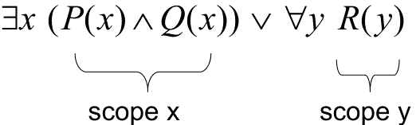

## 量化命题的否定

- 我们也可以否定带有量词的命题。
- 两个重要的等价式：
  - ¬∀x P(x) ≡ ∃x ¬P(x)，并非对于所有 x P(x) 为真 ≡ 必须存在一个 x 使得 P(x) 不为真
  - ¬∃x P(x) ≡ ∀x ¬P(x)，不存在 x 使得 P(x) 为真并非为真 ≡ P(x) 对所有 x 必须为假

## 使用谓词和量词

- 将句子翻译成逻辑表达式
- 示例：本班每个学生都学过 C 语言
  - ∀ x C(x) x 的论域为本班的学生
  - ∀ x (S(x) →C(x)) x 的论域为所有人
  - ∀ x (S(x) →L(x, c))

## 使用谓词和量词

- 逻辑编程
  - Prolog 语言
  - 事实和规则
  - 示例：
    - instructor (john, math202)
    - enrolled (tom, math202)
    - enrolled (jack, math202)
    - teacher (P,S) :- instructor (P,C), enrolled (S,C)
    - ?enrolled (tom, math202)      yes
    - ?enrolled (X, math202)
    - ?teacher (X, tom)

## homework2

(1) 用 2 种方法证明

\[(p \lor q) \land (\neg p \lor r) \to (q \lor r)\]

是重言式

## homework2

(2) Page 37, No.6,8

*Page 47, No.11,16 ver6*

- No.11: 设 P(x) 为陈述“x=x²”，如果域由整数组成，P(0); P(1); P(2); P(-1); ∃x P(x); ∀x P(x) 的真值是什么？

- No.16: 如果域由实数组成，确定每个陈述的真值？∃x(x²=2); ∃x(x²=-1); ∀x(x²+2≥1); ∀x(x²≠x)

## homework2

(3) Page 39, No.21, 22

*Page 49, No.41,43   verb6*

No. 41: 表达每个系统规范

- a) 在非空的消息集合中，至少有一条邮件消息可以被保存，如果存在一块空闲空间超过 10 千字节的磁盘
- b) 每当有活动警报时，所有排队的消息都会被传输。
- c) 诊断监视器跟踪除主控制台外的所有系统的状态
- d) 会议电话中主持人未将其列入特殊名单的每个参与者都被计费

## homework2

(3)

- No. 43: 判断 ∀x(P(x) → Q(x)) 和 ∀xP(x) → ∀xQ(x) 是否逻辑等价。证明你的答案。

## Quiz

- 如何证明两个逻辑陈述的等价性
- 判断 ∃x(P(x) → Q(x)) 和 ∃xP(x) → ∃xQ(x) 是否逻辑等价。证明你的答案。
- ¬(∀x∃y P(x) → ¬Q(y))
  让否定直接作用于谓词

## 嵌套量词

- **Nested Quantifier:** *出现在另一个量词作用域内的量词*
- 示例：x,y,z 为实数
  - ∀ x ∃ y (x+y=0)
  - ∀ x ∀ y ∀ z (x+(y+z) = (x+y)+z)
  - ∀ x ∀ y (x>0) ∧ (y<0) → (xy<0)
    - 对于所有 x 和所有 y，如果 x 为正且 y 为负，则它们的乘积必须为负。
    - 正数与负数的乘积为负数。

## 使用嵌套量词

- 将此句子翻译成逻辑表达式。
  - “如果一个人是女性并且是父母，那么她就是某人的母亲。”
- F(x) 为“x 是女性”，P(x) 为“x 是某人的父母”，M(x,y)，“x 是 y 的母亲”
  - ∀x ∃y (F(x) ∧ P(x)) → M(x,y)


## 否定嵌套量词

- ∀x∃y (x+y=0)
- ¬∀x∃y (x+y=0)
  ≡ ∃x ¬∃y (x+y=0)
  ≡ ∃x∀y ¬(x+y=0)
  ≡ ∃x∀y (x+y≠0)

## 量词的顺序

- 下列复合命题恒为真；左右等价。
  - ∀ x ∀ y p(x,y) ↔ ∀ y ∀ x p(x,y)
  - ∃ x ∃ y p(x,y) ↔ ∃ y ∃ x p(x,y)

## 将量化视为循环

- **提示：** 你可以将带量词的表达式视为计算机程序中执行的“循环”
  - ∃ y ∀ x p(x,y)
  - 先对 y 循环，对每一个 y 再对 x 循环；对每一个 y 的取值，检查 p(x,y) 是否对所有 x 都为真。如果找到了一个“y”，则该命题必须为真。

## 逻辑与证明 (3)

Wu Gang
School of Software, SJTU

## 证明 (毕达哥拉斯定理)

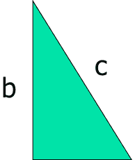

$a^2+b^2=c^2$

## 证明 (毕达哥拉斯定理)

- 一个很酷的证明

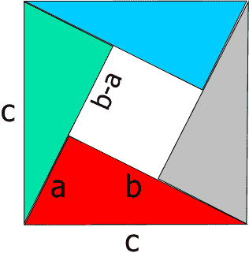

## 证明 (毕达哥拉斯定理)

- 一个很酷的证明

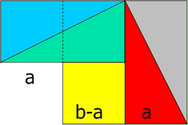

## 证明

- 这里有什么问题？
  - $a, b$ 为正整数
  - $a = b \iff$
  - $a^2 = ab \iff$
  - $a^2 - b^2 = ab - b^2 \iff$
  - $(a - b)(a + b) = b(a - b) \iff$
  - $a + b = b \iff$
  - $2b = b \iff$
  - $2 = 1$

## 证明

- 这里有什么问题？

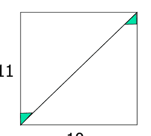

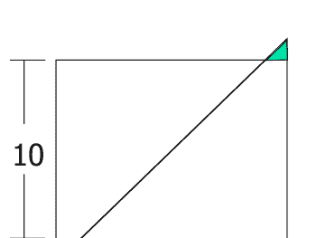

Yes, Profit!

## 证明

### 定义

- *定理*：可以被证明的陈述
- *证明*：一系列陈述，用以证明定理为真
- *公理/公设*：证明所基于的基本假设
- *推理规则*：用于从其他断言得出结论

## 证明

- 定义
  - _引理_：用于证明其他定理的简单定理
  - _推论_：直接由你刚刚证明的定理得出的结果
  - _猜想_：真值未知的陈述

## 推理规则 (命题逻辑)

- 基础：分离规则（假言推理）
- (p ∧ (p → q)) → q 是一个重言式

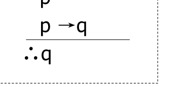

That is: if the premises p and p→q are both true, then q can only be true.

## 推理规则

- **示例**
  - 今天下雪。
  - 如果今天下雪，我们就去滑雪。
  - 因此：我们去滑雪。

```
p
p → q
────
∴ q
```

## 推理规则

**附加**

p → (p ∨ q)

```
p
────
∴ p ∨ q
```

**合取**

(p) ∧ (q) → (p ∧ q)

```
p
q
────
∴ p ∧ q
```

**化简**

p ∧ q → p

```
p ∧ q
────
∴ p
```

**否定后件**

[¬q ∧ (p → q)] → ¬p

```
¬q
p → q
────
∴ ¬p
```

**假言三段论**

[(p → q) ∧ (q → r)] → (p → r)

```
p → q
q → r
────
∴ p → r
```

**析取三段论**

[(p ∨ q) ∧ ¬p] → q

```
p ∨ q
¬p
────────
∴ q
```

**归结**

[(p ∨ q) ∧ (¬p ∨ r)] → (q ∨ r)

```
p ∨ q
¬p ∨ r
────────────
∴ q ∨ r
```

## 有效论证

- 若所有前提都为真，则结论也为真的论证形式称为有效。
  - 证明 q 由假设 p₁, p₂, ..., pₙ 推出，等价于证明蕴涵式 (p₁ ∧ p₂ ∧ ... ∧ pₙ) → q 为真。

*要使一个论证为真，所有前提都必须为真；*
*需要使用若干推理规则。*

## 有效论证 (示例)

- 假设
  - 如果你爱我，那么你就会跟我走。
  - 如果你不爱我，那么你就会跟他走。
  - 如果你跟他走，那么我会哭。
- 结论
  - 如果你没有跟我走，那么我会哭。

## 有效论证 (示例)

- p: 你爱我
- q: 你会跟我走
- r: 你会跟他走
- s: 我会哭
- 假设：p→q, ¬p→r, r→s
- 结论：¬q→s

## 有效论证 (示例)

- 假设：p→q, ¬p→r, r→s
- 结论：¬q→s

| 步骤 | 陈述 | 原因 |
|---|---|---|
| 1 | p→q | 假设 |
| 2 | ¬q→¬p | 第 1 步的逆否命题 |
| 3 | ¬p→r | 假设 |
| 4 | ¬q→r | 假言三段论 (2, 3) |
| 5 | r→s | 假设 |
| 6 | ¬q→s | 假言三段论 (4, 5) |


## 演绎推理规则

- 重言式：((p ∨ q) ∧ (¬p ∨ r)) → (q ∨ r)
- 对基于逻辑规则的编程语言很重要，如 Prolog
- *子句*：变量或其否定词的析取
- 示例：证明 (p ∧ q) ∨ r，r → s 蕴含 p ∨ s
  - (p ∨ r) ∧ (q ∨ r) ∧ (¬r ∨ s)

## 谬误

- 不基于重言式
- 形式谬误
  - 否定前件谬误
  - 肯定后件谬误

```
p → q
p
____
∴ q
正确

p → q
¬p
____
∴ ¬q
错误

p → q
q
____
∴ p
错误
```

## 量化语句的推理

- ∀x P(x)  
  ∴ P(c) 对任意 c  
  全称实例化

- P(c) 对任意 c  
  ∴ ∀x P(x)  
  全称概括

- ∃x P(x)  
  ∴ P(c) 对某个元素 c  
  存在实例化

- P(c) 对某个元素 c  
  ∴ ∃x P(x)  
  存在概括

## 示例 1

- 证明：
  - 这个数学班里的每个人都上过 CS 课程；Marla 在这个数学班里；因此 Marla 上过 CS 课程
- 设：
  - D(x) = x 在这个数学班里
  - C(x) = x 上过 CS 课程
  - 前提：∀x (D(x)→C(x))；D(Marla)
  - 结论：C(Marla)
- 证明：
  1. ∀x(D(x) → C(x))    前提
  2. D(Marla) → C(Marla)    全称实例化 (1)
  3. D(Marla)    前提
  4. C(Marla)    假言推理 (2)(3)

## 示例 2

- 证明：
  - “这个班里有一个学生没有读过这本书”并且“这个班里的每个人都通过了测验”蕴含“有一个通过测验的人没有读过这本书”
- 设：
  - C(x) = x 在这个班里；
  - B(x) = x 读过这本书；
  - P(x) = x 通过了测验；
  - 前提：∃x(C(x) ∧ ¬B(x))；∀x(C(x)→P(x))
  - 结论：∃x(P(x) ∧ ¬B(x))；
- 证明：
  1. ∃x(C(x) ∧ ¬B(x))    前提
  2. C(a) ∧ ¬B(a)    存在实例化 (1)
  3. ∀x(C(x)→P(x))    前提
  4. C(a)→P(a)    全称实例化 (3)
  5. C(a)    从 (2) 简化
  6. P(a)    假言推理 (4)(5)
  7. ¬B(a)    简化 (2)
  8. P(a) ∧ ¬B(a)    合取 (6)(7)
  9. ∃x(P(x) ∧ ¬B(x))    存在概括 (8)

## 证明定理的方法

- 要证明蕴含式 p → q：
  - **直接证明**：假设 p 为真并使用推理规则证明 q 必须为真。
  - **间接证明**：¬q → ¬p ≡ p → q，反证法
  - **空真证明**：证明 p 恒为假
  - **平凡证明**：证明 q 恒为真
- 反证法：
  - 如果能证明 ¬p → F，则 p 为真
- 分情况证明：
  - (p₁∨p₂∨...∨pₙ) → q ≡ (p₁→q) ∧ (p₂→q) ∧ ... ∧ (pₙ→q)
- 等价性证明：
  - p↔q ≡ (p→q) ∧ (q→p)
- 存在性证明：
  - 构造性
  - 非构造性
- 唯一性证明：
  - 存在性与唯一性
- 反例：
  - 用来证明 ∀x P(x) 为假

## 证明策略

- 包括：
  - 前向和后向推理
  - 利用分情况证明
  - 借鉴已有证明
  - 猜想 / 证明 / 反例
- 自己阅读！

## 作业

1. 第 58 页，第 3 题；第 72 页，第 5 题 ver6

   使用推理规则证明假设“Randy 努力工作”、“如果 Randy 努力工作那么他是个呆子”、“如果 Randy 是个呆子，那么他将得不到这份工作”蕴含结论“Randy 得不到这份工作”。

2. 第 58 页，第 7 题 ver5 或 第 73 页，第 13 题 ver6

   对每个论证，说明使用了哪些推理规则，并给出步骤：
   - Doug，是这个班的学生，知道如何用 Java 编程。所有会用 Java 编程的人都能获得高薪工作。因此这个班里有人能获得高薪工作。
   - 这个班里有人喜欢观鲸。每个人如果喜欢观鲸就会关心海洋污染。因此这个班里有一个人关心海洋污染。
   - 这个班里的 93 名学生每人拥有一台 PC。所有拥有 PC 的人都会使用文字处理程序。因此，Zeke，这个班的学生，会使用文字处理程序。
   - 新泽西州的每个人都住在离海洋 50 英里以内。新泽西州有人从未见过大海。因此有一个住在离海洋 50 英里以内的人从未见过大海。


## 作业

（3）第59页，第9题

第74页，第17题 ver6

这个论证有什么问题？

设 H(x) 表示“x 是快乐的”。给定前提 ∃xH(x)，我们得出结论 H(Lola)。因此，Lola 是快乐的。

## 作业

（4）第69页，第9题

第85页，第17题 ver6

证明：如果 n 是整数且 n³+5 是奇数，则 n 是偶数，使用

- 逆否证明法
- 反证法

## 基本结构（一）

吴刚

上海交通大学软件学院


## 基本离散结构

- 集合
- 函数

## 集合

- 定义
  - 对象的一个无序集合
  - 格奥尔格·康托尔 1895，朴素集合论
  - 罗素悖论，逻辑不一致性
  - 公理集合论
  - 通常用大写字母表示集合，如“A,B,C...”

## 集合与元素

- 集合中的对象称为**元素**，通常用小写字母表示，如“a,b,c...”
- `a ∈ A`：a 是集合 A 的一个元素，或者说 A 包含 a
- `a ∉ A`：a 不是集合 A 的元素

## 描述集合的方法

- 在大括号之间列出所有元素
  - A= {0, 1, 2, 3, 4, 5, 6, 7, 8, 9}
  - B= {a, b, c, ..., x, y, z}
  - C= {1, 2, 3, 4, ...}
  - D= {{1,2}, {3,4,5}}
- 集合描述法
  - A= {x|x 是小于 10 的自然数}
  - B= {x|x 是英文字母}
  - C= {x| P(x) }
- 维恩图
  - 通常用于表示集合之间的关系

## 集合之间的关系

- 相等
  - 具有相同的元素
  - {1,2,3}, {2,1,3}, {1,1,3,2,2}
- 子集
  - A 是 B 的子集，当且仅当 A 的每个元素也是 B 的元素
  - A ⊆ B 当且仅当 ∀ x (x ∈ A → x ∈ B)
  - 定理：对于任意集合 A，∅ ⊆ A 且 A ⊆ A
  - 真子集 A ⊂ B：A ⊆ B 且 A ≠ B
- A = B 当且仅当 A ⊆ B 且 B ⊆ A，即“∀ x (x ∈ A ↔ x ∈ B)”

## 维恩图

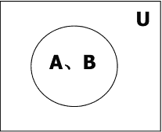

A = B

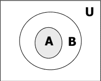

A ⊂ B

## 幂集

定义

- 给定一个集合 S，S 的幂集是 S 的所有子集构成的集合，记作 P(S)
- S={1,2}，则 P(S)={∅ , {1}, {2}, {1,2}}
- S= ∅，则 P(S)={ ∅ }
- S={∅ }，则 P(S)={∅ , {∅ }}
- 若 S 有 n 个元素，则 P(S) 有 2ⁿ 个元素

## 笛卡尔积

- 有序 n 元组
  - (a₁,a₂,...,aₙ)
  - (a₁,a₂,...,aₙ)=(b₁,b₂,...,bₙ) 当且仅当 i=1,2,...,n 时，aᵢ=bᵢ
  - 有序对：(a,b), (c,d)

- 集合 A 和 B 的笛卡尔积
  - 记作 A×B
  - A×B = {(a,b) | a ∈ A ∧ b ∈ B}，它是由有序对组成的集合
  - 勒内·笛卡尔

## 笛卡尔积

- 集合 A₁,A₂,...,Aₙ 的笛卡尔积
  - 记作 A₁xA₂x...xAₙ
  - A₁xA₂x...xAₙ = {(a₁,a₂,...,aₙ) | aᵢ ∈ Aᵢ，其中 i=1,2,...,n}

- 示例
  - A={1,2}, B={a,b,c}
    AxB={(1,a), (1,b), (1,c), (2,a), (2,b), (2,c)}
    BxA={(a,1), (b,1), (c,1), (a,2), (b,2), (c,2)}
  - A= ∅，则 AxB = ∅

## 集合运算

- 设 A 和 B 是集合
  - A 与 B 的**并集**，记作 A ∪ B
    - A ∪ B = {x | x ∈ A ∨ x ∈ B}
  - A 与 B 的**交集**，记作 A ∩ B
    - A ∩ B = {x | x ∈ A ∧ x ∈ B}

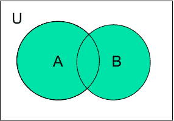

A ∪ B 的维恩图

## 集合运算

- 设 A 和 B 是集合
  - A 与 B 的_差集_，记作 A-B
    A-B = {x | x ∈ A ∧ x ∉ B}
- 设 U 是全集
  - 集合 A 的_补集_，记作
    Ā = {x | x ∉ A}

## 集合运算

- 若两个集合的交集为空集，则称这两个集合_不相交_
- 集合并集的基数（容斥原理）
  $|A \cup B| = |A| + |B| - |A \cap B|$

## 集合恒等式

- 同一律：A ∩ U = A，A ∪ ∅ = A
- 支配律：A ∩ ∅ = ∅ ，A ∪ U = U
- 幂等律：A ∩ A = A，A ∪ A = A
- 双补律：\overline{\overline{A}} = A
- 交换律：A ∪ B = B ∪ A
- 结合律：(A ∪ B) ∪ C = A ∪ (B ∪ C)
- 分配律：A ∪ (B ∩ C) = (A ∪ B) ∩ (A ∪ C)
- 德·摩根定律：\overline{A ∪ B} = \overline{A} ∩ \overline{B}
- 吸收律：A ∪ (A ∩ B) = A
- 互补律：A ∪ \overline{A} = U


## 集合恒等式的证明

$\overline{A \cap B} = \{x \mid x \notin A \cap B\}$

$\neg(x \in (A \cap B))$

$\neg(x \in A \land x \in B)$

$x \notin A \lor x \notin B$

$x \in \overline{A} \lor x \in \overline{B}$

$x \in \overline{A} \cup \overline{B}$

> 德摩根定律
> 用于逻辑等价

## 广义并集与交集

- **广义并集**：一个集合族的并集
  \[
  \bigcup_{i=1}^{n} A_i = A_1 \cup A_2 \cup \cdots \cup A_n
  \]

- **广义交集**：一个集合族的交集
  \[
  \bigcap_{i=1}^{n} A_i = A_1 \cap A_2 \cap \cdots \cap A_n
  \]

- **示例**
  - \(A_i = \{i, i+1, i+2, \ldots\}\)
  - \(\displaystyle\bigcup_{i=1}^{n} A_i = \{1,2,3,\ldots\}\)
  - \(\displaystyle\bigcap_{i=1}^{n} A_i = \{n,n+1,n+2,\ldots\}\)

## 集合的计算机表示

- 以无序方式存储集合的元素
  - 计算两个集合的并集/交集/差集将非常耗时

- 使用全集 U 的元素的一种任意顺序存储元素，例如 a₁,a₂,...,aₙ
  - 用长度为 n 的位串（位图）表示 U 的一个子集

## 集合的计算机表示

- 示例
  - 设 U={1,2,3,4,5,6,7,8,9}，元素按递增顺序排列
  - A={1,3,5,7,9} 101010101
  - B={2,4,5,6} 010111000
  - A ∪ B 按位或 111111101
  - A ∩ B 按位与 000010000

## 作业

(1) 第97页，第3题（那么{2}呢？）

第120页，第5、6题 第6版

- 对于以下每个集合，判断 2 是否是它的元素。

- a) {x ∈ R | x 是大于1的整数}

- b) {x ∈ R | x 是某个整数的平方}

- c) {2,{2}}

- d) {{2},{{2}}}

- e) {{2},{2, {2}}}

- f) {{{2}}}

- 判断 {2} 是否是上述集合的元素

## 作业

(2) 第97页，第15、16题

*第120页，第29、31题 第6版*

- 如果 A 有 m 个元素，B 有 n 个元素，那么 A×B 有多少个不同的元素？
- 解释为什么 A×B×C 和 (A×B)×C 不相同

## 作业

(3) 第106页，第10、15题

*第131页，第19、29题 第6版*

- 证明：如果 A 和 B 是集合，那么
  $A - B = A \cap \overline{B}$

- 如果已知以下条件，你能对集合 A 和 B 做出什么判断？
  - $A \cup B = A?$ $A \cap B = A?$ $A - B = A?$
  - $A \cap B = B \cap A?$ $A - B = B - A?$

## 基本结构（2）


吴刚

上海交通大学软件学院

## 函数

- 定义
  - *将集合 B 中的恰好一个元素分配给集合 A 中的每一个元素。f:A→B 或 f(a)=b。*
  - *函数 f 将 A 映射到 B*

## 函数

- A 是 f 的定义域。
- B 是 f 的陪域。
- b 是 a 的像。
- a 是 b 的原像。
- f 的值域：A 中所有元素的像的集合。

示例：f:Z→Z, f(x)=x^2
定义域/陪域：Z
值域：{0,1,4,9,...}

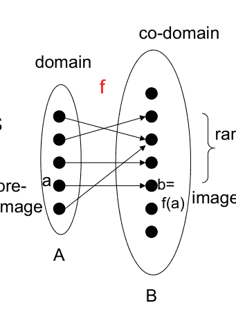

## 函数

- 如果 f1 和 f2 是从 A 到 **R**（实数）的两个函数，那么 g=f1+f2 和 h=f1*f2 也是从 A 到 **R** 的函数，定义如下：
  - (f1+f2)(x) = f1(x) + f2(x)
  - (f1*f2)(x) = f1(x)*f2(x)

- 示例：f1(x) = x, f2(x) = x^2。
  - (f1+f2)(x) = x+x^2
  - (f1*f2)(x) = x^3.

## 函数

f:A → B，且 S 是 A 的一个子集。那么我们可以定义 f′: S → Image(S)=f(S)

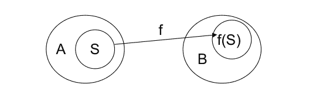

f(S) = {f(s) | s ∈ S}

## 一对一函数

## ▪ **一对一函数或单射函数：**

- ▪ 函数 *f* 是一对一的，当且仅当对于 *f* 定义域中的所有 *x*, *y*，*f(x)=f(y)* 蕴含 *x=y*。

$\forall x\forall y(f(x)=f(y)\to x=y)$

$\forall x\forall y(x\ne y\to f(x)\ne f(y))$

等价，因为：  $(p\to q)\equiv(\neg q\to\neg p)$

示例：f:ℤ→ℤ, f(x)=x^2 是一对一的吗？
不是！x=-1 和 x=1 都映射到 f(1)=f(-1)=1。


## 一对一函数

∀x∀y(x < y → f(x) < f(y)) — strictly increasing

∀x∀y(x < y → f(x) > f(y)) — strictly decreasing

x, y real number

decreasing    increasing

f(x) > f(y)

f(a)=f(b)

x < y

x' < y'

f(y') > f(x')

Strictly increasing and strictly decreasing functions are one-to-one.

## 满射函数

### Onto or surjective functions

A function f from A to B is onto if for every element b in B there is an element a in A with f(a)=b.

∀y∃x (f(x)=y)

Example: f:Z→Z, f(x)=x²

onto?

No, y=-1 has no pre-image.

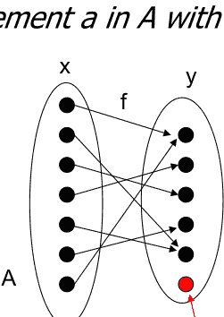

There is no element without incoming arrows.

## 一一对应

- **One-to-one correspondence or bijection:**
  - *A function f is in one-to-one correspondence if it is both one-to-one and onto.*
- Example: f:R→R, f(x)=-x — bijection!

## 逆函数

f⁻¹ : B → A, f⁻¹(b) = a

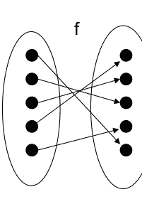

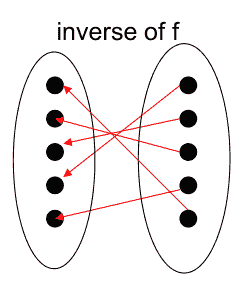

If a function is not a bijection, it is not invertible.

Example: f:R→R, f(x)=x².

## 函数的复合

### Composition

A composition of 2 functions g:A→B and f:B→C is defined by:

(f ∘ g)(x) = f(g(x))

Range of g must be subset of domain of f.

(f ∘ g)(x) = f(g(x))

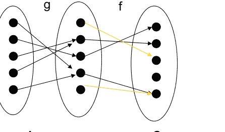

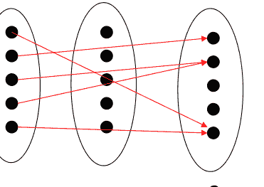

## 函数的图像

- The graph of a function f is the set of ordered pairs {(a,b)|a ∈ A, f(a)=b}.
- This is a subset of the Cartesian product A×B (i.e. it is a “relation”).

## Some important functions

- ⌊x⌋ = largest integer smaller or equal to x : Floor
- ⌈x⌉ = smallest integer larger or equal to x : Ceiling
- n! = 1·2·3·...·n : Factorial
- bⁿ = b·b·b·...·b (n times) : Exponential
- log_b(x) = inverse of exponential (x > 0)

## Q&A 1

- Let A1={a,b}, B1={1,2,3},
- A2={a,b,c}, B2={1,2},
- A3={a,b,c}, B3={1,2,3},

How many one-to-one/onto/bijection functions can be defined from A1→B1, A2→B2, A3→B3?

## Q&A 2

Let A1={a,b}, B1={1,{2},3}, A2={{a,b}}, B2={1,2}.

Give the Cartesian Product A1×B1, A2×B2, A2×A1×B2.

## homework

- Page 118 3, 6, 13
- Page 146 5, 15, 29 ver6

Find the domain and range of the functions. Note that in each case, to find the domain, determine the set of elements assigned values by the function.

- (a) The function that assigns to each bit string the number of ones minus the number of zeros
- (b) The function that assigns to each bit string twice the number of zeros in that string
- (c) The function that assigns to each bit string the number of bits left over when a bit string is split into bytes
- (d) The function that assigns to each positive integer the largest perfect square not exceeding this integer

Determine whether the function f: Z×Z → Z is onto if

- (a) f(m,n)=m+n
- (b) f(m,n)=m²+n²
- (c) f(m,n)=m
- (d) f(m,n)=|n|
- (e) f(m,n)=m-n

- Suppose that \(g\) is a function from A to B and \(f\) is a function from B to C
  - (a) Show that if both \(f\) and \(g\) are one-to-one functions, then \(f \circ g\) is also one-to-one
  - (b) Show that if both \(f\) and \(g\) are onto functions, then \(f \circ g\) is also onto

## Relations (1)

Wu Gang

School of Software, SJTU


## Relations

- Binary relation
  - Let A and B be sets, a binary relation from A to B is a subset of A×B
  - It is a set R of ordered pairs
  - Notation aRb denotes that (a,b) ∈ R, and a is said to be related to b by R

## Binary relation

- Examples
  - A: set of the students in this class, B: set of the courses, R is the relation to say Student a enrolled in Course b.
    (Obama, CS112), (Bush, CS911)
  - Let A={0,1,2}, B={a,b}, then {(0,a), (0,b), (1,a), (2,b)} is a relation from A to B


## 函数与关系

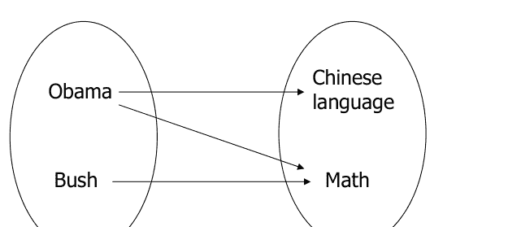

这是一个关系，而不是函数

## 集合上的关系

- 集合 A 上的关系是从 A 到 A 的关系
- 示例
  - A={1,2,3,4}，给出集合 A 上的关系 R
    R={(a,b)|a 整除 b}
    R={(1,1), (1,2), (1,3), (1,4), (2,2), (2,4), (3,3), (4,4)}
  - 一个有 n 个元素的集合上有多少个关系？

## 集合上关系的性质

集合 A 上的关系 R

- 自反的
  - ∀ a ((a,a) ∈ R), a ∈ A
- 反自反的
  - ∀ a ((a,a) ∉ R), a ∈ A
- 对称的
  - ∀ a ∀ b ((a,b) ∈ R → (b,a) ∈ R)  a,b ∈ A
- 反对称的
  - ∀ a ∀ b ((a,b) ∈ R ∧ (b,a) ∈ R → (a=b))  a,b ∈ A

## 集合上关系的性质

集合 A 上的关系 R

- 传递的
  - ∀a∀b∀c ((a,b)∈R ∧ (b,c)∈R → (a,c)∈R)
    a,b,c∈A

## 集合上关系的性质

- 示例
  - **N** 上的关系“=”、“>”、“≥”
  - ∅ 上的关系

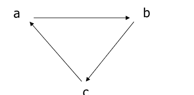

## 关系的组合

- R1 和 R2 是从 A 到 B 的关系
  - R1 ∪ R2
  - R1 ∩ R2
  - R1-R2
  - R2-R1

## 关系的组合

- R 是从 A 到 B 的关系，S 是从 B 到 C 的关系，则
  - R 和 S 的复合是从 A 到 C 的关系，记为 S∘R，对于每个 (a,c) ∈ S∘R，存在一个元素 b ∈ B，使得 (a,b) ∈ R, (b,c) ∈ S

## n 元关系

- 哪些列车在晚上9点后从上海开往北京？
- 你班上谁上个学期获得了超过2个A？
- n 元关系与计算机数据库

## n 元关系

- **定义**
  - 设 A1, A2, …, An 是集合，这些集合上的 n 元关系是 A1×A2×…×An 的一个子集，A1, A2, …, An 称为关系的域，n 称为它的度
- **示例**
  - (D, 305, 上海, 北京, 晚上9:00)
  - (张三, G10101, 英语, A, 2009, 秋季)

## n 元关系上的运算

- 选择运算符 sC
  - 将 n 元关系 R 映射为由 R 中所有满足条件 C 的 n 元组构成的 n 元关系
- 投影运算符 P_i1,i2,...,im
  - 将 n 元组 (a1,a2,...an) 映射为 m 元组 (a_i1,a_i2,...,a_im)，其中 m≤n

## n 元关系上的运算

### 连接运算符 $J_p(R,S)$

设 $R$ 是一个度为 $m$ 的关系，$S$ 是一个度为 $n$ 的关系，$p\le m,p\le n$。$J_p(R,S)$ 是一个度为 $m+n-p$ 的关系，由所有 $(m+n-p)$ 元组 $(a_1,a_2,\ldots a_{m-p},c_1,c_2,\ldots c_p,b_1,b_2,\ldots b_{n-p})$ 组成，其中 $(a_1,a_2,\ldots a_{m-p},c_1,c_2,\ldots c_p)$ 属于 $R$，且 $(c_1,c_2,\ldots c_p,b_1,b_2,\ldots b_{n-p})$ 属于 $S$

## 作业

- 第253页 11

*第528页 25 第6版*
设 R 是正整数集上的关系 R={(q,b)|a 整除 b}。求 a) R⁻¹    b) R̄

## 作业

- 第253页 14

第528页 31 第6版

设 R 是人的集合上的关系，由二元组 (a,b) 组成，其中 a 是 b 的父母。设 S 是人的集合上的关系，由二元组 (a,b) 组成，其中 a 和 b 是兄弟姐妹（兄弟或姐妹）。S∘R 和 R∘S 是什么？

## 作业

- 第253页 23
  *第528页 49 第6版*
  证明集合 A 上的关系 R 是对称的当且仅当 R=R⁻¹，其中 R⁻¹ 是逆关系

## 作业

- 第253页 26
  *第528页 55 第6版*
  设 R 是集合 A 上的自反关系，证明对所有正整数 n，Rⁿ 都是自反的。

## 关系（2）

吴刚

上海交通大学软件学院


## 关系的表示

- 表示有限集合之间的关系
  - 列出其有序对
  - 使用 0-1 矩阵（用于计算机程序）
  - 有向图（帮助人们更好地理解关系）

## 使用矩阵

- 假设 R 是从 A={a₁,a₂,…,aₘ} 到 B={b₁,b₂,…,bₙ} 的关系。
  - 元素按任意顺序列出（如果 A=B，则顺序相同）。
  - 使用矩阵 M_R=[mᵢⱼ] 表示 R

$$M_{ij}=\begin{cases}1\ldots\text{如果 }(a_i,b_j)\in R\\0\ldots\text{如果 }(a_i,b_j)\notin R\end{cases}$$


## 使用矩阵
- 示例
  - A={1,2,3} B={1,2}, R 是从 A 到 B 的关系，其中对每一对 (a,b) 都有 a>b
  - R={(2,1),(3,1),(3,2)}

$M_R = \begin{bmatrix}0 & 0\\1 & 0\\1 & 1\end{bmatrix}$

## 使用矩阵
- 集合上的关系矩阵是一个方阵。 可用于确定关系的性质
  - 自反 “主对角线上的元素 =1”
  - 反自反
  - 对称 “M_R=(M_R)^t”
  - 反对称

## 使用矩阵
$M_R = \begin{bmatrix} 1 & 1 & 0 \\ 1 & 1 & 1 \\ 0 & 1 & 1 \end{bmatrix}$

|  |  |
|---|---|
| 自反？ | YES |
| 对称？ | YES |
| 反对称？ | NO |

## 使用矩阵
- 表示两个关系的并集和交集
  - 使用 0-1 矩阵的布尔运算 join ∨ 和 meet ∧
  - M_R1 ∪ R2 = M_R1 ∨ M_R2
  - M_R1 ∩ R2 = M_R1 ∧ M_R2

## 使用矩阵
- 示例

M_R1 = ⎡1 0 1⎤
         ⎢1 0 0⎥
         ⎣0 1 0⎦      M_R2 = ⎡1 0 1⎤
                         ⎢0 1 1⎥
                         ⎣1 0 0⎦

M_R1∪R2 = M_R1 ∨ M_R2 = ⎡1 0 1⎤
                         ⎢1 1 1⎥
                         ⎣1 1 0⎦

M_R1∩R2 = M_R1 ∧ M_R2 = ⎡1 0 1⎤
                         ⎢0 0 0⎥
                         ⎣0 0 0⎦

## 使用矩阵
- 表示两个关系的复合
- 使用 0-1 矩阵的布尔乘积运算 ⊙
- R 是从 A 到 B 的关系，S 是从 B 到 C 的关系，A/B/C 有 m/n/p 个元素
- Mₛ∘ᴿ = Mᴿ ⊙ Mₛ
- 元素已按任意顺序列出

## 使用矩阵
- 表示幂 Rⁿ
  - 使用 0-1 矩阵的布尔幂运算

$M_{R^n} = M_R^{[n]}$

## 使用有向图
- 有向图由顶点集合 _V_ 和边集合 _E_ 组成
  - 边 (a,b)：a 是初始顶点，b 是终止顶点
  - 边 (a,a) 称为环

## 使用有向图
- 使用关系的有向图来确定关系的性质
  - 自反 “每个节点都有环”
  - 反自反 “没有环”
  - 对称
  - 反对称

## 关系的闭包
- 设 R 是集合 A 上的关系。 则 R 可能具有或不具有某些性质 P，如自反性/对称性/传递性。
  - 如果存在具有性质 P 且包含 R 的关系 S，使得 S 是包含 R 的所有具有性质 P 的关系的子集
  - S 被称为 R 关于 P 的闭包

## 闭包
- 自反闭包
  - R ∪ △，其中 △ = {(a,a) | a ∈ A} 称为 A 上的对角关系
- 对称闭包
  - R ∪ R⁻¹
- 传递闭包
  - 更复杂

## 有向图中的路径
- 有向图中的从 a 到 b 的路径是一系列边
  (a,x1)(x1,x2)(x2,x3)...(xn,b)
- 路径表示为 a,x1,x2,...,xn,b
- 其长度为 n+1
- 如果 a=b，则路径称为回路/环
- 注意：一条路径可以通过同一个节点多次，一条边可以在一条路径中出现多次

## 有向图中的路径
- 定理
  - 设 R 是集合 A 上的关系。 当且仅当 (a,b) ∈ Rⁿ 时，从 a 到 b 存在长度为 n 的路径（正整数）

## 作业
- **Page265 1** *(Page543 1 verb6)*
  用矩阵表示 {1,2,3} 上每个关系（元素按递增顺序）
  
  a) {(1,1), (1,2), (1,3)}
  
  b) {(1,2), (2,1), (2,2), (3,3)}
  
  c) {(1,1), (1,2), (1,3), (2,2), (2,3), (3,3)}
  
  d) {(1,3), (3,1)}

- *绘制表示上述练习 1 中关系的有向图*

## 作业
- Page265 8,9 (Page543 16,17 ver6)
  设 R 是具有 n 个元素的集合 A 上的关系。 如果 M_R 中有 k 个非零条目，表示 R 的矩阵，那么 R 的逆的矩阵中有多少个非零条目？
  补集的矩阵中有多少个非零条目？


## 作业

+   第265页 14（第543页 31 ver6）

判断以下图所表示的关系是否是自反的、反自反的、对称的、反对称的和/或传递的。

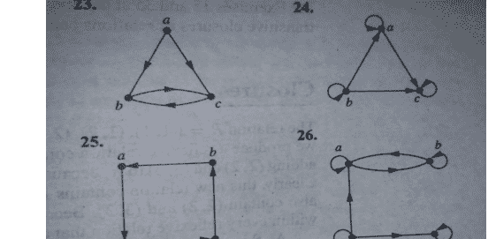

## 关系（3）

吴刚

上海交通大学软件学院

## 传递闭包

+   - 连通关系 R*
+     - 设 R 是集合 A 上的一个关系
+     - R* 由满足以下条件的序偶 (a,b) 组成：在 R 中从 a 到 b 存在一条长度至少为 1 的路径

R* = ⋃_{n=1}^{∞} R^n

## 示例

+   - 设 R 是全世界所有人集合上的关系，若 a 见过 b，则 (a,b) ∈ R
+     - Rⁿ 是什么？R* 是什么？
+     - (你, 奥巴马) ∈ R* 吗？

## 示例

+   - 设 R 是上海所有地铁站集合上的关系，若可以从 a 到 b 且无需换乘，则 (a,b) ∈ R
+   - Rⁿ 是什么？R* 是什么？
+   - (东川路, 剑川路) ∈ R⁵ 吗？
+   - (东川路, 剑川路) ∈ R⁴ 吗？

## 传递闭包

+   - 定理
+     - 关系 R 的传递闭包等于连通关系 R*
+       - R* 包含 R
+       - R* 是传递的
+       - 若存在一个传递且包含 R 的关系 S，则 S 包含 R*

## 传递闭包

+   R* = R ∪ R² ∪ R³ ∪ ... ∪ Rⁿ

M_{R*} = M_R ∨ M_R^{[2]} ∨ M_R^{[3]} ... ∨ M_R^{[n]}

## 等价关系

+   - 定义：集合 A 上的关系 R 是等价关系，如果它是自反的、对称的且传递的。

+   - 示例
+     - 设 R 是本节课学生集合上的关系，aRb 当且仅当 a 和 b 来自同一个省份——“老乡”
+     - 同余模
+       - R={(a,b)|a≡b(mod m)}    m>1 是正整数，a 和 b 是整数

## 等价类

+   - 设 R 是集合 A 上的等价关系。与 A 中元素 a 相关的所有元素组成的集合称为 a 的等价类，记作 [a]_R
+   - [a]_R = {s | (a,s) ∈ R}
+   - 如果只考虑一种关系，则可以记作 [a]

## 等价类

+   - 示例
+     - [张三] 对应“老乡”关系
+     - 模 4 同余的 [0]、[1]、[5]
+       - [0]={...-8,-4,0,4,8...}
+       - [1]={...-7,-3,1,5,9...}
+       - [5]=?
+     - 模 m 的同余类，记作 [a]ₘ，例如 [5]₄ 和 [1]₃

## 等价类与划分

+   定理 1
+     设 R 是集合 A 上的等价关系，下列命题等价
+     (1) aRb;  (2) [a]=[b];  (3)[a]∩[b]≠∅

## 偏序

## 定义

+   - 集合 S 上的关系 R 称为偏序，如果它是自反的、反对称的和传递的。
+   - 集合 S 连同其上的偏序 R 称为*偏序集*或 *poset*，记作 (S,R)

## 偏序

+   - 示例
+     - (Z, ≥)
+     - 集合 S 的幂集上的包含关系，(P(S), ⊆)
+   - (S,R)
+     - 对于集合 S 中的任意 a 和 b，并不一定需要 aRb 或 bRa 成立

## 偏序

+   - 偏序集 (S, ≤) 中的元素 a 和 b 称为可比的，如果 a ≤ b 或 b ≤ a；否则称为不可比的
+   - 全序
+     - 如果 (S, ≤) 是偏序集，且 S 中任意两个元素都是可比的，则称 S 为全序集或线性序集
+     - (P(S), ⊆) 是全序吗？

## 偏序

+   字典序

+   在 N 个偏序集的笛卡尔积上的 ≤
+   (A₁, ≤₁) (A₂, ≤₂)... (Aₙ, ≤ₙ)

+   (a₁,a₂,...aₙ)<(b₁,b₂...bₙ) 如果 a₁<₁b₁ 或存在整数 i>0 使得 a₁=b₁ a₂=b₂ ... aᵢ=bᵢ，且 aᵢ₊₁<ᵢ₊₁bᵢ₊₁)

+   (a₁,a₂,...aₙ)=(b₁,b₂...bₙ) 如果 aᵢ=bᵢ i=1,2,...n

+   如何比较 8 位二进制数？

## 偏序

+   - 字符串的字典序
+     - a₁a₂...aₘ, b₁b₂...bₙ
+     - 设 t 为 m 和 n 中的较小者，则 (a₁,a₂,...aₘ)<(b₁,b₂...bₙ) 如果 (a₁,a₂,...aₜ)<ₜ(b₁,b₂...bₜ) 或 (a₁,a₂,...aₜ)=(b₁,b₂...bₜ) 且 m<n
+   - 如何比较 “good”、“goodbye”、“gate”、“go”？


## 哈斯图

- 给定有限偏序集的有向图：
  - 因为每个顶点都有环，可以删除它们（自反性）。
  - 由于传递性必然存在许多边，可以移除它们。
  - 将每条边排列成初始顶点在终点下方，然后可以去掉箭头。
- 最终得到哈斯图。

- **示例**：
  - \((\mathbb{Z}, \leq)\)
  - \((\{2, 3, 6, 12, 24, 36\}, \mid)\)
  - \((\text{power set of } \{a,b\}, \subseteq)\)

## 极大元与极小元

- **极大元**：在偏序集 \((S, \le)\) 中，\(a \in S\)，不存在 \(b \in S\) 使得 \(a < b\)。
- **极小元**
- **最大元**：在偏序集 \((S, \le)\) 中，\(a \in S\)，对于每个 \(b \in S\)，都有 \(b \le a\)。
- **最小元**

- **示例**：
  - \(S =\) \(\{a,b,c\}\) 的幂集，\(\subseteq\)。
  - (1) \(A = \{\{a,b\}, \{b,c\}, \{b\}, \{c\}, \varnothing\}\)
  - (2) \(A = \{\{a\}, \{c\}\}\)
  - 给出极大元/极小元/最大元/最小元，以及上界/下界/最小上界/最大下界。

- 有上界，但没有最小上界？？？

## 作业

- **第282页，习题5**（第563页，习题9，第6版）：
  设 \(A\) 是一个非空集合，\(f\) 是以 \(A\) 为定义域的函数。令 \(R\) 为 \(A\) 上的关系，由所有满足 \(f(x) = f(y)\) 的有序对 \((x, y)\) 组成。
  a) 证明 \(R\) 是 \(A\) 上的等价关系。
  b) \(R\) 的等价类是什么？

- **第282页，习题8**（第563页，习题15，第6版）：
  设 \(R\) 是正整数有序对集合上的关系，满足 \(((a,b),(c,d)) \in R\) 当且仅当 \(a+d=b+c\)。证明 \(R\) 是等价关系。

- **第294页，习题2**（第578页，习题3，第6版）：
  *设 \(S\) 是全世界所有人的集合，且 \((a,b) \in R\)，其中 \(a\) 和 \(b\) 都是人。如果满足以下条件，\((S,R)\) 是否构成偏序集：*
  a) \(a\) 比 \(b\) 高？
  b) \(a\) 不比 \(b\) 高？
  c) \(a = b\) 或 \(a\) 是 \(b\) 的祖先？
  d) \(a\) 和 \(b\) 有一个共同的朋友？

## 神经元的成分-神经生物学

- 图片说明：此图丢失了

个体发育是指在生物发育过程中，从受精卵开始到个体成熟所经历的一系列连续变化过程。

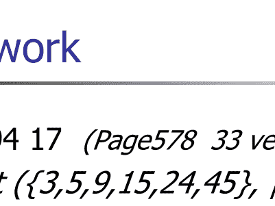

## 格与布尔代数

Wu Gang  
上海交通大学软件学院

## 格

- 如果偏序集 \((S, \le)\) 中每对元素都有最小上界和最大下界，则称其为格。

- **示例**：哪些是格？
  - \((\mathbb{Z}^+, |)\)
  - \((\{1,2,3,4,5\}, |)\)
  - \((\{1,2,4,8,16\}, |)\)
  - \((P(S), \subseteq)\)，其中 \(S\) 是集合

- 设 \((S, \le)\) 是一个格。定义
  - 交运算 \((\land)\)：\(a \land b = \mathrm{glb}(a,b)\)
  - 并运算 \((\lor)\)：\(a \lor b = \mathrm{lub}(a,b)\)
- 对于格 \(S\) 中的所有元素 \(x, y, z\)：
  - \(x \land y = y \land x\)，\(x \lor y = y \lor x\)（交换律）
  - \((x \land y) \land z = x \land (y \land z)\)（结合律）
  - \(x \land (x \lor y) = x\)，\(x \lor (x \land y) = x\)（吸收律）
  - \(x \land x = x\)，\(x \lor x = x\)（幂等律）

## 格与代数结构

- 一个格 \((S, \le)\)。
- \((S, \lor, \land)\) 是由该格导出的代数结构。
  - \(\lor, \land\) 运算具有交换律、结合律、吸收律和幂等律的性质。

## 分配格

- 给定格 \((S, \le)\)，对于所有 \(a, b, c \in S\)：
  - \(a \lor (b \land c) \le (a \lor b) \land (a \lor c)\)
  - \((a \land b) \lor (a \land c) \le a \land (b \lor c)\)
- 如果
  - \(a \lor (b \land c) = (a \lor b) \land (a \lor c)\)
  - \((a \land b) \lor (a \land c) = a \land (b \lor c)\)
  则 \((S, \le)\) 是分配格。

- **示例**：哪些格是分配格？
  - \((\mathbb{Z}^+, |)\)
  - \((P(S), \subseteq)\)，其中 \(S\) 是集合
  - \((S, \subseteq)\)，\(S = \{\varnothing, \{1\}, \{2\}, \{3\}, \{1,2\}, \{2,3\}, \{1,2,3\}\}\)

## 有界格

- 给定一个格 \((S, \le)\)。
- 如果存在上界，记为 \(1\)，使得对所有 \(a \in S\) 有 \(a \le 1\)；并且存在下界，记为 \(0\)，使得对所有 \(a \in S\) 有 \(0 \le a\)，则该格是有界格。
  - \(a \lor 1 = 1;\quad a \land 1 = a\)
  - \(a \lor 0 = a;\quad a \land 0 = 0\)

## 补元与有界格

- 给定一个有界格 \((S, \le)\)。
- 元素 \(a\) 的补元是满足以下条件的元素 \(b\)：
  - \(a \lor b = 1;\quad a \land b = 0\)
- 如果每个元素都有补元，则这个格是有补格。


## 补集与有界格
- 示例：是否可补？
  - (P(S), ⊆)，S 是一个有限集合
  - (S, ⊆)，S={∅, {1}, {2}, {3}, {1,2}, {2,3},{1,2,3}}

## 格与布尔代数
- 若格是可补且分配的，则称该格为布尔格。
- 由布尔格导出的代数结构称为布尔代数 (S, ∨, ∧, ~)， "~" 表示一个一元运算，用于计算元素的补集。

## 布尔函数
- 布尔集合 {0,1}
- 3 种运算
  - 补运算  0̅=1  1̅=0
  - 布尔和 "记为 + 或 OR"
    - 1+1=1  1+0=1  0+1=1  0+0=0
  - 布尔积 "记为 . 或 AND"
    - 1·1=1  1·0=0  0·1=0  0·0=0
  - 运算优先级：补运算，AND，OR

## 布尔函数
- 布尔变量
- n 次布尔函数
  - 从 Bⁿ 到 B
  - B={0,1}, Bⁿ={(x₁,x₂,...xₙ)|xᵢ ∈ B}
- 布尔表达式
  - 递归定义为
    - 0,1, x₁,x₂,...xₙ 都是布尔表达式
    - 若 E 是布尔表达式，则 E 的补集是布尔表达式
    - 若 E₁,E₂ 都是布尔表达式，则 E₁E₂, E₁+E₂ 都是布尔表达式

## 布尔函数
- 每个布尔表达式都表示一个布尔函数
  - F(x,y,z)=xy+~z  （使用 ~ 表示补集）
- 布尔表达式与命题逻辑表达式之间的关系
- 布尔值表

## 布尔函数
- n 个变量的布尔函数 F 和 G 当且仅当 F(b₁,b₂,...bₙ)=G(b₁,b₂,...bₙ) 时相等。表示相同函数的两个不同布尔表达式称为等价。如 xy=xy+0
- n 次有多少个不同的布尔函数？

## 布尔函数
- 布尔恒等式
  - ver6 第 753 页表 5
  - 交换律，结合律，分配律，德摩根律......
- 对偶性
  - 互换布尔和与布尔积，并互换 0 与 1
  - 对偶原理

## 布尔代数的抽象定义
定义：布尔代数是一个集合 B，带两个二元运算 ∨ 和 ∧，元素 0 和 1，以及一个一元运算 ~，使得对 B 中所有 x,y,z 都有以下性质成立
- 恒等律
- 补律
- 结合律
- 交换律
- 分配律

## 布尔代数的抽象定义
- 布尔代数
  - 布尔表达式
  - 命题
  - 集合

## 表示布尔函数
- 析取范式展开
  - 示例：如何构造表示具有给定值的函数的布尔表达式
  - 定义：*字* 是布尔变量或其补集。布尔变量 x₁,x₂,...xₙ 的一个 *极小项* 是布尔积 y₁y₂...yₙ，其中 yᵢ=xᵢ 或其补集
    - 极小项对其变量的取值组合中只有一个组合取值为 1

## 表示布尔函数
- 析取范式展开
  - 表示该函数的极小项之和称为析取范式展开或析取范式
  - 示例：F(x,y,z)=(x+y)~z
- 合取范式展开或合取范式

## 表示布尔函数
### 函数完备性
- 每个布尔函数都可以表示为极小项的布尔和，每个极小项是布尔变量或其补集的布尔积。因此布尔运算符集合 “和，积，补” 称为函数完备
- 我们能否找到一个更小的函数完备运算符集合？

## 作业
- 第 294 页 22（第 580 页，43 ver6）

判断具有这些哈斯图的帖子是否为格

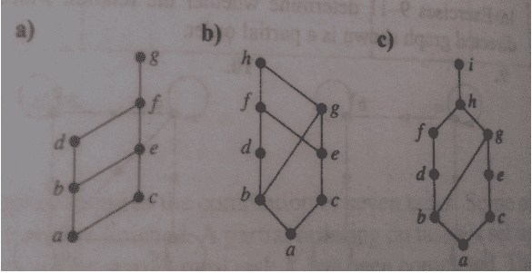

## 作业
- 第 294 页 23（*第 580 页，45 ver6*）
  - 证明格的每一个非空有限子集都有最小上界和最大下界。


## 作业

+   证明德摩根律在布尔代数中成立。也就是说，证明对所有 x 和 y，
+   
+   $\overline{(x \vee y)} = \bar{x} \wedge \bar{y}$
+   
+   $\overline{(x \wedge y)} = \bar{x} \vee \bar{y}$

## 逻辑基础 (1)


吴刚

软件学院，上海交通大学

## Logic

+   - **deductive reasoning**（演绎推理）
+     - 前提和结论之间的可推导性
+   - **Inductive reasoning**（归纳推理）
+     - 样本到总体的一个推理
+     - 所有观察到的乌鸦都是黑的
+     - 所以，所有乌鸦都是黑的

## deductive reasoning

+   - 研究形式上的可推导性关系
+     - 所有大学生都听音乐之声（前提）
+     - 张三不听音乐之声（前提）
+     - 张三不是大学生（结论）
+     - 这个推导过程是正确的，虽然前提／结论不一定为真
+     - 推理是否正确与命题的真假无关，跟逻辑形式有关

## deductive reasoning

+   - 研究形式上的可推导性关系
+     - S中的元素都有性质R（前提）
+     - a没有性质R（前提）
+     - a不是S中的元素（结论）
+   - 这就是前面例子的逻辑形式，跟S到底是什么无关

## deductive reasoning

+   - 命题逻辑
+     - 命题： P、 Q、 R
+     - 逻辑连接词： ¬、 ∧、 ∨、 →、 ...
+   - 谓词逻辑
+     - 谓词： S(t)， t是项（term）
+     - 量词： ∀x、 ∃x
+     - 个体： a、 b、 c（常量）、 ...u、 v（变元）
+     - 个体函数： f、 g...
+     - 构造规则： 项的构造、 公式构造

## 形式语言

+   - 语法和语义
+     - 语法只涉及符号和表达式的形式结构
+     - 而给符号赋予某种解释时，就有语义了
+   - 谓词逻辑公式的解释（赋值）
+     - 论域
+     - 谓词函数
+     - 个体函数
+     - 命题真值

## 命题逻辑与谓词逻辑的性质

+   - the **soundness** property（可靠性）
+     - 语法的推演反映出的关系在语义上是成立的
+     - 形式推演对于语义的推理是可靠的
+     - 形式推演的可靠性
+   - The **completeness** property（完备性）
+     - 凡是语义推理成立的关系，语法的推演都是可以反映的
+     - 形式推演的完备性

## 可满足性与有效性

+   - 语义概念
+   - 可满足的：一个公式或者公式集合是可满足的，当且仅当有一个赋值（论域不为空）使得公式（或集合中每一个公式）为T。一般用Σ表示公式集合，大写字母A、B、P、Q标识公式
+   - 有效的：公式A是有效的，当且仅当任何赋值都使之为T（论域不为空）

## 可满足性与有效性

+   - 在论域D上是可满足的：当且仅当在论域D上有一个赋值使之为T
+   - 在论域D上是有效的：当且仅当在论域D上的任何赋值都使之为T

+   - Σ在论域D上是可满足的，则Σ是可满足的；
+   - A是有效的，则A在论域D上是有效的

## 可满足性与有效性

+   - **定理**
+     - A是可满足的，当且仅当¬A不是有效的
+     - A是有效的，当且仅当¬A是不可满足的
+     - A(u₁,u₂,...,uₙ)是可满足的，当且仅当 ∃x₁...∃xₙ A(x₁,...,xₙ)是可满足的
+     - A(u₁,u₂,...,uₙ)是有效的，当且仅当 ∀x₁...∀xₙ A(x₁,...,xₙ)是有效的

## 前束范式

+   - 谓词逻辑的一种范式
+     - Q₁x₁...Qₙxₙ A，其中Q₁...Qₙ为量词
+   - 一个公式可以变换为某个前束范式，且与之等值≡
+   - Prenex normal form

## 前束范式

+   - ¬ ∀ xA(x) ≡ ∃ x¬A(x)
+   - ¬ ∃ xA(x) ≡ ∀ x¬A(x)
+   - A ∧ QxB(x) ≡ Qx(A ∧ B(x)), x不在A中出现
+   - A ∨ QxB(x) ≡ Qx(A ∨ B(x)), x不在A中出现
+   - ∀ xA(x) ∧ ∀ xB(x) ≡ ∀ x (A(x) ∧ B(x))
+   - ∃ xA(x) ∨ ∃ xB(x) ≡ ∃ x (A(x) ∨ B(x))
+   - Q₁xA(x) ∨ Q₂yB(y) ≡ Q₁xQ₂y(A(x) ∨ B(y))
+   - Q₁xA(x) ∧ Q₂yB(y) ≡ Q₁xQ₂y(A(x) ∧ B(y))

## 前束范式的可满足性与有效性

+   - 定理
+     - A是可满足的，当且仅当A的前束范式是可满足的
+     - A是有效的，当且仅当A的前束范式是有效的

## Page 122, 3.6.1

+   - 将下列公式变换成前束范式
+   - $(\neg \exists xF(x) \lor \forall yG(y)) \land (F(u) \to \forall yG(y))$
+   - $\exists xF(u, x) \leftrightarrow \forall yG(y)$
+   - $\forall x(F(x) \to \exists y(G(y) \to F(x) \lor \forall zG(z)))$


## Fundament of Logic (2)

吴刚

软件学院，上海交通大学

## 可靠性（谓词逻辑、命题逻辑）

+   - 定理：设 Σ ⊆ Form(L)，A ∈ Form(L)。
+     - 若 Σ ⊢ A，则 Σ ⊨ A。
+     - 若 Φ ⊢ A，则 Φ ⊨ A。
+     - 即：所有形式可证明的公式都是有效的。
+     - 一阶逻辑有17条推理规则，要证明每一条规则都满足可靠性

## 17条推理规则

+   - A ⊢ A  (Ref)
+   - if Σ ⊢ A, then Σ, Σ′ ⊢ A  (+)
+   - if Σ, ¬A ⊢ B and Σ, ¬A ⊢ ¬B, then Σ ⊢ A  (¬ ¬)
+   - if Σ ⊢ A→B, Σ ⊢ A, then Σ ⊢ B (→ ¬)
+   - if Σ, A ⊢ B, then Σ ⊢ A→B  (→ +)
+   - if Σ ⊢ A∧B, then Σ ⊢ A and Σ ⊢ B (∧¬)
+   - if Σ ⊢ A and Σ ⊢ B, then Σ ⊢ A∧B (∧+)

## 17条推理规则

+   - if  Σ,A ⊢C and  Σ,B ⊢C, then  Σ,A∨B ⊢C  (∨−)
+   - if  Σ ⊢A, then Σ ⊢A∨B,  Σ ⊢B∨A  (∨+)
+   - if  Σ ⊢A↔B,  Σ ⊢A, then  Σ ⊢B  (↔−)
+   - if  Σ,A ⊢B,  Σ,B ⊢A, then  Σ ⊢A↔B  (↔+)
+   - if  Σ ⊢∀xA(x), then  Σ ⊢A(t)  (∀−)
+   - if  Σ ⊢A(u), u不在Σ中出现
+     then  Σ ⊢∀xA(x)  (∀+)

## 17条推理规则

+   - if Σ, A(u) ⊢ B, u不在Σ或B中出现
+     then Σ, ∃xA(x) ⊢ B
+     (∃−) 代入
+   - if Σ ⊢ A(t) then Σ ⊢ ∃xA(x) (∃+)
+     x替换t（可以只替换部分）
+   - if Σ ⊢ A(t₁), Σ ⊢ t₁≡t₂ then Σ ⊢ A(t₂)
+     t₂替换t₁（可以只替换部分） (≡−)
+   - Φ ⊢ u≡u (≡+)

## 证明可靠性定理

+   - (Ref): A ⊢ A 显然成立
+   - (+): if Σ ⊢ A, then Σ, Σ' ⊢ A
+     要证： if Σ ⊨ A, then Σ, Σ' ⊨ A
+   - (¬ ¬): 要证 if Σ, ¬A ⊢ B and Σ, ¬A ⊢ ¬B, then Σ ⊨ A  反证法
+   - (∨ ¬): 要证 if Σ, A ⊨ C and Σ, B ⊨ C, then Σ, A ∨ B ⊨ C


## 证明可靠性定理

+   (∃一): 要证if Σ, A(u) ⊨ B, u不在Σ或 B中出现, then Σ, ∃xA(x) ⊨ B

+   令v为以D为论域的任何赋值，使Σ^v, ∃xA(x)^v 均为真，则有a∈D，使A(a) 即A(u)^v(u=a) 为真；由于u不在Σ中出现，因此Σ^v(u=a)= Σ^v 为真；因此Σ, A(u) 在解释v(u=a)下均为真，得到B^v(u=a)为真，又由于u不在B中出现，则

## 错误推理的说明

+   - 易证：
+     - A(u) ⊭ ∀xA(x)
+     - ∃xA(x) ⊭ A(u)

+   - 那么由可靠性定理得
+     - A(u) ⊬ ∀xA(x)
+     - ∃xA(x) ⊬ A(u)
+     - 意思是可以证明这是无法推出的！！

## 协调性

+   - 定义： Σ ⊆ Form(L) 是协调的，当且仅当不存在 A ∈ Form(L)，使得 Σ ⊢ A 并且 Σ ⊢ ¬A
+   - 语法概念

## 协调性的一个定理

+   - Σ ⊆ Form(L) 是协调的，当且仅当存在 A， 使得 Σ ⊬ A

## 作业

+   - 证明上一页的定理
+   - 证明：可靠性定理证明中的
+     \((\rightarrow -)、(\wedge +)、(\forall +)\) 情况

## 逻辑基础 (3)

Wu Gang
软件学院，上海交通大学

## 极大协调性

+   - 定义：公式集Σ是极大协调的，当且仅当Σ满足以下两点，
+     - Σ是协调集
+     - 对于任何A∉Σ，Σ∪{A}是不协调的。
+       即不存在以Σ为真子集的协调集
+   - 如果对于任何A，Σ ⊢A蕴涵A∈Σ，称Σ是封闭于形式可推演的。

## 极大协调性

+   - 定理1：设Σ是极大协调集，那么对于任何A，Σ ⊢ A 当且仅当 A ∈ Σ
+     - 设 Σ ⊢ A，如果 A ∉ Σ，由 Σ 是极大协调的可知 Σ ∪ {A} 是不协调的。因此 Σ ⊢ ¬A，导出 Σ 不协调，矛盾！因此，A ∉ Σ。
+     - 设 A ∈ Σ，则由推理规则可到 Σ ⊢ A
+   - 极大协调集 Σ 是封闭于形式可推演的

## 极大协调性

+   - 推论：设Σ是极大协调集，则对于任何A ， Σ ⊢¬A 当且仅当 Σ ⊢A
+   - Σ ⊢¬A，若 Σ ⊢A，Σ不协调，矛盾！
+   - Σ ⊢A，则 A ∉ Σ，则 ¬A ∈ Σ，则 Σ ⊢¬A

## 极大协调集

+   定理（Lindenbaum）：任何协调的公式集Σ能够扩充为极大协调集。记为Σ*

+   设Form(L)是可数无限集，令A₀, A₁, A₂,…是其一个排列。定义Σₙ (n≥0)如下：
+   Σ₀=Σ， Σₙ₊₁=Σₙ∪{Aₙ} (若Σₙ∪{Aₙ}协调)，
+   否则Σₙ₊₁=Σₙ

+   则有Σₙ⊆Σₙ₊₁，且Σₙ是协调的。

+   Σ* = ∪ₙ∈N Σₙ 先证Σ*是协调的；
+   再证Σ*是极大的

## 极大协调集

+   - 定理（Lindenbaum）：任何协调的公式集 Σ 能够扩充为极大协调集。记为 Σ*

+     - 注明：一阶语言不可数时，Form(L) 是不可数无限集。这种情况不做要求。

## 命题逻辑的完备性

+   - 完备性证明有多种不同的方法

+   - 方法一的引理
+     设A ∈ Form(L^p)含不同的原子公式p₁， p₂， ... ， pₙ， v是真假赋值。对于i=1,2,..., n, 令若pᵢ^v=1，则Aᵢ=pᵢ；否则，Aᵢ=¬pᵢ。则有

+   - 若A^v=1，则A₁，A₂，...，Aₙ ⊢ A。

+   - 若A^v=0，则A₁，A₂，...，Aₙ ⊢ ¬A

## 命题逻辑的完备性

+   - **方法一的定理**：设 $A\in\mathrm{Form}(L^p)$，$\Sigma\subseteq\mathrm{Form}(L^p)$，且 $\Sigma$ 是有限集，则
+     - 若 $\Phi\nvdash A$，则 $\Phi\nvdash A$（$A$ 是重言式的话，则 $A$ 是形式上可证明的）
+     - 若 $\Sigma\nvdash A$，则 $\Sigma\nvdash A$

## 命题逻辑的完备性

证明若 Φ ⊨ A，则 Φ ⊢ A：

设 A 含不同的原子公式 p₁,p₂,…,pₙ。令 v1，v2 是真假赋值，且 p₁ᵛ¹=1，p₁ᵛ²=0，p₂ᵛ¹= p₂ᵛ²=1，pᵢᵛ¹= pᵢᵛ² (i=3, …, n)。由引理，由于 Aᵛ¹=1，所以 p₁，p₂，…，Aₙ ⊢ A。由于 Aᵛ²=1，所以 ¬p₁，p₂，…，Aₙ ⊢ A。可得，p₁ ∨ ¬p₁，p₂，…，Aₙ ⊢ A，p₂，…，Aₙ ⊢ (p₁ ∨ ¬p₁) → A，又因为 Φ ⊢ p₁ ∨ ¬p₁，所以 p₂，…，Aₙ ⊢ p₁ ∨ ¬p₁。可得，p₂，…，Aₙ ⊢ A。

再令 u1，u2 是真假赋值，且 p₁ᵘ¹=1，p₁ᵘ²=0，p₂ᵘ¹= p₂ᵘ²=0，pᵢᵘ¹= pᵢᵘ²，i=3, …, n。同理可得，¬p₂，…，Aₙ ⊢ A。

可得，A₃，…，Aₙ ⊢ A。进一步指定真假赋值，可得 Φ ⊢ A。

## 命题逻辑的完备性

+   方法二的引理：
+     Σ* ⊆ Form(Lρ) 是极大协调集，构造真假赋值 v 使得对任何原子公式 p，p^v = 1 当且仅当 p ∈ Σ*，于是对于任何的 A ∈ Form(Lρ)，A^v = 1 当且仅当 A ∈ Σ*

## 命题逻辑的完备性

+   - 方法二的定理1：设 Σ⊆Form(Lᵖ)，A∈Form(Lᵖ)，则有
+     - 如果 Σ 是协调的，则 Σ 是可满足的；
+     - 如果 A 是协调的，则 A 是可满足的；

证明：Σ 是协调的，任取 B∈Σ，把 Σ 扩为极大协调集 Σ*，使用引理中的真假赋值 v，就有 Bᵛ=1。因此，v 满足 Σ。

## 命题逻辑的完备性

+   - 方法二的定理2：设 $\Sigma \subseteq \mathrm{Form}(L^p)$，$A \in \mathrm{Form}(L^p)$，则
+     - 若 $\Sigma \models A$，则 $\Sigma \vdash A$
+     - 若 $\Phi \models A$，则 $\Phi \vdash A$（$A$ 是重言式的话，则 $A$ 是形式上可证明的）

证明：$\Sigma \not\vdash A$，则 $\Sigma \cup \{\neg A\}$ 是不可满足的。又定理1可知 $\Sigma \cup \{\neg A\}$ 是不协调的。因此 $\Sigma \vdash A$

## 一阶逻辑的完备性

+   - 经典一阶逻辑就是指谓词逻辑
+   - 我们只需要大家了解结论，不需要大家掌握证明。

## 一阶逻辑的完备性

+   - 一阶完备性定理1：设Σ ⊆ Form(L)，A ∈ Form(L)，则有
+     - 如果Σ是协调的，则Σ是可满足的；
+     - 如果A是协调的，则A是可满足的；

## 作业

+   - 设Σ是封闭于形式可推演的，证明Σ是极大协调的，当且仅当对于任何的A，Σ包含且只包含A和¬A之一。

+   - 证明：命题逻辑完备性方法二引理中A=B∨C，和B→C的情况。

## 集合基数

+   - 集合 A 与集合 B 具有相同的基数当且仅当存在从 A 到 B 的一一对应
+   - 有限集，无限集
+     - 无限集有一个与之基数相同的子集

## 可数集合

+   - 可数：基数为 Aleph0
+     - 有限集
+     - 与正整数集合基数相同的无限集
+   - 示例
+     - 奇正整数集合
+     - 正有理数集合
+     - 整数集合？


## 不可数集
- 实数集
- 对角线论证
- (0,1) 与 R
  - Tan π (2x-1)/2
- (0,1) 与 [0,1]？
- 连续统假设
