# sjtu_se_111_ics2


## 欢迎来到 ICS(2)

## 大纲
- 教学人员
- 评分

## 授课教师


藏越宇

邮箱：byzang@fudan.edu.cn

办公电话：13917124245


陈榕

邮箱：rongchen@sjtu.edu.cn

办公电话：13616861826

## 助教

感谢 侯君

刘宇宸（LYC）

邮箱：[liuyuchen@sjtu.edu.cn](mailto:liuyuchen@sjtu.edu.cn)

闵师达（MSD）

邮箱：[minshistar@163.com](mailto:minshistar@163.com)

成立（CL）

邮箱：[lewischenq0204@gmail.com](mailto:lewischenq0204@gmail.com)

曾福山（ZFS）

邮箱：[chafee.hello@gmail.com](mailto:chafee.hello@gmail.com)

## 评分
- 考试（60%）
  - 期中考试（20%）
  - 期末考试（40%）
  - 所有考试均为开卷/开笔记。
- 实验（35%）
  - 4 次实验（每次占 7–10%）
- 作业（5%）

## 处理器架构

## 主题
- 回顾 y86 指令集架构
- 逻辑设计
- 硬件控制语言 HCL
- 建议阅读：4.1, 4.2

## 目标
- 理解计算机的基本组成
  - 指令集架构
- 深入探索 CPU 工作机制
  - 指令是如何执行的
- 帮助你编程
  - 充分理解计算机的组织和工作方式将帮助你编写更稳定、更高效的代码

## 指令集架构 #1
- 它是什么？
  - 汇编语言抽象
  - 机器语言抽象

指令集架构（ISA）
- 它提供了什么？
  - 真实计算机的一种抽象，隐藏实现细节
    - 计算机指令的语法
    - 指令的语义
    - 执行模型
    - 程序员可见的计算机状态

## 指令集架构 #2
- 汇编语言视角
  - 处理器状态
    - 寄存器、内存等
  - 指令
    - `addl, movl, leal, ...`
    - 指令如何编码为字节
- 抽象层
  - 上层：如何编程机器
    - 处理器按顺序执行指令
  - 下层：需要构建什么
    - 使用技巧使其运行更快
    - 例如，同时执行多条指令

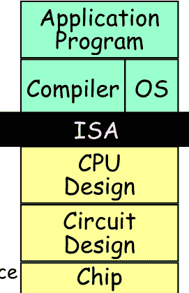

## 指令集架构 #3
- ISA 定义处理器家族
  - 两大类：RISC 和 CISC
    - RISC: SPARC, MIPS, PowerPC, ARM
    - CISC: X86（或称为 IA32）
- 在相同的 ISA 下，有许多不同的处理器
  - 来自不同的制造商
    - X86 来自 Intel、AMD 和 VIA
  - 不同的型号
    - 8086, 80386, Pentium, Pentium 4

## Y86 处理器状态
- 程序寄存器
  - 与 IA32 相同的 8 个寄存器，每个 32 位
- 条件码
  - 由算术或逻辑指令设置的单比特标志
    - OF：溢出  ZF：零  SF：负数
- 程序计数器
  - 指示指令的地址
- 内存
  - 字节可寻址的存储数组
  - 字以小端字节序存储


## Y86 指令
- 格式（P259）
  - 从内存读取 1--6 字节的信息
    - 可以从第 1 个字节确定指令长度
    - 指令类型不如 IA32 多，编码也比 IA32 简单
  - 每条指令都会访问和修改程序状态的某些部分

| 长度 |  | 字节0 | 字节1 | 字节2 | 字节3 | 字节4 | 字节5 |
|---|---|---|---|---|---|---|---|
| 1 | nop | 0 | 0 |  |  |  |  |
| 1 | halt | 1 | 0 |  |  |  |  |
| 2 | rrmovl rA,rB | 2 | 0 | rA rB |  |  |  |
| 6 | irmovl V,rB | 3 | 0 | rA rB | V |  |  |
| 6 | rmmovl rA,D(rB) | 4 | 0 | rA rB | Dest |  |  |
| 6 | mrmovl D(rB),rA | 5 | 0 | rA rB | Dest |  |  |
| 2 | opl rA,rB | 6 | fn | rA rB |  |  |  |
| 2 | addl rA,rB | 6 | 0 | rA rB |  |  |  |
| 2 | subl rA,rB | 6 | 1 | rA rB |  |  |  |
| 2 | andl rA,rB | 6 | 2 | rA rB |  |  |  |
| 2 | xorl rA,rB | 6 | 3 | rA rB |  |  |  |
| 5 | jxx Dest | 7 | fn | Dest |  |  |  |
| 5 | jmp Dest | 7 | 0 | Dest |  |  |  |
| 5 | jle Dest | 7 | 1 | Dest |  |  |  |
| 5 | jl Dest | 7 | 2 | Dest |  |  |  |
| 5 | je Dest | 7 | 3 | Dest |  |  |  |
| 5 | jne Dest | 7 | 4 | Dest |  |  |  |
| 5 | jge Dest | 7 | 5 | Dest |  |  |  |
| 5 | jg Dest | 7 | 6 | Dest |  |  |  |
| 5 | call Dest | 8 | 0 | Dest |  |  |  |
| 1 | ret | 9 | 0 |  |  |  |  |
| 2 | pushl rA | A | 0 | rA 8 |  |  |  |
| 2 | popl rA | B | 0 | rA 8 |  |  |  |

## Y86 指令集


## 编码寄存器

- 每个寄存器有 4 位 ID
  - 与 IA32 中的编码相同，但 IA32 仅使用 3 位 ID

| 寄存器 | ID |
|---|---|
| %eax | 0 |
| %ecx | 1 |
| %edx | 2 |
| %ebx | 3 |
| %esi | 6 |
| %edi | 7 |
| %esp | 4 |
| %ebp | 5 |

- 寄存器 ID “F” 表示“无寄存器”
  - 我们将在硬件设计的多个地方用到它

## 逻辑设计与 HCL

## 逻辑设计

- 数字电路
  - 什么是数字电路？
  - 了解 CPU 将基于什么？
- 硬件控制语言（HCL）
  - 一种简单且功能性的语言，用于描述我们的 CPU 实现
  - 语法类似 C

## 电路类别

- 模拟电路
  - 使用信号的全范围
  - 大部分是放大器
  - 难以建模和自动设计
  - 以晶体管和电容为基础
  - 此处不讨论

## 电路类别

- 数字电路
  - 只有两个值：0 和 1
  - 易于建模和设计
  - 使用真值表等工具进行分析
  - 以门电路为基础
  - 不同电路中的 1 电压不同
    - 例如，TTL 电路以 5 伏电压作为 1

## 数字信号

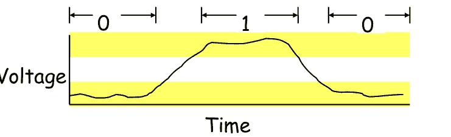

- 使用电压阈值从连续信号中提取离散值
- 最简单的形式：1 位信号
  - 要么是高范围（1），要么是低范围（0）
  - 两者之间有保护范围
- 不易受噪声或低质量电路元件的影响
  - 可以使电路简单、小巧且快速

## 逻辑设计概述

- 基本硬件需求
  - 通信
    - 如何将值从一个地方传输到另一个地方
  - 计算
  - 存储（内存）
  - 时钟信号

## 逻辑设计概述

- 位是我们的朋友
  - 一切都用值 0 和 1 表示
  - 通信
    - 电线上的低或高电压
  - 计算
    - 计算布尔函数
  - 存储
  - 时钟信号

## 数字电路类别

- 组合电路
  - 无内存，因此电路不能有状态。任何相同输入在任何时候都会得到相同输出。
  - 不需要时钟信号
  - 典型应用：ALU

## 数字电路类别

- 时序电路
  - = 组合电路 + 内存和时钟信号
  - 有状态。两个相同输入可能不会产生相同输出。
  - 使用时钟信号控制电路运行。
  - 典型应用：CPU

## 用逻辑门进行计算

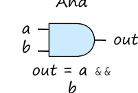

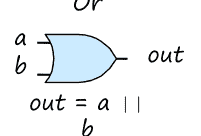

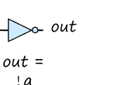

- 输出是输入的布尔函数
- 不是赋值操作，只是给电路一个名称
- 持续响应输入的变化
  - 带有一些微小的延迟

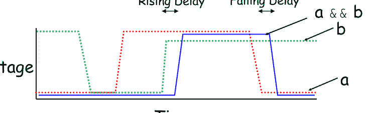

## 位相等

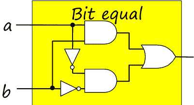

HCL 表达式

```
bool eq = (a&&b) || (!a&&!b)
```

- 如果 a 和 b 相等则生成 1
- 硬件控制语言（HCL）
  - 非常简单的硬件描述语言
    - 布尔运算的语法类似于 C 语言中的逻辑运算
  - 我们将用它来描述处理器的控制逻辑

## 字相等

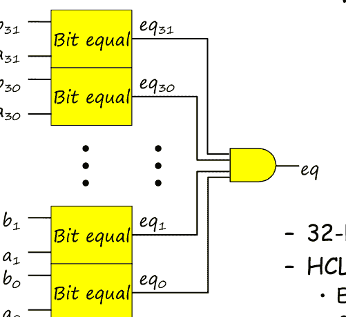

### 字级表示

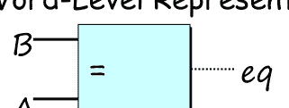

### HCL 表示

```
bool Eq = (A == B)
```

- 32 位字长
- HCL 表示
  - 相等运算
  - 生成布尔值

## 位级多路选择器

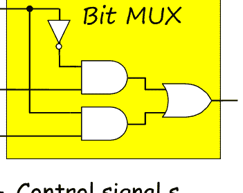

### HCL 表达式

```
bool out = (s&&a) || (!s&&b)
```

- 控制信号 s
- 数据信号 a 和 b
- 当 s=1 时输出 a，当 s=0 时输出 b
- 名称：MUX
- 用途：从多个信号中选择一个信号


## 字多路选择器

## 字级表示

## HCL 表示 ?

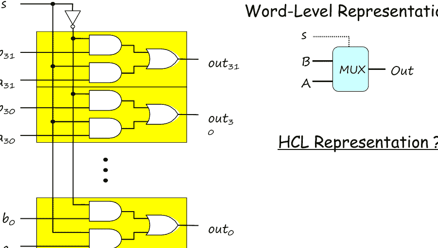

## 字多路选择器

- HCL 表示
  - 根据控制信号 s 选择输入字 A 或 B
  - HCL 表示
    - 分支表达式
    - 一系列 测试:值 对（不需要互斥）
- 第一个成功测试的输出值

```
int Out = [
  s : A;
  1 : B;
];
default case
```

## HCL 字级示例

## 三个字中的最小值

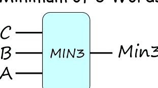

## HCL 表示

```
int Min3 = [
  A < B && A < C : A;
  B < A && B < C : B;
  1               : C;
];
```

- 找出三个输入字中的最小值
- HCL 分支表达式
- 最后一个分支保证匹配

## HCL 字级示例

## 四路多路选择器

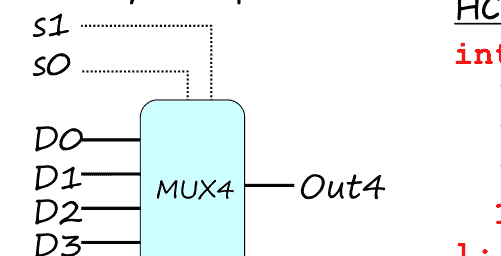

## HCL 表示

```
int Out4 = [
  !s1&&!s0: D0;
  !s1      : D1;
  !s0      : D2;
  1        : D3;
];
```

- 基于两个控制位选择四个输入之一
- HCL 分支表达式
- 通过假设顺序匹配来简化测试

## 算术逻辑单元

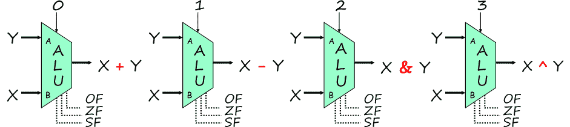

- 组合逻辑
  - 持续响应输入
- 控制信号选择计算的功能
  - 对应 Y86 中的四种算术/逻辑操作
- 同时计算条件码的值
- 我们将把它用作 CPU 的基本组件

## 存储

- 时钟寄存器
  - 例如：程序计数器(PC)、条件码(CC)
  - 保存单个字或位
  - 时钟上升时载入
  - 不是“程序寄存器”

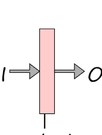

## 寄存器操作

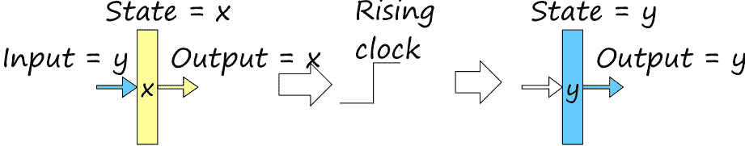

- 存储数据位
- 大部分时间充当输入和输出之间的屏障
- 时钟上升时，载入输入

## 状态机示例

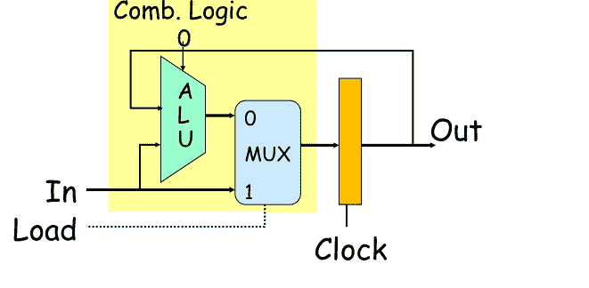

## 状态机示例

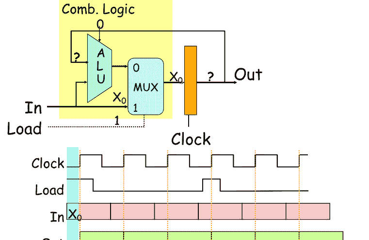

## 状态机示例

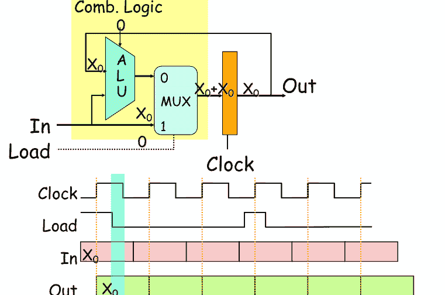

## 状态机示例

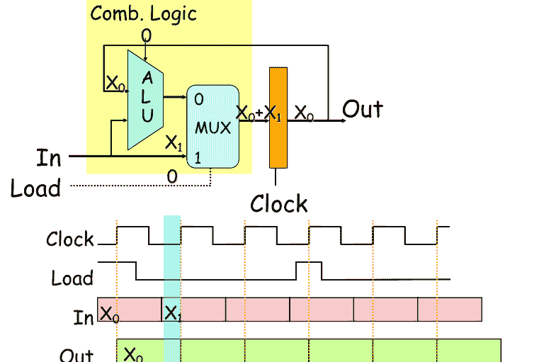

## 状态机示例

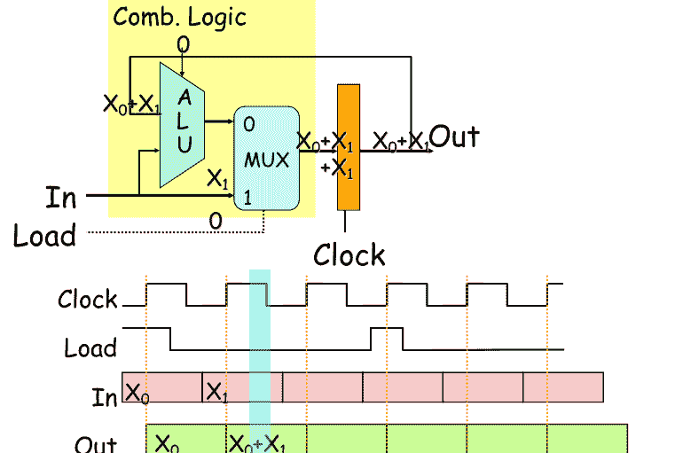

## 状态机示例

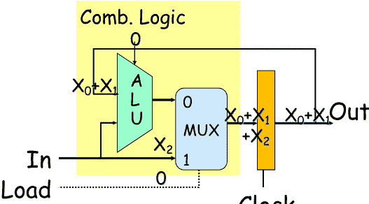

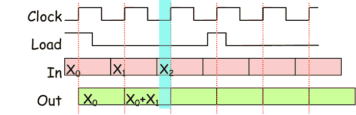

## 状态机示例

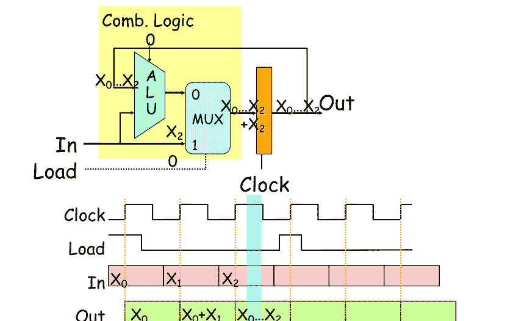

## 状态机示例

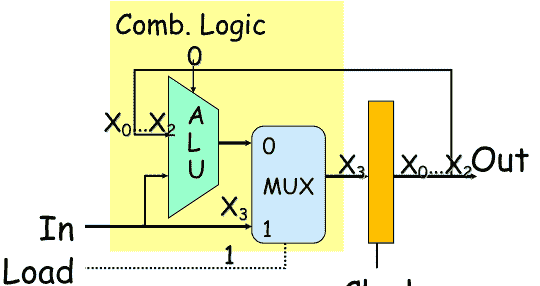

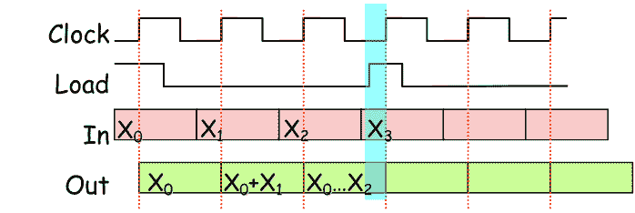

## 状态机示例

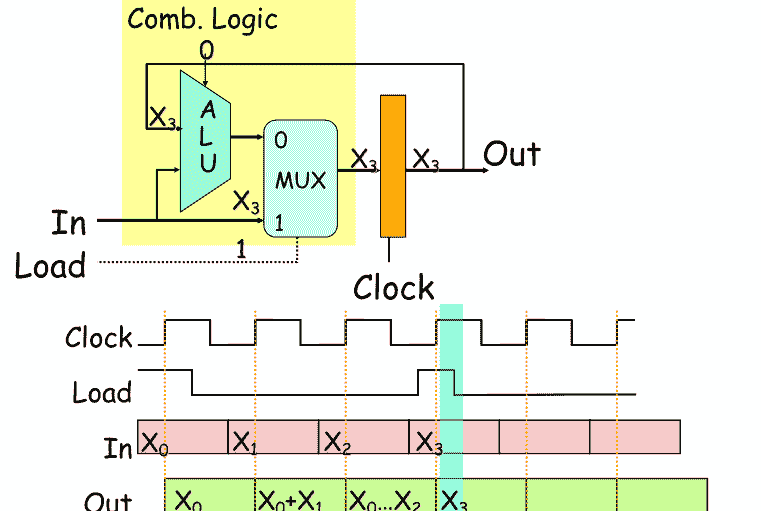

## 状态机示例

- 累加器电路
- 在每个周期载入或累加

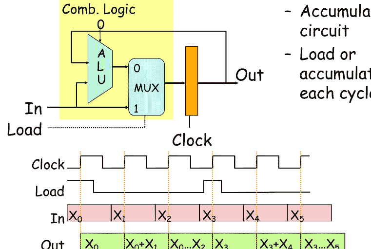

## 存储

- 随机访问存储器
  - 例如：寄存器文件、存储器
  - 保存多个字
    - 地址输入指定要读或写的字
  - 可能有多个读或写端口
  - 当地址输入改变时读字
  - 时钟上升时写字

## 寄存器文件

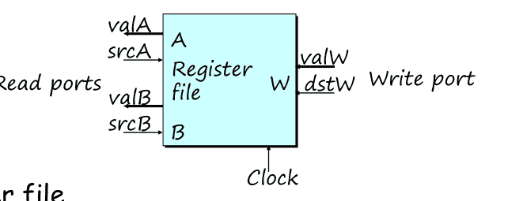

- 寄存器文件
  - 保存程序寄存器的值
  - %eax、%esp 等
  - 寄存器标识符用作地址
    - 标识 "F" 表示不执行读或写
- 多端口
  - 可以在一个周期内读取和/或写入多个字
    - 每个端口都有独立的地址和数据输入/输出

## 寄存器文件时序

- 读
  - 类似组合逻辑
  - 输出数据根据输入地址生成（经过一定延迟）
- 写
  - 类似寄存器
  - 仅在时钟上升时更新

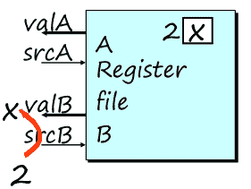

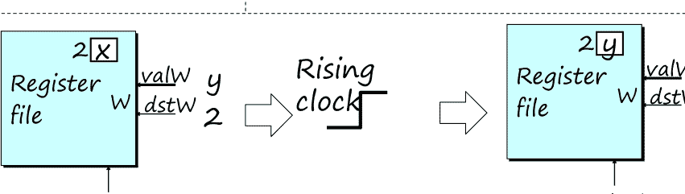


## 内存

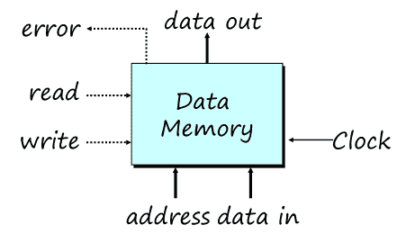

- Memory
  - 存放程序数据和指令
- Ports
  - 一个地址输入
  - 写操作的数据输入，和读操作的数据输出
  - 错误信号表示地址无效

## 总结

- Computation
  - 由 _combinational_ 逻辑执行
  - 计算“布尔”函数
  - 持续响应输入变化

## 总结

- Storage
  - Clocked Registers
    - 存放单个字，例如 PC、CC
    - 在时钟上升沿加载
  - Random-access memories
    - 存放多个字，例如寄存器文件、内存
    - 可能存在多个读或写端口
    - 地址输入变化时读取字
    - 在时钟上升沿写入字

## Sequential CPU Implementation

## 概要

- SEQ timing
- Organizing Processing into Stages
- Suggested Reading 4.3.1 ~ 4.3.3

## What is SEQ ?

- SEQ: Sequential Processor
  - Y86 处理器
  - 在每个周期处理一条完整指令
- What we have and we need?
  - Combinational logic and storage
  - ALU、Register File、Memory、PC 和 CC

## SEQ Components

Combinational Logic


Clocked Register


Memory


## SEQ Components

Combinational Logic

Clocked Register

Memory

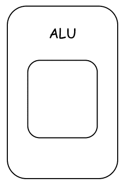

## SEQ Components

Combinational Logic

Clocked Register

Memory

Combinational Logic

ALU


## SEQ Components

Combinational Logic

Clocked Register

Memory

Combinational Logic

ALU

Memory

Register File

## SEQ Components

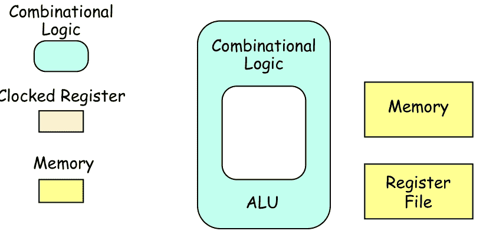

## SEQ Components

Combinational Logic

Clocked Register

Memory

Combinational Logic

ALU

CC

Memory

Register File

PC

## SEQ Components

Combinational Logic

Clocked Register

Memory

Combinational Logic

ALU

CC

Memory

Register File

PC

## SEQ Components

Combinational Logic

Clocked Register

Memory

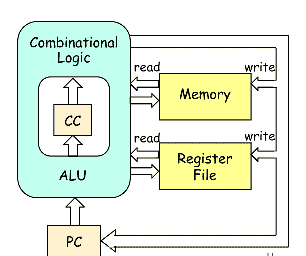

## SEQ Components

- Combinational Logic
  - ALU
  - Control logic
  - Memory reads
    - Inst. memory
    - Data memory
    - Register file

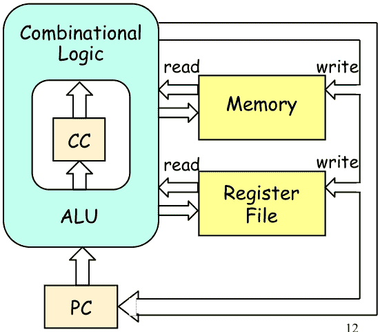

## SEQ Components

- Sequential Logic
  - Program counter (PC)
  - Condition code (CC)
  - Register File
  - Memories
  - a single clock signal
    (All updated as clock rises)

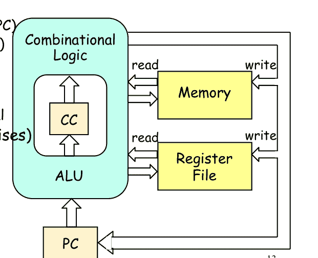

## Process Instruction on SEQ

- SEQ
  - 在每个周期处理一条完整指令
  - 一个时钟控制所有状态
    - 加载 *CC* 和新的 *PC*
    - 写入寄存器文件和内存

> > 处理器在完成本条指令的处理时，无需读取该指令更新的状态。

## Beginning of Cycle 3

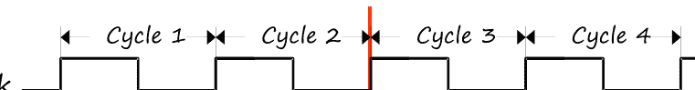

| Cycle | Instruction |
|---|---|
| Cycle 1: | 0x000: irmovl $0x100,%ebx  # %ebx←0x100 |
| Cycle 2: | 0x006: irmovl $0x200,%edx  # %edx←0x200 |
| Cycle 3: | 0x00c: addl %edx,%ebx  # %ebx←0x300 CC←000 |
| Cycle 4: | 0x00e: je dest  # Not taken |

## Beginning of Cycle 3

```
Cycle 2: 0x006: irmovl $0x200,%edx # %edx←0x200
```

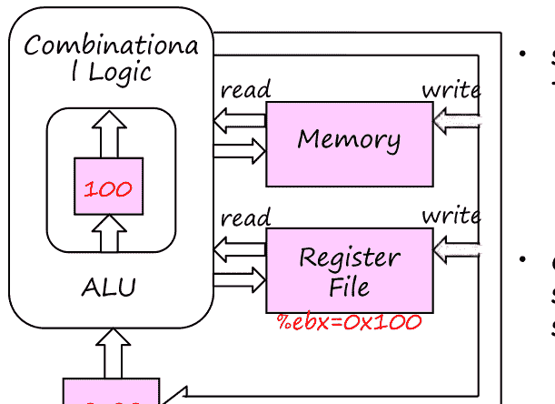

- state set according to 2nd instruction
  - PC: 0x00C
  - CC: 100 (assume)
  - %edx: 0x200
  - %ebx: 0x100
- combinational logic starting to react to state changes

## End of Cycle 3

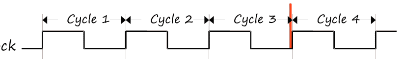

Cycle 1: 0x000: irmovl $0x100,%ebx  # %ebx←0x100

Cycle 2: 0x006: irmovl $0x200,%edx  # %edx←0x200

Cycle 3: 0x00c: addl %edx,%ebx  # %ebx←0x300 CC←000

Cycle 4: 0x00e: je dest  # Not taken


## 周期 3 结束

Cycle 3: 0x00c: addl %edx,%ebx   # %ebx←0x300 CC←000

+   - state set according to 2nd instruction
+   - combinational logic generates results for 3rd instruction

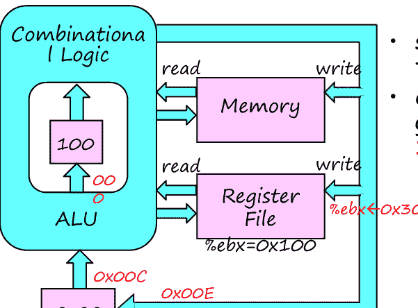

## 周期 4 开始

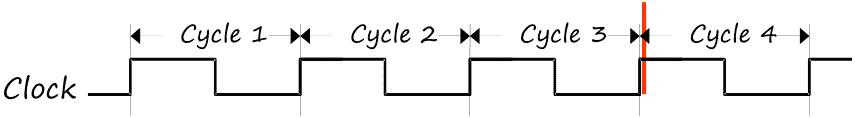

| Cycle | Instruction | Description |
|---|---|---|
| Cycle 1: | `0x000: irmovl $0x100,%ebx` | `%ebx←0x100` |
| Cycle 2: | `0x006: irmovl $0x200,%edx` | `%edx←0x200` |
| Cycle 3: | `0x00c: addl %edx,%ebx` | `%ebx←0x300  CC←000` |
| Cycle 4: | `0x00e: je dest` | `Not taken` |

## 周期 4 开始

Cycle 4: 0x00e: je dest # Not taken

+   - state set according to 3rd instruction
+     - PC: 0x00E
+     - CC: 000
+     - %edx: 0x200
+     - %ebx: 0x300
+   - combinational logic starting to react to state changes

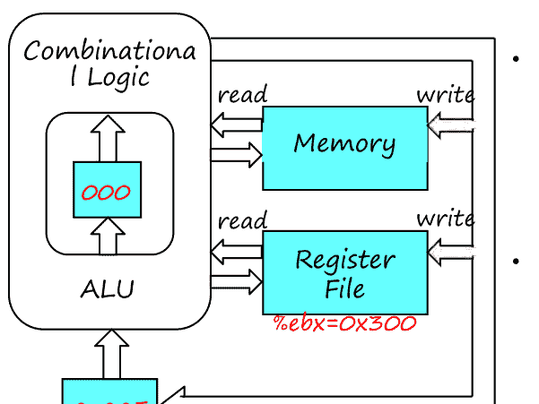

## 周期 4 结束

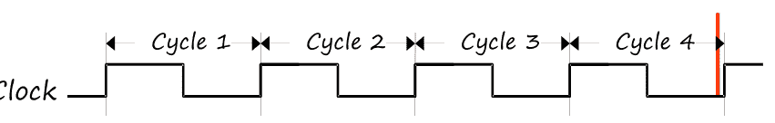

```
Cycle 1: 0x000: irmovl $0x100,%ebx # %ebx←0x100
```

```
Cycle 2: 0x006: irmovl $0x200,%edx # %edx←0x200
```

```
Cycle 3: 0x00c: addl %edx,%ebx   # %ebx←0x300 CC←000
```

```
Cycle 4: 0x00e: je dest   # Not taken
```

## 周期 4 结束

Cycle 4: 0x00e: je dest # Not taken

+   - state set according to 3rd instruction
+   - combinational logic generates results for 4th instruction

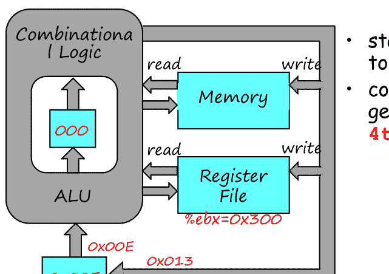

## 如何设计 SEQ ？

+   - Naïve Design: One-by-one
+     - Straightforward, but waste
+   - Advanced Design: Multi-stages
+     - Formulate instruction execution as sequence of simple steps (stages)
+       - Like: function for programming
+     - Best use of hardware
+     - Challenge: use same general form for all instructions

## Y86 指令解码

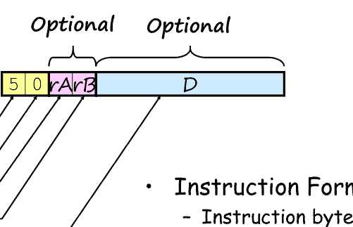

+   - Instruction Format
+     - Instruction byte
+     - Optional register byte
+     - Optional constant word

icode:ifun
rA:rB
valC

## Y86 指令集

Byte
0 1 2 3 4 5
nop
0 0
halt
1 0
rrmovl rA,rB
2 0 rA rB
irmovl V,rB
3 0 F rB V
rmmovl rA,D(rB)
4 0 rA rB D
mrmovl D(rB),rA
5 0 rA rB D
OP1 rA, rB
6 fn rA rB
addl 6 0
subl 6 1
andl 6 2
xorl 6 3

## Y86 指令集

| Instruction | Encoding |
|---|---|
| `jXX Dest` | `7 fn` + `Dest` |
| `call Dest` | `8 0` + `Dest` |
| `ret` | `9 0` |
| `pushl rA` | `A 0 rA F` |
| `popl rA` | `B 0 rA F` |

Byte positions: `0 1 2 3 4 5`

Jump-function encodings:

| Instruction | Code |
|---|---|
| `jmp` | `7 0` |
| `jle` | `7 1` |
| `jl` | `7 2` |
| `je` | `7 3` |
| `jne` | `7 4` |
| `jge` | `7 5` |
| `jg` | `7 6` |

## 指令执行阶段

+   - Fetch
+     - Read instruction from instruction memory
+   - Decode
+     - Read program registers
+   - Execute
+     - Compute value or address
+   - Memory
+     - Read or write data
+   - Write Back
+     - Write program registers
+   - PC
+     - Update program counter


PC

Write back

Memory

Data memory

Execute

CC

ALU

Decode

A B E Register File

Fetch

Instruction memory

PC increment

PC

## SEQ 硬件结构

+   - Instruction Flow
+     - Read instruction at address specified by PC: 1
+     - Process through stages: 2→5
+     - Update program counter: 6

## 执行算术/逻辑操作

opl rA, rB    6 fn rA rB

+   - Fetch
+     - Read 2 bytes
+   - Decode
+     - Read operand registers
+   - Execute
+     - Perform operation
+     - Set Condition Ccodes

+   - Memory
+     - Do nothing
+   - Write back
+     - Update register rB
+   - PC Update
+     - Increment PC by 2

## 阶段计算: 算术/逻辑操作

|  | OPl rA, rB |  |
|---|---|---|
| Fetch | icode:ifun ← M₁[PC]
rA:rB ← M₁[PC+1]

valP ← PC+2 | Read instruction byte
Read register byte

Compute next PC |
| Decode | valA ← R[rA]
valB ← R[rB] | Read operand A
Read operand B |
| Execute | valE ← valB ifun
Set CC | Perform ALU operation
Set condition code register |
| Memory |  |  |
| Write back | R[rB] ← valE | Write back result |
| PC update | PC ← valP | Update PC |


## 阶段计算：算术/逻辑操作

|  | OP1 rA, rB | subl %edx, %ebx 0x00C: |
|---|---|---|
| Fetch | icode:ifun ← M1[PC] rA:rB ← M1[PC+1] valP ← PC+2 | icode:ifun ← M1[0x00C] = rA:rB ← M1[0x00C+1] = valP ← 0x00C+2 = 0x00E |
| Decode | valA ← R[rA] valB ← R[rB] | valA ← R[%edx] = 9 valB ← R[%ebx] = 21 |
| Execute | valE ← valB ifun Set CC | valE ← 21 - 9 = 12 ZF ← 0, SF ← 0, OF ← 0 |
| Memory |  |  |
| Write back | R[rB] ← valE | R[%ebx] ← valE = 12 |
| PC update | PC ← valP | PC ← valP = 0x00E |

## PC

Write back

Memory

Execute

Decode

icode:ifun, rA:rB

Fetch

Instruction memory

PC increment

PC

Register File

Data memory

CC

ALU

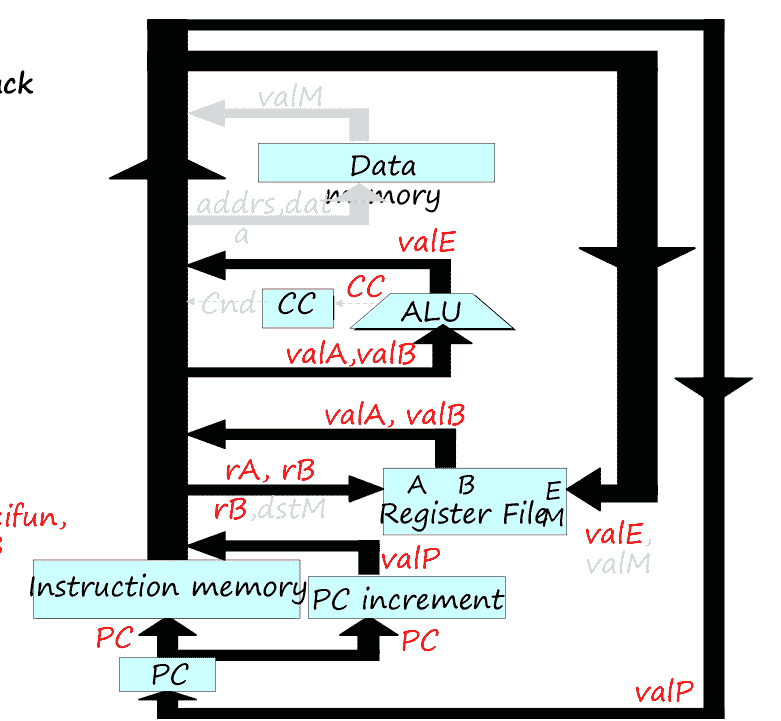

## 执行 rrmovl

```
rrmovl rA, rB    2 0 rA rB
```

- Fetch
  - Read 2 bytes
- Decode
  - Read operand register rA
- Execute
  - Do nothing
- Memory
  - Do nothing
- Write back
  - Update register rB
- PC Update
  - Increment PC by 2

## 阶段计算：rrmovl

|  | rrmovl rA, rB |  |
|---|---|---|
| Fetch | icode:ifun ← M₁[PC] rA:rB ← M₁[PC+1] valP ← PC+2 | Read instruction byte Read register byte Compute next PC |
| Decode | valA ← R[rA] | Read operand A |
| Execute | valE ← O + valA | Perform ALU operation (generalization) |
| Memory |  |  |
| Write back | R[rB] ← valE | Write back result |
| PC update | PC ← valP | Update PC |

PC

Write back

Memory

Execute

Decode

Fetch

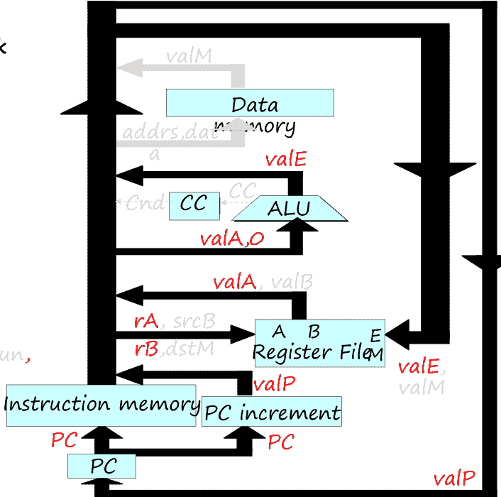

Data memory

CC

ALU

Register File

Instruction memory

PC increment

PC

icode: ifun, rA:rB

rA, srcB

rB, dstM

valA, valB

valE

valA,0

valP

valE

valM

valP

PC

## 执行 irmovl

```
irmovl V, rB  3 0 F rB  V
```

- Fetch
  - Read 6 bytes
- Decode
  - Do nothing
- Execute
  - Do nothing
- Memory
  - Do nothing
- Write back
  - Update register rB
- PC Update
  - Increment PC by 6

## 阶段计算：`irmovl`

| Stage | Computation |
|---|---|
| **Fetch** | `icode:ifun ← M₁[PC]` `rA:rB ← M₁[PC+1]` `valC ← M₄[PC+2]` `valP ← PC+6` |
| **Decode** |  |
| **Execute** | `valE ← 0 + valC` |
| **Memory** |  |
| **Write back** | `R[rB] ← valE` |
| **PC update** | `PC ← valP` |

Read instruction byte

Read register byte

Read constant value

Compute next PC

Perform ALU operation

> generalization

Write back result

Update PC

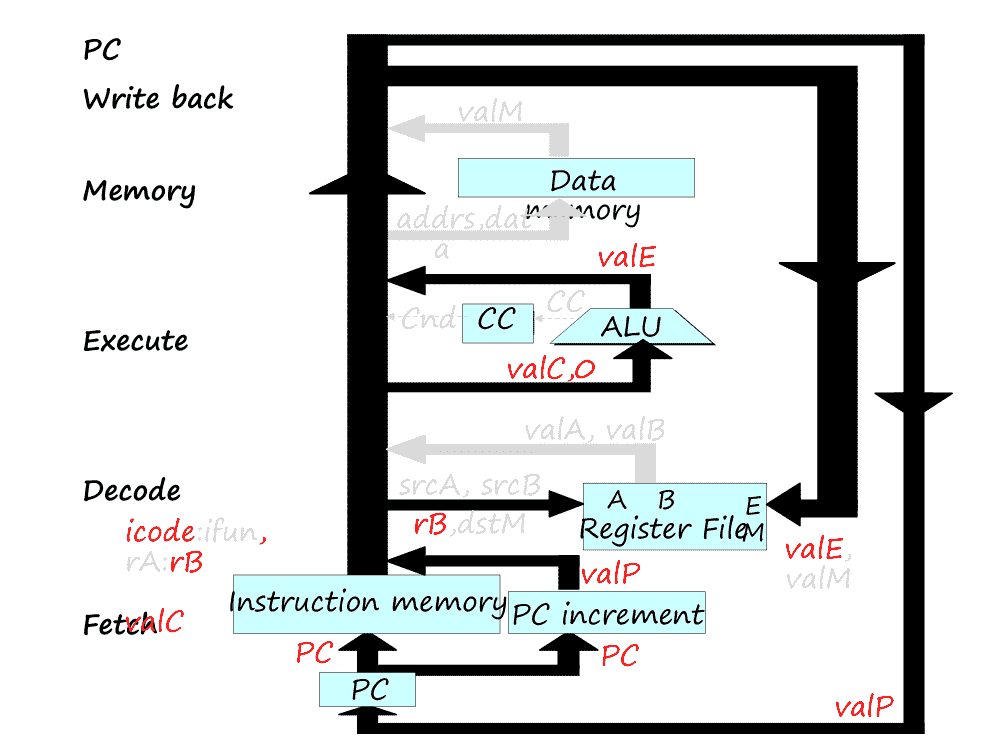

## 执行 rmmovl

```
rmmovl rA, D(rB) 4 0 rA rB D
```

- Fetch
  - Read 6 bytes
- Decode
  - Read operand registers
- Execute
  - Compute effective address
- Memory
  - Write to memory
- Write back
  - Do nothing
- PC Update
  - Increment PC by 6

## 阶段计算：rmmovl

|  | rmmovl rA, D(rB) |  |
|---|---|---|
| Fetch | icode:ifun ← M₁[PC] rA:rB ← M₁[PC+1] valC ← M₄[PC+2] valP ← PC+6 | Read instruction byte Read register byte Read displacement D Compute next PC |
| Decode | valA ← R[rA] valB ← R[rB] | Read operand A Read operand B |
| Execute | valE ← valB + valC | Compute effective address |
| Memory Write back | M₄[valE] ← valA | Write value to memory |
| PC update | PC ← valP | Update PC |

- Use ALU for address computation

## 执行 mrmovl

```
mrmovl D(rB),rA 5 0 rA rB D
```

- Fetch
  - Read 6 bytes
- Decode
  - Read operand register rB
- Execute
  - Compute effective address
- Memory
  - Read from memory
- Write back
  - Update register rA
- PC Update
  - Increment PC by 6

## 阶段计算：mrmovl

|  | mrmovl D(rB), rA |  |
|---|---|---|
| Fetch | icode:ifun ← M₁[PC] rA:rB ← M₁[PC+1] valC ← M₄[PC+2] valP ← PC+6 | Read instruction byte Read register byte Read displacement D Compute next PC |
| Decode | valB ← R[rB] | Read operand B |
| Execute | valE ← valB + valC | Compute effective address |
| Memory | valM ← M₄[valE] | Read data from memory |
| Write back | R[rA] ← valM | Update register rA |
| PC update | PC ← valP | Update PC |

- Use ALU for address computation


## 执行 pushl

```
`pushl rA`  `a 0 rA F`
```

- **Fetch**
  - Read 2 bytes
- **Decode**
  - Read stack pointer and register rA
- **Execute**
  - Decrement stack pointer by 4

- **Memory**
  - Store valA at the address of new stack pointer
- **Write back**
  - Update stack pointer
- **PC Update**
  - Increment PC by 2

## 阶段计算：pushl

|  | pushl rA |  |
|---|---|---|
| Fetch | icode:ifun ← M₁[PC]
rA:rB ← M₁[PC+1]
valP ← PC+2 | Read instruction byte
Read register byte
Compute next PC |
| Decode | valA ← R[rA]
valB ← R[%esp] | Read valA
Read stack pointer |
| Execute | valE ← valB + (-4) | Decrement stack pointer |
| Memory | M₄[valE] ← valA | Store to stack |
| Write back | R[%esp] ← valE | Update stack pointer |
| PC update | PC ← valP | Update PC |

- Use ALU to decrement stack pointer

## 执行 popl

```
popl rA
b 0 rA F
```

- Fetch
  - Read 2 bytes
- Decode
  - Read stack pointer
- Execute
  - Increment stack pointer by 4

- Memory
  - Read from old stack pointer
- Write back
  - Update stack pointer
  - Update register rA
- PC Update
  - Increment PC by 2

## 阶段计算：popl

|  | popl rA |  |
|---|---|---|
| Fetch | icode:ifun ← M₁[PC]
rA:rB ← M₁[PC+1]
valP ← PC+2 | Read instruction byte
Read register byte
Compute next PC |
| Decode | valA ← R[%esp]
valB ← R[%esp] | Read stack pointer
Read stack pointer |
| Execute | valE ← valB + 4 | Increment stack pointer |
| Memory | valM ← M₄[valA] | Read from stack |
| Write back | R[%esp] ← valE
R[rA] ← valM | Update stack pointer
Write back result |
| PC update | PC ← valP | Update PC |

- Use ALU to increment stack pointer

update two registers (special: rA=%esp)

## 执行跳转

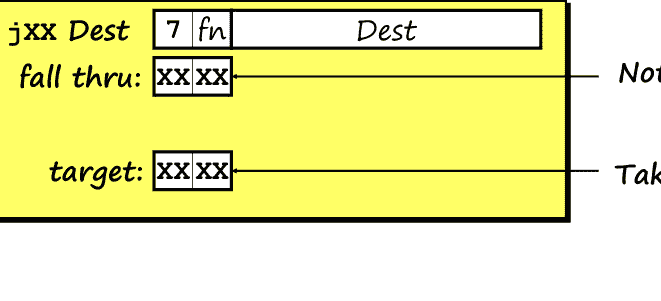

## 阶段计算：跳转

|  | jXX Dest |
|---|---|
| Fetch | icode:ifun ← M₁[PC]
valC ← M₄[PC+1]
valP ← PC+5 |
| Decode |  |
| Execute | Cnd ← Cond(CC,ifun) |
| Memory |  |
| Write back |  |
| PC update | PC ← Cnd ? valC : valP |

Read instruction byte

Read destination address
Fall through address

Compute both addresses

Take branch?

Update PC

Chose based on CC and ifun


## 执行 call

- Fetch
  - Read 5 bytes
  - Increment PC by 5
- Decode
  - Read stack pointer
- Execute
  - Decrement stack pointer by 4
- Memory
  - Write incremented PC to new value of stack pointer
- Write back
  - Update stack pointer
- PC Update
  - Set PC to Dest

## 阶段计算：call

|  | call Dest |  |
|---|---|---|
| Fetch | icode:ifun ← M₁[PC]
valC ← M₄[PC+1]
valP ← PC+5 | Read instruction byte
Read destination address
Compute return point |
| Decode | valB ← R[%esp] | Read stack pointer |
| Execute | valE ← valB + -4 | Decrement stack pointer |
| Memory | M₄[valE] ← valP | Write return value on stack |
| Write back | R[%esp] ← valE | Update stack pointer
Store incremental PC |
| PC update | PC ← valC | Set PC to destination |

- Use ALU to decrement stack pointer


## 执行 ret

- Fetch
  - Read 1 byte
- Decode
  - Read stack pointer
- Execute
  - Increment stack pointer by 4
- Memory
  - Read return address from old stack pointer
- Write back
  - Update stack pointer
- PC Update
  - Set PC to return address

## 阶段计算：ret

|  | ret |  |
|---|---|---|
| Fetch | icode:ifun ← M₁[PC] | Read instruction byte |
| Decode | valA ← R[%esp]
valB ← R[%esp] | Read operand stack
Reinterpret operand stack pointer |
| Execute | valE ← valB + 4 | increment stack pointer |
| Memory | valM ← M₄[valA] | Read return address |
| Write back | R[%esp] ← valE | Update stack pointer |
| PC update | PC ← valM | Set PC to return address |

- Use ALU to increment stack pointer


## 执行 `cmovXX`


- **Fetch**
  - Read 2 bytes
- **Decode**
  - Read operand register rA
- **Execute**
  - Determine whether to move
- **Memory**
  - Do nothing
- **Write back**
  - Update register rB if move taken
- **PC Update**
  - Increment PC by 2

## 阶段计算：cmovXX

|  | cmovXX rA, rB |  |
|---|---|---|
| Fetch | icode:ifun ← M₁[PC] rA:rB ← M₁[PC+1] valP ← PC+2 | Read instruction byte Read register byte Compute next PC |
| Decode | valA ← R[rA] | Read operand A |
| Execute | valE ← O + valA Cnd ← Cond(CC,ifun) | Perform ALU operation Take move? |
| Memory |  |  |
| Write back | Cnd ? R[rB] ← valE : - | Write back result if move taken |
| PC update | PC ← valP | Update PC |

## 计算步骤

| Stage | Signals | Computation | Description |
|---|---|---|---|
| Fetch | `icode,ifun` | `icode:ifun ← M₁[PC]` | Read instruction byte |
| Fetch | `rA,rB` | `rA:rB ← M₁[PC+1]` | Read register byte |
| Fetch | `valC` |  | Read constant word |
| Fetch | `valP` | `valP ← PC+2` | Compute next PC |
| Decode | `valA, srcA` | `valA ← R[srcA]` | Read operand A |
| Decode | `valB, srcB` | `valB ← R[srcB]` | Read operand B |
| Execute | `valE` | `valE ← valB OP valA` | Perform ALU operation |
| Execute | `Cond code` | `Set CC` | Set condition code reg. |
| Memory | `valM` |  | Read/Write Memory |
| Write Back | `dstE` | `R[rB] ← valE` | Write back ALU result |
| Write Back | `dstM` |  | Write back Memory |
| PC update | `PC` | `PC ← valP` | Update PC |

- All instructions follow same general pattern
- Differ in what gets computed on each step

## 计算步骤

|  |  | OP1 rA, rB | call Dest |
|---|---|---|---|
| **Fetch** | icode,ifun | icode:ifun ← M₁[PC] | icode:ifun ← M₁[PC] |
|  | rA,rB | rA:rB ← M₁[PC+1] |  |
|  | valC |  | valC ← M₄[PC+1] |
|  | valP | valP ← PC+2 | valP ← PC+5 |
| **Decode** | valA, srcA | valA ← R[rA] |  |
|  | valB, srcB | valB ← R[rB] | valB ← R[%esp] |
| **Execute** | valE | valE ← valB OP valA | valE ← valB + −4 |
|  | Cond code | Set CC |  |
| **Memory** | valM |  | M₄[valE] ← valP |
| **Write Back** | dstE | R[rB] ← valE | R[%esp] ← valE |
|  | dstM |  |  |
| **PC update** | PC | PC ← valP | PC ← valC |

- All instructions follow same general pattern
- Differ in what gets computed on each step


## 不确定值

## Decode

srcA location of valA
rA, %esp

srcB location of valB
rB, %esp

## Execute

aluA input A of ALU
valA, valC, +4, -4

aluB input B of ALU
valB, 0

## Memory

addr address of memory
valA, valE

data data of Memory
valA, valP

## Write back

dstE dest. of ALU result
rB, %esp

dstM dest of Memory
rA

## PC

newPC next of PC
valP, valC, valM

PC

Write back

Memory

Execute

Decode

Fetch


valM

Data memory

addrs,data

a

valE

CC

ALU

aluA, aluB

valA, valB

srcA, srcB

dstE, dstM

A   B   F
Register File

valE, valM

icode:ifun,
rA:rB

Instruction memory

PC increment

PC

newPC

## SEQ 语义

- Achieve the same effect as a sequential execution of the assignment shown in the tables of Figures 4.18 to 4.21
  - Though all of the state updates occur **simultaneously** at the clock rises to the next cycle.
  - A problem: `pop %esp` need to sequentially write two registers. So the register file control logic must process it.


## SEQ 总结

- Sequential Processor (SEQ)
  - Combinational logic + Sequential logic
  - Instruction executes in sequential
  - Every Instruction finished in one cycle.
  - Express every instruction as series of simple steps
    - Fetch, Decode, Execute, Memory, Write Back, PC


## SEQ CPU 实现

## 大纲

- SEQ 实现
- 推荐阅读 4.3.2, 4.3.4

## 我们今天要讨论什么？

- 顺序 CPU（SEQ）的实现
  - 每条指令在一个周期内完成。
  - 指令顺序执行。
  - 没有两条指令并行或重叠执行。

## SEQ 硬件结构

- 阶段
  - **取指**：从内存读取指令
  - **译码**：读取程序寄存器
  - **执行**：计算值或地址
  - **访存**：读取或写入数据
  - **写回**：写入程序寄存器
  - **PC**：更新程序计数器

PC

写回

访存

执行

译码

取指


valM

数据存储器

addrs, data

a

valE

CC

ALU

aluA, aluB

valA, valB

srcA, srcB

dstE, dstM

A B F  
寄存器文件

valE, valM

icode:ifun,  
rA:rB

指令存储器

PC 增量

PC

newPC

## 语义与实现之间的区别

- ISA
  - 每个阶段都可能更新一些状态；这些更新按顺序发生。
- SEQ
  - 所有状态更新操作在时钟上升沿同时发生。


## SEQ 硬件

- 蓝色方框：□ 重新设计的硬件模块
  - 例如，存储器、ALU
- 灰色方框：▭ 控制逻辑
  - 用 HCL 描述
- 白色椭圆：○ 信号标签
- 粗线：→ 32 位字值
- 细线：→ 4–8 位值
- 点线：.......→ 1 位值

## 取指逻辑


## 取指逻辑

- 预定义模块
  - PC：包含 PC 的寄存器
  - 指令存储器：读取 6 个字节（PC 到 PC+5）
  - 拆分：将指令字节划分为 icode 和 ifun
  - 对齐：获取 rA、rB 和 valC 字段


## 取指逻辑


- **控制模块**
  - **指令有效：** 这条指令是否有效？
  - **需要 regids：** 这条指令是否有寄存器字节？
  - **需要 valC：** 这条指令是否有一个常数字？
  - **icode|ifun：** 如果 `imem_error`，则设为 “nop”

## 一些宏

| 名称 | 值 | 含义 |
|---|---|---|
| RESP | 6 | `%esp` 的寄存器 ID |
| RNONE | F | 表示不访问寄存器文件 |
| ALUADD | 0 | 加法操作的函数 |
| SAOK | 1 | 正常操作的状态码 |
| SADR | 2 | 地址异常的状态码 |
| SINS | 3 | 非法指令异常的状态码 |
| SHLT | 4 | `halt` 的状态码 |

| 指令 | 字节编码 | 操作数 |
|---|---|---|
| `nop` | `0 0` | |
| `halt` | `1 0` | |
| `rrmovl rA, rB` | `2 0` | `rA rB` |
| `irmovl V, rB` | `3 0 8 rB V` | |
| `rmmovl rA, D(rB)` | `4 0 rA rB D` | |
| `mrmovl D(rB), rA` | `5 0 rA rB D` | |
| `OP1 rA, rB` | `6 fn rA rB` | |
| `jXX Dest` | `7 fn Dest` | |
| `call Dest` | `8 0 Dest` | |
| `ret` | `9 0` | |
| `pushl rA` | `A 0 rA 8` | |
| `popl rA` | `B 0 rA 8` | |

`need_regids`

## 取指控制逻辑

```c
bool need_regids = icode in
{ IRRMOVL, IIRMOVL, IRMMOVL,
IMRMOVL, IOPL, IPUSHL, IPOPL };

bool instr_valid = icode in
{ INOP, IHALT, IRRMOVL, IIRMOVL,
IRMMOVL, IMRMOVL, IOPL, IJXX,
ICALL, IRET, IPUSHL, IPOPL };
```

## 译码与写回逻辑


## 译码与写回逻辑


- 预定义模块
  - 寄存器文件
    - 读端口 A、B 和写端口 E、M
    - 地址是寄存器 ID 或 F（无访问）

## 译码与写回逻辑

- 控制逻辑
  - srcA：valA 的读端口地址 `{rA, %esp}`
  - srcB：valB 的读端口地址 `{rB, %esp}`
  - dstE：valE 的写端口地址 `{rB, %esp}`
  - dstM：valM 的写端口地址 `{rA}`
  - Cnd：用于决定是否设置 valE（cmovXX）


## A 源操作数

|  |  |  |
|---|---|---|
|  | opl rA, rB |  |
| Decode | valA ← R[rA] | 读取操作数 A |
|  | rmmovl rA, D(rB) |  |
| Decode | valA ← R[rA] | 读取操作数 A |
|  | popl rA |  |
| Decode | valA ← R[%esp] | 读取栈指针 |
|  | jxx Dest |  |
| Decode |  | 无操作数 |
|  | call Dest |  |
| Decode |  | 无操作数 |
|  | ret |  |
| Decode | valA ← R[%esp] | 读取栈指针 |

```
int srcA = [
    icode in { IRRMOVL, IRMMOVL,
                IOPL, IPUSHl } : rA;
    icode in { IPOPL, IRET } : RESP;
    1 : RNONE; # Don't need register
];
```

## E 目的操作数

|  | Instruction | Write-back | Description |
|---|---|---|---|
|  | opl rA, rB |  |  |
| Write-back | R[rB] ← valE |  | 写回结果 |
|  | rmmovl rA, D(rB) |  |  |
| Write-back |  | None |  |
|  | popl rA |  |  |
| Write-back | R[%esp] ← valE |  | 更新栈指针 |
|  | jxx Dest |  |  |
| Write-back |  | None |  |
|  | call Dest |  |  |
| Write-back | R[%esp] ← valE |  | 更新栈指针 |
|  | ret |  |  |
| Write-back | R[%esp] ← valE |  | 更新栈指针 |

```
int dstE = [
    icode in { IRRMOVL, IIRMOVL,
                IOPL} : rB;
    icode in { IPUSHL, IPOPL, ICALL,
                IRET } : RESP;
    1 : RNONE;  # Don't need register
];
// not conside cmovXX
```

## 执行逻辑


- **预定义模块**
  - ALU: 实现 4 个必需函数并生成条件码值
  - CC: 具有 3 个条件码位的寄存器
  - cond: 计算条件标志


- 控制逻辑
  - Set CC: 是否应加载条件码寄存器？
  - ALU A: 输入 A 到 ALU {valA, valC, +4, -4}
  - ALU B: 输入 B 到 ALU {valB, 0}
  - ALU fun: ALU 应计算什么函数？

## ALU A 输入

| 阶段 | 指令/ALU 输入 |
|---|---|
| Execute | `OPI rA, rB`<br>`valE ← valB OP valA` |
| Execute | `irmovl rA, D(rB)`<br>`valE ← valB + valC` |
| Execute | `popl rA`<br>`valE ← valB + 4` |
| Execute | `jXX Dest`<br>（空操作） |
| Execute | `call Dest`<br>`valE ← valB + -4` |
| Execute | `ret`<br>`valE ← valB + 4` |

Perform ALU operation

Compute effective address

Increment stack pointer

No operation

Decrement stack pointer

Increment stack pointer

```
int aluA = [
    icode in { IRMMOVL, IOPL } : valA;
    icode in { IIRMOVL, IRMMOVL, IMRMOVL } : valC;
    icode in { ICALL, IPUSHl } : -4;
    icode in { IRET, IPOPL } : 4;
    # Other instructions don't need ALU
];
```

## ALU 操作

| Stage | Instruction / Operation |
|---|---|
|  | `opl rA, rB` |
| Execute | `valE ← valB OP valA` |
|  | `rrmovl rA, D(rB)` |
| Execute | `valE ← valB + valC` |
|  | `popl rA` |
| Execute | `valE ← valB + 4` |
|  | `jXX Dest` |
| Execute |  |
|  | `call Dest` |
| Execute | `valE ← valB + -4` |
|  | `ret` |
| Execute | `valE ← valB + 4` |

Perform ALU operation

Compute effective address

Increment stack pointer

No operation

Decrement stack pointer

Increment stack pointer

## ALU 操作 / 条件设置

```
int alufun = [
    icode == IOPL : ifun;
    1 : ALUADD;
];
```

```
Bool set_cc = icode in { IOPL };
```

## 内存逻辑

- Predefined Blocks
  - Memory: Reads or writes memory word


- Control Logical
  - Mem. read: should word be read?
  - Mem. write: should word be written?
  - Mem. addr.: Select address {valA, valE}
  - Mem. data.: Select data {valA, valP}

## 内存地址

| Memory | `opl rA, rB` | No operation |
|---|---|---|
| Memory | `mrmovl rA, D(rB)` | Write value to memory |
| Memory | `M₄[valE] ← valA` | Write value to memory |
| Memory | `popl rA` | Read from stack |
| Memory | `valM ← M₄[valA]` | Read from stack |
| Memory | `jxx Dest` | No operation |
| Memory | `call Dest` | Write return value on stack |
| Memory | `M₄[valE] ← valP` | Write return value on stack |
| Memory | `ret` | Read return address |
| Memory | `valM ← M₄[valA]` | Read return address |


## 内存地址

```c
int mem_addr = [
    icode in { IRMMOVL, IPUSHL,
               ICALL, IMRMOVL } : valE;
    icode in { IPOPL, IRET } : valA;
    # Other instructions don't need address
];
```

## 内存读取

| 指令 | 内存操作 | 描述 |
|---|---|---|
| `op1 rA, rB` | 无操作 |  |
| `rmmovl rA, D(rB)` | `M₄[valE] ← valA` | Write value to memory |
| `popl rA` | `valM ← M₄[valA]` | Read from stack |
| `jxx Dest` | 无操作 |  |
| `call Dest` | `M₄[valE] ← valP` | Write return value on stack |
| `ret` | `valM ← M₄[valA]` | Read return address |

## PC 更新逻辑

- 新 PC
  - 选择 PC 的下一个值


## PC 更新

| 指令 | PC 更新 | 描述 |
|---|---|---|
| `op1 rA, rB` | `PC ← valP` | Update PC |
| `rmmovl rA, D(rB)` | `PC ← valP` | Update PC |
| `popl rA` | `PC ← valP` | Update PC |
| `jxx Dest` | `PC ← Cnd ? valC : valP` | Update PC |
| `call Dest` | `PC ← valC` | Set PC to destination |
| `ret` | `PC ← valM` | Set PC to return address |

## PC 更新

```c
int new_pc = [
    icode == ICALL : valC;
    icode == IJXX && Cnd : valC;
    icode == IRET : valM;
    1 : valP;
];
```


## SEQ 总结

- 实现
  - 将每条指令表达为一系列简单步骤
  - 对每种指令类型遵循相同的通用流程
  - 组装寄存器、存储器、预设计的组合逻辑块
  - 与控制逻辑连接

## SEQ 总结

- 限制
  - 太慢而无法实用
  - 在一个周期内，必须经过指令存储器、寄存器文件、ALU 和数据存储器
  - 需要非常缓慢地运行时钟
  - 硬件单元在时钟周期中只有很小一部分时间处于活动状态

## 流水线原理

## 大纲

- 流水线通用原理
  - 目标
  - 困难
- 建议阅读 4.4

## SEQ 的问题

- 太慢
  - 在一个时钟周期内需要完成太多任务
  - 信号需要很长时间才能通过所有阶段传播
  - 时钟必须足够慢地运行
- 不能很好地利用硬件单元
  - 每个单元在整个时钟周期中只有一部分时间处于活动状态

## 计算示例


- 系统
  - 计算总共需要 300 皮秒
  - 将结果保存到寄存器中还需要额外 20 皮秒
  - 时钟周期至少为 320 ps

## 3 级流水线版本


- 系统
  - 将组合逻辑分为 3 个各 100 ps 的块
  - 前一个操作通过阶段 A 后即可开始新操作
    - 每 120 ps 开始一次新操作
  - 总体延迟增加
    - 从开始到结束 360 ps

## 流水线图

- **非流水线**
  - OP1
  - OP2
  - OP3


- 必须等到前一个操作完成才能开始新操作

- **3 级流水线**


- 同时最多有 3 个操作在进行

## 限制：非均匀延迟


## 限制：非均匀延迟

- 吞吐量受最慢阶段限制
- 其他阶段大部分时间处于空闲状态
- 将系统划分为平衡的阶段具有挑战性

## 限制：寄存器开销

Clock

Delay = 420 ps,  
Throughput = 14.29 GOPS


## 限制：寄存器开销

- 随着尝试加深流水线，加载寄存器的开销变得更加显著
- 花在加载寄存器上的时钟周期百分比：
  - 1级流水线：6.25%
  - 3级流水线：16.67%
  - 6级流水线：28.57%
- 现代处理器设计通过非常深的流水线获得高速

## 数据依赖


- 系统
  - 每个操作都依赖于前一个操作的结果

## 数据冒险

Comb. logic A

Reg

Comb. logic B

Reg

Comb. logic C

Reg

Clock

OP1

OP2

OP3

OP4

Time


## 数据冒险

- 结果没有及时反馈以供下一个操作使用
- 流水线改变了系统的行为

```
1  irmovl $50, %eax
2  addl %eax, %ebx
3  mrmovl 100(%ebx), %edx
```

## SEQ+ CPU 实现

## 概要

- SEQ+ 实现
- 建议阅读 4.5.1

## SEQ 硬件 vs. SEQ+ 硬件

- SEQ 硬件
  - 阶段按顺序发生
  - 一次只有一个操作在进行
- SEQ+ 硬件
  - 仍是顺序实现
  - 将 PC 阶段重新排序至开头

## SEQ+ 硬件

- **PC 阶段**
  - 任务是为当前指令选择 PC
  - 基于前一条指令计算的结果
- **处理器状态**
  - PC 不再存储在寄存器中
  - 但可以根据其他存储的信息确定 PC

## PC 计算

```
int pc= [
    picode == ICALL : pValC;
    picode == IJXX && pBch : pValC;
    Picode == IRET : pValM;
    1 : pValP;
];
```

## 朴素流水线实现

## 概要

- 朴素 PIPE 实现
- 流水线冒险
- 建议阅读 4.5.2 ~ 4.5.5


## 流水线阶段

- Fetch
  - 选择当前 PC
  - 读取指令
  - 计算递增的 PC
- Decode
  - 读取程序寄存器
- Execute
  - 操作 ALU
- Memory
  - 读或写数据内存
- Write Back
  - 更新寄存器文件

## PIPE- 硬件

- 流水线寄存器保存指令执行的中间值
- 正向（向上）路径
  - 值从一个阶段传递到下一个阶段
  - 不能跳过阶段
    - 例如，valC 经过解码

## 反馈路径

- 预测 PC
  - 猜测下一个 PC 的值
  - 分支信息
    - 跳转已取/未取
    - 穿透或目标地址
  - 返回点
    - 从内存读取
- 寄存器更新
  - 到寄存器文件写端口


## Write back

## Memory

## Execute

## Decode

## Fetch


| 阶段 | 流水线寄存器字段 |
|---|---|
| W | stat, icode, valE, valM, dstE, dstM |
| M | stat, icode, Cnd, valE, valA, dstE, dstM |
| E | stat, icode, ifun, valC, valA, valB, dstE, dstM, srcA, srcB |
| D | stat, icode, ifun, rA, rB, valC, valP |
| F | predPC |

## 预测 PC

- 在当前指令完成取指阶段后开始获取新指令
  - 没有足够的时间可靠地确定下一条指令
- 猜测将跟随的指令
  - 如果预测错误则恢复

## 我们的预测策略

- 不转移控制的指令
  - 预测下一个 PC 为 valP
  - 总是可靠的
- 调用和无条件跳转
  - 预测下一个 PC 为 valC（目标）
  - 总是可靠的


## 我们的预测策略

- 条件跳转
  - 预测下一个 PC 为 valC（目标地址）
  - 仅当分支被采用时才正确
    - 通常 60% 的情况下是正确的
    - 恢复：M_Cnd 和 M_valA（valP：下一个 PC）
- 返回指令
  - 不尝试预测

## 选择 PC

```text
int f_predPC = [
    f_icode in {IJXX, ICALL} : f_valC;
    1: f_valP;
];
```


## 选择 PC

```text
int f_PC = [
  #mispredicted branch. Fetch at incremented PC
    M_icode == IJXX && !M_Cnd : M_valA;
  #completion of RET instruction
    W_icode == IRET : W_valM;
  #default: Use predicted value of PC
    1: F_predPC
];
```

## 流水线演示

```text
irmovl $1,%eax #I1
irmovl $2,%ecx #I2
irmovl $3,%edx #I3
irmovl $4,%ebx #I4
halt #I5
1 2 3 4 5 6 7 8 9
F D E M W
F D E M W
F D E M W
F D E M W
F D E M W
Cycle 5
W I1
M I2
E I3
D I4
F I5
```

## 避免数据冒险

## 大纲

- 指令停顿
- 数据转发
- 建议阅读 4.5.6、4.5.7

## 处理器中的数据依赖

```text
1   irmovl $50, %eax
2   addl %eax, %ebx
3   mrmovl 100(%ebx), %edx
```

- 一条指令的结果被用作另一条指令的操作数
  - 写后读（RAW）依赖
- 在实际程序中非常常见
- 必须确保我们的流水线正确处理这些情况
  - 获得正确的结果
  - 最小化性能影响

## 数据依赖：3 个 Nop

```text
## demo-h3.ys
0x000: irmovl $10,%edx
0x006: irmovl $3,%eax
0x00c: nop
0x00d: nop
0x00e: nop
0x00f: addl %edx,%eax
0x011: halt
```


```text
Cycle 6
Write Back
R[%eax]←3

Cycle 7
Decode
val←R[%edx]=10
val←R[%eax]=3
```

## 数据依赖：2 个 Nop

```text
## demo-h2.ys
0x000: irmovl $10,%edx
0x006: irmovl $3,%eax
0x00c: nop
0x00d: nop
0x00e: addl %edx,%eax
0x010: halt
```

```text
1 2 3 4 5 6 7 8 9 10
F D E M W
F D E M W
F D E M W
F D E M W
F D E M W
F D E M W

Cycle 6

Write Back
R[%eax] ← 3

Decode
val ← R[%edx] = 10
val ← R[%eax] = 0
Error
```

## 数据依赖：1 个 Nop

```text
## demo-h1.ys
0x000: irmovl $10,%edx
0x006: irmovl $3,%eax
0x00c: nop
0x00d: addl %edx,%eax
0x00f: halt
```

```text
1 2 3 4 5 6 7 8 9

F D E M W
F D E M W
F D E M W
F D E M W
F D E M W

Cycle 5

Write Back
R[%edx] ←10

Memory
M_valE=3
M_dstE=%eax

:

Decode
val←R[%edx]=0
val←R[%eax]=0

Error
```

## 数据冒险的分类

当一条指令更新程序状态中会被后续指令读取的部分时，就可能出现冒险。

## 数据冒险的分类

- **程序状态：**
  - 程序寄存器（已标识）
  - 条件码（**无冒险**）
    - 在执行阶段同时写入和读取。
  - 程序计数器（第 4.5.11 节）
    - 更新和读取 PC 之间的冲突会导致控制冒险（例如预测错误的分支和 `ret`）
  - 内存
    - 在访存阶段同时写入和读取。
    - 如果没有_自修改_代码，**则无冒险**。
  - 状态寄存器（第 4.5.9 节）
    - 当异常发生时有序停机

## 数据依赖：2 个 Nop

```text
## demo-h2.ys
0x000: irmovl $10,%edx
0x006: irmovl $3,%eax
0x00c: nop
0x00d: nop
0x00e: addl %edx,%eax
0x010: halt
```


## 数据依赖：2 个 Nop

```text
## demo-h2.ys
0x000: irmovl $10,%edx
0x006: irmovl $3,%eax
0x00c: nop
0x00d: nop
0x00e: addl %edx,%eax
0x010: halt
```


- 如果指令紧随某条写入寄存器的指令之后，就放慢它的速度
- 将指令保持在解码阶段
- 在执行阶段动态注入 **nop**


## 停顿条件

- **源寄存器**
  - 解码阶段当前指令的 srcA 和 srcB
- **目的寄存器**
  - dstE 和 dstM 字段
  - 执行、访存和写回阶段的指令
- **条件**
  - srcA==dstE 或 srcA==dstM
  - srcB==dstE 或 srcB==dstM
- **特殊情况**
  - 不要为寄存器 ID F 停顿
    - 表示不存在寄存器操作数


## 数据依赖：2 个 NOP


```asm
## demo-h2.ys
0x000:irmovl $10,%edx
0x006:irmovl $3,%eax
0x00c:nop
0x00d:nop
```

气泡

```asm
0x00e:addl %edx,%eax
0x010:halt
```


| 写回 |
|---|
| W_dstE=%eax |
| W_valE=3 |

| 译码 |
|---|
| srcA=%edx |
| srcB=%eax |

## 停顿三次

```
## demo-h0.ys
0x000: irmovl $10,%edx
0x006: irmovl $3,%eax
bubble
bubble
bubble
0x00c: addl %edx,%eax
0x0e: halt
```

1 2 3 4 5 6 7 8 9 10 11

| F | D | E | M | W |
| F | D | E | M | W |
|   |   | E | M | W |
|   |   |   | E | M | W |
|   |   |   |   | E | M | W |
| F | D | D | D | D | E | M | W |
| F | F | F | F | D | E | M | W |

## 周期 4

## 周期 5

## 周期 6

| 执行 |
| E_dstE=%eax |
| 译码 |
| srcA=%edx |
| srcB=%eax |

| 访存 |
| M_dstE=%eax |

| 写回 |
| W_dstE=%eax |

| 译码 |
| srcA=%edx |
| srcB=%eax |
| 译码 |
| srcA=%edx |
| srcB=%eax |
| 译码 |
| srcA=%edx |
| srcB=%eax |

## 实现停顿

流水线控制逻辑

WdstM

WdstE

W icode valE valM dstE dstM

MdstM

MdstE

M icode Cnd valE valA dstE dstM

EdstM

EdstE

E_bubble

E icode ifun valC valA valB dstE dstM srcA srcB

dsrcB

dsrcA

Dicode

D_stall

D icode ifun rA rB valC valP

F_stall

F predPC

srcA srcB

## 实现停顿

- 流水线控制
  - 组合逻辑检测停顿条件
  - 设置模式信号以决定流水线寄存器如何更新

## 流水线控制的初始版本

```verilog
bool F_stall =
    d_srcA == E_dstE || d_srcA == E_dstM ||
    d_srcA == M_dstE || d_srcA == M_dstM ||
    d_srcA == W_dstE || d_srcA == W_dstM;

bool D_stall =
    d_srcA == E_dstE || d_srcA == E_dstM ||
    d_srcA == M_dstE || d_srcA == M_dstM ||
    d_srcA == W_dstE || d_srcA == W_dstM;

bool E_bubble =
    d_srcA == E_dstE || d_srcA == E_dstM ||
    d_srcA == M_dstE || d_srcA == M_dstM ||
    d_srcA == W_dstE || d_srcA == W_dstM;
```

## 流水线寄存器模式

正常


时钟上升沿


## 流水线寄存器模式


## 定价与分销策略

我们的定价模型旨在最大限度地提高采用率，同时确保可持续的收入增长。我们采用分层订阅方式，为个人用户提供免费层，并为企业提供高级企业方案。

分销策略侧重于数字渠道、战略合作伙伴关系以及社区主导的增长计划，以高效扩大市场覆盖面。

收入预测显示，未来三个季度将稳步增长，这得益于新客户获取以及现有客户账户内的扩展。


上图展示了关键细分市场的预期收入增长，反映了我们的定价层级和分销渠道的影响。

## 数据转发

- 观察
  - 值在执行或访存阶段生成
- 技巧
  - 将值直接从生成指令传递到译码阶段
  - 需要在译码阶段结束时可用

## 数据依赖：2 个 NOP

## demo-h2.ys

```
0x000: irmovl $10,%edx
```

```
0x006: irmovl $3,%eax
```

```
0x00c: nop
```

```
0x00d: nop
```

气泡

```
0x00e: addl %edx,%eax
```

```
0x010: halt
```

- irmovl 位于 W 阶段
- 目的值在 W 流水线寄存器中
- 作为 valB 转发到 D 阶段

| 1 | 2 | 3 | 4 | 5 | 6 | 7 | 8 | 9 | 10 |
| F | D | E | M | W |   |   |   |   |   |
|   | F | D | E | M | W |   |   |   |   |
|   |   | F | D | E | M | W |   |   |   |
|   |   |   | F | D | E | M | W |   |   |
|   |   |   |   | F | D | E | M | W |   |
|   |   |   |   |   | F | D | E | M | W |

## 周期 6

| 写回 |  |
| W_dstE=%eax | R[%eax]←3 |
| W_valE=3 |  |

| 译码 |  |
| srcA=%edx | val←R[%edx]=10 |
| srcB=%eax | val←W_valE=3 |


## 写回

## 记忆

## 执行

## 解码

## 获取


## 旁路路径

- 解码阶段
- 转发逻辑选择 valA 和 valB
- 通常来自寄存器文件
- 转发：从后续流水线阶段获取 valA 或 valB
- 转发源
- 执行：valE
- 记忆：valE, valM
- 写回：valE, valM

## 数据相关：无 Nop

```
## demo-h0.ys
0x000: irmovl $10,%edx
0x006: irmovl $3,%eax
0x00c: addl %edx,%eax
0x00e: halt
```

- 寄存器 %edx
- 由上一周期 ALU 生成
- 从 M 阶段转发作为 valA
- 寄存器 %eax
- 值刚由 ALU 生成
- 从 E 阶段转发作为 valB


## 实现转发

```
## A 值应该是什么？
int new_E_valA = [
    # 使用递增的 PC
    D_icode in { ICALL, IJXX } : D_valP;
    # 从执行转发 valE
    d_srcA == E_dstE : e_valE;
    # 从记忆转发 valM
    d_srcA == M_dstM : m_valM;
    # 从记忆转发 valE
    d_srcA == M_dstE : M_valE;
    # 从写回转发 valM
    d_srcA == W_dstM : W_valM;
    # 从写回转发 valE
    d_srcA == W_dstE : W_valE;
    # 使用从寄存器文件读取的值
    1 : d_rvalA;
];
```

## 转发的局限性

```
#demo-luh.ys
0x000: irmovl $128, %edx
0x006: irmovl $3, %ecx
0x00c: rmmovl %ecx, 0(%edx)
0x012: irmovl $10, %ebx
#Load %eax
0x018: mrmovl 0(%edx), %eax
#Use %eax
0x10e: addl %ebx, %eax
0x020: halt
```

- Load-use 相关
- 值在第 7 周期 D 阶段结束时需要
- 值在第 8 周期 M 阶段从内存读取

| Cycle 7 | Cycle 8 |
|---|---|
| Memory | Memory |
| M_dstE=%ebx<br>M_valE=10 | M_dstM=%eax<br>m_valM <- M[128]=3 |
| : | |
| Decode | |
| valB<-M_valE=10<br>valA<-R[%eax]=0 | |


## 避免 Load/Use 冒险

```
#demo-luh.ys
0x000: irmovl $128, %edx
0x006: irmovl $3, %ecx
0x00c: rmmovl %ecx, 0(%edx)
0x012: irmovl $10, %ebx
#Load %eax
0x018: mrmovl 0(%edx), %eax
#Use %eax
0x10e: addl %ebx, %eax
0x020: halt
```

- 使用一条指令停顿一个周期
- 然后可以通过从内存转发获取加载的值


## Load/Use 冒险的控制

```
#demo-luh.ys

0x000: irmovl $128, %edx
0x006: irmovl $3, %ecx
0x00c: rmmovl %ecx, 0(%edx)
0x012: irmovl $10, %ebx
#Load %eax
0x018: mrmovl 0(%edx), %eax
#Use %eax
0x10e: addl %ebx, %eax
0x020: halt
```


- 停顿取指和解码阶段的指令
- 在执行阶段注入气泡

| Condition | F | D | E | M | W |
|---|---|---|---|---|---|
| Load/Use Hazard | stall | stall | bubble | normal | normal |


## 流水线实现

## 概要

- 处理控制冒险
- 特殊情况
- 建议阅读 4.5

## 控制相关

- 示例：
- loop:
- subl %edx, %ebx
- jne targ
- irmovl $10, %edx
- jmp loop
- targ:
- halt

- jne 指令创建控制相关
- 将执行哪条指令？


## 分支预测错误示例

```
#demo-j.ys
0x000:    xorl %eax, %eax
0x002:    jne t          # Not taken
0x007:    irmovl $1, %eax # Fall through
0x00d:    nop
0x00e:    nop
0x00f:    nop
0x010:    halt
0x011: t:  irmovl $3, %edx # Target (Should not execute)
0x017:    irmovl $4, %ecx # Should not execute
0x01d:    irmovl $5, %edx # Should not execute
```

- 仅应执行前 7 条指令

## 选择 PC

```
int F_predPC = [
  f_icode in {IJXX, ICALL} : f_valC;
  1: f_valP;
];
```


## 分支预测错误跟踪

1: 0x000: xorl %eax,%eax
2: 0x002: jne T # Not taken
3: 0x00e: irmovl $2, %edx # T
4: 0x014: irmovl $3, %ebx # T+1
5: 0x007: irmovl $1, %eax # Fall Through

```
## demo-j.ys
0x000:    xorl %eax,%eax
0x002:    jne T  # Not taken
0x007:    irmovl $1, %eax
0x00d:    halt
0x00e:    T:irmovl $2, %edx
0x014:    irmovl $3, %ebx
0x01a:    halt
```

错误地在分支目标处执行了两条指令

1 2 3 4 5 6 7 8 9
F D E M W
F D E M W
F D E M W
F D E M W
F D E M W

Cycle 5
Memory
M_Cnd=0
M_valA=0x007
Execute
e_valEΦ2
E_dstE=%edx
Decode
D_valC=3
D_dstE=%ebx
Fetch
f_valCΦ1
rBΦ%eax

## 选择 PC

```
int f_PC = [
#mis-predicted branch. Fetch at incremented PC
    M_icode == IJXX && !M_Cnd : M_valA;
#completion of RET instruction
    W_icode == IRET : W_valM;
#default: Use predicted value of PC
    1: F_predPC
];
```

## 返回示例

```
#demo-ret.ys
0x000:     irmovl Stack,%esp     # Intialize stack pointer
0x006:     nop                   # Avoid hazard on %esp
0x007:     nop
0x008:     nop
0x009:     call p                # Procedure call
0x00e:     irmovl $5,%esi        # Return point
0x014:     halt
0x020: .pos 0x20
0x020: p: nop                    # procedure
0x021:     nop
0x022:     nop
0x023:     ret
0x024:     irmovl $1,%eax        # Should not be executed
0x02a:     irmovl $2,%ecx        # Should not be executed
0x030:     irmovl $3,%edx        # Should not be executed
0x036:     irmovl $4,%ebx        # Should not be executed
0x100: .pos 0x100
0x100: Stack:                    # Stack: Stack pointer
```

- 需要大量 nop 来避免数据相关

## 错误的返回示例

错误地执行了 ret 之后的 3 条指令

- 1: 0x023: ret
- 2: 0x024: irmovl $1,%eax #oops
- 3: 0x02a: irmovl $2,%ecx #oops
- 4: 0x030: irmovl $3,%edx
- 5: 0x00e: irmovl $5,%esi #Ret point


## 处理预测错误

```
## demo-j.ys
0x000:    xorl %eax,%eax
0x002:    jne T  # Not taken
0x007:    irmovl $1, %eax
0x00d:    halt
0x00e: T: irmovl $2, %edx
0x014:    irmovl $3, %ebx
0x01a:    halt
```

```
## demo-j2.ys
0x000:    xorl %eax,%eax
0x002:    jne T  # Not taken
0x007:    irmovl $1, %eax
0x00d:    halt
0x00e: T: nop
0x00f:    nop
0x010:    irmovl $2, %edx
0x016:    irmovl $3, %ebx
0x01c:    halt
```

## 处理预测错误

```
#demo-j.ys
1: 0x000: xorl %eax, %eax
2: 0x002: jne T #Not Taken
3: 0x00e: irmovl $2, %edx # T
4:        bubble
5: 0x014: irmovl $3, %ebx # T+1
6:        bubble
7: 0x007: irmovl $1, %eax # Fall through
8: 0x00d: halt
```


- 预测分支为已取
- 在目标处取 2 条指令
- 预测错误时取消
- 在执行阶段检测到分支未取
- 在下一周期，用气泡替换执行和译码中的指令
- 尚未产生副作用

## 检测预测错误的分支

Execute


| 条件 | 触发 |
|---|---|
| 预测错误的分支 | E_icode = IJXX & !e_Cnd |

## 预测错误的控制

```
#demo-j.vs
1: 0x000: xorl %eax, %eax
2: 0x002: jne T #Not Taken
3: 0x00e: irmovl $2, %edx # T
4:          bubble
5: 0x014: irmovl $3, %ebx # T+1
6:          bubble
7: 0x007: irmovl $1, %eax # Fall through
8: 0x00d: halt
```


| 条件 | F | D | E | M | W |
|---|---|---|---|---|---|
| 预测错误的分支 | 正常 | 气泡 | 气泡 | 正常 | 正常 |


管道控制逻辑

| W | icode |  | valE | valM |  | dstE | dstM |
|---|---|---|---|---|---|---|---|

| M | icode | Bch |  | valE | valA |  | dstE | dstM |
|---|---|---|---|---|---|---|---|---|

E_icode

E_bubble

| E | icode | ifun | valC | valA | valP | dstE | dstM | srcA | srcB |
|---|---|---|---|---|---|---|---|---|---|

D_bubble

| D | icode | ifun | rA | rB | valC | valP |
|---|---|---|---|---|---|---|

| F | predPC |
|---|---|

srcA

srcB

## Return Example

```
#demo-retB.ys
0x000:     irmovl Stack,%esp   # Intialize stack pointer
0x006:     call p             # Procedure call
0x00b:     irmovl $5,%esi     # Return point
0x011:     halt
0x020: .pos 0x20
0x020: p: irmovl $-1,%edi     # procedure
0x026:     ret
0x027:     irmovl $1,%eax     # Should not be executed
0x02d:     irmovl $2,%ecx     # Should not be executed
0x033:     irmovl $3,%edx     # Should not be executed
0x039:     irmovl $4,%ebx     # Should not be executed
0x100: .pos 0x100
0x100: Stack:                 # Stack: Stack pointer
```

- Previously executed three additional instructions

## Correct Return Example

```
#demo_retb
1: 0x026: ret
2: bubble
3: bubble
4: bubble
5: 0x00b: irmovl $5, %esi #return
```

- As ret passes through pipeline, stall at F stage
  - While in D, E, and M stage
  - fetch the same instruction after ret 3 times.
- Inject bubble into D stage
- Release stall when reach W stage


## Detecting Return


执行

解码

## Control for Return

| Condition | Trigger |
|---|---|
| Processing ret | IRET in { D_icode, E_icode, M_icode } |

```
#demo_retb
1: 0x026: ret
2: bubble
3: bubble
4: bubble
5: 0x00b: irmovl $5, %esi #return
```


| Condition | F | D | E | M | W |
|---|---|---|---|---|---|
| Processing ret | stall | bubble | normal | normal | normal |


# Pipe control logic

M_icode

E_icode

D_icode

D_bubble

F_stall

| W | icode |  | valE | valM |  | dstE | dstM |  |
|---|---|---|---|---|---|---|---|---|

| M | icode | Cnd |  | valE | valA |  | dstE | dstM |  |
|---|---|---|---|---|---|---|---|---|---|

| E | icode | ifun |  | valC | valA | valB | dstE | dstM | srcA | srcB |
|---|---|---|---|---|---|---|---|---|---|---|

| D | icode | ifun |  | rA | rB | valC | valP |  |
|---|---|---|---|---|---|---|---|---|

| F |  |  | predPC |  |  |
|---|---|---|---|---|---|

## Control Cases

- Detection

| Condition | Trigger |
|---|---|
| Processing ret | IRET in { D_icode, E_icode, M_icode } |
| Load/Use Hazard | E_icode in { IMRMOVL, IPOPL } && E_dstM in { d_srcA, d_srcB } |
| Mispredicted Branch | E_icode = IJXX & !e_Cnd |

- Action

| Condition | F | D | E | M | W |
|---|---|---|---|---|---|
| Processing ret | stall | bubble | normal | normal | normal |
| Load/Use Hazard | stall | stall | bubble | normal | normal |
| Mispredicted Branch | normal | bubble | bubble | normal | normal |

## Implementing Pipeline Control

- Combinational logic generates pipeline control signals
- Action occurs at start of following cycle

## Initial Version of Pipeline Control

```
bool F_stall =
    # Conditions for a load/use hazard
    E_icode in { IMRMOVL, IPOPL } &&
    E_dstM in { d_srcA, d_srcB } ||
    # Stalling at fetch
    while ret passes through pipeline
    IRET in { D_icode, E_icode, M_icode };
```

```
bool D_stall =
    # Conditions for a load/use hazard
    E_icode in { IMRMOVL, IPOPL } &&
    E_dstM in { d_srcA, d_srcB };
```

## Initial Version of Pipeline Control

```
bool D_bubble =
    # Mispredicted branch
    (E_icode == IJXX && !e_Bch) ||
    # Stalling at fetch
    while ret passes through pipeline
    IRET in { D_icode, E_icode, M_icode };
```

```
bool E_bubble =
    # Mispredicted branch
    (E_icode == IJXX && !e_Bch) ||
    # Load/use hazard
    E_icode in { IMRMOVL, IPOPL } &&
    E_dstM in { d_srcA, d_srcB };
```


## 控制组合

Load/use
M
E Load
D Use

Mispredict
M
E JXX
D

ret1
M
E
D ret

ret2
M
E ret
D bubble

ret3
M ret
E bubble
D bubble

Combination A

Combination B

- 可能在同一时钟周期出现的特殊情况
- Combination A
  - 未取分支
  - 分支目标处的 ret 指令
- Combination B
  - 从内存读取到 %esp 的指令
  - 后跟 ret 指令

## 控制组合 A

| Condition | F | D | E | M | W |
|---|---|---|---|---|---|
| Processing ret | stall | bubble | normal | normal | normal |
| Mispredicted Branch | normal | bubble | bubble | normal | normal |
| Combination | stall | bubble | bubble | normal | normal |

## 控制组合 A

| Condition | F | D | E | M | W |
|---|---|---|---|---|---|
| Processing ret | stall | bubble | normal | normal | normal |
| Mispredicted Branch | normal | bubble | bubble | normal | normal |
| *Combination* | *stall* | *bubble* | *bubble* | *normal* | *normal* |

- 应作为误预测分支处理
- 停滞 F 流水线寄存器
- 但 PC 选择逻辑无论如何都会使用 M_valA

## 控制组合 B


| Condition | F | D | E | M | W |
|---|---|---|---|---|---|
| Processing ret | stall | bubble | normal | normal | normal |
| Load/Use Hazard | stall | stall | bubble | normal | normal |
| Combination | stall | bubble + stall | bubble | normal | normal |

- 会尝试同时对流水线寄存器 D 进行 bubble *和* stall
- 由处理器作为流水线错误发出信号

## 处理控制组合 B

| Condition | F | D | E | M | W |
|---|---|---|---|---|---|
| Processing ret | stall | bubble | normal | normal | normal |
| Load/Use Hazard | stall | stall | bubble | normal | normal |
| *Combination* | *stall* | *stall* | *bubble* | *normal* | *normal* |

- Load/use hazard 应获得优先级
- `ret` 指令应在译码阶段额外停留一个周期

## 修正后的流水线控制逻辑

```
bool D_bubble =
    # Mispredicted branch
    (E_icode == IJXX && !e_Cnd) ||
    # Stalling at fetch
    while ret passes through pipeline
    IRET in { D_icode, E_icode, M_icode }
    # but not condition for a load/use hazard
    && !(E_icode in { IMRMOVL, IPOPL }
        && E_dstM in { d_srcA, d_srcB });
```

| Condition | F | D | E | M | W |
|---|---|---|---|---|---|
| Processing ret | stall | bubble | normal | normal | normal |
| Load/Use Hazard | stall | stall | bubble | normal | normal |
| Combination | stall | stall | bubble | normal | normal |

## 流水线总结

- Data Hazards
  - 大多数由转发处理
    - 无性能损失
  - Load/use hazard 需要一个周期停顿
- Control Hazards
  - 检测到误预测分支时取消指令
    - 浪费两个时钟周期
  - 在 `ret` 通过流水线时停滞取指阶段
    - 浪费三个时钟周期

## 流水线总结

- 控制组合
  - 必须仔细分析
  - 第一个版本存在微妙的 bug
    - 仅在不寻常的指令组合下出现

## 异常处理

## 异常

- 处理器无法继续正常运行的条件

- 原因
  - Halt 指令
  - 指令或数据的地址错误
  - 无效指令

- 典型期望操作
  - 完成某些指令
    - 取决于异常类型，为当前或之前的指令
  - 丢弃其他指令
  - 调用异常处理程序
    - 如一次意外的过程调用

(Current)
(Previous)
(Previous)

## 异常示例

- 在取指阶段检测
  `jmp $-1` # 无效跳转目标
  `.byte 0xFF` # 无效指令代码
  `halt` # Halt 指令
- 在存储阶段检测
  `irmovl $100,%eax`
  `rmmovl %eax,0x10000(%eax)` # 无效地址


## 管道处理器中的异常 #1

```asm
# demo-exc1.ys
irmovl $100,%eax
rmmovl %eax,0x10000(%eax) # Invalid address
nop
.byte 0xFF                  # Invalid instruction code
```

0x000: irmovl $100,%eax  
0x006: rmmovl %eax,0x10000(%eax)  
0x00c: nop  
0x00d: .byte 0xFF

- 期望行为
  - `rmmovl` 应导致异常


## 管道处理器中的异常 #2

```asm
# demo-exc2.ys
0x000:    xorl %eax,%eax    # Set condition codes
0x002:    jne t              # Not taken
0x007:    irmovl $1,%eax
0x00d:    irmovl $2,%edx
0x013:    halt
0x014: t: .byte 0xFF         # Target
```

0x000:    xorl %eax,%eax  
0x002:    jne t  
0x014: t: .byte 0xFF  
0x???: (I'm lost!)  
0x007:    irmovl $1,%eax

- 期望行为
  - 不应发生异常

1 2 3 4 5 6 7 8 9  
F D E M W  
F D E M  
F D E M W  
F D E M W  
F D E M W  
Exception detected

## 保持异常顺序

| W | stat | icode | valE | valM | dstE | dstM |
|---|---|---|---|---|---|---|
| M | stat | icode | Cnd | valE | valA | dstE | dstM |
| E | stat | icode | ifun | valC | valA | valB | dstE | dstM | srcA | srcB |
| D | stat | icode | ifun | rA | rB | valC | valP |
| F | predPC |

- 向流水线寄存器添加异常状态字段
- 取指阶段将其设置为“ AOK ”、“ ADR ”（当取指地址错误时）、“ HLT ”（停机指令）或“ INS ”（非法指令）
- 解码和执行阶段传递值
- 存储器阶段要么传递通过，要么设置为“ ADR ”
- 只有当指令到达写回阶段时才触发异常

## 异常处理逻辑

```c
int Stat = [
    # SBUB in earlier stages indicates bubble
    W_stat == SBUB : SAOK;
    1 : W_stat;
];
```

写回阶段

```c
# Update the status
int m_stat = [
    dmem_error : SADR;
    1 : M_stat;
];
```

存储器阶段

```c
# Determine status code for fetched instruction
int f_stat = [
    imem_error: SADR;
    !instr_valid : SINS;
    f_icode == IHALT : SHLT;
    1 : SAOK;
];
```

取指阶段


## 管道处理器中的副作用

```asm
# demo-exc3.ys
irmovl $100,%eax
rmmovl %eax,0x10000(%eax) # invalid address
addl %eax,%eax             # Sets condition codes
```


- **期望行为**
  - `rmmovl` 应导致异常
  - 后续指令不应产生任何效果

## 避免副作用

- 异常的存在应禁用状态更新
  - 当在存储器阶段检测到异常时
    - 禁用执行阶段的条件码设置
    - 必须在同一时钟周期内发生
  - 当异常传递到写回阶段时
    - 禁用存储器阶段的内存写入
    - 禁用执行阶段的条件码（CC）设置
- 实现
  - 硬连线到 PIPE 模拟器的设计中
  - 你无法控制此项

## 避免副作用

- 异常的存在应禁用状态更新
  - 无效指令被转换为流水线气泡
    - 除 `stat` 指示异常状态的指令外
  - 数据存储器不会写入无效地址
  - 防止条件码的无效更新
    - 在存储器阶段检测异常
    - 禁用执行阶段的条件码设置
    - 必须在同一时钟周期内发生

## 避免副作用

- 异常的存在应禁用状态更新
  - 在最后阶段处理异常
    - 当在存储器阶段检测到异常时
      - 从下一周期开始向存储器阶段注入气泡
    - 当在写回阶段检测到异常时
      - 停滞异常指令
  - 包含在 HCL 代码中

## 状态更改的控制逻辑

## 设置条件码

```c
// Should the condition codes be updated?
bool set_cc = (E_icode == IOPL)
             // State changes only during normal operation
             && !m_stat in { SADR, SINS, SHLT }
             && !W_stat in { SADR, SINS, SHLT };
```

## 阶段控制

- 也控制内存的更新

```c
// Start injecting bubbles as soon as exception passes
// through memory stage
bool M_bubble = m_stat in { SADR, SINS, SHLT }
              || W_stat in { SADR, SINS, SHLT };

// Stall pipeline register W when exception encountered
bool W_stall = W_stat in { SADR, SINS, SHLT };
```


## 异常处理的其余部分
- 调用异常处理程序
  - 将 PC 压入栈
    - 要么是出错指令的 PC，要么是下一条指令的 PC
    - 通常与异常状态一起通过流水线传递
  - 跳转到处理程序地址
    - 通常是固定地址
    - 定义为 ISA 的一部分
- 实现
  - 还没尝试过！

## 处理器总结
- **设计技术**
  - 为所有指令创建统一框架
    - 希望在指令之间共享硬件
  - 用控制逻辑的位连接标准逻辑块
- **操作**
  - 状态保存在存储器和时钟寄存器中
  - 计算由组合逻辑完成
  - 对寄存器/存储器的时钟控制足以控制整体行为
- **提高性能**
  - 流水线提高吞吐量并改善资源利用率
  - 必须确保保持 ISA 行为

## 大纲
- 性能分析
- 建议阅读 4.5.12

## 性能指标
- 时钟频率
  - 以吉赫兹为单位测量
  - 是阶段划分和电路设计的功能
    - 保持每个阶段的工作量小
- 指令执行的速率
  - CPI：每条指令的周期数
  - 平均而言，每条指令需要多少个时钟周期？
  - 是流水线设计和基准程序的功能
    - 例如，分支预测错误发生的频率如何？

## CPI for PIPE (Cont.)
• LP：由于 load/use 冒险停顿造成的惩罚
– 是负载指令的指令比例  
  0.25
– 需要停顿的负载指令比例  
  0.20
– 每次注入的气泡数  
  1
⇒ LP = 0.25 × 0.20 × 1 = **0.05**
• MP：由于分支预测错误造成的惩罚
– 是条件跳转的指令比例  
  0.20
– 条件跳转预测错误的比例  
  0.40
– 每次注入的气泡数  
  2
⇒ MP = 0.20 × 0.40 × 2 = **0.16**

## 现代处理器

## 大纲
- 理解现代处理器
  - 超标量
  - 乱序执行
- 建议阅读
  - 5.7

## 回顾
- 与机器无关的优化
  - 消除循环低效
  - 减少过程调用
  - 消除不必要的内存引用

## 回顾
```
void combine1(vec_ptr v, data_t *dest)
{
    long int i;
    *dest = IDENT;

    for (i = 0; i < vec_length(v); i++) {
        data_t val;
        get_vec_element(v, i, &val);
        *dest = *dest OP val;
    }
}
```
```
void combine4(vec_ptr v, data_t *dest)
{
    long int i;
    long int length = vec_length(v);
    data_t *data = get_vec_start(v);
    data_t x = IDENT;

    for (i = 0; i < length; i++)
        x = x OP data[i];
    *dest = x;
}
```

| 函数 | 整数 |  | 浮点 |  |  |
| | + | * | + | F* | D* |
| combine1 | 12 | 12 | 12 | 12 | 13 |
| combine4 | 2 | 3 | 3 | 4 | 5 |

## 现代处理器
- 超标量
  - 每个时钟周期执行多个操作
  - 指令级并行
- 乱序执行
  - 指令执行的顺序不必对应于它们在汇编程序中的顺序

## 指令控制


## 执行

## 现代处理器
- 两个主要部分
  - 指令控制单元 (ICU)
    - 负责从内存读取一系列指令
    - 从上述指令生成一组要在程序数据上执行的基本操作
  - 执行单元 (EU)
    - 执行这些操作

## 指令控制单元
- 指令缓存
  - 一个特殊的高速存储器，包含最近访问的指令。


## 指令控制单元

- 取指控制
  - 预取当前正在访问的指令
    - 足够的时间来解码指令并将解码后的操作发送到执行单元


### 取指控制

- 分支预测
  - 分支被取或顺序执行
  - 猜测分支是否被取
- 推测执行
  - 仅根据分支预测进行取指、解码和执行
  - 在分支预测是否确定之前

## 指令控制单元

- 指令解码逻辑
  - 获取实际的程序指令


## 指令控制单元

- 指令解码逻辑
  - 获取实际的程序指令
  - 将它们转换为一组基本操作
    - 一条指令可以被解码为可变数量的操作
  - 每个基本操作执行某个简单任务
    - 简单算术、Load、Store
  - 寄存器重命名

```
addl %eax, 4(%edx)
```

```
load 4(%edx) → t1
addl %eax, t1 → t2
store t2, 4(%edx)
```

## 执行单元

- 多功能单元
  - 从 ICU 接收操作
  - 在每个时钟周期执行多个操作
  - 处理特定类型的操作


### 多功能单元

- 多条指令可以并行执行
  - Nehalem CPU（Core i7）
    - 1 次加载，带地址计算
    - 1 次存储，带地址计算
    - 2 个简单整数（其中一个可能是分支）
    - 1 个复杂整数（乘法/除法）
    - 1 个 FP 乘法
    - 1 个 FP 加法

### 多功能单元

- 有些指令需要 > 1 个周期，但可以流水线化

Nehalem（Core i7）

| Instruction | Latency | Cycles/Issue |
|---|---|---|
| Integer Add | 1 | 0.33 |
| Integer Multiply | 3 | 1 |
| Integer/Long Divide | 11--21 | 5--13 |
| Single/Double FP Add | 3 | 1 |
| Single/Double FP Multiply | 4/5 | 1 |
| Single/Double FP Divide | 10--23 | 6--19 |

## 执行单元

- 操作被分派到多功能单元之一，只要
  - 操作的所有操作数都已准备好
  - 有合适的功能单元可用
- 执行结果在功能单元之间传递

## 指令控制单元

- 退休单元
  - 跟踪正在进行的处理
  - 遵守机器级程序的顺序语义（误预测与异常）


## 指令控制单元

- 寄存器文件
  - 整数、浮点和其他寄存器
  - 由退休单元控制


## 执行单元

- 操作结果
  - 功能单元可以直接将结果发送给彼此
  - 一种复杂的数据转发技术形式


## 执行单元

- 寄存器重命名
  - 值直接从生产者传递给消费者
  - 为操作的结果生成一个标签 †
    - 例如 %ecx.0, %ecx.1
  - 重命名表
    - 维护程序寄存器 r 与将更新此寄存器的操作的标签 † 之间的关联

## 理解翻译示例

| mulss (%rax,%rdx,4),%xmm0 | load (%rax,%rdx.0,4) ➔ t.1
mulq t.1, %xmm0.0 ➔ %xmm0.1 |

- 分成两个操作
  - Load 从内存读取以生成临时结果 t.1
  - 乘法操作仅在寄存器上操作

## 理解翻译示例

| mulss (%rax,%rdx,4),%xmm0 | load (%rax,%rdx.0,4) ➔ t.1
mulq t.1, %xmm0.0  ➔ %xmm0.1 |

- 操作数
  - 寄存器 %rax 在循环中不改变
  - 值将在解码期间从寄存器文件检索


# 理解翻译示例

| mulss (%rax,%rdx,4),%xmm0 | load (%rax,%rdx.0,4) ➔ t.1 |
| | mulq t.1, %xmm0.0 ➔ %xmm0.1 |

- 操作数
  - 寄存器 %xmm0 在每次迭代中都会改变
  - 将不同版本唯一标识为
    - %xmm0.0, %xmm0.1, %xmm0.2, ...
  - 寄存器重命名
    - 值直接从生产者传递给消费者

# 理解翻译示例

| `addq $1, %rdx` | `addq $1, %rdx.0` → `%rdx.1` |
|---|---|

- 寄存器 `%rdx` 在每次迭代中都会改变
- 重命名为 `%rdx.0`, `%rdx.1`, `%rdx.2`, ...

# 理解翻译示例

| cmpq %rdx,%rbp | cmpq %rdx.1, %rbp ➔ cc.1 |

- 条件码被视为与寄存器类似
- 分配标签以定义生产者与消费者之间的连接

# 理解翻译示例

| `jg .L488` | `jg-taken cc.1` |

- 指令控制单元确定跳转的目的地
- 预测目标是否会被采用
- 开始在预测的目的地获取指令

# 理解翻译示例

| jg .L488 | jg-taken cc.1 |

- 执行单元仅检查预测是否正确
- 如果不正确，则向指令控制单元发出信号
  - 指令控制单元随后“使无效”由错误获取指令生成的任何操作
  - 开始在正确目标处获取和解码指令

# 图形表示


```
```asm
load (%rax,%rdx,0,4) → t.1
mulq t.1, %xmm0.0 → %xmm0.1
addq $1, %rdx.0 → %rdx.1
cmpq %rdx.1, %rbp → cc.1
jg-taken cc.1
```
```

- 寄存器
  - 只读: `%rax`, `%rcx`
  - 只写: -
  - 循环: `%rdx`, `%xmm0`
  - 局部: `t`, `cc`

# 图形表示的细化

# 数据依赖


# 图形表示的细化

# 数据依赖


# 图形表示的细化


# 图形表示的细化


# 图形表示的细化


- 两个数据依赖链
  - 通过 mul 更新 x
  - 通过 add 更新 i
- 关键路径
  - mul 的延迟为 4
  - add 的延迟为 1

combine4 的延迟为 4

|  | Integer |  | Floating Point |  |  |
|---|---|---|---|---|---|
| Function | + | * | + | F* | D* |  |
| combine1 | 12 | 12 | 12 | 12 | 13 |  |
| combine4 | 2 | 3 | 3 | 4 | 5 |  |

# 性能限制的关键路径

| Function | Integer |  | Floating Point |  |  |
|---|---|---|---|---|---|
|  | + | * | + | F* | D* |
| combine1 | 12 | 12 | 12 | 12 | 13 |
| combine4 | 2 | 3 | 3 | 4 | 5 |

# Nehalem (Core i7)

| Instruction | Latency | Cycles/Issue |
|---|---|---|
| Integer Add | 1 | 0.33 |
| Integer Multiply | 3 | 1 |
| Integer/Long Divide | 11--21 | 5--13 |
| Single/Double FP Add | 3 | 1 |
| Single/Double FP Multiply | 4/5 | 1 |
| Single/Double FP Divide | 10--23 | 6--19 |

# 其他性能因素

- 数据流表示仅提供下限
  - 例如 Integer addition, CPE = 2.0
  - 可用功能单元的总数
  - 数据值在功能单元之间传递的数量

- 下一步
  - 增强指令级并行
  - 目标：CPEs 接近 1.0

# 更多代码优化

# 大纲

- 更多代码优化技术
- 优化限制因素
- 内存性能
- 建议阅读
  - 5.8 ~ 5.12

# 回顾

|  | Integer |  | Floating Point |  |  |
|---|---|---|---|---|---|
| Function | + | * | + | F* | D* |
| combine1 | 12 | 12 | 12 | 12 | 13 |
| combine4 | 2 | 3 | 3 | 4 | 5 |
| Latency | 1 | 3 | 3 | 4 | 5 |
| Throughput | 1 | 1 | 1 | 1 | 1 |

# Nehalem (Core i7)

| Instruction | Latency | Cycles/Issue |
|---|---|---|
| Integer Add | 1 | 0.33 |
| Integer Multiply | 3 | 1 |
| Integer/Long Divide | 11--21 | 5--13 |
| Single/Double FP Add | 3 | 1 |
| Single/Double FP Multiply | 4/5 | 1 |
| Single/Double FP Divide | 10--23 | 6--19 |


## 循环展开

```
void combine5(vec_ptr v, int *dest)
{
    int i;
    int length = vec_length(v);
    int limit = length - 2;
    int *data = get_vec_start(v);
    int x = IDENT;

    /* combine 3 elements at a time */
    for (i = 0; i < limit; i+=3)
        x = x OPER data[i] OPER data[i+1] OPER data[i+2];

    /* finish any remaining elements */
    for (; i < length; i++)
        x = x OPER data[i];

    *dest = x;
}
```

## 翻译

- 加载可以流水线，因为没有依赖关系
- 只有一组循环控制操作

```
load (%rax,%rdx.0,4) ➔ t.1a
addq t.1a, %rcx.0c ➔ %rcx.1a
load 4(%rax,%rdx.0,4) ➔ t.1b
addq t.1b, %rcx.1a ➔ %rcx.1b
load 8(%rax,%rdx.0,4) ➔ t.1c
addq t.1c, %rcx.1b ➔ %rcx.1c
addq $3,%rdx.0 ➔ %rdx.1
cmpq %rdx.1, %rbp ➔ cc.1
jg-taken cc.1
```

## 循环展开

- 提高性能
  - 减少操作次数（例如循环索引和条件分支）
  - 转换代码以减少关键路径中的操作次数
- 两种整数操作的 CPE 均有所改善
- 但两种浮点操作均未改善

## 展开的影响

- 关键路径
  - 整数加法的延迟为 1
  - FP 多路复用的延迟为 4

## 展开的影响

- 仅对我们的示例中的整数求和有帮助
  - 其他情况受功能单元延迟的限制
- 展开程度的影响是非线性的
  - 许多微妙的影响决定了操作的精确调度

## 增强并行性

- 多个累加器
  - 在两个不同的和中累加
    - 可以同时执行
  - 最后合并

## 翻译

- 循环内的两个乘法不再具有数据依赖性
- 允许它们流水线

```
load (%rax,%rdx.0,4) ➔ t.1a
mulq t.1a, %xmm0.0 ➔ %xmm0.1
load 4(%rax,%rdx.0,4) ➔ t.1b
mulq t.1b, %xmm1.0 ➔ %xmm1.1
addq $2,%rdx.0 ➔ %rdx.1
cmpq %rdx.1, %rbp ➔ cc.1
jg-taken cc.1
```

## 图形表示

```
mulss (%rax,%rdx,4), %xmm0
mulss 4(%rax,%rdx,4), %xmm1
addq $2,%rdx
cmpq %rdx,%rbp
jg loop
```


## 图形表示


## 图形表示


| 函数 | 整数 + | 整数 * | 浮点 + | 浮点 F* | 浮点 D* |
|---|---|---:|---:|---:|---:|
| combine4 | 2 | 3 | 3 | 4 | 5 |
| Combine5*2 | 2 | 1.5 | 3 | 4 | 5 |
| Combine6 (U*2, P*2) | 1.5 | 1.5 | 1.5 | 2 | 2.5 |
| Latency | 1 | 3 | 3 | 4 | 5 |
| Throughput | 1 | 1 | 1 | 1 | 1 |


## 再关联变换

```
void combine7(vec_ptr v, int *dest)
{
    int i;
    int length = vec_length(v), limit = length-1;
    int *data = get_vec_start(v);
    int x = IDENT;

    /* combine 2 elements at a time */
    for (i = 0; i < limit; i+=2) {
        x = x OPER (data[i] OPER data[i+1]);
    }

    /* finish any remaining elements */
    for (; i < length; i++)
        x0 = x0 OPER data[i];

    *dest = x0 OPER x1;
}
```

## 翻译

- 循环内的两个乘法不再具有数据依赖性
- 允许它们流水线

```
load (%rax,%rdx.0,4) ➔ xmm0.0
load 4(%rax,%rdx.0,4) ➔ t.1
mulq t.1, %xmm0.0 ➔ xmm0.1
mulq %xmm0.1, %xmm1.0 ➔ xmm1.1
addq $2,%rdx.0 ➔ %rdx.1
cmpq %rdx.1, %rbp ➔ cc.1
jg-taken cc.1
```

## 图形表示

%rax %rbp %rdx %xmm0 %xmm1

load
load
mul
mul
add
cmp
jg

```
movss (%rax,%rdx,4), %xmm0
mulss 4(%rax,%rdx,4), %xmm0
mulss %xmm0, %xmm1
addq $2,%rdx
cmpq %rdx,%rbp
jg loop
```

%rax %rbp %rdx %xmm0 %xmm1

## 图形表示


## 图形表示


| 函数 | 整数 + | 整数 * | 浮点 + | 浮点 F* | 浮点 D* |
|---|---|---|---|---|---|
| combine6 (U*2,P*2) | 1.5 | 1.5 | 1.5 | 2 | 2.5 |
| combine7 (U*2,RT) | 2 | 1.5 | 1.5 | 2 | 2.5 |
| Latency | 1 | 3 | 3 | 4 | 5 |
| Throughput | 1 | 1 | 1 | 1 | 1 |


## 优化限制因素

- 寄存器溢出
  - 仅有 6 个寄存器可用（IA32）
  - 使用栈（内存）作为存储

| Machine | 1 | 2 | 3 | 4 | 5 | 6 |
|---|---|---:|---:|---:|---:|---:|
| IA32 | 2.12 | 1.76 | 1.45 | 1.39 | 1.90 | 1.99 |
| X86-64 | 2.00 | 1.50 | 1.00 | 1.00 | 1.01 | 1.00 |

## 示例

```
IA32 code. Unroll x5, accumulate x5
data_t = int, OP = +, i in %edx, data in %eax, limit at %ebp-20
```

```asm
.L291:
    imull  (%eax,%edx,4), %ecx
    movl   -16(%ebp), %ebx
    imull  4(%eax,%edx,4), %ebx
    movl   %ebx, -16(%ebp)
    imull  8(%eax,%edx,4), %edi
    imull  12(%eax,%edx,4), %esi
    movl   -28(%ebp), %ebx
    imull  16(%eax,%edx,4), %ebx
    movl   %ebx, -28(%ebp)
    addl   $5, %edx
    cmpl   %edx, -20(%ebp)
    jg     loop

loop:
    x0 = x0 * data[i]
    Get x1
    x1 = x1 * data[i+1]
    Store x1
    x2 = x2 * data[i+2]
    x3 = x3 * data[i+3]
    Get x4
    x4 = x4 * data[i+4]
    Store x4
    i += 5
    Compare limit:i
    If >, goto loop
```

## 优化限制因素

- 寄存器溢出
  - 仅有 6 个寄存器可用（IA32）
  - 使用栈（内存）作为存储
- 分支预测
  - 推测执行
  - 误预测惩罚

## 分支预测

- 挑战
  - 指令控制单元必须领先执行单元很多
  - 以生成足够的运算来保持 EU 忙碌
- 推测执行
  - 猜测分支会走向何方
  - 开始在预测位置执行指令
    - 但不要实际修改寄存器或内存数据

## 示例：循环

```
80488b1: movl (%ecx,%edx,4),%eax
80488b4: addl %eax,(%edi)
80488b6: incl %edx
80488b7: cmpl %esi,%edx
80488b9: jl 80488b1
80488be: movl (%ecx,%edx,4),%eax
```

分支未 taken

分支 taken

```
80488b1: movl (%ecx,%edx,4),%eax
80488b4: addl %eax,(%edi)
80488b6: incl %edx
80488b7: cmpl %esi,%edx
80488b9: jl 80488b1
```

## 循环中的分支预测

```
80488b1:    movl    (%ecx,%edx,4),%eax
80488b4:    addl    %eax, (%edi)
80488b6:    incl    %edx
80488b7:    cmpl    %esi,%edx
80488b9:    jl      80488b1
```

```
80488b1:    movl    (%ecx,%edx,4),%eax
80488b4:    addl    %eax, (%edi)
80488b6:    incl    %edx
80488b7:    cmpl    %esi,%edx
80488b9:    jl      80488b1
```

```
80488b1:    movl    (%ecx,%edx,4),%eax
80488b4:    addl    %eax, (%edi)
80488b6:    incl    %edx
80488b7:    cmpl    %esi,%edx
80488b9:    jl      80488b1
```

```
80488b1:    movl    (%ecx,%edx,4),%eax
80488b4:    addl    %eax, (%edi)
80488b6:    incl    %edx
80488b7:    cmpl    %esi,%edx
80488b9:    jl      80488b1
```

假设向量长度 = 100

i = 98

预测 Taken（正确）

i = 99

预测 Taken（糟糕）

读取无效位置

i = 100

i = 101

已执行

已获取

## 分支误预测失效

```asm
80488b1:    movl    (%ecx,%edx,4),%eax
80488b4:    addl    %eax,(%edi)
80488b6:    incl    %edx
80488b7:    cmpl    %esi,%edx
80488b9:    jl      80488b1

80488b1:    movl    (%ecx,%edx,4),%eax
80488b4:    addl    %eax,(%edi)
80488b6:    incl    %edx
80488b7:    cmpl    %esi,%edx
80488b9:    jl      80488b1
80488be:    movl    (%ecx,%edx,4),%eax
```

假设向量长度 = 100

i = 98

> 预测 Taken（正确）

i = 99

> 绝对不会 taken

## 分支误预测恢复

- 性能开销
  - Core i7 上误预测浪费约 ~44 个时钟周期
  - 不必过度担心可预测的分支
  - 例如，闭合循环的分支通常会被预测为 taken，并且仅在最后一次循环时才会产生误预测惩罚

## 编写合适的代码

```c
void minmax1(int a[],
             int b[], int n)
{
    int i;
    for (i = 0; i < n; i++) {
        if (a[i] > b[i]) {
            int t = a[i];
            a[i] = b[i];
            b[i] = t;
        }
    }
}
```

```c
void minmax2(int a[],
             int b[], int n)
{
    int i;
    for (i = 0; i < n; i++) {
        int min = a[i] < b[i] ? a[i] : b[i];
        int max = a[i] < b[i] ? b[i] : a[i];
        a[i] = min;
        b[i] = max;
    }
}
```

| Function | random | predictable |
|---|---|---:|---:|
| minmax1 | 14.5 | 3.0–4.0 |
| minmax2 | 5.0 | 5.0 |


## 指令控制


## 执行

## 加载性能

- load unit can only initiate one load operation every clock cycle (Issue=1.0)

```
typedef struct ELE {
    struct ELE *next ;
    int data ;
} list_ele, *list_ptr ;

int list_len(list_ptr ls) {
    int len = 0 ;
    while (ls) {
        len++ ;
        ls = ls->next;
    }
    return len ;
}
```

```
len in %eax, ls in %rdi
.L11:
    addl $1, %eax
    movq(%rdi), %rdi
    testq %rdi, %rdi
    jne .L11
```

| Function | CPE |
|---|---|
| list_len | 4.0 |
| load latency | 4.0 |

## 存储性能

- store unit can only initiate one store operation every clock cycle (Issue=1.0)

```
void array_clear_4(int *dest, int n)
{
    int i;
    int limit = n-3;
    for (i = 0; i < limit; i+=4) {
        dest[i] = 0;
        dest[i+1] = 0;
        dest[i+2] = 0;
        dest[i+3] = 0;
    }
    for ( ; i < n; i++)
        dest[i] = 0;
}
```

| Function      | CPE |
|---------------|-----|
| array_clear_4 | 1.0 |

## 存储性能

```
void write_read(int *src,
    int *dest, int n)
{
    int cnt = n;
    int val = 0;
    while (cnt--) {
        *dest = val;
        val = (*src)+1;
    }
}
```

Example A:
write_read(&a[0],&a[1],3)

|  | initial | initial | initial | initial |
|---|---|---|---|---|
| cnt | 3 | 2 | 1 | 0 |
| a | -10 | 17 | -10 | 0 | -10 | -9 | -10 | -9 |
| val | 0 | -9 | -9 | -9 |

Example B:
write_read(&a[0],&a[0],3)

|  | initial | initial | initial | initial |
|---|---|---|---|---|
| cnt | 3 | 2 | 1 | 0 |
| a | -10 | 17 | 0 | 17 | 1 | 17 | 2 | 17 |
| val | 0 | 1 | 2 | 3 |

| Function | CPE |
|---|---|
| Example A | 2.0 |
| Example B | 6.0 |

## 图形化表示

```
movl %eax,(%ecx)
movl (%ebx), %eax
addl $1,%eax
subl $1,%edx
jne loop
```

```
//inner-loop
while (cnt--) {
  *dest = val;
  val = (*src)+1;
}
```

%eax %ebx %ecx %edx

s_addr
s_data
load
add
sub
jne

%eax %ebx %ecx %edx

## 图形化表示


## 图形化表示

## Example A

## Example B

Critical Path

| Function | CPE |
|---|---|
| Example A | 2.0 |
| Example B | 6.0 |


## 获取高性能

- Good compiler and flags
- Don’t do anything stupid
  - Watch out for hidden algorithmic inefficiencies
  - Write compiler-friendly code
    - Watch out for optimization blockers: procedure calls & memory references
    - Look carefully at innermost loops
- Tune code for machine
  - Exploit instruction-level parallelism
  - Avoid unpredictable branches
  - Make code cache friendly

## 异常控制流 I

## 大纲

- Operating Systems
- Processes
- Virtual Memory
- Suggested reading 1.7, 8.2.1, 8.2.2, 8.2.3

## 操作系统

- Contemporary Applications never access hardware resources directly
- They rely on the services provided by the operating system


## 操作系统

- Is a program that manages the computer hardware
- Also provides a basis for application programs
- And acts as an intermediary between a user of a computer and the computer hardware

## 两个主要目的

- Protect hardware from misuse by applications
- Provide applications with simple and uniform mechanisms for manipulating hardware devices

## 操作系统

- Fundamental abstractions:
  - Process
  - Virtual memory
  - files

## 操作系统提供的抽象


## 进程：现象

- When a program runs on a modern system,
- the operating system provides the illusion
  - that the program is the only one running on the system

## 进程：现象

- The program appears to have exclusive use of all the processor, main memory, and I/O devices
- The program appears to execute the instructions in the program, one after the other, without interruption
- The code and data of the program appear to the only objects in the system’s memory


# 进程

- 定义：*进程* 是正在运行的程序的一个实例。
- 进程是计算机科学中最深刻的概念之一。
- 系统中的每个程序都在某个进程的上下文中运行

# 何时创建新进程

- 每次用户运行一个程序时
  - 通过在 shell 中输入可执行对象文件的名称，
- shell 会创建一个新进程
- 然后在该新进程的上下文中运行可执行对象文件

# 何时创建新进程

- 应用程序也可以
  - 创建新进程
  - 并在
    - 其自身
    - 或其他应用程序
  - 的新进程上下文中运行

# 进程

- 进程为每个程序提供两个关键抽象：
  - 逻辑控制流
    - 让每个程序产生它独占使用 CPU 的错觉。
  - 私有地址空间
    - 让每个程序产生它独占使用主内存的错觉

# 进程

- 这种错觉是如何维持的？
  - 进程执行被交错进行（多任务处理）
  - 地址空间由虚拟内存系统管理

# 进程

- 并发
  - 多个进程可以并发运行
  - 一个进程的指令与另一个进程的指令交错进行

# 逻辑控制流

- 每个进程都有自己的逻辑控制流
  - 不会影响任何其他进程的状态
- 被抢占
- 时间片


# 并发进程

- 两个进程并发运行
  - 如果它们的时间流在时间上重叠，则为并发。
- 否则，它们是顺序的。
- 示例：
  - 并发：A & B，A&C
  - 顺序：B & C


# 并发进程的用户视图

- 并发进程的控制流在物理上在时间上是分离的。
- 然而，我们可以认为并发进程彼此并行运行。
- 多任务处理或时间片


# 进程的上下文

- 上下文由程序正确运行所需的全部状态组成
- 该状态包括
  - 程序的代码和数据存储在内存中
  - 它的栈
  - 它的通用寄存器的内容
  - 它的程序计数器
  - 环境变量
  - 以及打开的文件描述符集合

# 操作系统提供的抽象


# 私有地址空间

- 每个进程都有自己的私有地址空间


# 虚拟内存

- 一个抽象
  - 每个进程似乎独占使用主内存
  - 虚拟地址空间
    - 程序代码和数据（全局变量）
    - 堆
    - 共享库（标准库和数学库）
    - 栈（函数调用）
    - 内核（操作系统）
  - 硬件支持虚拟地址的转换

# 操作系统提供的抽象


# 文件

- 一系列字节
- 每个 I/O 设备都被建模为一个文件
- Unix I/O
  - 使用一组小的系统调用读写文件
  - 系统中的所有输入输出都通过 Unix I/O 执行

# 大纲

- 异常
- 建议阅读 8.1

# 控制流

- 从启动到关闭，CPU 只是简单地读取并执行（解释）一系列指令，一次一条。
- 这个序列是系统的物理控制流（或控制流）。

时间
物理控制流
<startup>
inst₁
inst₂
inst₃
...
instₙ
<shutdown>

# 修改控制流

- 我们讨论了两种改变控制流的机制：
  - 跳转和分支
  - 使用栈规则的调用和返回。
  - 两者都对程序状态的变化做出反应。
- 我们如何改变进程之间的控制流（多任务处理）？


## Y86 的异常（复习）
- 管道无法继续正常操作的条件
- 原因
  - 停机指令（当前）
  - 指令或数据的地址错误（前一）
  - 无效指令（前一）
  - 管道控制错误（前一）

## Y86 的异常（复习）
- 期望的操作
  - 完成部分指令
    - 取决于异常类型，为当前或前一指令
  - 丢弃其他指令
  - 调用异常处理程序
    - 如一次意外的过程调用

## 异常控制流
- 异常控制流的机制存在于计算机系统的所有层级。
- 低级机制：
  - 异常
    - 对系统事件（即系统状态变化）的控制流改变
    - 由硬件和操作系统软件组合实现

## 异常控制流
- 高级机制：
  - 进程上下文切换（操作系统层）
  - 信号
  - 非局部跳转（setjmp/longjmp）
  - 由以下实现：
    - 操作系统软件（上下文切换和信号）。
    - C 语言运行时库：非局部跳转。

## 事件
- 处理器状态的显著变化
- 编码在处理器内部的各种位和信号中
- 它可能与当前指令的执行相关
  - 页故障，算术溢出
- 它可能与当前指令的执行无关
  - 系统计时器响起，
  - I/O 请求完成

## 异常
- 当异常处理程序完成处理时：
  1. 处理程序将控制返回给当前指令 Ic​urr
  2. 处理程序将控制返回给下一指令 Inext
  3. 处理程序中止被中断的程序

## 异常表
- 1. 每种类型的事件都有一个唯一的异常号 k
- 2. 异常表项 k 指向一个函数（异常处理程序）。
- 3. 每次发生异常 k 时都会调用处理程序 k。


## 异常表


## 异常处理程序
- 处理器将返回地址压入栈，返回地址为
  - 当前指令
  - 或下一指令
- 处理器还将一些额外的处理器状态压入栈
  - 当处理程序返回时将需要重启被中断的程序
    - 例如当前的条件码

## 异常处理程序
- 所有这些项目都压入内核的栈中
  - 而不是压入用户的栈
  - 如果控制正在从用户程序转移到内核
- 异常处理程序在内核模式下运行
  - 意味着它们可以完全访问所有系统资源

## 异常控制流 II

## 大纲
- 异常的类别
- 内核模式和用户模式
- 上下文切换
- 系统调用和错误处理
- 进程控制
- 建议阅读 8.1.4, 8.2, 8.3, 8.4

## 异步异常（中断）
- 由处理器外部的事件（状态变化）引起
  - 通过设置处理器的中断引脚来指示
  - 处理程序返回到“下一”指令。

## 异步异常（中断）
- 示例：
  - I/O 中断
    - 在键盘上按下 ctl-c
    - 网络到达数据包
    - 磁盘到达数据扇区
  - 硬复位中断
    - 按下复位按钮
  - 软复位中断
    - 在 PC 上按下 ctl-alt-delete

## 异常的系统上下文


## 同步异常
- 由执行指令的结果而发生的事件引起
  - 例如有缺陷的指令
- 陷阱
  - 故意触发
  - 返回控制到“下一”指令
  - 示例：系统调用，断点陷阱


## 同步异常

- 故障
  - 非故意但可能可恢复
  - 要么重新执行出错的（“当前”）指令，要么中止。
  - 示例：页故障（可恢复）、保护故障（不可恢复）
- 中止
  - 非故意且不可恢复
  - 中止当前程序
  - 示例：奇偶校验错误、机器检查

## 同步异常

- IA32 系统中的异常

| 异常编号 | 描述 | 异常类别 |
|---|---|---|
| 0 | 除法错误 | 故障 |
| 13 | 常规保护故障 | 故障 |
| 14 | 页故障 | 故障 |
| 18 | 机器检查 | 中止 |
| 32–127 | 操作系统定义的异常 | 中断或陷阱 |
| 128 (0x80) | 系统调用 | 陷阱 |
| 129–255 | 操作系统定义的异常 | 中断或陷阱 |

## 故障示例 #1

- 内存引用
  - 用户写入内存位置
  - 用户内存的该部分（页）当前在磁盘上

```c
int a[1000];
main ()
{
    a[500] = 13;
}
```

```
80483b7: c7 05 10 9d 04 08 0d  movl  $0xd,0x8049d10
```

- 内存引用
  - 页故障处理程序必须将页加载到物理内存中
  - 返回到出错指令
  - 第二次尝试成功

```c
int a[1000];
main ()
{
        a[500] = 13;
}
```

```
80483b7: c7 05 10 9d 04 08 0d  movl    $0xd,0x8049d10
```


## 故障示例 #2

- 内存引用
  - 用户写入内存位置
  - 地址无效

```c
int a[1000];
main ()
{
        a[5000] = 13;
}
```

```
80483b7: c7 05 60 e3 04 08 0d  movl    $0xd,0x804e360
```

- 内存引用
  - 页故障处理程序检测到无效地址
  - 向用户进程发送 SIGSEG 信号
  - 用户进程以“段错误”退出

```c
int a[1000];
main ()
{
    a[500] = 13;
}
```

```
80483b7: c7 05 60 e3 04 08 0d  movl    $0xd,0x804e360
```


## 同步异常

- 陷阱
  - 故意产生的异常
  - 执行指令的结果。
  - 示例：读取文件（read）、创建进程（fork）
- 系统调用
  - 用户程序与操作系统之间的类似过程的接口
  - 受控访问内核服务

## 系统调用

- IA32 系统中的系统调用

| 编号 | 名称 | 描述 | 编号 | 名称 | 描述 |
|---|---|---|---|---|---|
| 1 | exit | 终止进程 | 27 | alarm | 设置信号递送闹钟 |
| 2 | fork | 创建新进程 | 29 | pause | 挂起进程直至信号到达 |
| 3 | read | 读取文件 | 37 | kill | 向另一进程发送信号 |
| 4 | write | 写入文件 | 48 | signal | 安装信号处理程序 |
| 5 | open | 打开文件 | 63 | dup2 | 复制文件描述符 |
| 6 | close | 关闭文件 | 64 | getppid | 获取父进程 ID |
| 7 | waitpid | 等待子进程终止 | 65 | getpgrp | 获取进程组 |
| 11 | execve | 加载并运行程序 | 67 | sigaction | 安装可移植信号处理程序 |
| 19 | lseek | 跳转到文件偏移 | 90 | mmap | 将内存页映射到文件 |
| 20 | getpid | 获取进程 ID | 106 | stat | 获取文件信息 |

## 系统调用示例

```
# hello world
1 int main()
2 {
3     write(1, "hello, world\n", 13);
4     exit(0);
5 }
```

```
1   .section .data
2   string:
3       .ascii "hello, world\n"
4   string_end:
5       .equ len, string_end - string
6   .section .text
7   .globl main
8 main:
```

```
First, call write(1, "hello, world\n", 13)

9    movl $4, %eax        System call number 4
10   movl $1, %ebx        stdout has descriptor 1
11   movl $string, %ecx  Hello world string
12   movl $len, %edx     String length
13   int  $0x80          System call code

Next, call exit(0)

14   movl $1, %eax        System call number 0
15   movl $0, %ebx        Argument is 0
16   int  $0x80           System call code
```


## 陷阱示例

- 写入文件
  - 操作系统必须找到文件，向其中写入字符串
  - 返回一个整数，表示操作是否成功


## 异常

| 类别 | 原因 | 异步/同步 | 返回行为 |
|---|---|---|---|
| 中断 | 来自 I/O 设备的信号 | 异步 | 总是返回到下一条指令 |
| 陷阱 | 有意的异常 | 同步 | 总是返回到下一条指令 |
| 故障 | 可能可恢复的错误 | 同步 | 可能返回到当前指令 |
| 中止 | 不可恢复的错误 | 同步 | 从不返回 |


## 内核与用户模式

## 用户模式与内核模式

- 进程由称为内核的共享操作系统代码块管理
  - 重要提示：内核不是一个独立的进程，而是作为某个用户进程的一部分运行


## 保护

- 限制应用程序
  - 执行某些指令（特权指令）
  - 访问地址空间的某些部分
- 在某些控制寄存器中通常有一个模式位
  - 如果该位被设置，则为内核（监管）模式
  - 如果该位被清除，则为用户模式

## 用户模式与内核模式

- 在内核模式下运行的进程可以
  - 执行指令集中的任何指令
  - 访问系统中的任何内存位置
- 在用户模式下运行的进程可以
  - 既不能执行特权指令
  - 也不能直接引用地址空间中内核区域的代码或数据
  - 只能通过系统调用接口间接地完成上述操作

## 用户模式与内核模式

- 运行应用程序代码的进程
  - 最初处于用户模式
  - 将用户模式切换为内核模式
    - 当异常发生且控制权传递给异常处理程序时
  - 将内核模式切换回用户模式
    - 当控制权返回到应用程序代码时
- 进程从用户模式切换到内核模式的唯一途径是通过异常

## 实现进程抽象

- 需要以下两者之间的紧密合作
  - 底层硬件和
  - 操作系统软件

## 上下文切换

## 上下文切换

- 内核为每个进程维护一个上下文
- 上下文是内核重新启动被抢占进程所需的状态
- 上下文包含
  - PC 值、寄存器文件、状态寄存器、用户栈、内核栈
  - 内核数据结构
    - 进程表、页表、文件表

## 上下文切换

- 调度器（一段内核代码）按如下方式进行调度
  - 在进程执行期间决定是否抢占当前进程
  - 选择一个先前被抢占的进程（被调度的进程）来重新启动
  - 抢占当前进程
    - 保存当前进程的上下文
  - 重新启动被调度的进程
    - 恢复被调度进程已保存的上下文
    - 将控制权传递给这个新恢复的进程

## 进程的三种状态

- 运行
  - 进程要么在 CPU 上执行
  - 要么等待被执行
  - 并且最终会被调度。
- 停止
  - 进程的执行被暂停
  - 并且不会被调度。
- 终止
  - 进程被永久停止。

## 进程的三种状态

- 运行中的进程变为停止
  - 通过接收信号，例如
    - SIGSTOP、SIGTSTP、SIGTTIN 或 SIGTTOU
- 停止中的进程变为运行
  - 通过接收 SIGCONT 信号
  （信号是软件中断的一种形式）


## 进程的三种状态

- 进程变为终止状态
  - 接收到默认动作为终止进程的信号
  - 从主例程返回
  - 调用 exit 函数

## 上下文切换

- 上下文切换何时发生？
  - 内核代表用户执行系统调用，例如
    - `read`、`sleep` 等，这将导致调用进程被阻塞
  - 即使系统调用不阻塞，内核也可以决定执行上下文切换而不是将控制权返回给调用进程
  - 由于中断发生
    - 定时器中断

## 上下文切换


## 系统调用错误处理

- Unix 系统级函数遇到错误
  - 通常返回 -1
  - 设置全局整数变量 `errno`
    - 以指示出了什么问题

## 系统调用错误处理

```
1 if ((pid = fork()) < 0) {
    fprintf(stderr, "fork error: %s\n",
        strerror(errno));
3   exit(0);
4 }
```

```
1 void unix_error(char *msg) /* unix-style error */
2 {
    fprintf(stderr, "%s: %s\n", msg, strerror(errno));
4   exit(0);
5 }
```

```
1 if ((pid = fork()) < 0)
2   unix_error("fork error");
```

## 进程控制

## 获取进程 ID

- **进程 ID**
  - PID
  - 每个进程都有一个唯一的正 PID
- **Getpid()**
  - 返回调用进程的 PID
- **Getppid()**
  - 返回其父进程的 PID
    - 创建调用进程的进程

## 获取进程 ID

```
```c
#include <unistd.h>
#include <sys/types.h>
pid_t getpid(void);
pid_t getppid(void);
```
```

返回：调用者或父进程的 PID

- **getpid** 和 **getppid** 例程返回类型为 **pid_t** 的整数值
- **pid_t**
  - 在 Linux 系统上定义为 **types.h** 中的 **int**

## Exit 函数

```
#include <stdlib.h>
void exit(int status);

this function does not return
```

- exit 函数以 status 为退出状态终止进程。

## Fork 函数

- 一个父进程
  - 通过调用 `fork` 函数
  - 创建一个新的运行中的子进程

```
```c
#include <unistd.h>
#include <sys/types.h>
pid_t fork(void);
```

返回：对子进程返回 0，对父进程返回子进程 PID，错误时返回 -1
```

## Fork 函数

- 新创建的子进程与父进程
  - **几乎**相同，但并不完全相同。
- 父进程和新创建的子进程具有不同的 PID。

## Fork 函数

- 子进程
  - 获得父进程用户级虚拟地址空间的相同但独立的副本
    - 包括文本、数据和 bss 段、堆和用户栈。
  - 还获得父进程所有打开文件描述符的相同副本
    - 这意味着子进程可以读写父进程在调用 fork 时打开的任何文件。

## Fork 函数

- 调用一次
  - 在父进程中
- 返回两次：
  - 在父进程中
    - 返回子进程的 PID
  - 在新创建的子进程中。
    - 返回 0

## Fork 函数

- 返回值提供了一种无歧义的方式
  - 判断程序是在父进程还是子进程中执行。

## Fork 函数

```
1 #include "csapp.h"
2 
3 int main()
4 {
5     pid_t pid;
6     int x = 1;
7 
8     pid = Fork();
9     if (pid == 0) { /* child */
10        printf("child : x=%d\n", ++x);
11        exit(0);
12    }
13 
14    /* parent */
15    printf("parent: x=%d\n", --x);
16    exit(0);
17 }
```

## Fork 函数

- 调用 _一次_，返回 _两次_。
  - 如前所述
  - 对于创建单个子进程的程序来说，这相当直接。
  - 包含多个 `fork` 实例的程序
    - 可能会令人困惑
    - 需要仔细推理


## Fork 函数

- 并发执行
  - 父进程和子进程是运行并发的独立进程。
  - 它们逻辑控制流中的指令可以由内核以任意方式交错。
  - 我们永远不能对不同进程中指令的交错做出假设。

## Fork 函数

- 复制但独立的地址空间

- 在每个进程中 fork 函数返回后立即，每个进程的地址空间是相同的。

- 当在第 8 行 fork 函数返回时，局部变量 x 在父进程和子进程中的值都为 1。

## Fork 函数

```
1 #include "csapp.h"
2
3 int main()
4 {
5     pid_t pid;
6     int x = 1;
7
8     pid = Fork();
9     if (pid == 0) { /* child */
10        printf("child : x=%d\n", ++x);
11        exit(0);
12    }
13
14    /* parent */
15    printf("parent: x=%d\n", --x);
16    exit(0);
17 }
```

## Fork 函数

- _复制_ 但 _独立_ 的地址空间。
  - 父进程和子进程是独立的进程
    - 它们各自拥有私有的地址空间。
    - 父进程或子进程对 x 做的任何后续更改
      - 私有的
      - 不会反映在另一个进程的内存中。

## Fork 函数

```c
#include "csapp.h"

int main()
{
    Fork();
    printf("hello!\\n");
    exit(0);
}
```


(a) 调用 fork **一次**。

(b) 打印 **两行** 输出。

## Fork 函数

```
1 #include "csapp.h"
2
3 int main()
4 {
5     Fork();
6     Fork();
7     printf("hello!\n");
8     exit(0);
9 }
```


(c) 调用 fork 两次。    (d) 打印四行输出。

## 异常控制流Ⅲ

## 大纲

- 创建进程
- 收割子进程
- 让进程休眠
- 加载和运行程序
- 建议阅读 8.4

## Fork 函数

- 父进程
  - 通过调用 fork 函数
  - 创建一个新的运行中的子进程

```
#include <unistd.h>
#include <sys/types.h>
pid_t fork(void);
Returns: 0 to child, PID of child to parent, -1 on error
```

## Fork 函数

- 新创建的子进程
  - 几乎与父进程相同，但不完全相同。
- 父进程和新创建的子进程具有不同的 PID。

## Fork 函数

- 子进程
  - 获得父进程用户级虚拟地址空间的相同（但独立）副本
    - 包括文本、数据和 bss 段、堆和用户栈。
  - 还获得父进程所有打开文件描述符的相同副本
    - 这意味着子进程可以读写父进程在调用 fork 时打开的任何文件。

## Fork 函数

- 返回值提供了一种无歧义的方式
  - 判断程序是在父进程还是子进程中执行。

## Fork 函数

```
1 #include "csapp.h"
2 
3 int main()
4 {
5     pid_t pid;
6     int x = 1;
7 
8     pid = Fork();
9     if (pid == 0) { /* child */
10        printf("child : x=%d\n", ++x);
11        exit(0);
12    }
13 
14    /* parent */
15    printf("parent: x=%d\n", --x);
16    exit(0);
17 }
```

## Fork 函数

- 调用 _一次_，返回 _两次_。
  - 如前所述
  - 对于创建单个子进程的程序来说，这相当直接。
  - 具有多个 `fork` 实例的程序
    - 可能令人困惑
    - 需要仔细推理

## Fork 函数

- 并发执行
  - 父进程和子进程是运行并发的独立进程。
  - 它们逻辑控制流中的指令可以由内核以任意方式交错。
  - 我们永远不能对不同进程中指令的交错做出假设。


## Fork 函数

- **复制但独立**的地址空间
  - 在 `fork` 函数于每个进程中返回后，每个进程的地址空间是相同的。
    - 当 `fork` 函数在第 8 行返回时，局部变量 x 在父进程和子进程中的值都为 1。

```
1 #include "csapp.h"
2 
3 int main()
4 {
5     pid_t pid;
6     int x = 1;
7 
8     pid = Fork();
9     if (pid == 0) { /* child */
10        printf("child : x=%d\n", ++x);
11        exit(0);
12    }
13 
14    /* parent */
15    printf("parent: x=%d\n", --x);
16    exit(0);
17 }
```

- **复制但独立**的地址空间。
  - 父进程和子进程是独立的进程
    - 它们各自拥有自己的**私有**地址空间。
    - 父进程或子进程之后对 x 所做的任何更改
      - 是私有的
      - 不会反映在另一个进程的内存中。

- 复制但独立的地址空间
  - 当父进程和子进程调用各自的 printf 语句时，变量 x 在两者中的值不同。
- 共享文件
  - 如 stdout
  - 子进程与父进程之间的通信

```
1 #include "csapp.h"
2
3 int main()
4 {
5     Fork();
6     printf("hello!\n");
7     exit(0);
8 }
```


(a) 调用 fork 一次。

(b) 打印两行输出。

```
1 #include "csapp.h"
2
3 int main()
4 {
5     Fork();
6     Fork();
7     printf("hello!\n");
8     exit(0);
9 }
```


(c) 调用 fork 两次。    (d) 打印四行输出。

```
1 #include "csapp.h"
2
3 int main()
4 {
5     Fork();
6     Fork();
7     Fork();
8     printf("hello!\n");
9     exit(0);
10 }
```


(e) 调用 fork 三次。 (f) 打印八行输出。

## 僵尸进程

- 进程终止后，内核不会立即将其从系统中移除
- 该进程会以终止状态保留，直到其父进程将其回收。

- 当父进程回收已终止的子进程时
  - 内核会将子进程的退出状态传递给父进程，
  - 然后丢弃该终止进程，此时它不再存在。
- 尚未被回收的终止进程称为**僵尸进程**。

- 如果父进程
  - 在未回收其僵尸子进程的情况下终止，
  - 内核会安排 `init` 进程来回收它们。
- `init` 进程
  - PID 为 1
  - 由内核在系统初始化期间创建。

## Wait_pid 函数

```c
#include <sys/types.h>

#include <sys/wait.h>

pid_t waitpid(pid_t pid, int *status, int options);
pid_t wait(int *status);
```

返回值：成功时返回子进程的 PID，若设置了 WNOHANG 则返回 0，出错时返回 -1

```
pid_t waitpid(pid_t pid, int *status, int options);
```

- pid > 0
  - 等待集合是单个子进程
    - 其进程 ID 等于 pid
- pid = -1
  - 等待集合包含父进程的所有子进程

- waitpid 函数
  - 如果调用进程没有子进程
    - 返回 -1
    - 将 errno 设置为 ECHILD
  - 如果被信号中断
    - 返回 -1
    - 将 errno 设置为 EINTR

```
`pid_t waitpid(pid_t pid, int *status, int options);`
```

- `options = 0`
  - waitpid 会挂起调用进程的执行，直到其等待集合中的某个子进程终止
  - 如果调用时等待集合中已有进程终止，则 waitpid 立即返回
  - waitpid 返回导致 waitpid 返回的那个已终止子进程的 PID
  - 该已终止子进程会从系统中移除


## Wait_pid Function

```
pid_t waitpid(pid_t pid, int *status, int options);
```

- options
  - WNOHANG: 如果等待集合中没有任何子进程尚未终止，则立即返回（返回值为 0）
  - WUNTRACED: 挂起调用进程的执行，直到有进程终止或停止的子进程导致返回
  - WUNTRACED | WNOHANG: 挂起调用进程的执行，直到有进程终止或停止的子进程导致返回。同时，如果等待集合中没有任何子进程被终止或停止，则立即返回（返回值为 0）

- 检查被回收子进程的退出状态
  - status 参数为非 NULL
  - `waitpid` 将导致返回的子进程的状态信息编码到 `status` 参数中
  - `wait.h` 头文件定义了多个宏
    - 用于解释 `status` 参数

- **WIFEXITED(status)**
  - 如果子进程通过调用 exit 或 return 正常终止，则返回 true

- **WEXITSTATUS(status)**
  - 返回正常终止的子进程的退出状态。
  - 此状态仅在 WIFEXITED 返回 true 时才定义。

- **WIFSIGNALED(status)**
  - 如果子进程因未被捕获的信号而终止，则返回 true
- **WTERMSIG(status)**
  - 返回导致子进程终止的信号编号。
  - 此状态仅在 **WIFSIGNALED** 返回 true 时才定义。

- **WIFSTOPPED(status)**
  - 如果导致返回的子进程当前处于停止状态，则返回 true
- **WSTOPSIG(status)**
  - 返回导致子进程停止的信号编号。
  - 此状态仅在 **WIFSTOPPED** 返回 true 时才定义。

```
1 #include "csapp.h"
2 #define N 2
3 
4 int main()
5 {
6     int status, i;
7     pid_t pid;
8 
9     /* Parent creates N children */
10    for (i = 0; i < N; i++)
11        if ((pid = Fork()) == 0) /* child */
12            exit(100+i);
13
/* Parent reaps N chds. in no particular order */
while ((pid = waitpid(-1, &status, 0)) > 0) {
    if (WIFEXITED(status))
        printf("child %d terminated normally with exit
               status=%d\n", pid, WEXITSTATUS(status));
    else
        printf("child %d terminated abnormally\n", pid);
}

/* The only normal term. is if there no more chds. */
if (errno != ECHILD)
    unix_error("waitpid error");

exit(0);
}
```

```
unix> ./waitpid1

child 22966 terminated normally with exit status=100

child 22967 terminated normally with exit status=101
```

```
1 #include "csapp.h"
2 #define N 2
3
4 int main()
5 {
6     int status, i;
7     pid_t pid[N+1], retpid;
8
9     /* Parent creates N children */
10     for (i = 0; i < N; i++)
11         if ((pid[i] = Fork()) == 0) /* Child */
12             exit(100+i);
13
14     /* Parent reaps N children in order */
15     i = 0;
15  while ((retpid = waitpid(pid[i++], &status, 0)) > 0) {
16      if (WIFEXITED(status))
18          printf("child %d terminated normally with exit
19              status=%d\n", retpid, WEXITSTATUS(status));
20      else
21          printf("child %d terminated abnormally\n", retpid);
22  }
23
24  /* The only normal term. is if there are no more chds. */
25  if (errno != ECHILD)
26      unix_error("waitpid error");
27
28  exit(0);
29}
```


## 将进程置于睡眠状态

```c
#include <unistd.h>
unsigned int sleep(unsigned int secs);
Returns: seconds left to sleep
int pause(void);
Always returns -1
```

- 使进程暂停一段时间。
- 如果请求的时间已过去，则返回零
- 否则返回剩余需要睡眠的秒数。

## 加载和运行

```c
#include <unistd.h>

int execve(const char *filename, const char *argv[],
           const char *envp[]);
```

如果正常则不返回，错误时返回 -1

- 加载并运行
  - 可执行目标文件 `filename`
  - 参数列表 `argv`
  - 环境变量列表 `envp`。
  - 只有在出错时才返回给调用程序
    - 例如找不到 `filename`。
- `execve` 只被调用一次且永不返回

## 加载和运行

```c
int execve(const char *filename, const char *argv[], const char *envp[]);
```


## 新程序启动时的用户栈


```text
0xbfffffff
Bottom of stack

Null-terminated environment variable strings

Null-terminated command-line arg strings

(Unused)

envp[n] == NULL
envp[n-1]
...
envp[0]

argv[argc] = NULL
argv[argc-1]
...
argv[0]

(Dynamic linker variables)

envp
argv
argc

Stack frame for main

0xbffffa7c
Top of stack
```

## 加载和运行

```c
#include <unistd.h>
char *getenv(const char *name);
Returns: ptr to name if exists, NULL if no match.
int setenv(const char *name, const char *newvalue, int overwrite);
Returns: 0 on success, -1 on error.
void unsetenv(const char *name);
Returns: nothing.
```

## Unix Shell

- 一个交互式应用级程序，它
  - 代表用户运行其他程序
- 变体：sh, csh, tcsh, ksh, bash
- 执行一系列的读取/求值步骤然后终止
  - 读取：从用户读取命令行
  - 求值：解析命令行并代表用户运行程序

```c
/* The main routine for a simple shell program */
#include "csapp.h"
#define MAXARGS 128

/* function prototypes */
void eval(char*cmdline);
int parseline(const char *cmdline, char **argv);
int builtin_command(char **argv);

int main()
{
    char cmdline[MAXLINE]; /* command line */

    while (1) {
        /* read */
        printf("> ");
        Fgets(cmdline, MAXLINE, stdin);
        if (feof(stdin))
            exit(0);

        /* evaluate */
        eval(cmdline);
    }
}
```

## 解析命令行

- 解析空格分隔的命令行参数
- 构建 `argv` 向量
  - 最终将传递给 `execve`

```c
/* parse the cmd line and build the argv array */
int parseline(const char *cmdline, char **argv)
{
    char *delim; /* first space delimiter */
    int argc; /* number of args */
    int bg; /* background job? */

    buf[strlen(buf)-1] = ' ';
    /* replace trailing '\n' with space */
    while (*buf && (*buf == ' ')) /* ignore spaces */
        buf++;
}
```

## 我们为什么这样做？

首先，我们有很久很久没有见面了。

明天见！

无论如何，我们还是要继续往前走。

## 解析命令行

- 假设第一个参数是
  - 内置 shell 命令的名称
    - 立即解释
  - 或可执行目标文件
    - 将在新子进程的上下文中加载并运行

```c
if (!builtin_command(argv)) {
    if ((pid = Fork()) == 0) { /* execute in child */
        if (execve(argv[0], argv, environ) < 0) {
            printf("%s: Command not found.\n", argv[0]);
            exit(0);
        }
    }
}
```

```c
/* if last arg is a builtin command,
   run it and return true */
int builtin_command(char **argv)
{
    if (!strcmp(argv[0], "quit"))  /* quit command */
        exit(0);
    if (!strcmp(argv[0], "&"))  /* ignore singleton & */
        return 1;
    return 0;  /* not a builtin command */
}
```


## 前景与背景

- 如果最后一个参数是 "&" 字符
  - parseline 返回 1
  - 表示程序应在后台执行
  （shell 返回到循环顶部并等待下一个命令）
- 否则
  - parseline 返回 0
  - 表示程序应在前台运行
  （shell 等待其完成）

```c
if (!builtin_command(argv)) {
    if ((pid = Fork()) == 0) { /* execute in child */
        if (execve(argv[0], argv, environ) < 0) {
            printf("%s: Command not found.\n", argv[0]);
            exit(0);
        }
    }
}

/* parent waits for foreground job to terminate */
if (!bg) { /* foreground */
    int status;
    if (waitpid(pid, &status, 0) < 0)
        unix_error("waitfg: waitpid error");
}
else
    printf("%d %s", pid, cmdline);
}
return;
}
```

## 异常控制流 IV

## 大纲

- 信号
  - 信号术语
  - 发送信号
  - 接收信号
- 建议阅读 8.5.1~8.5.3

## 信号

- Unix 信号
  - 异常的更高层软件形式
  - 允许进程和内核中断其他进程

## kill 程序

- Kill 程序
  - 位于目录 `/bin/`
  - 向另一个进程发送任意信号

```
e.g. unix> kill -9 15213
```

- 向进程 15213 发送信号 9（SIGKILL）。

## 信号类型

- 信号是通知进程的消息
  - 系统中发生了某种类型的事件。
- 每种类型对应某种系统事件
  - 低级 **硬件** 异常
    - 由内核的异常处理程序处理，通常对用户进程不可见。
    - 信号提供了一种将此类异常的发生暴露给用户进程的机制。
  - 高级 **软件** 事件
    - 在内核中
    - 在其他用户进程中

## 硬件事件

- SIGFPE 信号（编号 8）
  - 如果进程尝试除以零，则内核向其发送 SIGFPE 信号
- SIGILL 信号（编号 4）
  - 如果进程执行非法指令，内核向其发送 SIGILL 信号。
- SIGSEGV 信号（编号 11）
  - 如果进程进行非法内存引用，内核向其发送 SIGSEGV 信号。

## 软件事件

- **SIGINT 信号（编号 2）**
  - 当进程在前台运行时
  - 如果你输入 ctrl-c
  - 则内核向该进程发送 SIGINT 信号
- **SIGKILL 信号（编号 9）**
  - 一个进程可以强制终止另一个进程
  - 通过向其发送 SIGKILL 信号
- **SIGCHLD 信号（编号 17）**
  - 当子进程终止或停止时，
  - 内核向父进程发送 SIGCHLD 信号。

## Linux 信号

```
> man signal
```

| 编号 | 名称 | 默认动作 | 对应事件 |
|---|---|---|---|
| 1 | SIGHUP | 终止 | 终端线路挂断 |
| 2 | SIGINT | 终止 | 来自键盘的中断 |
| 3 | SIGQUIT | 终止 | 来自键盘的退出 |
| 4 | SIGILL | 终止 | 非法指令 |
| 5 | SIGTRAP | 终止并转储核心 (1) | 跟踪陷阱 |
| 6 | SIGABRT | 终止并转储核心 (1) | 来自 abort 函数的终止信号 |
| 7 | SIGBUS | 终止 | 总线错误 |
| 8 | SIGFPE | 终止并转储核心 (1) | 浮点异常 |
| 9 | SIGKILL | 终止 (2) | Kill 程序 |
| 10 | SIGUSR1 | 终止 | 用户定义信号 1 |
| 11 | SIGSEGV | 终止并转储核心 (1) | 无效内存引用（段错误） |
| 12 | SIGUSR2 | 终止 | 用户定义信号 2 |
| 13 | SIGPIPE | 终止 | 向没有读者的管道写入 |
| 14 | SIGALRM | 终止 | 来自 alarm 函数的计时器信号 |
| 15 | SIGTERM | 终止 | 软件终止信号 |
| 16 | SIGSTKFLT | 终止 | 协处理器上的堆栈故障 |
| 17 | SIGCHLD | 忽略 | 一个子进程已停止或终止 |
| 18 | SIGCONT | 忽略 | 如果进程已停止则继续进程 |
| 19 | SIGSTOP | 直到下一个 SIGCONT 停止 (2) | 非终端的停止信号 |
| 20 | SIGTSTP | 直到下一个 SIGCONT 停止 | 来自终端的停止信号 |


## 发送信号
- 内核
  - **发送**（传递）一个信号到目标进程
    - 通过更新目标进程上下文中的某些状态。
- 信号被传递的原因有两种
  - 内核检测到系统事件
    - 除零错误，子进程终止
  - 一个进程调用了 `kill` 函数
    - 以显式请求内核向目标进程发送信号。
    - 一个进程可以向自身发送信号。

## 待处理信号
- 待处理信号
  - 已发送但尚未接收的信号
- 只有一个
  - 在任何时刻，
  - 特定类型的待处理信号最多只能有一个
- 不排队
  - 如果一个进程已有类型为 k 的待处理信号
  - 那么随后发送给该进程的任何类型为 k 的信号都不会排队
  - 它们将被直接丢弃。
- 一个待处理信号最多只会被接收一次。

## 阻塞信号
- 一个进程可以有选择地 **阻塞** 某些信号的接收。
- 当一个信号被阻塞时
  - 它可以被传递
  - 但由此产生的待处理信号将不会被接收
  - 直到进程解除对该信号的阻塞

## 内部数据结构
- 对于每个进程，内核维护
  - 待处理信号的集合在 **pending 位向量** 中
  - 被阻塞信号的集合在 **blocked 位向量** 中
- 内核设置 **pending** 中的位 k
  - 每当类型为 k 的信号被传递时
- 内核清除 **pending** 中的位 k
  - 每当类型为 k 的信号被接收时。

## 进程组
```
#include <unistd.h>
pid_t getpgrp(void);
    returns: process group ID of calling process
#include <unistd.h>
pid_t setpgid(pid_t pid, pid_t pgid);
    returns: 0 on success, -1 on error
```
- 将进程 pid 的进程组更改为 pgid
- 如果 pid 为零，则使用当前进程的 PID
- 如果 pgid 为零，则使用由 pid 指定的进程的 PID 作为进程组 ID

## setgpid 函数
e.g. `setpgid(0, 0);`
- 假设进程 15213 是调用进程，
- 那么此函数调用
  - 创建一个新的进程组，其进程组 ID 为 15213
  - 将进程 15213 添加到该新组中。

## kill 程序
- Kill 程序
  - 位于目录 `/bin/` 中
  - 向另一个进程发送任意信号
```
e.g. unix> kill -9 15213
```
- 向进程 15213 发送信号 9（SIGKILL）。

## kill 程序
- 通过 kill 向进程组发送信号
  - 使用负的 PID
  - 这会导致信号被发送到进程组 PID 中的每个进程
- e.g. unix> kill -9 -15213
  - 向进程组 15213 中的每个进程发送 SIGKILL 信号。

## 从键盘发送信号
- **作业**
  - Unix shell 使用的抽象
  - 表示作为评估单个命令行结果而创建的进程
  - 在任何时候，最多有一个前台作业和零个或多个后台作业
  - **例如** `unix> ls | sort`
    - 由两个通过管道连接的进程组成的前台作业

## 从键盘发送信号
- shell 为每个作业创建一个单独的进程组
  - 通常，进程组 ID 取自作业中某个父进程

## 从键盘发送信号

前台进程组 20

后台进程组 32

后台进程组 40

## 从键盘发送信号
- 在键盘上键入 **ctrl-c**
  - 会向 shell 发送一个 SIGINT 信号
  - shell 捕获该信号
  - 然后向前台进程组中的每个进程发送 SIGINT
  - 结果是终止前台作业（默认）


## 从键盘发送信号

- 输入 `ctrl-z`
  - 向 shell 发送一个 SIGTSTP 信号
  - shell 捕获该信号
  - 向前台进程组中的每个进程发送 SIGTSTP 信号
  - 结果是停止（挂起）前台作业（默认）

## 使用 kill 函数发送信号

```
#include <sys/types.h>
#include <signal.h>
int kill(pid_t pid, int sig);
returns: 0 if OK, -1 on error
```

- 如果 pid 大于零，
  - 则 kill 函数向进程 pid 发送信号号 sig
- 如果 pid 小于零
  - 则 kill 向进程组 abs(pid) 中的每个进程发送信号 sig

## 接收信号

- 前提条件
  - 当内核从异常处理程序返回时
  - 并且准备好将控制权传递给进程 p

## 接收信号

- 操作
  - 内核检查未被阻塞的待处理信号集合（`pending & ~blocked`）
  - 如果该集合为空（通常情况）
    - 则内核将控制权传递给 p 的逻辑控制流中的下一条指令（Iₙₑₓₜ）。
  - 然而，如果该集合非空
    - 则内核在该集合中选择某个信号 k（通常是最小的 k）
    - 并强制 p 接收信号 k。

## 接收信号

- 信号的接收会触发进程的某种操作。
- 一旦进程完成该操作，则控制权返回到 p 的逻辑控制流中的下一条指令（Iₙₑₓₜ）。


## 接收信号

- 每种信号类型都有一个预定义的默认动作，其为以下之一：
  - 进程终止。
  - 进程终止并转储核心。
  - 进程停止，直到被 SIGCONT 信号重启。
  - 进程忽略该信号。

## 接收信号

- SIGKILL
  - 默认动作是终止接收进程
- SIGCHLD
  - 默认动作是忽略该信号。

## 接收信号

- 进程可以通过以下方式修改与信号关联的默认动作
  - 使用 `signal` 函数
  - 唯一例外是 SIGSTOP 和 SIGKILL，其默认动作不可更改。

## Signal 函数

```
#include <signal.h>
typedef void handler_t(int)
handler_t *signal(int signum, handler_t *handler)
returns: ptr to previous handler if OK, SIG_ERR on error (does not set errno)
```

- 更改默认动作的三种方式：
  - 如果 handler 是 SIG_IGN，则类型为 signum 的信号将被忽略。
  - 如果 handler 是 SIG_DFL，则类型为 signum 的信号的动作恢复为默认动作。
  - 否则，将动作更改为 handler（称为信号处理程序）

## Signal 函数

- 安装处理程序
  - 通过向 `signal` 函数传递处理程序的地址来更改默认动作
- 捕获信号
  - 处理程序的调用
- 处理信号
  - 处理程序的执行

```c
#include "csapp.h"

void handler(int sig) /* SIGINT handler */
{
    printf("Caught SIGINT\n");
    exit(0);
}

int main()
{
    /* Install the SIGINT handler */
    if (signal(SIGINT, handler) == SIG_ERR)
        unix_error("signal error");

    pause(); /* wait for the receipt of a signal */

    exit(0);
}
```

## Signal 函数

- 处理信号
  - 当进程捕获类型为 k 的信号时，
  - 为信号 k 安装的处理程序会被调用
    - 带有单个整数参数，设置为 k。
  - 当处理程序执行其 **return** 语句时，
    - 控制权（通常）返回到进程控制流中
      - 被信号接收中断的那条指令。
      - 在某些系统中，被中断的系统调用会立即返回错误。

## Signal 函数

- 同一个处理程序函数可用于捕获不同类型的信号
  - 通过将不同的信号号设置为信号处理程序的参数


# 使用 alarm 函数发送信号

```c
#include <unistd.h>

unsigned int alarm(unsigned int secs);
```

返回：上一个 alarm 剩余的秒数，如果没有上一个 alarm 则返回 0

- 安排内核在 **secs** 秒后向调用进程发送 SIGALRM 信号。
- 如果 **secs** 为零
  - 则不安排新的 alarm。
- 调用 **alarm**
  - 取消任何待处理的 alarm
  - 返回任何待处理 alarm 到期交付前剩余的秒数
  - 如果没有待处理的 alarm 则返回 0。

```
linux> ./alarm
BEEP
BEEP
BEEP
BEEP
BEEP
BOOM!
```

# 大纲

- Signal
  - Signal Handling Issues
  - Portable Signal Handling
  - Explicitly Blocking Signals
  - Synchronizing Flows to Avoid Nasty Concurrency Bugs
- Nonlocal Jump
- Suggested reading 8.5, 8.6

# Signal Handling Issues

- Pending signals can be blocked
  - Unix signal handlers typically block pending signals of the type currently being processed by the handler
- Pending signals are not queued
  - There can be at most one pending signal of any particular type
  - then the second same type of pending signal is simply discarded

# Signal Handling Issues

- System calls can be interrupted
  - Slow system calls
    - `read, wait, and accept`
  - On some systems
    - slow system calls that are interrupted when a handler catches a signal do not resume when the signal handler returns
    - but instead return immediately to the user with an error condition and `errno` set to `EINTR`

```c
int main()
{
    int i, n;  char buf[MAXBUF];
    if (signal(SIGCHLD, handler1) == SIG_ERR)
        unix_error("signal error");

    /* parent creates children */
    for (i = 0; i < 3; i++) {
        if (Fork() == 0) {
            printf("Hello from child %d\n", (int)getpid());
            Sleep(1);
            exit(0);
        }
    }
    /* parent waits for term. input and then processes it */
    if ((n = read(STDIN_FILENO, buf, sizeof(buf))) < 0)
        unix_error("read");

    printf("Parent processing input\n");
    while (1) ;

    exit(0);
}
```

```c
#include "csapp.h"

void handler1(int sig)
{
    pid_t pid;

    if ((pid = waitpid(-1, NULL, 0)) < 0)
        unix_error("waitpid error");
    printf("Handler reaped child %d\n", (int)pid);
    Sleep(2);
    return;
}
```

```
linux> ./signal1
Hello from child 10320
Hello from child 10321
Hello from child 10322
Handler reaped child 10320
Handler reaped child 10322
<ctrl-c>
Parent processing input
<ctrl-z>
Suspended

linux> ps
PID TTY STAT TIME COMMAND
...
10319 p5 T 0:03 signal1
10321 p5 Z 0:00 signal1 <zombie>
10323 p5 R 0:00 ps
```

```c
#include "csapp.h"

void handler2(int sig)
{
    pid_t pid;

    while ((pid = waitpid(-1, NULL, 0)) > 0)
        printf("Handler reaped child %d\n", (int)pid);
    if (errno != ECHILD)
        unix_error("waitpid error");
    Sleep(2);
    return;
}
```

linux> ./signal2
Hello from child 10378
Hello from child 10379
Hello from child 10380
Handler reaped child 10379
Handler reaped child 10378
Handler reaped child 10380
<cr>
Parent processing input

solaris> ./signal2
Hello from child 18906
Hello from child 18907
Hello from child 18908
Handler reaped child 18906
Handler reaped child 18908
Handler reaped child 18907
read: Interrupted system call

```c
int main()
{
    int i, n;  char buf[MAXBUF];
    if (signal(SIGCHLD, handler2) == SIG_ERR)
        unix_error("signal error");

    /* parent creates children */
    for (i = 0; i < 3; i++) {
        if (Fork() == 0) {
            printf("Hello from child %d\n", (int)getpid());
            Sleep(1);
            exit(0);
        }
    }

    /* Manually restart the read if it is interrupted */
    while ((n = read(STDIN_FILENO, buf, sizeof(buf))) < 0)
        if (errno != EINTR)
            unix_error("read");

    printf("Parent processing input\n");
    while (1) ;
    exit(0);
}
```


```
solaris> ./signal3
来自子进程 19571
来自子进程 19572
来自子进程 19573
处理程序回收了子进程 19571
处理程序回收了子进程 19572
处理程序回收了子进程 19573
<cr>
父进程正在处理输入
```

## sigaction 函数

```
#include <signal.h>
int sigaction(int signum,
            struct sigaction *act,
            struct sigaction *oldact);
                    返回值：成功时为 0，出错时为 -1

struct sigaction {
    void (*sa_handler)();        /* 信号处理程序的地址，
                                 或 SIG_IGN，或 SIG_DFL */
    sigset_t sa_mask; /* 要阻塞的其他信号 */
    int sa_flags;                 /* 信号选项 */
} ;
```

## Signal 函数

- 一旦安装了信号处理程序，它就会一直保持安装状态，直到使用 `SIG_IGN` 或 `SIG_DFL` 作为处理程序参数调用 Signal

## 显式阻塞信号

```
#include <signal.h>

int sigprocmask(int how, const sigset_t *set, sigset_t *oldset)
int sigemptyset(sigset_t *set) ;
int sigfillset(sigset_t *set);
int sigaddset(sigset_t *set, int signum);
int sigdelset(sigset_t *set, int signum);
返回值：成功时为 0，出错时为 -1
Int sigismember(const sigset_t *set, int signum);
返回值：如果是成员则为 1，否则为 0，出错时为 -1
```

## 棘手的并发错误

```
10 int main(int argc, char **argv)
11 {
12     int pid;
14     Signal(SIGCHLD, handler);
15     initjobs(); /* 初始化作业列表 */
16
17     while(1) {
18         /*子进程 */
19         if ((pid = Fork()) == 0)
20             Execve("/bin/ls", argv, NULL);
21
22         /* 父进程 */
23         addjob(pid) ; /* 将子进程添加到作业列表 */
24     }
25     exit(0)
26 }
```

```
void handler(int sig)
{
    pid_t pid;
    /*回收僵尸子进程 */
    while ( (pid = waitpid(-1, NULL, 0) > 0)) > 0)
        /* 从作业列表中删除子进程 */
        deletejob(pid);

    if (errno != ECHILD)
        unix_error("waitpid error");
}
```

- 错误的事件顺序
  - 父进程执行 `fork`，内核调度新创建的子进程
  - 子进程终止，内核向父进程发送 SIGCHLD 信号
  - 父进程接收到 SIGCHLD 信号并运行信号处理程序
  - 信号处理程序调用 `deletejob`
  - 父进程从 `fork` 返回并调用 `addjob`

```
void handler(int sig)
{
    pid_t pid;
    /* 回收僵尸子进程 */
    while ( (pid = waitpid(-1, NULL, 0) > 0)) > 0)
        deletejob(pid); /* 从作业列表中删除子进程 */
    if (errno != ECHILD)
        unix_error("waitpid error");
}

int main(int argc, char **argv)
{
    int pid;
    sigset_t mask;

    Signal(SIGCHLD, handler);
    initjobs(); /* 初始化作业列表 */
```

```
while(1) {
    Sigemptyset(&mask);
    Sigaddset(&mask, SIGCHLD);
    Sigprocmask(SIG_BLOCK, &mask, NULL);

    /* 子进程 */
    if ((pid = Fork()) == 0) {
        Sigprocmask(SIG_UNBLOCK, &mask, NULL);
        Execve("/bin/ls", argv, NULL);
    }

    /* 父进程 */
    addjob(pid) ; /* 将子进程添加到作业列表 */
    Sigprocmask(SIG_UNBLOCK, &mask, NULL);
}
exit(0)
```

## 非局部跳转

- 非局部跳转
  - 将控制权直接从一个函数转移到另一个当前正在执行的函数
  - 无需经过正常的调用和返回流程
  - C 提供了一种用户级异常控制流形式

- 非局部跳转由以下函数提供
  - `setjmp` 函数
    - 将当前栈上下文保存到 `env` 缓冲区中，以便稍后由 `longjmp` 使用，并返回 0
  - `longjmp` 函数
    - 从 `env` 缓冲区恢复栈上下文
    - 触发从最近一次初始化了 `env` 的 `setjmp` 调用返回
    - 此时 `setjmp` 将返回非零返回值 `retval`


## 非局部跳转

```
#include <setjmp.h>

int setjmp(jmp_buf env);

Returns: 0 from setjmp, nonzero from long jumps

#include <setjmp.h>
void longjmp(jmp_buf env, int retval);

Never returns
```

```
1 #include "csapp.h"
2
3 jmp_buf buf;
4
5 int error1 = 0;
6 int error2 = 1;
7
8 void foo(void), bar(void);
9
10 int main()
11 {
12     int rc;
13
14     rc = setjmp(buf);
15     if (rc == 0)
16         foo();
17     else if (rc == 1)
18         printf("Detected an error1 condition in foo\n");
19     else if (rc == 2)
20         printf("Detected an error2 condition in foo\n");
21     else
22         printf("Unknown error condition in foo\n");
23     exit(0);
24 }
```

```
25
26 /* deeply nested function foo */
27 void foo(void)
28 {
29     if (error1)
30         longjmp(buf, 1);
31     bar();
32 }
33
34 void bar(void)
35 {
36     if (error2)
37         longjmp(buf, 2);
38 }
```

## 非局部跳转

```
#include <setjmp.h>

int sigsetjmp(sigjmp_buf env, int savesigs);
Returns: 0 from sigsetjmp, nonzero from siglongjumps

#include <setjmp.h>
void siglongjmp(sigjmp_buf env, int retval);
Never returns
```

```c
#include "csapp.h"
sigjmp_buf buf;

void handler(int sig) { siglongjmp(buf, 1); }

int main()
{
    Signal(SIGINT, handler);

    if (!sigsetjmp(buf, 1))
        printf("starting\n");
    else
        printf("restarting\n");

    while(1) {
        sleep(1);
        printf("processing...\n");
    }
    exit(0);
}
```

## 系统级 I/O

## 大纲

- Unix I/O
- 读取文件元数据
- 共享文件与 I/O 重定向
- 健壮的 I/O
- 标准 I/O
- 建议阅读
  - 10.1~10.3, 10.5~10.7, 10.4, 10.8

## 为什么是 Unix I/O

- 输入/输出
  - 在主内存和外部设备之间复制数据的过程
- 标准 I/O 库
  - 用户级或高级 I/O 函数

## 为什么是 Unix I/O

- Unix I/O
  - 内核提供的 I/O 函数
  - 帮助你理解其他系统概念
    - I/O 与进程
  - 有时，这是唯一的选择

## Unix I/O

- Unix 文件是一个由 m 个字节组成的序列
  - B₀, B₁, ......, Bₖ, ......, Bₘ
- 所有 I/O 设备都被建模为文件
  - 例如网络、磁盘和终端
  - 使 Unix 能够导出一个简单、低级的应用程序接口，称为 Unix I/O，

## Unix I/O

- 所有输入和输出都是通过读取和写入适当的文件来执行的
  - 使所有输入和输出能够以统一和一致的方式执行。

## 打开文件

- 应用程序宣布其访问 I/O 设备的意图
  - 内核打开相应的文件
  - 内核返回一个小的非负整数，描述符
    - 在对文件的后续所有操作中标识该文件
  - 内核跟踪有关打开文件的所有信息
    - 为每个打开文件维护一个文件位置 k，初始为 0

## 文件的内核数据结构


## 描述符表

- 每个进程都有自己的独立描述符表
  - 其条目由进程的打开文件描述符索引
  - 每个打开描述符条目指向文件表中的一个条目

## 文件表

- 打开文件的集合由文件表表示
- 文件表由所有进程共享
- 每个文件表条目包含
  - 当前文件位置
  - 当前指向它的描述符条目的数量的引用计数
  - 指向 v-node 表中条目的指针
  - 当其引用计数变为零时，内核删除一个文件表条目

## V-node 表

- V-node 表由所有进程共享
- 每个条目包含文件的大部分信息

## 文件的内核数据结构


## 打开文件

- 应用程序宣布其意图访问 I/O 设备
  - 应用程序仅跟踪描述符
  - 应用程序可以通过执行 seek 操作显式设置当前文件位置

## 打开文件

```c
#include <sys/types.h>
#include <sys/stat.h>
#include <fcntl.h>

int open(char *filename, int flags, mode_t mode);
```

**返回：** 成功时为新的文件描述符，错误时为 -1

## flags

- O_RDONLY, O_WRONLY, O_RDWR（必须选择其一）
- O_CREAT, O_TRUNC, O_APPEND（可选）

## mode

- S_IRUSR, S_IWUSR, S_IXUSR
- S_IRGRP, S_IWGRP, S_IXGRP
- S_IROTH, S_IWOTH, S_IXOTH

## 关闭文件

- 关闭文件
  - 终止时的默认操作
    - 内核关闭所有打开的文件
    - 内核释放其内存资源

```
#include <unistd.h>
int close(int fd) ;
Returns: zero if OK, -1 on error
```

## 读写文件

- 一次读操作
  - 从文件复制 m > 0 字节到内存
    - 从当前文件位置 k 开始
    - 将 k 增加 m
  - 如果从 k 到文件末尾的总字节数小于 m，则会触发一种称为文件结束（EOF）的条件
    - 可以由应用程序检测到
    - 文件末尾没有显式的“EOF 字符”

## 读写文件

```
#include <unistd.h>

ssize_t read(int fd, void *buf, size_t count);
    returns: number of bytes read if OK,
            0 on EOF, -1 on error

ssize_t write(int fd, const void *buf, size_t count);
    returns: number of bytes written if OK,
            -1 on error
```

## 读取文件元数据

```
#include <unistd.h>

#include <sys/stat.h>

int stat(const char *filename, struct stat *buf);

int fstat(int fd, struct stat *buf) ;

returns: 0 if OK, -1 on error
```

## 读取文件元数据

```
/* file info returned by the stat function */
struct stat {
    dev_t st_dev;               /* device */
    ino_t st_ino;               /* inode */
    mode_t st_mode;             /* protection and file type */
    nlink_t st_nlink;           /* number of hard links */
    uid_t st_uid;               /* user ID of owner */
    gid_t st_gid;               /* group ID of owner */
    dev_t st_rdev;              /* device type (if inode device) */
    off_t st_size;              /* total size, in bytes */
    unsigned long st_blksize;   /* blocksize for filesystem I/O */
    unsigned long st_blocks;    /* number of blocks allocated */
    time_t st_atime;            /* time of last access */
    time_t st_mtime;            /* time of last modification */
    time_t st_ctime;            /* time of last change */
};
```

```
int main(int argc, char **argv)
{
    struct stat stat ;
    char *type, *readok ;
    stat(argv[1], &stat) ;
    if (S_ISREG(stat.st_mode)) /* Determine file type */
        type = "regular" ;
    else if (S_ISDIR(stat.st_mode))
        type = "directory" ;
    else
        type = "other" ;

    if ((stat.st_mode & S_IRUSR)) /* check read access */
        readok = "yes";
    else
        readok = "no";

    printf("type: %s, read: %s\n", type, readok) ;
    exit(0) ;
}
```

S_ISREG() 这是一个普通文件吗？
S_ISDIR() 这是一个目录文件吗？

## V-Node 表

- 由所有进程共享
- 每个条目包含 stat 结构中的大部分信息，例如
  - st_mode
  - st_size

## 共享文件

描述符表
（每个进程一张表）

| Descriptor |
|---|
| fd0 |
| fd1 |
| fd2 |
| fd3 |
| fd4 |
| fd5 |
| fd6 |
| fd7 |

打开文件表
（由所有进程共享）
file A

| file A |
|---|
| file pos |
| refcnt = 1 |
| ... |

file B

| file B |
|---|
| file pos |
| refcnt = 1 |
| ... |

V-node 表
（由所有进程共享）

| file A |
|---|
| File access |
| File size |
| File type |
| ... |

| file B |
|---|
| File access |
| File size |
| File type |
| ... |


# 共享文件


# 共享文件

```
#include "csapp.h"

int main()
{
    int fd1, fd2;
    char c;

    fd1 = open("foobar.txt", O_RDONLY, 0) ;
    fd2 = open("foobar.txt", O_RDONLY, 0) ;
    read(fd1, &c, 1) ;
    read(fd2, &c, 1) ;
    printf("c = %c\n", c) ;
    exit(0)
}
```


# 父子进程间共享文件


# 父子进程间共享文件


# 父子进程间共享文件

```
#include "csapp.h"

int main()
{
    int fd;
    char c;

    fd = open("foobar.txt", O_RDONLY, 0) ;
    if (fork() == 0) {
        read(fd, &c, 1) ;
        exit(0) ;
    }
    wait(NULL) ;
    read(fd, &c, 1) ;
    printf("c = %c\n", c) ;
    exit(0)
}
```


# I/O 重定向

unix > ls > foo.txt

- dup2 复制每个进程的文件描述符表中的条目。

```
#include <unistd.h>

int dup2(int oldfd, int newfd);
returns: nonnegative descriptor if OK,
-1 on error
```

- dup2(oldfd, newfd) 用 oldfd 的条目覆盖每个进程文件表中的 newfd 条目。

# 重定向

dup2(4,1)

描述符表
（每个进程一张表）

fd0
fd1
fd2
fd3
fd4
fd5
fd6
fd7

打开文件表
（所有进程共享）

文件 A
文件位置
引用计数 = 1
...

文件 B
文件位置
引用计数 = 1
...

V 节点表
（所有进程共享）

文件 A
文件访问
文件大小
文件类型
...

文件 B
文件访问
文件大小
文件类型
...

# 重定向

dup2(4,1)

描述符表
（每个进程一张表）

fd0
fd1
fd2
fd3
fd4
fd5
fd6
fd7

打开文件表
（所有进程共享）

文件 A

文件位置
引用计数 = 0
...

文件 B

文件位置
引用计数 = 2
...

V 节点表
（所有进程共享）

文件 A

文件访问
文件大小
文件类型
...

文件 B

文件访问
文件大小
文件类型
...

# 重定向

```
#include "csapp.h"

int main()
{
        int fd1, fd2;
        char c;

        fd1 = open("foobar.txt", O_RDONLY, 0);
        fd2 = open("foobar.txt", O_RDONLY, 0);
        read(fd2, &c, 1);
        dup2(fd2, fd1);
        read(fd1, &c, 1);
        printf("c = %c\n", c);
        exit(0)
}
```


# RIO 包

- RIO 是一组包装器，为应用程序提供**高效且健壮的 I/O**，例如容易出现短计数的网络程序

- RIO 提供两种不同类型的函数
  - 二进制数据的无缓冲输入和输出
    - `rio_readn` 和 `rio_writen`
  - 二进制数据和文本行的缓冲输入
    - `rio_readlineb` 和 `rio_readnb`

# 健壮的 I/O

- 无缓冲输入和输出
  - 在没有应用级缓冲的情况下直接在内存和文件之间传输数据

```
#include "csapp.h"
ssize_t rio_readn(int fd, void *usrbuf, size_t count);
ssize_t rio_writen(int fd, void *usrbuf, size_t count);
return: number of bytes read (0 if EOF) or written, -1 on error
```

```
ssize_t rio_readn(int fd, void *buf, size_t count)
{
    size_t nleft = count;
    ssize_t nread;
    char *ptr = buf;

    while (nleft > 0) {
        if ((nread = read(fd, ptr, nleft)) < 0) {
            if (errno == EINTR)
                nread = 0; /* and call read() again */
            else
                return -1; /* errno set by read() */
        } else if (nread == 0)
            break; /* EOF */
        nleft -= nread;
        ptr += nread;
    }
    return (count - nleft); /* return >= 0 */
}
```

```
ssize_t rio_writen(int fd, const void *buf, size_t count)
{
    size_t nleft = count;
    ssize_t nwritten;
    const char *ptr = buf;

    while (nleft > 0) {
        if ((nwritten = write(fd, ptr, nleft)) <= 0) {
            if (errno == EINTR)
                nwritten = 0; /* and call write() again */
            else
                return -1; /* errno set by write() */
        }
        nleft -= nwritten;
        ptr += nwritten;
    }
    return count;
}
```


## 缓冲 I/O：动机

- 解决方案：缓冲读取
  - 使用 Unix `read` 获取字节块
  - 用户输入函数每次从缓冲区取一个字节
    - 缓冲区为空时重新填充


## 缓冲 I/O：实现

- 用于从文件读取
- 文件有相关联的缓冲区，用于存放已从文件中读取但尚未被用户代码读取的字节


```
typedef struct {
    int rio_fd;                 /* descriptor for this internal buf */
    int rio_cnt;                /* unread bytes in internal buf */
    char *rio_bufptr;           /* next unread byte in internal buf */
    char rio_buf[RIO_BUFSIZE];  /* internal buffer */
} rio_t;
```

## 缓冲 I/O：实现

- 构建于 Unix 文件之上：


## 健壮 I/O

- 缓冲输入和输出
  - 高效地从文件中读取文本行和二进制数据，其内容缓存在应用级缓冲区中

```
#include "csapp.h"
void rio_readinitb(rio_t *rp, int fd) ;
ssize_t rio_readlineb(rio_t *rp,
    void *usrbuf, size_t maxlen);
ssize_t rio_readnb(rio_t *rp,
    void *usrbuf, size_t maxlen);
returns: number of bytes read (0 if EOF), -1 on error
```

## 健壮 I/O

```
#define RIO_BUFSIZE 8192
typedef struct {
    int rio_fd;
    int rio_cnt;
    char *rio_bufptr;
    char rio_buf[RIO_BUFSIZE];
} rio_t ;

void rio_readinitb(rio_t *rp, int fd)
{
    rp->rio_fd = fd ;
    rp->rio_cnt = 0 ;
    rp->rio_bufptr = rp->rio_buf ;
}
```

## 健壮 I/O

```
#include "csapp.h"

int main(int argc, char **argv)
{
    int n;
    rio_t rio;
    char buf[MAXLINE];

    Rio_readinitb(&rio, STDIN_FILENO);
    while ((n = Rio_readlineb(
            &rio, buf, MAXLINE)) != 0)
        Rio_writen(STDOUT_FILENO, buf, n);
}
```

```
static ssize_t rio_read(rio_t *rp, char *usrbuf, size_t n)
{
    int cnt = 0;

    while (rp->rio_cnt <= 0) { /* refill if buf is empty */
        rp->rio_cnt = read(rp->rio_fd, rp->rio_buf,
                           sizeof(rp->rio_buf));
        if (rp->rio_cnt < 0) {
            if (errno != EINTR)
                return -1;
        }
        else if (rp->rio_cnt == 0) /* EOF */
            return 0;
        else
            rp->rio_bufptr = rp->rio_buf; /* reset buffer ptr */
    }
}
```

```
/* Copy min(n, rp->rio_cnt) bytes
    from internal buf to user buf */
cnt = n ;
if ( rp->rio_cnt < n)
    cnt = rp->rio_cnt ;
memcpy(usrbuf, rp->rio_bufptr, cnt) ;
rp->rio_bufptr += cnt ;
rp->rio_cnt -= cnt ;
return cnt ;
}
```

```
ssize_t rio_readnb(rio_t *rp, void *usrbuf, size_t n)
{
    size_t nleft = n;  ssize_t nread ;
    char *bufp = usrbuf;
    while (nleft > 0) {
        if ((nread = rio_read(rp, bufp, nleft)) < 0) {
            if ( errno != EINTR)
                /* interrupted by sig handler return */
            nread = 0;
        else
            return -1;
        }
        else if (nread == 0)
            break;
        nleft -= nread;
        bufp += nread;
    }
    return (n - nleft);
}
```

```
ssize_t rio_readlineb (rio_t *rp,
    void *usrbuf, size_t maxlen)
{
    int n, rc;
    char c, *bufp = usrbuf;
    for (n=1; n < maxlen; n++) {
        if ((rc = rio_read(rp, &c, 1)) == 1) {
            *bufp++ = c;
            if (c == '\n')
                break;
        } else if (rc == 0) {
            if (n== 1)
                return 0; /* EOF, no data read */
            else
                break;
        } else
            return -1; /* error */
    }
    *bufp = 0 ;
    return n ;
}
```

## 标准 I/O

- C 标准库（`libc.so`）包含一组更高层的标准 I/O 函数集合
- 标准 I/O 函数示例：
  - 打开和关闭文件（`fopen` 和 `fclose`）
  - 读写字节（`fread` 和 `fwrite`）
  - 读写文本行（`fgets` 和 `fputs`）
  - 格式化读写（`fscanf` 和 `fprintf`）


## 标准 I/O

- 标准 I/O 将文件建模为 **流**
  - 文件描述符和内存中缓冲区的抽象。
  - 类似于带缓冲的 RIO
- C 程序开始时打开了三个流（在 `stdio.h` 中定义）
  - `stdin`（标准输入 fd=0）
  - `stdout`（标准输出 fd=1）
  - `stderr`（标准错误 fd=2）

## 标准 I/O 中的缓冲

- 标准 I/O 函数使用缓冲 I/O
- 缓冲区在遇到 "\n" 或调用 fflush() 时刷新到输出 fd


## Unix I/O、标准 I/O 和健壮 I/O

- 标准 I/O 和 RIO 都是使用低级 Unix I/O 实现的
- 在你的程序中应该使用哪一种？


## Unix I/O 的优缺点

- **优点**
  - Unix I/O 是最通用且开销最低的 I/O 形式。
    - 所有其他 I/O 包都是使用 Unix I/O 函数实现的。
  - Unix I/O 提供了访问文件元数据的函数。
  - Unix I/O 函数是异步信号安全的，可以安全地在信号处理程序中使用。

## Unix I/O 的优缺点

- **缺点**
  - 处理短计数很棘手且容易出错。
  - 高效读取文本行需要某种形式的缓冲，这也很棘手且容易出错。
  - 这两个问题都由标准 I/O 和 RIO 包解决。

## 标准 I/O 的优缺点

- 优点：
  - 缓冲通过减少 `read` 和 `write` 系统调用次数来提高效率
  - 短计数会自动处理

## 标准 I/O 的优缺点

- 缺点：
  - 未提供访问文件元数据的函数
  - 标准 I/O 函数不是异步信号安全的，不适合用于信号处理程序。
  - 标准 I/O 不适合用于网络套接字上的输入和输出
    - 对流有文档记录不佳的限制，与套接字的限制相互作用不良

## 选择 I/O 函数

- 一般规则：使用你能使用的最高级 I/O 函数
  - 许多 C 程序员能够仅使用标准 I/O 函数完成所有工作

## 选择 I/O 函数

- 何时使用标准 I/O
  - 处理磁盘或终端文件时
- 何时使用原始 Unix I/O
  - 在信号处理程序内部，因为 Unix I/O 是异步信号安全的。
  - 在极少数需要绝对最高性能的情况下。
- 何时使用 RIO
  - 当你读取和写入网络套接字时。
  - 避免在套接字上使用标准 I/O。

## 网络编程

## 大纲

- 客户端-服务器编程模型
- 网络
- 全球 IP 互联网
- 建议阅读：
  - 11.1~11.3

## 客户端-服务器事务

- 大多数网络应用程序基于客户端-服务器模型
  - 一个服务器进程和一个或多个客户端进程
  - 服务器管理某些资源
  - 服务器通过为客户端操作资源来提供服务
  - 服务器由客户端请求激活

## 客户端-服务器事务


注意：客户端和服务器是运行在主机上的进程（可以是相同或不同的主机）。

## 网络主机的硬件组织


## 计算机网络

- **网络** 是按地理邻近性组织的盒子和线路的层次系统
  - SAN（系统区域网络）跨越集群或机房
    - 交换式以太网、Quadric QSW
  - LAN（局域网）跨越建筑物或校园
    - 以太网是最突出的例子
  - WAN（广域网）跨越国家或世界
    - 通常是高速点对点电话线路

## 计算机网络

- 互联网络（internet）是一组互连的网络
  - 全球 IP 互联网是互联网络最著名的例子
- 让我们看看如何从头开始构建一个互联网络


## 最低层级：以太网段

- 以太网段由一组通过线缆（双绞线）连接到集线器的主机组成
- 跨越建筑物中的房间或楼层。


- 操作
  - 每个以太网适配器都有一个唯一的 48 位地址
    - 例如 00:16:ea:e3:54:e6
  - 主机将位以帧的形式发送给同一段中的任何其他主机。
  - 集线器忠实地将每个端口的每一位复制到每个其他端口
    - 每个主机都能看到每一位
    - 注：集线器正在被淘汰

## 下一级：桥接以太网段

- 跨越建筑物或校园
- 网桥巧妙地学习哪些主机可通过哪些端口到达，然后选择性地将帧从一个端口复制到另一个端口


## LAN 的概念视图

为简化起见，集线器、网桥和线缆通常显示为一组主机连接到一根单线上：


## 下一级：互联网

- 多个不兼容的局域网可以通过称为路由器的专用计算机物理连接
- 连接的网络称为互联网


LAN 1 和 LAN 2 可能是完全不同、完全不兼容的局域网（例如以太网、Wifi、DSL）

## 互联网的逻辑结构

- 网络的临时互联
  - 没有特定的拓扑结构
  - 路由器和链路容量差异巨大
- 通过网络跳跃将数据包从源发送到目的地
  - 路由器在网络之间形成桥梁


## 互联网协议的概念

- 如何在不兼容的局域网和广域网之间发送位？
- 解决方案：
  - 在每个主机和路由器上运行的协议软件平滑了不同网络之间的差异
- 实现一个**互联网协议**（即规则集）
  - 规定主机和路由器在网络间传输数据时应如何协作
  - TCP/IP 是全球 IP 互联网的协议。

## 互联网协议做什么？

- 提供命名方案
  - 互联网协议定义了主机地址的统一格式
  - 每个主机（和路由器）至少被分配一个唯一的互联网地址来标识它。
- 提供传输机制
  - 互联网协议定义了标准传输单元（数据包）
  - 数据包由头部和负载组成
    - 头部：包含诸如数据包大小、源地址和目的地址等信息。
    - 负载：包含从源主机发送的数据位。

## 在互联网上传输数据

```
LAN1
Host A
client
protocol software
LAN1 adapter
Host B
server
protocol software
LAN2 adapter
LAN2
Router
LAN1 adapter
LAN2 adapter
protocol software
internet packet
LAN1 frame
LAN2 frame
PH: Internet packet header
FH: LAN frame header
```


## 其他问题

- 我们忽略了一些重要问题：
  - 如果不同网络的最大帧大小不同怎么办？（分段）
  - 路由器如何知道将帧转发到哪里？
  - 当网络拓扑发生变化时，路由器如何被告知？
  - 如果数据包丢失怎么办？
- 这些问题构成了计算机系统领域的核心，即**计算机网络**

## 全球 IP 互联网

- 互联网最著名的例子。
- 基于 TCP/IP 协议族。
  - IP（互联网协议）：
    - 提供基本命名方案和主机到主机数据包（数据报）不可靠的传输能力。


## 全球 IP 互联网

- 基于 TCP/IP 协议族。
  - UDP（不可靠数据报协议）
    - 使用 IP 为进程间提供不可靠的数据报传输。
  - TCP（传输控制协议）
    - 使用 IP 为进程间提供可靠的字节流，例如文件。
- 通过 Unix 文件 I/O 和 Berkeley sockets 接口的函数混合访问。

## 互联网应用的硬件和软件组织


## 程序员视角的互联网

- 主机被映射到一组 32 位 **IP 地址**。
  - `202.120.40.188`（ICS 服务器）
- IP 地址集合被映射到一组称为互联网 **域名** 的标识符。
  - `202.120.40.188` 被映射到 `ipads.se.sjtu.edu.cn`。
- 一个主机上的进程通过 **连接** 与另一个主机上的进程通信。

## 点分十进制表示法

- 按惯例，32 位 IP 地址中的每个字节都由其十进制值表示并用句点分隔。
  - IP 地址 `0xca7828bc` = `202.120.40.188`。

## 点分十进制表示法

- 用于在二进制 IP 地址和点分十进制字符串之间转换的函数：
  - **inet_aton**：将点分十进制字符串转换为网络字节序的 IP 地址。
  - **inet_ntoa**：将网络字节序的 IP 地址转换为对应的点分十进制字符串。
  - “n” 表示网络表示。“a” 表示应用表示。

## IP 地址

- 32 位 IP 地址存储在 IP 地址结构体中。
  - IP 地址始终以网络字节序（大端字节序）存储在内存中。

```c
/* Internet address structure */
struct in_addr {
    unsigned int s_addr; /* network byte order (big-endian) */
};
```

## 有用的网络字节序转换函数

- **htonl**：将 `uint32_t` 从主机字节序转换为网络字节序。
- **htons**：将 `uint16_t` 从主机字节序转换为网络字节序。
- **ntohl**：将 `uint32_t` 从网络字节序转换为主机字节序。
- **ntohs**：将 `uint16_t` 从网络字节序转换为主机字节序。

## 互联网域名


## 域名系统（DNS）

- 互联网在名为 DNS 的庞大分布式数据库中维护 IP 地址和域名之间的映射。
- 概念上，我们可以将 DNS 数据库视为数百万个主机条目结构。

## 域名系统（DNS）

```c
/* DNS host entry structure */
struct hostent {
    /* official domain name of host */
    char  *h_name;
    /* null-terminated array of domain names */
    char  **h_aliases;
    /* host address type (AF_INET) */
    int   h_addrtype;
    /* length of an address, in bytes */
    int   h_length;
    /* null-terminated array of in_addr structs */
    char  **h_addr_list;
};
```

## DNS 主机条目的属性

- 每个主机条目都是域名和 IP 地址的等价类。
- 每个主机都有一个本地定义的域名 `localhost`，它始终映射到回环地址 `127.0.0.1`。

## DNS 主机条目的属性

- 可能存在不同种类的映射：
  - **1-1**：域名与 IP 地址之间的映射：
    - `ipads.se.sjtu.edu.cn` 映射到 `202.120.40.188`。
  - **M-1**：多个域名映射到同一个 IP 地址：
    - `google.com.cn` 和 `google.cn` 都映射到 `74.125.128.160`。

## DNS 主机条目的属性

- 可能存在不同种类的映射：
  - **M-N**：多个域名映射到多个 IP 地址：
    - `baidu.com` 和 `baidu.com.cn` 映射到三个不同的 IP 地址。
  - **1-?**：某些有效域名不映射到任何 IP 地址：
    - `ics.se.sjtu.edu.cn`。

## 域名系统（DNS）

- 用于从 DNS 检索主机条目的函数：
  - **gethostbyname**：查询键为 DNS 域名。
  - **gethostbyaddr**：查询键为 IP 地址。


## 查询 DNS 的程序

```c
int main(int argc, char **argv) { /* argv[1] is a domain name */
    char *pp;                         /* or dotted decimal IP addr */
    struct in_addr addr;
    struct hostent *hostp;

    if (inet_aton(argv[1], &addr) != 0)
        hostp = gethostbyaddr((const char *)&addr, sizeof(addr),
                              AF_INET);
    else
        hostp = gethostbyname(argv[1]);
    printf("official hostname: %s\n", hostp->h_name);

    for (pp = hostp->h_aliases; *pp != NULL; pp++)
        printf("alias: %s\n", *pp);

    for (pp = hostp->h_addr_list; *pp != NULL; pp++) {
        addr.s_addr = *((unsigned int *)*pp);
        printf("address: %s\n", inet_ntoa(addr));
    }
}
```

## 使用 DNS 程序

```text
$ ./dns ipads.se.sjtu.edu.cn
official hostname: ipads.se.sjtu.edu.cn
address: 202.120.40.188

$ ./dns baidu.com
official hostname: baidu.com
address: 123.125.114.144
address: 220.181.111.85
address: 220.181.111.86
```

## Internet 连接

- 客户端和服务器通过发送连接的字节流进行通信
  - 点对点、全双工、可靠
- 套接字是连接的一个端点
  - 套接字地址是 IP 地址:端口 对

## Internet 连接

- 端口是一个 16 位整数，用于标识一个进程：
  - 临时端口：客户端发起连接请求时自动分配
  - 众所周知端口：与服务器提供的某项服务相关联（例如，端口 80 与 Web 服务器相关联）

## Internet 连接

- 连接由其端点的套接字地址唯一标识（*套接字对*）
  - `(cliaddr:cliport, servaddr:servport)`

## 综合起来：
Internet 连接的解剖结构


## 网络编程

## 大纲

- Sockets 接口
  - 函数
  - Echo 客户端和服务器
- 建议阅读：
  - 11.4

## 客户端-服务器事务


注意：客户端和服务器是运行在主机上的进程（可以是相同或不同的主机）。

## Internet 连接

- 客户端和服务器通过发送连接的字节流进行通信
  - 点对点、全双工、可靠
- 套接字是连接的一个端点
  - 套接字地址是 IP 地址:端口 对

## 综合起来：
Internet 连接的解剖结构


## 客户端

- 客户端程序示例
  - Web 浏览器、ftp、telnet、ssh
- 客户端如何找到服务器？
  - 服务器进程的地址有两个部分：
    IP-address:port
  - IP 地址是一个唯一的 32 位正整数，用于标识主机（适配器）。
    - 点分十进制形式：0x8002C2F2 = 128.2.194.242
  - 端口是与该机器上的服务（从而是服务器进程）相关联的 16 位正整数

## 服务器

- 服务器是长期运行的进程（守护进程）
  - 通常在启动时由 init 进程（进程 1）创建
  - 持续运行直到机器关闭
- 运行服务器进程的机器通常也被称为“服务器”。

## 示例：Echo 客户端和服务器

### 在客户端

### 在服务器

```
server> ./echoserveri 15213
```

```
client> echoclient greatwhite.ics.cs.cmu.edu 15213
```

```
server connected to BRYANT-TP4.VLSI.CS.CMU.EDU (128.2.213.29)
```

```
type: hello there
```

```
server received 12 bytes
```

```
echo: HELLO THERE
type: ^D
```

```
Connection closed
```

## Berkeley Sockets 接口

- 创建于 80 年代初，作为包含早期 Internet 协议的原始 Berkeley Unix 发行版的一部分
- 为网络提供用户级接口
- 所有 Internet 应用的基础
- 基于客户端/服务器编程模型


## 什么是 socket？

- socket 是一个描述符，允许应用程序从网络读取/写入到网络。
  - 关键思想：Unix 对文件 I/O 和网络 I/O 使用相同的抽象。
- 客户端和服务器通过读取和写入 **socket 描述符** 互相通信。
  - 使用常规的 Unix **read** 和 **write** I/O 函数。
- 文件 I/O 和 socket I/O 的主要区别在于应用程序“打开” socket 描述符的方式。

## 关键数据结构

- Internet 风格的 socket 由以下特征定义：
  - 32 位 IP 地址和一个端口。
- 定义在 `/usr/include/netinet/in.h`。

```c
/* Internet address */
struct in_addr {
    unsigned int s_addr; /* 32-bit IP address */
};
```

```c
/* Internet style socket address */
struct sockaddr_in {
    unsigned short int sin_family;          /* Address family (AF_INET) */
    unsigned short int sin_port;            /* Port number */
    struct in_addr sin_addr;                /* IP address */
    unsigned char sin_zero[8];              /* Pad to “sockaddr” */
};
```

```c
/* Generic socket address structure */
struct sockaddr {
    unsigned short int sin_family;          /* Protocol family (AF_INET) */
    char sa_data[14];                       /* Address data */
};
```

- 定义在 `/usr/include/netdb.h`。

```c
/* Domain Name Service (DNS) host entry */
struct hostent {
    char    *h_name;       /* official name of host */
    char    **h_aliases;   /* alias list */
    int     h_addrtype;    /* host address type */
    int     h_length;      /* length of address */
    char    **h_addr_list;  /* list of addresses */
};
```

## Sockets 接口概述


## accept() 举例说明

1. 服务器在 `accept` 中阻塞，等待在监听描述符 `listenfd` 上的连接请求。
2. 客户端通过调用并在 `connect` 中阻塞来发起连接请求。
3. 服务器从 `accept` 返回 `connfd`。客户端从 `connect` 返回。连接现在在 `clientfd` 和 `connfd` 之间建立。


## Echo 客户端

```c
int main(int argc, char **argv)
{
    int clientfd, port;
    char *host, buf[MAXLINE];
    rio_t rio;

    if (argc != 3) {
        fprintf(stderr, "usage:%s <host> <port>\n", argv[0]);
        exit(0);
    }
    host = argv[1]; port = atoi(argv[2]);
    clientfd = open_clientfd(host, port);
    Rio_readinitb(&rio, clientfd);

    while (Fgets(buf, MAXLINE, stdin) != NULL) {
        Rio_writen(clientfd, buf, strlen(buf));
        Rio_readline(&rio, buf, MAXLINE);
        Fputs(buf, stdout);
    }
    Close(clientfd);
}
```

## Echo 客户端：`open_clientfd()`

```c
int open_clientfd(char *hostname, int port)
{
    int clientfd;
    struct hostent *hp;
    struct sockaddr_in serveraddr;

    clientfd = Socket(AF_INET, SOCK_STREAM, 0);

    /* fill in the server's IP address and port */
    hp = Gethostbyname(hostname);
    bzero((char *) &serveraddr, sizeof(serveraddr));
    serveraddr.sin_family = AF_INET;
    bcopy((char *)hp->h_addr,
          (char *)&serveraddr.sin_addr.s_addr, hp->h_length);
    serveraddr.sin_port = htons(port);

    /* establish a connection with the server */
    Connect(clientfd, (SA *) &serveraddr, sizeof(serveraddr));

    return clientfd;
}
```

## Echo 客户端：`open_clientfd()` (socket)

- 客户端创建一个 socket，将作为 Internet (AF_INET) 连接的端点 (SOCK_STREAM)。
  - `socket()` 返回一个整数 socket 描述符。

```c
int clientfd;  /* socket descriptor */
clientfd = Socket(AF_INET, SOCK_STREAM, 0);
```

## Echo 客户端：`open_clientfd()`

- 客户端构建服务器的 Internet 地址。

```c
struct hostent *hp;             /* DNS host entry */
struct sockaddr_in serveraddr;  /* server's IP address */

/* fill in the server's IP address and port */
hp = Gethostbyname(hostname);
bzero((char *) &serveraddr, sizeof(serveraddr));
serveraddr.sin_family = AF_INET;
bcopy((char *)hp->h_addr,
      (char *)&serveraddr.sin_addr.s_addr, hp->h_length);
serveraddr.sin_port = htons(port);
```


## Echo 客户端：open_clientfd()（connect）

- 客户端与服务器建立连接
  - 客户端进程在与服务器建立连接前会挂起（阻塞）。
  - 此时客户端已准备好通过描述符 clientfd 上的 Unix I/O 调用与服务器交换消息。

```
int clientfd;                 /* socket descriptor */
struct sockaddr_in serveraddr;  /* server address */

/* establish a connection with the server */
Connect(clientfd, (SA*)&serveraddr, sizeof(serveraddr));
```

## Sockets 接口概述


## Echo 服务器

```
int main(int argc, char **argv) {
    int listenfd, connfd, port, clientlen;
    struct sockaddr_in clientaddr;
    struct hostent *hp;
    char *haddrp;

    port = atoi(argv[1]); /* the server listens on
        a port passed on the command line */
    listenfd = open_listenfd(port);
```

## Echo 服务器

```c
while (1) {
    clientlen = sizeof(clientaddr);
    connfd = Accept(listenfd,
            (SA *)&clientaddr, &clientlen);
    hp = Gethostbyaddr((const char *)
            &clientaddr.sin_addr.s_addr,
            sizeof(struct in_addr), AF_INET);
    haddrp = inet_ntoa(clientaddr.sin_addr);
    printf("server connected to %s (%s)\n",
            hp->h_name, haddrp);
    echo(connfd);
    Close(connfd);
}
}
```

## Echo 服务器：open_listenfd()

```
int open_listenfd(int port)
{
    int listenfd;
    int optval;
    struct sockaddr_in serveraddr;

    /* create a socket descriptor */
    listenfd = Socket(AF_INET, SOCK_STREAM, 0);

    /* eliminates "Address already in use"
       error from bind. */
    optval = 1;
    Setsockopt(listenfd, SOL_SOCKET, SO_REUSEADDR,
        (const void *)&optval , sizeof(int));
```

## Echo 服务器：open_listenfd()（续）

```
/* listenfd will be an endpoint for all requests to port on any IP address for this host */
bzero((char *) &serveraddr, sizeof(serveraddr));
serveraddr.sin_family = AF_INET;
serveraddr.sin_addr.s_addr = htonl(INADDR_ANY);
serveraddr.sin_port =
    htons((unsigned short)port);
Bind(listenfd,
    (SA *)&serveraddr, sizeof(serveraddr));
/* make it a listening socket ready to accept connection requests */
Listen(listenfd, LISTENQ);
return listenfd;
}
```

## Echo 服务器：`open_listenfd()`（setsockopt）

- 可以为套接字设置一些属性。

```
/* eliminates "Address already in use" error
   from bind. */
optval = 1;
Setsockopt(listenfd, SOL_SOCKET, SO_REUSEADDR,
           (const void *)&optval, sizeof(int));
```

## Echo 服务器：`open_listenfd()`（setsockopt）

- 方便的技巧，允许我们在杀掉服务器后立即重新运行它。
  - 否则我们大约需要等待 15 秒。
  - 消除 `bind()` 的“Address already in use”错误。
  - 强烈建议你在所有服务器上都这样做以简化调试。

## Echo 服务器：`open_listenfd()`

- 接下来，我们使用服务器的 Internet 地址（IP地址和端口）初始化套接字

```
/* server's socket addr */
struct sockaddr_in serveraddr;

/* listenfd will be an endpoint for all requests
   to port on any IP address for this host */
bzero((char *) &serveraddr, sizeof(serveraddr));
serveraddr.sin_family = AF_INET;
serveraddr.sin_addr.s_addr = htonl(INADDR_ANY);
serveraddr.sin_port = htons((unsigned short)port);
```

## Echo 服务器：open_listenfd()（初始化）

- IP 地址和端口以网络（大端）字节序存储
  - `htonl()` 将长整型从主机字节序转换为网络字节序。
  - `htons()` 将短整型从主机字节序转换为网络字节序。

## Echo 服务器：open_listenfd()（bind）

- **bind()** 将套接字与我们刚刚创建的套接字地址关联起来。

```
int listenfd;                     /* listening socket */
struct sockaddr_in serveraddr; /*server’s socket addr*/

/* listenfd will be an endpoint for all requests
   to port on any IP address for this host */
Bind(listenfd, (SA *)&serveraddr, sizeof(serveraddr));
```


## Echo server: open_listenfd (listen)

- listen() 表示该套接字将接受来自客户端的连接（connect）请求。

```
int listenfd;                 /* listening socket */

/* make listenfd a server-side listening socket
ready to accept connection requests from clients */
Listen(listenfd, LISTENQ);
```

- 我们终于准备好进入主服务器循环，以接受并处理客户端连接请求。

## Echo server: main loop

- 服务器无限循环，等待连接请求，然后从客户端读取输入，并将输入回显给客户端。

```
main() {
    /* create and configure the listening socket */

    while(1) {
        /* Accept(): wait for a connection request */
        /* echo(): read/echo input line from client */
        /* Close(): close the connection */
    }
}
```

## Echo server: accept()

- **accept()** 返回一个已连接的套接字描述符（`connfd`），其属性与监听描述符（`listenfd`）相同
  - 在客户端与服务器连接完成后返回。
  - 所有与客户端的 I/O 均通过已连接套接字进行。
- **accept()** 还会填充客户端的地址。

## Echo server: identifying the client

- 服务器可以确定客户端的域名和 IP 地址。

```
struct hostent *hp; /* pointer to DNS host entry */
char *haddrp; /* pointer to dotted decimal string */

hp = Gethostbyaddr((const char *)
    &clientaddr.sin_addr.s_addr,
    sizeof(clientaddr.sin_addr.s_addr), AF_INET);
haddrp = inet_ntoa(clientaddr.sin_addr);
printf("server connected to %s (%s)\n",
    hp->h_name, haddrp);
```

## Echo server: echo ()

- 服务器使用 Unix I/O 读取并回显文本行，直到遇到 EOF（文件结束）。
- EOF 通知由客户端调用 `close(clientfd)` 引起。
- 注意：EOF 是一个条件，而不是数据字节。

## Echo server: echo()

```
void echo(int connfd)
{
    size_t n;
    char buf[MAXLINE];
    rio_t rio;

    Rio_readinitb(&rio, connfd);
    while((n = Rio_readlineb(&rio, buf, MAXLINE)) !=0) {
        printf("server received %d bytes\n", n);
        Rio_writen(connfd, buf, n);
    }
}
```

## Networking Programming

## Outline

- Web servers
  - HTTP Protocol
  - Web Content
  - CGI
- The Tiny Web Server
- Suggested Reading:
  - 11.5~11.6

## Web servers

- 客户端和服务器使用超文本传输协议（HTTP）进行通信
  - 客户端和服务器建立 TCP 连接
  - 客户端请求内容
  - 服务器响应请求的 content
  - 客户端和服务器关闭连接（通常）
- 当前版本为 HTTP/1.1
  - RFC 2616, 1999 年 6 月。

## Web servers


|  |  |
|---|---|
| HTTP | Web content |
| TCP | Streams |
| IP | Datagrams |

## Web content

- Web 服务器向客户端返回 **content**
  - content：具有关联 MIME（多用途互联网邮件扩展）类型的字节序列

- 示例 MIME 类型
  - `text/html` — HTML 页面
  - `text/plain` — 未格式化的文本
  - `application/postscript` — Postscript 文档
  - `image/gif` — 以 GIF 格式编码的二进制图像
  - `image/jpg` — 以 JPG 格式编码的二进制图像

## Static and dynamic content

- HTTP 响应中返回的内容可以是静态的或动态的
  - 静态内容：
    - 存储在文件中并响应 HTTP 请求检索的内容
    - 示例：HTML 文件、图像、音频剪辑。
  - 动态内容：
    - 响应 HTTP 请求即时生成的内容
    - 示例：服务器代表客户端执行程序生成的内容。

## URLs

- 服务器管理的每个文件都有一个唯一名称，称为 **URL**（通用资源定位符）

- 静态内容的 URL：
  - 标识由监听端口 80 的 `ipads.se.sjtu.edu.cn` 上的 Web 服务器管理的名为 `index.html` 的文件。

```
http://ipads.se.sjtu.edu.cn:80/courses/ics/index.html
http://ipads.se.sjtu.edu.cn:/courses/ics/index.html
http://ipads.se.sjtu.edu.cn/courses/ics/
```


## URLs

- 动态内容的 URL：
  - 标识了一个名为 adder 的可执行文件，由位于 www.cs.cmu.edu 的 Web 服务器管理，该服务器监听端口 8000，应使用两个参数字符串调用：15000 和 213。

```
http://www.cs.cmu.edu:8000/cgi-bin/adder?15000&213
```

## 客户端和服务器如何使用 URL

- 示例 URL：
  `http://www.aol.com:80/index.html`
- 客户端使用前缀 (`http://www.aol.com:80`) 来推断：
  - 要联系的服务器类型 (`Web server`)
  - 服务器的位置 (`www.aol.com`)
  - 它监听的端口 (`80`)
- 服务器使用后缀 (`/index.html`) 来：
  - 确定请求是针对静态内容还是动态内容。
    - 对此没有硬性规定。
    - 惯例：可执行文件位于 cgi-bin 目录中
  - 在文件系统上查找文件
    - 后缀中的初始 "/" 表示所请求内容的 home 目录。
    - 最小的后缀是 "/"，所有服务器都将其扩展为某个默认主页（例如，index.html）。

## HTTP 事务的解剖结构

```
//Client: open connection to server
unix> telnet ipads.se.sjtu.edu.cn 80
//Telnet prints 3 lines to the terminal
Trying 202.120.40.88...
Connected to ipads.se.sjtu.edu.cn.
Escape character is '^]'.
//Client: request line
GET /courses/ics/index.shtml HTTP/1.1
//Client: required HTTP/1.1 HOST header
host: ipads.se.sjtu.edu.cn
//Client: empty line terminates headers
```

```
//Server: response line
HTTP/1.1 200 OK
//Server: followed by five response headers
Server: nginx/1.0.4
Date: Thu, 29 Nov 2012 10:15:38 GMT
//Server: expect HTML in the response body
Content-Type: text/html
//Server: expect 11,560 bytes in the resp body
Content-Length: 11560
...
//Server: empty line ("\r\n") terminates hdrs
```

```
```text
//Server: first HTML line in response body
<!DOCTYPE html PUBLIC "-//W3C//DTD HTML 4.01 Transitional//EN">
<html>
    ...                 //Server: 292 lines of HTML not shown.
</html>
//Server: last HTML line in response body
//Server: closes connection
Connection closed by foreign host.
Client: closes connection and terminates
unix>
```
```

## HTTP 请求

- HTTP 请求是一个请求行，后跟零个或多个请求头
- 请求行：<method> <uri> <version>
  - <version> 是请求的 HTTP 版本（HTTP/1.0 或 HTTP/1.1）
  - <uri> 通常是代理的 URL，服务器的 URL 后缀。
    - URL 是一种 URI（统一资源标识符）
    - 参见 http://www.ietf.org/rfc/rfc2396.txt
  - <method> 是 GET、POST、OPTIONS、HEAD、PUT、DELETE 或 TRACE 之一。

## HTTP 请求（续）

- HTTP 方法：
  - GET：检索静态或动态内容
    - 动态内容的参数在 URI 中
    - 工作主力方法（99% 的请求）
  - POST：检索动态内容
    - 动态内容的参数在请求体中
  - OPTIONS, HEAD, PUT, DELETE, TRACE
- 请求头：<header name>: <header data>
  - 向服务器提供额外信息
  - 例如 host: ipads.se.sjtu.edu.cn

## HTTP 响应

- HTTP 响应是一个响应行，后跟零个或多个响应头。

- 响应行：`<version> <status code> <status msg>`
  - `<version>` 是响应的 HTTP 版本。
  - `<status code>` 是数字状态。
  - `<status msg>` 是对应的英文文本。

200 OK        请求已无错误处理
301 Moved      提供备用 URL
403 Forbidden  服务器无权访问文件
404 Not found  服务器找不到该文件。

- 响应头：`<header name>`: `<header data>`
  - 提供有关响应的额外信息
  - Content-Type：响应体中内容的 MIME 类型
  - Content-Length：响应体中内容的长度

## 提供动态内容

- 客户端向服务器发送请求
- 如果请求 URI 包含字符串 "/cgi-bin"，则服务器假定请求是针对动态内容的。

```
GET /cgi-bin/env.pl HTTP/1.1
```


## 提供动态内容

- 服务器创建一个子进程并在该进程中运行由 URI 标识的程序


- 子进程运行并生成动态内容。
- 服务器捕获子进程的内容并未经修改地转发给客户端


- 1. 客户端如何向服务器传递程序参数？
- 2. 服务器如何将这些参数传递给子进程？
- 3. 服务器如何将与请求相关的其他信息传递给子进程？

- 4. 服务器如何捕获子进程生成的内容？

- 这些问题由通用网关接口 Common Gateway Interface (CGI) 规范解决。


- **问题：**
  - 客户端如何向服务器传递参数？
- **答案：**
  - 参数附加到 URI 后面
    - `http://add.com/cgi-bin/adder?1&2`
    - `adder` 是服务器上将执行加法的 CGI 程序。
    - 参数列表以 `"?"` 开始
    - 参数之间用 `"&"` 分隔
    - 空格用 `"%20"` 表示

- **问题：**
  - 服务器如何将这些参数传递给子进程？

- **答案：**
  - 在环境变量 `QUERY_STRING` 中
    - 一个包含问号之后所有内容的字符串
    - 对于 add.com：`QUERY_STRING = "1&2"`

```c
if ((buf = getenv("QUERY_STRING")) != NULL) {
    p = strchr(buf, '/&');
    *p = '\0';
    strcpy(arg1, buf);
    strcpy(arg2, p+1);
    n1 = atoi(arg1);
    n2 = atoi(arg2);
}
```

- **问题：**
  - 服务器如何将与请求相关的其他信息传递给子进程？
- **答案：**
  - 在 CGI 规范定义的一组环境变量中。

## 一些 CGI 环境变量

- 请求特定
  - QUERY_STRING （包含 GET 参数）
  - SERVER_PORT
  - REQUEST_METHOD （GET, POST 等）
  - REMOTE_HOST （客户端域名）
  - REMOTE_ADDR （客户端 IP 地址）
  - CONTENT_TYPE （对于 POST，请求体的 MIME 类型）
  - CONTENT_LENGTH （对于 POST，字节长度）

## Tiny Web Server

- 文本中描述的 Tiny Web 服务器
  - Tiny 是一个顺序 Web 服务器。
  - 为真实浏览器提供静态和动态内容。
    - 文本文件、HTML 文件、GIF 和 JPEG 图像。
  - 226 行带注释的 C 代码。
  - 不如真正的 Web 服务器完整或健壮

```
/* Domain Name Service (DNS) host entry */
struct hostent {
    char     *h_name;        /* official name of host */
    char     **h_aliases;        /* alias list */
    int      h_addrtype;        /* host address type */
    int      h_length;          /* length of address */
    char     **h_addr_list;     /* list of addresses */
}

/* Internet address */
struct in_addr {
    unsigned int s_addr;        /* 32-bit IP address */
};

/* Generic socket address structure
(for connect, bind, and accept) */
struct sockaddr {
    unsigned short sa_family;   /* protocol family */
    char sa_data[14];           /* address data */
}
```

```
/* Internet style socket address */
struct sockaddr_in {
    /* Address family (AF_INET) */
    unsigned short sin_family;
    unsigned short sin_port;    /* Port number */
    struct in_addr sin_addr;    /* IP address */
    /* Pad to sizeof "struct sockaddr" */
    unsigned char  sin_zero[8];
};
```

## Sockets 接口概述


```
struct hostent *genhostbyname(const char *name);  
struct hostent *genhostbyaddr(  
    const char *addr, int len, 0);  

/* client-side socket interface */  
int socket(int domain, int type, int protocol);  
int connect(int sockfd,  
            struct sockaddr *serv_addr,  
            int addr_len);  

/* server-side socket interface */  
int bind(int sockfd,  
         struct sockaddr *my_addr,  
         int addrlen);  
int listen(int sockfd, int backlog);  
int accept(int listenfd,  
           struct sockaddr *addr,  
           int addrlen);
```


## Tiny Web 服务器

```
1 /*
2 * tiny.c - A simple HTTP/1.0 Web server that uses the
3 * GET method to serve static and dynamic content.
4 */
5 #include "csapp.h"

void doit(int fd);
void read_requesthdrs(int fd);
int parse_uri(char *uri, char *fname, char *cgiargs);
void serve_static(rio_t *rio, char *fname, int fsize);
void get_filetype(char *fname, char *ftype);
void serve_dynamic(rio_t *rio,char *fname,char*cgiargs);
void clienterror(rio_t *rio, char *cause, char *errnum,
char *shortmsg, char *longmsg);
```

```
16 int main(int argc, char **argv)
17 {
    int listenfd, connfd, port, clientlen;
    struct sockaddr_in clientaddr;

    /* check command line args */
    if (argc != 2) {
        fprintf(stderr,"usage: %s <port>\n", argv [0]);
        exit(1);
    }
    port = atoi(argv[1]);
```

```
28  listenfd = open_listenfd(port);
  while (1) {
      clientlen = sizeof(clientaddr);
      connfd = Accept(listenfd,
                  (SA *)&clientaddr, &clientlen);
      doit(connfd);
      Close(connfd);
  }
}
```

## Tiny Web 服务器

```
1 void doit(int fd)
2 {
    int is_static;
    struct stat sbuf;
    char buf[MAXLINE], method[MAXLINE];
    char uri[MAXLINE], version[MAXLINE];
    char filename[MAXLINE], cgiargs[MAXLINE];
    rio_t rio;
```

GET /courses/ics HTTP/1.1
method uri version

```
9   /* read request line and headers */
10  Rio_readinitb(&rio, fd)
11  Rio_readlineb(&rio, buf, MAXLINE);
12  sscanf(buf, "%s %s %s\n", method, uri, version);
13  if (strcasecmp(method, "GET")) {
      clienterror(fd, method, "501", "Not Implemented",
                  "Tiny does not implement this method");
      return;
  }
  read_requesthdrs(&rio);
```

```
/* parse URI from GET request */
is_static = parse_uri(uri, filename, cgiargs);
if (stat(filename, &sbuf) < 0) {
    clienterror(fd, filename, "404", "Not found",
                "Tiny couldn't find this file");
    return;
}

if (is_static) { /* serve static content */
    if ((!S_ISREG(sbuf.st_mode)) ||
        !(S_IRUSR & sbuf.st_mode)) {
            clienterror(fd, filename, "403",
            "Forbidden", "Tiny couldn't read the file");
            return;
    }
    serve_static(&rio, filename, sbuf.st_size);
}
```

```
else { /* serve dynamic content */
    if (!(S_ISREG(sbuf.st_mode)) ||
        !(S_IXUSR & sbuf.st_mode)) {
        clienterror(fd, filename, "403", "Forbidden",
                    "Tiny couldn't run the CGI program");
        return;
    }
    serve_dynamic(&rio, filename, cgiargs);
}
}
```

```
1 void clienterror(rio_t *fd, char *cause, char *errnum,
2                 char *shortmsg, char *longmsg)
3 {
    char buf[MAXLINE], body[MAXBUF];

    /* build the HTTP response body */
    sprintf(body, "<html><title>Tiny Error</title>");
    sprintf(body, "%s<body bgcolor=\"ffffff\">\r\n", body);
    sprintf(body, "%s%s: %s\r\n", body, errnum, shortmsg);
   sprintf(body, "%s<p>%s: %s\r\n", body, longmsg, cause);
   sprintf(body, "%s<hr><em>Tiny Web server</em>\r\n",body);

   /* print the HTTP response */
   sprintf(buf, "HTTP/1.0 %s %s\r\n", errnum, shortmsg);
   Rio_writen(fd, buf, strlen(buf));
   sprintf(buf, "Content-type: text/html\r\n");
   Rio_writen(fd, buf, strlen(buf));
   sprintf(buf, "Content-length: %d\r\n\r\n", strlen(body));
   Rio_writen(fd, buf, strlen(buf));
   Rio_writen(fd, body, strlen(body));
}
```

## Tiny Web 服务器

```
1 void read_requesthdrs(rio_t *fd)
2 {
    char buf[MAXLINE];

    Readline(fd, buf, MAXLINE);
    while(strcmp(buf, "\r\n"))
        Rio_readlineb(fd, buf, MAXLINE);
    return;
}
```

```
1 int parse_uri(char *uri, char *filename, char *cgiargs)
2 {
    char *ptr;

    if (!strstr(uri, "cgi-bin")) { /* static content */
        strcpy(cgiargs, "");
        strcpy(filename, ".");
        strcat(filename, uri);
        if (uri[strlen(uri)-1] == '/')
           strcat(filename, "home.html");
        return 1;
    }
    else { /* dynamic content */
        ptr = index(uri, '?');
        if (ptr) {
            strcpy(cgiargs, ptr+1);
            *ptr = '\0';
        } else
            strcpy(cgiargs, "");
        strcpy(filename, ".");
        strcat(filename, uri);
        return 0;
    }
}
```


```c
void serve_static(int fd, char *filename, int filesize)
{
    int srcfd;
    char *srcp, ftype[MAXLINE], buf[MAXBUF];

    /* send response headers to client */
    get_filetype(filename, ftype);
    sprintf(buf, "HTTP/1.0 200 OK\r\n");
    sprintf(buf, "%sServer: Tiny Web Server\r\n", buf);
    sprintf(buf, "%sContent-length: %d\n", buf, filesize);
    sprintf(buf, "%sContent-type: %s\r\n\r\n", buf, ftype);
    Rio_writen(fd, buf, strlen(buf));

    /* send response body to client */
    srcfd = Open(filename, O_RDONLY, 0);
    srcp = Mmap(0, filesize, PROT_READ, MAP_PRIVATE, srcfd, 0);
    Close(srcfd);
    Rio_writen(fd, srcp, filesize);
    Munmap(srcp, filesize);
}
```

## The Tiny Web Server

```c
/*
 * get_filetype - derive file type from file name
 */
void get_filetype(char *filename, char *filetype)
{
    if (strstr(filename, ".html"))
        strcpy(filetype, "text/html");
    else if (strstr(filename, ".gif"))
        strcpy(filetype, "image/gif");
    else if (strstr(filename, ".jpg"))
        strcpy(filetype, "image/jpg");
    else
        strcpy(filetype, "text/plain");
}
```

```c
void serve_dynamic(int fd, char *filename, char *cgiargs)
{
    char buf[MAXLINE];

    /* return first part of HTTP response */
    sprintf(buf, "HTTP/1.0 200 OK\r\n");
    Rio_writen(fd, buf, strlen(buf));
    sprintf(buf, "Server: Tiny Web Server\r\n");
    Rio_writen(fd, buf, strlen(buf));

    if (Fork() == 0) { /* child */
        /* real server would set all CGI vars here */
        setenv("QUERY_STRING", cgiargs, 1);
        Dup2(fd, STDOUT_FILENO); /* redirect output to client */
        Execve(filename, NULL, environ); /* run CGI program */
    }
    Wait(NULL); /* parent reaps child */
}
```

## Proxies

- A **proxy** is an intermediary between a client and an **origin server**.
  - To the client, the proxy acts like a server.
  - To the server, the proxy acts like a client.


## Why Proxies?

- Can perform useful functions as requests and responses pass by.
  - Examples: Caching, logging, anonymization, filtering, transcoding.


Slower, more expensive global network

Fast, inexpensive local network

## Concurrent Programming

## Outline

- Topics:
  - Concurrent programming with processes
  - Concurrent programming with threads
  - Concurrent programming with I/O multiplexing
- Suggested reading:
  - 12.1–12.3

## Concurrency

- Concurrency is a general phenomenon.
  - Hardware exception handlers
  - Processes
  - Unix signal handlers

## Concurrency

- Application-level concurrency is useful.
  - Responding to asynchronous events
  - Computing in parallel on multiprocessor
  - Accessing slow I/O devices
  - Interacting with humans
  - Reducing latency by deferring work
  - Servicing multiple network clients

## Concurrency

- Concurrent programming:
  - Applications that use application-level concurrency
- Three basic approaches for concurrent programming:
  - Processes
  - Threads
  - I/O multiplexing

## Concurrency

- Concurrent programming is hard.
  - The human mind tends to be sequential.
  - Thinking about all possible sequences of events in a computer system is at least error-prone and frequently impossible.
  - Classical problem classes of concurrent programs:
    - Data races, deadlock, and livelock/starvation

## Iterative Echo Server

Client

Server

open_clientfd

open_listenfd

Connection request

Client / Server Session

Await connection request from next client

socket

socket

bind

listen

accept

connect

rio_writen

rio_readlineb

rio_readlineb

rio_writen

close

EOF

rio_readlineb

close

## Review: Iterative Echo Server

```c
int main(int argc, char **argv)
{
    int listenfd, connfd, port = atoi(argv[1]);
    struct sockaddr_in clientaddr;
    int clientlen = sizeof(clientaddr);

    listenfd = Open_listenfd(port);
    while (1) {
        connfd = Accept(listenfd, (SA *)&clientaddr, &clientlen);
        echo(connfd);
        Close(connfd);
    }
    exit(0);
}
```

- Accept a connection request
- Handle echo requests until client terminates


## 迭代服务器

- 迭代服务器一次处理一个请求


## 迭代服务器的基本流程


- 解决方案：改用 **并发** 服务器
- 并发服务器使用多个并发流程同时为多个客户端提供服务

## 使用进程进行并发编程

listenfd

1. 服务器在 accept 上阻塞，等待在监听描述符 listenfd 上的连接请求

clientfd

Connection request

listenfd

2. 客户端通过调用 connect 并阻塞来发起连接请求

clientfd

listenfd

3. 服务器从 accept 返回 connfd。派生子进程处理客户端。客户端从 connect 返回。连接现在在 clientfd 和 connfd 之间建立

clientfd

connfd


## 基于进程的并发服务器

```
int main(int argc, char **argv)
{
    int listenfd, connfd, port = atoi(argv[1]);
    struct sockaddr_in clientaddr;
    int clientlen = sizeof(clientaddr);

    Signal(SIGCHLD, sigchld_handler);
    listenfd = Open_listenfd(port);
    while (1) {
        connfd = Accept(listenfd, (SA *) &clientaddr, &clientlen);
        if (Fork() == 0) {
            Close(listenfd); /* Child closes its listening socket */
            echo(connfd);    /* Child services client */
            Close(connfd);   /* Child closes connection with client */
            exit(0);         /* Child exits */
        }
        Close(connfd); /* Parent closes connected socket (important!) */
    }
}
```

- 为每个客户端派生单独的进程
- 不允许不同客户端处理器之间进行任何通信

## 使用进程进行并发编程

- 内核提供具有独立地址空间的多个控制流。
- 标准 Unix 进程控制和信号。
- 显式的进程间通信机制

## 进程的实现问题

- 如果 accept 调用被转移控制到 SIGCHLD 处理程序中断，服务器应重新启动 accept 调用
- 服务器必须回收僵尸子进程
  - 以避免致命的内存泄漏

```
void sigchld_handler(int sig)
{
    while (waitpid(-1, 0, WNOHANG) > 0)
        ;
    return;
}
```

## 进程的实现问题

- 服务器必须关闭其 connfd 的副本。
  - 内核为每个套接字保留引用。
  - fork 后，refcnt(connfd) = 2。
  - 直到 refcnt(connfd)=0，连接才会被关闭。

## 进程的优缺点

- 进程控制的额外开销。
- 在进程之间共享数据并不简单。
  - 需要 IPC（进程间通信）机制
    - FIFO（命名管道）、System V 共享内存和信号量

## 进程的传统视图

- 进程 = 进程上下文 + 代码、数据和栈

Process context

Code, data, and stack

Program context:
Data registers
Condition codes
Stack pointer (SP)
Program counter (PC)
Kernel context:
VM structures
Descriptor table
brk pointer


## 进程的另一种视图

- 进程 = 线程 + 代码、数据和内核上下文

Thread (main thread)

Code and Data

stack

SP

brk

PC

0

shared libraries

run-time heap

read/write data

read-only code/data

Thread context:
Data registers
Condition codes
Stack pointer (SP)
Program counter (PC)

Kernel context:
VM structures
Descriptor table
brk pointer

## 具有多个线程的进程

- 可以将多个线程与一个进程关联
- 每个线程都有自己的逻辑控制流（PC 值序列）
- 每个线程共享相同的代码、数据和内核上下文
- 每个线程都有自己的线程 ID（TID）


## 多线程进程

Thread 1 (主线程)

共享代码和数据

Thread 2 (对等线程)


| Shared memory |
|---|
| shared libraries |
| run-time heap |
| read/write data |
| read-only code/data |

- **Thread 1 context:**
  - Data registers
  - Condition codes
  - SP1
  - PC1

- **Thread 2 context:**
  - Data registers
  - Condition codes
  - SP2
  - PC2

- **Kernel context:**
  - VM structures
  - Descriptor table
  - brk pointer

## 线程的逻辑视图

- 与进程关联的线程形成一个对等池
  - 不同于形成树形层次结构的进程


## 线程 vs. 进程

- 线程和进程的相似之处
  - 各自拥有自己的逻辑控制流
  - 各自可以与其他线程并发运行（可能在不同核心上）
  - 各自会被上下文切换

## 线程 vs. 进程

- 线程和进程的**不同之处**
  - 线程共享代码和部分数据
    - 进程（通常）不共享
  - 线程的开销比进程**小一些**
    - 进程控制（创建和回收）的开销是线程控制的两倍
    - Linux 数据：
      - 创建和回收一个进程约需 ~20K cycles
      - 创建和回收一个线程约需 ~10K cycles（或更少）

## Posix 线程（Pthreads）接口

- Pthreads：约 60 个函数的标准接口
  - 从 C 程序操作线程
  - 创建和回收线程
    - pthread_create
    - pthread_join
  - 确定你的线程 ID
    - pthread_self
  - 终止线程
    - pthread_cancel
    - pthread_exit
    - exit [终止所有线程]
    - return [终止当前线程]

## Pthreads 的 "hello, world" 程序

```
/* hello.c - Pthreads "hello, world" program */
#include "csapp.h"

/* thread routine */
void *thread(void *varp) {
    printf("Hello, world!\n");
    return NULL;
}

int main() {
    pthread_t tid;
    Pthread_create(&tid, NULL, thread, NULL);
    Pthread_join(tid, NULL);
    exit(0);
}
```

Thread attributes (usually NULL)

return value (void **p)

Thread arguments (void *p)

## 线程化 "hello, world" 的执行

main thread

call pthread_create()
Pthread_create() returns
call pthread_join()

main thread waits for peer thread to terminate

Pthread_join() returns
exit()
terminates
main thread and
any peer threads

peer thread

printf()
return NULL;
(peer thread terminates)

## 基于线程的并发服务器（续）

```
int main(int argc, char **argv){
    int listenfd, *connfdp, port, clientlen;
    struct sockaddr_in clientaddr;
    pthread_t tid;

    if (argc != 2) {
        fprintf(stderr, "usage: %s <port>\n", argv[0]);
        exit(0);
    }
    listenfd = open_listenfd(port);
    while (1) {
        clientlen = sizeof(clientaddr);
        connfdp = Malloc(sizeof(int));
        *connfdp = Accept(listenfd,
            (SA *)&clientaddr, &clientlen);
        Pthread_create(&tid, NULL, thread, connfdp);
    }
}
```

## 基于线程的并发服务器（续）

```
/* thread routine */
void *thread(void *vargp)
{
    int connfd = *((int *)vargp);

    Pthread_detach(pthread_self());
    Free(vargp);

    echo_r(connfd); /* reentrant version of echo() */
    Close(connfd);
    return NULL;
}
```

## 基于线程的服务器的问题

- 必须以 "detached" 方式运行以避免内存泄漏。
  - 在任意时刻，一个线程要么是可连接的要么是分离的
  - 可连接线程可以被其他线程回收和杀死。
    - 必须被回收（使用 pthread_join）以释放内存资源。

## 基于线程的服务器的问题

- 必须以 “detached” 方式运行以避免内存泄漏。
  - 分离线程不能被其他线程回收或杀死。
    - 资源在终止时**自动回收。**
  - 默认状态是可连接的。
    - 使用 `pthread_detach(pthread_self())` 使其分离。


## 线程设计设计的优缺点

- 线程间易于共享数据结构
  - 例如，日志信息、文件缓存。
- 线程比进程更高效
- 非预期的共享可能引入难以重现的微妙错误！
  - 数据易于共享既是线程的最大优点，也是最大的弱点
  - 难以知道哪些数据被共享以及私有

## I/O 多路复用：select() 函数

```c
#include <sys/select.h>

int select (int maxfd, fd_set *readset,
            NULL, NULL, NULL);
```

Return nonzero count of ready descriptors, -1 on error

## I/O 多路复用：select() 函数

- select()
  - 睡眠直到集合 readset 中的一个或多个文件描述符可读
  - 返回就绪描述符的数量并设置 readset 的每一位以指示其对应描述符的就绪状态

## I/O 多路复用：select() 函数

- readset
  - 位向量（最多 FD_SETSIZE 位）指示描述符集合的成员资格
  - 如果位 k 为 1，则描述符 k 是描述符集合的成员
- maxfd
  - readset 的基数
  - 测试描述符 0, 1, 2, ..., maxfd-1 的集合成员资格

## 操作集合描述符的宏

```
/* clear all bits in fdset. */
void FD_ZERO(fd_set *fdset);

/* clear bit fd in fdset */
void FD_CLR(int fd, fd_set *fdset);

/* turn on bit fd in fdset */
void FD_SET(int fd, fd_set *fdset);

/* Is bit fd in fdset on? */
int FD_ISSET(int fd, *fdset);
```

## 使用 I/O 多路复用的并发编程

```c
#include "csapp.h"

int main(int argc, argv)
{
    int listenfd, connfd, port;
    socklen_t clientlen=sizeof(struct sockaddr_in);
    struct sockaddr_in clientaddr;
    fd_set read_set, ready_set;
    if (argc != 2) {
        fprintf(stderr, "usage: %s <port>\n",argv[0]);
        exit(0);
    }
    port = atoi(argv[1]);
    listenfd = Open_listenfd(port);
```

FD_ZERO(&read_set);
FD_SET(STDIN_FILENO, &read_set);
FD_SET(listenfd, &read_set);
while(1) {
    ready_set = read_set;
    Select(listenfd+1, &ready_set,
            NULL, NULL, NULL);
    if (FD_ISSET(STDIN_FILENO, &ready_set)
        /*read command line from stdin */
        command();
    if (FD_ISSET(listenfd, &ready_set)){
        connfd = Accept(listenfd,
                (SA *)&clientaddr, &clientlen);
        echo(connfd);
    }
}
}

## 使用 I/O 多路复用的并发编程

```c
void command(void)
{
    char buf[MAXLINE];
    if (!Fgets(buf, MAXLINE, stdin))
        exit(0);   /* EOF */
    /*Process the input command */
    printf("%s", buf);
}
```

## I/O 多路复用的优缺点

- 一个逻辑控制流。
- 可以用调试器单步执行。
- 没有进程或线程控制开销。
  - 高性能 Web 服务器和搜索引擎的首选设计。
- 编码比基于进程或线程的设计复杂得多。
- 难以提供细粒度的并发
  - 例如，我们的示例会在部分行时挂起。
- 无法利用多核
  - 单一控制线程

## 并发方法

- **进程**
  - 难以共享资源：易于避免非预期共享
  - 添加/移除客户端的开销高
- **线程**
  - 易于共享资源：也许太容易了
  - 中等开销
  - 对调度策略控制不多
  - 难以调试：事件顺序不可重复
- **I/O 多路复用**
  - 乏味且底层
  - 对调度有完全控制
  - 开销非常低
  - 无法创建更细粒度的并发级别
  - 不利用多核

## 大纲

- 主题：
  - 共享变量
  - 使用信号量同步
- 建议阅读：
  - 12.4~12.5


## 并发方法

- **进程**
  - 难以共享资源：易于避免非预期共享
  - 增加/移除客户端开销高
- **线程**
  - 易于共享资源：也许太容易了
  - 中等开销
  - 对调度策略控制不多
  - 调试困难：事件顺序不可重复
- **I/O 多路复用**
  - 繁琐且底层
  - 对调度完全控制
  - 开销非常低
  - 无法创建更细粒度的并发级别
  - 不能利用多核

## 进程的传统视图

- 进程 = 进程上下文 + 代码、数据和栈


## 进程的替代视图

- 进程 = 线程 + 代码、数据和内核上下文

Thread (main thread)

Code and Data

stack

SP

brk

PC

0

shared libraries

run-time heap

read/write data

read-only code/data

Thread context:
Data registers
Condition codes
Stack pointer (SP)
Program counter (PC)

Kernel context:
VM structures
Descriptor table
brk pointer

## 具有多个线程的进程

- 可以将多个线程与一个进程关联
  - 每个线程都有自己的逻辑控制流（PC 值序列）
  - 每个线程共享相同的 **代码**、**数据** 和 **内核上下文**
  - 每个线程有自己的 **线程 id**（TID）

## 线程的逻辑视图

- 与进程关联的线程形成一组对等体
  - 不同于形成树层次结构的进程

Threads associated with process foo

Process hierarchy


## 基于线程设计的优缺点

- + 线程间易于 **共享** 数据结构
  - 例如，日志信息、文件缓存。
- + 线程比进程更 **高效**
- - **非预期共享** 可能引入难以重现的微妙错误！
  - 数据易于共享既是线程的最大优势，也是最大弱点
  - 难以知道哪些数据被共享以及哪些是私有的

## 线程化 C 程序中的共享变量

- C 程序中哪些变量是共享的或不共享的？
  - 线程的内存模型是什么？
  - 变量的实例如何映射到内存？
  - 有多少线程引用这些实例中的每一个？

## 线程内存模型

- 概念模型：
  - 每个线程在进程的上下文中运行。
  - 每个线程有自己独立的线程上下文
    - 线程 ID、栈、栈指针、程序计数器、条件码和通用寄存器
  - 所有线程共享剩余的进程上下文
    - 进程虚拟地址空间的代码、数据、堆和共享库段
    - 打开的文件和已安装的处理程序

## 共享变量分析

```c
#include "csapp.h"
#define N 2
void *thread(void *vargp);

char **pptr; /* global variable */
```

## 共享变量分析

```c
#include "csapp.h"
#define N 2
void *thread(void *vargp);

char **ptr;
/* global variable */

int main()
{
    int i;
    pthread_t tid;
    char *msgs[N] = {
        "Hello from foo",
        "Hello from bar"
    };

    ptr = msgs;
    for (i = 0; i < N; i++)
        Pthread_create(&tid, NULL, thread, (void *)i);
    Pthread_exit(NULL);
}
```

## 共享变量分析

```
21 void *thread(void *var gp)
22 {
23     int myid = (int)var gp;
24     static int cnt = 0;
25
26     printf("[ %d]:%s(cnt=%d)\n", myid, ptr[myid], ++cnt);
}
```

## 变量实例到内存的映射

- 全局变量
  - 定义：函数外部声明的变量
  - 虚拟内存包含任何全局变量的确切一个实例
- 局部变量
  - 定义：函数内部声明且不带 static 属性的变量
  - 每个线程栈包含每个局部变量的一个实例
- 局部静态变量
  - 定义：函数内部声明并带 static 属性的变量
  - 虚拟内存包含任何局部静态变量的确切一个实例。


## 共享变量分析

- 哪些变量是共享的？

| 变量实例 | 主线程引用？ | peer thread-0 引用？ | peer thread-1 引用？ |
|---|---|---|---|
| ptr | yes | yes | yes |
| cnt | no | yes | yes |
| i.m | yes | no | no |
| msgs.m | yes | yes | yes |
| myid.p0 | no | yes | no |
| myid.p1 | no | no | yes |

## 共享变量分析

- Answer: A variable x is shared iff multiple threads reference at least one instance of x
- Thus:
  - ptr, cnt, and msgs are shared.
  - i and myid are NOT shared.

## 共享变量分析

```
#include "csapp.h"
#define NITERS 100000000
void *count(void *arg);
/* shared variable */
unsigned int cnt = 0;

int main()
{
    pthread_t tid1, tid2;

    Pthread_create(&tid1, NULL, count, NULL);
    Pthread_create(&tid2, NULL, count, NULL);
    Pthread_join(tid1, NULL);
    Pthread_join(tid2, NULL);

    if (cnt != (unsigned)NITERS*2)
        printf("BOOM! cnt=%d\n", cnt);
    else
        printf("OK cnt=%d\n", cnt);
    exit(0);
}
```

## 共享变量分析

```c
/* thread routine */
void *count(void *arg)
{
    int i;
    for (i=0; i<NITERS; i++)
        cnt++;
    return NULL;
}
```

## 共享变量分析

```
linux> badcnt
BOOM! cnt=198841183

linux> badcnt
BOOM! cnt=198261801

linux> badcnt
BOOM! cnt=198269672
```

- cnt should be equal to 200,000,000.
- What went wrong?!

## 计数器循环的汇编代码

C code for thread i

```
for (i=0; i<NITERS; i++)
cnt++;
```

## 计数器循环的汇编代码

### Asm code for thread i

Head (Hᵢ)

Load cnt (Lᵢ)
Update cnt (Uᵢ)
Store cnt (Sᵢ)

Tail (Tᵢ)

```
.L9:
    movl -4(%ebp),%eax #i:-4(%ebp)
    cmpl $99999999,%eax
    jle .L12
    jmp .L10
.L12:
    movl cnt,%eax     # Load
    leal 1(%eax),%edx # Update
    movl %edx,cnt     # Store
.L11:
    movl -4(%ebp),%eax
    leal 1(%eax),%edx
    movl %edx,-4(%ebp)
    jmp .L9
.L10:
```

## 并发执行

| i(thread) | instr_i | %eax_1 | %eax_2 | cnt |
|---|---|---|---|---|
| 1 | H₁ | - | - | 0 |
| 1 | L₁ | 0 | - | 0 |
| 1 | U₁ | 1 | - | 0 |
| 1 | S₁ | 1 | - | 1 |
| 2 | H₂ | - | - | 1 |
| 2 | L₂ | - | 1 | 1 |
| 2 | U₂ | - | 2 | 1 |
| 2 | S₂ | - | 2 | 2 |
| 2 | T₂ | - | 2 | 2 |
| 1 | T₁ | 1 | - | 2 |

OK

## 并发执行 (cont)

- Incorrect ordering: two threads increment the counter, but the result is 1 instead of 2.

| i (thread) | instr_i | %eax_1 | %eax_2 | cnt |
|---|---|---|---|---|
| 1 | H₁ | - | - | 0 |
| 1 | L₁ | 0 | - | 0 |
| 1 | U₁ | 1 | - | 0 |
| 2 | H₂ | - | - | 0 |
| 2 | L₂ | - | 0 | 0 |
| 1 | S₁ | 1 | - | 1 |
| 1 | T₁ | 1 | - | 1 |
| 2 | U₂ | - | 1 | 1 |
| 2 | S₂ | - | 1 | 1 |
| 2 | T₂ | - | 1 | 1 |

## 进度图


A *progress graph* depicts the discrete *execution state space* of concurrent threads.

Each axis corresponds to the sequential order of instructions in a thread.

Each point corresponds to a possible *execution state* `(Inst₁, Inst₂)`.

E.g., `(L₁, S₂)` denotes state where thread 1 has completed L₁ and thread 2 has completed S₂.

## 进度图中的轨迹

Thread 2

T₂

S₂

U₂

L₂

H₂

H₁ L₁ U₁ S₁ T₁ Thread 1

A *trajectory* is a sequence of legal state transitions that describes one possible concurrent execution of the threads.

Example:

H1, L1, U1, H2, L2, S1, T1, U2, S2, T2


## 临界区和不安全区域

Thread 2

Thread 1

T₂

S₂

U₂

L₂

H₂

H₁

L₁

U₁

S₁

T₁

critical section wrt cnt

critical section wrt cnt

Unsafe region

L, U, and S form a critical section with respect to the shared variable cnt.

Instructions in critical sections (write to some shared variable) should not be interleaved.

Sets of states where such interleaving occurs form unsafe regions.

## 安全和不安全的轨迹


**Def:** A trajectory is *safe* iff it doesn’t touch any part of an unsafe region.

**Claim:** A trajectory is *correct* (write cnt) iff it is safe.


# 使用信号量实现同步

- Dijkstra 对信号量的 P 和 V 操作
  - 信号量：非负整数同步变量。
  - P(s)：[ while (s == 0) wait(); s--; ]
    - 荷兰语 "Proberen"（测试）
  - V(s)：[ s++; ]
    - 荷兰语 "Verhogen"（增加）

- Dijkstra 对信号量的 P 和 V 操作
  - 操作系统保证括号 [ ] 之间的操作是不可分割地执行的。
    - 一次只能有一个 P 或 V 操作修改 s。
    - 当 P 中的 while 循环终止时，只有该 P 操作可以递减 s。
  - 信号量不变量：(s >= 0)

# POSIX 信号量

```
#include <semaphore.h>

int sem_init(sem_t *sem, 0, unsigned int value);
int sem_wait(sem_t *s);  /* P(s) */
int sem_post(sem_t *s);  /* V(s) */

#include "csapp.h"

void P(sem_t *s); /* Wrapper function for sem_wait */
void V(sem_t *s); /* Wrapper function for sem_wait */
```

# 使用 POSIX 信号量实现共享

```
#include "csapp.h"
#define NITERS 10000000
unsigned int cnt; /* counter */
sem_t sem;          /* semaphore */

int main() {
    pthread_t tid1, tid2;
    Sem_init(&sem, 0, 1);
    /* create 2 threads and wait */
    ...
    if (cnt != (unsigned)NITERS*2)
        printf("BOOM! cnt=%d\n", cnt);
    else
        printf("OK cnt=%d\n", cnt);
    exit(0);
}
```

```
/* thread routine */
void *count(void *arg)
{
    int i;

    for (i=0; i<NITERS; i++) {
        P(&sem);
        cnt++;
        V(&sem);
    }
    return NULL;
}
```

# 使用信号量实现安全共享

通过对共享变量周围的临界区使用信号量 s（初始设置为 1）的 P 和 V 操作，提供对共享变量的互斥访问。

信号量不变量创建了一个禁止区域，该区域包围了不安全区域，并且任何轨迹都不会触及它。

初始时
s = 1


# 并发编程

# 大纲

- 主题：
  - 生产者-消费者问题
  - 读者-写者问题
  - 基于 Pthreading 的并发服务器
  - 并发问题
- 建议阅读：
  - 12.5~12.7

# 互斥锁

```
/* thread routine */
void *count(void *arg)
{
    int i;

    for (i=0; i<NITERS; i++) {
        P(&sem);
        cnt++;
        V(&sem);
    }
    return NULL;
}
```

# 使用信号量调度对共享资源的访问

- _基本思想_：线程使用信号量操作通知另一个线程某个条件已变为真
  - 使用计数信号量来跟踪资源状态。
  - 使用二进制信号量来通知其他线程。
- 两个经典示例：
  - 生产者-消费者问题
  - 读者-写者问题

# 使用信号量进行信号通知


- 常见同步模式：
  - 生产者等待空槽位，将项目插入缓冲区，并通知消费者
  - 消费者等待项目，从缓冲区移除项目，并通知生产者

# 单元素缓冲区上的生产者-消费者问题

```
int main() {
    pthread_t tid_producer;
    pthread_t tid_consumer;

    /* Initialize the semaphores */
    Sem_init(&shared.empty, 0, 1);
    Sem_init(&shared.full, 0, 0);
    /* Create threads and wait */
    Pthread_create(&tid_producer, NULL, producer, NULL);
    Pthread_create(&tid_consumer, NULL, consumer, NULL);
    Pthread_join(tid_producer, NULL);
    Pthread_join(tid_consumer, NULL);

    exit(0);
}
```

```
#define NITERS 5

struct {
    int buf;
    sem_t full;
    sem_t empty;
} shared;
```

初始时：empty==1, full==0

## 生产者线程

```
void *producer(void *arg) {
    int i, item;

    for (i=0; i<NITERS; i++) {
        /* Produce item */
        item = i;
        printf("produced %d\n", item);

        /* Write item to buf */
        P(&shared.empty);
        shared.buf = item;
        V(&shared.full);
    }
    return NULL;
}
```

## 消费者线程

```
void *consumer(void *arg) {
    int i, item;

    for (i=0; i<NITERS; i++) {
        /* Read item from buf */
        P(&shared.full);
        item = shared.buf;
        V(&shared.empty);

        /* Consume item */
        printf("consumed %d\n", item);
    }
    return NULL;
}
```


## n元素缓冲区的生产者-消费者问题

- 需要一个互斥锁和两个计数信号量
  - `mutex`: 强制对缓冲区的互斥访问
  - `slots`: 计数缓冲区中可用槽位
  - `items`: 计数缓冲区中可用项目
- 使用共享缓冲区包 `sbuf` 实现。

## sbuf 包 - 声明

```
struct {
    int *buf;      /* Buffer array */
    int n;         /* Maximum number of slots */
    int front;     /* buf[(front+1)%n] is first item */
    int rear;      /* buf[rear%n] is last item */
    sem_t mutex;   /* protects accesses to buf */
    sem_t slots;   /* Counts available slots */
    sem_t items;   /* Counts available items */
} sbuf_;
```

## sbuf 包 - 实现

```
void sbuf_init(sbuf_t *sp, int n)
{
    sp->buf = Calloc(n, sizeof(int));
    /* Buffer holds max of n items */
    sp->n = n;
    /* Empty buffer iff front == rear */
    sp->front = sp->rear = 0;
    /* Binary semaphore for locking */
    Sem_init(&sp->mutex, 0, 1);
    /* Initially, buf has n empty slots */
    Sem_init(&sp->slots, 0, n);
    /* Initially, buf has zero data items */
    Sem_init(&sp->items, 0, 0);
}
```

## sbuf 包 - 实现

```
void sbuf_insert(sbuf_t *sp, int item)
{
    /* Wait for available slot */
    P(&sp->slots);
    /*Lock the buffer */
    P(&sp->mutex);
    /*Insert the item */
    sp->buf[(++sp->rear) % (sp->n)] = item;
    /* Unlock the buffer */
    V(&sp->mutex);
    /* Announce available items*/
    V(&sp->items);
}
```

## sbuf 包 - 实现

```
void sbuf_remove(sbuf_t *sp)
{
    int item;
    /* Wait for available item */
    P(&sp->items);
    /*Lock the buffer */
    P(&sp->mutex);
    /*Remove the item */
    item = sp->buf[(++sp->front) % (sp->n)];
    /* Unlock the buffer */
    V(&sp->mutex);
    /* Announce available slot*/
    V(&sp->slots);
    return item;
}
```

## 读者-写者问题

- *互斥问题的推广*
- 问题陈述：
  - 读者线程只读取对象
  - 写者线程修改对象
  - 写者必须对对象具有独占访问权
  - 无限数量的读者可以访问对象

## 读者-写者问题

- 在真实系统中经常出现，例如，
  - 在线航空预订系统
  - 多线程缓存 Web 代理

## 读者-写者问题的变体

- 第一个读者-写者问题（偏向读者）
  - 除非已授予写者使用对象的权限，否则不应让任何读者等待。
  - 在等待写者之后到达的读者优先于写者。

## 读者-写者问题的变体

- 第二个读者-写者问题（偏向写者）
  - 一旦写者准备好写入，它会尽快执行写入
  - 在写者之后到达的读者必须等待，即使写者也在等待。
- 在这两种情况下都可能发生饥饿（线程无限期等待）。

## 第一个读者-写者问题的解决方案

读者：

```
int readcnt;    /* Initially 0 */
sem_t mutex, w; /* Both initially 1 */

void reader(void) {
    while (1) {
        P(&mutex);
        readcnt++;
        if (readcnt == 1) /* First in */
            P(&w);
        V(&mutex);
        /* Reading happens here */
        P(&mutex);
        readcnt--;
        if (readcnt == 0) /* Last out */
            V(&w);
        V(&mutex);
    }
}
```

写者：

```
void writer(void)
{
    while (1) {
        P(&w);
        /* Writing here */
        V(&w);
    }
}
```

## 案例研究：预线程并发服务器


## 预线程

```
#define NTHREADS  4
#define SBUFSIZE  16

/* shared buffer of connected descriptors */
sbuf_t sbuf ;

int main(int argc, char **argv)
{
    int i, listenfd, connfd, port;
    int clientlen = sizeof(struct sockaddr_in);
    struct sockaddr_in clientaddr;
    pthread_t tid;
```


## Prethreading
```
port = atoi(argv[0]);
sbuf_init(&sbuf, SBUFSIZE);
listenfd = open_listenfd(port);
/* Create worker threads */
for (i = 0; i < NTHREADS; i++)
    Pthread_create(&tid, NULL, thread, NULL);

while (1) {
    connfd = Accept (listenfd,
                     (SA *)&clientaddr, &clientlen);
    /* Insert connfd in buffer */
    sbuf_insert(&sbuf, connfd);
}
```

## Prethreading
```
void *thread(void *vargp)
{
    Pthread_detach(pthread_self());
    while (1) {
        int connfd = sbuf_remove(&sbuf);
        /* Remove connfd from buffer */
        echo_cnt(connfd);
        /* Service client */
        Close(connfd);
    }
}
```

## Prethreading
```
#include "csapp.h"

static int byte_cnt;      /* byte counter */
static sem_t mutex;       /* and the mutex that protects it */

static void init_echo_cnt(void)
{
    Sem_init(&mutex, 0, 1);
    byte_cnt = 0;
}
```

## Prethreading
```
void echo_cnt(int connfd)
{
    int n; char buf[MAXLINE]; rio_t rio;
    static pthread_once_t once = PTHREAD_ONCE_INIT;

    Pthread_once(&once, init_echo_cnt);
    Rio_readinitb(&rio, connfd);
    while((n = Rio_readlineb(&rio, buf, MAXLINE)) != 0) {
        P(&mutex);
        byte_cnt += n;
        printf("thread %d rec. %d(%d) byte on fd %d\n",
               (int)pthread_self(),n,byte_cnt, connfd);
        V(&mutex);
        Rio_writen(connfd, buf, n);
    }
}
```

## 线程安全函数
- 从线程中调用的函数必须是线程安全的
- 定义：函数是线程安全的当且仅当它在被多个并发线程重复调用时始终能产生正确的结果。

## 线程安全函数
- 我们识别出四类（非不相交的）线程不安全函数：
  - 类 1：未能保护共享变量。
  - 类 2：依赖于跨调用的持久状态。
  - 类 3：返回指向静态变量的指针。
  - 类 4：调用线程不安全函数。

## 线程不安全函数（情况 2）
- 类 2：依赖于跨调用的持久状态
```
unsigned int next = 1;
/* rand - return pseudo-random int on 0..32767 */
int rand(void)
{
    next = next * 110351524 + 12345 ;
    return (unsigned int)((next/65536) % 32768);
}
/* srand - set seed for rand() */
void srand(unsigned int seed)
{
    next = seed;
}
```

## 线程不安全函数（情况 2）
- 将状态作为参数的一部分传递
  - 从而消除静态状态
```
/* rand_r - return pseudo-random int on 0..32767 */
int rand_r(int *nextp)
{
    *nextp = *nextp * 110351524 + 12345 ;
    return (unsigned int)((*nextp/65536) % 32768);
}
```

## 线程安全函数
- 类 3：返回指向静态变量的指针
```
struct hostent *gethostbyname(char name)
{
    static struct hostent host;
    <contact DNS and fill in h>
    return &host;
}
```

## 线程安全函数
```
hostp = Malloc(...);
gethostbyname_r(name, hostp);
```
- 类 3：（修复方法）
  - 重写以使调用者传递指向结构的指针
    - 问题：需要在调用者和被调用者中进行更改
  - “加锁并复制”
    - 问题：调用者必须释放内存
```
struct hostent *gethostbyname_ts(char *name)
{
    struct hostent *p,*q = Malloc(...);
    P(&mutex);
    p = gethostbyname(name);
    *q = *p;
    V(&mutex);
    return q;
}
```

## 线程安全函数
- 类 4：调用线程不安全函数。
  - 调用一个线程不安全函数会使整个调用它的函数变为线程不安全
  - 修复：修改函数使其仅调用线程安全函数 ☺

## 可重入函数
- 函数是可重入的当且仅当它在被多个线程调用时不访问任何共享变量。
  - 可重入函数是线程安全函数的重要子集。
  - 不需要同步操作。

## 可重入函数


NOTE: 对类 2 线程不安全函数的修复需要修改函数使其可重入


## 线程安全的库函数

- 标准 C 库（在你的 K&R 书籍末尾）中的所有函数都是线程安全的。
- 大多数 Unix 系统调用都是线程安全的，但有少数例外：

| 线程不安全函数 | 类别 | 可重入版本 |
|---|---:|---|
| rand | 2 | rand_r |
| strtok | 2 | strtok_r |
| asctime | 3 | asctime_r |
| ctime | 3 | ctime_r |
| gethostbyaddr | 3 | gethostbyaddr_r |
| gethostbyname | 3 | gethostbyname_r |
| inet_ntoa | 3 | (none) |
| localtime | 3 | localtime_r |

## 问题：竞争

- *程序的正确性取决于*
  - 一个线程在其控制流中先到达点 x
  - 另一个线程到达点 y

```
/*thread routine */
void *thread(void *var_gp)
{
    int myid = *((int *)var_gp) ;
    printf("Hello from th. %d\n", myid);
    return NULL ;
}
```

```
#define N 4
int main()
{
    pthread_t tid[N];
    int i ;
    for ( i=0 ; i<N ; i++ )
        pthread_create(&tid[i], NULL, thread, &i);
    for ( i=0 ; i<N ; i++ )
        pthread_join(tid[i], NULL) ;
    exit(0) ;
}
```

```
int main()
{
    pthread_t tid[N];
    int i, *ptr ;
    for ( i=0 ; i<N ; i++ ) {
        ptr = malloc(sizeof(int));
        *ptr = i ;
        pthread_create(&tid[i], NULL, thread, ptr);
    }
    for ( i=0 ; i<N ; i++ )
        pthread_join(tid[i], NULL) ;
    exit(0) ;
}
```

## 问题：死锁

```c
int main()
{
    pthread_t tid[2];
    Sem_init(&mutex[0], 0, 1);  /* mutex[0] = 1 */
    Sem_init(&mutex[1], 0, 1);  /* mutex[1] = 1 */
    Pthread_create(&tid[0], NULL, count, (void*)0);
    Pthread_create(&tid[1], NULL, count, (void*)1);
    Pthread_join(tid[0], NULL);
    Pthread_join(tid[1], NULL);
    printf("cnt=%d\n", cnt);
    exit(0);
}
```

```
void *count(void *var_gp)
{
    int i;
    int id = (int) var_gp;
    for (i = 0; i < NITERS; i++) {
        P(&mutex[id]); P(&mutex[1-id]);
        cnt++;
        V(&mutex[id]); V(&mutex[1-id]);
    }
    return NULL;
}
```

Thread0
Tid[0]:
P(s₀);
P(s₁);
cnt++;
V(s₀);
V(s₁);

Thread1
Tid[1]:
P(s₁);
P(s₀);
cnt++;
V(s₁);
V(s₀);

加锁引入了死锁的可能性：等待一个永远不会为真的条件。

任何进入死锁区域的轨迹最终都会到达死锁状态，等待 s 或 t 变为非零。

其他轨迹则幸运地避开了死锁区域。

初始时，s=t=1


## 线程总结

- 线程为编写并发程序提供了另一种机制
- 线程越来越受欢迎
  - 比进程成本稍低
  - 线程间共享数据很容易
- 然而，共享的便利性是有代价的：
  - 很容易引入微妙的同步错误
  - 使用线程时要谨慎！
- 了解更多信息：
  - D. Butenhof, "Programming with Posix Threads", Addison-Wesley, 1997

## 虚拟内存 (I)

## 大纲

- 物理寻址和虚拟寻址
- 地址空间
- VM 作为缓存的工具
- VM 作为内存管理的工具
- VM 作为内存保护的工具
- 建议阅读：9.1~9.5

## 物理寻址

- **主存储器的属性**
  - 组织为 M 个连续字节大小单元的数组
  - 每个字节都有唯一的 **物理地址** (PA)，从 0 开始
- **物理寻址**
  - CPU 使用物理地址访问内存
- **示例**
  - 早期 PC、DSP、嵌入式微控制器和 Cray 超级计算机


- 用于“简单”系统，如汽车、电梯和数码相框中的嵌入式微控制器

## 虚拟寻址

- 虚拟寻址
  - CPU 通过 **虚拟地址** (VA) 访问主存储器
    - 虚拟地址会被转换为适当的物理地址


## 虚拟寻址

- 地址转换
  - 将虚拟地址转换为物理地址
  - 需要 CPU 硬件和操作系统之间紧密协作
    - HW：内存管理单元（MMU）
      - CPU 芯片上用于实时转换虚拟地址的专用硬件
    - SW：查找表
      - 存储在主内存中
      - 内容由操作系统管理

## 使用虚拟寻址的系统


- 用于所有现代服务器、台式机和笔记本电脑
- 计算机科学中的伟大思想之一

## 地址空间

- 地址空间
  - 有序的非负整数地址集合
- 线性空间
  - 地址空间中的整数是连续的
- N 位地址空间

## 地址空间

线性地址空间：有序的连续非负整数地址集合：
{0, 1, 2, 3 ... }

虚拟地址空间：N = 2ⁿ 个虚拟地址的集合
{0, 1, 2, 3, ..., N-1}

物理地址空间：M = 2ᵐ 个物理地址的集合
{0, 1, 2, 3, ..., M-1}

- 数据（字节）与其属性（地址）之间清晰区分
- 每个对象现在可以拥有多个地址
- 主内存中的每个字节：
  一个物理地址，一个或多个虚拟地址

## 地址空间

- K=2¹⁰(千), M=2²⁰(兆), G=2³⁰(吉), T=2⁴⁰(太), P=2⁵⁰(拍), E=2⁶⁰(艾)

| #虚拟地址位 (n) | #虚拟地址 (N) | 最大可能虚拟地址 |
|---|---|---|
| 8 | 256 | 255 |
| 16 | 64K | 64K-1 |
| 32 | 4G | 4G-1 |
| 48 | 256T | 256T-1 |
| 64 | 16E | 16E-1 |

## 为什么使用虚拟内存（VM）？

- 高效使用主内存
  - 将 DRAM 用作虚拟地址空间部分的缓存
- 简化内存管理
  - 每个进程获得相同的统一线性地址空间
- 隔离地址空间
  - 一个进程无法干扰另一个进程的内存
  - 用户程序无法访问特权内核信息

## 将主内存用作缓存

- DRAM 与磁盘之间的差异比 SRAM 与 DRAM 更极端
  - 访问延迟：
    - DRAM 比 SRAM 慢 ~10 倍
    - 磁盘比 DRAM 慢 ~100,000 倍
  - 结论：
    - 为 DRAM 缓存做出的设计决策由缺失的巨大成本驱动

## 设计考虑

- 行大小？（大 vs 小）
  - **大**，因为磁盘更擅长传输大块数据
- 相联度？（全相联 vs 直接映射）
  - **全相联**，以最小化未命中率
- 写穿还是写回？（WB vs WT）
  - **写回**，因为无法承受对磁盘执行小写操作

## 页

- 虚拟内存
  - 概念上组织为存储在磁盘上的连续字节大小单元的数组。
  - 每个字节都有唯一的虚拟地址，可作为数组的索引
  - 磁盘上数组的内容缓存在主内存中

## 页

- 磁盘上的数据被划分为 **块**
  - 作为磁盘与主内存之间传输单元
  - 虚拟 *页*（VPs）
  - 物理 *页*（PPs）
    - 或页帧


## 页属性

- 未分配：
  - VM 系统尚未分配（或创建）的页
  - 没有任何关联数据
  - 不占用磁盘上的任何空间。

## 页属性

- 已缓存：
  - 已分配且当前缓存在物理内存中的页。
- 未缓存：
  - 已分配但未缓存在物理内存中的页。

## 页表

- 每个已分配的虚拟内存页在页表中都有条目
- 虚拟页到物理页的映射
  - 从未缓存形式到已缓存形式
- 即使页不在内存中也有页表项
  - 指定磁盘地址
- OS 检索信息


## 页表


## 页表


## 页命中


地址转换：硬件通过由操作系统管理的查找表（页表）将虚拟地址转换为物理地址

## 页错误

- 页表项指示虚拟地址不在内存中
- 调用操作系统异常处理程序将数据从磁盘移入内存
  - 当前进程挂起，其他进程可以恢复
  - 操作系统完全控制放置等。

## 页错误

- 交换或分页
- 已交换出或分页出
- 请求分页

发生故障前

发生故障后


## 处理页错误

- 处理器向控制器发出信号
  - 从磁盘地址 X 开始读取长度为 P 的块并存储到内存地址 Y 开始


## 处理页错误

- 读取发生
  - 直接内存访问（DMA）
  - 在 I/O 控制器控制下

(2) DMA 传输


## 处理页错误

- I / O 控制器发出完成信号
  - 中断处理器
  - 操作系统恢复已挂起的进程


## 局部性再次拯救！

- 虚拟内存之所以有效是因为局部性
- 在任何时间点，程序倾向于访问一组活动虚拟页，称为工作集
  - 具有更好时间局部性的程序将具有更小的工作集

## 局部性再次拯救！

- 如果（工作集大小 < 主内存大小）
  - 在强制性未命中之后，单个进程的性能良好
- 如果（ SUM(工作集大小) > 主内存大小 ）
  - 抖动：性能崩溃，页面被连续不断地交换（复制）进出

## 为什么使用虚拟内存（VM）？

- 高效使用主内存
  - 将 DRAM 用作虚拟地址空间部分的缓存
- 简化内存管理
  - 每个进程获得相同的统一线性地址空间
- 隔离地址空间
  - 一个进程无法干扰另一个进程的内存
  - 用户程序无法访问特权内核信息

## VM 作为内存管理工具

- 关键思想：每个进程都有自己的虚拟地址空间
  - 它可以将内存视为简单的线性数组


## VM 作为内存管理工具

- 内存 **分配**
  - 每个虚拟页可以映射到任何物理页
  - 虚拟页在不同时间可以存储在不同的物理页中


## VM 作为内存管理工具

- 在进程之间共享代码和数据
  - 将虚拟页映射到同一物理页（例如 PP 6）

进程 1 的虚拟地址空间：

进程 2 的虚拟地址空间：

物理地址空间（DRAM）

地址转换

（例如，只读库代码）


## 简化链接和加载

- 链接
  - 每个程序具有相似的虚拟地址空间
  - 代码、栈和共享库始终从同一地址开始


## 简化链接和加载

- 加载
  - execve() 为 .text 和 .data 部分分配虚拟页
  = 创建标记为无效的 PTE
  - .text 和 .data 部分由虚拟内存系统按需逐页复制


## 为什么使用虚拟内存（VM）？

- 高效使用主内存
  - 将 DRAM 用作虚拟地址空间部分的缓存
- 简化内存管理
  - 每个进程获得相同的统一线性地址空间
- 隔离地址空间
  - 一个进程无法干扰另一个进程的内存
  - 用户程序无法访问特权内核信息


## 虚拟内存作为内存保护的工具

- 用权限位扩展页表项（PTE）
  - 同一物理页对不同进程具有不同的权限


## 虚拟内存作为内存保护的工具

- 缺页处理程序在重新映射之前检查这些权限
  - 如果违反，向进程发送 SIGSEGV（段错误）

进程 i:

|  | SUP | 读 | 写 | 地址 |
|---|---|---|---|---|
| VP 0: | 否 | 是 | 否 | PP 6 |
| VP 1: | 否 | 是 | 是 | PP 4 |
| VP 2: | 是 | 是 | 是 | PP 2 |

物理地址空间

进程 j:

|  | SUP | 读 | 写 | 地址 |
|---|---|---|---|---|
| VP 0: | 否 | 是 | 否 | PP 9 |
| VP 1: | 是 | 是 | 是 | PP 6 |
| VP 2: | 否 | 是 | 是 | PP 11 |


## 虚拟内存

## 大纲

- 地址转换
- 加速转换
  - 使用 TLB
  - 多级页表
- 建议阅读：10.6

## 地址转换

- V = {0, 1, ..., N-1} 虚拟地址空间
- P = {0, 1, ..., M-1} 物理地址空间
- N > M
- 地址转换
- MAP：V → P ∪ {∅} 地址映射函数
- MAP(a) = a' 表示虚拟地址 a 处的数据存在于物理地址 a'（在 P 中）
  = ∅ 表示虚拟地址 a 处的数据不存在于 P 中（无效或位于磁盘上）

## 地址转换

处理器

硬件地址转换机制

a

虚拟地址

m

片上内存管理单元（MMU）的一部分

Ø

缺页

缺页处理程序

a'

物理地址

主存

辅助存储器

操作系统执行此传输（仅在未命中时）

## 地址转换

- 基本参数
  - N = 2^n = 虚拟地址限制
  - M = 2^m = 物理地址限制
  - P = 2^p = 页面大小（字节）。

## 地址转换

- 基本参数
  - N = 2ⁿ = 虚拟地址限制
  - M = 2ᵐ = 物理地址限制
  - P = 2ᵖ = 页面大小（字节）。
- 虚拟地址（VA）的组成部分
  - VPO：虚拟页偏移量
  - VPN：虚拟页号
- 物理地址（PA）的组成部分
  - PPO：物理页偏移量（与 VPO 相同）
  - PPN：物理页号


## 简单内存系统示例

- **寻址**
  - 14 位虚拟地址
  - 12 位物理地址
  - 页面大小 = 64 字节（6 位）


## 地址转换示例

虚拟地址：0x03D4


VPN: VPO: 缺页? ______


PPN: PPO: ______ PA:

## 地址转换示例

虚拟地址：0x03D4


VPN: 0x0f VPO: 0x14

缺页? _____


PPN: PPO: 0x14 PA:

## 简单内存系统页表

- 仅显示前 16 个表项

| VPN | PPN | 有效 | VPN | PPN | 有效 |
|---|---:|---:|---|---:|---:|
| 00 | 28 | 1 | 08 | 13 | 1 |
| 01 | - | 0 | 09 | 17 | 1 |
| 02 | 33 | 1 | 0A | 09 | 1 |
| 03 | 02 | 1 | 0B | - | 0 |
| 04 | - | 0 | 0C | - | 0 |
| 05 | 16 | 1 | 0D | 2D | 1 |
| 06 | - | 0 | 0E | 11 | 1 |
| 07 | - | 0 | 0F | 0D | 1 |

## 地址转换示例

虚拟地址：0x03D4


VPN: 0x0f VPO: 0x14 缺页? 否


PPN: 0x0D VPO: 0x14 PA: 0x

## 页命中

VA：虚拟地址
PTEA：页表项地址
PTE：页表项
PA：物理地址


- 1. 处理器将虚拟地址发送给 MMU
- 2–3. MMU 从内存中的页表获取 PTE
- 4. MMU 将物理地址发送给缓存/内存
- 5. 缓存/内存将数据字发送给处理器


## 页错误


- 1) 处理器向 MMU 发送虚拟地址
- 2-3) MMU 从内存中的页表中获取 PTE
- 4) 有效位为零，因此 MMU 触发页错误异常
- 5) 处理程序识别出受害页（如果脏，则将其写回磁盘）
- 6) 处理程序调入新页并在内存中更新 PTE
- 7) 处理程序返回到原始进程，重新开始出错指令

## 集成缓存和虚拟内存


- 大多数缓存“物理寻址”
  - 通过物理地址访问
  - 允许多个进程同时在缓存中拥有块
  - 允许多个进程共享页
  - 缓存无需关心保护问题
    - 访问权限作为地址转换的一部分进行检查

- 在缓存查找之前执行地址转换
  - 但这本身可能涉及一次内存访问（访问 PTE）
  - 当然，页表项也可以被缓存

## 使用 TLB 加速转换

- “旁路转换缓冲器”（TLB）
  - MMU 中的小型硬件缓存
  - 将虚拟页号映射到物理页号

## TLB 命中


TLB 命中消除了一次内存访问

## TLB 未命中


TLB 未命中会带来额外的内存访问（PTE）

幸运的是，TLB 未命中很少发生。为什么？

## 使用 TLB 加速转换


## 地址转换

- 虚拟地址（VA）的组成部分
  - VPO：虚拟页偏移
  - VPN：虚拟页号
  - TLBI：TLB 索引
  - TLBT：TLB 标签
- 物理地址（PA）的组成部分
  - PPO：物理页偏移（与 VPO 相同）
  - PPN：物理页号
  - CO：缓存行内的字节偏移
  - CI：缓存索引
  - CT：缓存标签

## 使用 TLB 加速转换


## 简单内存系统 TLB

- **TLB**
  - 16 个条目
  - 4 路组相联（2 位）

- **寻址**
  - 14 位虚拟地址
  - 12 位物理地址
  - 页大小 = 64 位（6 位）


| Set | Tag | PPN | Valid | Tag | PPN | Valid | Tag | PPN | Valid | Tag | PPN | Valid |
|---:|---:|:---:|---:|---:|:---:|---:|---:|:---:|---:|---:|:---:|---:|
| 0 | 03 | - | 0 | 09 | 0D | 1 | 00 | - | 0 | 07 | 02 | 1 |
| 1 | 03 | 2D | 1 | 02 | - | 0 | 04 | - | 0 | 0A | - | 0 |
| 2 | 02 | - | 0 | 08 | - | 0 | 06 | - | 0 | 03 | - | 0 |
| 3 | 07 | - | 0 | 03 | 0D | 1 | 0A | 34 | 1 | 02 | - | 0 |

## 地址转换示例

Virtual Address 0x03D4

VPN
VPO

VPN: 0x0f TLBI: 0x03 TLBT: 0x03 TLB Hit? Page Fault? __

PPN
PPO

PPN: PPO: ______ PA:

## 简单内存系统 TLB

- TLB
  - 16 个条目
  - 4 路组相联（2 位）

- 寻址
  - 14 位虚拟地址
  - 12 位物理地址
  - 页大小 = 64 位（6 位）


| Set | Tag | PPN | Valid | Tag | PPN | Valid | Tag | PPN | Valid | Tag | PPN | Valid |
|---|---|---|---|---|---|---|---|---|---|---|---|---|
| 0 | 03 | - | 0 | 09 | 0D | 1 | 00 | - | 0 | 07 | 02 | 1 |
| 1 | 03 | 2D | 1 | 02 | - | 0 | 04 | - | 0 | 0A | - | 0 |
| 2 | 02 | - | 0 | 08 | - | 0 | 06 | - | 0 | 03 | - | 0 |
| 3 | 07 | - | 0 | 03 | 0D | 1 | 0A | 34 | 1 | 02 | - | 0 |

## 地址转换示例

Virtual Address 0x03D4


VPN: 0x0f TLBI: 0x03 TLBT: 0x03 TLB Hit? Yes Page Fault? No


PPN: 0x0D PPO: 0x14 PA: 0x354


## 简单内存系统缓存

- Cache
    - 16 lines
    - 4-byte line size
    - Direct mapped


| Idx | Tag | Valid | B0 | B1 | B2 | B3 | Idx | Tag | Valid | B0 | B1 | B2 | B3 |
|---|---|---|---|---|---|---|---|---|---|---|---|---|---|
| 0 | 19 | 1 | 99 | 11 | 23 | 11 | 8 | 24 | 1 | 3A | 00 | 51 | 89 |
| 1 | 15 | 0 | - | - | - | - | 9 | 2D | 0 | - | - | - | - |
| 2 | 1B | 1 | 00 | 02 | 04 | 08 | A | 2D | 1 | 93 | 15 | DA | 3B |
| 3 | 36 | 0 | - | - | - | - | B | 0B | 0 | - | - | - | - |
| 4 | 32 | 1 | 43 | 6D | 8F | 09 | C | 12 | 0 | - | - | - | - |
| 5 | 0D | 1 | 36 | 72 | F0 | 1D | D | 16 | 1 | 04 | 96 | 34 | 15 |
| 6 | 31 | 0 | - | - | - | - | E | 13 | 1 | 83 | 77 | 1B | D3 |
| 7 | 16 | 1 | 11 | C2 | DF | 03 | F | 14 | 0 | - | - | - | - |

## 地址转换示例

PA: 0x354

CT CI CO

| 11 | 10 | 9 | 8 | 7 | 6 | 5 | 4 | 3 | 2 | 1 | 0 |
|---|---|---|---|---|---|---|---|---|---|---|---|---|
| 0 | 0 | 1 | 1 | 0 | 1 | 0 | 1 | 0 | 1 | 0 | 0 |

PPN PPO

Offset: 0x0   CI: 0x05   CT: 0x0D   Hit?   Byte: 0x____

## 地址转换示例

PA: 0x354

CT CI CO

| 11 | 10 | 9 | 8 | 7 | 6 | 5 | 4 | 3 | 2 | 1 | 0 |
|---|---|---|---|---|---|---|---|---|---|---|---|---|
| 0 | 0 | 1 | 1 | 0 | 1 | 0 | 1 | 0 | 1 | 0 | 0 |

PPN PPO

Offset: 0x0   CI: 0x05   CT: 0x0D   Hit? Yes   Byte: 0x36

## 多级页表

- Given:
    - X86: 32-bit address space
        - 4KB (2¹²) page size, 4-byte PTE
    - X86-64: 48-bit address space
        - 4KB (2¹²) page size, 8-byte PTE
- Problem:
    - X86: Would need a 4 MB page table!
        - 2²⁰ *4 bytes (20bit = 32bit - 12bit)
    - X86-64: Would need a 512 GB page table!
        - 2³⁰ *8 bytes (30bit = 48bit - 12bit)

## 多级页表

- Common solution
    - multi-level page tables
    - e.g., 2-level page table
        - Level 1 table: 1024 entries, each of which points to a Level 2 page table.
        - Level 2 table: 1024 entries, each of which points to a page


## 多级页表

Level 1 page table

Level 2 page tables

Virtual memory

32 bit addresses, 4KB pages, 4-byte PTEs

2K allocated VM pages for code and data

6K unallocated VM pages

1023 unallocated pages

1 allocated VM page for the stack


## 多级页表


## Summary

- Programmer's view of virtual memory
    - Each process has its own private linear address space
    - Cannot be corrupted by other processes
- System view of virtual memory
    - Uses memory efficiently by caching virtual memory pages
        - Efficient only because of locality
    - Simplifies memory management and programming
    - Simplifies protection by providing a convenient interpositioning point to check permissions

## 虚拟内存

## Outline

- Pentium/Linux Memory System
- Core i7
- Suggested reading: 9.7

## P6 Memory System


- 32 bit address space
- 4 KB page size
- L1, L2, and TLBs
    - 4-way set associative
- inst TLB
    - 32 entries
    - 8 sets
- data TLB
    - 64 entries
    - 16 sets
- L1 i-cache and d-cache
    - 16 KB
    - 32 B line size
    - 128 sets
- L2 cache
    - unified
    - 128 KB -- 2.3MB
    - 32 B line size

## Review of Address Translation

- **Basic Parameters**
    - **N** = 2ⁿ = Virtual address limit
    - **M** = 2ᵐ = Physical address limit
    - **P** = 2ᵖ = page size (bytes).
- **Components of the virtual address (VA)**
    - **VPO**: Virtual page offset
    - **VPN**: Virtual page number
- **Components of the physical address (PA)**
    - **PPO**: Physical page offset (same as VPO)
    - **PPN**: Physical page number

## Review of Address Translation


## 地址转换回顾

- 虚拟地址（VA）的组成部分
  - VPO：虚拟页偏移
  - VPN：虚拟页号
  - TLBI：TLB 索引
  - TLBT：TLB 标签
- 物理地址（PA）的组成部分
  - PPO：物理页偏移（与 VPO 相同）
  - PPN：物理页号
  - CO：缓存行内的字节偏移
  - CI：缓存索引
  - CT：缓存标签

## P6 地址转换


virtual address (VA)

physical address (PA)

CPU

32 result

L2 and DRAM

VPN | VPO

20 | 12

TLBT | TLBI

16 | 4

TLB miss

TLB hit

TLB (16 sets, 4 entries/set)

VPN1 | VPN2

10 | 10

Page tables

PDBR

PDE

PTE

PPN | PPO

20 | 12

L1 (128 sets, 4 lines/set)

L1 hit

L1 miss

CT | CI | CO

20 | 7 | 5

## P6 页表

- 页目录
  - 1024 个 4 字节的页目录项（PDEs），指向页表
  - 每个进程一个页目录。
  - 其进程运行时页目录必须在内存中
  - 始终由 PDBR 指向
- 页表：
  - 1024 个 4 字节的页表项（PTEs），指向页。
  - 页表可以分页进出。


## P6 页目录项（PDE）

Page table physical base addr Avail G PS A CD WT U/S R/W P=1
31 12 11 9 8 7 6 5 4 3 2 1 0

页表物理基地址：物理页表地址的 20 个最高有效位（强制页表为 4KB 对齐）

Avail：供系统程序员使用

G：全局页（任务切换时不从 TLB 中逐出）

PS：页大小 4K（0）或 4M（1）

A：已访问（由 MMU 在读写时设置，由软件清除）

CD：缓存禁用（1）或启用（0）

WT：此页表的写直通或写回缓存策略

U/S：用户或监督模式访问

R/W：只读或读写访问

P：页表在内存中存在（1）或不存在（0）
Available for OS (page table location in secondary storage) P=0
31 1 0

## P6 页表项（PTE）

Page physical base address | Avail | G | O | D | A | CD | WT | U/S | R/W | P=1
31 12 11 9 8 7 6 5 4 3 2 1 0

页基地址：物理页地址的 20 个最高有效位（强制页为 4 KB 对齐）

Avail：供系统程序员使用

G：全局页（任务切换时不从 TLB 中逐出）

D：已修改（由 MMU 在写入时设置）

A：已访问（由 MMU 在读写时设置）

CD：缓存禁用或启用

WT：此页的写直通或写回缓存策略

U/S：用户/监督

R/W：读/写

P：页在物理内存中存在（1）或不存在（0）

31 1 0
Available for OS (page location in secondary storage) | P=0

## 页表转换

10 VPN1 10 VPN2 12 VPO Virtual address
word offset into page directory
word offset into page table
word offset into physical and virtual page
page directory
PDE
PDBR physical address of page directory
page table
PTE
physical address of page base (if P=1)
physical address of page table base (if P=1)
20 PPN 12 PPO Physical address

## P6 TLB 转换


## P6 TLB

- TLB 条目（未全部记录，因此这是推测性的）：
  
  32      16   1 1
  PDE/PTE  Tag  PD V
  
  - V：表示 TLB 条目有效（1）或无效（0）
  - PD：此条目是 PDE（1）还是 PTE（0）？
  - tag：区分缓存在同一集合中的条目
  - PDE/PTE：页目录或页表项

- 数据 TLB 的结构：
  - 16 个集合，4 条目/集合

| entry | entry | entry | entry | set 0 |
| entry | entry | entry | entry | set 1 |
| entry | entry | entry | entry | set 2 |
| ... | ... | ... | ... | ... |
| entry | entry | entry | entry | set 15 |

## 使用 P6 TLB 进行转换


- 1. 将 VPN 分区为 TLBT 和 TLBI。
- 2. VPN 的 PTE 是否缓存在集合 TLBI 中？
- 3. 是：然后构建物理地址。
- 4. 否：然后从内存中读取 PTE（如果未缓存则读取 PDE）并构建物理地址。


## 使用 P6 页表进行转换（情况 1/1）

- 情况 1/1：页表存在且页存在。
- MMU 操作：
  - MMU 构建物理地址并获取数据字。
- OS 操作：
  - 无

Mem

Disk

Page directory

Page table

Data page

## 使用 P6 页表进行转换（情况 1/0，续）


- OS 操作：
  - 检查虚拟地址是否合法。
  - 通过 PDE 读取 PTE。
  - 找到空闲物理页（必要时换出当前页）
  - 从磁盘读取虚拟页并复制到物理页
  - 通过返回异常处理程序重新启动故障指令。

Mem

Disk

## 使用 P6 页表进行转换（情况 0/1）


Mem

Disk

- 情况 0/1：页表缺失但页存在。
- 引入一致性问题。
- 潜在地每次页外都需要更新磁盘页表。
- Linux 禁止这种情况。
- 如果页表被换出，则同时换出其数据页。

## 使用 P6 页表进行转换（情况 0/0）

- 情况 0/0：页表和页均缺失。
- MMU 操作：
  - 页故障异常

```
Mem

Disk

VPN VPO
20 12
VPN1 VPN2
PDE p=0
PDBR
Page directory
PTE p=0
Page table
data
Data page
```

## 使用 P6 页表进行转换（情况 0/0，续）


- OS 操作：
  - 换入页表。
  - 通过返回处理程序重新启动故障指令。

从这里开始与情况 1/0 相同。

## P6 L1 缓存访问

```
CPU
virtual address (VA)
VPN 20 VPO 12
TLBT 16 TLBI 4
TLB miss
TLB hit
TLB (16 sets, 4 entries/set)
VPN1 10 VPN2 10
PDE
PTE
Page tables
PDBR
PPN 20 PPO 12
physical address (PA)
CT 20 CI 7 CO 5
L1 (128 sets, 4 lines/set)
L1 hit
L1 miss
32 result
L2 and DRAM
```

## L1 缓存访问


- 将物理地址划分为 CO、CI 和 CT。
- 使用 CT 确定包含地址 PA 处字的行是否缓存在集合 CI 中。
- 如果否：检查 L2。
- 如果是：提取字节偏移 CO 处的字并返回处理器。

## Core i7 总结

- Core i7
  - 64 位 Nehalem 微架构
  - 目前支持 48 位（256 TB）虚拟地址空间和 52 位（4 PB）物理地址空间
  - 兼容模式支持 32 位（4 GB）虚拟和物理地址空间

## Core i7 内存系统

```
Processor package

Core x 4

Registers

Instruction fetch

MMU (addr translation)

L1 d-cache 32 KB, 8-way

L1 i-cache 32 KB, 8-way

L1 d-TLB 64 entries, 4-way

L1 i-TLB 64 entries, 4-way

L2 unified cache 256 KB, 8-way

L2 unified TLB 512 entries, 4-way

QuickPath interconnect 4 links @ 25.6 GB/s 102.4 GB/s total

To other cores

To I/O bridge

L3 unified cache 8 MB, 16-way (shared by all cores)

DDR3 memory controller 3 x 64-bit @ 10.66 GB/s 32 GB/s total (shared by all cores)

Main memory
```

## Core i7 地址转换


## 一级、二级和三级页表项

| Bits | Field |
| --- | --- |
| 63 | XD |
| 62-52 | Unused |
| 51-12 | Page table physical base addr |
| 11-9 | Unused |
| 8 | G |
| 7 | PS |
| 6 |  |
| 5 | A |
| 4 | CD |
| 3 | WT |
| 2 | U/S |
| 1 | R/W |
| 0 | P=1 |

P=0: Available for OS (page table location in secondary storage).

- XD: Disable or enable instruction fetches
- Base addr: 40 most significant bits of base address of child page table (forces page tables to be 4KB aligned)
- G: global page (don’t evict from TLB on task switch)
- PS: Page size either 4K(0) or 2M(1) (defined for Level 1 PTEs only)
- A: Reference bit (set by MMU on reads and writes, cleared by software)
- CD: Cache disabled(1) or enabled(0) for child page table
- WT: Write-through or write-back cache policy
- U/S: User or supervisor(kernel) mode access permission
- R/W: Read-only or read-write access permission
- P: Child page table present in memory(1) or not(0)


## 页表翻译

| VPN 1 | VPN 2 | VPN 3 | VPN 4 | VPO |
|---|---|---|---|---|
| 9     | 9     | 9     | 9     | 12  |


CR3

L1 PT 的物理地址

L1 PT：页全局目录

- L1 PTE
  - 每个条目 512 GB 区域

L2 PT：页上层目录

- L2 PTE
  - 每个条目 1 GB 区域

L3 PT：页中层目录

- L3 PTE
  - 每个条目 2 MB 区域

L4 PT：页目录

- L4 PTE
  - 每个条目 4 KB 区域

虚拟地址

- 物理页和虚拟页的偏移量
- 页的物理地址

物理地址

| PPN | PPO |
|---|---|
| 40  | 12  |

## 加速 L1 访问的巧妙技巧


### 观察

- 确定 CI 的位在虚拟地址和物理地址中相同
- 可以在地址转换进行的同时索引缓存
- 通常我们命中 TLB，因此 PPN 位（CT 位）随后可用
- “虚拟索引，物理标记”
- 缓存仔细设计以使此操作成为可能

## Linux 虚拟内存系统

- 对每个进程不同：
  - 进程特定数据结构（例如，task 和 mm 结构体，页表，内核栈）
- 对每个进程相同：
  - 物理内存
  - 内核代码和数据
  - 内核虚拟内存
- 进程虚拟内存：
  - 用户栈（%esp）
  - 共享库的内存映射区域
  - brk
  - 运行时堆（通过 malloc）
  - 未初始化数据（.bss）
  - 已初始化数据（.data）
  - 程序文本（.text）
  - 0x08048000（32）
  - 0x40000000（64）

## 虚拟内存

## 大纲

- 内存映射
- 建议阅读：10.7，10.8

## Linux 虚拟内存系统

- 进程特定数据结构（例如，task 和 mm 结构体，页表，内核栈）
- 对每个进程不同
- 物理内存
- 对每个进程相同
- 内核代码和数据
- 内核虚拟内存
- 用户栈
- %esp
- 共享库的内存映射区域
- brk
- 运行时堆（通过 malloc）
- 未初始化数据（.bss）
- 已初始化数据（.data）
- 程序文本（.text）
- 0x08048000（32）
- 0x40000000（64）
- 进程虚拟内存

## Linux 将 VM 组织为一组“区域”

- pgd:
  - 页目录地址
- vm_prot:
  - 该区域的读/写权限
- vm_flags:
  - 与其他进程共享或私有给此进程


## Linux 页错误处理

- 进程虚拟内存
- vm_area_struct:
  - vm_end
  - vm_start
  - r/o
  - vm_next
- 共享库：
  - vm_end
  - vm_start
  - r/w
  - vm_next
- data:
  - vm_end
  - vm_start
  - r/o
  - vm_next
- text:
  - read
  - read
  - write

- VA 是否合法？
  - 即，它是否在 vm_area_struct 定义的区域内？
  - 如果不是，则发出段错误信号（例如，(1)）


- 操作是否合法？
  - 即，进程能否读/写此区域？
  - 如果不是，则发出保护违规信号（例如，(2)）


- 如果正常，处理故障
  - 例如，(3)

## 内存映射

- 脏页在内存和特殊交换文件之间来回复制。

## 按需分页

- _关键点_：除非被引用，否则不会将任何虚拟页复制到物理内存中！
  - 称为“按需分页”
  - 对时间和空间效率至关重要

## Exec() 重新审视

- 要使用 exec() 在当前进程中运行新程序 p：
  - 释放旧区域的所有 vm_area_structs 和页表。
- 进程特定数据结构（页表，task 和 mm 结构体，内核栈）
- 物理内存
- 内核代码/数据
- 栈
- 共享库的内存映射区域
- 运行时堆（通过 malloc）
- 未初始化数据（.bss）
- 已初始化数据（.data）
- 程序文本（.text）
- 禁止
- 对每个进程相同
- 0xc0000000
- %esp
- brk
- 内核 VM
- 进程 VM
- 按需零
- 按需零
- .data
- .text
- libc.so
- .data
- .text
- p


# Exec() 再探

- 使用 exec() 在当前进程中运行新程序 p：
  - 为新区域创建新的 vm_area_structs 和页表。
- stack, bss, data, text, shared libs.

进程特定数据结构（页表、task 和 mm 结构体 内核栈）

物理内存

内核代码/数据

stack

共享库的内存映射区域

运行时堆（通过 malloc）

未初始化数据（.bss）

已初始化数据（.data）

程序文本（.text）

禁止访问

每个进程相同
0xc0000000

%esp

brk

内核 VM

进程 VM

按需清零

.data
.text
libc.so

按需清零

.data
.text
p


进程特定数据结构（页表、task 和 mm 结构体 内核栈）

物理内存

内核代码/数据

stack

共享库的内存映射区域

运行时堆（通过 malloc）

未初始化数据（.bss）

已初始化数据（.data）

程序文本（.text）

禁止访问

每个进程相同
0xc0000000
%esp
brk
0

内核 VM
进程 VM

按需清零

.data
.text
libc.so

按需清零

.data
.text
p

- 使用 exec() 在当前进程中运行新程序 p：
  - 为新区域创建新的 vm_area_structs 和页表。
- text 和 data 由 ELF 可执行对象文件支持。
- bss 和 stack 初始化为零。


- 使用 exec() 在当前进程中运行新程序 p：
  - 将 PC 设置为 .text 中的入口点
- Linux 会在需要时交换代码和数据页。


# 用户级内存映射

```
void *mmap(void *start, int len, int prot,
    int flags, int fd, int offset)
```

将文件描述符 *fd* 指定的文件从 *offset* 偏移开始的 *len* 字节映射，优先映射到地址 *start*（通常为 0 表示不关心）。

- *prot*: MAP_READ, MAP_WRITE
- *flags*: MAP_PRIVATE, MAP_SHARED

返回指向映射区域的指针

```
void *mmap(void *start, int len, int prot, int flags, int fd, int offset)
```

len bytes

offset
(bytes)

由文件描述符 fd 指定的磁盘文件

len bytes

start
（或内核选择的地址）

进程虚拟内存


- 示例：快速文件拷贝
  - 对需要快速拷贝文件的应用如 Web 服务器很有用。
  - `mmap` 允许在不拷贝到用户空间的情况下进行文件传输。

# mmap() 示例：快速文件拷贝

```
/*
 * mmapcopy - uses mmap to copy file fd to stdout
 */
void mmapcopy(int fd, int size)
{
    char *bufp;
    /* map the file to a new VM area */
    bufp = mmap(0, size, PROT_READ,
                MAP_PRIVATE, fd, 0);
    /* write the VM area to stdout */
    write(1, bufp, size);
    return ;
}
```

```
int main(int argc, char **argv)
{
    struct stat stat;
    /* check for required command line argument */
    if ( argc != 2 ) {
        printf("usage: %s <filename>\n", argv[0]);
        exit(0) ;
    }
    /* open the file and get its size*/
    fd = open(argv[1], O_RDONLY, 0);
    fstat(fd, &stat);
    mmapcopy(fd, stat.st_size);
}
```

# 共享对象

- Shared Object
  - 一个被映射到进程虚拟内存区域的对象
  - 进程对该区域所做的任何写入都对也将共享对象映射到其虚拟内存的任何其他进程可见
  - 更改也会反映在磁盘上的原始对象中
- Shared Area
  - 共享对象被映射到的虚拟内存区域

# 私有对象

- Private Object
  - 与共享对象相反
  - 对映射到私有对象的区域所做的更改对其他进程不可见
  - 进程对该区域所做的任何写入都不会反映回磁盘上的对象。
- Private Area
  - 类似于共享区域


## 重新讨论共享：共享对象

进程 1  
虚拟内存

物理  
内存

进程 2  
虚拟内存

共享  
对象

- 进程 1 映射共享对象


## 重新讨论共享：共享对象

进程 1  
虚拟内存

物理  
内存

进程 2  
虚拟内存

共享  
对象

- 进程 2 映射共享对象
- 注意，虚拟地址可以不同


## 写时复制

- 私有对象以与共享对象完全相同的方式开始生命周期：物理内存中只存储一份私有对象副本。

## 重新讨论 Fork()

- 使用 fork 创建新进程
  - 写时复制
  - 将可写区域的页面设置为只读
  - 将这些区域的 vm_area_struct 标记为私有的“写时复制”。
  - 任一进程对这些页面执行写操作都会导致缺页异常
    - 缺页异常处理程序识别出写时复制，创建页面副本，并恢复写权限。

## 写时复制

- 对于映射私有对象的每个进程
  - 相应私有区域的页表项被标记为只读
  - 区域结构被标记为私有写时复制
  - 只要两个进程都不尝试写入各自的私有区域，它们就会继续共享物理内存中的同一份对象副本。

## 写时复制

- 对于映射私有对象的每个进程
  - 缺页异常处理程序
    - 在物理内存中创建页面的新副本
    - 更新页表项，使其指向新副本
    - 恢复页面的写权限

## 重新讨论共享：私有 COW 对象

进程 1  
虚拟内存

物理  
内存

进程 2  
虚拟内存

写时复制

写入私有写时复制页面

私有  
写时复制对象


## 重新讨论 Fork()

- 使用 fork 创建新进程：
  - 最终结果：
    - 只有在绝对必要时才延迟复制，也就是说，直到其中一个进程尝试修改共享页面时才进行复制。

## 虚拟内存

## 情况 1

- 在 32 位机器中，我们将虚拟地址划分为以下 4 个部分：
- 我们使用三级页表，其中前 7 位用于第一级，依此类推。
- 物理地址为 44 位，并且每页有 4 个保护位。（字节对齐）

| 8 位 | 4 位 | 8 位 | 12 位 |

## 情况 1

- 这种系统中的页面大小是多少？
  - 4K（2¹²）
- 对于一个从地址 0 开始、拥有 128K 内存的进程，页表消耗多少内存，内部碎片浪费多少内存？
  - #L3-entry：2⁸ = 256，条目大小：5 字节（44-12+4 位）
  - #L2-entry：2⁴ = 16，条目大小：5 字节（44-8+4 位）
  - #L1-entry：2⁸ = 256，条目大小：6 字节（44-4+4 位）

## 情况 1

- 对于一个从地址 0 开始、拥有 128K 内存的进程，页表消耗多少内存，内部碎片浪费多少内存？
  - 128K = 4K * 32 → 1 个 L1 + 1 个 L2 + 1 个 L3
  - L3：256 * 5 = 1280 字节
  - L2：16 * 5 = 80 字节
  - L1：256 * 6 = 1536 字节
  - 内存：1280 + 80 + 1536 = 2896 字节
  - 内部碎片：1*(5*8-36) + 1*(5*8-40) + 32*(6*8-44) = 132 位

## 情况 2

图 1


## 进程 A

## 物理内存

读/写

vm_end  
vm_start  
[]  
vm_next

栈

共享库数据

共享库代码

堆

BSS

数据  
(.data)

代码  
(.text, .rodata)

63  
47  
16  
0

15  
14  
13  
12  
11  
10  
9  
8  
7  
6  
5  
4  
3  
2  
1  
0

## 试卷示例

第 3 部分

- 假设系统不执行页面交换。
- 程序启动前，物理内存如图 2 中的表格所示。
  - 黑色方框（PPN:2,9）已经被分配。
- 父进程在 fork 后阻塞并等待，并在子进程退出后继续执行。


## 案例 2

第 3 部分

- 程序二进制文件和共享库按以下顺序被触及：
  - 父进程：<page4, page5, stack, page0, page2, bss, heap, fork, page1>
  - 子进程：<stack, page1, page3, bss, page0, page2, heap>
  - 对 data/bss/stack/heap 的操作为写
  - 不考虑回收

## 案例 2

- 使用了一个简单的首次命中内存分配策略。

```
slot_t *find_a_mem_slot()
{
    for(i = 0; i < 16; i++)
        if (slot_is_free)
            return slot[i];

    if (i == 16)
        return fail;
}
```

## 案例 2

- 请在父进程和子进程执行结束前，为两者填写下面的扁平页表 PPN。

Parent: Child:

Page4 Stack

Page5 PPN: 3

Stack

Page0 PPN: 1
PPN: 0

Page2

Bss PPN: 8
PPN: 7

Heap PPN: 6

Fork PPN: 4

Parent Process

stack 47 PPN:10 stack 47

page5 page4 16 PPN:1 PPN:0 page5 page4 16

heap bss page3 page2 page1 page0 0

PPN:8 PPN:7 PPN:6 PPN:4

Child Process

## 案例 2

- 请在父进程和子进程执行结束前，为两者填写下面的扁平页表 PPN。

Parent: Child:
Page4 Stack
Page5 Page1 PPN: 3
Stack
Page0 PPN: 1
PPN: 0
Page2
Bss PPN: 8
PPN: 7
Heap PPN: 6
Fork PPN: 4

Parent Process
stack 47 PPN:10
page5
page4 16 PPN:1 PPN:0
heap
bss
page3
page2
page1
page0 0

Child Process
stack 47
page5
page4 16
heap
bss
page3
page2
page1
page0 0

PPN:10
PPN:1
PPN:0
PPN:8
PPN:7
PPN:6
PPN:11
PPN:4

## 案例 2

- 请在父进程和子进程执行结束前，为两者填写下面的扁平页表 PPN。

Parent: Child:

Page4 Stack

Page5 Page1 PPN:3

Stack Page3

Page0 PPN:1 PPN:0

Page2

Bss PPN:8 PPN:7

Heap PPN:6

Fork PPN:4

Parent Process

stack 47 PPN:10 stack 47

page5 page4 16 PPN:1 PPN:0 page5 page4 16

heap bss PPN:8 PPN:7 heap bss

page3 page2 PPN:12 PPN:6 page2

page1 page0 PPN:11 PPN:4 page1 page0

Child Process


## 案例 2

- 请在父进程和子进程执行结束前，为两者填写下面的扁平页表 PPN。

Parent: Child:

Page4 Stack

Page5 Page1 PPN:3

Stack Page3

Page0 Bss PPN:1 PPN:0

Page2

Bss PPN:8 PPN:7

Heap PPN:6

Fork PPN:4

Parent Process

stack 47 PPN:10 stack 47

page5 page4 16 PPN:1 PPN:0 page5 page4 16

heap bss page3 page2 page1 page0 0

PPN:8 PPN:13 PPN:12 PPN:6 PPN:11 PPN:4

Child Process

## 案例 2

- 请在父进程和子进程执行结束前，为两者填写下面的扁平页表 PPN。

Parent: Child:

Page4 Stack

Page5 Page1 PPN: 3

Stack Page3

Page0 Bss PPN: 1
PPN: 0

Page2 Page0

Bss PPN: 8
PPN: 7

Heap PPN: 6

Fork PPN: 4

Parent Process

stack 47

page5
page4 16

heap
bss
page3
page2
page1
page0 0

PPN:10

PPN:1
PPN:0

PPN:8
PPN:13
PPN:12
PPN:6
PPN:11
PPN:4

Child Process

stack 47

page5
page4 16

heap
bss
page3
page2
page1
page0 0

## 案例 2

- 请在父进程和子进程执行结束前，为两者填写下面的扁平页表 PPN。

Parent: Child:
Page4 Stack
Page5 Page1 PPN:3
Stack Page3
Page0 Bss PPN:1
PPN:0
Page2 Page0
Bss Page2 PPN:8
PPN:7
Heap PPN:6
Fork PPN:4

Parent Process
stack 47 PPN:10
page5 PPN:1
page4 16 PPN:0
heap PPN:8
bss PPN:13
page3 PPN:12
page2 PPN:14
page1 PPN:11
page0 PPN:4 0

Child Process
stack 47
page5 16
page4
heap
bss
page3
page2
page1
page0 0

## 案例 2

- 请在父进程和子进程执行结束前，为两者填写下面的扁平页表 PPN。

Parent: Child:

Page4 Stack

Page5 Page1 PPN:3

Stack Page3

Page0 Bss PPN:1 PPN:0

Page2 Page0

Bss Page2 PPN:8 PPN:7

Heap Heap PPN:6

Fork PPN:4

Parent Process

stack 47 PPN:10

page5 page4 16 PPN:1 PPN:0

heap bss page3 page2 page1 page0 0 PPN:15 PPN:13 PPN:12 PPN:14 PPN:11 PPN:4

Child Process

stack 47

page5 page4 16

heap bss page3 page2 page1 page0 0


## 案例 2

+   - 请在父进程和子进程执行完毕之前，将下面的 PPN 填入平页表中。

父进程：子进程：

第 4 页 栈

第 5 页 第 1 页 PPN：3

栈 第 3 页

第 0 页 Bss PPN：1 PPN：0

第 2 页 第 0 页

Bss 第 2 页 PPN：8 PPN：7

堆 堆 PPN：6 PPN：11 PPN：4

Fork

第 1 页

父进程

栈 47

第 5 页 第 4 页 16

堆 bss 第 3 页 第 2 页 第 1 页 第 0 页 0

PPN：10 PPN：1 PPN：0 PPN：15 PPN：13 PPN：12 PPN：14 PPN：11 PPN：4

子进程

栈 47

第 5 页 第 4 页 16

堆 bss 第 3 页 第 2 页 第 1 页 第 0 页 0

## 案例 3

```
do_page_fault()
{
    //页面错误虚拟地址
    address = get_page_fault_addr();
    //页面错误的原因
    type = get_page_fault_type();
    //查找地址所属的虚拟内存区域
    vma = find_vma(address);
    if (!vma)
        return fail;

    if (type == WRITE_PROTECT_FAULT)
        do_copy_on_write(); //此处不展开
```

## 案例 4

+   - 以下程序在 Pentium/Linux 上执行。

```
#define PAGE_SIZE 4 * 1024
#define BUF_SIZE 128*PAGE_SIZE

int main(void) {
    char *p = NULL;
    int i;
A: p = mmap(0, 128 * PAGE_SIZE, PROT_READ |
        PROT_WRITE, MAP_PRIVATE | MAP_ANON, 0, 0);
    printf("buffer start: %p\n", p);
    for(i = 0; i < BUF_SIZE; i += PAGE_SIZE)
        p[i] = 1;
B: munmap(p, BUF_SIZE);
    return;
}
```

+   - 当程序执行到标签 A 时，页表如下所示。方框中的数字表示 PDE/PTE 的偏移量。函数 printf 的输出为 `"buffer start: 0xb7bdf000"`。

+   - 当程序执行到标签 B 时，请按照上面的格式写出页表。

+   - 注意：没有数字的白色方框表示空的 PDE/PTE；带数字的白色方框表示已填充的 PDE/PTE；黑色方框表示多个已填充的 PDE/PTE；灰色方框表示包含某些数据/代码的页面。

开始
0xb7bdf000
L1：2DE
L2：3DF

+128K

结束
0xb7c5f000
L1：2DF
L2：05F


## CISC 与 RISC

## Y86

+   - Y86 指令集体系结构
+     - 与 IA32 具有相似的状态和指令
+     - 编码更简单
+     - 介于 CISC 和 RISC 之间

## CISC

+   - 算术指令可以访问内存
+     - addl %eax, 12(%ebx,%ecx,4)
+     - 需要进行内存读写
+     - 复杂的地址计算
+   - 条件码
+     - 作为算术和逻辑指令的副作用被设置

+   - 设计理念
+     - 增加用于执行“典型”编程任务的指令

## RISC

+   - RISC（发音为“risk”）
+   - 设计理念
+     - 针对更简单的指令集形式生成高效代码
+   - 为什么不采用 CISC？
+     - 高级指令很难由编译器生成，而且很少被使用

## 约翰·科克

美国 – 1987 年

## 获奖理由

因其在编译器的设计与理论、大型系统的体系结构以及精简指令集计算机（RISC）的开发方面作出的重大贡献；因发现并系统化了许多如今用于优化编译器的基本转换，包括运算强度削弱、公共子表达式消除、寄存器分配、常量传播和死代码消除。

## 约翰·科克

约翰·科克，又译为约翰·考克、约翰·寇克，生于美国北卡罗来纳州夏洛特，计算机科学家，在电脑架构及编译器最优化技术方面有重大贡献，因此获得图灵奖。曾提出 CYK 算法。在他主导的 IBM 801 计划中，首次采用 RISC 架构，因此被称为 RISC 架构之父。荣誉颇多。

生于：1925 年 5 月 30 日，美国北卡罗来纳州夏洛特（北卡罗来纳州）

逝于：2002 年 7 月 16 日，美国纽约州瓦尔哈拉

教育背景：杜克大学（1953 年），杜克大学（1946 年）

所获奖项：图灵奖，约翰·冯·诺伊曼奖


## CISC 与 RISC

## CISC

## RISC

用于指定操作数的多种格式。
例如，内存操作数说明符可以由位移量、基址寄存器、变址寄存器和比例因子的多种不同组合构成。

简单的寻址格式。
通常只使用基址加位移量的寻址方式。


## CISC 与 RISC

### CISC

实现细节对机器级程序*隐藏*。ISA 在程序与执行方式之间提供了一个*干净*的抽象。

### RISC

实现细节对机器级程序*暴露*。  
（例如，某些 RISC 机器禁止特定的指令序列，并且跳转不会在下一条指令执行前生效。编译器被赋予在这些约束下优化性能的任务。）

## 回顾 Y86

- Y86 ISA 同时研究 CISC 和 RISC
  - CISC：条件码、可变长度指令和基于栈的过程链接
  - RISC：load-store 架构和规则的编码

## 争议与融合

- 早期争论
  - 观点强烈！
  - _CISC 支持者_：对编译器友好，代码字节更少
  - _RISC 支持者_：更适合优化编译器，能用简单芯片设计实现快速运行

纯粹形式的 RISC 或 CISC 都不如融合两者最佳思想的设计。

- RISC ← CISC
  - 更多指令（执行需要多个周期）
  - 实现细节暴露给机器级程序
- CISC ← RISC
  - 动态将 CISC 指令翻译成一系列更简单、类似 RISC 的操作
  - X86-64：更多寄存器，更接近寄存器密集型过程链接，...

## MIPS 一览

- MIPS 强调
  - 简单的 load-store 指令集
  - 为流水线效率而设计，包括固定的指令集编码
  - 作为编译器目标的高效性
- 寄存器
  - 32 个 64 位通用寄存器
  - 32 个浮点寄存器
  - R0 的值始终为 0
- 数据类型
  - 8、16、32 和 64 位整数数据
  - 32 和 64 位浮点数据
- 定址方式
  - 立即数和位移（偏移）
  - 16 位字段
- 指令格式
  - 32 位固定指令
  - 6 位主操作码
  - I-type、R-type 和 J-type

### I-type

| Opcode | rs | rt | imm |
|---|---|---|---|

编码：字节、半字、字、双字的加载和存储。所有立即数（rt ← rs op immediate）

条件分支指令（rs 为寄存器，rd 未使用）  
跳转寄存器、跳转并链接寄存器  
（rd = 0，rs = 目标，immediate = 0）

### J-type

| Opcode | Offset added to PC |
|---|---|

跳转和跳转并链接  
陷阱和异常返回

### R-type

| Opcode | rs | rt | rd | shamt | funct |
|---|---|---|---|---|---|

寄存器-寄存器 ALU 操作：rd ← rs funct rt  
功能编码数据通路操作：Add、Sub、...  
读写特殊寄存器和移位

- 操作
  - 算术/逻辑指令 R-type

    ```
    DADDU R1, R2, R3
        Regs[R1] ← Regs[R2] + Regs[R3]
    ```

    ```
    DADDIU R1, R2, #3
        Regs[R1] ← Regs[R2] + 3
    ```

    ```
    DSLL R1, R2, #5
        Regs[R1] ← Regs[R2] << 5
    ```

    ```
    SLT R1, R2, R3
        Regs[R1] ← (Regs[R2]<Regs[R3]) ? 1 : 0
    ```

  - 控制流

    | Type | Instruction | Semantics |
    |------|-------------|-----------|
    | J-type | `J name` | `PC₃₆..₆₃ ← name` |
    | J-type | `JAL name` | `Regs[R31] ← PC+8; PC₃₆..₆₃ ← name` |
    | | | `((PC+4)−2²⁷) <= name <= ((PC+4)+ 2²⁷)` |
    | R-type | `JR R3` | `PC ← Regs[R3]` |
    | R-type | `JALR R2` | `Regs[R31] ← PC+8; PC ← Regs[R2]` |
    | I-type | `BEQZ R4, name` | `if (Regs[R4]==0) PC ← name` |
    | | | `((PC+4)−2¹⁷) <= name <= ((PC+4)+ 2¹⁷)` |
    | R-type | `MOVZ R1,R2,R3` | `if (Regs[R3]==0) Regs[R1] ← Regs[R2]` |

## 感谢

## 流水线上的分支预测

## 程序中的分支行为

- 基于 SPEC 基准测试
  - 分支在 INT 程序中出现的频率为 14% 到 16%，在 FP 程序中为 3% 到 12%。
  - 约 75% 的分支是前向分支
  - 60% 的前向分支被采用
  - 80% 的后向分支被采用
  - 67% 的所有分支都被采用


## 程序中的分支行为

为什么分支（尤其是向后分支）更可能被执行而不是不被执行？

## 处理分支停顿

- 方法 1：停顿直到分支方向明确
  - 简单
- 方法 2：预测分支 **未被执行**
  - 按顺序执行后续指令
    - 在深流水线中比 Taken 更高效
  - PC+4 已计算好
  - 平均 **33%** 的分支未被执行

## 处理分支停顿

- 方法 3：预测分支 **被执行**
  - 平均 **67%** 的分支被执行
  - 但在深流水线中目标地址尚未计算
    - 仍会产生 1 个周期的延迟
  - 在分支目标在结果之前已知的机器上是有意义的（例如 Y86）

## 处理分支停顿

- 方法 4：**延迟**分支
  - 定义分支在之后 *n* 条指令执行后才发生
  - **分支延迟槽**
    - 分支延迟槽中的指令无论分支是否被执行都会被执行
    - 在早期的 RISC 机器中大量使用（例如 MIPS）
    - 具有深流水线的机器需要额外的延迟槽来避免分支惩罚

## 调度分支延迟槽

- 延迟槽的指令从哪里来？


使分支无效或取消分支

– 将延迟槽指令转换为 nop

## 避免分支停顿的重要性

- 对现代微处理器至关重要，其每周期发出并执行多条指令
  - 需要持续的指令流来保持硬件忙碌
  - 控制冒险导致的停顿占主导
- 到目前为止，我们研究的是减少分支惩罚的静态方案

## 静态与动态

- **静态**方案：同一方案适用于每条分支指令
  
- **动态**方案：为每条指令单独选择最合适的方案
  - 例如，分支到循环顶部 // **Taken**
    ```c
    if (x == 0) return; // Not Taken
    ```
  - 可以根据观察到的行为**学习**合适的方案

## 分支预测器

- 两个部分
  - 目标缓冲：映射 PC 到被执行的目标
  - 方向预测器：映射 PC 到被执行/未被执行
- “映射 PC”是什么意思？
  - 使用某些 PC 位作为索引进入数据项数组

## 映射 PC

- 如果数据数组有 N 个条目
  - 需要 log(N) 位来索引它
- 选择哪 log(N) 位？
  - 去掉最低的 2 位之后的最低 log(N) 位
  - 最低有效位变化最频繁

## 映射 PC

- 如果两个 PC 在该子集位上具有相同模式（**别名**）
  - 我们得到一个无意义的目标（ intended for another PC）
  - 没关系，这本来就是一个猜测，如果错误可以恢复

## 分支预测（历史）缓冲

- 小内存，由分支指令的低位索引
  - 存储 **单个位** 的信息：T 或 NT
  - 起始为 T，每当分支行为与预测相反时翻转
  - 由 **取指** 阶段维护
  - 正确预测意味着 **无分支惩罚**

## 分支预测（历史）缓冲

- 该简单方案的问题
  - 对“大多数情况下被执行的分支”预测效果不佳
    - `e.g., for (i=0; i<10; i++) { ... }`
    - 循环重复执行会导致 **2 次误预测**
      - 最后一次迭代将 T 翻转为 NT
      - 第一次迭代将 NT 翻转为 T
    - 预测准确率为 **80%**

## 2 位预测方案

- 在分支历史缓冲中存储 2 位信息
  - 如果我们从 (11) 状态开始，每次迭代会产生 1 次误预测


## 相关分支预测器

```
if (aa == 2)
    aa = 0;
if (bb == 2)
    bb = 0;
if (aa != bb)
    { ... }

DSUBUI R3, R1, #2
BNEZ  R3, L1      ; branch b1
DADD  R1, R0, R0
L1: DSUBUI R3, R2, #2
BNEZ  R3, L2      ; branch b2
DADD  R2, R0, R0
L2: DSUBU  R3, R1, R2
BEQZ  R3, L3      ; branch b3
```

- b3 的行为与 b1 和 b2 相关
  - 如果 b1 和 b2 均为 NT，b3 将为 T
- 我们能否（如何）预测此类分支？


## (1,1) 相关预测器

```
if (d == 0)
    d = 1;
if (d == 1)
{ ... }

BNEZ  R1, L1      ; branch b1
DADDUI R1, R0, #1
L1: DADDUI R3, R1, #-1
BNEZ  R3, L2      ; branch b2
...
L2:
```

|  | b1 | b2 |
|---|---|---|
| 0 | NT | NT |
| 1 | T | NT |
| 2 | T | T |

- 扩展：(m,n) 相关预测器
- 使用最近 m 个分支的行为从 2^m 个 n 位预测器中选择

## 循环优化

Oct. 2013

## 大纲

- 为什么进行循环优化
- 常见技术
- 分块 vs. 展开
- 分块示例

## 为什么

- 循环：尤其是科学程序（如图像处理）中的主要瓶颈。
- 重复执行：稍微改进一下就能大幅提速

## 定义

- 循环优化可以被视为将一系列特定的循环变换应用于源代码或中间表示
- 合法性：程序的结果应保持不变。

## 循环展开

- 在课堂上多次提到，也称为循环解绕
- 试图消除的开销：
  - 指针运算
  - 循环结束测试

## 简单示例

| 普通循环 | 循环展开后 |
|---|---|
| ```
int x;
for (x = 0; x < 100; x++)
{
    delete(x);
}
``` | ```
int x;
for (x = 0; x < 100; x+=5)
{
    delete(x);
    delete(x+1);
    delete(x+2);
    delete(x+3);
    delete(x+4);
}
``` |

## 缓存简要回顾

- 缓存未命中
- 每次一条缓存行
- 另外：TLB 未命中


## 示例

- 现在我们以矩阵乘法为例。
- 你在上学期“缓存友好代码”讲座中遇到过它
- 这次，更具体一些。

- 两个矩阵 X * Y = Z 每个矩阵都是 N x N
- 看看最内层循环。 （另外为什么先分配寄存器？）

```
for(i = 0; i < N; i++)
    for(k = 0; k < N; k++)
        r = X(i,k); /*register allocated*/
        for(j = 0; j < N; j++)
            Z(i,j) += r*Y(k,j);
```


- 如果缓存足够大……一切都会很顺利！
  - 多亏了预取，所有 Z 和 Y 项都会被重用。
- 如果缓存容不下一个 N x N 矩阵怎么办？
  - 数据 Y 会在被重用前被替换
- 如果缓存甚至容不下 Z 中的一行怎么办？
  - 缓存中的 Z 数据无法被重用

- 最坏情况是什么？
- 在 N^3 次迭代中，需要从内存读取 2N^3 + N^2 个字的数据

```
for(i = 0; i < N; i++)
    for(k = 0; k < N; k++)
        r = X(i,k); /*register allocated*/
        for(j = 0; j < N; j++)
            Z(i,j) += r*Y(k,j);
```

- 尝试将矩阵分块成小块，这样缓存可以容纳该小块。然后循环局部性就会恢复。

## 分块代码

```c
for(i = 0; i < N; i++)
    for(k = 0; k < N; k++)
        r = X(i,k); /* register allocated */
        for(j = 0; j < N; j++)
            Z(i,j) += r*Y(k,j);
```

```c
for(kk = 0; kk < N; kk+B)
    for(jj = 0; jj < N; jj+B)
        for(i = 0; i < N; i++)
            for(k = kk; k < min(kk+B-1,N); k++)
                r = X(i,k);
                for(j = jj; j < min(jj+B-1,N); j++)
                    Z(i,j) += r*Y(k,j);
```

```cpp
for(kk = 0; kk < N; kk+=B)
    for(jj = 0; jj < N; jj+=B)
        for(i = 0; i < N; i++)
            for(k = kk; k < min(kk+B-1,N); k++)
                r = X(i,k);
                for(j = jj; j < min(jj+B-1,N); j++)
                    Z(i,j) += r*Y(k,j);
```


- B <<< N（小于）
- B 称为分块因子
- Y 的 B x B 子矩阵和 Z 的长度为 B 的一行可以放入缓存。因此称为 B x B 分块

```
for (kk = 0; kk < N; kk+B)
    for (jj = 0; jj < N; jj+B)
        for (i = 0; i < N; i++)
            for (k = kk; k < min(kk+B-1,N); k++)
                r = X(i,k);
                for (j = jj; j < min(jj+B-1,N); j++)
                    Z(i,j) += r*Y(k,j);
```


-   因此，主存中访问的字数为 2N^3/B + N^2。
-   B 越大，性能提升越大？
    -   选择一个合适的分块因子，使缓存完全被可复用的数据占据。
-   是的，但并不总是如此。
-   对于采用 LRU 策略的全关联缓存，这是正确的。
    -   缓存被完全使用。
-   在实践中，缓存要么是直接映射的，要么至多具有较低的组相联度。
    -   将矩阵的多行映射到同一缓存行，使得尝试充分利用缓存变得不可行。
-   此外，性能增益随矩阵大小而剧烈变化。


## 一些事实

-   确实，所有这些优化工作都可以由编译器完成。例如，gcc 的 LNO 标志会为你完成循环嵌套优化工作。
-   使用了复杂算法。
-   手动代码优化有时效果更好（你比那个书呆子编译器更聪明 ^_^）。
-   循环展开和分块将出现在期中考试中。
-   谢谢！！！
