# 上海交通大学软件工程212 数据库


# 01 概述
介绍

## 数据库

- Database
- 长期储存在计算机内的、有组织的、可共享的、互相关联的数据的集合
- 是一个持久数据的集合
- 一个非常庞大、集成的 数据集合。

## 数据库管理系统

- DataBase Management System(DBMS)
- 用于存储和管理数据库的软件包。
- 提供高效、可靠、方便、安全的 多用户存储和访问海量持久数据。

## DBMS

- 庞大
- 持久
- 安全
- 多用户
- 方便
- 高效
- 可靠

## Key concepts

- 数据模型
  - 描述数据的概念集合
  - 一般而言，对数据结构的一种描述。
- 模式与数据
  - 使用给定的数据模型对特定数据集合的描述
  - 模式建立了数据库的结构。
- 数据定义语言 (DDL)
- 数据操纵或查询语言 (DML)

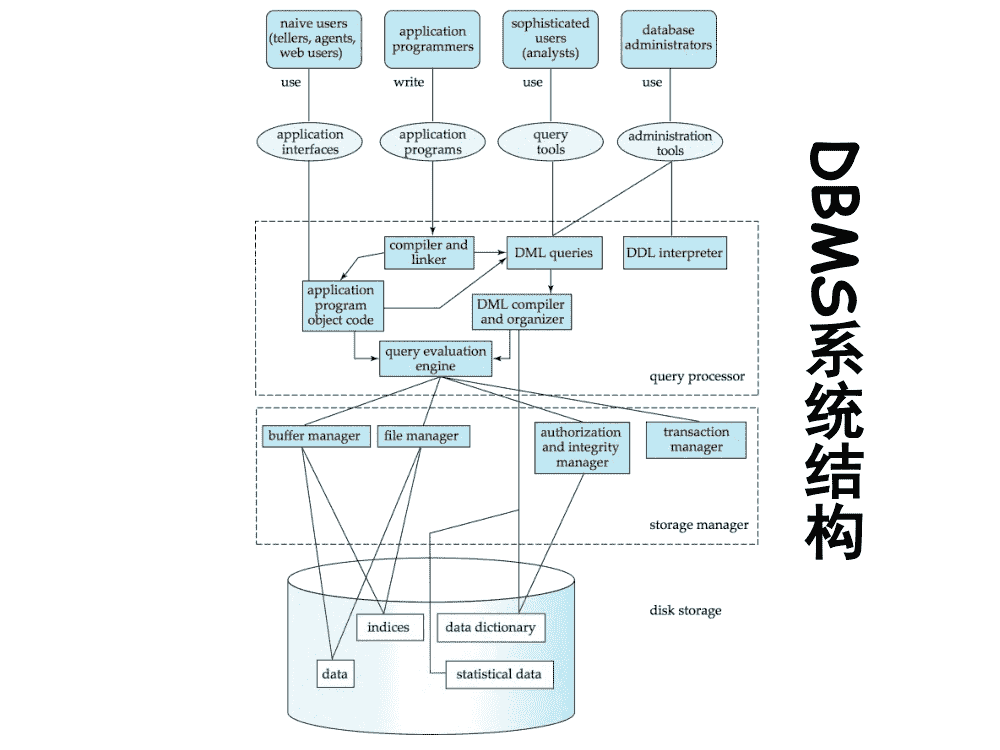

## 数据库应用

Whether you know it or not,
you're using a database every day

......

# 02 关系模型
关系模型

## 关系数据模型基础

- 关系模型是一种基于表的数据模型
  - 用表的集合表示数据及数据间的联系


- **Schema**
  - 数据库中关系的结构描述
  
  Student(sno, sname, age, gender, dept)

- **Instance**
  - 特定时间点的实际内容
  
  Student(95001,"张三",21,"M","SE")

- Database = set of named **relations**(tables)
- Each relation has a set of named **attributes** (columns)
- Each **tuple**(row) has a value for each attribute
- Each attribute has a **type**(domain)

- **Key（键、码）**
  - 属性，其值在每个元组中唯一
  - 或属性集合，其组合值唯一
- Super Key（超码）
- Candidate Key（候选码）
- Primary Key（主码）
- Foreign key（外码）
  - 一个关系中的值必须出现在另一个关系中
  - 引用关系
  - 被引用关系

| student |
| sno | sname | age | gender | dept |
| 001 | 张三 | 21 | M | SE |
| 002 | 李四 | 20 | F | CS |

| course |
| cno | cname | credit |
| 222 | SE | 3 |
| 223 | DB | 3 |

| SC |
| sno | cno | grade |
| 001 | 223 | 80 |
| 002 | 222 | 86 |
| 001 | 222 | 82 |

## Example: University

- 教师由个人唯一的标识号（ID）来标识
  - 每位教师有姓名（name）
  - 所在的系（dept name）
  - 工资（salary）
- 学生由个人唯一的标识号（ID）来标识
  - 每位学生有姓名（name）
  - 主修的系（dept name）
  - 已修学分数（tot_cred）

## Example: University

- 大学维护一个教室列表
  - 楼名（building）
  - 房间号（room_number）
  - 容量（capacity）。
- 大学维护开设的所有课程（开课）的列表
  - 每次开课由课程号（course id）、开课号（sec_id）、年（year）、学期（semester）来标识
  - 与之相关联的有学期（semester）、年（year）、楼名（building）、房间号（room_number）、时段号（time_slot_id，即上课的时间）。

## Example: University

- 系有一个教学任务列表，说明每位教师的授课情况。
- 大学有一个所有学生课程注册的列表，说明每位学生在哪些课程的哪次开课中注册了。
- 一个真正的大学数据库会比上述的设计复杂得多。然而，我们就用这个简化了的模型来帮助你理解概念思想，避免你迷失在复杂设计的细节中。

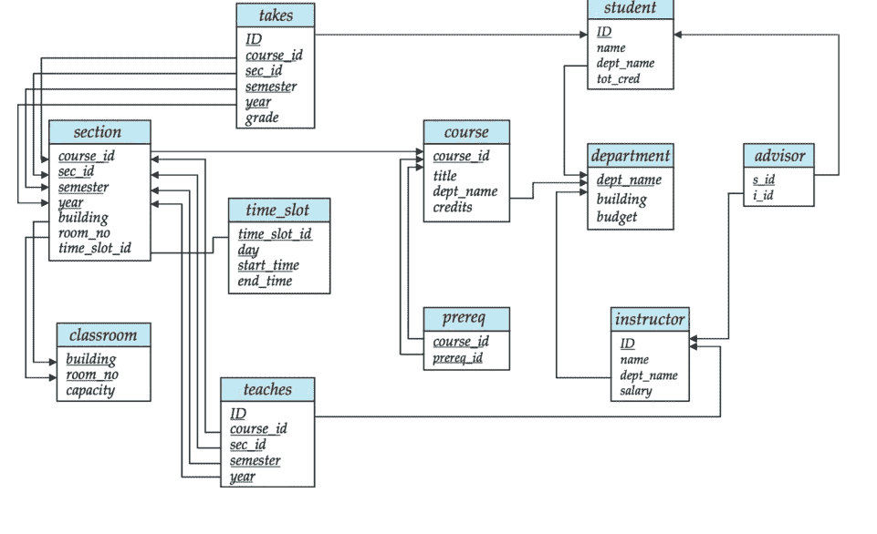

## Example: University

Classroom (building, room number, capacity)
Department (dept_name, building, budget)
Course (course id, title, dept_name, credits)
Instructor (ID, name, dept_name, salary)
Section (course id, sec id, semester, year, building, room_number, time_slot_id)
Teaches (ID, course id, sec id, semester, year) student (ID, name, dept_name, tot_cred)
Takes (ID, course id, sec id, semester, year, grade)
Advisor (s_ID, i_ID)
time_slot (time slot id, day, start time, end_time)
Prereq (course id, prereq id)

## 关系代数

### 关系代数基础

- 关系数据模型的操作
  - 查询、修改
- 查询语言
  - 用户用来从数据库中请求获取信息的语言
  - 过程化语言（what & how）
  - 非过程化语言（what）
- 关系代数
  - 过程化查询语言

- Set
- Bag
- List

## 关系代数

- **Six basic operators**
  - select:
  - project:
  - union:
  - set difference: −
  - Cartesian product: ×
  - rename:

The operators take one or two relations as inputs and produce a new relation as a result.


- 选择：σ_p(r) = {t | t ∈ r 且 p(t)}

- 投影：$\Pi_{A_1,A_2,\dots,A_k}(r)$

- 笛卡尔积：×
  r × s = {t q | t ∈ r 且 q ∈ s}

将多个 relation 组合（join）在一起。

## 关系代数

附加操作

- 集合交集 ∩

  E₁ ∩ E₂ = E₁ - (E₁ - E₂)

- 自然连接 ⋈（Natural join）

  r ⋈ s = Π<sub>schema(r) ∪ schema(s)</sub> σ<sub>r.a₁=s.a₁ ∧ r.a₂=s.a₂ ∧ ...</sub> (r × s)

  schema(r) ∩ schema(s) = (a₁, a₂, ...)
  （属性的交集上取等值）

  - 试列出选过课程的学生学号、姓名
  - 试列出没有选课记录的学生学号、姓名

- θ 连接 ⋈<sub>θ</sub> 或 ×<sub>θ</sub>（条件连接）

  r ⋈<sub>θ</sub> s = σ<sub>θ</sub>(r × s)

- 外连接 ⟗（Outer join），匹配连接及不匹配连接

  - 左外
  - 右外
  - 全外
  - 所有学生的选课情况
  - 所有课程的被选情况

- 赋值（Assignment）

  p ← r ⋈ s
  insert r ← r ∪ t₁
  delete r ← r - t₁

## 聚集函数与操作

- **聚集函数（Aggregation function）** 接收一组值，并返回一个**单一值**作为结果。

- avg：平均值
- min：最小值
- max：最大值
- sum：总和
- count：值的个数

- Null，不参与
- 对于 r(a,b)：
  - sum(a) - sum(b) = sum(a - b)?
  - count(*), count(a), count(b)?
- count(name), count(distinct name)?

# SQL

（结构化查询语言）

## 历史

- IBM Sequel 语言是 IBM 圣何塞研究实验室 System R 项目的一部分
- 更名为结构化查询语言（SQL）
- ANSI 和 ISO 标准 SQL：
  - SQL-86（第一个由 ANSI 正式标准化）
  - SQL-89（完整性约束）
  - SQL-92（重大修订）
  - SQL:1999（语言名称符合 Y2K 要求！ORDB）
  - SQL:2003、SQL:2006（XML）
  - SQL:2008（INSTEAD OF、TRUNCATE）
  - SQL:2011（时态数据库）
- 商业系统提供了 SQL-92 的大部分功能（即使不是全部），并附加了来自后续标准的不同功能集以及特殊的专有功能。

## 数据库交互工具

- **Oracle**
  - SQL*Plus（命令行）
  - iSQL*Plus（基于 Web）
- **SQL Server**
  - SQLCMD（命令行）
  - iSQL、OSQL
- **SQL Anywhere**
  - Dbisqlc（命令行风格）
  - Dbisql（GUI）
- **MySQL**
  - mysql（命令行）

# SQL

- DDL
  - 用于模式
  - 创建、修改、删除
- DML
  - 用于数据
  - 修改：插入、更新、删除
  - 查询：选择
  - 授权：授予、撤销

## ODBC：体系结构

- 应用程序
- ODBC 驱动程序管理器
- ODBC 驱动程序
- DBMS

- Windows ODBC
- UnixODBC
- iODBC

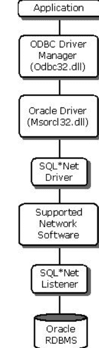

## ODBC：DSN

- DSN（数据源名称）是一个符号名称，表示 ODBC 连接。
- 在连接到 ODBC 时，它存储连接详细信息，如数据库名称、目录、数据库驱动程序、用户 ID、密码等。

## DDL

用于模式（创建/修改/删除）

```sql
Create table Student(
  sno      char(10) primary key,
  sname    varchar(10),
  age      smallint check(age>=0),
  gender   char(1),
  dept     char(2)
);
```

```sql
Alter table student add GPA int;
Alter table student drop GPA;

Drop table student;
```

### DDL：数据类型

- **char(n)**
  - 固定长度的字符串，长度 n 由用户指定。
- **varchar(n)**
  - 可变长度的字符串，最大长度 n 由用户指定。
- **Int**
  - 整数（整数的一个有限子集，与机器相关）。
- **Smallint**
  - 小整数（整数域类型的一个与机器相关的子集）。


### DDL：数据类型
- **numeric(p,d)**
  - 定点数，用户指定精度为 p 位，小数点右侧有 d 位。
  - 例如 numeric(3,1)，44.5
- **real, double precision**
  - 浮点数和双精度浮点数，精度取决于机器。
- **float(n)**
  - 浮点数，用户指定精度至少为 n 位。

### DDL：数据类型
- **Date**
  - 日期，包含（4 位）年、月和日
  - 示例：date '2005-7-27'
- **Time**
  - 一天中的时间，以小时、分钟和秒表示。
  - 示例：time '09:00:30' time '09:00:30.75'
- **Timestamp**
  - 日期加上一天中的时间
  - 示例：timestamp '2005-7-27 09:00:30.75'

### DDL：数据类型
- **Interval**
  - 时间段
  - 示例：interval '1' day
  - 从另一个值中减去一个日期/时间/时间戳值会得到一个区间值
  - 区间值可以加到日期/时间/时间戳值上

## 查询

### DML：查询
```sql
SELECT *
FROM   student
WHERE  dept = 'SE'
```

```sql
SELECT DISTINCT sname,dept
FROM   student
WHERE  age >= 21
```

### DML：查询
```sql
SELECT *
FROM  student
WHERE sname LIKE '%明_'
```

```sql
SELECT sno, cno, SQRT(grade)*10
FROM  SC
```

### DML：查询
列出软件学院所有学生的姓名、课名和成绩

```sql
SELECT  sname,cname,grade
FROM    student,SC,course
WHERE   dept = 'SE'
?
```

### DML：查询
找出与95001同龄的学生的学号、姓名、院系

```sql
SELECT sno,sname,dept
FROM    student s1,student s2
WHERE   s1.sno = '95001' and
        s1.age = s2.age
```

?

元组变量：s1,s2

### DML：查询
- join-expression :
  table-expr. join-operator table-expr. [ ON join-condition ]

- join-operator :
  [ KEY | NATURAL ] [ join-type ] JOIN | CROSS JOIN

- join-type :
  INNER
  | LEFT [ OUTER ]
  | RIGHT [ OUTER ]
  | FULL [ OUTER ]

### DML：查询，聚合
统计软件学院男女生平均年龄及人数

```sql
SELECT gende, AVG(age), COUNT(*)
FROM student
WHERE dept = 'SE'
GROUP BY dept, gende
```

### DML：查询，聚合
- 容易混淆的问题
  - Where? Having?
  - 那些原始属性可以出现在 select 子句中?
  - Null的角色

### DML：查询，集合
- 列出所有师生的编号（工号或学号）、姓名

```sql
SELECT id,name
FROM instructor
Union
SELECT id,name
FROM student
```

### DML：查询，多集合
- 列出所有师生的编号（工号或学号）、姓名

```sql
SELECT id,name
FROM instructor
UNION ALL
SELECT id,name
FROM student
```

### DML：查询，多集合
r有m个元组，s有n个元组，则结果集中的元组数：

- `r union s`
  `m+n`
- `r intersect s`
  `min(m,n)`
- `r except s`
  `max(0,m-n)`

### 子查询
回忆一下：
找出与95001同龄的学生的学号、姓名、院系

### 元组变量

自然思维方式？

### 子查询
- Select-from-where嵌入where,from中

找出与95001同龄的学生的学号、姓名、院系

```sql
SELECT  sno,sname,dept
FROM    student
WHERE   age = ( SELECT  age
                FROM    student
                WHERE   sno = '95001')
```

### 子查询
```sql
SELECT sno,sname,dept
FROM   student
WHERE  age = (  SELECT age
                FROM   student
                WHERE  sno = '95001')
```

结果集中如何去除95001本人？

### 关联变量（Correlation Variables）

### 子查询
列出选过02号课程的学生姓名

```sql
SELECT  sname
FROM    student
WHERE   sno in ( SELECT  sno
                FROM    SC
                WHERE   cno = '02' )
```

### 子查询
找出年龄最大的学生

```sql
SELECT *
FROM  student
WHERE age >= ALL ( SELECT  age
                  FROM  student )
```

### 子查询
找出年龄不是最大的学生

```sql
SELECT *
FROM  student
WHERE age <= SOME (SELECT  age
FROM  student )
```

SOME = ANY

### 子查询
找出选修了SE开设的所有课程的学生

```sql
SELECT   *
FROM     student s
WHERE    not exist (SELECT cno
                    FROM   course
                    WHERE  dept = 'SE')
         except
         (SELECT cno
          FROM   SC
          WHERE  SC.sno = s.sno)
```


### SubQuery

查找在 2009 年秋季学期和 2010 年春季学期均开设的所有课程。

```
select course_id
from  section as S
where semester = 'Fall' and year= 2009 and
    exists ( select *
        from section as T
        where semester = 'Spring' and
            year= 2010 and
            S.course_id= T.course_id);
```

### SubQuery

Select-from-where,可以出现在哪里？

- Where
- From

查找平均工资大于 $42,000 的那些系的平均教员薪资。

```
select dept_name, avg_salary from
(select dept_name, avg(salary) as avg_salary
from instructor
group by dept_name
) as dept_avg (dept_name, avg_salary)
where avg_salary > 42000;
```

## DML: Modification

## DML: Modification

- INSERT
  - 单行整行
  - 单行部分属性
  - 多行

## DML: Modification

```
INSERT INTO student Values
('98001','张三',21,'M','SE')
```

```
INSERT INTO student (sno,sname)
Values('99001','李四')
```

```
INSERT INTO SC
SELECT sno,cno
FROM student as s,course as c
WHERE c.dept = 'SE'
```

## DML: Modification

DELETE 整元组删除

```
DELETE
FROM student
WHERE dept = 'SE'
```

```
DELETE
FROM   student
FROM   SC
WHERE  student.sno = SC.sno and
       grade < 60
```

## DML: Modification

UPDATE

修改相关元组中的指定属性

```
UPDATE student
  SET age = age+1,
      dept = 'SE'
WHERE dept = 'MA'
```

## Authorization

## Authorization

- DCL
- Grant授权
- Revoke回收

grant select on instructor to U₁, U₂, U₃
revoke select on branch from U₁, U₂, U₃

## Authorization

```
grant select on department to Amit
with grant option;
revoke select on department from Amit, Satoshi cascade;
revoke select on department from Amit, Satoshi restrict;
```

## View

## View

- Create a view of department salary totals

```
create view departments_total_salary(dept_name, total_salary) as
select dept_name, sum (salary)
from instructor
group by dept_name;
```

### View的存在形式及操作

- Virtual Table　　 Base Table
- View的定义被存储在Meta Data中
- 操作时，被转换成对BASE TABLE的处理

### View的使用

```
create view departments_total_salary(dept_name, total_salary) as
select dept_name, sum (salary)
from instructor
group by dept_name;
```

```
SELECT    dept_name, total_salary
FROM      departments_total_salary
WHERE     total_salary > 2,000,000
```

查询：如同BaseTable，转换成对BaseTable的查询

### View的使用

```
UPDATE departments_total_salary
SET total_salary = total_salary*1.5
WHERE total_salary < 2,000,000
```

能成功转换成对BaseTable的运算吗？

对View的更新操作，必须慎重！

### View的使用

- Most SQL implementations allow updates only on **simple views**
  - The FROM clause has only one database relation.
  - The SELECT clause contains only attribute names of the relation, and does not have any expressions, aggregates, or DISTINCT specification.
  - Any attribute not listed in the SELECT clause can be set to NULL
  - The query does not have a GROUP BY or HAVING clause.

## Integrity Constraints

## Integrity Constraints

- Integrity constraints guard against accidental damage to the database, by ensuring that authorized changes to the database do not result in a loss of data consistency.
  - A checking account must have a balance greater than $10,000.00.
  - A salary of a bank employee must be at least $4.00 an hour.
  - A customer must have a (non-null) phone number

### Constraints on a Single Relation

- not null
- primary key
- unique
- check (P)

- **unique (A1, A2, ..., Am)**
  - The unique specification states that the attributes A1, A2, ... Am form a candidate key.
  - Candidate keys are permitted to be null (in contrast to primary keys).

### Referential Integrity

- Ensures that a value that appears in one relation for a given set of attributes also appears for a certain set of attributes in another relation.


### 参照完整性中的级联操作

```sql
create table course (
    course_id   char(5) primary key,
    title        varchar(20),
    dept_name    varchar(20) references department
)
```

```sql
create table course (
    ...
    dept_name varchar(20),
    foreign key (dept_name) references department
                         on delete cascade
                         on update cascade,
    ...
)
```

级联操作的替代方式：设置为空值、设置为默认值

### 复杂的检查子句

- check (time_slot_id in (select time_slot_id from time_slot))
  - 为什么不在这里使用外键？
- 每个课程班次至少有一名教师授课。
  - 应该如何编写？
- 遗憾的是：几乎所有数据库都不支持检查子句中的子查询
  - 替代方案：触发器（后面介绍）
- `create assertion <assertion-name> check <predicate>;`
  - 同样没有任何数据库支持

### 参照完整性中的违例及处理方式

## 触发器

- “事件—条件—动作规则”
  - 当事件发生时
  - 检查条件；如果条件为真，则执行动作

```text
Create Trigger name
Before|After|Instead Of events
[ referencing-variables ]
[ For Each Row ]
When ( condition )
action
```

在 section 和 time_slot 上使用触发器来强制执行完整性约束

```sql
Create Trigger timeslot_check1 after insert on section
referencing new row as nrow
for each row
when (nrow.time_slot_id not in (select time_slot_id from time_slot))
begin
    rollback
end;
```

```sql
create trigger timeslot_check2 after delete on time_slot
referencing old row as orow
for each row
when (orow.time_slot_id not in (
                         select time_slot_id
                         from time_slot)
     and orow.time_slot_id in (
                         select time_slot_id
                         from section))
begin
    rollback
end;
```

```sql
create trigger credits_earned after update of grade on takes
referencing new row as nrow
referencing old row as orow
for each row
when nrow.grade <> 'F' and nrow.grade is not null
    and (orow.grade = 'F' or orow.grade is null)
begin atomic
    update student
    set tot_cred = tot_cred +
    (select credits
        from course
        where course.course_id = nrow.course_id)
    where student.id = nrow.id;
end;
```

## 函数与存储过程

### 过程

- SQL 提供了一种模块语言
  - 允许在 SQL 中定义过程，并使用 if-then-else 语句、for 循环和 while 循环等
- 存储过程
  - 可以将过程存储在数据库中
  - 然后使用 call 语句执行这些过程
  - 允许外部应用程序在不了解数据库内部细节的情况下操作数据库
- SQL:1999 支持函数和过程
  - 函数和过程可以直接使用 SQL 编写，也可以使用外部编程语言编写。
  - 函数对于图像和几何对象等特殊数据类型尤其有用。
    - 示例：用于检查多边形是否重叠，或比较图像相似度的函数。
  - 某些数据库系统支持表值函数，这类函数可以返回一个关系作为结果。
- SQL:1999 还支持一组丰富的命令式结构，包括
  - 循环、if-then-else、赋值

### 函数

- 定义一个函数：给定系名称，返回该系教师人数。

```sql
Create Function dept_count(dept_name varchar(20))
returns integer
begin
    declare d_count integer;
    select count(*) into d_count
    from instructor
    where instructor.dept_name = dept_name;
    return d_count;
end
```

查找教师人数超过 12 人的所有系的系名和预算。

```sql
Select dept_name, budget
From   department
Where dept_count(dept_name) > 12
```


## Function
- SQL:2003 新增了返回关系作为结果的函数

```
Create Function instructors_of (dept_name char(20))
    returns table (ID varchar(5),
                  name varchar(20),
                  dept_name varchar(20),
                  salary numeric(8,2))
    return table(Select ID, name, dept_name, salary
                From instructor
                Where instructor.dept_name =
                      instructors_of.dept_name)
```

```
Select *
From table (instructors_of ('Music'))
```

## Stored Procedure
- dept_count 函数也可以改写为过程：

```
Create Procedure dept_count_proc (
    in  dept_name varchar(20),
    out d_count integer)
Begin
    select count(*) into d_count
    from  instructor
    where instructor.dept_name =
            dept_count_proc.dept_name
End
```

- 过程可以从 SQL 过程或嵌入式 SQL 中通过 call 语句调用。

```
Declare d_count integer;
Call dept_count_proc('Physics', d_count);
```

- 过程和函数也可以从动态 SQL 中调用

## Cursor
- 游标用于从查询结果集中检索多行结果。游标是 SQL 查询的**句柄**或标识符以及结果集中的**位置**。
- 游标可以定位在以下位置：
  - 结果集的第一行之前。
  - 结果集中的一行上。
  - 结果集的最后一行之后。

```
CREATE PROCEDURE get_table_name(
IN id_value INT, OUT tabname CHAR(128))
BEGIN
    DECLARE qry LONG VARCHAR;
    SET qry = 'SELECT table_name  FROM SYS.SYSTAB ' || 'WHERE table_id=' || string(id_value);
    BEGIN
        DECLARE crsr CURSOR USING qry;
        OPEN crsr;
        FETCH crsr INTO tabname;
        CLOSE crsr;
    END
END;
```

```
CREATE FUNCTION GetRowCount( IN qry LONG VARCHAR )
    RETURNS INT
BEGIN
    DECLARE crsr CURSOR USING qry;
    DECLARE rowcnt INT;
    SET rowcnt = 0;
    OPEN crsr;
    lp: LOOP
        FETCH crsr;
        IF SQLCODE <> 0 THEN LEAVE lp END IF;
        SET rowcnt = rowcnt + 1;
    END LOOP;
    CLOSE crsr;
    RETURN rowcnt;
END;
```

## Updates Through Cursors
- 可以通过声明游标为可更新来更新游标获取的元组

```
declare c cursor for
select *
from instructor
where dept_name = 'Music'
for update
```

要更新游标 c 当前位置的元组

```
update instructor
set salary = salary + 100
where current of c
```

## API & Application

## JDBC and ODBC
- API（应用程序编程接口）用于程序与数据库服务器交互
- 应用程序会调用
  - 与数据库服务器连接
  - 向数据库服务器发送 SQL 命令
  - 将结果元组逐一取出到程序变量中
- ODBC（开放数据库连接）适用于 C、C++、C# 和 Visual Basic
  - 其他 API 如 ADO.NET 构建在 ODBC 之上
- JDBC（Java 数据库连接）适用于 Java

## ODBC
- Open DataBase Connectivity(ODBC) 标准
- 应用程序程序与数据库服务器通信的标准。
- 应用程序程序接口 (API) 用于
  - 打开与数据库的连接，
  - 发送查询和更新，
  - 获取结果。
- 诸如 GUI、电子表格等应用程序可以使用 ODBC

```
int ODBCexample()
{
    RETCODE error;
    HENV    env;      /* environment */
    HDBC    conn;     /* database connection */
    SQLAllocEnv(&env);
    SQLAllocConnect(env, &conn);
    SQLConnect(conn, "db.yale.edu", SQL_NTS, "avi", SQL_NTS, "avipasswd", SQL_NTS);
    { ... Do actual work ... }

    SQLDisconnect(conn);
    SQLFreeConnect(conn);
    SQLFreeEnv(env);
}
```

```
char deptname[80];
float salary;
int lenOut1, lenOut2;
HSTMT stmt;
char * sqlquery = "select dept_name, sum (salary)
                    from instructor
                    group by dept_name";

SQLAllocStmt(conn, &stmt);
error = SQLExecDirect(stmt, sqlquery, SQL_NTS);
if (error == SQL_SUCCESS) {
    SQLBindCol(stmt, 1, SQL_C_CHAR, deptname, 80,
    &lenOut1);
    SQLBindCol(stmt, 2, SQL_C_FLOAT, &salary, 0,
    &lenOut2);
    while (SQLFetch(stmt) == SQL_SUCCESS) {
        printf (" %s %g\n", deptname, salary);
    }
}
SQLFreeStmt(stmt, SQL_DROP);
```


## JDBC

- JDBC 是用于与支持 SQL 的数据库系统通信的 Java API。
- JDBC 支持多种用于查询和更新数据以及检索查询结果的功能。
- JDBC 还支持元数据检索，例如查询数据库中存在的关系以及关系属性的名称和类型。
- 与数据库通信的模型：
  - 打开连接
  - 创建一个“statement”对象
  - 使用 Statement 对象执行查询以发送查询并获取结果
  - 异常机制用于处理错误

## SQLCA

### SQL 通信区

- 是内存中的一个区域，用于在每次数据库请求时在应用程序与数据库服务器之间以及返回应用程序时传递统计信息和错误。
- SQLCA 用作应用程序到数据库通信链路的句柄。它被传递给所有需要与数据库服务器通信的数据库库函数。它在所有嵌入式 SQL 语句上隐式传递。

### SQLCA 字段

- **sqlcode** 一个 32 位整数，用于在数据库在请求上检测到错误时指定错误代码。
- 错误代码的定义可以在头文件 `sqlerr.h` 中找到。
  - 错误代码为 0 表示操作成功
  - 100 表示未找到行
  - 正数为警告
  - 负数为错误。


# 第 7 章：实体-关系模型

# 第 7 章：实体关系模型

- 设计过程
- 建模
- 约束
- E-R 图
- 设计问题
- 弱实体集
- 扩展 E-R 特性
- 银行数据库设计
- 归约为关系模式
- 数据库设计
- UML

## 建模

- *数据库* 可以建模为：
  - 一组实体，
  - 实体之间的关系。
- *实体* 是存在且可与其他对象区分的对象。
  - 示例：特定的人、公司、事件、工厂
- 实体具有 *属性*
  - 示例：人们拥有姓名和地址
- *实体集* 是具有相同属性的同类型实体的集合。
  - 示例：所有人、公司、树、假期的集合

## 实体集 instructor 和 student

| instructor_ID | instructor_name |
|---|---|
| 76766 | Crick |
| 45565 | Katz |
| 10101 | Srinivasan |
| 98345 | Kim |
| 76543 | Singh |
| 22222 | Einstein |

instructor

| student-ID | student_name |
|---|---|
| 98988 | Tanaka |
| 12345 | Shankar |
| 00128 | Zhang |
| 76543 | Brown |
| 76653 | Aoi |
| 23121 | Chavez |
| 44553 | Peltier |

student

## 关系集 advisor

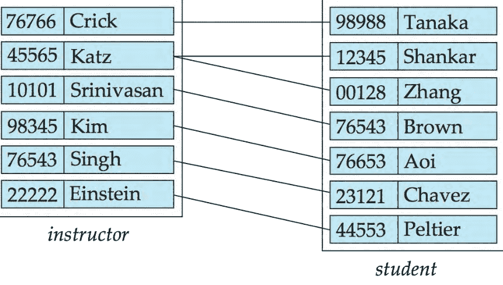

instructor

student

## 关系集（续）

- 一个 *属性* 也可以是关系集的属性。
- 例如，实体集 *instructor* 和 *student* 之间的 *advisor* 关系集可能具有属性 *date*，用于跟踪学生何时开始与导师关联

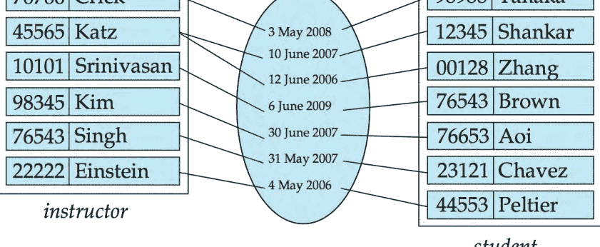

## 关系集的度数

- **二元关系**
  - 涉及两个实体集（或度为二）。
  - 大多数数据库系统中的关系集是二元的。
- 两个以上实体集之间的关系很少见。大多数关系是二元的。（稍后会详细介绍。）
  - 示例：学生在讲师的指导下从事研究项目。
  - 关系 proj_guide 是 instructor、student 和 project 之间的三元关系

## 属性

- 实体由一组属性表示，即实体集中所有成员所具有的描述性属性。
- 示例：
  - instructor = (ID, name, street, city, salary)
  - course = (course_id, title, credits)

域 – 每个属性的允许值集合

属性类型：

简单和复合属性。

单值和多值属性

示例：多值属性：phone_numbers

派生属性

可以从其他属性计算得出

示例：age，由 date_of_birth 给出


## 映射基数约束

- 表示通过一个关系集，一个实体可与多少个另一实体相关联。
- 在描述二元关系集时最为有用。
- 对于二元关系集，映射基数必须是以下类型之一：
  - 一对一
  - 一对多
  - 多对一
  - 多对多

## 映射基数

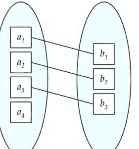

(a) 一对一

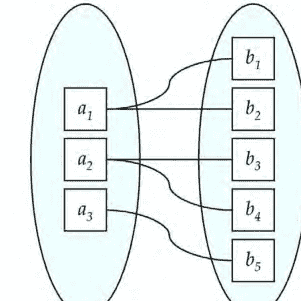

(b) 一对多

注意：A 和 B 中的某些元素可能未映射到另一集合中的任何元素

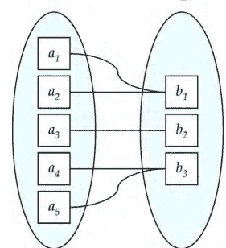

(a) 多对一

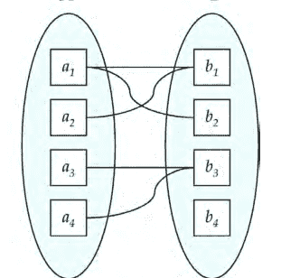

(b) 多对多

注意：A 和 B 中的某些元素可能未映射到另一集合中的任何元素

## 键

- 实体集的**超键**是一个或多个属性的集合，其值能够唯一确定每个实体。
- 实体集的**候选键**是一个最小超键
  - *ID* 是 *instructor* 的候选键
  - *course_id* 是 *course* 的候选键
- 虽然可能存在多个候选键，但其中一个候选键被选为**主键**。

### 关系集的键

- 参与关系集的各个实体集的主键组合构成了该关系集的超键。
  - `(s_id, i_id)` 是 `advisor` 的超键
  - **注意：** 这意味着 *一对实体集在某个特定关系集中最多只能有一个关系。*
    - 例如：如果我们希望记录一个学生与其导师之间的多个会面日期，则不能为每次会面假设一个关系。不过我们可以使用多值属性。
- 在决定哪些是候选键时，必须考虑关系集的映射基数。
- 当存在多个候选键时，选择主键需要考虑关系集的语义。

## 冗余属性

- 假设我们有以下实体集
  - *instructor*，其属性包括 *dept_name*
  - *department*
  以及一个关系
  - *inst_dept*，它关联 *instructor* 和 *department*
- 实体 *instructor* 中的属性 *dept_name* 是冗余的，因为存在一个显式关系 *inst_dept*，它将教师与院系关联起来。
  - 该属性复制了关系中已有的信息，应从 *instructor* 中移除。
  - 但是：在转换回表时，某些情况下该属性会被重新引入，我们稍后会看到。

## E-R 图

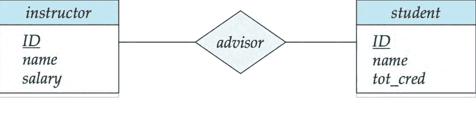

- Peter Chen 和 IDEF1X
- 矩形表示实体集。
- 菱形表示关系集。
- 属性列在实体矩形内部。
- 下划线表示主键属性。

## 具有复合、多值和派生属性的实体

| instructor |
|---|
| *ID* |
| *name* |
| &nbsp;&nbsp;&nbsp;&nbsp;*first_name* |
| &nbsp;&nbsp;&nbsp;&nbsp;*middle_initial* |
| &nbsp;&nbsp;&nbsp;&nbsp;*last_name* |
| *address* |
| &nbsp;&nbsp;&nbsp;&nbsp;*street* |
| &nbsp;&nbsp;&nbsp;&nbsp;&nbsp;&nbsp;&nbsp;&nbsp;*street_number* |
| &nbsp;&nbsp;&nbsp;&nbsp;&nbsp;&nbsp;&nbsp;&nbsp;*street_name* |
| &nbsp;&nbsp;&nbsp;&nbsp;&nbsp;&nbsp;&nbsp;&nbsp;*apt_number* |
| &nbsp;&nbsp;&nbsp;&nbsp;*city* |
| &nbsp;&nbsp;&nbsp;&nbsp;*state* |
| &nbsp;&nbsp;&nbsp;&nbsp;*zip* |
| {*phone_number*} |
| *date_of_birth* |
| *age( )* |

## 具有属性的关系集

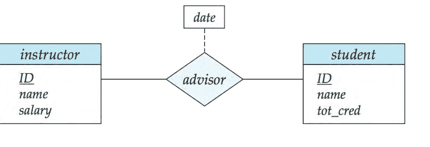

## 角色

- 一个关系中的实体集不必互不相同。
  - 实体集的每次出现都在关系中扮演一个“角色”。
- 标签 “course_id” 和 “prereq_id” 被称为角色。

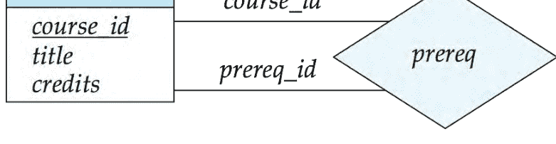


## 基数约束

- 我们通过在关系集和实体集之间绘制有向线（→），表示“一个”，或无向线（–），表示“多个”，来表达基数约束。
- 一对一关系：
  - 一个学生通过 advisor 关系最多关联一个导师
  - 一个学生通过 stud_dept 最多关联一个系

### 一对一关系

- 导师和学生之间的一对一关系
  - 一个导师通过 advisor 最多关联一个学生
  - 一个学生通过 advisor 最多关联一个导师

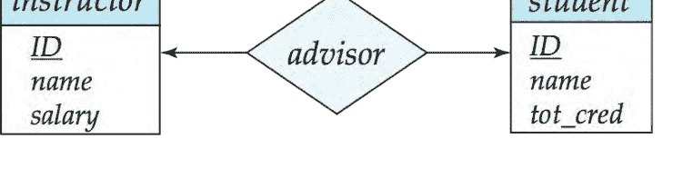

### 一对多关系

导师和学生之间的一对多关系

- 一个导师通过 advisor 关联若干个（包括 0 个）学生
- 一个学生通过 advisor 最多关联一个导师。

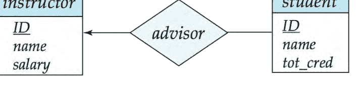

### 多对一关系

在导师和学生之间的多对一关系中，

- 一个导师通过 advisor 最多关联一个学生。
- 一个学生通过 advisor 关联若干个（包括 0 个）导师

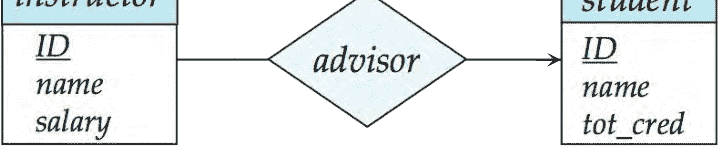

### 多对多关系

- 一个导师通过 advisor 关联若干个（可能为 0 个）学生
- 一个学生通过 advisor 关联若干个（可能为 0 个）导师

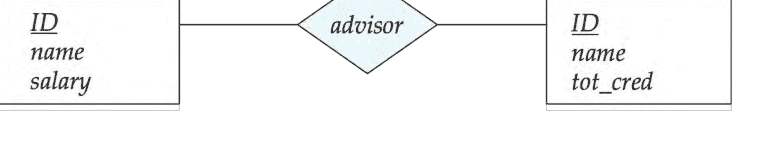

## 实体集在关系集中的参与度

- 完全参与（用双线表示）：实体集中每个实体都至少参与关系集中的一个关系
  - 例如，section 在 sec_course 中的参与是完全的
    - 每个 section 必须有一个关联的 course
- 部分参与：某些实体可能不参与关系集中的任何关系
  - 示例：instructor 在 advisor 中的参与是部分的

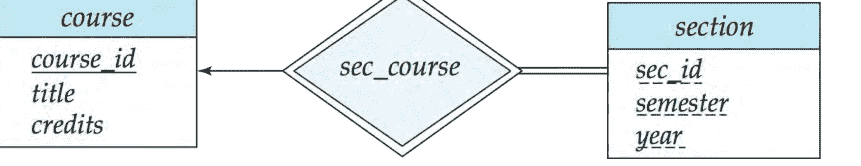

## 基数限制的替代表示法

- 基数限制也可以表达参与约束

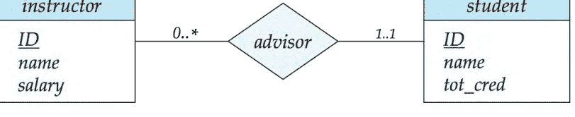

## 包含三元关系的 ER 图

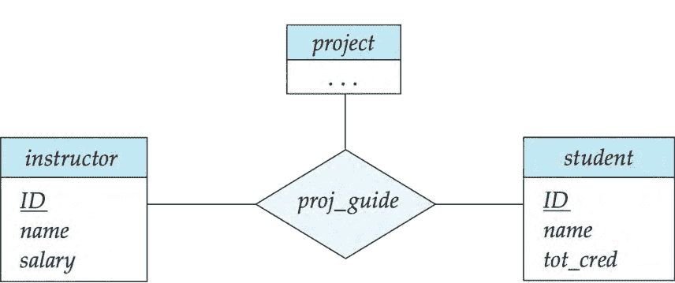

实体：`instructor`

- **ID**
- name
- salary

实体：`project`

- ...

实体：`student`

- **ID**
- name
- tot_cred


## 三元关系上的基数约束

- 我们允许从一个三元（或更高度）关系最多发出一个箭头来表示基数约束
- 例如，从 proj_guide 到 instructor 的箭头表示每个学生对一个项目最多有一个导师
- 如果有不止一个箭头，则有两种定义含义的方式。
  - 例如，A、B 和 C 之间的三元关系 R 带有指向 B 和 C 的箭头可能意味着
    1. 每个 A 实体与 B 和 C 中的唯一实体相关联或
    2. 每个 (A, B) 实体对与唯一的 C 实体相关联，且每个 (A, C) 对与唯一的 B 相关联
  - 每个替代方案在不同的形式化方法中都曾被使用
  - 为避免混淆，我们禁止使用多于一个箭头


何不在黑板上交互式地进行 ER 设计呢？
建议一个要建模的应用。

## 弱实体集

- 没有主键的实体集被称为 **弱实体集**。
- 弱实体集的存在依赖于 **标识实体集** 的存在
  - 它必须通过从标识实体到弱实体集的完全、一对多关系集与标识实体集相关联
  - **标识关系** 用双菱形表示
- 弱实体集的 **辨别符**（或部分键）是区分弱实体集中所有实体的属性集合。
- 弱实体集的主键由弱实体集存在依赖的强实体集的主键加上弱实体集的辨别符组成。


## 弱实体集（续）

- 我们用虚线为弱实体集的判别符加下划线。
- 我们将弱实体的标识联系置于双菱形中。
- section 的主键 – (course_id, sec_id, semester, year)

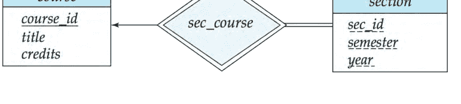


- 注意：强实体集的主键并不显式存储在弱实体集中，因为它在标识联系中是隐式的。
- 如果显式存储了 course_id，section 就能成为强实体，但那样 section 和 course 之间的联系就会被一种由 course 和 section 共有的属性 course_id 定义的隐式联系所重复。

## 大学企业的 E-R 图

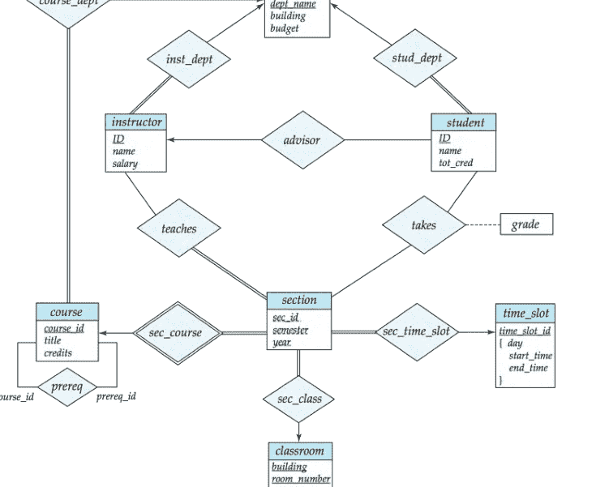


## 转换为关系模式

## 转换为关系模式

- 实体集和联系集可以统一表示为关系模式，这些关系模式表示数据库的内容。
- 符合 E-R 图的数据库可以由一组模式来表示。
- 每个实体集和联系集都有一个唯一的模式，其名称被指定为相应实体集或联系集的名称。
- 每个模式都有若干列（通常对应属性），这些列具有唯一的名称。

### 表示具有简单属性的实体集

- 强实体集转换为具有相同属性的模式。
- student(ID, name, tot_cred)
- 弱实体集变成一个表，该表包含标识它的强实体集的主键列。
- section ( course_id, sec_id, sem, year )

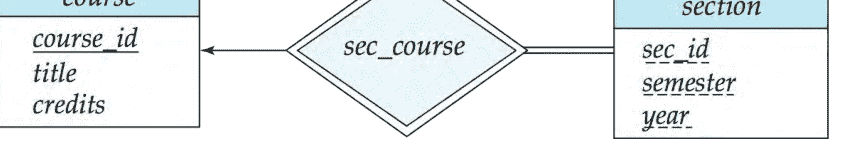

### 表示联系集

- 多对多联系集表示为一个模式，该模式具有两个参与实体集的主键属性，以及联系集的任何描述性属性。
- 示例：联系集 advisor 的模式
- advisor = (s_id, i_id)


### 模式的冗余

- 多对一和一对多联系集，如果它们在多方是完全参与的，则可以通过在“多”方添加一个额外属性来表示，该属性包含“一”方的主键。
- 示例：不为联系集 inst_dept 创建模式，而是向来自实体集 instructor 的模式添加属性 dept_name。

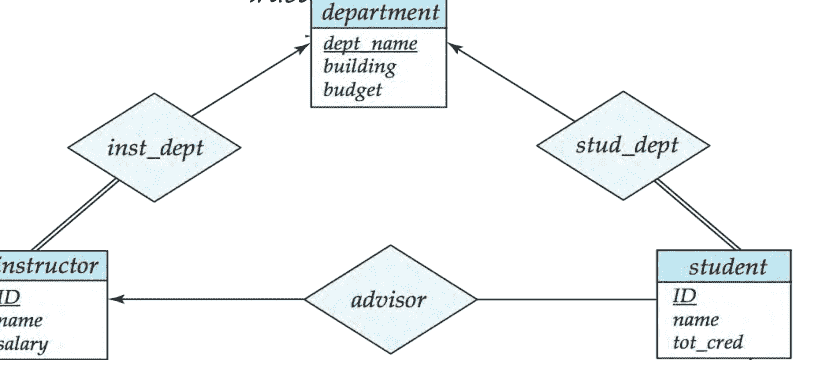

### 复合属性和多值属性

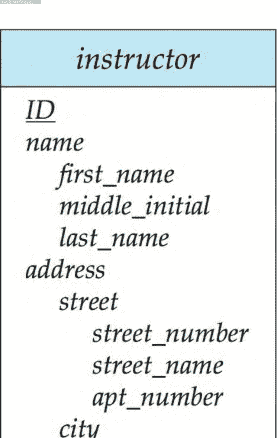

- 复合属性通过为每个分量属性创建单独属性来展开。
- 示例：给定实体集 `instructor`，其复合属性 `name` 有分量属性 `first_name` 和 `last_name`，则对应于该实体集的模式具有两个属性 `name_first_name` 和 `name_last_name`。
- 若无歧义，则省略前缀。
- 忽略多值属性，扩展后的 instructor 模式为：
- `instructor(ID, first_name, middle_initial, last_name, street_number, street_name, apt_number, city, state, zip_code, date_of_birth)`

### 复合属性和多值属性

- 实体 E 的多值属性 M 由单独的模式 EM 表示。
- 模式 EM 有对应于 E 的主键的属性，以及对应于多值属性 M 的一个属性。
- 示例：instructor 的多值属性 phone_number 由模式 inst_phone = ( ID, phone_number) 表示。
- 多值属性的每个值映射到模式 EM 上的关系的一个独立元组。
- 例如，主键为 22222、电话号码为 456-7890 和 123-4567 的 instructor 实体映射到两个元组：(22222, 456-7890) 和 (22222, 123-4567)。


### 多值属性（续）

- 特殊情况：实体 `time_slot` 除了主键属性外只有一个属性，且该属性是多值的
- 优化：不要创建对应实体的关系，只创建对应多值属性的关系
- `time_slot(time_slot_id, day, start_time, end_time)`
- 注意事项：由于此优化，`section` 的 `time_slot` 属性（来自 `sec_time_slot`）不能作为外键

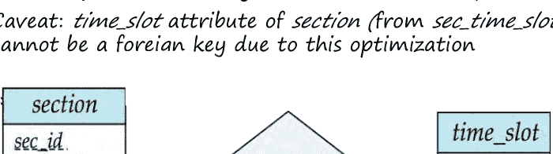

## 设计问题

- 实体集与属性的使用
- 将电话作为实体使用允许关于电话号码的额外信息（以及多个电话号码）

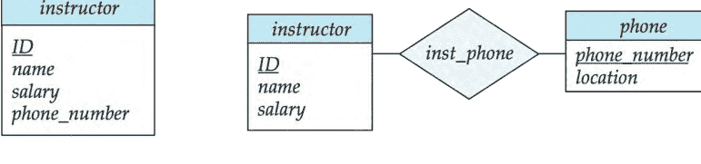

## 设计问题

- 实体集与关系集的使用
- 可能的指导原则是将关系集指定为描述实体之间发生的动作

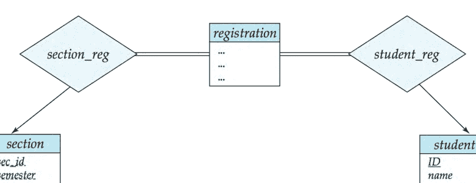

## 设计问题

- **二元与 n 元关系集**
  虽然可以用多个不同的二元关系集替换任何非二元（n 元，n > 2）关系集，但 n 元关系集更清晰地表明多个实体参与单一关系。
- **关系属性的放置**
- 例如，属性 *date* 作为 *advisor* 的属性还是作为 *student* 的属性

## 二元与非二元关系

- 一些看似非二元的关系可能更适合使用二元关系表示
  - 例如，三元关系 *parents*，将孩子与其父亲和母亲关联，最好替换为两个二元关系，*father* 和 *mother*
    - 使用两个二元关系允许部分信息（例如仅知道母亲）
  - 但有些关系本质上是非二元的
    - 示例：*proj_guide*

### 将非二元关系转换为二元形式

一般来说，任何非二元关系都可以通过创建一个人工实体集，使用二元关系来表示。

- 用实体集 E 替换实体集 A、B 和 C 之间的 R，并创建三个关系集：
  1. R_A 关联 E 和 A
  2. R_B 关联 E 和 B
  3. R_C 关联 E 和 C

- 为 E 创建一个特殊的标识属性

- 将 R 的任何属性添加到 E

- 对于 R 中的每个关系 (a_i, b_i, c_i)，创建
  1. 实体集 E 中的一个新实体 e_i
  2. 将 (e_i, a_i) 添加到 R_A
  3. 将 (e_i, b_i) 添加到 R_B
  4. 将 (e_i, c_i) 添加到 R_C

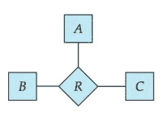

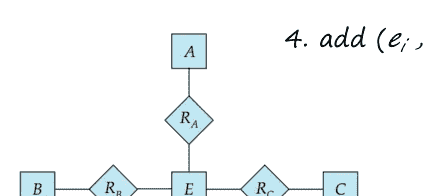

### 将非二元关系转换为二元形式（续）

- 还需要转换约束
  - 转换所有约束可能不可行
  - 翻译后的模式中可能存在无法对应 R 的任何实例的实例
    - 练习：向关系 R_A、R_B 和 R_C 添加约束，以确保新创建的实体对应于实体集 A、B 和 C 中的恰好一个实体
  - 我们可以通过使 E 成为弱实体集（稍后描述）并由三个关系集标识来避免创建标识属性

## 扩展 E-R 特性：特化

- 自顶向下的设计过程；我们在实体集中指定与集合中其他实体不同的子分组。
- 这些子分组成为低层实体集，它们具有不适用于高层实体集的属性或参与关系。
- 由标记为 ISA 的三角形组件表示（例如，instructor “is a” person）。
- 属性继承——低层实体集继承其所链接的高层实体集的所有属性和关系参与。

### 特化示例

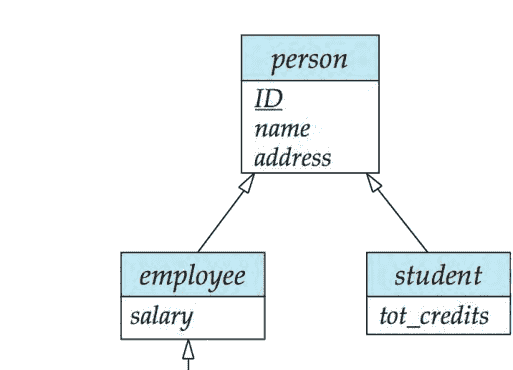


## 扩展ER特性：泛化

- **自底向上的设计过程** – 将多个具有相同特征的实体集组合成一个更高层的实体集。
- 特化和泛化互为简单的逆过程；它们在E-R图中以相同方式表示。
- 特化和泛化这两个术语可以互换使用。

### 特化与泛化（续）

- 可以基于不同特征对一个实体集进行多种特化。
- 例如：除 `instructor` 与 `secretary` 之外，还有 `permanent_employee` 与 `temporary_employee`。
- 每个特定的雇员将是
  - `permanent_employee` 或 `temporary_employee` 之一的成员，
  - 同时也是 `instructor`、`secretary` 之一的成员。
- ISA关系也称为**超类–子类**关系。

### 特化/泛化的设计约束

- 关于哪些实体可以成为给定低层实体集成员的约束。
  - 条件定义
    - 示例：所有超过65岁的客户都是老年公民实体集的成员；老年公民 ISA person。
  - 用户定义
- 关于在一个泛化中实体是否可以属于多个低层实体集的约束。
  - 不相交
    - 一个实体只能属于一个低层实体集
    - 在E-R图中通过多个低层实体集连接到同一个三角形来表示
  - 重叠
    - 一个实体可以属于多个低层实体集

### 特化/泛化的设计约束（续）

- **完整性约束** —— 指定在泛化中，高层实体集中的实体是否必须至少属于该泛化中的某个低层实体集。
  - **total（完全）**：实体必须属于某个低层实体集
  - **partial（部分）**：实体不必属于某个低层实体集

## 聚合

- 考虑之前看到的三元关系 proj_guide
- 假设我们想要记录一个指导教师（guide）对一个学生在某个项目上的评价

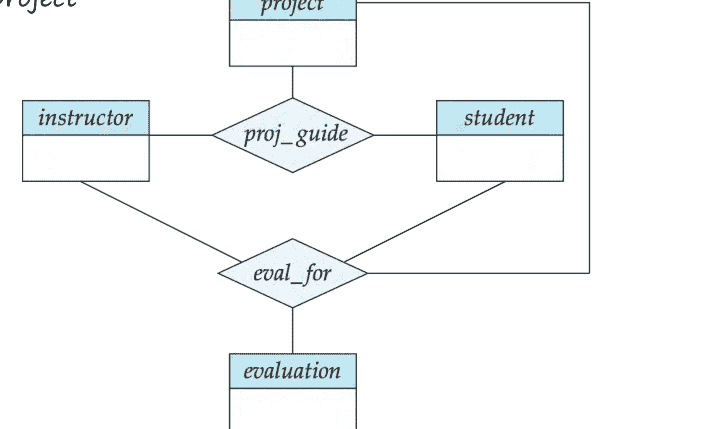

## 聚合（续）

- 关系集 eval_for 和 proj_guide 表示重叠的信息
  - 每个 eval_for 关系都对应一个 proj_guide 关系
  - 然而，某些 proj_guide 关系可能不对应任何 eval_for 关系
    - 因此我们不能丢弃 proj_guide 关系
- 通过聚合消除这种冗余
  - 将关系视为抽象实体
  - 允许关系之间建立关系
  - 将关系抽象为新的实体

## 聚合（续）

在不引入冗余的情况下，下图表示：

- 一个学生在某个特定项目上由一位特定教师指导
- 一个学生，关联 e

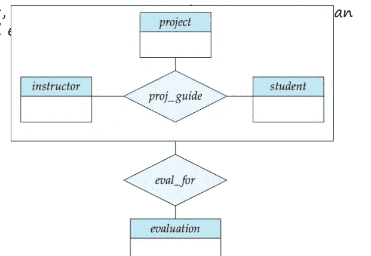

### 通过模式表示特化

- 方法1：
  - 为高层实体创建一个模式
  - 为每个低层实体集创建一个模式，包含高层实体集的主键和局部属性
  - 缺点：要获取一个雇员的信息，需要访问两个关系，一个对应于低层模式，另一个对应于高层模式

| 模式 | 属性 |
|---|---|
| person | ID, name, street, city |
| student | ID, tot_cred |
| employee | ID, salary |

### 将特化表示为模式（续）

- **方法2：**
  - 为每个实体集创建一个包含所有局部属性和继承属性的模式

| 模式 | 属性 |
|---|---|
| person | ID, name, street, city |
| student | ID, name, street, city, tot_cred |
| employee | ID, name, street, city, salary |

- 如果特化是完全的，则泛化实体集（person）的模式不需要存储信息
- 可以定义为一个“视图”关系，包含各特化关系的并集
- 但显式模式可能仍为外键约束所需
- 缺点：对于既是学生又是雇员的人，*姓名（name）*、*街道（street）* 和 *城市（city）* 可能被冗余存储

| 模式 | 属性 |
|---|---|
| person | ID, name, street, city |
| student | ID, name, street, city, tot_cred |
| employee | ID, name, street, city, salary |


### 与聚合对应的模式

- 要表示聚合，创建一个模式，包含：
  - 聚合关系的主键，
  - 相关实体集的主键
  - 任何描述性属性

### 与聚合对应的模式（续）

- 例如，要表示 `works_on` 关系与 `manager` 实体集之间的聚合 manages，创建一个模式
  
  `eval_for (s_ID, project_id, i_ID, evaluation_id)`

- 模式 `proj_guide` 是冗余的，前提是我们愿意在模式 `manages` 上的关系中为属性 `manager_name` 存储空值

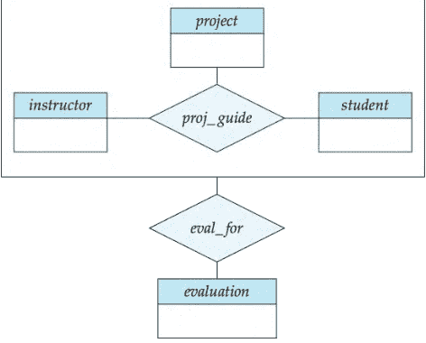

## E-R 设计决策

- 使用属性还是实体集来表示对象。
- 现实世界概念最好用实体集还是关系集来表达。
- 使用三元关系还是一对二元关系。
- 使用强实体集还是弱实体集。
- 使用特化/泛化——有助于设计的模块化。
- 使用聚合——可以将聚合实体集视为单一单元，而无需关心其内部结构的细节。


### 要不要在黑板上互动地再做一次 ER 设计？

## 符号


实体集


关系集

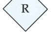

弱实体集的标识关系集


实体集在关系中的完全参与

| E |
|---|
| A1 |
| A2 |
|   A2.1 |
|   A2.2 |
| {A3} |
| A4() |

属性：
- 简单（A1），
- 复合（A2）和
- 多值（A3）
- 派生（A4）

| E |
|---|
| A1 |

主键

| E |
|---|
| A1 |

弱实体集的区分属性

### E-R 符号（续）

多对多关系

多对一关系

一对一关系

基数限制

角色名

角色指示符

ISA：泛化或特化

全整（不相交）泛化

不相交泛化

## 备选 ER 表示法

- Chen、IDE1FX 等

实体集 E，具有
简单属性 A1，
复合属性 A2，
多值属性 A3，
派生属性 A4，
以及主键 A1

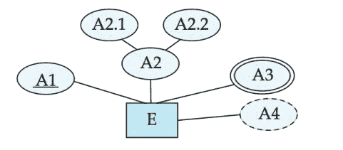

弱实体集


泛化

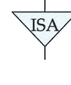

全整泛化

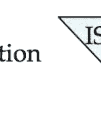

## 备选 ER 表示法

（乌鸦脚表示法）

Chen

IDE1FX

多对多关系

一对一关系

多对一关系

在 R 中的参与：完全（E1）和部分（E2）

## UML


- **UML**：统一建模语言
- UML 包含许多组件，可以用图形化方式对整个软件系统的不同方面进行建模
- UML 类图与 E-R 图相对应，但存在若干差异。

## ER 与 UML 类图对比

### ER 图表示法

### UML 中的等价表示

| ER 图表示法 | UML 中的等价表示 |
|---|---|
| **E** — 具有属性（简单、复合、多值、派生）的实体 | **E** — 具有简单属性和方法的类（属性前缀：`+` = 公有，`−` = 私有，`#` = 受保护） |
| **E1** — `role1` — **R** — `role2` — **E2** — 二元关系 | **E1** — `role1` **R** `role2` — **E2** |
| **E1** — `role1` — **R** — `role2` — **E2**，以 **A1** 作为关系属性 | **E1** — `role1` **R** `role2` — **E2**，其中 **R** 包含 **A1** |
| **E1** — `0..*` — **R** — `0..1` — **E2** — 基数约束 | **E1** — `0..1` — **R** — `0..*` — **E2** |

> *注意基数约束表示中位置的反转*


## ER 与 UML 类图对比

### ER 图符号

### UML 中的等价表示

n 元关系

重叠泛化

重叠

不相交泛化

不相交

*泛化可以使用合并或分离的箭头，且与重叠/不相交无关*

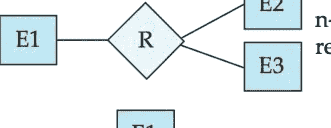

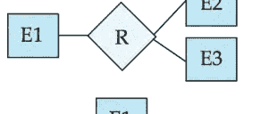

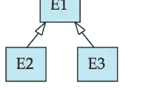

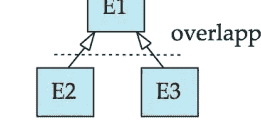

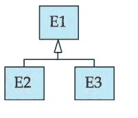

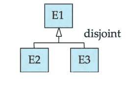


## 第7章结束

数据库系统概念，第6版

©Silberschatz, Korth and Sudarshan

参见 www.db-book.com 了解重用条件

## 图 7.01

| ID | 姓名 |
|---|---|
| 76766 | Crick |
| 45565 | Katz |
| 10101 | Srinivasan |
| 98345 | Kim |
| 76543 | Singh |
| 22222 | Einstein |

*教师*

| ID | 姓名 |
|---|---|
| 98988 | Tanaka |
| 12345 | Shankar |
| 00128 | Zhang |
| 76543 | Brown |
| 76653 | Aoi |
| 23121 | Chavez |
| 44553 | Peltier |

*学生*

## 图 7.02

教师

学生

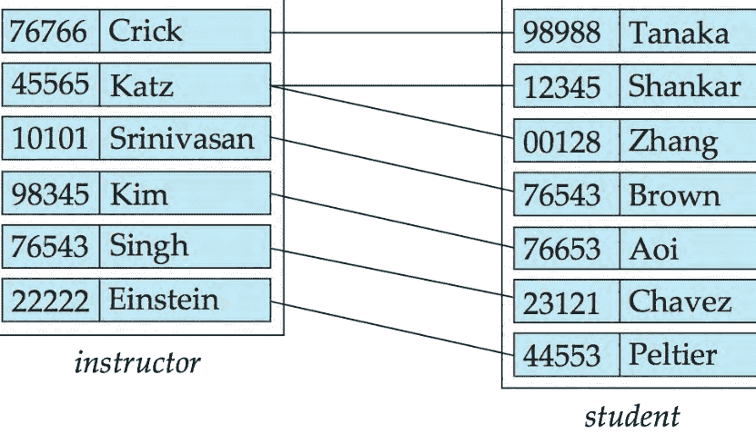

## 图 7.03

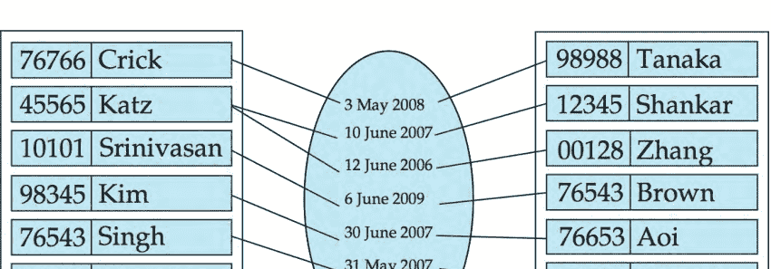

## 图 7.05

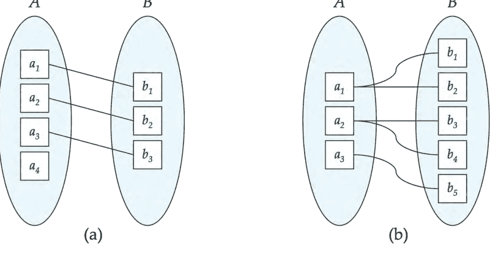

(a)

(b)

## 图 7.06

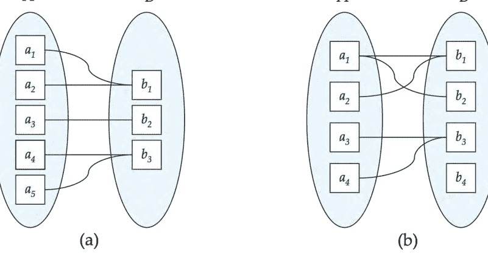

(a)

(b)

## 图 7.07

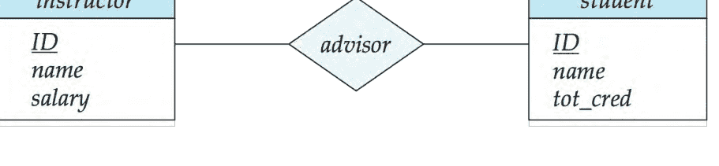

## 图 7.08

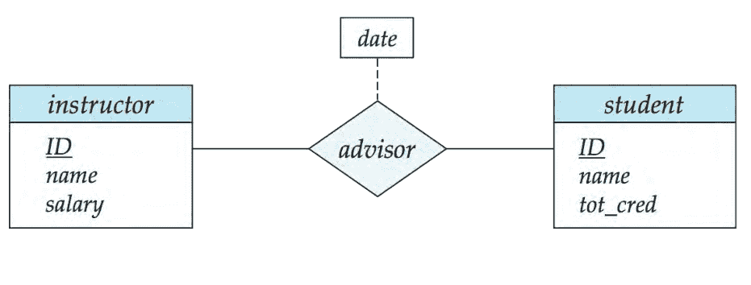

## 图 7.09

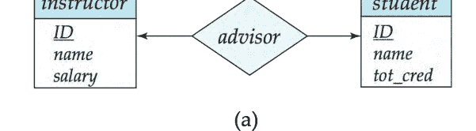

(a)


(b)


(c)

## 图 7.10


| 教师 | 学生 |
|---|---|
| **ID**  
姓名  
工资 | **ID**  
姓名  
总学分 |

## 图 7.11

| 教师 |
|---|
| ID |
| 姓名 |
| ├─ 名字 |
| ├─ 中间名首字母 |
| ├─ 姓 |
| 地址 |
| ├─ 街道 |
| │  ├─ 街道号 |
| │  ├─ 街道名 |
| │  └─ 公寓号 |
| ├─ 城市 |
| ├─ 州 |
| └─ 邮编 |
| { 电话号码 } |
| 出生日期 |
| 年龄( ) |

## 图 7.12


## 图 7.13


## 图 7.14


## 图 7.15

## 图 7.17


## 图 7.18


## 图 7.19

(a)

(b)

## 图 7.20

|  | 教师 |
|---|---|
| 76766 | Crick |
| 45565 | Katz |
| 10101 | Srinivasan |
| 98345 | Kim |
| 76543 | Singh |
| 22222 | Einstein |

教师

|  |  |  |
|---|---|---|
| 98988 | Tanaka | 2009年5月 |
| 12345 | Shankar | 2007年6月 |
| 00128 | Zhang | 2006年6月 |
| 76543 | Brown | 2009年6月 |
| 76653 | Aoi | 2007年6月 |
| 23121 | Chavez | 2007年5月 |
| 44553 | Peltier | 2006年5月 |

学生

## 图 7.21


## 图 7.22


## 图 7.23


## 图 7.24

实体集

关系集

弱实体集的标识性关系集

实体集在关系中的全参与

多对多关系

一对一关系

角色名称
角色指示符

全（不相交）泛化

属性：简单（A1）、复合（A2）、多值（A3）和派生（A4）

主键

弱实体集的区分属性

多对一关系

基数限制

ISA：泛化或特化

不相交泛化

## 图 7.25

具有简单属性 A1、复合属性 A2、多值属性 A3、派生属性 A4 和主键 A1 的实体集 E


多对多关系


一对一关系


多对一关系


在 R 中的参与：全参与（E1）和部分参与（E2）


弱实体集


泛化


全泛化


## 图 7.26
### ER 图表示法
### 在 UML 中的等价表示

E 具有属性的实体（简单、复合、多值、派生）

E 具有简单属性和方法 的类（属性前缀：+ = 公有，– = 私有，# = 保护） –A1 +M10

E1 role1 R role2 E2 二元关系

E1 role1 R role2 E2

A1 关系属性

R A1

E1 role1 role2 E2

E1 role1 role2 E2

E1 0..* R 0..1 E2 基数约束

E1 0..1 R 0..* E2

E1 R E2 E3 n 元关系

E1 R E2 E3

E1 E2 E3 重叠的概括

E1 E2 E3 重叠

E1 E2 E3 不相交的概括

E1 E2 E3 不相交

## 图 7.27


(a)


(b)


(c)

## 图 7.29


# 关系数据库设计

## 不良设计

- 设计“异常”
  - 例如. student-course
  - 冗余
  - 更新异常
  - 删除异常

## FD

设 R 为关系模式
α ⊆ R 且 β ⊆ R

函数依赖 α → β 在 R 上成立当且仅当对于 R 的任意合法关系 r(R)，每当 r 的任意两个元组 t₁ 和 t₂ 在属性 α 上一致时，它们也在属性 β 上一致。

即，

t₁[α] = t₂ [α]
t₁[β] = t₂ [β]

### FD，示例

- 考虑 r ( A, B ) 具有 r 的以下实例。


- 在此实例上，A → B 不成立，但 B → A 成立

- FD 本质是约束，描述属性间的约束

### FD，示例

- Stu(sno,sname,age,gende,ID,dept,cno,cname,grade)

## 键

- K ⊆ R

- K 是关系模式 R 的超键当且仅当 K → R

- K 是 R 的候选键当且仅当
  - K → R, 且
  - 对于任意 K' ⊂ K，K' → R 不成立

### 平凡 FD

- 函数依赖如果对关系的任意实例都成立，则为 **平凡** 的

- 示例：

ID, name → ID

- 一般地，α → β 如果 β ⊆ α 则为平凡

## Armstrong 公理

- 若 β ⊆ α，则 α → β （自反律）
- 若 α → β，则 γα → γβ （增补律）
- 若 α → β，且 β → γ，则 α → γ （传递律）

- 附加规则：
  - 若 α → β 且 α → γ，则 α → βγ （合并律）
  - 若 α → βγ，则 α → β 且 α → γ （分解律）
  - 若 α → β 且 γβ → δ，则 αγ → δ （伪传递律）

## 闭包

- 根据相关定理，找出已知的 FD 所蕴含的函数依赖
  - 函数依赖集的闭包
  - 属性的闭包

## 范式

- 1NF
- 2NF
- 3NF
- BCNF

### NF 的分解

- 分解的要求
  - 无损连接分解
    $R_1 \cap R_2 \rightarrow R_1$
    $R_1 \cap R_2 \rightarrow R_2$
  - 依赖保持
    $(F_1 \cup F_2 \cup \cdots \cup F_n)^+ = F^+$
  - NF 要求

## 正则覆盖

- F 的一个正则覆盖是与 F 等价的 **“最小”** 函数依赖集合，没有冗余的依赖或依赖的冗余部分
- 正则覆盖的特征
  - 左边是唯一的，右边多属性合并
  - 两边均不含无关属性(extraneous)
- 用于校验依赖保持

### 无关属性的判断

- For
- 测试属性 A 在 α → β 中是否无关
  1. 使用 F 中的依赖计算 (α - A)+
  2. 检查 (α - A)+ 是否包含 β；如果包含，则 A 在 α 中无关
- 测试属性 A 在 α → β 中是否无关
  1. 使用仅 F' = (F - {α → β}) ∪ {(α - A) → β} 中的依赖计算 β+
  2. 检查 β+ 是否包含 A；如果包含，则 A 在 β 中无关

## 正则覆盖

- R = (A, B, C)
  F = {A → BC, B → C, A → B, AB → C}
- F = {A → BC, B → C, AB → C}
- F = {A → BC, B → C}
- F = {A → B, B → C}

## 范式分解

1) 对 R，求 Key，找出违反范式要求的 FD，A → B;
2) 求 A⁺
3) R1 = {A⁺} √
   R2 = {A ∪ ( R - A⁺ )}
4) 对 R2 重复 1-3，直至均满足范式要求

- R1 ∩ R2 ⊆ R1, 无损连接
- 验证 (F₁ F₂ ... Fₙ)⁺ = F⁺
- 亦可验证 Fc

## 范式分解

R = (A, B, C)
F = {A→B, B→C}

可以分解为两种不同方式

- R1 = (A, B),    R2 = (B, C)

无损连接分解：

R1 ∩ R2 = {B} 且 B→BC

依赖保持

- R1 = (A, B),    R2 = (A, C)

无损连接分解：

R1 ∩ R2 = {A} 且 A→AB

不依赖保持
（无法在不计算 R1 ⋈ R2 的情况下检查 B→C）


## 范式分解

- R = (A, B, C)

F = {A→B, B→C, B→A}

- R1 = (A, B), R2 = (A, C)

无损连接分解：

R1 ∩ R2 = {A} 且 A→AB

保持依赖？

B→C？

(F1 ∪ F2 ∪ ... ∪ Fn)+ = F+

## 范式分解

R(T,S,C)，每位教师T只上一门课C，每门课可能有多个教学班，S为学生。

T→C, SC→T

键：SC, TS

分解: R1(T,C), R2(T,S)

无损连接，依赖保持？

### 例子

- 图书馆
  - ISBN，分类号：TP311.13

## MVD

- inst_info(ID, child_name, phone_number)

| ID | Child_name | Phone_number |
|---|---|---|
| 99999 | David | 512-555-1234 |
| 99999 | David | 512-555-4321 |
| 99999 | William | 512-555-1234 |
| 99999 | William | 512-555-4321 |

- BCNF，为什么？
- 仍有冗余，仍有异常
- MVD
  - ID →→ child_name
  - ID →→ phone_number

## MVD

|  | α | β | R − α − β |
|---|---|---|---|
| t₁ | a₁ ... aᵢ | aᵢ₊₁ ... aⱼ | aⱼ₊₁ ... aₙ |
| t₂ | a₁ ... aᵢ | bᵢ₊₁ ... bⱼ | bⱼ₊₁ ... bₙ |
| t₃ | a₁ ... aᵢ | aᵢ₊₁ ... aⱼ | bⱼ₊₁ ... bₙ |
| t₄ | a₁ ... aᵢ | bᵢ₊₁ ... bⱼ | aⱼ₊₁ ... aₙ |

## MVD

- 平凡的MVD, α →→ β, α ∪ β = R
- 如果 α → β，则 α →→ β
- 如果 α →→ β，则 α →→ R - α - β

## 4NF

- 对所有的非平凡多值依赖，其决定因子均来自超码。

| ID | Child_name | Phone_number |
|---|---|---|
| 99999 | David | 512-555-1234 |
| 99999 | David | 512-555-4321 |
| 99999 | William | 512-555-1234 |
| 99999 | William | 512-555-4321 |

- ID→→child_name
- ID→→phone_number
- R1(ID,child_name), R2(ID,phone_number)

## ER模型与规范化

在真实（不完美）的设计中，可能会存在从实体的非键属性到该实体其他属性的函数依赖。

- 例如：一个*员工*实体，具有属性*部门名称*和*楼宇*，以及函数依赖
  `department_name → building`
- 好的设计本应将部门作为一个实体

## 反规范化以提升性能

- 出于性能考虑，可能希望使用非规范化模式
- 例如，显示先修课程以及课程ID和课程名称需要连接course与prereq
- 使用一个反规范化关系，其中包含course和prereq的属性以及上述所有属性
  - 更快的查找
  - 额外的存储空间和更新时额外的执行时间
  - 程序员额外的编码工作量以及额外代码中出错的可能性

# 事务（Transaction）

## 事务概念

- **事务**是程序执行的一个单元，它访问并可能更新各种数据项
- SQL DML/C++ Java
- 操作的集合、逻辑工作单元
- 可能由多条语句构成

## 事务示例

例如，从账户A转账50美元到账户B的事务：

1. read(A)
2. A := A - 50
3. write(A)
4. read(B)
5. B := B + 50
6. write(B)

## ACID特性

- 原子性
- 一致性
- 隔离性
- 持久性

## 事务

- 提交


- 回滚


## 事务处理过程


## 事务状态


## 调度

- 指令执行的时间顺序
- 必须包含被调度的事务的所有指令，并保持指令在各事务中的原顺序
- 调度，实现事务的并发运行
- 可串行调度，多事务并发运行的结果，与串行运行一致

### 调度1

| T₁ | T₂ |
|---|---|
| read(A)<br>A := A - 50<br>write(A)<br>read(B)<br>B := B + 50<br>write(B)<br>commit | |
| | read(A)<br>temp := A * 0.1<br>A := A - temp<br>write(A)<br>read(B)<br>B := B + temp<br>write(B)<br>commit |

一个串行调度，其中T₁后跟T₂

### 调度2

| T₁ | T₂ |
|---|---|
| | read(A)<br>temp := A * 0.1<br>A := A - temp<br>write(A)<br>read(B)<br>B := B + temp<br>write(B)<br>commit |
| read(A)<br>A := A - 50<br>write(A)<br>read(B)<br>B := B + 50<br>write(B)<br>commit | |

一个串行调度，其中T₂后跟T₁

### 调度3

| $T_1$ | $T_2$ |
|---|---|
| read(A)<br>$A := A - 50$<br>write(A)<br>read(B)<br>$B := B + 50$<br>write(B)<br>commit | read(A)<br>$temp := A * 0.1$<br>$A := A - temp$<br>write(A)<br>read(B)<br>$B := B + temp$<br>write(B)<br>commit |

在调度1、2和3中，总和A + B保持不变。


### Schedule 4

| T₁ | T₂ |
|---|---|
| read (A) <br> A := A - 50 <br> <br> write (A) <br> read (B) <br> B := B + 50 <br> write (B) <br> commit | read (A) <br> temp := A * 0.1 <br> A := A - temp <br> write (A) <br> read (B) <br> <br> B := B + temp <br> write (B) <br> commit |

此并发调度未保持 (A + B) 的值。

## Lock

### 锁的机制

- 共享锁（Shared）、排它锁（exclusive）

|   | S | X |
|---|---|---|
| S | true | false |
| X | false | false |

## Lock & Transaction

- 如果请求的锁与其它事务已在该项目上持有的锁兼容，则可以向一个事务授予对该项目的锁。
- 任意数量的事务可以对一个项目持有共享锁，
  - 但是如果有任何事务对该项目持有排他锁，则其它事务不得持有该项目上的任何锁。
- 如果无法授予锁，则请求事务将被置于等待状态，直到其它事务持有的所有不兼容锁都被释放。随后授予该锁。

## Lock

| T₃ | T₄ |
|---|---|
| lock-x (B) <br> read (B) <br> B := B - 50 <br> write (B) |  |
|  | lock-s (A) <br> read (A) <br> lock-s (B) |
| lock-x (A) |  |

- T₃ 和 T₄ 都无法取得进展——执行 lock-S(B) 会导致 T₄ 等待 T₃ 释放其对 B 的锁，而执行 lock-X(A) 会导致 T₃ 等待 T₄ 释放其对 A 的锁。
- 这种情况称为死锁。
  - 为处理死锁，必须回滚 T₃ 或 T₄ 其中之一并释放其锁。

## Isolation level

### 0 - Read uncommitted

- 允许读取带有或不带写锁的行
- 不应用读取锁
- 不能保证并发事务不会修改行或回滚对行的更改
- 对应表提示 NOLOCK 和 READUNCOMMITTED
- 允许脏读、不可重复读和幻行

### 1 - Read committed

- 仅允许在没有写锁的行上读取
- **读取锁在当前行读取时获取并持有，但在光标移离该行时释放**
- 不能保证数据在事务期间不会发生变化
- 对应表提示 READCOMMITTED
- 防止脏读
- 允许不可重复读和幻行

### 2 - Repeatable

- 仅允许在没有写锁的行上读取
- 读取锁在结果集中每读取一行时获取，并在事务结束前一直持有
- 对应表提示 REPEATABLEREAD
- 防止脏读和不可重复读
- 允许幻行

### 3 - serializable

- 仅允许在结果中没有写锁的行上读取
- 读取锁在光标打开时获取，并在事务结束前一直持有
- 对应表提示 HOLDLOCK 和 SERIALIZABLE
- 防止脏读、不可重复读和幻行

## Isolation Level

一致性
低                                                                 高

隔离级别 0

隔离级别 1

隔离级别 2

隔离级别 3

并发性
高                                                                 低

# Recovery System

## Failure Classification

- **事务失败：**
  - 逻辑错误：事务由于某些 *内部错误* 条件无法完成
  - 系统错误：数据库系统必须由于错误条件终止活动事务（例如，死锁）
- **系统崩溃：** 断电或其他硬件或软件故障导致系统崩溃。
- **磁盘故障：** 磁头崩溃或类似磁盘故障破坏全部或部分磁盘存储

## 恢复策略

- 即使发生故障，仍需保持数据库的基本特性ACID
- 在正常事务处理时采取措施，保障有足够的信息可用于故障恢复；
- 故障发生后，使数据库恢复到某一保证ACID的状态。

## Classification of Physical Storage Media

- 数据可访问的速度
- 每单位数据的成本
- 可靠性
  - 断电或系统崩溃时的数据丢失
  - 存储设备的物理故障
- 可将存储区分成：
  - 易失性存储：
    - 断电时丢失内容
  - 非易失性存储：
    - 即使断电内容仍然持久。
    - 包括二级和三级存储，以及带电池备份的主存储。


## 物理存储介质

- 高速缓存——最快且成本最高的存储形式；易失性；由计算机系统硬件管理。
- **主存：**
  - 访问速度快（几十到几百纳秒；1 纳秒 = 10⁻⁹ 秒）
  - 通常太小（或太贵）而无法存储整个数据库
    - 目前广泛使用的容量可达几个吉字节（GB）
    - 容量不断提升，每字节成本持续快速下降（大约每 2 到 3 年降低一半）
  - 易失性——如果发生电源故障或系统崩溃，主存中的内容通常会丢失。
- **闪存**
  - 电源故障时数据不会丢失
  - 数据只能在某个位置写入一次，但该位置可以被擦除并再次写入
  - 读取速度与主存大致相当
  - 但写入速度较慢（几微秒），擦除更慢
  - 广泛用于嵌入式设备，如数码相机、手机和 U 盘
  - SSD（固态硬盘）
- **磁盘**
  - 数据存储在旋转的盘片上，通过磁性方式读写
  - 长期存储数据的主要介质；通常存储整个数据库。
  - 访问数据时必须将数据从磁盘移动到主存，存储时再写回
  - 可以直接访问，以任意顺序读取磁盘上的数据，这与磁带不同
  - 截至 2009 年，容量最高可达约 1.5 TB
    - 容量远大于主存/闪存，单位字节成本也更低
    - 随着技术进步持续快速增长（每 2 年增长到原来的 2 到 3 倍）
  - 可抵御电源故障和系统崩溃
    - 磁盘故障可能破坏数据，但很少发生
- **光存储**
  - 非易失性，使用激光从旋转的盘片上以光学方式读取数据
  - CD-ROM（640 MB）和 DVD（4.7 至 17 GB）是最流行的形式
  - 蓝光光盘：27 GB 至 54 GB
  - 一次写入多次读取（WORM）光盘用于归档存储（CD-R、DVD-R、DVD+R）
  - 还有多次写入版本（CD-RW、DVD-RW、DVD+RW 和 DVD-RAM）
  - 读写速度比磁盘慢
  - 光盘库（Juke-box）系统，配备大量可移动光盘、少量驱动器以及自动装载/卸载光盘的机制，可用于存储大量数据
- 磁带存储
  - 非易失性，主要用于备份（以从磁盘故障中恢复）和归档数据
  - 顺序访问——比磁盘慢得多
  - 容量非常大（可提供 40 至 300 GB 的磁带）
  - 磁带可以从驱动器中取出；存储成本远低于磁盘，但驱动器价格昂贵
  - 磁带库可用于存储海量数据
    - 数百太字节（1 TB = 10¹² 字节）甚至数拍字节（1 PB = 10¹⁵ 字节）

## 存储层次结构


- **主存储：** 最快的介质，但易失（高速缓存、主存）。
- **辅助存储：** 层次结构中的下一级，非易失，访问时间适中
  - 也称为联机存储
  - 例如闪存、磁盘
- **三级存储：** 层次结构中的最低一级，非易失，访问时间慢
  - 也称为脱机存储
  - 例如磁带、光存储

## 磁性硬盘机制


注意：图示为示意图，简化了实际磁盘驱动器的结构

## 磁盘

- **读写头**
  - 位于盘片表面非常近的位置（几乎接触）
  - 读取或写入磁性编码的信息。
- **盘片表面划分为同心磁道**
  - 典型硬盘上每个盘片有超过 5 万至 10 万条磁道
- **每条磁道划分为扇区。**
  - 扇区是可读写的最小数据单位。
  - 扇区大小通常为 512 字节
  - 典型每磁道扇区数：内圈磁道 500 到 1000 个，外圈磁道 1000 到 2000 个
- **读写一个扇区时**
  - 磁盘臂摆动，将磁头定位到正确的磁道上
  - 盘片持续旋转；当扇区经过磁头下方时进行数据读写
- **磁头磁盘组件**
  - 单个主轴上装有多张盘片（通常 1 至 5 张）
  - 每张盘片有一个磁头，安装在同一个臂上。
- **柱面 i 由所有盘片的第 i 条磁道组成**


## 磁盘（续）

- 早期世代的磁盘容易发生磁头碰撞
  - 早期世代磁盘的表面具有金属氧化物涂层，磁头碰撞时会分解并损坏磁盘上的所有数据
  - 当前世代的磁盘不易发生此类灾难性故障，尽管单个扇区可能会损坏

## 磁盘（续）

- 磁盘控制器 – 在计算机系统与磁盘驱动硬件之间进行接口。
  - 接受读取或写入扇区的[content]

## 磁盘（续）

- 早期世代的磁盘容易发生磁头碰撞
  - 早期世代磁盘的表面具有金属氧化物涂层，磁头碰撞时会分解并损坏磁盘上的所有数据
  - 当前世代的磁盘不易发生此类灾难性故障，尽管单个扇区可能会损坏

## 磁盘（续）

- 磁盘控制器 – 在计算机系统与磁盘驱动硬件之间进行接口。
  - 接受读取或写入扇区的高级命令
  - 启动诸如将磁盘臂移动到正确磁道以及实际读取或写入数据的操作
  - 为每个扇区计算并附加校验和以验证数据是否正确读回
    - 如果数据损坏，则存储的校验和与重新计算的校验和不匹配的概率非常高
  - 通过在写入后重新读取扇区来确保写入成功
  - 执行坏扇区的重映射

## 磁盘子系统


- 多个磁盘通过控制器连接到计算机系统
  - 控制器功能（校验和、坏扇区重映射）通常由单个磁盘执行；减轻控制器负载
- 磁盘接口标准系列
  - ATA（AT 适配器）标准范围
  - SATA（串行 ATA）
  - SCSI（小型计算机系统接口）标准范围
  - SAS（串行连接 SCSI）
  - 每种标准的多个变体（不同的速度和功能）

## 磁盘子系统

- 磁盘通常直接连接到计算机系统
- 在存储区域网络（SAN）中，大量磁盘通过高速网络连接到多个服务器
- 在网络附加存储（NAS）中，网络存储使用网络文件系统协议提供文件系统接口，而不是提供磁盘系统接口

## 性能指标（续）

- 平均故障间隔时间（MTTF）- 磁盘预计连续运行而不发生任何故障的平均时间。
  - 通常为 3 至 5 年
  - 新磁盘的故障概率相当低，对应于新磁盘的“理论 MTTF”为 500,000 至 1,200,000 小时
    - 例如，新磁盘的 MTTF 为 1,200,000 小时意味着在 1000 个相对较新的磁盘中，平均每 1200 小时就会有一个发生故障
  - 随着磁盘老化，MTTF 会下降

## 磁盘块访问优化

- **块 – 来自单个磁道的连续扇区序列**
  - 数据以块的形式在磁盘和主内存之间传输
  - **大小范围从 512 字节到数千字节**
    - 块越小：从磁盘传输次数越多
    - 块越大：由于部分填充的块而浪费的空间越多
    - 当今典型的块大小范围从 4 到 16 千字节
- 磁盘臂调度算法对挂起的磁道访问进行排序，以使磁盘臂移动最小化

## 磁盘块访问优化（续）

- 文件组织 - 通过组织块以对应于数据将被访问的方式来优化块访问时间
  - 例如。将相关信息存储在同一或相邻的柱面上。
  - 文件可能会随着时间的推移而碎片化
    - 例如。如果向文件插入/从文件中删除数据
    - 或磁盘上的空闲块分散，新创建的文件其块分散在磁盘上
    - 对碎片化文件的顺序访问会导致磁盘臂移动增加
  - 一些系统具有用于整理文件系统的实用程序，以加快文件访问速度

## 磁盘块访问优化（续）

- 非易失性写缓冲区通过立即将块写入非易失性 RAM 缓冲区来加快磁盘写入速度
  - 非易失性 RAM：带电池备份的 RAM 或闪存
    - 即使断电，数据也是安全的，并在电源恢复时写入磁盘
  - 控制器然后在磁盘没有其他请求或请求已挂起一段时间时写入磁盘
  - 需要在继续之前安全存储数据的数据库操作可以继续，而无需等待数据写入磁盘
  - 可以重新排序写入以最小化磁盘臂移动


## 磁盘块访问的优化（续）

- 日志磁盘——专门用于按顺序写入块更新日志的磁盘
  - 其用途与非易失性RAM完全相同
    - 由于无需寻道，写入日志磁盘的速度非常快
    - 无需特殊硬件（NV-RAM）
- 文件系统通常会重新排序对磁盘的写入以提高性能
  - 日志文件系统将数据按安全顺序写入NV-RAM或日志磁盘
  - 无日志情况下的重排序：可能导致文件系统数据损坏

## 闪存存储

- NOR闪存 与 NAND闪存 的对比
- NAND闪存
  - 广泛用于存储，因为它比NOR闪存便宜得多
  - 需要按页读取（页大小：512字节到4 KB）
  - 传输速率约为20 MB/秒
  - 固态硬盘：使用多个闪存存储设备以提供100到200 MB/秒的更高传输速率
  - 擦除操作非常慢（1到2毫秒）
    - 擦除块包含多个页
      - 将逻辑页地址重映射到物理页地址可避免等待擦除
        - 转换表跟踪映射关系
          - 同时也存储在闪存页的标签字段中
        - 重映射由闪存转换层执行
      - 经过10万到100万次擦除后，擦除块将变得不可靠且无法使用
        - 磨损均衡

## 数据访问示例


## 数据访问

- **物理块**是驻留在磁盘上的块。
- **缓冲块**是暂时驻留在主内存中的块。
- 磁盘与主内存之间的块移动通过以下两个操作发起：
  - **input(B)** 将物理块B传输到主内存。
  - **output(B)** 将缓冲块B传输到磁盘，并替换那里的相应物理块。
- 每个事务Ti都有其私有工作区，其中保存了它所访问和更新的所有数据项的本地副本。
  - Ti对数据项X的本地副本称为xi。
- 为简单起见，我们假设每个数据项都适合存储在一个单独的块中。

## 数据访问（续）

- 事务使用以下操作在系统缓冲块与其私有工作区之间传输数据项：
  - read(X) 将数据项X的值赋给局部变量xi。
  - write(X) 将局部变量xi的值赋给缓冲块中的数据项X。
  - 如果X所在的块BX尚未在内存中，这两个命令都可能在赋值之前需要发出input(BX)指令。
- 事务
  - 在首次访问X时执行read(X)；
  - 所有后续访问均针对本地副本。
  - 在最后一次访问之后，事务执行write(X)。
- output(BX) 不必紧跟在write(X)之后。系统可以在其认为合适的时候执行输出操作。

## 基于日志的备份

- 为了在发生故障时确保原子性，我们首先将描述修改的信息输出到稳定存储器，而不修改数据库本身。
- 基于日志的恢复

## 基于日志的恢复

- **日志**保存在稳定存储器上。
  - 日志是一系列**日志记录**，维护数据库上的更新活动记录。
- 使用日志的两种方法
  - 延迟数据库修改
  - 立即数据库修改

### 延迟数据库修改

(a)

```txt
<T0 start>
<T0, A, 950>
<T0, B, 2050>
```

(b)

```txt
<T0 start>
<T0, A, 950>
<T0, B, 2050>
<T0 commit>
<T1 start>
<T1, C, 600>
```

(c)

```txt
<T0 start>
<T0, A, 950>
<T0, B, 2050>
<T0 commit>
<T1 start>
<T1, C, 600>
<T1 commit>
```

### 立即数据库修改

(a)

```txt
⟨T₀ start⟩
⟨T₀, A, 1000, 950⟩
⟨T₀, B, 2000, 2050⟩
```

(b)

```txt
⟨T₀ start⟩
⟨T₀, A, 1000, 950⟩
⟨T₀, B, 2000, 2050⟩
⟨T₀ commit⟩
⟨T₁ start⟩
⟨T₁, C, 700, 600⟩
```

(c)

```txt
⟨T₀ start⟩
⟨T₀, A, 1000, 950⟩
⟨T₀, B, 2000, 2050⟩
⟨T₀ commit⟩
⟨T₁ start⟩
⟨T₁, C, 700, 600⟩
⟨T₁ commit⟩
```


### 立即数据库修改

| 日志 | 写入 | 输出 |
|-----|-------|--------|
| `<T₀ start>` | | |
| `<T₀, A, 1000, 950>` | A = 950 | |
| `<T₀, B, 2000, 2050>` | B = 2050 | |
| `<T₀ commit>` | | |
| `<T₁ start>` | | |
| `<T₁, C, 700, 600>` | C = 600 | |
| `<T₁ commit>` | | |
| | | B_B, B_C<br>B_A |

- 注意：`B_X` 表示包含 `X` 的块。

## 检查点

- 恢复过程中的问题
  1. 搜索整个日志非常耗时
  2. 我们可能会不必要地重做那些已经将其更新输出到数据库的事务。
- 通过定期执行检查点来简化恢复过程
  1. 将当前位于主内存中的所有日志记录输出到稳定存储。
  2. 将所有修改过的缓冲块输出到磁盘。
  3. 将一条 `<checkpoint>` 日志记录写入稳定存储。

## 日常备份策略

- 转储数据库
- 转储日志
- 恢复数据库
- 恢复日志

# 查询处理与性能调优

## 索引

- 在数据库上获得提升性能的主要机制
- 用于加速访问所需数据的索引机制

| 搜索键 | 指针 |
|------------|--------|

- **搜索键** - 用于在文件中查找记录的属性或属性集。
- 两种基本的索引类型：
  - 有序索引
    - 搜索键按排序顺序存储
    - 平衡树
  - 哈希索引
    - 使用“哈希函数”将搜索键均匀分布到“桶”中
    - 哈希表

### 索引 - 查询


- 无索引：读取每一行（表扫描）
- 有索引：直接转到表中的行

### 索引 - 修改

- 无索引：仅插入、更新、删除行
- 有索引：插入、更新、删除行和索引


### 有序索引

- 在**有序索引**中，索引条目按搜索键值排序存储。
- **主索引**：在顺序排序的文件中，其搜索键指定文件顺序次序的索引。
  - 也称为**聚簇索引**
  - 主索引的搜索键通常（但未必）是主键。
- **辅助索引**：其搜索键指定的顺序不同于文件顺序次序的索引。也称为**非聚簇索引**。
- **索引顺序文件**：带有主索引的有序顺序文件。

### 稠密索引文件

- 稠密索引——文件中每个搜索键值都出现一条索引记录。
- 例如，在 instructor 关系的 ID 属性上建立的索引


### 稀疏索引文件

- **稀疏索引**：仅包含部分搜索键值的索引记录。
  - 适用于记录按搜索键顺序排序的情况
- **要定位搜索键值为 K 的记录，我们：**
  - 找到搜索键值 <= K 的最大索引记录
  - 从索引记录指向的记录开始顺序搜索文件


### 多级索引

- 如果主索引无法装入内存，访问将变得昂贵。
- **解决方案：** 将磁盘上的主索引视为顺序文件，并为其构建稀疏索引。
  - 外层索引——主索引的稀疏索引
  - 内层索引——主索引文件
- 即使外层索引也太大而无法装入主内存，还可以再创建一级索引，依此类推。
- 从文件中插入或删除时，必须更新所有级别的索引。


#### 多级索引（主索引）

数字表示连续的 2K 次 I/O


根

数据页

索引页


#### 多级索引（二级索引）

数字表示
连续的 2K I/O


根

索引页

数据页

#### 多级索引（续）


### 覆盖索引（主键）

select * from employee
where emp_id like "E%"


根页

中间

根层级
数据页

### 覆盖索引（二级）

```
SELECT * FROM employee
WHERE employee_lname = "Green"
```


### 覆盖索引
（多属性）

```
select emp_fname, emp_lname
from employee
where    emp_lname like “Gr%” and
         emp_fname like “M%”
```


| key | row ID | pg ptr |
|---|---:|---:|
| Bennet Chet | 1421,1 | 1007 |
| Karson Kit | 1876,4 | 1305 |
| Smith Abe | 1242,2 | 1062 |

| key | row ID | pg ptr |
|---|---:|---:|
| Bennet Chet | 1421,1 | 1132 |
| Fox John | 1317,3 | 1133 |
| Hunter Leon | 1242,1 | 1127 |

| key | row ID |
|---|---:|
| Bennet Chet | 1421,1 |
| Chan Greg | 1129,3 |
| Dull Charles | 1409,1 |

| key | row ID |
|---|---:|
| Fox John | 1317,3 |
| Greane David | 1242,3 |
| Green Mitch | 1421,2 |
| Greene Joe | 1409,2 |

| key | row ID |
|---|---:|
| Hunter Leon | 1242,1 |
| Jenkins Paul | 1241,4 |

| key | row ID |
|---|---:|
| Karson Kit | 1876,1 |
| Lam Pamela | 1451,1 |
| Peters Mary | 1899,4 |

| key | row ID |
|---|---:|
| O’Leary Chet | A1 |
| Ringer Joan | A2 |
| White Susan | A3 |
| Jenkins Paul | C1 |

| key | row ID |
|---|---:|
| Hunter Leon | E1 |
| Smith Abe | E2 |
| Greane David | E3 |

| key | row ID |
|---|---:|
| Bennet Chet | E4 |
| Green Mitch | M1 |
| Ringer Anne | M2 |

| key | row ID |
|---|---:|
| Dull Charles | M3 |
| Greene Joe | M4 |
| Patel Peter | M5 |

根页

中间

叶层级

数据页

## 查询处理

### 查询处理的基本步骤

- 1. 解析和翻译
- 2. 优化
- 3. 求值


### 查询成本度量

- 成本通常以回答查询的总耗时来衡量
  - 许多因素都会影响时间成本
    - 磁盘访问、CPU，甚至网络通信
- 通常磁盘访问是主要成本，也相对容易估计。通过考虑以下因素来衡量
  - 寻道次数 * 平均寻道成本
  - 读取块数 * 平均块读取成本
  - 写入块数 * 平均块写入成本
    - 写入块的成本高于读取块的成本
      - 数据在写入后会被读回以确保写入成功

### 查询成本度量（续）

- 为简化起见，我们仅使用从磁盘传输的块数和寻道次数作为成本度量
  - t_T - 传输一个块的时间
  - t_S - 一次寻道的时间
  - b 次块传输加 S 次寻道的成本
    b * t_T + S * t_S
- 为简化起见，我们忽略 CPU 成本
  - 实际系统确实会考虑 CPU 成本
- 我们在成本公式中不包括将输出写入磁盘的成本

### 查询成本度量（续）

- 若干算法可通过使用额外的缓冲区空间来减少磁盘 I/O
  - 可用于缓冲的实际内存量取决于其他并发查询和操作系统进程，仅在执行期间才知道
  - 我们通常使用最坏情况估计，假设仅有操作所需的最小内存量可用
- 所需数据可能已驻留在缓冲区中，从而避免磁盘 I/O
  - 但在成本估算中难以考虑

### 选择操作

### 文件扫描

- **算法 A1（线性搜索）。** 扫描每个文件块并测试所有记录以查看它们是否满足选择条件。
  - 成本估计 = $b_r$ 次块传输 + 1 次寻道
    - $b_r$ 表示包含关系 $r$ 记录的块数
  - 如果选择是在键属性上，可以在找到记录时停止
    - 成本 = $(b_r / 2)$ 次块传输 + 1 次寻道


### 使用索引的选择

- **索引扫描** - 使用索引的搜索算法
  - 选择条件必须是索引搜索键上的条件。
- **A2**（**主索引，键上等值**）。检索满足相应等值条件的单个记录
  - *代价* = ($h_i$ + 1) * ($t_T$ + $t_S$)
- **A3**（**主索引，非键上等值**）检索多条记录。
  - 记录将位于连续的块中
  - 设 b = 包含匹配记录的块数
  - *代价* = $h_i$ * ($t_T$ + $t_S$) + $t_S$ + $t_T$ * b

- A4（辅助索引，非键上等值）。
  - 如果搜索键是候选键，则检索单个记录
    - 代价 = (hᵢ + 1) * (tₜ + tₛ)
  - 如果搜索键不是候选键，则检索多条记录
    - n 个匹配记录中的每一个可能位于不同的块上
    - 代价 = (hᵢ + n) * (tₜ + tₛ)
    - 可能非常昂贵！

### 涉及比较的选择

- 可以通过以下方式实现形式为 $A \vee (r)$ 或 $A \wedge (r)$ 的选择：
  - 线性文件扫描，
  - 或以以下方式使用索引：

- **A5** *（主索引，比较）*。（**关系按 $A$ 排序**）
  - 对于 $A \vee (r)$，使用索引找到第一个元组 $\geq v$，然后从那里顺序扫描关系。
  - 对于 $A \wedge (r)$，只需顺序扫描关系直到第一个元组 $> v$；不要使用索引。

- A6（辅助索引，比较）。
  - 对于 A v(r)，使用索引找到第一个索引项 v，然后从那里顺序扫描索引，以找到指向记录的指针。
  - 对于 A v(r)，只需扫描索引的叶页面，找到指向记录的指针，直到第一个条目 > v
  - 无论哪种情况，检索被指向的记录
    - 每条记录需要一次 I/O
    - 线性文件扫描可能更便宜

### 复杂选择的实现

- 合取：σ₁ σ₂ ... σₙ(r)
- A7（使用一个索引的合取选择）。
  - 选择 σᵢ 和算法 A1 到 A7 的组合，使得 σᵢ(r) 的成本最小。
  - 将元组取入内存缓冲区后，对其测试其他条件。
- A8（使用复合索引的合取选择）。
  - 如果可用，使用适当的复合（多键）索引。

- **合取：**
  
  `1      2   ...   n(r)`

- **A9** *（通过标识符交集进行合取选择）*
  - 需要带有记录指针的索引。
  - 对每个条件使用相应的索引，并取所有获得的记录指针集合的交集。
  - 然后从文件中获取记录。
  - 如果某些条件没有合适的索引，则在内存中进行测试。

### 复杂选择的算法

- **析取：** $1, 2, \ldots, n(r)$.
- **A10** *（通过标识符并集进行析取选择）*
  - 如果*所有*条件都有可用索引，则适用。
    - 否则使用线性扫描。
  - 对每个条件使用相应的索引，并取所有获得的记录指针集合的并集。
  - 然后从文件中获取记录

- 否定：(r)
  - 对文件使用线性扫描
  - 如果满足条件的记录很少，并且索引适用于该条件
    - 使用索引查找满足条件的记录并从文件中获取

### 连接操作

- 实现连接有几种不同的算法
  - 嵌套循环连接
  - 块嵌套循环连接
  - 索引嵌套循环连接
  - 合并连接
  - 哈希连接
- 基于代价估算选择
- 示例使用以下信息
  - *student* 的**记录**数：5,000
    *takes*：10,000
  - *student* 的**块**数：100
    *takes*：400

#### 嵌套循环连接

• 要计算 theta 连接 r ⋈ s
for each tuple t_r in r do begin
  for each tuple t_s in s do begin
    test pair(t_r, t_s) to see if they satisfy the join condition
    if they do, add t_r · t_s to the result.
  end
end
r 称为连接的外关系，s 称为连接的内关系。
不需要索引，可用于任何类型的连接条件。
由于检查两个关系中的每一对元组，代价高昂。


#### Nested-Loop Join（续）

- 在最坏情况下，如果内存只能容纳每个关系的1个块，则估计成本为
  $n_r \cdot b_s + b_r$ 次块传输，外加
  $n_r + b_r$ 次寻道
- 如果较小的关系完全适合内存，则将其用作内层关系。
  - 将成本降至 $b_r + b_s$ 次块传输和 2 次寻道
- 假设最坏情况内存可用性成本估计为
  - 以 student 为外层关系：
    - 5000 × 400 + 100 = 2,000,100 次块传输，
    - 5000 + 100 = 5100 次寻道
  - 以 takes 为外层关系
    - 10000 × 100 + 400 = 1,000,400 次块传输和 10,400 次寻道
- 如果较小的关系（student）完全适合内存，成本估计将为 500 次块传输。
- 块嵌套循环算法（下一张幻灯片）更可取。

#### Block Nested-Loop Join

- 嵌套循环连接的变体，其中内层关系的每个块都与外层关系的每个块配对。

```
for each block B_r of r do begin
  for each block B_s of s do begin
    for each tuple t_r in B_r do begin
      for each tuple t_s in B_s do begin
        Check if (t_r, t_s) satisfy the join condition
        if they do, add t_r · t_s to the result.
      end
    end
  end
end
```

#### Block Nested-Loop Join（续）

- 最坏情况估计：$b_r * b_s + b_r$ 次块传输 + $2 * b_r$ 次寻道
  - 内层关系 $s$ 中的每个块对于外层关系中的每个块都会被读取一次
- 最佳情况：$b_r + b_s$ 次块传输 + 2 次寻道。
- 对嵌套循环和块嵌套循环算法的改进：
  - 在块嵌套循环中，使用 $M - 2$ 个磁盘块作为外层关系[content]

#### Nested-Loop Join（续）

- 在最坏情况下，如果内存只能容纳每个关系的1个块，则估计成本为
  $n_r \cdot b_s + b_r$ 次块传输，外加
  $n_r + b_r$ 次寻道
- 如果较小的关系完全适合内存，则将其用作内层关系。
  - 将成本降至 $b_r + b_s$ 次块传输和 2 次寻道
- 假设最坏情况内存可用性成本估计为
  - 以 student 为外层关系：
    - 5000 × 400 + 100 = 2,000,100 次块传输，
    - 5000 + 100 = 5100 次寻道
  - 以 takes 为外层关系
    - 10000 × 100 + 400 = 1,000,400 次块传输和 10,400 次寻道
- 如果较小的关系（student）完全适合内存，成本估计将为 500 次块传输。
- 块嵌套循环算法（下一张幻灯片）更可取。

#### Block Nested-Loop Join

- 嵌套循环连接的变体，其中内层关系的每个块都与外层关系的每个块配对。

```
for each block B_r of r do begin
  for each block B_s of s do begin
    for each tuple t_r in B_r do begin
      for each tuple t_s in B_s do begin
        Check if (t_r, t_s) satisfy the join condition
        if they do, add t_r · t_s to the result.
      end
    end
  end
end
```

#### Block Nested-Loop Join（续）

- 最坏情况估计：$b_r * b_s + b_r$ 次块传输 + $2 * b_r$ 次寻道
  - 内层关系 $s$ 中的每个块对于外层关系中的每个块都会被读取一次
- 最佳情况：$b_r + b_s$ 次块传输 + 2 次寻道。
- 对嵌套循环和块嵌套循环算法的改进：
  - 在块嵌套循环中，使用 $M - 2$ 个磁盘块作为外层关系的块大小，其中 $M =$ 内存大小（以块为单位）；使用剩余的两个块来缓冲内层关系和输出
    - 成本 = $\lceil b_r / (M-2) \rceil * b_s + b_r$ 次块传输 + $2 \lceil b_r / (M-2) \rceil$ 次寻道
  - 如果等值连接属性构成键或内层关系，则在首次匹配时停止内层循环
  - 交替向前和向后扫描内层循环，以利用缓冲区中剩余的块（采用 LRU 替换）
  - 如果可用，使用内层关系的索引（下一张幻灯片）

#### Example of Nested-Loop Join Costs

⋈

- 计算 *student* ⋈ *takes*，以 *student* 为外层关系。
- 设 *takes* 在属性 `/ID` 上有一个主键 B⁺-树索引，每个索引节点包含 20 个条目。
- 由于 *takes* 有 10,000 个元组，树的高度为 4，并且还需要一次额外访问来找到实际数据。
- *student* 有 5000 个元组
- 块嵌套循环连接的成本
  - 400*100 + 100 = 40,100 次块传输 + 2 * 100 = 200 次寻道
    - 假设最坏情况内存
    - 内存更多时可能显著更少
- 索引嵌套循环连接的成本
  - 100 + 5000 * 5 = 25,100 次块传输和寻道。
  - CPU 成本可能低于块嵌套循环连接的成本

