## 软件工程


## 软件工程

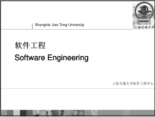

### 关于本课程

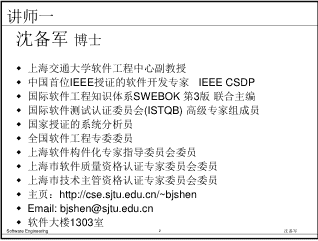

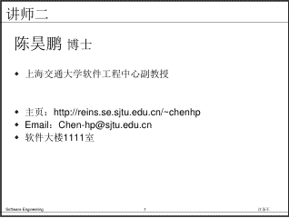

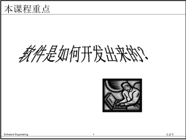

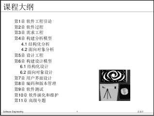

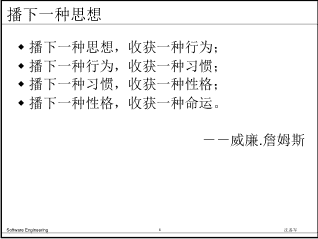

### 教材


### MOOC课程

- 本课程
  - MIT “Software Engineering for Web Applications”，Prof. Harold Abelson，Fall 2003，http://ocw.mit.edu
  - Vanderbilt，“Pattern-Oriented Software Architectures for Concurrent and Networked Software”，Prof. Douglas C. Schmidt，March 2013，https://www.coursera.org/course/posa
  - 清华，中国科大，“软件工程”，2014，http://www.icourse163.org/course/ustc-89008#/info
  - 浙江大学，北大，“面向对象技术高级班”，2014，http://www.topu.com/mooc/3823
- 硕士课程
  - MIT “Software Engineering Concepts”，Prof. Nancy Leveson，Fall 2005，http://ocw.mit.edu

### 考核方法

- 平时成绩 40%
  - 作业 80分
  - 立项答辩 20分
  - 缺勤一次扣 4分
  - 迟到或早退一次扣 1分
- 期末考试 60%
  - 开卷、笔试 100分

### 助教

| 组别 | 姓名 | 联系电话 | 邮箱 |
|---|---|---|---|
| 1班 | 张程 | 13917115283 | 459309661@163.com |
| 2班 | 周玮 | 13817193543 | 328353736@qq.com |
| 3班 | 童望荣 | 13817128140 | 254091182@qq.com |
| 4班 | 蔡熙桐 | 18667047886 | bakercxy@163.com |

### 软件工程引论

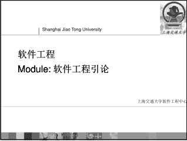

### 本节内容

- 什么是软件
  - 软件的作用、发展、定义和特性
  - 软件危机和问题
- 什么是工程
- 什么是软件工程
  - 软件工程的概念和误读
  - 软件工程的三个角
  - 控制软件开发的复杂性
  - 软件建模及方法

### 计算机软件已经成为一种驱动力

- 进行商业活动的引擎；
- 现代科学研究和工程问题解决的基础；
- 区分现代产品和服务的关键因素；
- 现代社会中不可缺少的。

应用于：交通、医疗、通讯、军事、娱乐、办公、社交、学习……

举例：Dell, Amazon, 淘宝, Ctrip等成功案例

“智能地球”

### 软件的定义

**软件是**

- 能够完成预定功能和性能的可执行的指令（计算机程序）；
- 使得程序能够适当地操作信息的数据结构；
- 描述程序的操作和使用的文档。

现在，被普遍接受的软件的定义是：

软件（software）是计算机系统中与硬件（hardware）相互依存的另一部分，它包括程序（program）、相关数据（data）及说明文档（document）。

### 软件特征

- 软件开发不同于硬件设计
  - 与硬件设计相比，软件更依赖于开发人员的业务素养、智力，以及人的组织、合作和管理。同时软硬件同样有设计成本，但软件成本在产品成本中只占一小部分，而软件开发占整个产品成本的大部分。
- 软件生产不同于硬件制造
  - 硬件设计完成后就投入批量制造，制造也是一个复杂的过程，其间可能犯下质量问题；而软件成为产品之后，其制造只是简单的拷贝而已，软件的制造和运输也非常简单。
- 软件维护不同于硬件维修
  - 软件在运行的初期有较高的故障率，在错误修正后的一段时间中，故障率会降到一个较低且稳定的水平。随着时间的迁移，故障率将再次升高，这是因为硬件会受到磨损等因素的影响，而软件故障是发生在程序逻辑中的。软件是能够不断地更换和升级的，但不会损耗。使用过之后，软件的缺陷可能会变得比以前更严重。如果软件内部的逻辑关系比较复杂，在维护过程中还可能产生新的错误。

### 软件是被设计的

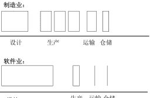

### 硬件的故障率曲线（浴缸曲线）

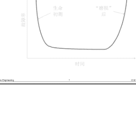

### 软件的故障率曲线(理想情况下)

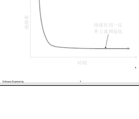

### 软件的故障率曲线(实际情况)

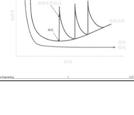

### 软件面临的新挑战

- 软件复杂性的增加
- 软件规模的不断扩大
- 软件运行环境的变化
- 遗留系统（Legacy System）的集成和复用
- 软件开发的高质量和敏捷性要求
- 分散的开发团队的协同

大型软件的典型事故案例：2000年1月，如同预言产生的一个人一夜之间老去，等等不一。2000年1月1日，2000年问题导致全球历史上最大的计算机事故，估计损失超过3,5354亿美元，合计同时使用计算机无先例。

- 网络应用
- 多种硬件、操作系统
- 多种编程语言
- 层出不穷的新技术

### 本节内容

- 什么是软件
- 软件的作用、发展、定义和特性
- 软件危机和问题
- 什么是工程
- 什么是软件工程
- 软件工程的属性和知识域
- 软件工程的黄金三角
- 控制软件开发的复杂性
- 软件建模及方法

### 软件危机的主要表现

- 对软件开发成本和进度的估计常常不准确，开发成本超出预算，实际进度比计划一再推迟的现象并不罕见。
- 用户对“已完成”系统不满意的现象经常发生。
- 软件产品的质量往往靠不住，Bug一大堆，Patch一个接着一个。
- 软件的可维护程度非常之低。
- 软件通常没有适当的文档资料。
- 软件的成本不断提高。
- 软件开发生产率的提高赶不上硬件的发展和人们需求的增长。

### 软件项目成功率调查

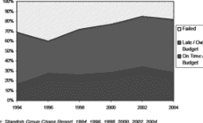

### 当前软件实践的问题

- 软件直到测试阶段仅仅是忽略质量的现代技术。典型地说，软件工程师
  - 没有计划他们的工作
  - 匆匆地走过需求和设计
  - 在编码时再进行设计
- 这些实践引入了大量的缺陷
  - 有经验的工程师每7-10行代码就引入一个缺陷
  - 平均中等规模的系统存在着上千个缺陷
  - 这些缺陷的大多数会累积到发现
  - 通常需要花去一倍以上的开发时间
- 目前大多数的工作方式还像30年前一样——“code-fix”

### 软件事故

- 1981年，由计算机程序变更而导致1/67的时间停运，使航天飞机STS-5的计算机不能同步运行。这个错误导致了航天飞机发射失败。
- 1986年，1台Therac-25机器错误释放致命剂量的辐射，致使两名医院病人死亡。原因是一个软件出现了问题，导致设备机器错误。
- 化学银行一个晚上从10多万客户的账户上，错误地扣除了大约1500万美元的存款。原因是一个软件的错误使ATM的每一笔业务重复记两次。
- 小事故：计算机一个月停机几次，不得不随时进行数据备份；定期重装机器；病毒四溢。

软件工程师是希望改变？

### 中国的软件产业现状

- 软件作坊 vs. 软件工厂
- 缺少系统化和规范化的管理
- 规模小，大多数在50人以下
- 生产率低
- 质量差

和美国、印度等存在较大的差距。

### 软件危机和问题的原因

- 一方面是与软件本身的特点有关
- 另一方面是由软件开发和维护的方法、过程、管理、规范和工具不正确有关

### 本节内容

- 什么是软件
  - 软件的作用、发展、定义和特性
  - 软件危机和问题
- 什么是工程
- 什么是软件工程
  - 软件工程的概念和知识域
  - 软件工程的三个角
  - 控制软件开发的复杂性
  - 软件建模及方法


## 软件是一门什么学科？

- 软件开发
  - 是一门艺术？
  - 是一门科学？
  - 是一门工程？

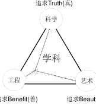

## 什么是工程？

- 工程是对技术（或社会）实体的分析、设计、建造、验证和管理。
- 工程是一种组织良好、管理严密、各类人员协同配合、共同完成工作的学科。
- 它具有以下特性：
  - 以价值为目标
  - 高度的组织管理性
  - 多种学科的综合
  - 高度的实践性

## 如何做工程？

- 一个工程实践包括以下四个核心步骤：
  - 理解问题。在软件工程领域，就是需求分析；
  - 规划方案。在软件工程领域，就是设计；
  - 实施计划。在软件工程领域，就是编码；
  - 验证结果的准确性。在软件工程领域，就是测试和质量保证。

## 本节内容

- 什么是软件
  - 软件的作用、发展、定义和特性
  - 软件危机和问题
- 什么是工程
- 什么是软件工程
  - 软件工程的概念和知识域
  - 软件工程的金三角
  - 控制软件开发的复杂性
  - 软件建模及方法

## 软件工程的经典定义

> “The establishment and use of sound engineering principles in order to obtain economically software that is reliable and works on real machines.” [Fritz Bauer]

> 软件工程就是为了经济地获得可靠的且能在实际机器上高效运行的软件而建立和使用的工程原理。

## 软件工程的经典定义(Cont.)

> “The application of a systematic, disciplined, quantifiable approach to the development, operation, and maintenance of software” [IEEE 1990]

> 软件工程是将系统的、规范的、可量化的方法应用于软件的开发、运行和维护，即将工程化应用于软件。

## 软件工程的经典定义(Cont.)

- “Software engineering is that form of engineering that applies the principles of computer science and mathematics to achieving cost-effective solutions to software problems.” [CMU/SEI-90-TR-003]
- 软件工程就是应用计算机科学和数学的原理来经济有效地解决软件问题的一种工程。

## 软件工程是一个国家的战略性学科

- 软件工程的发展受到了美国DOD的极大推动
- CMU SEI
- 如果一个国家的软件工程不强，那么这个国家就不会强大
- 软件工程要做强，关键在于创新，在于规范化的软件开发
- 本课程是软件学院的最核心课程，区别于计算机科学系。

## 软件工程知识体系SWEBOK

- 软件工程知识体系(Software Engineering Body of Knowledge) 简称SWEBOK
- 由IEEE国际组织推出
- 版本：当前版本 V3(2014)
- 网址：http://www.swebok.org
- 国际软件工程师证书：
  - CSDA，针对大学应届毕业生
  - CSDP，针对有经验的工程师

## SWEBOK V3的15个知识域

- 软件工程实践类知识域
- 软件需求、软件设计、软件构造、软件测试、软件维护、软件配置管理、软件工程管理、软件过程管理、软件工程方法、软件质量、软件工程职业实践
- 软件工程教育要求类知识域
- 工程经济基础、计算基础、数学基础、工程基础

## 本节内容

- 什么是软件
  - 软件的作用、发展、定义和特性
  - 软件危机和问题
- 什么是工程
- 什么是软件工程
  - 软件工程的概貌和知识域
  - 软件工程的黄金三角
  - 控制软件开发的复杂性
  - 软件建模及方法

## 软件工程的黄金三角

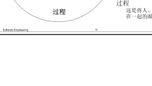

## 软件工程技术

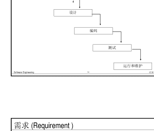

## 系统工程 (System Engineering)

- 在软件开发之前，必须了解该软件所外的外部“系统”
- 计算系统包括计算机硬件、软件、人员、数据库、文档、规程等系统元素。
- 系统工程的任务：
  - 系统建模 —— 系统模型
  - 系统仿真
- 系统工程的表现形式
  - 信息系统、关注企业、业务流程图——业务模型
  - 联合式系统、关注产品、产品结构——产品模型
  - 多媒体系统、关注内容、内容工程——脚本

## 需求 (Requirement)

- 目的：澄清用户的需求。
- 描述：软件人员和用户沟通，充分理解和获取用户的需求，并进行分析，形成《软件需求规格》文档和分析模型。
- 任务：
  - 需求获取
  - 需求分析和建模
  - 需求定义
  - 需求确认
  - 需求管理

重点在What

## 需求与设计

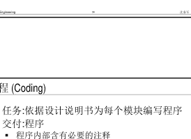

## 设计 (Design)

- 目的：建立软件的设计蓝图，是需求到代码的桥梁。
- 任务：软件人员依据软件需求，进行设计，形成《软件架构》文档和设计模型。
- 内容
  - 架构设计
  - 详细设计

重点在How

## 编码 (Coding)

- 任务:依据设计说明书为每个模块编写程序
- 交付程序
  - 程序内部含有必要的注释
  - 不含有语法错误
- 交付这样的程序就是编码阶段完成的里程碑

## 编程的误区

- 软件人员应该制衡大于编程的欲望
- 先经过分析阶段确定用户要求。
- 再经过设计阶段为需求制订蓝图。
- 甚至编程的条件才具备，可进入编码阶段
- 不要让compiler代替你检查代码的错误
- 那样会让语言bug隐藏得更深
- 先要自查代码的错误，再编译

## 测试 (Testing)

- 任务：发现并排除软件中的缺陷
- 不同层次的测试：
  - 单元测试 (Unit testing)
  - 集成测试 (Integration testing)
  - 系统测试 (System testing)


## 部署 (Deployment)

- 任务：交付、支持和反馈
- 部署原则：
  - Manage customer expectations for each increment
  - A complete delivery package should be assembled and tested
  - A support regime should be established
  - Instructional materials must be provided to end-users
  - Buggy software should be fixed first, delivered later

## 软件开发工作量分配比例

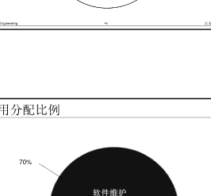

## 运行和维护 (Operation and Maintenance)

- 所谓维护，是指软件系统交付使用以后，为了改正错误或满足新的需要而修改软件的过程。
- 举例：一个中等规模的软件，如果开发过程要一年，投入使用后，其运行时间可能持续五年，这段时期是维护阶段。
- 与开发相比，维护阶段的工作量和成本要大得多。
- 人们对软件维护的认识还不够软件开发，因为开发具有主动性和创造性，易被人们所重视。

## 费用分配比例


## 维护类型

- 纠错性维护（Corrective maintenance）
  - 由于软件中的缺陷引起的修改
- 完善性维护（Perfective maintenance）
  - 根据用户在使用过程中提出的一些建设性意见而进行的维护活动
- 适应性维护（Adaptive maintenance）
  - 为适应环境的变化而修改软件的活动
- 预防性维护（Preventive maintenance）
  - 为了进一步改善软件系统的可维护性和可靠性，并为以后的改进奠定基础

## 软件工程的发展

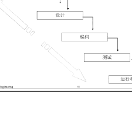

## 本节内容

- 什么是软件
  - 软件的作用、发展、定义和特性
  - 软件危机和问题
- 什么是工程
- 什么是软件工程
  - 软件工程的概念和知识域
  - 软件工程的金三角
  - 控制软件开发的复杂性
  - 软件建模方法

## 控制软件开发的复杂性

- 软件开发常常是相复杂、不可预测、难以计划的。
- 软件开发的复杂性主要来源于：
  - 技术的发展
  - 不断发展
  - 使用多项技术
  - 需求的复杂性
  - 规模
  - 不断变化
  - 人的复杂性
- 如何控制复杂性？
  - 抽象
  - 分解
  - 迭代

## 本节内容

- 什么是软件
  - 软件的作用、发展、定义和特性
  - 软件危机和问题
- 什么是工程
- 什么是软件工程
  - 软件工程的概念和知识域
  - 软件工程的黄金三角
  - 控制软件开发的复杂性
  - 软件建模及方法

## 软件建模是软件工程的核心技术

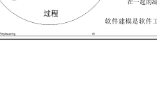


## 模型的功能

- 在正式启动工程项目之前发现设计中的错误
- 通过形式化的分析和实验，降低工程的风险
- 研究和比较不同的解决方案
- 用来和项目的所有者进行交流
- 客户、用户、实现者、测试者、开发文档管理员，等等
- 促进工程的实现

## 建模的重要性

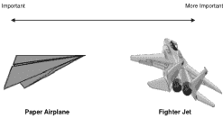

## 有用模型的特征

- 抽象性
- 突出重点方面，去除无关紧要的细节
- 可理解性
- 模型的表达方式能被模型的观察者很容易地理解
- 精确性
- 忠实地表达被建模的系统
- 说明性
- 能够被用来对被建模系统进行直观地分析，并得出正确的结论
- 经济性
- 模型的建立和分析比被建模系统更廉价，更经济

> > 作为有用的工程模型，必须具备以上所有特征！

## 模型的多个视图

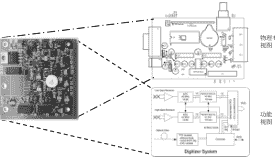

## 举例：UML 的软件模型视图

- 需求：
- 用例图 Use Case diagram
- 结构：
- 类图 Class diagram
- 对象图 Object diagram
- 行为：
- 状态图 Statechart diagram
- 活动图 Activity diagram
- 顺序图、协作图 Sequence diagram / Collaboration diagram
- 实现：
- 构件图 Component diagram
- 部署图 Deployment diagram

> 这些视图构成一个完整的模型。

## 软件的三种模型

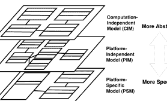

## 模型间的转换

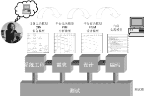

## 软件建模的方法

- 形式化方法 (Formal Method)
- 结构化方法 (Structured Method)
- 面向对象方法 (Object Oriented Method)
- 基于构件的软件开发方法 (Component Based Software Development)
- 面向服务方法 (Service Oriented Method)
- 模型驱动的开发方法 (Model-Driven Development)
- 敏捷建模方法 (Agile Modeling Method)
- ……

## 形式化方法

- 形式化方法是基于数学的技术开发软件，如集合论、模糊逻辑、函数。
- 形式化方法的好处：
- 无二义性
- 一致性
- 正确性
- 完整性

## 举例

```
AddBlock
△BlockHandler
Ablocks? = P BLOCKS
------------------------------
Ablocks? ⊆ used
BlockQueue′ = BlockQueue ⊕ ⟨Ablocks?⟩
used′ = used /\
  free′=free
```

加一个块集合到队列的尾部，采用Z语言

## 形式化方法的不足

- 形式化规约主要关注于功能和数据，而问题的时序、控制和行为等方面却更难表示。此外，有些问题元素（如，人机界面）最好用图形技术来刻划。
- 使用形式化方法来建立规范比其他方法更难，使得这种方法越来越难被实践者来说它代表了一种重要的“文化冲击”。
- 难以支持大的复杂系统。

尚未成为主流的开发方法，实践和应用较少

## 结构化设计的系统示例

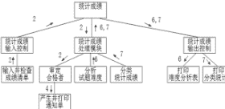

## 软件工程

## 结构化方法

- 核心：数据和处理
- 手段：自顶向下、逐步求精、模块化
- 常用建模工具：
- 需求建模
- DFD(数据流图)、DD(数据字典)、ERD(实体关系图)、STD(状态图)
- 设计建模
- 结构图(SC)
- 流程图、N-S图、PAD图、伪代码

## 软件工程引论

## 面向对象方法示例：销售订单

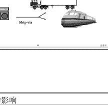

## 销售订单的图

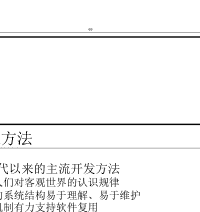

## 需求变化的影响

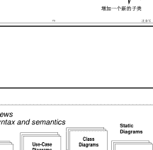

## 面向对象方法

- 九十年代以来的主流开发方法
- 符合人类对客观世界的认知规律
- 开发的系统结构易于理解、易于维护
- 继承机制有良好支持软件复用
- 常见的面向对象方法
- Booch method 1984
- Coad and Yourdon method 1991
- Rumbaugh method -- OMT 1991
- Jacobson method -- OOSE 1992
- Wirfs-Brock method 1990
- ……
- 国际标准统一建模语言 UML 1997

## UML 模型

- 多个视图
- 精确的语法和语义


## UML建模工具

- IBM RSA 和Rational Rose
- Sybase PowerDesigner
- Sparx System EA
- Borland Together
- ArgoUML 开源
- StarUML 开源
- ...

## 基于构件的软件系统示例

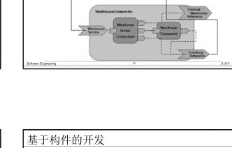

## 构件

- 构件是软件复用的重要手段，是核心和基础
- 构件由构件规约与构件实现两部分组成


## 基于构件的开发


## 软件工程

## 软件工程 模块：软件过程

## 软件过程

- 软件过程概述
- 软件生命周期模型
- 统一软件过程 RUP
- 敏捷过程

## 回顾：软件工程的金三角

人 完成软件开发的主体
技术 提供了遵循软件技术上要求 “如何做”的方法
管理 我们有了管理、协调等需要与技术结合，以提高软件开发效率
过程 这是把人、技术、管理结合在一起的凝聚力

## 软件过程的杠杆作用点

- 每个人都会体会到主动积极的优质劳动力的重要性，但是...
- 如果不理解过程，或者过程不是“最佳实践”下运行，即使我们的技术精英也无法使工作达到最佳的状态
- 过程是产品成本、速度和质量的主要决定因素

## 什么是软件过程

- 定义了谁在做什么、何时做，以及如何达到某个目标。

## 软件过程的组成

- 软件过程，也称为软件生存周期过程，是指软件生存周期中的一系列相关过程，其中过程就是活动的集合，活动是任务的集合，任务就是把输入加工输出的作业。
- 活动的执行可以是顺序的、迭代的（重复的）、并行的、嵌套的，或者是有条件地引发的。

## 软件过程

- 软件过程概述
- 软件生命周期模型
- 统一软件过程 RUP
- 敏捷过程

## 什么是软件生存周期模型

- 又称软件开发模型，是软件生命周期中的一个框架，规定了软件开发、运作和维护等所需要的过程、活动和任务。
- 软件生存周期模型分类：
- 瀑布顺序模型 Waterfall Model
- 增量式模型 Incremental Model
- 演化模型 Evolutionary Model

## 瀑布型(Waterfall)

- 最早的软件开发模型
- 1970年W. Royce提出
- 又称为线性顺序模型

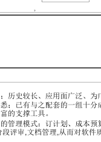

## 瀑布型特点

- 特点
- 强调整的阶段分其顺序性
- 强调各阶段工作及其文档的完整性
- 每一个阶段结束之前，都从技术和管理两个角度进行严格的审查
- 是一种线性顺序的、按阶段顺序的、逐步细化的开发模型
- 适用时机
- 需求、功能、性能等要求唯一、一次解决和确定时
- 所有功能都一次性交付时
- 必须同时测试全部系统时

## 瀑布型的价值

- 结构简单明了，历史悠久、应用面广泛、为广大软件工作者所熟悉，已有与之配套的、十分成熟的开发方法和和各种工具。
- 严格地有有效的管理模式，计划、成本预算、组织开发人员阶段评审、文档管理，从而对软件质量有一定的保证。

## 瀑布型的风险和缺点

- 获得完美的需求规格是十分困难的；
- 难以近快速变化需求；
- 系统太大时，难以一次性完成；
- 反馈信息慢；
- 可能引起开发后期的大量返工，如返工到需求、设计等早期活动；
- ...


## 增量型（Incremental）

- 构造一系列可执行的中间版本（Version by Version）

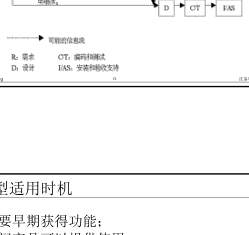

## 增量型需考虑的风险

- 需求未被很好地理解
- 一次要求所有功能
- 需求迅速发生变化
- 事先打算采用的技术迅速发生变化
- 长期内仅有有限的资源（人员/资金）

## 增量型适用时机

- 需要早期获得功能；
- 中间产品可以提供使用；
- 系统被自然地分割成增量；
- 工作人员/资金可以逐步增加。

## 演化型（Evolutionary）

- 表现：
  - 需求常常在软件开发过程中发生改变，想要一次迭代开发交付的最终产品是不可能的
- 解决办法：演化模型
  - 解决办法的原则是使软件可以分若干次交付一个完整的软件产品
- 特点：
  - 软件的开发方法，渐进式开发可多次迭代。逐步完善软件产品，每个版本都开发、开发过程中活动和任务都集中或与重量平衡进行开发
  - 与增量模型的区别是：开发早期无法确定所有需求，在开发的每个阶段需求又会被重新确定，可能每个增量版本中都需要重新确定

## 演化模型举例

基于风险、顺序执行的演化模型


- 首先执行风险最大的任务
- 并行开发
- 每次迭代都有迭代的原型
- 可以在细化所有需求之前启动开发工作

## 演化型价值：降低风险


演化模型是最早采用风险控制的模型

## 演化模型已成为主流

- 现代软件过程都采用演化模型
- 统一软件过程 RUP
- 敏捷过程（SCRUM, XP 等）
- 净室（Cleanroom）软件过程
- 演化模型的“子类”
  - 原型 Prototyping
  - 螺旋模型 Spiral Model

## 快速原型模型 Rapid Prototyping Model

一种迭代次数为2的演化模型

## 快速原型模型的特点

- 特点
- 快速开发工具
- 循环
- 低成本
- 种类
- 渐进型
- 抛弃型

## 螺旋模型 Spiral Model

一种基于风险的演化模型

## 螺旋模型的特点

- B.Boehm于1988年提出
- 演化模型+快速原型+风险分析
- 螺旋模型沿着螺旋线旋转，在四个象限上分别表示四个方面的活动，即：
- 制定计划：确定任务目标，选择实施方案，弄清项目开发的限制条件
- 风险分析：评价所选方案，识别风险，消除风险
- 工程实施：实施软件开发，验证工作产品
- 客户评价：评价开发工作，提出修正建议

## 软件过程

- 软件过程概述
- 软件生命周期模型
- 统一软件过程 RUP
- 敏捷过程

## 统一软件过程 RUP

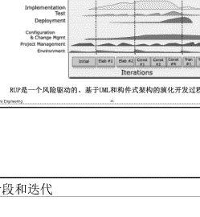

RUP是一个过程框架，基于UML和软件架构的演化开发过程。

## RUP的四个阶段

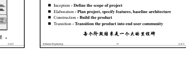

- 初始阶段（Inception） · 定义项目范围
- 精化阶段（Elaboration） · 规划项目、详细说明特性、确定基线架构
- 构建阶段（Construction） · 构建产品
- 移交阶段（Transition） · 将产品移交给最终用户群体

每个阶段结束是一个大里程碑

## 阶段和迭代

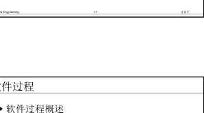

迭代是一组具有既定计划和评估标准的独特活动序列，其结果是产生一个可执行的发布版本（内部或外部）。

## 一个迭代周期：一个小的瀑布模型

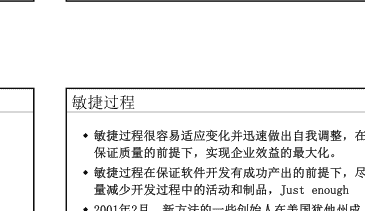

## 软件过程

- 软件过程概述
- 软件生命周期模型
- 统一软件过程 RUP
- 敏捷过程

## 敏捷过程

- 敏捷过程很容易适应变化并迅速做出调整，在保证质量的前提下，实现企业效益的最大化。
- 敏捷过程在保证软件开发成功产出的前提下，尽量减少开发过程中的活动和制品，做到恰到好处（Just enough）
- 2001年2月，一些新方法的创始人在美国犹他州齐聚，成立了敏捷联盟（Agile Alliance，网址：www.agilealliance.org）

XP SCRUM Crystal ASD dx MSF FDD DSDM Lean Development

## 敏捷宣言

- 较之于过程和工具，更注重人及其相互作用的价值
- 较之于无所不及的各类文档，更注重可运行的软件的价值
- 较之于合同谈判，更注重与客户合作的价值
- 较之于按计划行事，更注重响应需求变化的价值

## 敏捷过程的适用范围

Martin Fowler认为：新方法并非到处适用。

适合采用敏捷过程的情况：

- 需求不确定、易挥发
- 有责任感和积极向上的开发人员
- 用户容易沟通并能参与
- 小于10个人的项目团队

## Scrum — 敏捷的软件项目管理

- 1994年由Ken Schwaber和Jeff Sutherland 提出
- Scrum一词来源于橄榄球运动，意为两队争球
- Scrum的特征为：
  - 一个自组织的小团队，集体负责且责任共担
  - 团队成员紧密互助，集中地在短周期的环境下工作

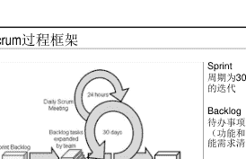

## Scrum的核心准则

- 迭代开发（Iterative Development）
  - 项目可交付成果是在多个迭代开发周期中构建的，每个周期都会增加新功能，并产生可演示的成果：可工作的代码、书面文档、可视化设计等。
- 自我管理（Team Empowerment）
  - 项目团队被划分为自我管理的多功能单元，称为 Sprint 团队，由最多六到七人组成。团队有权使用他们认为最合适的任何开发方法或工具来准备其可交付成果。

## Scrum过程框架

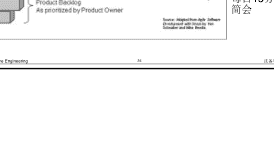

Sprint
周期为30天的迭代
Backlog
待办事项表
(功能和非功能需求清单)
Daily Scrum
每日15分钟
例会

## Scrum 角色（Scrum Players）

- Scrum 项目组
  - 产品负责人（Product Owner）
    - 向产品待办列表中添加条目
    - 设置优先级
  - 团队（Team）
    - 确定 Sprint 待办列表（确定可以完成什么）
    - 开发软件
  - ScrumMaster（主持项目的经理角色）
    - 负责 Scrum 过程
    - 清除障碍
- 其他相关方
  - 利益相关者（Stakeholder）
    - 为项目提供资金，将使用项目，并受其影响
    - 请求增强功能
  - IT 管理部门
    - 人力分配
    - 预算与计费
  - 高层业务管理部门
    - 企业资源的最佳利用


## Software Engineering / 软件工程

## 软件过程

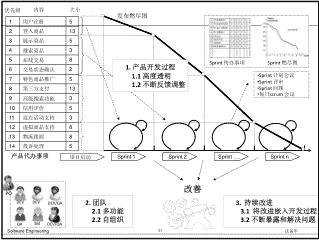

## 需求工程

Module: 需求工程

Shanghai Jiao Tong University  
上海交通大学软件工程中心

### 问题

- 用户说不清需求
- 我不确定，但我看到时就会知道
- 需求经常变化，项目没有时间
- 开发人员不断地大量超时工作，因为误解或二义性的需求直到开发后期才发现
- 系统测试白费了，因为测试者并未明白产品要做什么
- 功能都实现了，但由于产品的低性能、使用不方便或其它因素用户不满意
- 维护费用相当高，因为客户的许多增加要求未在需求获取阶段提出

### 需求工程

- 软件需求概念
- 需求获取
- 需求分析和建模
- 需求定义和验证
- 需求管理

@第5章 教材

### 什么是软件需求？

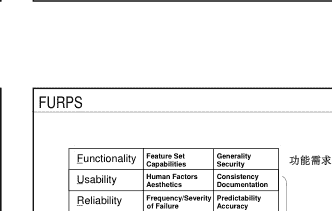

### 定义

- 需求
  - 系统必须符合的条件或能力
- 软件需求
  - 用户对目标软件系统在功能、行为、性能、设计约束等方面的期望。
- 内容包括：FURPS+

关注 What!

### FURPS

|  |  |  | 功能需求 |
|---|---|---|---|
| Functionality | Feature Set Capabilities | Generality |  |
|  | Security | Security |  |
| Usability | Human Factors | Consistency |  |
|  | Aesthetics | Documentation |  |
| Reliability | Frequency/Severity of Failure | Predictability | 非功能需求 |
|  | Recoverability | Accuracy |  |
|  | MTBF |  |  |
| Performance | Speed | Throughput |  |
|  | Efficiency | Response Time |  |
|  | Resource Usage |  |  |
| Supportability | Testability | Configurability |  |
|  | Extensibility | Serviceability |  |
|  | Adaptability | Installability |  |
|  | Maintainability | Localizability |  |
|  | Compatibility | Robustness |  |

### 定义 Functionality 需求

概要功能需求

Feat 63 - the defect tracking system will provide trending information to help the project manager assess project status
Feat 63 - 缺陷跟踪系统将提供趋势信息以帮助项目经理评估项目状态

详细功能需求

Trending information will be charted with a line graph showing time on the x axis, and number of defects found on the y axis.
趋势信息将用折线图绘制，x 轴显示时间，y 轴显示发现的缺陷数量。

### 定义 Reliability 需求

- “reliability”可靠性
  - The ability for the software to behave consistently in a user-acceptable manner
  - 软件以用户可接受的方式一致运行的能力
- 可靠性需求
  - Availability (xx.xx%)
  - Accuracy
  - Mean time between failures (xx hrs)
  - Max. bugs per KLOC (0-x)
  - Bugs by class - critical, significant, minor

### 定义 Supportability 需求

- “supportability”支持性
  - The ability of the software to be easily modified to accommodate enhancements and repairs
  - 软件能够轻松修改以适应增强和修复的能力
- 支持性需求
  - Languages, DBMSs, tools, etc.
  - Programming standards
  - Error handling and reporting standards
- 常常难以定义
  - If it is not measurable or observable, it is not a requirement
  - 如果不可测量或不可观察，就不是需求
  - Is it a design constraint?
  - 这是设计约束吗？
  - Is it an intent or goal?
  - 这是意图或目标吗？

### 定义 Performance 需求

- “performance”性能
  - A measure of speed or efficiency of the running system
  - 运行系统速度或效率的度量
- 性能需求
  - Capacity
  - Throughput
  - Response time
  - Memory
  - Degradation modes
  - Efficient use of scarce resources
    - Processor, memory, disk, network bandwidth

### 定义 Usability 需求

- “usability”可用性
  - The ease with which software can be learned and operated by the intended users
  - 软件被预期用户学习和操作难易程度
- 可用性需求
  - Training time requirements, measurable task times
  - User abilities (beginner/advanced)
  - Comparison to other systems that users know and like
  - Online help systems, tool tips, documentation needs
  - Conformity with standards
    - Examples: Windows, style guides, GUI Standards

### FURPS +

- 设计约束（design constraints）：规定或约束了系统设计的需要
- 实现需求（implementation requirements）：规定或要求了系统的编码或构造，如所需的标准、编程语言、数据库完整性策略、容错限制和操作环境。
- 接口需求（interface requirements）：规定了系统必须与之交互的外围软硬件，以及对这种交互作用所使用的格式、时间或其他因素的约束。
- 物理需求（physical requirements）：规定了系统必须具备的物理特征，可用来代表硬件要求，如物理网络配置需求。

### 二义性练习

我没说她偷了我的钱

Mary had a little lamb
玛丽有一只小羊羔

如何减少需求的二义性？

### 需求工程

### 二义性与可理解性的关系

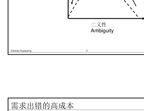

### 可验证性

- 需求是可验证的，如果可以用人工或机器方法检查产品是否满足需求
- The system supports up to 1,000 simultaneous users
- 系统支持多达 1,000 个并发用户
- The system shall respond to an arbitrary query in 500 msec.
- 系统应对任意查询在 500 毫秒内做出响应。
- The color shall be a pleasing shade of green
- 颜色应为令人愉悦的绿色色调
- The system shall be available 24 x 7
- 系统应 24 x 7 可用
- The system shall export view data in comma-separated format
- 系统应以逗号分隔格式导出视图数据

这些需求可验证吗？如果不，如何更好地表述？

### 需求出错的高成本

The 1-10-100 Rule
1-10-100 规则

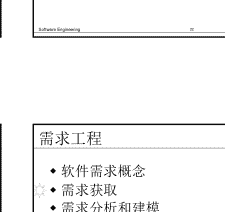

> "All together, the results show as much as a 200:1 cost ratio between finding errors in the requirements and maintenance stages of the software lifecycle."
> “总的来说，结果显示在软件生命周期的需求阶段和维护阶段发现错误之间的成本比率高达 200:1。”

### 需求工程


发现、获取、组织、分析、编写和维护需求的方法论，让客户和项目之间沟通共享

### 需求工程

- 软件需求概念
- 需求获取
- 需求分析和建模
- 需求定义和验证
- 需求管理


# Software Engineering

# 需求工程

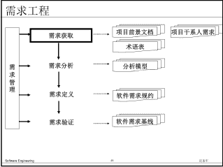

## 前置文档（Vision）

+ 1. 简介 Introduction
+ 2. 定位 Positioning
  - 2.1 商机 2.2 问题说明 2.3 产品定位
+ 3. 项目干系人和用户描述 Stakeholder and User Descriptions
+ 4. 产品概述 Product Overview
+ 5. 产品特性 Product Features
+ 6. 约束 Constraints
+ 7. 质量范围 Quality Ranges
+ 8. 优先级 Precedence and Priority
+ 9. 其它产品需求 Other Product Requirements
+ 10. 文档需求 Documentation Requirements

## 1）分析问题及根源

+ ◆ 什么是问题？
  ▪ 理解和记录客户的观点
  ▪ 达成共识（从业务角度）
+ ◆ 什么是真正的问题？
  ▪ 寻找问题根源，探究症结
+ ◆ 避免Yes...But现象，避免IT黑洞

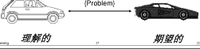

## 识别业务解决方案

+ ◆ 分析业务需求
+ ◆ 提出多种解决方案
  ▪ 技术的或(和)非技术的
+ ◆ 选择最能满足业务需求的解决方案
+ ◆ 启动项目，实现方案

## 案例研究: Course Registration System

+ ◆ Review the problem statement


## 举例：选课系统的问题陈述 @Vision文档

| 项目 | 内容 |
|---|---|
| The problem of | The outdated and largely manual student registration process at Wylie College |
| affects | Students, professors, and College administration. |
| The impact of which is | A slow and costly process combined with dissatisfied students and professors. |
| A successful solution would | Improve the image of the College, attract more students, and streamline administrative registration functions. |

## 5）识别需求的来源

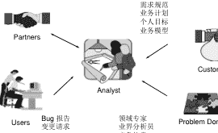

## 6）收集需求

+ - 项目干系人需求的收集技术：
  - 访谈
  - 调查问卷
  - 需求研讨会
  - Use-Case 研讨会
  - Storyboards
  - 角色扮演
  - 复审现有需求
  - 观察正在工作的用户

## 获取需求：采用哪种技术？

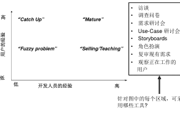

## 需求获取过程

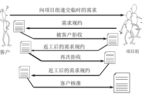

## 7）产品定位

| 项目 | 示例：选课系统的产品定位 @Vision文档 |
|---|---|
| For | While College students, professors, and the course registrar |
| Who | Attend, teach, or administer college courses |
| The Course Registration System | Is a tool |
| That | Enables online course registration and access to course and grade information |
| Unlike | The existing outdated mainframe registration system |
| Our product | Provides up-to-date information on all courses, registrations, teachers, and grades to all users from any PC connected via the College LAN or internet. |

## 8）撰写产品特性

+ 举例：选课系统的产品特性 @Vision文档
  - Logon
  - Register for Courses
  - Course Cancellations
  - Student Billings
  - Enter, Update, and View Professor Information
  - View Student Grades
  - Select Courses to Teach
  - Enter, Update, and View Student Information
  - Record Student Grades
  - View Course Catalog Information
  - View Course Schedule
  - Monitor for Course Full

# Software Engineering

# 需求工程

## 9）定义质量范围

举例：选课系统的质量范围@Vision文档

+ - **Availability:**
  - The System shall be available 24 hours a day, 7 days a week.
+ - **Usability:**
  - The System shall be easy-to-use and shall be appropriate for the target market of computer-literate students and professors.
  - The System shall include online help for the user. Student and Professor users should not require the use of a hardcopy Manual to use the System.
+ - **Maintainability:**
  - The System shall be designed for ease of maintenance. All college-specific data should be table-driven and modifiable without recompilation of the system.
+ - **Performance Requirements:**
  - The system shall support up to 200 simultaneous users against the central database at any given time, and up to 500 simultaneous users against the local servers at any one time.
  - The system shall provide access to the legacy Course Catalog Database with no more than a 10 second latency.
  - The system shall complete 80% of all transactions within 2 minutes.

## 10）定义文档需求

举例：选课系统的文档需求 @Vision文档

+ - User Manual
+ - On-line Help
+ - Installation Guides, Configuration, Read Me File
+ - Labeling and Packaging

## 11）建立项目范围

+ - Feature 1: The system must...
+ - Feature 2: The system must...
+ - Feature 3: The system must...
+ - Feature 4: The system must...
+ - Feature n: The system must...

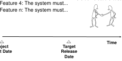

## 使用需求属性排列特性的优先级

| Feature | 状态 | 风险 | 重要性 | 工作量 | 成本 |
|---|---|---|---|---|---|
| Feature Reqt. 10 | Approved | Low | High | 👥👥👥 | $$$ |
| Feature Reqt. 13 | Proposed | Med. | Low | 👤 | $$ |
| Feature Reqt. 40 | Approved | High | Mandatory | 👥👥👥 | $ |

其他属性包括稳定性、技术难度等

## 12）划分特性优先级

举例：选课系统的特性优先级 @Vision文档

+ - **Release 1:**
  - Logon
  - Register for Courses
  - Interface to Course Catalog Database
  - Maintain Student Information
  - Maintain Professor Information
+ - **Release 2:**
  - Submit Student Grades
  - View Grades
  - Select Courses to Teach

## 需求工程

+ - 软件需求概念
+ - 需求获取
+ - 需求分析和建模
+ - 需求定义和验证
+ - 需求管理


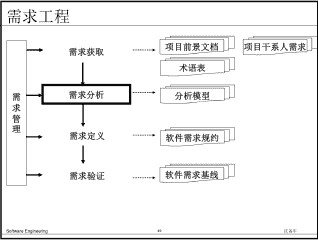

## Software Engineering

## 需求工程

## 分析建模准则

- Represent the information domain
- Represent software functions
- Represent software behavior
- Partition these representations
- Move from essence toward implementation

## 分析模型

对需求进行分析，并进行图形建模，形成分析模型（平台无关模型 PIM）。

◆ 结构化分析模型
- 数据流图（DFD）
- 控制流图（CFD）
- 数据字典（DD）
- 实体—关系图（ERD）
- 状态变迁图（STD）
- 加工说明（PSPEC）
- 控制说明（CSPEC）

◆ 面向对象分析模型
- 用例图
- 活动图
- 类图
- 时序图
- 通信图
- 状态机图

## 需求工程

- 软件需求概念
- 需求获取
- 需求分析和建模
- 需求定义和验证
- 需求管理

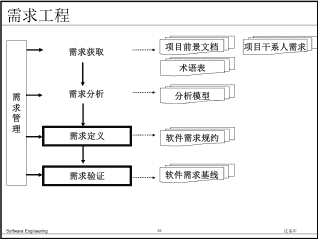

## 需求工程

## 需求定义的任务

定义详细需求 - SRS

- 细化功能需求
- 细化非功能需求
- 细化约束条件
- 设计用户界面和接口

## 成果：软件需求规范说明书

软件需求规范说明书（SRS）定义了系统的外在行为和属性。

## 细化需求

- 细化功能需求
- 引入分析模型
- 细化非功能需求
- 细化约束条件

概要功能需求
Feat 63 - the defect tracking system will provide trending information to help the project manager assess project status

详细功能需求
Trending information will be charted with a line graph showing time on the x axis, and number of defects found on the y axis.

## 设计用户界面和接口

- 如果和外界的软系统或硬件进行交互，则需定义通信协议
- 如果采用现有的协议，在功能说明中描述
- 如果采用新的协议，在设计时进行完整描述
- 如果和用户交互，则简略要设计用户界面
- 图表（在纸上）
- 位图（采用绘图工具），或
- 可执行代码（交互式的电子界面原型）

## 如何描述用户界面

- 可在功能说明中纳入屏幕截图，也可以是一个独立的用户界面原型
- 注意不要关注太多的界面设计细节

## SRS模板（采用传统技术）

1. 简介
2. 整体说明
3. 具体需求
   3.1 功能
   3.2 性能
   3.3 可靠性
   3.4 兼容性
   3.5 安装
   3.6 设计约束
   3.7 软件界面和硬件接口需求
   3.8 通信接口需求
   3.9 授权
   3.10 许可权及其它说明
   3.11 维护
   3.12 适用的标准
4. 支持信息
   附录、术语表等

## SRS模板（采用Use-Case技术）

1. 引言
   1.1 Purpose
   1.2 Scope
   1.3 Definitions, Acronyms, and Abbreviations
   1.4 References
   1.5 Overview
2. 概述
   2.1 Use-Case Model Survey
   2.2 Assumptions and Dependencies
3. 具体需求
   3.1 Use-Case 描述
      3.1.1 Use Case i:
      3.1.2 ...
   3.2 补充需求
      3.2.1 用例相关表
      3.2.2 ...
4. 支持信息
   附录、术语、用户/操作指南等

## 需求验证

- 原型确认
  - 抛弃型原型确认
  - 演进型原型确认
- 需求评审

评审需求文档（Vision和SRS等），及时发现缺陷，寻找改进的机会，同时从评审反馈中获得知识，补充了正式的文档和培训机制，帮助团队建立对产品的共同理解

## 需求评审方法

- 审查
- 小组评审
- 走查
- 针对编程
- 同级桌查
- 轮查
- 临时评审

正式化程度

## 需求评审的输入和输出

- 输入
  - 待评审的需求文档
  - Check list
- 输出
  - 评审结论
    - 通过
    - 有条件通过
    - 不通过
  - 缺陷清单

软件需求基线

## 需求工程

- 软件需求概念
- 需求获取
- 需求分析和建模
- 需求定义和验证
- 需求管理

## 需求工程


## 需求管理

1. 定义需求基线
2. 需求变更控制和版本控制（建立新的需求基线）
3. 需求跟踪

## Software Engineering

## 需求工程

## 1）建立需求基线

- Feature 1: The system must...
- Feature 2: The system must...
- Feature 3: The system must...
- Feature 4: The system must...
- Feature n: The system must...

How do we know what the needs are?
How do we determine priority?
Where do we set the baseline?

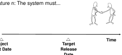

## 2）需求变更控制

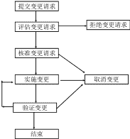

## 3）需求跟踪


## 软件工程
Module: 结构化分析

Shanghai Jiao Tong University

## 结构化分析

- 结构化分析方法概述
- 数据流图
- 分层数据流图的审查
- 数据字典
- 描述基本加工的小说明
- 实体—关系图

@3.2.1节,教材

## 结构化方法

- 一种面向数据流的传统软件开发方法
- 以数据流为中心构建软件的分析模型、设计模型和实现模型
- 分为：
  - 结构化分析(Structured Analysis, 简称SA)
  - 结构化设计(Structured Design, 简称SD)
  - 结构化编程(Structured Programming, 简称SP)

## 结构化方法的思想

- 发展历史
  - 提出：20世纪60年代末到70年代初
  - 成熟：20世纪70年代末到80年代中期
- 主要思想：抽象与自顶向下逐步分解
  (控制复杂性的两个基本手段)
  - 抽象：从作为整体的系统开始第一层，每一抽象层上只关注于系统的输入输出
  - 分解：将系统不断分解为子系统、模块……

## 结构化分析方法中的抽象与分解

- 随着分层层次的增加，抽象的级别越来越低，也越接近问题的算法和数据结构


## 结构化分析模型

数据字典是模型的核心，它包含了为使用和产生所有数据的描述
数据流图：用于功能建模，描述数据输入数据流图如何经过一系列加工、数据流逐步变成系统的输出数据流
实体—关系图：用于数据建模，描述数据字典中数据之间的关系

- 状态转换图：用于行为建模，描述系统接收哪些外部事件，以及在外部事件的作用下系统的状态迁移情况


## 结构化分析

- 结构化分析方法概述
- 数据流图
- 分层数据流图的审查
- 数据字典
- 描述基本加工的小说明
- 实体-关系图

## 数据流图

Data Flow Diagram(简称DFD)：描述输入数据流到输出数据流的变换(即加工)过程，用于对系统的功能建模。基本元素包括：

- → 数据流(data flow)：由一固定成分的数据组成，表示数据的流动方向
- ○ 加工(process)：描述了数据流到数据流输出数据流的变换，转换输入数据加工成输出数据流
- = 文件(file)：使用文件、数据存储等保存数据被采集以后再用
- 源或宿(source or sink)：由一固定成分的数据组成，表示数据的流动方向

## 示例：图书订阅系统DFD


## 源或宿

- 存在于软件系统之外的人员或组织，表示软件系统输入数据的来源和输出数据的去向，因此也称为源点和终点
  - 例如，对一个专科处理系统而言
  - 学生向系统提供数据(输入数据流)，所以学生是考察系统的一个输入
  - 系统将成绩单提供给学生(输出数据流)
  - 老师处理成绩单并制作成成绩分析表(输出数据流)或送往考务中心，所以考试中心是系统的另一个输出
- 源或宿用相同的图形符号表示
  - 当数据流从该符号表示流出
  - 当数据流流向该符号表示流入
  - 当两者皆有时表示既是源又是宿

## 示例：图书订阅系统DFD


## 加工和文件

- 加工：描述输入数据流到输出数据的变换
  - 每个加工用一个定义明确的名称标识
  - 至少有一个输入数据流和一个输出流
  - 可以有多个输入数据流和多个输出数据流
- 文件：保存数据信息的外部单元
  - 每个文件用一个定义明确的名称标识
  - 由加工进行读写
  - DFD中称为文件，但在具体实现时可以用文件系统实现也可以用数据库系统等实现

## 示例：图书订购系统DFD


## 结构化分析

## 数据流

- 每个数据流用一组固定成分的数据组成并拥有一个定义明确的名字标识
- 如：运动会管理系统，报名单(数据流由队名、姓名、性别、参赛项目等数据组成
- 数据流的流向
  - 从一个加工流向另一个加工
  - 从加工流向文件(写文件)
  - 从文件流向加工(读文件)
  - 从源流向加工
  - 从加工流向宿

## 示例：图书订购系统DFD


## 数据流图的充要符号

- 描述一个加工的多个数据流之间的关系
  - 基础(*): 表示数据流之间在“与”关系
    - 所有输入数据流同时在时，才能进行加工处理
    - 或加工产生的结果是在所有输出数据流
  - 加工(+): 表示数据流之间在“或”关系
    - 至少存在一个输入数据流时才能进行加工处理
    - 加工产生的结果是至少产生一个输出数据流
  - 异或(⊕): 表示数据流之间在“异或”关系
    - 必须存在且仅存在一个输入数据流时，才能进行加工处理
    - 或加工处理的结果是产生且仅产生一个输出数据流

## 对数据流图进行分层

- George Miller在著名论文“神奇的数字7加减2：我们处理信息的能力的某种限制”中指出：人们在一段时间内短期的记忆似乎限制在5~9件事物之内
- 根据自顶向下逐步分解的思想将数据流图作成层次结构
- 每个层次画在独立的数据流图中，加工个数可大致控制在“7±2”的范围中

## 数据流图的各个层次

- 顶层图
  - 其代表整个数据系统的1个加工，描述了数据系统与外部环境间的7个数据流
  - 加工不必编号
- 0层图
  - 顶层图的加工分解后的图，只有1张
  - 加工编号分别为1、2、3、...
- X层图
  - 顶层编号，若父图中加工号X分解成一子图，则该子图编号为“Xx”
  - 如图的编号，若父图的加工号为X的加工分解成一子图，则该子图中的加工编号分别为X.1、X.2、X.3...

## 分层数据流图举例

- 简化的资格和水平考试的考务处理系统
- 成员多个级别，如初级程序员、程序员、高级程序员、系统分析员等，凡满足一定的条件的考生都可以参加一个级别的考试
- 考试的合格标准根据每年的考试成绩由考试中心确定
- 考试的阅卷由阅卷站进行，因此，阅卷工作不包含在软件系统中

## 示例：考务处理系统功能需求

- 对考生送来的报名单进行检查
- 对合格的报名单编好准考证号后将准考证送给考生，并将汇总后的考生名单送给阅卷站
- 对阅卷站送来的成绩清单进行检查，并根据考试中心制订的合格标准审查合格者
- 制作考生成绩通知单送给考生
- 进行成绩分类统计(按地区、年龄、文化程度、职业、考试级别等分类)和试题难易度分析，产生统计分析表

## 示例：考务处理系统顶层图


## 示例：部分数据流的组成

- 报名单=地区+序号+姓名+文化程度+职业+考试级别+通信地址
- 正式报名单=准考证号+报名单
- 准考证=地区+序号+姓名+准考证号+考试级别+考试
- 考生名单=(准考证号+考试级别)
- 其中 (w 表示重复多次)
- 考生名单=正式报名单
- 统计分析表=分类统计表+难易度分析表
- 成绩通知单=准考证号+姓名+通信地址+考试级别+考试成绩+合格标志

## DFD细化—确定加工

- 将父图中某一加工分解成若干子加工
- 根据功能分解来确定加工，将一个复杂的功能分解成若干个较小的功能，较多应用于高层DFD中的分解
- 根据业务处理流程确定加工，分析图中待分解加工的业务处理流程，业务流程中的每一步都可能是一个子加工
- 特别要注意在业务流程中数据流发生变化或数据流的值发生变化的地方，应该存在一个加工

## DFD细化—确定数据流

- 在父图中某一加工分解而成的子图中，父图中相应加工的输入/输出数据流都是而且只是子图边界上的输入/输出数据流
- 分解后的子加工之间的数据流增添相应的新数据流表示加工过程中的中间数据
- 如果某些中间数据需要保存以备后用，那么可以做成流向文件的数据库
- 一个源或加工可以有多个数据流流向一个加工，如果它们不是一起到达和一起加工的，那么可以将它们分成若干个数据流

## Software Engineering

## 结构化分析

## DFD细化—确定文件

- 如果图中该加工存在读写文件的数据流，则相应的文件和数据都需画到子图中
- 在分解子图中，如果某些要保留某些中间数据以备后用，则可以将其数据流做成一个新的文件
- 新文件(首次出现的文件)至少应有一个加工为其写入记录，同时至少存在另一个加工读取该文件的记录
- 注意：从图中流下来来的文件在子图可只能对其进行读，或只是写号

## 示例：考务处理系统0层图


## 示例：考务处理系统—考试报名1子图

- 3个子加工：检查报名单、确认考试证号、登记考生
- “合格报名单”和“正式报名单”是新增的数据流。其数据流需要加上一个版本号
- 在加工1的分解中没有新的文件产生


## 示例：考务处理系统—统计成绩2子图


## 总结：画层次数据流图的步骤

1. 系统的输入和输出
2. 画系统内部
3. 画加工内部
4. 重复第3步，直至每个尚未分解的加工都足够简单(即不必再分解)

## DFD练习，画出顶层图和0层图

- 一个大城市的公检部门决定开发一个基于Web的故障跟踪和维修补充系统(PHTRS)：
  - 该系统将有责任跟踪、它将跟踪每一个报案，并跟踪到维修地点。
  - 大约有1(910)位警察中队巡逻员、地区(即提供给地区和补充服务由指定的大队指挥员来管理)。
- 工作单数据和每个故障有关，数据包括报案位置和大小、修理标准项、修理和维修人员、分配的技工、修复时间表、报案是否正在处理中、已维修、删除或维修、未修复、如果维修的修理和修理的升级、维修使用时间、人员、使维修的成本计算等。
- 每个产生一个报案文件和报案的故障的维修发生时，并包括报案的地点、地址、电话号码、损坏类型和维修类型。
- PHTRS是基于Web的系统，可交互进行所有的查询。

4.1 - 5


# 结构化分析

- 结构化分析方法概述
- 数据流图
- 分层数据流图的审查
- 数据字典
- 描述基本加工的小说明
- 实体—关系图

## 分层数据流图的审查

- 检查图中是否存在错误或不合理(不理想)的部分
- 一致性：分层DFD中不存在矛盾和冲突
- 完整性：分层DFD本身的完整性，即是否存在遗漏

### 分层数据流图的一致性

- 父图与子图平衡
- 任何一张DFD子图边界上的输入输出数据流必须与其父图中对应的加工的输入输出数据流保持一致
- 数据守恒
- 一个加工所产生输出数据流中的数据，必须能从该加工的输入数据流中直接获得，或者能通过该加工的处理而产生
- 多余的数据流：加工未使用其输入数据流中的某些数据项

### 父图与子图不平衡的实例

- 加工2的输入数据流有M和N，输出数据流是T
- 而子图(右图)边界上的输入数据流是N，输出数据流是S和T


### 父图与子图平衡的实例

注意：如某父图中加工的一个数据流，对应于子图中几个数据流，而父图中没有这些数据流的源头或正好对应于父图中的这个数据流，事实上它们的源头是同一个


### 数据不守恒的实例

由于“正式成绩清单”中缺少“考生成绩单”中的姓名、通信地址等数据，这些数据也无法由加工2.3自己产生，因此，加工2.3不满足数据守恒的条件


### 分层数据流图的完整性

- 每个加工至少有一个输入数据流和一个输出数据流
- 在整套分层数据流中，每个文件应至少有一个加工读取该文件，有另一个加工写该文件
- 分层数据流图中的每个数据流和文件都必须命名（除了流入或流出文件的数据流），并保持与数据字典的一致
- 分层DFD中的每个基本加工（即不再分解子图的加工）都应有一个加工规约

### 其它需注意的问题-1

- 适当命名：每个数据流、加工、文件、源和宿都应被适当地命名，名字应符合被命名对象的实际含义
  - 名字应反映整个对象（如数据流、加工），而不是仅反映它的某一部分
  - 避免使用空洞的、含义不清的名字，如数据、信息、处理、统计等
  - 如果发现某个数据流或加工难以命名时，往往是DFD分解不当的征兆，此时应考虑重新分解
- 画数据流而不是画控制流
  - 判断准则：这条线上是否有数据流过

### 其它需注意的问题-2

- 分解尽可能均匀
  - 理想目标：任何两个加工的分解层数之差不超过1
  - 应尽可能使分解均匀，对于分解不均匀的情况应重新分解
- 先考虑稳定状态，忽略琐碎的枝节
  - 先考虑稳定状态下的各种问题，暂时不考虑系统如何启动、如何结束、出错处理以及性能等问题
- 随时准备重画
  - 对于一个复杂的软件系统，往往要经过反复多次的重画才能达到完善的分层整合
  - 分析阶段遗留下来的一个错误，到开发后期要花几十倍代价来纠正这个错误

### 分解的程度

- 可参照以下几条与分解有关的原则：
  - 7±2
  - 分解应自然、概念上合理、清晰
  - 只要不影响DFD的易理解性，可适当分解几个加工，以减少步数
  - 一般说来，上层分解得越细（即多分解几个加工），下层分解得越粗（即少分解几个加工）
  - 分解要均匀

# 结构化分析

- 结构化分析方法概述
- 数据流图
- 分层数据流图的审查
- 数据字典
- 描述基本加工的小说明
- 实体—关系图

## 数据字典

- 数据流图与数据字典是密不可分的，两者结合起来构成软件的分析模型
- 数据字典由字典条目组成，每个条目描述DFD中的一个元素
- 数据字典条目包括：数据流、文件、加工、源或宿

## DFD练习

- 一个大城市的公共工程部门决定开发一个基于Web的坑洼跟踪和报告系统(PHTRS):
- 该系统将保存坑洼，它们被编入一个区段内，并按街道编号排序。
- 大小为10的，包括中转站编号，地区通过街道编号和种族编号来识别。
- 工作单将根据居民的姓名，邮寄地址和坑洼数据大小，坑洼标准号，坑洼的身份，分别登记，居民姓名，坑洼的正常处理，已登记，赔偿金额，未修复，使用标准的坑洼的开销(由居民提供)，人数，使用材料的方法进行登记。
- 建议，产生一个关于个人使用坑洼的损失信息，并包括居民的姓名，地址，电话号码，可能发生和损失情况。
- PHTRS基于Web的系统，可交互进行所有查询。

# 结构化分析

- 结构化分析方法概述
- 数据流图
- 分层数据流图的审查
- 数据字典
- 描述基本加工的小说明
- 实体—关系图

## 基本加工的小说明

- 小说明是基本加工的概要说明，应精确地描述用户要求的一个加工“做什么”。
- 包括加工的触发条件、加工逻辑、优先级、执行频率、输出数据等。
- 每个基本加工的核心部分是加工逻辑，即该加工的输出数据与输入数据流之间的逻辑关系。
- 加工逻辑不是对加工的设计，不涉及数据结构、算法实现、编程语言等与设计和实现有关的细节

### 加工逻辑的描述方法

- 结构化语言：介于自然语言和形式语言之间的一种半形式化语言
- 判定表：适用于加工逻辑包含多个条件，而不同的条件组合需做不同的动作
- 判定树：判定表的变种，它本质上与判定表是相同的，只是表示形式不同

### 结构化语言

- 没有严格的语法
- 加工被划分为若干个段落，每个段落可分为内外两类：
  - 外层有严格的语法来描述的控制结构
    - 如结构化英语中可使用 if_then_else, while do、repeat until, for do、case等结构
  - 内层可以用自然语言来描述
- 允许使用嵌套结构

#### “计算信用度”的结构化英语描述

```text
Case 1 (No Bounced - Checks in Customer Record):
Write Exemplary—Customer—Citation to Annual—Summary.
Case 2 (One Bounced - check):
If Yearly-Average-Balance exceeds $ 1000.
Remove Bounced-Check from Customer-Record.
Otherwise:
Reduce Credit—Limit by 10%.
Case 3 (Multiple Bounced - Checks):
For each Bounced—Check:
Reduce Credit—Limit by 15%.
Set Credit—Rating to Deadbeat.
Write Scathing—Comment to Annual—Summary.
Write Customer—Name—and—Address to IRS—Enemies—List.
```

### 结构化语言书写加工规约注意事项

- 语句力求简练
- 语句必须简洁、易理解、无二义
- 主要使用祈使句，祈使句中的动词要明确表达该要执行的操作
- 所有名字必须是数据字典中有定义的名词
- 不使用形容词、副词等修饰语
- 不使用含义相同的词，如“修改”、“修正”等
- 可以使用常用的逻辑和关系运算符号
- 总之要尽可能精确、无二义、简明扼要、易理解

### 判定表

- 判定表的组成元素
  - 条件桩(Condition Stub)：列出与条件有关的项目，如发货金额、截止天数等，每行对应一个条件
  - 条件项(Condition entry)：列出各条件桩的取值。条件条目的取值通常只有两个可能值
  - 动作桩(action stub)：列出所有可能采取的动作，如发出发货单等
  - 动作项(action entry)：列出各条件组合下应采取的动作

“审批发货单”加工的判定表：

| 发货金额 | >500 | >500 | ≤500 | ≤500 |
| 截止天数 | >60 | ≤60 | >60 | ≤60 |
| 发出批发单 | √ |  |  |  |
| 发出零售单 |  | √ | √ | √ |

#### 判定表的其它形式

“审批发货单”加工的简化判定表：

| 发货金额 | >500 | ≤500 | — | — |
| 截止天数 | ≥60 | <60 | ≥60 | <60 |
| 发出批发单 | √ |  |  |  |
| 发出零售单 |  | √ | √ | √ |

“审批发货单”加工的另一种判定表：

| 发货金额>500 | 0 | 0 | 1 | 1 |
| 截止天数>60 | 1 | 1 | 0 | 0 |
| 截止天数>40 | 0 | 1 | 0 | 1 |
| 截止天数>40 | 1 | 0 | 1 | 0 |
| 发出批发单 | √ |  |  |  |
| 发出零售单 |  | √ | √ | √ |

### 判定树

- 本质上与判定表是相同的，只是表示形式不同
- 例如“审批发货单”加工逻辑的判定树描述如下：


# 结构化分析

- 结构化分析方法概述
- 数据流图
- 分层数据流图的审查
- 数据字典
- 描述基本加工的小说明
- 实体—关系图

## 实体—关系图

- 实体—关系图(Entity-Relation Diagram, ERD)用于数据建模，描述数据字典中数据之间的关系
- 实体是客观存在的数据库对象
  - 具体数据，不封装操作，和OO类不同
  - 例如：学生，学校，事件，植物
- 实体具有属性
  - 例如：学生具有姓名和地址
- 实体间可存在多种不同关系
  - 例如：教师指导学生，学生选课


## 实体和关系

### 关系的基数

### ERD示例

### ERD练习

- 一个大城市的公共工作部门决定开发一个基于Web的抗击道路和移除系统(PHTRS):
- 每个道路和移除作业都由一个或多个员工执行，并需要两道维护、大型(10吨)或重型(或重型)车辆。地区由街道地理坐标记录并提供服务(每个街道的大部分区域在多个地区内)。
- 作业数据和每个作业有关。数据包括作业是星期几、修理站点号、维修的个人、分配的设备、修理时间长度、损坏(在现场中)、已修复、待修复、未修复、修复费用和损坏和修复的开始和结束时间。人员、人员、设备和维修的费用都将被跟踪。
- 最后，产生一个维修作业以便在该地区进行道路损坏信息，并包括报告的产生、通知、电话号码、维修和维修的损失信息。
- PHTRS是基于Web的系统，可允许进行所有查询。

## Software Engineering

### Differences Between OO and Structured Method

- Object-orientation (OO)
  - 在生命周期早期将数据和数据流过程融合在一起
  - 具有高度的封装性
  - 以不同的方式促进代码重用
  - 允许更多的软件可扩展性

## 面向对象分析

### History of the UML


### 面向对象方法的三个步骤

- 面向对象分析
  - Object Oriented Analysis, OOA
- 面向对象设计
  - Object Oriented Design, OOD
- 面向对象编程
  - Object Oriented Programming, OOP

## 面向对象分析

- 面向对象方法概述
- 面向对象的基本概念
- 用例建模
- 建立概念模型
- 用例分析

### What Is an Object?

- 非正式地说，对象代表一个实体，无论是物理的、概念的还是软件的。
- Physical entity
- Conceptual entity
- Software entity


### A More Formal Definition

- 对象是一个具有明确边界和身份的实体，它封装了状态和行为。
- 状态由属性和关系表示。
- 行为由操作、方法以及状态机表示。


### Representing Objects in the UML

- 在 UML 中，对象表示为带有下划线名称的矩形。

### Basic Principles of Object Orientation

### What Is Abstraction?

- 区分实体与其他类型实体本质特征。
- 相对于观察者的视角定义一个边界。
- 不是具体的表现形式，表示某事物的理想本质。

### Example: Abstraction

### What Is Encapsulation?

- 将实现细节隐藏于客户端之外。
- 客户端依赖于接口。

Improves Resiliency

### Encapsulation Illustrated

- Professor Clark needs to be able to teach four classes in the next semester.

## Software Engineering

### What Is a Package?

- 用于将元素组织成组的通用机制。
- 可以包含其他模型元素的模型元素。
- 包可以用于：
  - 组织正在开发的模型。
  - 作为配置管理的单元。


## 面向对象分析

### Package 示例

The package, University Artifacts, contains one package and five classes.


## 面向对象分析

- 面向对象方法概述
- 面向对象的基本概念
- 用例建模
- 建立概念模型
- 用例分析

### 面向对象分析的步骤

1. 用例建模
2. 建立概念模型
3. 用例分析

### 面向对象分析的步骤

1. 用例建模
   1.1 识别actor和use case，画Use-Case图
   1.2 编写Use-Case Spec.
   1.3 优化Use-Case图的结构
2. 建立概念模型
3. 用例分析

### Use Case技术

- 提供涉众的观点
- 定义功能需求
- 促进理解和讨论
  - 为什么需要系统？
  - 谁和系统交互 (actors)?
  - 用户希望如何使用系统 (use cases)?
  - 系统应该有什么接口？


### Use-Case 模型的组成


### 面向对象分析的步骤

1. 用例建模
   1.1 识别actor和use case，画Use-Case图
   1.2 编写Use-Case Spec.
   1.3 优化Use-Case图的结构
2. 建立概念模型
3. 用例分析

### Actor 和 Use Case


**Actor**

和系统交互的系统外的某些人或某些系统：

- 终端用户
- 外界软硬件系统
- 外部硬件设备

**Use case**

Actor 想要用系统去做的事

### 如何识别Actor

- 需要在系统的帮助下完成自己的任务？
- 需要谁去执行系统的核心功能？
- 需要谁去完成系统的管理和维护？
- 系统是否需要和外界的硬件或软件系统进行交互？

### 如何识别Use Case

- 每个actor的目标和需求是什么？
- actor希望系统提供什么功能？
- actor 将创建、存储、修改和删除数据吗？
- actor 是否告知系统外界的事件？
- actor 需要被告知系统中发生的事件吗？

### 避免功能分解

**现象**

- use case 太小
- use cases 太多
- Use case 没有信息回报
- 命名以频繁的动作
  - "Operation" + "object"
  - "Function" + "data"
  - Example: "Insert Card"
- 很难理解整个模型

**纠正措施**

- 寻找更大的上下文
- "为什么你要做本系统呢？"
- 注意自己在用户的角度 "用户想要得到什么"
- "这个 use case 能满足谁的需求？"
- "这个 use case 能够值什么？"
- "这个 use case 还有其它故事？"

一个用例定义了和actor之间的一次完整对话。


## 软件工程

### 通信-关联 Communicates-Association

- Actor 和 use case 间的通信渠道
- 用一条线表示
- 箭头表示谁启动通信

### 面向对象分析

#### Course Registration System的用例图

#### 面向对象分析的步骤

1. 用例建模
   - 1.1 识别actor和use case，画Use-Case图
   - 1.2 编写Use-Case Spec.
   - 1.3 优化Use-Case图的结构
2. 建立概念模型
3. 用例分析

#### Use-Case Specifications

- Name
- Brief description
- Flow of Events
- Relationships
- Activity diagrams
- Use-Case diagrams
- Special requirements
- Pre-conditions
- Post-conditions
- Other diagrams

#### 事件流（基本流和备选流）

- 一个基本流
  - Happy day scenario
  - Successful scenario from start to finish
- 多个备选流
  - Regular variant
  - Odd cases
  - Exceptional (error) flows

#### 事件流举例: Get Quote

**基本流**

1. Customer logs on
2. Customer selects 'Get Quote' function
3. Customer selects stock trading symbol
4. Get desired quote from Quote System
5. Display quote
6. Customer gets other quotes
7. Customer logs off

**备选流 Alternative Flows**

A1. Unidentified Trading Customer
A2. Quote System Unavailable
A3. Quit

What are other alternatives?

#### Scenario 是 Use-Case 的实例

Student Register for Courses Course Catalog System

- Scenario 1
  - Log on to system
  - Approve log on
  - Enter subject in search
  - Get course list
  - Display course list
  - Select courses
  - Confirm availability
  - Display final schedule

- Scenario 2
  - Log on to system
  - Approve log on
  - Enter subject in search
  - Invalid subject
  - Re-enter subject
  - Get course list
  - Display course list
  - Select courses
  - Confirm availability
  - Display final schedule

#### 细化基本事件流

**Get Quote**

**Basic Flow**

1. Customer Logs On

   The use case starts when the Trading Customer logs on. The system validates the customer id and password.

2. Customer Selects "Get Quote" Function

   The Trading Customer chooses to "Get Quote". The system displays the list of securities for which it has quotes.

3. Customer Gets Quote

   The Trading Customer selects from the list of securities or enters the trading symbol for a security. The system sends the trading symbol to the Quote System, and receives the Quote System Response.

4. Customer Gets Other Quotes

   If the Trading Customer wishes to get additional quotes, the use case resumes at Step 3.

5. Customer Logs Off

   The Trading Customer logs off the system. The use case ends.

- 将流程分成几步
- 每步标记序号和名字
- 描述每步（1-3 句）
- 每一步对应一个回应的事件

#### 细化通用备选流

**Identify Customer**

**Alternative Flows**

**A1. Unidentified Trading Customer**

In Step 1 of the Basic Flow, if the system determines that the customer password is not valid, the system displays "Sorry, not a valid customer." message. The use case ends.

**A2. Wrong Password**

In Step 1 of the Basic Flow, if the system determines that the customer password is not valid, the system displays a "Sorry, not..."

**A3. Suspect Theft**

In step 1 of the Basic Flow, if the customer is not on the system's list of stolen identification, the system displays a "Sorry, not..." message. The system also records the date, time, And computer address...

**A4. Quit**

The RJU e.t System allows the Trading Customer to quit at any time during the use case. The use case ends.

**A5. No Reply From User**

At any time during the use case, if the system asks for input from the Trading Customer...

在任何事件流都有发生

#### 细化特殊备选流

**Get Quote**

**Alternative Flows**

**A1. Unidentified Trading Customer**

In Step 1, Customer Logs On, in the Basic Flow, if the system determines that the customer id and/or password are not valid...

**A2. Quote System Unavailable**

In Step 3, Customer Gets Quote, in the Basic Flow, if the system is unable to communicate with the Quote System, the system...

**A3. Quit**

The RJU e.t System allows the Trading Customer to quit at any time during the use case. The use case ends.

**A4. Unknown Trading Symbol**

In Step 3, Customer Gets Quote, in the Basic Flow, if the system cannot recognize the trading symbol, the system notifies the Trading... continues at the beginning of Step 3.

**A5. Quote System Cannot Locate Information**

In Step 3, Customer Gets Quote, in the Basic Flow, if the Quote System responds that it does not have the requested information...

- 描述发生了什么
- 开端
- 条件
- 动作
- 后续

#### 举例：备选流的另一种编号方法

**基本流 Basic Flow**

1. 系统显示购物篮的商品明细表和总价。
2. 客户输入信用卡号、交易密码、邮寄地址、是否加急费用等。
3. 系统检查信用卡、顾客身份和信用额度（若有）。2）若检查不通过为此。
4. 系统将订单输入到数据库中保存，生成订单号。
5. 系统显示订单号，告诉客户订单号，设置订单状态和订单单据为“未提交”
6. 系统将订单交到仓库。
7. 系统将订单状态改为“待发货”，通知采购经理处理销售订单。

**备选流 Alternative Flows**

- 1-3a 退出
  - 1) 显示退出窗口。
  - 2) 用户选择不购买，系统取消销售订单。订单单据要求不变。
- 4a. 信用卡信息不齐全：
  - 系统提示不完整，回到步骤3。

#### What Is an Activity Diagram?

- An activity diagram in the Use-Case Model can be used to capture the activities in a use case.
- It is essentially a flow chart, showing flow of control from activity to activity.

**Flow of Events**

This use case starts when the Register requests for the System... Activity1 Activity2 Activity3


## 软件工程
## 示例：活动图


## 面向对象分析
## 分区


## 前置条件
- Use-case 启动的约束条件
- 不是触发 Use-case 的事件
- 可选的: 仅当需要时才用

示例:
必须满足下面的前置条件，ATM 系统才能出钞：
ATM 必须进入 ATM 网络。
ATM 必须与银行交易服务器的状态。
ATM 中必须有...现金可供出钞。
ATM 必须有足够的纸张打印至少一次交易的收据

## 后置条件
- 当用例 case 结束时，后置条件一定为真
- 用于降低用例事件流的复杂性并提高其可读性
- 还可用来描述在用例结束时系统执行的动作
- 可选的: 仅当需要时才用

示例:
在用例结束时如果显示 “欢迎使用” 消息，可将此消息记录在用例后置条件中。
与安全性：如果 ATM 在如现金短缺的情况下结束且总会禁止客户交易，则不管事件进程如何，将这种情况记录为用例后置条件。

## 其它 Use Case 属性
- 非功能需求
  - 有关本 use case 的 URPS+
- 业务规则
  - 在执行事件流时，使用到的重要业务规则或计算公式
- 扩展
  - use-case 可以通过另一 use-case 进行扩展
- 关联
  - 和 actors 及 use-case 的关联
- Use-case 图
  - 涉及本 use-case 的关系的可视化模型
- Other diagrams or enclosures
  - 交互、活动或其他图
  - 用户界面框图

## 面向对象分析的步骤
- 1. 用例建模
- 1.1 识别 actor 和 use case，画 Use-Case 图
- 1.2 编写 Use-Case Spec.
- 1.3 优化 Use-Case 图的结构
- 2. 建立概念模型
- 3. 用例分析

## Use Case 间的关系
- Include 包含
- Extend 扩展
- Generalization 泛化

## 什么是 Include 关系？
- 基本用例包含某个包含用例
- 包含用例定义的行为将显式插入基本用例

## Include 关系示例
Get Quote Use Case
1. Include "Identify Customer" to verify customer's identity
2. Display options. Customer selects "Get Quote"
3. ...

Identify Customer Use Case
1. Log on
2. Validate logon
3. Enter password
4. Verify password
A1: Not valid logon
A2: Wrong password
A3: ...

## 执行 Include
- 到达插入点时执行包含用例

## 什么是 Extend 关系？
- 从基本用例到扩展用例的联接
- 将扩展用例的行为插入基本用例
- 只有当扩展条件为真时才进行插入
- 在一个命令的扩展点插入基本用例

## Extend 关系示例

## 软件工程
## Extend 关系示例(续)
Get Quote Use Case
Basic Flow:
1. Include "Identify Customer" to verify customer identity.
2. Display options.
3. Customer selects "Get Quote".
4. Customer gets quote.
5. Customer gets other quotes.
6. Customer logs off.
A1. Quote System unavailable
Extension Points:
The "Optional Services" extension point occurs at Step 3 in the Basic Flow.

Get News Use Case
This use case extends the Get Quote Use Case, at extension point "Optional Services".
Basic Flow:
1. If Customer selects "Get News", the system asks customer for time period and number of news items.
2. Customer enters time period and log of items. The system sends stock trading symbol to News System, receives reply, and displays the news to the customer.
3. The Get Quote Use Case continues.
A1: News System Unavailable
A2: No News About This Stock

## 面向对象分析
## 执行 Extend
- 当到达扩展点并且扩展条件为真时执行


## 什么是 Use-Case Generalization?
- 从子用例到父用例的关系
- 在父用例中描述通用的共享的行为
- 在子用例中描述特殊的行为
- 共享共同的目标


## Generalization 示例


## Generalization 关系示例
Execute Trade Use Case
Basic Flow:
1. Customer Logs On
Include "Identify Customer" to verify customer identity.
2. Customer Selects "Trade".
Customer chooses trade...
3. Customer Selects Account
System displays account...
Perform Trade
4. Customer Begins New Trade
If customer wants other trades, repeat from Step 3...
6. Display Summary
System displays summary...
A1. Account Not Operational...

Execute Securities Trade Use Case
This use case is a child of the Execute Trade Use Case.
Trade Use Case.
Basic Flow:
1. Customer Logs On
2. Customer Selects "Trade"
3. Customer Selects Account
4. Perform Trade
If customer selects trade order type. The system performs... Limit Sell, Limit Buy...
The system sends...
5. Customer Begins New Trade
6. Display Summary
A1: Limit Sell Order...

## 什么是 Actor Generalization?
- Actors 可能有公共的属性
- 多个 actors 和 Use-Case 交互时可能有公共的角色或其的

4.2 - 11

## 软件工程
## Actor Generalization 示例
- Parent: Medical Worker
  - Medical Worker can read charts
- Children: Doctor, Nurse, Aide
  - Doctor, Nurse, and Aide can read charts

## 面向对象分析
## 面向对象分析
- 面向对象方法概述
- 面向对象的基本概念
- 用例建模
- 建立概念模型
- 用例分析

参考阅读：UML与C++的关系 UML与Java的关系 UML与VB的关系

## 面向对象分析的步骤
- 1. 用例建模
- 2. 建立概念模型
  - 2.1 识别 Conceptual Class
  - 2.2 建立 Conceptual Class 之间的关系
  - 2.3 增加 Conceptual Class 的属性
- 3. 用例分析

## 概念类图的作用
- When modeling the static view of a system, class diagrams are typically used in one of three ways, to model:
  - The vocabulary of a system
  - Collaborations
  - A logical database schema

## 面向对象分析的步骤
- 1. 用例建模
- 2. 建立概念模型
  - 2.1 识别 Conceptual Class
  - 2.2 建立 Conceptual Class 之间的关系
  - 2.3 增加 Conceptual Class 的属性
- 3. 用例分析

## Identify Conceptual Class
- Strategies to Identify Conceptual Classes
  - Use a conceptual class category list
  - Finding conceptual classes with Noun Phrase
  - Use analysis patterns, which are existing conceptual models created by experts
  - using published resources such as Analysis Patterns [Fowler96] and Data Model Patterns [Hay96].


## 软件工程

### 使用概念类分类列表

| Category | Conceptual Classes |
|---|---|
| physical or tangible objects | Student, Professor, FulltimeStudent, ParttimeStudent |
| form or abstract noun concepts | Course, Course Offering, Schedule |
| organizations | Dept |

### 面向对象分析

### Finding conceptual classes with Noun Phrase

- Use use-case flow of events as input
- Underline noun phrases in the use-case flow of events
- Remove redundant candidates
- Remove vague candidates
- Remove actors (out of scope)
- Remove implementation constructs
- Remove attributes (save for later)
- Remove operations

### Example: Candidate Conceptual Classes


### A Common Mistake in Identifying Conceptual Classes

- Perhaps the most common mistake when creating a domain model is to represent something as an attribute when it should have been a concept.
- A rule of thumb to help prevent this mistake:
  - If we do not think of some conceptual class X as a number or text in the real world, X is probably a conceptual class, not an attribute.
- Example
  - Should store be an attribute of Sale, or a separate conceptual class Store?
  - In the real world, a store is not considered a number or text - the term suggests a legal entity, an organization, and something occupies space.
  - Therefore, Store should be a concept.

### 面向对象分析的步骤

1. 用例建模
2. 建立概念模型
   - 2.1 识别Conceptual Class
   - 2.2 建立Conceptual Class之间的关系
   - 2.3 增加Conceptual Class的属性
3. 用例分析

### Class relationships

- Association
  - Aggregation
  - Composition
- Generalization
- Dependency

### Relationships: Association

- The semantic relationship between two or more classifiers that specifies connections among their instances.
- A structural relationship specifying that objects of one thing are connected to objects of another thing.

### What Is Multiplicity?

- Multiplicity is the number of instances one class relates to ONE instance of another class.
- For each association, there are two multiplicity decisions to make, one for each end of the association.
  - For each instance of Professor, many Course Offerings may be taught.
  - For each instance of Course Offering, there may be either one or zero Professor as the instructor.

### Multiplicity Indicators

| Multiplicity | Notation |
|---|---|
| Unspecified |  |
| Exactly One | 1 |
| Zero or More | 0..* |
| Zero or More | * |
| One or More | 1..* |
| Zero or One (optional value) | 0..1 |
| Specified Range | 2..4 |
| Multiple, Disjoint Ranges | 2, 4, 6 |

### Example: Multiplicity

### What Are Roles?

- The "face" that a class plays in the association

### What Is Navigability?

- Indicates that it is possible to navigate from an associating class to the target class using the association


### 两个类之间关联同时可以有多条


### What Is an Aggregation?

- A special form of association that models a whole-part relationship between the aggregate (the whole) and its parts.
  - An aggregation is an "is a part-of" relationship.
- Multiplicity is represented like other associations.


### Example: Aggregation


### What Is Composition?

- A form of aggregation with strong ownership and coincident lifetimes
- The parts cannot survive the whole/aggregate


### Aggregation Vs. Composition


### 举例

- 组合/部分
- 容器/内容
- 集合/成员

### 练习

- 汽车和轮胎是关联、聚合、还是组合？
- 丈夫和妻子是关联、聚合、还是组合？

### Relationships: Generalization

- A relationship among classes where one class shares the structure and/or behavior of one or more classes.
- Defines a hierarchy of abstractions where a subclass inherits from one or more superclasses.
  - Single inheritance
  - Multiple inheritance
- Is an "is a kind of" relationship.

### Example: Single Inheritance

- One class inherits from another.

### Example: Multiple Inheritance

- A class can inherit from several other classes.

Use multiple inheritance only when needed and always with caution!

### What Is Inherited?

- A subclass inherits its parent's attributes, operations, and relationships.
- A subclass may:
  - Add additional attributes, operations, relationships.
  - Redefine inherited operations. (Use caution!)
- Common attributes, operations, and/or relationships are shown at the highest applicable level in the hierarchy.

Inheritance leverages the similarities among classes.


## 软件工程

## 面向对象分析

## 示例：继承了什么


## 泛化 vs. 聚合

- 泛化和聚合经常被混淆。
  - 泛化表示“是一种”或“是一种类型”的关系。
  - 聚合表示“部分于整体”的关系。


正确吗？

## 泛化 vs. 聚合


WindowWithScrollbar “是一种” Window。  
WindowWithScrollbar “包含一个” Scrollbar。


## 里氏替换原则——LSP

- Liskov Substitution Principle
- 子类型应该能替换基类型

> ——Barbara Liskov

## 对吗？


圆是一种有半径的点。

## 子类能替换超类吗？


三个圆能组成三角形吗？


关联更能反映领域内涵。

## 关系：依赖

- 两个类之间的关系，其中一个的变化可能导致另一个的变化。
- 非结构性的，“使用”关系。

## 依赖 vs. 关联

- 关联是结构性关系。
- 依赖是非结构性关系。
- 为了让对象“相互认识”，它们必须可见。
  - 局部变量引用
  - 参数引用
  - 全局引用
  - 字段引用

## 局部变量可见性

- `op1()` 操作包含一个类型为 `ClassB` 的局部变量。

## 参数可见性

- `ClassB` 实例被传递给 `ClassA` 实例。

## 全局可见性

- `ClassUtility` 实例可见，因为它是全局的。

## 示例：概念模型

## 讨论

- “‘女儿’和‘父亲’是什么关系？”
- “‘青蛙’和‘蝌蚪’是什么关系？（Metamorphosis）”

## 面向对象分析的步骤

1. 用例建模
2. 建立概念模型
   2.1 识别 Conceptual Class
   2.2 建立 Conceptual Class 之间的关系
   2.3 增加 Conceptual Class 的属性
3. 用例分析

## 增加 Conceptual Class 的属性

识别出用例模型的主要属性，可以有遗漏。在后续的分析与设计中，这些属性会逐渐补充。同时可以识别概念类的附加操作。在概念模型中，关联的属性被看成是度量。

## 面向对象分析

- 面向对象方法概述
- 面向对象的基本概念
- 用例建模
- 建立概念模型
- 用例分析

哪些类相互合作实现用例模型中每个用例？

## 面向对象分析的步骤

1. 用例建模
2. 建立概念模型
3. 用例分析
   3.1 识别出用例实现
   3.2 针对每个用例实现：
   - 识别出分析类
   - 建立时序图，生成通信图
   - 对照通信图建立类图，完善每个分析类的属性和操作

## 什么是用例实现？


## 面向对象分析的步骤

1. 用例建模
2. 建立概念模型
3. 用例分析
   3.1 识别出用例实现
   3.2 针对每个用例实现：
   - 识别出分析类
   - 建立时序图，生成通信图
   - 对照通信图建立类图，完善每个分析类的属性和操作

## 三种 Analysis Class


- 不同的简型（stereotype）可采用不同的图标，也可采用“《》”来区别。

## 查找分析类

- 用例的完整行为必须分配给分析类。


## 什么是实体类？

- 系统的关键抽象。


与环境无关。

## 实体类的角色


在系统中存储和管理信息。

## 示例：候选实体类

- Register for Courses (Create Schedule)

## 什么是边界类？

- 在接口和系统外部事物之间进行中介。
- 有几种类型：
  - 用户界面类
  - 系统接口类
  - 设备接口类
- 每一个参与者/用例对对应一个边界类。

分析类简型 → `<<boundary>>`

依赖于环境。

## 边界类的角色

建模系统与其环境之间的交互。

## 示例：查找边界类

- 每一个参与者/用例对对应一个边界类。

## 什么是控制类？

- 用例行为协调器。
  - 更复杂的用例通常需要一个或多个控制类。

Use Case

分析类简型

依赖于用例。与环境无关。

## 控制类的角色

协调用例行为。


## Software Engineering
## Example: Finding Control Classes
- 一般而言，每个用例识别出一个控制类。
- 随着分析的深入，复杂用例的控制类可能会演化为多个类

## 面向对象分析
## Example: Summary: Analysis Classes

## 面向对象分析的步骤
- 1. 用例建模
- 2. 建立概念模型
- 3. 用例分析
- 3.1 识别出用例实现
- 3.2 针对每个用例实现：
- — 识别出分析类
- — 建立时序图，生成通信图
- — 对通信图建立类图，完成每个分析类的属性和操作

## Objects Need to Collaborate
- 对象如果不能协作解决问题就是无用的。
- 每个对象都负责自己的行为和状态。
- 没有任何一个对象能够独自承担所有责任。
- 对象如何相互交互？
- 它们通过消息进行交互。

## Objects Interact with Messages
- 消息展示了一个对象如何请求另一个对象执行某种活动。

## What is an Interaction Diagram?
- 通用术语，适用于强调对象交互的多种图表
- Sequence Diagram
  - 对象交互的时间导向视图
- Communication Diagram
  - 消息对象结构视图

## Create Sequence Diagrams
- 时序图是一种强调消息时间顺序的交互图。
- 该图显示：
  - 参与交互的对象。
  - 交换的消息序列。


## The Anatomy of Sequence Diagrams


## Example: Sequence Diagram

先分工，再协作！


## Generate Communication Diagrams
- 通信图强调参与交互的对象的组织结构。
- 通信图显示：
  - 参与交互的对象。
  - 对象之间的链接。
  - 对象之间传递的消息。


## The Anatomy of Communication Diagrams


## Example: Communication Diagram


## 面向对象分析的步骤
- 1. 用例建模
- 2. 建立概念模型
- 3. 用例分析
  - 3.1 识别出用例实现
  - 3.2 针对每个用例实现：
  - — 识别出对象
  - — 建立时序图，生成通信图
  - — 对照通信图建立类图，完成每个分析类的属性和操作

## Finding Relationships and Operations

Communication Diagram
Class Diagram
Relationship for every link!
为每个链接寻找关系！

## Example: VOPC: Finding Relationships


## 完成用例分析

Use-Case Model
Use-Case realization
Use Cases
Use-Case realization
Sequence Diagrams
Communication Diagrams
Class Diagrams
用例模型
用例实现
用例
用例实现
时序图
通信图
类图

## Software Engineering
## 设计工程

软件工程
Module: 设计工程
模块：设计工程

## Change our viewpoint


> 软件需求工程解决“做什么”的问题
> 软件设计工程解决“怎么做”的问题

## 设计工程
- 软件架构设计
- 软件设计的原则
- 软件设计的复用
- 软件设计的质量

## 设计的步骤
- 架构设计
  - 又称概要设计，定义了软件的全貌（即蓝图），记录了最重要的设计决策，并成为随后的设计与实现工作的战略指导原则。
- 详细设计
  - 又称模块设计，它在软件架构的基础上定义各模块的内部细节，例如内部的数据结构、算法和控制流等，其所做的设计决策常常只影响单个模块的实现。

## 架构设计
- 架构设计（architecture design）的内容：
  - 定义软件的物理架构
  - 定义软件的逻辑架构
  - 定义软件的数据架构
  - 选择软件质量属性的设计策略
- 目标：使得软件系统在架构层面的设计上满足建系统功能性和非功能性需求。

## 定义软件的物理架构，即架构的部署视图
- 针对分布式系统，需要定义物理架构，包括计算机或处理器节点以及网络间的关系。
- 重点考虑可靠性和性能等功能需求的支持。
- 举例：客户/服务端（C/S）架构


## Software Engineering
## 1. B/S结构示例
## 2. C/S结构示例


## 设计工程
## 举例：大型电商网站的物理架构


## UML的物理架构的描述


选课系统的C/S物理架构

## P2P物理架构
- 所有计算机节点都是对等的


- 讨论：网上四人飞行棋软件的物理架构？

## 定义软件的逻辑架构，即架构的逻辑视图
- 把软件划分为多个模块（又称构件），模块和模块相互协作，共同完成软件的需求规范。这些模块将部署在物理架构的同一节点或不同节点上。
- 重点考虑功能需求的支持，
- 所有软件都需要定义逻辑架构


## 举例：编译器的逻辑架构图
## (1) 传统的编译器的架构图


## (2) 具有共享符号表的编译器的架构图


## 举例: 空调控制软件的逻辑架构图


## 举例: 一淘网（www.etao.com）的逻辑架构图


## 举例: 基于Web的在线考试系统的架构图


## UML的逻辑架构的描述


## 定义软件的数据架构，即架构的数据视图

- 针对以数据为中心的软件，则需定义数据架构
- 举例: 选课系统的数据视图。


## 其他架构视图？

- 针对多进程多级软件，需定义进程视图
- 针对高安全性软件，需要定义安全视图
- 针对高易用性软件，需要定义易用性视图
- 针对网站，需要定义页面和导航视图
- ……


## 质量因素的架构设计技术（1）

| 质量因素 | 设计技术 |
|---|---|
| 易用性 | 1.为用户提供易用的反馈机制<br>2.将用户界面与其它系统功能分离<br>3.提供帮助信息<br>4.建立用户界面，任务简单和易于操控 |
| 可靠性 即可用性 | 1.错误恢复，如心跳、冗余、命名空间<br>2.错误检测，如定时器、冗余、检查点、恢复<br>3.容错，如冗余、重启动、失败检测、失败恢复 |
| 性能 | 1.资源管理，如缓冲、缓存、减少I/O开销、控制资源竞争率、提高I/O效率<br>2.提高I/O效率，如输入输出缓冲、增加可用资源、维持数据或计算的多副本<br>3.资源估计，如优先级、优先级调度 |

## 质量因素的架构设计技术（2）

| 质量因素 | 设计技术 |
|---|---|
| 安全性 | 1.标识和验证访问，如用户身份验证、用户授权、限制易被窃取的信息、防火墙<br>2.从系统中删除，如撤销非授权访问、采用可审计机制及技术 |
| 可维护性 | 1.模块的输入输出，如深层模块，接口定义清晰、将模块与实现分离、简化功能<br>2.内部设计，如内置测试器 |
| 可移植性 | 1.防止代码依赖，如硬件依赖、期望环境的变化、限制可能的选项<br>2.防止失效机制，如避免信息隐藏、能够有条件、限制通信细节<br>3.选择标准时间 |

## 好的架构的特征

- 弹性
- 简单
- 易于接近
- 职责清晰分离
- 职责均衡分配
- 平衡经济和技术约束

## 架构约束设计和实现

- 架构涉及一组战略性的设计决策、规则或模式，约束设计和构建。


> 架构决策是最根本的决策，改变它们将产生重大影响。

## 详细设计

- 详细设计软件架构中的每个模块：
  - 将模块进一步细分子模块—子子模块—…
    - 原子模块为类、函数、过程等
  - 为所有数据对象定义数据结构
  - 为所有在模块内发生的处理定义算法细节、控制流和数据流

## 选课系统的详细设计


## 设计工程

- 软件架构设计
- 软件设计的原则 —— 抽象和分解 —— 模块化设计
- 软件设计的质量
- 软件设计的复用

## 抽象 abstraction

- 抽象，是在软件规模逐渐增大、软件复杂性逐渐增大下，控制复杂性的基本策略。软件开发过程就是对软件抽象层次的一次次细化的过程：需求、架构、设计、编码。
- 在软件设计中，主要抽象手段包括：
  - 数据抽象把一个数据对象的定义抽象为一个数据类型名，用此类型名可定义多个具有相同性质的数据对象。
  - 过程抽象把完成一个特定功能的动作序列抽象为一个过程名和参数，以后通过指定过程名和实际参数调用此过程。
  - 对象抽象则通过操作和属性，组合了这两种抽象，即在抽象数据类型的定义中加入一组操作的定义，以确定在此类数据对象上可以进行的操作。

## 数据抽象 数据抽象


## 过程抽象 过程抽象


## 分解和模块化

- 分解（decomposition）是控制复杂性的另一种有效方法，软件设计师用分解来实现模块化设计。
- 模块化（modularity），即将一个复杂的系统自顶向下地分解成若干模块（module），每个模块完成一个特性，所有的模块组装起来，成为一个整体，完成整个系统所要求的特性。


## 软件模块化的好处

- 把复杂软件变简单，更易实现
- 把易变的部分和稳定的部分分开，模块可插拔可替换，应对需求变更和技术升级
- 在计算机中，CPU是常变的模块，键盘是相对稳定的模块
- 支持多人协同开发
- 支持迭代式开发
- 模块复用和模块组装，加快开发时间，节省开发费用，提高产品质量
- 促进形成大规模开发的软件产业—软件工厂

## 软件模块

- 模块是能融合单一命令并独立地完成一定功能的程序语句的集合
- 例如：系统、过程、函数、子程序、类、类等
- 模块具有两个基本的特点：
- 外部特征是指模块在外部环境中所呈现的接口和模块的功能；
- 内部特征是指模块的内部环境具有的特点，即模块的局部数据和处理逻辑。
- 模块可继续分解为子模块、子子模块……


## 分解 decomposition

C(P1+P2) > C(P1)+C(P2)
E(P1+P2) > E(P1)+E(P2)

- C为问题的复杂度，E为解决需要的工作量
- 思考：
- 如果我们无限制地切分软件，开发它所需的工作量会变得小到可以忽略？！
- 事实上，影响软件开发工作量的因素还有很多，例如模块接口费用等等
- 上述不等式只能说明，当模块的总数量增加时，单独开发各个子模块的工作量之和会有所减少

## 模块化的成本

- 如果模块是相互独立的，当模块变得越小，每个模块花费的工作量越低；
- 但当模块数增加时，模块间的联系也随之增加，把这些模块联起来做的工作量也随之增加。


## 信息隐藏 信息隐藏

- 每个模块的实现细节对于其它模块来说该说是隐藏的


## 模块独立

- 模块独立的定义：
- 模块完成独立的功能并且与其它模块的接口简单
- 模块独立的重要性：
- 功能被划分、并接口被标准化，所以具有有效模块的软件零件更容易开发。当多人分工合作开发同一软件时，这个优点尤为重要。
- 由于数据和修改影响范围的作用局限于局部，错误传播被减小，并且模块复用成为可能，所以独立的模块更易于维护和测试。

## 模块独立的衡量指标

- 模块独立可以由两个指标来衡量：
- 内聚（cohesion），是一个模块内各个元素彼此结合的紧密程度的度量
- 耦合（coupling），是模块之间的相对独立性（互相关联的紧密程度）的度量
- 模块独立追求高内聚和低耦合。

## 内聚

◆ 一般模块的内聚性分为七种类型：
1. 偶然内聚（coincidental cohesion）
2. 逻辑内聚（logical cohesion）
3. 时间内聚（temporal cohesion）
4. 过程内聚（procedural cohesion）
5. 通信内聚（communicational cohesion）
6. 顺序内聚（sequential cohesion）
7. 功能内聚（functional cohesion）

◆ 确定内聚的精确级别是不必要的，重要的是要争取高内聚和识别低内聚。

## 低、中、高内聚

◆ 低内聚：
- 有时在同一过程中之后，发现一组语句在两处或多处出现，于是把这些语句作为一个模块，这样就出现了偶然内聚的模块。
- 如果一个模块完成的任务在逻辑上属于相似的一组（例如，一个模块中产生各种类型的错误输出）。
- 如果一个模块包含的任务必须在同一段时间内执行（例如，模块完成各种初始化工作），就叫时间内聚。

◆ 中内聚：
- 如果一个模块内的处理元素是相关的，而且必须按特定次序执行，则称为过程内聚。
- 如果模块中所有元素都使用同一个输入数据和（或）产生同一个输出数据，则称为通信内聚。

◆ 高内聚：
- 如果一个模块内的处理元素和同一个功能密切相关，而且这些处理必须顺序执行，则称为顺序内聚。
- 如果模块内所有处理元素都只完成一个单一的功能，则称为功能内聚。功能内聚是最高程度的内聚。

## 耦合

◆ 一般模块之间可能的耦合方式有七种类型：
1. 非直接耦合（no direct coupling）
2. 数据耦合（data coupling）
3. 特征耦合（stamp coupling）
4. 控制耦合（control coupling）
5. 外部耦合（external coupling）
6. 公共耦合（common coupling）
7. 内容耦合（content coupling）

◆ 确定耦合的精确级别是不必要的，重要的是尽量争取低耦合和识别高耦合。

## 弱耦合示例


- 模块1与模块2为同级模块，相互之间没有信息传递，属于非直接耦合。
- 模块1调用模块3，交换的是简单变量，便构成数据耦合。
- 模块1调用模块4，交换的是数据结构，则构成特征耦合。

## 哪个模块化设计好？


## 设计工程

- 软件架构设计
- 软件设计的原则
- 软件设计的复用
- 软件设计的质量


## 设计重用 Design Reuse

- Pattern
  - Architectural style
  - Design pattern
  - Idiom
- Framework

### 什么是模式(Pattern)

- Christopher Alexander 说过：“每一个模式描述了一个在我们周围不断重复发生的问题，以及该问题的解决方案的核心。这样，你就能一次又一次地使用该方案而不必做重复劳动”，1977年。
- 定义：“在一个上下文中对一种问题的解决方案”。

### 软件模式分类

An architectural pattern (architectural style) expresses a fundamental structural organization schema for software systems. It provides a set of predefined subsystems, specifies their responsibilities, and includes rules and guidelines for organizing the relationships between them.

A design pattern provides a scheme for refining the subsystems or components of a software system, or the relationships between them. It describes a commonly-recurring structure of communicating components that solves a general design problem within a particular context.

An idiom is a low-level pattern specific to a programming language. An idiom describes how to implement particular aspects of components or the relationships between them using the features of the given language.

### 架构风格
### 建筑风格——古希腊、古罗马建筑


### 建筑风格——哥特建筑


### 建筑风格——中国建筑


### 建筑风格——伊斯兰的清真寺


耶路撒冷的圣石庙

### 常见的架构风格

- From Mud to Structure: Organize components.
  - Layers: Organize components into layers where layer's services are only used by layer i+1.
  - Pipes and Filters: Divide the task into several sequential processing steps – the output of task i is the input of task i+1.
  - Blackboard: Several independent programs work cooperatively on a common data structure.
- Distributed Systems: Handle distributed computation.
  - Broker: Introduce a broker component to achieve better decoupling of clients and servers – brokers accept requests from clients and forward the requests to servers, then return the results back to the clients.
  - Client/Server
  - 3 Tiers

### 常见的架构风格（续）

- Interactive Systems: Keep a program's functional core independent of the user interface
  - Model - View - Controller: Divides the application into processing, output, and input. View and controller parts are usually observers of the model via the observer pattern
  - Presentation - Abstract - Control: Divides the application up to hierarchies of MVC-like components. Each component is dependent upon and provides functionality for a higher-level component. There is only one top-level component
- Adaptable Systems: Design for change.
  - Microkernel: Encapsulate the fundamental services of the application
  - Reflection: Divide the application into a meta-level and a base level to make the application "self-aware". The meta level encapsulates knowledge of the system, while the base level encapsulates knowledge about the problem domain
- Others

### MVC

**模型 Model**：管理系统中存储的数据和业务规则，并执行相应的功能

**视图 View**：根据模型生成供用户使用的交互界面。不同的视图可以对相同的数据产生不同的表现

**控制器 Control**：接收用户输入，通过调用模型来响应，并通知视图进行用户界面更新


### 管道和过滤器（Pipes and Filters）风格

- In this style, each component has a set of inputs and a set of outputs.
- A component reads streams of data on its inputs and produces streams of data on its output.


### 管道和过滤器架构举例

- Linux的Shell程序可以看做是典型的管道过滤器架构的例子。
- 如下面的Shell例子：
  - `$ cat TestResults | sort | grep Good`
  - 会将TestResults文件的内容读入并运行，然后找出其中包含单词Good的行，并按整行上的字符顺序排序。Shell首先将cat、sort和grep依次执行，就构成了一个管道过滤器架构。


## Software Engineering

### 层次架构（layered architecture）风格

Specific functionality

General functionality

- **Application Subsystems**: Distinct application subsystems that make up the information system for the organization. Developed by adding software developed by the organization.
- **Business-Specific**: Business specific — contains a number of business subsystems specific to the type of business.
- **Middleware**: Middleware — offers subsystems for utility services and platform independent services for distributed object computing in heterogeneous environments and so on.
- **System Software**: System software — contains the software that manages the system, interfaces to specific hardware systems, interfaces to specific devices, device drivers, and so on.

上一层依赖下一层

### 设计工程

### 层次架构实例

### 3 Tiers

- 表示层：负责向用户呈现界面，并接收用户请求发送给业务逻辑层；
- 业务逻辑层：负责执行业务逻辑及处理用户请求，并调用数据访问层提供的数据持久性操作；
- 数据访问层：负责执行数据持久性操作。

### 设计模式 Design Patterns

- A design pattern is a solution to a common design problem
  - Describes a common design problem
  - Describes the solution to the problem
  - Discusses the results and trade-offs of applying the pattern
- Design patterns provide the capability to reuse successful designs.

### GOF 23个设计模式

- 创建型模式
  - ABSTRACT FACTORY (抽象工厂)；BUILDER (生成器)；FACTORY METHOD (工厂方法)；PROTOTYPE (原型)；SINGLETON (单件)
- 结构型模式
  - ADAPTER (适配器)；BRIDGE (桥接)；COMPOSITE (复合)；DECORATOR (装饰)；FACADE (外观)；FLYWEIGHT (享元)；PROXY (代理)
- 行为模式
  - CHAIN OF RESPONSIBILITY (职责链)；COMMAND (命令)；INTERPRETER (解释器)；ITERATOR (迭代器)；MEDIATOR (中介者)；MEMENTO (备忘录)；OBSERVER (观察者)；STATE (状态)；STRATEGY (策略)；TEMPLATE METHOD (模板方法)；VISITOR (访问者)

### 举例：Facade模式


## 举例：Bridge模式

- 解释和毛笔刷的事情
  - 我们需要画出各种各样的毛笔刷制造画，画出各种山水、花鸟、人物等；
  - 我需要画笔
  - 不同粗细的笔（各种颜色可用笔不同长度、勾勒细节用笔粗细无法完成）
  - 不同颜色的笔（彩色画笔）
- 36只刷笔
  - 搭配笔杆、中、细等各种笔，一套12只，一共36只刷笔


- 解释毛笔刷的例子（续）
- 我需要画出各种毛笔刷在空中
- 3只毛笔、12种颜色，不同的毛笔使用不同的颜料


- 毛笔和颜料怎么分类？
  - 画笔的分类是按照笔的粗细
    - 而画笔的分类是按照笔的粗细
    - 笔的分类：3×12=36（将改变了加法）
    - 笔的分类：3+12=15
  - 采用
    - 12种颜色的毛笔刷可使用
- 解释为什么毛笔刷是可复用的原因是什么？
- 解释毛笔刷是可复用的原因是什么？
- 解释毛笔刷是可复用的原因是什么？
- 解释毛笔刷是可复用的原因是什么？

## Bridge模式

- 意图：
  - 将抽象与其实现解耦，使它们可以独立变化
- 图示：


## Design Pattern 的两本好书

- Erich Gamma, Richard Helm, Ralph Johnson, John Vlissides. "Design patterns: elements of reusable object-oriented software". Prentice Hall, 1994.
- Eric Freeman, Elisabeth Freeman, et al., "Head First Design Patterns", O'Reilly Media Inc., 2005.


## 框架(Framework)

框架是一个代码骨架，可以使用为解决问题的而设计的特定类或功能来填充这个代码骨架，使之丰满。


## 框架举例

- 1. MVC框架
  - J2EE
  - Struts
- 2. ORM 框架
  - EJB
  - Hibernate
- 3. 界面框架
  - Java界面框架: AWT, Swing, SWT, SwingWT, Java 2D, Java 3D.
  - JSF
  - AJAX界面框架: DWR, DOJO
- 4. 复合框架
  - Spring包含Web MVC, IOC, ...
  - Java EE 包含JSF, EJB, JAX-WS, IOC, ...

## Web MVC框架 (Java)举例

- JSP Model II
- J2EE
- Struts
- JSF
- Spring Web MVC
- WebWork
- TapeStry

## JSP Model II


## J2EE


## Struts 2


## SSH（Struts + Spring + Hibernate）


## Software Engineering

## 设计工程

- 软件架构设计
- 软件设计的原则
- 软件设计的复用
- 软件设计的质量

## 设计工程

## 软件设计的质量要求

- 1) 设计应当模块化、高内聚、低耦合。
  - 支持多人合作开发
  - 易于测试和修改
  - 能够以规范化实现
- 2) 设计应当包含数据、体系结构、接口和构件的清楚的表示。
- 3) 设计应根据软件需求采用可重复使用的方法进行。
- 4) 应该使用能够有效地传其意义的表示法来表达设计模型。

## 7种软件设计的坏味道

- 1) 僵化性（Rigidity）
  - 很难对软件进行改动，因为每个改动都会迫使对系统其他部分的许多改动
- 2) 脆弱性（Fragility）
  - 对系统的改动会导致系统中和改动的地方在概念上无关的许多地方出现问题
- 3) 牢固性（Immobility）
  - 很难解开系统某部分与其他部分之间的纠结，从而而使其中任何部分可以分离出来被其它系统复用

## 4) 粘滞性（Viscosity）

- 做正确的事比做错误的事困难。表现为两种形式：
  - 软件粘滞性
    需要对软件进行改动时，可能存在多种方法。有的方法可能很快但质量较差，有的慢、质量好。另一方面方法破坏了现有的设计质量。如果，破坏掉现有的设计质量比保持现有设计质量的修改要容易实施时，我们就称该软件具有“软件粘滞性”。
  - 环境粘滞性
    当开发环境迟钝、低效时，就会产生环境粘滞性。
    例如，如果编译时间很长，那么开发人员可能会放弃那些能够保持质量、但是需要导致大规模重新编译的改动。

- 5) 不必要的复杂性（Needless Complexity）
  - 设计中包含没有任何好处的基础结构。
- 6) 不必要的重复（Needless Repetition）
  - 设计中包含一些一再重复的结构，这些结构本来可以通过一个拷贝或继承来统一。
  - 使用Cut/Copy/Paste实现代码级的软件复用容易导致这一问题
  - 这种代码级别的冗余，将带来修改上的问题
- 7) 晦涩性（Opacity）
  - 很难以读和理解。不要相信你永远都会如此清楚地了解了你的程序、行为吗，“会冲突一切”。要始终在阅读者的角度进行设计

## Software Engineering

## 软件工程
Module: 构建设计模型

Shanghai Jiao Tong University

上海交通大学软件工作中心

## 构建设计模型

## 构建设计模型

- 设计工程中的重要环节
- 设计模型是平台有关模型
- 关注 How
- 两种建模的方法
  - 结构化设计
  - 面向对象设计
  - ……

@第3.2节和第7章.教材

## 分析模型 VS. 设计模型

| Analysis Model | Design Model |
|---|---|
| • Focus on understanding the problem | • Focus on understanding the solution |
| • Idealized design | • Operations and attributes |
| • Behavior | • Performance |
| • System structure | • Close to real code |
| • Functional requirements | • Object lifecycles |
| • A small model | • Nonfunctional requirements |
| | • A large model |

## 软件工程
Module: 结构化设计

## 结构化设计

- 结构化设计概述
- 结构化设计——概要设计
- 过程设计——详细设计

@3.2节·教材

## 结构化设计 (Structured Design, SD)

- 结构化设计是将结构化分析得到的数据流图映射成软件结构的一种设计方法
- 强调模块化、自顶向下逐步求精、信息隐蔽、高内聚低耦合等设计准则

## 结构化设计的内容

- 结构设计——概要设计
  - 结构图(Structure Chart)
  - 物理数据模型
- 过程设计——详细设计
  - 模块的处理过程
  - N-S图、PAD、PDL等

## 结构化设计

- 结构化设计概述
- 结构化设计——概要设计
- 过程设计——详细设计

## 结构化设计的工具——结构图

- 用结构图(Structure Chart)来描述软件系统的体系结构
- 描述一个软件系统由哪些模块组成，以及模块之间的调用关系
- 结构图的基本成分有：模块、调用和数据


## Software Engineering

## 结构化设计

### 模块(module)

- 模块是指具有一定功能的可以用模块名调用的一组程序语句，包括函数和子程序。
- 一个模块具有其外部特征和内部特征。
    - 外部特征包括：模块的接口（模块名、输入/输出参数、返回值等）和模块的功能。
    - 内部特征包括：模块的内部数据和完成其功能的程序代码。

### 调用和数据

- 调用(call)：用从一个模块指向另一个模块的箭头来表示，其含义是前者调用了后者。
    - 为了方便，有时用直线替代箭头，此时，表示位于上方的模块调用位于下方的模块。
- 数据(data)：模块调用时需传递的参数可通过在调用箭头旁附加一个小箭头和数据名来表示。


### 结构图中的辅助符号


### 数据流图到结构图的映射

- 结构化设计是将结构化分析的结果（数据流图）映射成软件的体系结构（结构图）。
- 将数据流图分为变换型数据流图和事务型数据流图，对应的映射分别称为变换分析和事务分析。

### 变换流

- 特征：数据流图可明显地分成三部分。
    - 输入：信息沿着输入路径进入系统，并将输入信息的外部形式经过编译、格式转换、合并性检查、预处理等辅助加工后变成内部形式。
    - 变换：内部形式的信息由变换中心进行处理。
    - 输出：将变换输出路径经过格式转换、组成整理、缓冲处理等辅助加工后变成输出信息送到系统外。


### 事务流

- 特征：数据流沿着输入路径经过一个事务中心，事务中心根据输入数据的类型在若干事务路径中选择一条来执行。
- 事务中心的任务是：接收输入数据（事务）；分析每个事务的类型；根据事务类型选择执行一条事务路径。


### 变换分析

- 变换分析的任务是将变换型的DFD映射成初始的结构图，步骤如下：
    - 划定输入流和输出流的边界，确定变换中心
    - 进行第一级分解：将DFD中的变换中心映射成变换型的程序结构
    - 进行第二级分解：将DFD中的加工映射成结构图中的一个适当的模块
    - 标注输入输出信息：根据DFD，在初始结构图上标注模块之间传递的输入信息和输出信息

### 变换映射


### 示例：统计成绩子图的输入、输出流边界


### 进行第一级分解

- 将DFD映射成变换型的程序结构
- 大型的软件系统第二级分解时可多分解几个模块，以减少最终结构树的层次数
    - 例如，每条输入线或输出路径画一个模块，每个主要变换功能都画一个模块


### “统计成绩”第二级分解的结构图


### 事务分析

- 将事务型DFD映射成相应的结构图
    - 实例：银行业务中存款、取款、查询余额、开户、转账等事务的处理，通过传递消息激活每一个事务，然后根据事务分支的类型执行一个事务处理功能
    - 事务型的结构包括：
        - 主控模块：完成整个系统的功能
        - 接收模块：接收输入数据（事务）
        - 发送模块：根据输入事务的类型，选择一个动作路径控制模块
        - 动作路径控制模块：完成相应的动作路径所执行的子功能


### 示例：3）细化SC图


### 优化结构图

### 结构图的相关度量

- **深度**：程序结构图中控制的层数，例如图中所示的结构图的深度是5。
- **宽度**：程序结构图中同一层次上模块总数的最大值，例如图中所示的结构图的宽度为7。
- **扇出（fan out）**：该模块直接调用的模块数目。例如，图中结构图最顶端的扇出为4，模块A的扇出为1。
- **扇入（fan in）**：能直接调用该模块的模块数目。例如图中模块C的扇入是1，模块D的扇入是2，模块R的扇入是4。


### 相关指标的含义

- 深度和宽度在一定程度上反映了程序的规模和复杂程度。
    - 相对而言，如果程序结构图的深度和宽度较大，则说明程序的规模和复杂程度都较大。
    - 模块的扇入和扇出会影响结构图的深度和宽度。例如减少模块的扇出，可能导致宽度变小而深度增加。
    - 一个模块的扇出过大通常意味着该模块比较复杂，然而扇出太少，可能导致深度的增加。
- 一般情况下，一个模块的扇出以3～9为宜。
- 一个模块的扇入表示有多少模块可直接调用它，它反映了该模块的复用（reuse）程度，因此模块的扇入越大越好。

### 启发式设计策略

按照模块化设计原则，相应的启发式设计策略如下：

- 1) 降低耦合度，提高内聚度
- 2) 避免高扇出，并随着深度的增加，力求高扇入
    - 避免如图a那样的“单锥”形态，较好的结构图形态是如图b那样的“梳齿”型。


- 3) 模块的影响范围应限制在该模块的控制范围内
    - 图a中，模块B2的影响范围（模块A）不在其控制范围（模块B2）内。
    - 图b中，把控制放在顶层模块，其影响范围（A、B2）在控制范围内，但是从决策控制模块到被控模块之间联系过多会导致范围过大。
    - 图c较合适，d为最好。


### “统计成绩”结构图的改进-0


### “统计成绩”结构图的改进-1

- 先将一些比较简单的模块合并到与其功能相一致的模块中，以减少耦合度
    - 将“输入成绩清单”“检查成绩清单”“打印成绩单输出信息”合并为“输入成绩清单”模块
    - 将“输入合格标准”与“审定合格者”合并，仍命名为“审定合格者”
    - 将“已输入合格标准”删除
    - 将“产生学生通知单”与“打印学生通知单”合并，产生并打印学生通知单


### “统计成绩”结构图的改进-2

- 降低模块间的耦合程度
    - 将“打印成绩分析表”和“打印分类统计表”模块分别作为“分析成绩”和“分类统计成绩”模块的顶层模块


### “统计成绩”结构图的改进-3

- 删去“统计成绩输出控制”
- “统计成绩输入控制”模块和“统计成绩处理模块”均为“管道”模块，也可删去


### 结构图改进技巧

- 减少模块间的耦合度
- 消除重复功能
- 消除“管道”模块
- 模块的大小适中
- 避免高扇出
- 应尽可能研究整张结构图，而不是只考虑其中的一部分


### 结构化设计

- 结构化设计概述
- 结构设计——概要设计
- 过程设计——详细设计

## 过程设计

- 目的
    - 确定模块采用的算法和模块数据结构
- 任务：编写软件的“过程设计说明书”
    - 为每个模块确定采用的算法
    - 确定每个模块使用的数据结构
    - 确定模块接口的细节

### 过程设计原则

- 清晰第一的设计风格
- 结构化的控制结构
- 逐步细化的实现方法

### 过程设计工具

- 流程图（Flow Diagram）
- N-S图
- PAD图（Problem Analysis Diagram）
- PDL语言

### 流程图


### “审定合格者”模块的程序流程图


### N-S图（盒图）


## N-S图示例


## 问题分析图(PAD)


## PAD示例


## PDL (Program Design Language)

- PDL是一种用于描述功能模块的算法设计和加工细节的语言。称为设计程序语言。它是一种伪码。
- 伪码的语法规则分为“外语法”和“内语法”。
- PDL具有严格的关键字外语法，用于定义控制结构和数据结构，同时它的表示实际操作和条件的内语法可使用自然语言的词汇。

## 示例: 拼写检查程序

```
PROCEDURE spellcheck IS
BEGIN
split document into single words
look up words in dictionary
display words which are not in dictionary
create a new dictionary
END spellcheck
```

## 软件工程

## Module: 面向对象设计

上海交通大学软件工程中心

## Agenda

- OO Design Overview
- The Principles of Object-Oriented Design
- Architectural Design
- Component Design
- Class Design
- From Design to Implementation

## 软件工程概论

Introduction to Software Engineering

## OO DESIGN OVERVIEW

## Understanding Design

- A process that uses the products of analysis to produce a specification for implementing a system.
- A logical description of how a system will work.
- Emphasizes a conceptual solution (in software and hardware) that fulfills the requirements, rather than its implementation.
- “do the right thing (analysis), and do the thing right (design)”

## Analysis Versus Design

### Analysis

- Focus on understanding the problem
- Idealized design
- Behavior
- System structure
- Functional requirements
- A small model

### Design

- Focus on understanding the solution
- Operations and attributes
- Performance
- Close to real code
- Object lifecycles
- Nonfunctional requirements
- A large model

## Object Oriented Design

- The specification of a logical software solution in terms of software objects,
  - such as their classes, attributes, methods, and collaborations.
- During object-oriented design (or simply, object design) there is an emphasis on defining software objects and how they collaborate to fulfill the requirements.

## 软件工程概论

Introduction to Software Engineering

## THE PRINCIPLES OF OBJECT-ORIENTED DESIGN

## SRP: The Single – Responsibility Principle

### Separating Coupled Responsibilities


## SRP: The Single – Responsibility Principle

### Separating Coupled Responsibilities


## LSP: The Liskov Substitution Principle

### The Liskov Substitution Principle

- subtypes must be substitutable for their base types
  - SubClass can be used instead of parent Class
- If for each object o1 of type S there is an object o2 of type T such that for all programs P defined in terms of T, the behavior of P is unchanged when o1 is substituted for o2 then S is a subtype of T [Liskov88].
  - If using implementation of T or subclass of T to be used instead of T, Software P which is associated with type T(interface or abstract class) can work well.
- Essential: the objects which is in the same inherit architecture should have behavior features.

### Example:

- In real world, penguin and bird is a “is-a” relationship. If we design penguin is a subclass of bird class, we violate LSP principle. because bird can fly() while penguin can not fly. So how to change this design?

## LSP: The Liskov Substitution Principle


## DIP: The Dependency Inversion Principle

- The Dependency Inversion Principle
  - High-level modules should **not** depend on low-level modules.
    - Both should depend on abstractions
  - Abstraction should **not** depend on details
    - Details should depend on abstractions
- Example


## DIP: The Dependency Inversion Principle

- Depend on Abstractions
- Naive model of a Button and a Lamp
- Dependency inversion applied to the Lamp


## DIP：依赖倒置原则

- 示例


## ISP：接口隔离原则

- 接口隔离原则
- 客户端不应该被迫依赖于它们不需要使用的方法。
- 示例


- 示例


- 示例


### 示例


## OCP：开闭原则

- 开闭原则（OCP），由 Bertrand Meyer 在 [Meyer88] 中描述
- OCP 的定义是：
  - 模块应同时**开放**（可扩展；可适应）和**封闭**（模块对影响客户端的修改是封闭的）。
    - 在 OCP 中，“模块”包括所有离散的软件元素，包括方法、类、子系统、应用程序等等
- 示例：


– 客户端**不是**开放且封闭的

- 该设计符合 OCP
  - 策略模式：客户端同时开放且封闭


- 另一个示例
  - 模板方法模式：
    - 基类是开放且封闭的


软件工程概论

Introduction to Software Engineering

## 架构设计与 UML 包图

## 设计模型概述


需求模型

用例

用例报告

术语表

补充规约

设计模型

用例实现

分层架构

- `<<layer>>` 特殊应用
- `<<layer>>` 通用应用
- `<<layer>>` 通用服务
- `<<layer>>` 系统服务

架构机制

## 架构设计与 UML 包图

- UML 包图
- 包设计的原则
- 架构模式
- 架构因素的解决
- 识别设计元素
- 组织设计模型包

## 包关系：依赖

- 包之间可以使用依赖关系相关联


- 依赖含义
  - 对供应商包的更改可能会影响客户端包
  - 客户端包不能独立重用，因为它依赖于供应商包

## 包组织指南

- 包在功能上具有内聚的垂直和水平切片
- 对一组接口进行打包
- 按工作和不稳定类集群进行打包
- 最负责的是最稳定的
- 提取独立类型
- 使用工厂减少对具体包的依赖
- 包中没有循环

## 打包技巧：功能相关的类

- 判断类是否功能相关的标准
  - 一个类的行为和/或结构**变化**需要另一个类的变化
  - **移除**一个类会影响另一个类
  - **两个对象交互**大量消息或具有复杂的相互通信
  - 如果边界类的功能是**呈现**实体类，则边界类可以与特定实体类功能相关
  - 两个类与、或受**同一参与者**更改的影响而交互
  - 两个类之间存在**关系**
  - 一个类**创建**另一个类的实例

- 判断两个类不应放在同一包中的标准
  - 与不同参与者相关的两个类不应放在同一包中
  - 可选类和强制类不应放在同一包中


## 包依赖：包元素可见性

只有公共类可以在拥有包之外被引用

公共可见性

私有可见性

面向对象原则：封装

PackageA

PackageB

## 包设计的原则

- **粒度：包内聚的原则**
  - REP：发布-复用等价原则
  - CRP：共同复用原则
  - CCP：共同封闭原则
- **稳定性：包耦合的原则**
  - ADP：无环依赖原则
  - SDP：稳定依赖原则
  - SAP：稳定抽象原则

## REP：发布-复用等价原则

- 发布-复用等价原则
- 复用的**粒度**是发布的**粒度**
  - 复用的粒度是发布的粒度
  - 包通常是开发工作和发布的基本单元
  - 为了提供复用者所需的保证，作者必须将软件组织成**可复用包**，然后**用版本号跟踪这些包**
  - 复用的粒度，即一个包，不能小于发布的粒度。
    - 我们复用的任何东西也必须被发布并跟踪。
  - **要么**包中的所有类都是可复用的，**要么**一个都不是。
    - 如果一个包包含应该被复用的软件，那么它就不应同时包含未设计用于复用的软件。

## CRP：共同复用原则

- 共同复用原则
  - 包中的类一起被复用。
    - 如果你复用了包中的一个类，你就复用了它们全部。
- CRP 帮助我们决定哪些类应该放入一个包
  - 倾向于一起被复用的类应放在同一个包中。
- CRP 告诉我们更多关于哪些类不应该放在一起。
  - 彼此之间没有紧密类关系绑定的类不应放在同一个包中。
- **指导原则：** 提取独立类型
  - 将可以独立使用或在不同上下文中使用的类型组织到单独的包中。
- **示例**


## CCP：共同封闭原则

- 共同封闭原则
  - 包中的类应针对**同一种类的变更**一起封闭。
    - 影响一个包的变更会影响该包中的所有类，而不会影响其他包
  - 可维护性更为重要
- 指导原则：按工作和不稳定类簇进行打包
  - 减少对不稳定包的广泛依赖
  - 示例：
    - 1) 已存在一个包含三十个类的庞大包 **P1**，并且
    - 2) 有一个工作趋势，特定子集的十个类会定期被修改并重新发布。
      - 将 P1 重构为 **P1-a** 和 **P1-b**，其中 P1-b 包含这十个经常被修改的类。

## ADP：无环依赖原则

- 无环依赖原则
  - 在包依赖图中**不允许出现循环**。
- 有两种解决方案：
  - 将参与循环的类型提取到**一个更小的包**中。
  - 用**接口**打破循环。

### 示例


## SDP：稳定依赖原则

- 稳定依赖原则
  - 朝稳定方向依赖
- 指导原则：责任最大者最稳定


## SDP：稳定依赖原则

- **示例**
  - SDP 违反


- 不良依赖的原因


- 使用 DIP 修复稳定性违反


## SAP：稳定抽象原则

- 指导原则：使用工厂以减少对具体包的依赖

- 增加包稳定性的一种方法是减少其对其他包中具体类的依赖


## SAP：稳定抽象原则

- 通过使用工厂对象减少与具体包的耦合


## 回顾：什么是架构？

- 软件架构涵盖了关于软件系统组织的一系列重要决策。
  - 选择系统的组成结构元素及其接口
  - 元素之间协作所指定的行为
  - 将这些结构和行为元素组合成更大的子系统
  - 指导此组织的架构风格

## 软件架构：“4+1 视图”模型

## 逻辑视图

## 实现视图

## 进程视图

## 部署视图

## 用例视图

分析师/设计师
结构

终端用户
功能性

程序员
软件管理

系统集成商
性能
可扩展性
吞吐量

系统工程
系统拓扑
交付、安装
通信

## 逻辑视图


> 因为应用层必须访问 Java RMI 提供的核心分发机制，所以是必要的

## 进程视图


## 实现视图（开发视图）


## 部署视图


Desktop PC : 1

clientComponent

Desktop PC : 2

clientComponent

RegistrationServer

serverComponent

«legacy»

CourseCatalog System

«legacy»

BillingSystem

## 用例视图


## 什么是架构模式？

- 架构模式表达了软件系统的基本结构组织模式。它提供了一组预定义的子系统，指定其职责，并包括组织它们之间关系的规定和指导原则
  - Buschman et al, “Pattern-Oriented Software architecture — A System of Patterns”
- 架构模式 - 常见架构风格
  - 层
  - 模型-视图-控制器（M-V-C）
  - 管道与过滤器
  - 黑板

## 架构模式示例 - 层

- 模式名称
  - **层**
- 上下文
  - 一个需要**分解**的大型系统。
- 问题
  - 一个系统必须处理**不同抽象级别**的问题。
  - 例如：硬件控制问题、通用服务问题和领域特定问题。编写**处理所有级别问题的垂直组件**将是**极其不 desirable** 的。相同的问题将不得不在不同组件中（可能不一致地）多次处理。

## 架构模式示例 - 层

- 权衡
  - 系统的各个部分应可**替换**
  - 组件的更改不应**产生连锁反应**
  - 相似的职责应**归为一组**
  - 组件大小 – 复杂的组件可能需要**分解**

- 解决方案
  - 将系统结构化为形成彼此**层叠**的组件组。
  - 使上层只使用下层服务的服务**仅**（绝不使用上层）。
  - 尽量**不要**使用**除直接下层以外的**服务（除非中间层只会添加直通组件，否则不要跳过层）。


## 建筑模式示例 - 层

| 级别 | 层 | 组 |
|---|---|---|
| 5 | 设备和客户特定代码 | 应用 |
| 4 | 流程和其他应用代码 | 应用 |
| 3 | 主要抽象、类等 | 应用框架 |
| 2 | 机制、服务 | 应用框架 |
| 1 | 硬件特定代码、操作系统特定代码、通用代码（例如 ORB、MQS,...） | 基础设施 |

## 建模架构层

- 架构层可以使用 **带刻板印象的包** 建模
- `<<layer>>` 刻板印象


## 层 – 驱动复用


## 示例

### 应用层


### 业务特定层


## 关键层

| 层名称 | 职责 | 实现技术 |
|---|---|---|
| Presentation | 用户界面 | JSP/HTML/JavaScript, java.awt.Component 子类 |
| Application | 用例 UI 工作流、语法验证、与服务的交互 | Servlets, &lt;usebean&gt; 目标, java.awt.Panel 子类 |
| Services | 控制事务、业务/工作流逻辑、充当外观 | EJB Session Beans |
| Domain | 领域模型、领域/业务逻辑、语义验证 | EJB Entity Beans, Plain Old Java Objects |
| Persistence | 领域对象状态的持久存储 | O/R mappers, OODBMS, EJB Entity Bean BMP/CMP |

type dependency

UI Layers

## 与观察者向上协作

- 当下层的 Application 或 Domain 层需要 **向上通信** 与 Presentation 层时，通常是通过 **Observer** 模式。
  - **较高** 的 Presentation 层中的 UI 对象实现 **PropertyListener** 或 **AlarmListener** 等接口，并作为来自下层对象的事件（例如属性或报警事件）的订阅者或监听者。
  - **下层** 对象直接向上层 UI 对象发送消息，但耦合仅针对被视为实现 **PropertyListener** 等接口的事物，**不是** 被视为特定的 **GUI windows**。

## N-Tier（C/S）


## N-Tier（3-Tier）


## N-Tier（n-tier）

| 层 | 技术 |
|---|---|
| Client/Browser | HTML, Script Languages, ... |
| Web Server | JSP, Servlets, CGI, ... |
| Application Server | EJB, CORBA, COM+ |
| Database Server | |
| Legacy System | Native languages |

## 架构模式 - MVC

- **名称**
  - MVC（Model-View-Controller）
- **上下文和驱动力**
  - 我们有一个 **数据模型** 和 **数据的多种表示**
    - 我们希望对系统进行模块化
    - 数据表示必须保持最新
- **问题**
  - 如何对系统进行模块化
- **解决方案**
  - **模型** 持有数据（并进行数据修改），**视图** 表示数据，**控制器** 处理用户输入

## 模型-视图-控制器架构

*模型-视图-控制器* 架构（MVC）将应用程序数据（包含在 *模型* 中）与图形呈现组件（*视图*）和输入处理逻辑（*控制器*）分离。


## 建筑模式示例 - 黑板

- **模式名称**
  - Blackboard
- **上下文**
  - 一个领域，其中 **没有封闭的（算法）方法** 来解决问题是已知的或可行的。示例包括 AI 系统、语音识别和监视系统。
- **问题**
  - **多个问题解决代理**（知识代理）必须 **合作** 来解决一个 **任何单个代理都无法解决** 的问题。各个代理的工作结果必须对所有其他代理可访问，以便它们可以评估是否可以为找到解决方案做出贡献并发布其工作结果。


## 建筑模式示例 - 黑板

### 力量

- 知识代理可以贡献于解决问题的时间**顺序**是**不确定**的，并且可能取决于问题解决策略。
- 来自**不同**代理的输入（结果或部分解决方案）可能具有**不同**的表示形式。
- 代理**不**直接知道彼此的存在，但可以评估彼此发布的贡献。

### 解决方案

- 若干知识代理可以访问一个名为黑板的共享数据存储。
- 黑板提供检查和更新其内容的接口。
- 控制模块/对象根据某种策略激活代理。
- 激活后，代理检查黑板以查看是否可以为解决问题做出贡献。
- 如果代理确定可以做出贡献，控制对象可以允许代理将其部分（或最终）解决方案放在板上。


## 建筑因素的解决

- 记录建筑替代方案、决策和动机 - 技术备忘录
- 技术备忘录示例

## 设计模型概述


## 技术备忘录

- 所有建筑方法都建议记录备选解决方案、决策、影响因素以及值得注意的问题和决策的动机。
- 这些记录被称为技术备忘录、问题卡和建筑方法文档，其正式程度和复杂程度各不相同。
    - 在某些方法中，这些备忘录是进一步审查和完善的另一个步骤的基础。
- 在 UP 中，这些备忘录应记录在 SAD 中。
- 技术备忘录的一个重要方面是动机或理由。
- 解释拒绝备选方案的理由很重要。

## 技术备忘录示例

**技术备忘录问题：** 可靠性——远程服务故障恢复

**解决方案摘要：** 使用服务查找实现位置透明性，从远程故障转移到本地，并进行本地服务部分复制。

### 因素

- 远程服务故障的稳健恢复（例如，税务计算器、库存）
- 远程产品（例如，描述和价格）数据库故障的稳健恢复

### 解决方案

使用在服务工厂中创建的适配器实现对服务位置的受保护变化。在可能的情况下，提供远程服务的本地实现，通常具有简化或受限的行为。例如，本地税务计算器将使用固定税率。本地产品信息数据库将是最常见产品的小型缓存。库存更新将在重新连接时存储并转发。

另请参阅适应性——第三方服务技术备忘录，了解此解决方案的适应性方面，因为远程服务实现在每个安装中都会有所不同。

为满足尽快与远程服务重新连接的质量场景，使用服务的智能代理对象，在每次服务调用时测试远程服务是否重新激活，并在可能时将其重定向。

### 动机

零售商真的不想停止销售！因此，如果 NextGen POS 提供这种级别的可靠性和恢复能力，它将是一个非常有吸引力的产品，因为我们的竞争对手都没有提供这种能力。小型产品缓存的动机是客户端资源非常有限。真正的第三方税务计算器主要没有在客户端复制，是因为更高的许可成本和配置工作（因为每个计算器安装几乎每周都需要调整）。这种设计还支持未来客户愿意并能够永久将服务（如税务计算器）复制到每个客户端终端的演进点。

### 未解决问题

无

### 已考虑的替代方案

与远程信用卡授权服务签订“黄金级别”服务质量协议以提高可靠性。它是可用的，但价格太贵了。


## UP 工件中的架构信息

- 架构决策记录在 SAD（软件架构文档）中。
  - 这包括技术备忘录和架构视图的描述。

## SAD 的示例结构

- 架构表示
  - **摘要** 说明本文件将如何描述架构，例如使用技术备忘录和架构视图。这对于不熟悉技术备忘录或视图概念的人很有用。请注意，并非所有视图都是必要的。
- 架构因素和决策
  - **参考** 补充规范以查看因素表。此外，总结决策的一组技术备忘录。
- 逻辑视图
  - UML 包图，以及主要元素的类图。对主要组件的大规模结构和功能进行评述。
- 流程视图
  - 说明系统进程和线程的 UML 类图和交互图。按交互的线程和进程分组。评述进程间通信的工作方式。
- 用例视图
  - 对最具架构意义的用例进行简要总结。某些具有架构意义的用例实现或场景的 UML 交互图，并附带对图表的评述，解释它们如何说明主要的架构元素。
- 部署视图
  - 显示节点以及进程和组件分配的 UML 部署图。对网络进行评述。
- 数据视图
  - 持久数据模式的概述，从对象到持久数据（通常在关系数据库中）的模式映射，从对象到数据库的映射机制，数据库存储过程和触发器。
  - 对 UP 数据模型的视图，使用 UML 类图可视化以描述数据模型。

## 识别设计元素

- **目的：**
  - 分析分析类的交互以识别设计模型元素。
- 识别 **类**、**活动类** 和 **子系统**
- 识别 **子系统接口**
- 识别并指定 **事件**
- 识别并指定 **信号**
- 在设计中，**分析类演化为多种不同的设计元素**
  - 分析类代表可以执行行为的概念事物
  - *类*
    - 表示一组相对细粒度的职责；
  - *子系统*
    - 表示一组粗粒度的职责，可能由进一步的子系统集合组成，但最终是一组类；
  - *活动类*
    - 表示系统中的控制线程；
  - *接口*
    - 表示由类或子系统提供的职责的抽象声明。
- 此外，在设计中我们还将识别
  - *事件*
    - 其是 **在时间和空间上发生的有趣事件** 的规范，通常（如果值得注意）**需要系统做出响应**；以及
  - *信号*
    - 用于表示 **用于在系统内部通信某些类型事件的异步机制**。
- 事件以及用于通信它们的信号，使我们能够描述系统必须响应的行为的异步触发。

## 软件工程概论
Introduction to Software Engineering

## 子系统设计

## 子系统设计概述

设计子系统和接口  
用例实现  
设计指南  
子系统设计  
设计子系统和接口（更新）  
用例实现（更新）  
设计类

## 子系统设计 - 目的

- 以包含类的协作形式定义子系统接口中指定的行为
- 记录子系统的内部结构
- 定义子系统接口与包含类之间的实现关系
- 确定对其他子系统的依赖关系


## 包与子系统

## 子系统
- 提供行为
- 完全封装其内容
- 容易被替换

## 包
- 不提供行为
- 不完全封装其内容
- 可能不容易被替换


封装是关键！

## 子系统示例


## 识别子系统


“超人”类

ClassA

Y()
Z()

<<接口>>

Y()
Z()

<<子系统>>
子系统 K

## 示例：设计子系统与接口

## 分析

## 设计

<<边界>>
BillingSystem

//提交账单()

<<边界>>
CourseCatalogSystem

//获取课程开设()

<<子系统>>
账单系统

IBillingSystem

submitBill(forTuition : Double, forStudent : Student)

<<子系统>>
课程目录
系统

ICourseCatalogSystem

getCourseOfferings(forSemester : Semester, forStudent : Student) : CourseOfferingList
initialize()

## 建模约定：子系统与接口

<<子系统>> 包

<<子系统>>
CourseCatalogSystem

ICourseCatalogSystem

接口以“I”开头

<<子系统代理>> 类

ICourseCatalogSystem
getCourseOfferings(forSemester : Semester, forStudent : Student) : CourseOfferingList
initialize()

<<子系统代理>>
CourseCatalogSystem
getCourseOfferings()
initialize()

## 子系统指南
- 目标
  - 松耦合
  - 可移植性、即插即用兼容性
  - 与变更隔离
  - 独立演化
- 强烈建议
  - 不暴露细节，只暴露接口
  - 只依赖其他接口

关键是抽象和封装


## 子系统设计步骤
- 将子系统行为分发给子系统元素
- 文档化子系统元素
- 描述子系统依赖关系

## 子系统职责
- 子系统职责由接口操作定义
  - 对接口实现建模
- 接口操作可以由以下方式实现
  - 内部类操作
  - 内部子系统操作


## 分配子系统职责
- 识别新的设计元素或重用现有设计元素（如类和/或子系统）
- 将子系统职责分配给设计元素
- 整合适用的机制（如持久化、分布等）
- 在“接口实现”中记录设计元素协作
  - 每个接口操作一个或多个交互图
  - 包含所需设计元素关系的类图
- 重新审视“识别设计元素”
  - 根据需要调整子系统边界和/或依赖关系

## 子系统依赖关系：指南
- 子系统对**子系统**的依赖


- 子系统对**包**的依赖


## 软件工程概论
软件工程导论

## 组件设计

## 组件设计与 UML CD 和 CSD
- 组件
- UML 组件图（CD）
- UML 组合结构图（CSD）
- 子系统设计

## 组件

## （软件）组件的定义
- 系统中的一个**非平凡**、**近乎独立**且**可替换的部分**，在定义良好的架构中履行清晰的功能。
- 组件遵循并提供一组接口的**物理实现**。
- 系统的一个**物理的、可替换的部分**，它封装了实现，并遵循及提供一组接口的实现。
- 组件表示**系统的一个物理实现单元**，包括软件代码（源代码、二进制代码或可执行代码）或等效内容，如脚本或命令文件。


## Sun Java EE


## Microsoft .NET


## Java EE 与 .NET 的对比


## Java EE 与 .NET 的对比


## Java EE 与 .NET 的对比


## UML 中的组件

- 模块化单元，具有定义良好的接口，在其环境中可替换
- 系统内的自治单元
  - 拥有一个或多个提供接口和需求接口
  - 其内部是隐藏且不可访问的
  - 组件是封装的
  - 其依赖关系经过设计，使其能够尽可能独立地被对待

## UML 中的组件

- UML 中最重要的修订之一是对 CBSD（基于组件的软件开发）支持的增强
  - 在 UML 中
    - 组件可用于整个生命周期的建模，并最终在部署或运行时环境中进行**优化**。
  - 组件的**内部结构**可以使用组合结构图来描述。
  - 组件遵循并实现一组接口，
    - 作为系统的**可替换部分**，组件封装了其内部元素的行为和状态
  - 组件可以被**组装**
    - 并连接协作组件之间的接口，以提供系统功能

## UML 组件图

- 展示一个封装类及其接口、端口，以及由嵌套组件和连接器组成的内部结构。
- 描述系统的静态设计实现视图。


## UML 组件表示法

- 组件显示为一个矩形，带有
  - 关键字 <<component>>
  - 可选地，在右侧角落可以显示一个组件图标
    - 组件图标是一个矩形，从左侧突出两个较小的矩形
    - 该符号是一种可视化的构造型
  - 组件名称

- 组件可以用构造型进行标记，有若干标准构造型
  - 例如：<<entity>>、<<subsystem>>


## UML 组件图 - 组件

## 组件

- 系统中可替换的部分，它遵循并提供一组接口的实现


## 组件与接口

- 组件使用接口


- 组件实现接口


## 组件的外部视图

- 组件具有**外部视图**和**内部视图**
  - **外部视图**（或黑盒视图）显示公开可见的属性和操作
  - 组件的外部视图通过从组件框伸出的接口符号来表示
  - 接口可以列在组件框的**分隔栏**中


## 组件的内部视图

- 组件的**内部视图**（或白盒视图）是指实现类/组件**嵌套**在组件形状内部。
- 实现是两组模型元素之间的关系
  - 一组表示规范
  - 另一组表示对后者的实现


## UML 组件图 - 接口

- 一组操作的集合，这些操作指定了由类或组件提供或请求的服务
- 提供接口
  - 描述组件向其环境提供的服务
- 需求接口
  - 描述组件期望从环境获得的服务


## UML 组件图 - 端口
- **Port**
  - 一个封装组件的特定 **窗口**，**接受与组件符合指定接口的消息**


## 依赖关系
- 组件可以通过 **使用** 依赖关系连接


- 使用依赖
  - 使用依赖是一种关系，其中一个元素需要另一个元素来实现其 **完整实现**
  - 是一种客户端需要供应商存在的依赖关系
  - 以带 <<use>> 关键字的虚线箭头表示
  - 箭头从依赖组件指向其所依赖的组件

## UML 组件图 - 内部结构
- 内部结构

组件通过一组以特定方式连接在一起的部件来实现


## UML 组件图 - 部件
### Part
- 组件实现的一个单元


## UML 组件图 - 连接器
- 组件上下文中两个部件或端口之间的 **通信关系**
  - 两种连接器：**装配** 和 **委托**


## 委托连接器
- 将组件的 **外部契约** 与 **内部实现** 链接起来
  - 表示信号的 **转发**
  - 它只能在 **相同类型** 的使用接口或端口之间定义


## UML 组件图 - 示例


## UML 复合结构图
- 显示分类器的内部结构，包括其与其他系统部分交互点的图表。
- 它显示了部件的配置和关系，这些部件共同执行包含分类器的行为。


## 部件和属性
- Car 类的两种可能视图
  - Car 显示为与角色名为 rear 的类 Wheel 具有组合关联，以及与角色名为 e 的类 Engine 具有关联
  - 指定 rear 和 e 属于类 Car 的内部结构。这允许指定仅对类 Car 上下文中 Wheel 和 Engine 类的实例成立的细节，而对一般轮子和发动机不成立。


## UML 复合结构图
- **Port**
  - 用于在分类器内部与其环境之间 **进行交互** 的点。

- **Delegate**
  - 委托连接器用于定义组件外部端口和接口的内部工作方式。
  - 它将组件的 **外部契约** 如其端口所示连接到组件部件行为的 **内部实现**。


## 复合结构图 - 协作
- 定义一组协同工作的角色，共同用于说明特定功能。
- 协作有两个方面：
  - **结构方面**
    - **指定协同完成命名协作的类、接口和其他元素；**
  - **行为方面**
    - **指定这些元素如何交互的动态。**


## 复合结构图 - 协作
- 角色绑定
  - 角色绑定连接器从协作绘制到实现该角色的分类器。
- 表示
  - 表示连接器可以从协作绘制到分类器，以显示协作在分类器中使用
- 出现
  - 出现连接器可以从协作绘制到分类器，以显示协作代表该分类器


# 复合结构图 - 协作


软件工程概论
Introduction to Software Engineering

## CLASS DESIGN AND UML STATE MACHINE DIAGRAM

## 类设计与 UML 状态机图

- Class Design
  - Create Initial Design Classes
  - Define Operations
  - Define Methods
  - Define States
  - Define Attributes
  - Define Dependencies
  - Define Associations
- UML State Machine Diagram

## 类设计考虑因素

- Class stereotype
  - Boundary
  - Entity
  - Control
- Applicable design patterns
- Architectural mechanisms
  - Persistence
  - Distribution
  - etc.

## 需要多少个类？

- **许多简单类**意味着每个类
  - 封装了**更少**的整体系统智能
  - **更**可重用
  - **更容易**实现
- **少数复杂类**意味着每个类
  - 封装了整体系统智能的**较大**部分
  - **不太**可能被重用
  - **更难**实现

一个类应该有一个单一且聚焦的目的。一个类应该只做一件事并且做好！

## 设计实体类的策略

- 实体对象通常是被动且持久的
- 性能要求可能迫使进行一些重构
- 参见 Identify Persistent Classes 步骤


## 设计控制类的策略

- 控制类会发生什么？
  - 它们真的需要吗？
  - 应该拆分吗？
- 如何决定？
  - 复杂度
  - 变更概率
  - 分布和性能
  - 事务管理

## 操作：你在哪里找到它们？

- 交互图中所显示的消息


- 其他实现相关的功能
  - 管理函数
  - 需要类副本
  - 需要测试相等性

## 命名和描述操作

- 适当的操作名称
  - 表明结果
  - 使用客户端视角
  - 在类之间保持一致
- 定义操作签名
  - `operationName(parameter : class,...) : returnType`
- 提供简短描述，包括所有参数的含义

## 指南：设计操作签名

- 设计操作签名时，考虑参数是否：
  - 按值传递还是按引用传递？
  - 被操作更改？
  - 可选？
  - 设置为默认值？
  - 在有效参数范围内？
- 参数越少越好
- 传递对象而不是“数据位”

## 操作可见性

- 可见性用于强制封装
- 可能是 public、protected 或 private


## 如何表示可见性？

以下符号用于指定导出控制：

- **+ Public access**
- **# Protected access**
- **- Private access**

| Class |
|---|
| - privateAttribute |
| # protectedAttribute |
| +publicOp() |
| # protectedOp() |
| - privateOp() |

## 作用域

- 确定属性/操作的实例数量
  - Instance: 每个类实例一个实例
  - Classifier: 所有类实例共用一个实例
- 分类器作用域用下划线属性/操作名称表示


## 示例：作用域

<<entity>>
Student
- name
- address
- studentID
- nextAvailID : int
+ addSchedule(theSchedule : Schedule, forSemester : Semester)
+ getSchedule(forSemester : Semester) : Schedule
+ hasPrerequisites(forCourseOffering : CourseOffering) : boolean
# passed(theCourseOffering : CourseOffering) : boolean
+ getNextAvailID() : int


## 定义方法

- 什么是方法？
  - 描述 **操作实现**
- 目的
  - 定义操作实现中的特殊方面
- 需要考虑的事项：
  - 特殊的 **算法**
  - 要使用的其他对象和操作
  - 属性和参数如何实现和使用
  - 关系如何实现和使用

## 什么是状态图？

- ♦ 状态的有向图（节点）通过转换（有向弧）连接
- ♦ 描述反应式对象的生命周期

State
State Name
stateVar : type = value
entry/ entry action
do/ activity
exit/ exit action
Activity
Event
event(args)
[guard condition]
/ operation(args)
^target.sendEvent(args)
Action
Transition

## 识别并定义状态

- 重要的、动态的属性

*每门课程开设的最大学生人数为 10*


- 某些链接的存在与不存在


## 识别转换

- 对于每个状态，确定什么事件导致转换到什么状态，包括在需要时使用守卫条件
- 转换描述了对事件接收的响应会发生什么


## 添加活动和动作

### Activities

- 与状态相关联
- 在进入状态时开始
- 需要时间完成
- 可中断

### Actions

- 与转换相关联
- 完成所需时间可忽略不计
- 不可中断


## 示例：状态图


## 示例：带嵌套状态和历史的状态图

## 哪些对象具有显著的状态？

- 其角色通过状态转换得以明确的对象
- 复杂的使用案例，其为 **状态控制**
- 并 **不是** 需要建模所有对象
  - 与实现有直接映射的对象
  - 不是状态控制的对象
  - 只有 **一个** 计算状态的对象

## 状态图如何映射到模型的其余部分？

- 事件可能映射到操作
- 方法应使用特定状态的信息进行更新
- 状态通常使用属性表示
  - 这作为输入到“定义属性”步骤


## 属性：你如何找到它们？

- 检查方法描述
- 检查状态
- 类本身需要维护的任何信息

## 属性表示

- 指定名称、类型和可选的默认值
  - **attributeName : Type = Default**
- 遵循实现语言和项目的命名约定
- 类型应为实现语言中的基本数据类型
  - 内置数据类型、用户定义数据类型或用户定义类
- 指定可见性
  - 公共：‘+’
  - 私有：‘-’
  - 受保护：‘#’

## 派生属性

- 什么是派生属性？
  - 其值可基于其他属性的值计算得出的属性
- 何时使用它们？
  - 当每次需要时重新计算值的时间不足时
  - 在运行时性能与所需内存之间进行权衡

## 示例：定义属性


## 定义依赖

- 什么是依赖？
  - 两个对象之间的关系
- 目的
  - 确定何处不需要结构关系
- 需要查找的内容：
  - 什么导致供应商对客户端可见


## 依赖关系 vs. 关联关系

- 关联关系是结构性关系
- 依赖关系是非结构性关系
- 为了让对象“相互了解”，它们必须可见

- 局部变量引用
- 参数引用
- 全局引用
- 字段引用

Dependency

Association


## 协作中的关联关系 vs. 依赖关系

- 关联关系的一个实例是链接
  - 除非它们具有全局、局部或参数可见性，否则所有链接都成为**关联关系**
  - 上下文相关的关系
- 依赖关系是**瞬态**链接
  - 持续时间有限
  - 上下文无关的关系
  - 概要关系

## 识别依赖关系：注意事项

- **永久**关系 - **关联关系**（字段可见性）
- **瞬态**关系 - **依赖关系**
  - **多个对象共享同一个实例**
    - 将实例作为参数传递（参数可见性）
    - 将实例作为托管全局变量（全局可见性）
  - **多个对象不共享同一个实例**（局部可见性）
- 创建/销毁需要多长时间？
  - **昂贵？** 使用字段、参数或全局可见性
  - 追求尽可能轻量的关系

## 示例：定义依赖关系（之前）


## 示例：定义依赖关系（之后）


Global visibility

Field visibility

## 定义关联关系

- 目的
  - 细化剩余的关联关系
- 需要查找的内容：
  - 关联关系 vs. 聚合
  - 聚合 vs. 组合
  - 属性 vs. 关联关系
  - 可导航性
  - 关联类设计
  - 多重性设计

## 什么是组合？

- 具有强所有权和生命周期一致的聚合形式
  - 部分**不能**在整体/聚合之外存活


## 聚合：共享 vs. 非共享

### ◆ 共享聚合


根据定义，组合是非共享聚合

## 示例：组合


## 属性 vs 组合

- 使用组合的情况
  - 属性需要独立的身份
  - 多个类具有相同的属性
  - 属性具有复杂结构且有自己的属性
  - 属性具有自己的复杂行为
  - 属性具有自己的关系
- 否则使用属性

## 示例：属性 vs 组合


Student

- name
- address
- <<classifier scope>> - nextAvailID : int
- StudentID : int
- dateofBirth : Date

- + addSchedule()
- + getSchedule()
- + delete schedule()
- + hasPrerequisites()
- # passed()

Schedule

- Semester

- + submit()
- + // save()
- # any conflicts?()
- + // create with offerings()
- + new()
- + passed()

Attributes

Composition of separate class

## 可导航性：真正需要的方向有哪些？

- 探索交互图
- 即使两个方向似乎都需要，其中一个也可能可行
  - 单向可导航性不频繁
  - 其中一个类的实例数量很少


## 关联类

- “附加”到关联关系上的一个类
- 包含关系属性
- 每个链接一个实例


## 示例：关联类设计

Design Decisions


# 多重性设计

- **Multiplicity = 1, or Multiplicity = 0..1**
  - 可直接实现为简单值或指针
  - 无需进一步“设计”


- **Multiplicity > 1**
  - 不能使用简单值或指针
  - 可能需要进一步“设计”


# 多重性设计选项

- 容器类的显式建模


- 注记


# 什么是参数化类（模板）？

- 一种定义其他类的类定义
- 常用于容器类
  - 一些常见的容器类：
    - 集合、列表、字典、栈、队列、...


# 实例化参数化类

显式绑定

隐式绑定

形式参数

参数化类

<<bind>> <实际参数>

实例化类

实例化类 <实际参数>

或

# 示例：实例化参数化类

之前

之后

或

# 多重性设计：可选性

- 如果一个链接是可选的，确保包含一个用于测试链接是否存在操作的


# UML 状态机图

- 状态机图说明了对象的有趣事件和状态，以及对象对事件的反应行为


# 电话的状态机图

# 协议状态机

- 协议状态机是行为状态机的**特化**
  - **协议状态机不与实现绑定，并且对其转换有限制**
  - **协议状态机捕获协议的行为**，例如 HTTP 或挑战-响应式密码门。
    - 它们**不绑定于协议的特定实现**；相反，它们指定与基于协议的通信相关的状态变化和事件。


# 定义：事件

- 事件是一个重要或值得注意的发生
- 事件种类

| 事件类型 | 描述 | 语法 |
|---|---|---|
| call event | 对象接收到显式同步调用请求 | op (a:T) |
| change event | 布尔表达式的值发生变化 | when (exp) |
| signal event | 对象之间接收到显式、命名的异步通信 | sname (a:T) |
| time event | 绝对时间的到达或相对时间的经过 | after (time) |

# 定义：状态

- 状态是对象在事件之间某一时刻的条件
- 状态种类

| 状态种类 | 描述 | 记法 |
|---|---|---|
| **simple state** | 没有子结构的简单状态 | `S` |
| **orthogonal state** | 被划分为两个或多个区域的状态。当复合状态激活时，每个区域各有一个直接子状态并发激活。 | 正交状态图 |
| **nonorthogonal state** | 包含一个或多个直接子状态的复合状态，当复合状态激活时，其中恰好一个子状态处于激活状态 | 非正交状态图 |

# 状态种类

| initial state | 指示封闭状态被调用时起始状态的伪状态 | ● |
| final state | 激活表示封闭状态已完成活动的特殊状态 | ◎ |
| terminate | 激活会终止拥有该状态机的对象执行的特殊状态 | × |
| junction | 将转换段链接成单个运行到完成转换的伪状态 | ● |
| choice | 在单个运行到完成转换内执行动态分支的伪状态 | ◇ |
| history state | 激活时会恢复复合状态内先前激活状态的伪状态 | H |


## 状态种类

| 状态种类 | 描述 | 记法 |
|---|---|---|
| 子机状态 | 一个引用状态机定义的、概念上替换子机状态的状态 | s: M |
| 入口点 | 状态机内一个外部可见的伪状态，用于标识内部状态作为目标 | a → ○ T |
| 出口点 | 状态机内一个外部可见的伪状态，用于标识内部状态作为源 | U ○× b → |

## 定义：转换

- 转换是**两个状态**之间的关系，表示当事件发生时，对象从先前状态移动到后续状态

### 转换种类

| 转换种类 | 描述 | 语法 |
|---|---|---|
| 入口转换 | 当进入状态时执行的**入口活动**的规范 | `entry/ activity` |
| 出口转换 | 当退出状态时执行的**出口活动**的规范 | `exit/ activity` |
| 外部转换 | 对事件的响应导致状态改变或自转换，并带有指定的效果。它还可能导致退出或进入的状态的出口和/或入口活动的执行。 | `e(a:T)[guard]/activity` |
| 内部转换 | 对事件的响应导致效果的执行，但不导致状态改变或出口或入口活动的执行 | `e(a:T)[guard]/activity` |


## 转换动作和守卫


## 嵌套状态


## 软件工程概论

Introduction to Software Engineering

## IMPLEMENTATION MODEL AND UML DEPLOYMENT DIAGRAM

## 实现模型和 UML 部署图

- 部署视图
- UML 部署图
  - 什么是节点？
  - 什么是连接？
  - 什么是制品？

## 关键概念：部署视图


部署视图是部署模型中一个“具有架构意义”的切片。

## UML 部署图

- 模拟系统的运行时间架构
- 一张图显示运行时间处理节点的配置以及驻留在其上的制品。


## 什么是节点？

- 节点是在运行时间存在的物理元素，表示计算资源，通常至少具有一些内存，并且通常具有处理能力。
- 一组组件可能驻留在节点上，并且也可能从节点迁移到节点。
- 图形上，节点被渲染为一个立方体，通常只包含其名称。


## 部署图 - 节点

- 节点实例

- 节点立体类型

- 为节点提供了许多标准立体类型，

- 即 «cd-rom», «computer», «disk array», «pc», «pc client», «pc server», «secure», «server», «storage», «unix server», «user pc»


- 关联

- 在部署图的上下文中，关联表示节点之间的通信路径


## 部署图 - 制品

## 制品

- 系统的**物理部分**，存在于**实现平台**的级别。
- 图形上，制品被渲染为一个矩形，带有关键字 «**artifact**»。


## 部署图 - 制品图

## 制品图

- 一种部署图变体
- 显示一组制品及其关系。
- 通常包含
  - 制品
  - 依赖、泛化、关联和实现关系


软件工程概论
软件工程概论

## 正向、逆向和往返工程

## 正向工程

- 正向工程意味着从 UML 图生成代码
- 许多工具只能处理静态模型：
  - 它们可以从代码生成类图，但不能生成交互图。
  - 对于正向工程，它们可以从类图生成基本的（例如 Java）类定义，但不能从交互图生成方法体。
- 演示


## 逆向工程

- 逆向工程意味着**从代码生成 UML 图**
- 演示


软件工程概论
软件工程概论

## 代码与测试

## 代码与测试

- 从类图创建类定义
- 从交互图创建方法
- 代码中的集合类
- 测试驱动开发
- 重构

## 代码中的集合类

```
public class Sale
{
...

private List lineItems = new ArrayList();
}
```


集合类是必要的，以保持对所有 SalesLineItems 的属性可见性。

## 测试驱动开发

- 由迭代和敏捷 XP 方法推广的优秀实践，并且适用于 UP 的是测试驱动开发（TDD）。
  - 它也被称为测试优先开发
- 在面向对象的单元测试 TDD 风格中，在被测试的类之前编写测试代码，并且开发人员为几乎所有生产代码编写单元测试代码。
- 单元测试框架
  - 最受欢迎的单元测试框架是 xUnit 系列（适用于多种语言）
    - 对于 Java，最受欢迎的版本是 JUnit。
    - 对于 .NET 也有 NUnit

## 重构

- 重构是一种结构化、有纪律的方法，用于在不改变其外部行为的情况下重写或重构现有代码，
  - 应用小的转换步骤并在每一步重新执行测试。

- 持续重构代码是另一种 XP 实践，适用于所有迭代方法

- 经过良好重构的代码简短、紧凑、清晰且没有重复，看起来像是大师程序员的作品。
  - 代码如果没有这些品质就会有异味或代码异味。

## 软件工程

## 用户界面设计


## 问题和原因

- **教育缺陷**
  - 国内绝大多数大学的计算机学科没有开设软件用户界面设计的课程，也没有开发相关的如人机工程学、美学、心理学等课程。理工科人士天生性喜好钻研技术，不太关心用户需要什么。
- **服务对象错位**
  - 开发人员在设计用户界面方面不仅仅存在先天的教育缺陷，更加糟糕的是还常常犯“错位”的毛病。认为只要自己感觉用户界面漂亮、使用起来方便，那么用户也一定会满意。

## 用户界面设计

- 界面设计的原则
- 人机交互方式
- 界面设计的过程
- 界面设计的问题

@第6.6节.教材

## 软件工程

## 用户界面设计

## 直接操纵

- 使用鼠标、手势等代替命令或菜单选择的键盘输入，并通过指向可视对象参与动作。用户可以迅速执行任务和立即获得响应。
- 优点：可视化增强、飞行控制和电视游戏等。
- 优点：直接操纵鼠标等手眼协调能力，对知道新任务的用户来说是很容易记住的，并且记忆存储设计，对经常用户来说也可以较快地进行任务。
- 采用选择一个菜单、选择一个对象供他们的任务最合适的菜单。
- 用户通过选择任务来选择菜单，开始进行选择任务等。
- 用户可以较快地学习和记住任务以及菜单选择等，对用户来说可以较少学习成本以及减少的错误率来实现任务。
- 采用菜单选择式对保证不变的屏幕设计，证实完整性和可靠性都有很大的益处。

## 填表

- 在数据输入数据时，菜单选择通常都很慢不方便。填表时经常这样。
- 用户看见一个相关字的意思。在该字中移动光标。
- 用户通过她输入数据，在填表时，用户必须按数字段的标签。如果她的光标在错误位置就很难输入，可能会对出错信息很敏感。
- 对有知识反应的用户经常使用菜单是最合适的。
- 命令语言
- 熟练使用用户来说，命令语言提供了一个控制和灵活性的方法。用户学习和记忆能力能够提供复杂和多任务。
- 而不强调易学和分层能力提供信息。
- 这种界面通常错误率比较高，培训是必要的，保持性也是较差的。很难提供信息和帮助求助。

## 自然语言

- 各类语言之间在人与同进行沟通时是等价的。如果在人与计算机之间使用自然语言进行沟通、交互、或该设备是理想的。
- 在这种互动中，计算机能够理解用户自然语言（包括键盘输入文字、手势语言、语音输入等）表达的请求，并把系统转换为执行相应的语言。然后执行相应的功能。
- 优点：具有用户容易学习训练就能使用自然交互方式使用设计繁琐的优点。
- 缺点：具有输入文字语言。自然语言语言有三种。需要具有应用领域的丰富知识以及图像和图像等缺陷，到目前为止，成功案例还比较少。
- 自然语言界面是理想的，最好的人机界面类型，但是要变得更复杂，有很多工作要做。

## 新的人机交互方式——可穿戴技术

视线、肢体动作、脸部表情……

美国的汽车技术供应商哈曼公司2012年推出了一款全新的车载人机交互系统，驾驶员只需配戴“点点头、挥挥手，就可以驾驶的同时自动使用汽车的内置功能。


## 3D体感摄像机 Kinect

- 骨架追踪
- 语音识别
- 人脸识别


## 耳感开关

- 嘴咬一下就能让房间的灯打开或者选出某台机器开始工作。
- 如果有一台iPod的话, 甚至轻轻一下手指就能让它停止或启动音乐播放, 或者是发邮件或者照片等各种功能。
- 如果配一下左眼, 它就能找到第一首歌, 很有趣是吗


## 可植入设备

- 皮下射频识别（RFID）芯片的小型胶囊
  - 让你与亲爱的“再见”


- “左撇子”的指南针
  - 将一个微型指南针放入一块硅套内，植入皮肤下，露出一个超薄的细颈。当用户面向北方时，这一细颈会微微发亮，轻轻地刺破皮肤。

## 可植入设备（续）

- 电子纹身
  - 由超薄电极、电子元件、传感器、无线电源和通信系统组成，测量佩戴者的心率、血压、皮肤的温度、紧张度、水化作用的水平


- 能恢复失明病患视力的视网膜植入设备

## 用户界面设计

- 界面设计原则
- 人机交互方式
- 界面设计的过程
- 界面设计的问题

### 用户界面设计过程

- 用户界面的设计过程是迭代的，包括四个活动：
  - 用户分析
  - 界面设计
  - 界面原型开发
  - 界面评估


### 根据用户的特点设计人机界面

- 用户分类：
  - 外行型：不熟悉计算机操作，对系统很少或毫无认识
  - 初学型：对计算机有一些经验，对新系统不熟悉，需要相当多的支持
  - 熟练型：对系统有丰富的使用经验，能熟练操作，但不了解系统的内部结构，不能纠正意外错误，不能扩充系统的能力
  - 专家型：了解系统内部的结构，有系统工作机制的专门知识，具有维护和修改系统的能力，希望为他们提供具备修改和扩充系统能力的复杂界面

### 举例

WinXP 控制面板的向导功能适合不太熟悉的用户。


### 讨论

- 以下系统的用户具有什么特点？应采用什么界面风格？
- POS 系统
- ATM 系统
- 银行前台系统
- 银行后台管理系统

### 1）系统响应时间（Response time）

- 系统响应时间是指从用户执行某个控制动作（如按回车键或点鼠标）到软件作出响应（期望的输出或动作）的时长。
- 时间长度：系统响应时间过长会使用户感到不安和担忧，人的一般容忍度为 15 秒。
- 可变性：稳定的响应时间（如 1 秒）比不稳定的响应时间（如 0.1 秒到 2.5 秒）要好。用户往往比较敏感，总是关心界面背后是否发生了异常。

### 及时反馈操作信息

- 当用户进行某项操作后，如果没有在合理的时间内让用户马上知道反馈信息，这就会使用户感到迷惑和不安，因为他不知道自己是否执行了该操作、该操作是否成功了。
- 及时反馈信息很重要，至少要让用户放心。例如告知该任务处理是否完毕、有什么结果。
- 例如下载一个文件，屏幕上就显示“百分比”或相关数字来表示下载的进度。若用户认为进度变得非常慢，如某类任务处理不能进行时等，就要至少给出提示信息“正在处理……等待……”，最好再提供给用户一个操作，让用户明白系统正在工作，没有死机。


### 示例


专业软件一般都具有反馈操作结果的窗口区域。

### 2）帮助设施（Help facilities）

- 关于帮助设施，在设计时须考虑以下问题：
  - 在系统交互时，是否能提供各种系统功能的帮助？是否能提供功能操作的帮助？
  - 用户应怎样寻求帮助？使用帮助菜单、功能键还是帮助命令。
  - 帮助显示如何？在另一个窗口中，指出某个对象（不是理想的方式）还是在屏幕特定位置的简单提示。
  - 用户怎样得到常规的或上下文相关的帮助？是否在屏幕上显示帮助信息（功能或操作）？
  - 怎样构造帮助信息？是平面式的（所有信息均通过关键字来访问）、分层式的（用户可以进一步查询得到更详细的信息）还是超文本式的。

### 3）出错处理（Error handling）

- 交互系统给出的出错消息和警告应具备以下特征：
  - 消息以用户可以理解的术语描述问题。
  - 消息提供相应的解决和恢复的建议。
  - 消息应指出错误可能导致哪些不良后果。
  - 消息应是“非评判性的”（nonjudgmental），即不能指责用户。


### 防错处理

- 在设计界面时必须考虑防错处理，目的是让用户避免犯错误、提高信心，不必小心翼翼地操作。
- 常见的防错处理措施有：
  - 对输入数据进行校验。例如用户输入错误的数据，软件应当识别错误并提示用户改正数据。
  - 对于某些情况下不应该使用的菜单项和命令按钮，应当将其“失效”（变成灰色，可见但不可操作）或者“隐藏”。
  - 执行破坏性的操作之前，应当获得用户的确认。
  - 尽量提供撤销功能，用户可以撤销刚才的操作。

### 4）菜单和命令交互（Menu and command Interaction）

- 在提供命令或菜单交互方式时，必须考虑以下设计问题：
  - 是否每个菜单选项都有对应的命令？
  - 采用何种命令形式？有 3 种选择：控制序列（例如，Ctrl+P）、功能键和输入命令。
  - 学习和记忆命令的难度有多大？忘记了命令怎么办？
  - 用户是否可以定制或编写命令？
  - 在界面环境中菜单标签是否是自解释的？
  - 子菜单是否与主菜单项所指功能相一致？

### 5）可访问性 6）国际化

- 应用系统的可访问性
  - 确保系统界面能让那些身体方面有障碍的用户也易于访问，例如为视力、听觉、运动性、语言和学习等方面有障碍的用户提供系统的访问机制。
- 国际化
  - 软件工程师和他们的经理往往会低估建立一个适应不同国家和不同语言需要的用户界面所付出的努力和技能。
  - 用户界面应该被设计成能够容易变更，对所有软件用户的核心功能保持不变，同时能够针对特定的市场进行界面的定制以及基本的本地化特征。
  - 文字——Unicode
  - 颜色
  - 阅读次序
  - 货币单位
  - 风俗习惯

### 7）合理的布局和合理的色彩

- 合理的布局
  - 界面的总体布局应当有一定的逻辑性，最好能够与工作流程相吻合。界面设计人员只有理解抽象的软件功能，才能获取对界面布局有价值的信息。
  - 窗口（或页面）上的界面元素的布局应当整齐清爽，界面元素应当在水平或者垂直方向对齐，行、列的间距保持一致。
  - 窗体的尺寸要合适，界面元素应当放在合适的位置，边界处需要有一定的空间，也不可过于宽松，显得凌乱。
  - 界面元素需要一致的对齐方式，以避免参差不齐的视觉效果。同类的界面元素尽量保持大小一致，起码要保证高度或宽度的一致，例如命令按钮、选择框等相关的元素应该放置于同一水平线上。
  - 要善于利用窗体和界面元素的空白，以及分割用的线条。
- 合理的色彩
  - 相比于布局，设计合理的色彩就难多了，因为色彩的组合千变万化，并且人们对颜色的喜好也极不相同。
    - 例如，人们对黑色的理解差异很大。
  - 一般规律：
    - 如果不是为了显示真实感的图形和图像，那么应当限制一帧屏幕的色彩数目，因为人们在观察屏幕的时候很难同时记住许多种色彩。
    - 应当根据对象的重要性来选择颜色，重要的对象应当用醒目的色彩表示。
    - 使用颜色的时候应当保持一致性，例如错误提示信息用红色表示，正常信息用绿色表示，那么切勿乱用红色和绿色。
    - 在表达信息时，不要过分依赖颜色，因为有些用户可能患有色觉问题。

### 示例

1. “危险、有红线、朱红、基本安全”的颜色，有什么区别？
2. “黄”有什么意义？
3. 文字不连续，必须在最后加上一个“*”。
4. 斜体说明为非强制。

### 国际化（Internationalization）

- 软件的国际化是为多语言设计，在使用时界面和帮助说明应为多语言或语言和文字的切换，方便使用不同语言的用户进行沟通。举例说明：微软公司、微软中国、微软提供中文、微软提供中文服务。
- 翻译文字短语，要符合本地习惯，不能硬翻译，否则会太不专业。
- MSN Messenger 在发送文件时出现：发送中。
- 例子：
- 例子：
- 例子：
- 例子：

### 案例分析—上网助手

例：上网助手收到 3721 个邮件的邮件名，这个软件的缺点是什么？

- “功能”有太多入口，信息不全，信息太多？
- “一键”可能导致误操作，如用户不小心点击了“删除”按钮，所有邮件将被删除。
- 用户不知道界面是否复杂，功能太多，难以使用。


1. 在“上网助手”页面中，导航栏不清晰，用户难以找到所需功能。
2. 页面布局混乱，信息过载，用户难以快速获取信息。
3. “下载”按钮位置不明显，用户难以找到下载入口。


上网助手中的“首页”以及其他标签页的“功能介绍”存在信息布局和信息过载问题，用户难以快速找到所需信息。


在工具栏中，一般不要使用下拉菜单（下拉菜单的弹出会遮挡内容）。如果要使用下拉菜单，应该在工具栏中设置下拉菜单的弹出位置，避免遮挡内容。


## 8）移动界面设计的问题

### 工具的进化


### 场景的改变


### 挑战

- 尺寸小
  - 同时无法展示丰富的内容，界面应简单，只显示重要的内容，操作步骤简单
  - 根据用户的行为特点和位置信息，智能地显示或推荐用户喜欢的信息
  - 尽可能减少不必要的文本输入
- 移动设备种类多，界面尺寸不同
  - 要求界面具有自适应性
- 用户的层次、爱好和习惯众多
  - 易用性要求更高
  - 支持个性化定制，提供个性化服务


### 举例：简洁的界面

- 美国西南航空公司的 web 站和对应的 iPhone app 比较
- iPhone app 简洁专注于客户需求：机票预订、登机手续、查询航班状态、查询里程等，所有其他的很多内容……


比如 Path，它把五个常用的按钮，集成到“+”里。点击后可以拍摄、分享、音乐等功能。而界面上，打开这个应用，最直观的就是主要的消息，首先就是它的好友。比如之前有多少人看过我的照片，它把这些人的信息直接集中在图片右上角，没有占用太多地方，点击之后，可以发表评论、喜欢等。除了很轻盈的界面，页面更是非常干净、漂亮。

### 举例：帮用户做决策


## 软件工程


### 编码和配置管理

### 编码的目的和质量要求

模块的构件级设计（不可执行的） → 源程序（可执行的）

- 程序设计语言的特性和程序设计风格会深刻地影响软件的质量和可维护性。
- 为了保证程序的质量，程序员必须深刻理解、熟练掌握并正确运用程序设计语言的特性。此外，还要求源程序具有良好的结构性和良好的程序设计风格。

### 编码和版本管理

- 程序设计语言
- 编码准则和规范
- 软件版本管理
- 软件持续集成

第12.3.4节·教材

### 计算机上语言的层次

| 层次 | 说明 |
|---|---|
| 二进制码 | Byte或word，指令、数据都分开。 |
| 机器码或符号机器码 | 用一组符号来代表指令，如用代号表示。 |
| 符号汇编语言 | 变量名称用符号表示，可使用可再调用的子程序。 |
| 宏汇编语言 | 用户可以定义新指令及子程序。 |
| 高级语言 | 源程序编译为目标程序，或解释执行。 |
| 甚高级语言 | 高级程序语言的高度灵活性，提供比较接近问题域的语言设施。 |

### 高级程序设计语言的分类

- 说明式（*declarative*）语言
  - 函数式 Lisp/Scheme、ML、Haskell …
  - 数据流 Id、Val …
  - 逻辑式或基于约束的 Prolog、spreadsheets …
  - 基于模板的 XSLT …
- 命令式（*imperative*）语言
  - 冯·诺伊曼 C、Ada、Fortran …
  - 脚本式 Perl、Python、PHP…
  - 面向对象 Smalltalk、Eiffel、C++、Java …

### 语言的选择

- 选择编程语言的标准
  - 应用领域
  - 算法与计算复杂性
  - 数据结构的复杂性
  - 效率的考虑

### GOTO语句是有害的

- 尽可能避免使用GOTO语句。
- 使用语言中的顺序、选择、重复等有限的基本控制结构表示程序逻辑。

例：打印A, B, C三数中最小者排序


### 程序1

```
if (A < B) goto 120;
if (B < C) goto 110;
100 write (C);
goto 140;
110 write (B);
goto 140;
120 if (A < C) goto 130;
goto 100;
130 write (A);
140 end
```

### 程序2

```
if (A < B) and (A < C) then
    write (A)
else
    if (A ≥ B) and (B < C) then
        write (B)
    else
        write (C)
    endif
endif
```

### 源程序的文档化（code documentation）

- 有意义的变量名称
- 适当的注释
- 标准的书写格式

- 用分层缩进的写法显示嵌套结构的层次；
- 在注释段与程序段、以及不同程序段之间插入空行；
- 每一行只写一条语句；
- 书写表达式时，适当用空格或圆括号等隔离符号；

好的源程序本身就是详细设计文档！

### 编码规范

浏览C++/Java 的编码规范


### 双向工程


### 确保模型和代码的一致


### 著名的竞赛

- ACM ICPC
  - http://icpc.baylor.edu/icpc/
- topcoder
  - http://www.topcoder.com/
- ICSE软件工程竞赛 SCORE
  - http://score.elet.polimi.it
- ACM研究竞赛 SRC: Student Research Competition
  - http://www.acm.org/src/
  - 以学术论文来参加竞赛
  - 论文全部发表在各国会议或杂志上

### 编码和版本管理

- 程序设计语言
- 编码准则和规范
- 软件版本管理
- 软件持续集成

### 软件配置项

- 软件版本管理的基本实体是软件配置项 (Software Configuration Item, SCI)。
- 一个软件配置项是在软件生存周期所产生或使用的一个工作产品或一组相关的工作产品，包括代码、文档、模型、数据等。


### 版本 version

- 配置项在软件开发过程中会不断变更，形成多个版本(Version)。
- 每个配置项的版本演化历史可以形象地表示为图形化的版本树(Version Tree)。


### 基线 baseline

- 基线是项目存储库中每个配置项版本在特定时期的一个“快照”，它提供一个正式标准，随后的工作基于此继续，并只有经过授权后才变更为新标准。
- 通常将交付给客户的基础版本称作一个“发行”(Release)，为内部开发用的基线则称为一个“构造”(Build)。


### 版本控制

- 版本管理记录每个配置项的变更履历，并控制基线的生成。
- 目的：
  - 对软件开发过程中配置项的各个版本提供有效的追踪手段，保证在需要时可回到旧版本，避免文件丢失和相互覆盖；
  - 通过对版本本身的访问控制免受未经授权的访问和修改，达到保护软件和知识产权的目的；
  - 实现团队并行开发，提高开发效率。

### 配置库CM Repository

- 存储配置管理信息及软件配置项的版本信息。


### Check-in和Check-out

- 软件配置项通过检入(Check-in)，进入配置库，开始“冻结”
- 由于各种原因需要变更，从配置库中检出(Check-out)配置项
- check in和check out通过加锁协调多用户操作
- 每次check in时，在配置库上都会生成新的版本

### 并行开发


### 版本控制的最佳实践

- 合理组织项目目录结构
- 避免多人Check-Out
- 合理管理权限
- 避免长时间不Check-in以及不Get Last Version
- 避免修改未Check-Out的本地文件的Read-Only属性
- 建议代码Check-in之前需通过单元测试
- 每天或定期备份所有数据

### 版本控制工具

- Merant PVCS
- IBM Rational Clearcase
- Microsoft Visual Source Safe
- CVS (Freeware)
- SVN (Freeware)
- Gitlab(Freeware)
- Google Code (云平台)
- GitHub (云平台)
- ...


## 编码和版本管理

- 程序设计语言
- 编码准则和规范
- 软件版本管理
- 软件持续集成

## 持续集成概念

- 持续集成是一种软件开发实践，即团队开发成员经常集成它们的工作，通常每个成员每天至少集成一次，也就意味着每天可能会发生多次集成。
- 每次集成都通过自动化的构建（包括编译，发布，自动化测试）来验证，从而尽快地发现错误。

## 持续集成流程


## 持续集成示例


## 软件工程

## 软件测试

## 测试组的组成

- 测试经理/测试组长
- 测试工程师
  - 测试开发工程师
  - 测试工程师


测试工程师和开发工程师的能力要求和工作习惯是不同的

## 本节内容

- 测试概述
- 测试技术
- 测试策略
- 测试过程
- 自动化测试

| 软件测试 |
|---|
| 基于知识和经验：白盒测试、黑盒测试、灰盒测试等 |
| 基于代码：静态测试、动态测试等 |
| 基于行为：功能测试、性能测试等 |
| 基于时间：回归测试、维护测试等 |
| 基于程度：单元测试、集成测试、系统测试、验收测试等 |
| 专用测试技术：可靠性测试、兼容性测试、可用性测试等 |

## 白盒测试

- 白盒测试把被测软件看作一个透明的白盒子，测试人员可以完全了解软件的设计或代码，按照软件内部逻辑进行测试。
- 白盒测试又称玻璃盒测试。


## 控制流测试（属白盒测试）

- 1）语句覆盖法
- 2）判定覆盖（分支）
- 3）条件覆盖
- 4）判定/条件覆盖
- 5）条件组合覆盖
- 6）路径覆盖

## 1）语句覆盖法

- 使得程序中的每一个语句至少被遍历一次
- 举例：对下列子程序进行测试

```
procedure example(y,z:real;var x:real);
begin
    if (y>1) and (z=0) then x:=x/y;
    if (y=2) or (x>1) then x:=x+1;
end;
```

## 软件工程

## 程序流程图

- 测试用例：
  - A=2, B=0, X=3


## 软件测试

## 2）判定覆盖（分支）

- 使得程序中每一个分支至少被遍历一次
- 测试用例
  - 1. A=2, B=0, X=1
    （沿路径 ace）
  - 2. A=1, B=0, X=0
    （沿路径 abd）


## 3）条件覆盖

- 使得每个判定的条件取值各种可能的结果
- 在a点 A1, A≤1, B=0, B≠0
  在b点 A=2, A≠2, X>1, X≤1
- 测试用例
  - 1. A=2, B=0, X=4
    （沿路径 ace）
  - 2. A=1, B=1, X=1
    （沿路径 abd）


## 4）判定/条件覆盖

- 使得判定中的条件取得各种可能的值，并使得每个判定取得各种可能的结果
- 测试用例
  - 1. A=2, B=0, X=4
    （沿路径 ace）
  - 2. A=1, B=1, X=1
    （沿路径 abd）


## 5）条件组合覆盖

- 使得每个判定条件的各种可能组合都至少出现一次
- 要求
  - 1. A1, B=0  5. A=2, X>1
  - 2. A1, B≠0  6. A=2, X≤1
  - 3. A≤1, B=0  7. A≠2, X>1
  - 4. A≤1, B≠0  8. A≠2, X≤1
- 测试用例
  - 1. A=2, B=0, X=4
  - 2. A=2, B=1, X=1
  - 3. A=1, B=0, X=2
  - 4. A1, B=1, X=1


## 6）路径覆盖

- 覆盖程序中所有可能的路径
- 如果程序中包含循环，则要求每条循环至少经过一次

- 测试用例：

| A B X | 覆盖路径 | L_i |
| 2 0 3 | a c e | L1 |
| 1 0 1 | a b d | L2 |
| 2 1 1 | a b c | L3 |
| 3 0 1 | a c d | L4 |


## 基本路径测试（白盒测试）

- 在实际问题中，一个不太复杂的程序，特别是包含循环的程序，其路径数可能非常大，因此测试常常以做到覆盖程序中的所有路径为此，我们希望把测试的程序限制在尽可能一定的范围内。
- 基本路径测试是Tom McCabe提出的一种白盒测试技术，这种方法首先根据程序流程图或控制流图（flow graph），并计算其区域数，然后确定一组独立的程序执行路径（称为基本路径），最后为每一条基本路径设计一个测试用例。

## 程序的控制流图

- 控制流图由结点和边组成，分引用和表头表示。控制流图中一个结点就对应处理（对应于程序中的顺序语句）或一个判定点（对应于程序中的条件控制语句）控制流图中的一个结点，程序流程图中的分支（或成于程序中的选择转）就对应控制流图中的一条边。对于程序流程图中的多个头的交点可以映射成控制流图中的一个结点（空结点）。


上述映射的前提是程序流程图的判定中不包含复合条件。如果判定中包含复合条件，就必须先将其转换成为等价的简单条件程序流程图。


- 我们把流图中由结点和边组成的闭合区域称为一个区域（region），在计算区域数时，图的外部部分也作为一个区域。例如，右图所示的流图的区域数为6。
- 独立路径是指程序中至少进行一次新的处理且程序中任何一条新路径，在流图中，独立路径至少包含一条在该路径之前未使用到过的边。在基本路径测试中，独立路径的数目就是流图的区域数。


例如，对一个PDL程序进行基本路径测试，该程序的功能是：最多输入一个值（以-999为输入结束标志），计算位于给定范围内的那些值（称为有效输入值）的平均值，以及输入值的个数和有效值的个数。


其区域数为6，我们选取独立路径如下：

- 路径1：1-2-10-11-13
- 路径2：1-2-10-12-13
- 路径3：1-2-3-10-11-13
- 路径4：1-2-3-4-5-8-9-2-10-12-13
- 路径5：1-2-3-4-5-6-8-9-2-10-12-13
- 路径6：1-2-3-4-5-6-7-8-9-2-10-11-13

为每一条独立路径设计测试用例。假设：n = 5；minimum = 0；maximum = 100。

## 软件工程

## 软件测试

路径1: 1-2-10-11-13
• 测试数据: value = [ 90, -999, 0, 0, 0]
• 预期结果: Average = 90, total.input = 1, total.valid = 1
路径2: 1-2-10-12-13
• 测试数据: value = [ -999 , 0, 0, 0, 0]
• 预期结果: Average = -999, total.input = 0, total.valid = 0
路径3: 1-2-3-10-11-13
• 测试数据: value = [ -1, 90, 70, -1, 80]
• 预期结果: Average = 80, total.input = 5, total.valid = 3

路径4: 1-2-3-4-5-8-9-2-10-12-13
• 测试数据: value = [ -1, -2, -3, -4, -999]
• 预期结果: Average = -999, total.input = 4, total.valid = 0
路径5: 1-2-3-4-5-6-8-9-2-10-12-13
• 测试数据: value = [ 120, 110, 101, -999, 0]
• 预期结果: Average = 999, total.input = 3, total.valid = 0
路径6: 1-2-3-4-5-6-7-8-9-2-10-11-13
• 测试数据: value = [ 95, 90, 70, 65, -999]
• 预期结果: Average = 80, total.input = 4, total.valid = 4

## 黑盒测试

- 黑盒测试程序看成一个黑盒子，完全不考虑程序内部细节和处理过程。
- 黑盒测试是在程序接口进行测试，它只是检查程序功能能否按照需求规范正常使用。
- 黑盒测试又称功能测试、行为测试，在软件开发后期执行。

输入 → [礼物盒图] → 输出

## 几种黑盒测试技术

- 1) 等价类划分法
- 2) 边界值划分法
- 3) 错误探测法
- 4) 因果图法

## 1) 等价类划分(equivalence partitioning)

- 基本概念
  - 试图所有输入数据是不可能的
  - 等价类划分方法是把程序的输入域划分成若干部分，然后从每个部分中选取少数代表性数据作为测试用例
  - 输入的数据划分为合理等价类和不合理等价类
- 例子:
  - 输入数据，每个学生可以选修最多3门课程则
  - 合理等价类: 选择1至3门课程
  - 不合理等价类: 没选修课程以及超过3门课程

## 确定等价类原则

(1) 如果输入条件规定了取值范围或值的个数，则可确定一个有效等价类和两个无效等价类。
• 例1 “...项目数可以从1到999...”
  有效等价类为 “1≤ 项目数 ≤ 999”
  无效等价类为 “项目数 <1” 及 “项目数>999”
• 例2 “学生选课允许2门至3门”
  有效等价类:
  无效等价类: 只选1门课程或选课超过3门


## 确定等价类原则（续）

（2）输入条件规定了输入值的集合，或是规定了“必须如何”的条件，则可确定一个有效等价类和一个无效等价类。

- 例：“必须以标点符号以字母开头的字符串”
- 有效等价类：以字母开头的字符串
- 无效等价类：以非字母开头的字符串

（3）如果知道，已划分的等价类中各元素在程序中的处理方式是不同的，则应将此等价类进一步细分。

## 设计测试用例

（1）设计一个测试用例，使其尽可能多地覆盖有效等价类，重复这一过程，最终使所有有效等价类都被覆盖。

（2）设计一个测试用例，使其只覆盖一个无效等价类，重复这一过程，最终使所有无效等价类都被覆盖。

- 例：项数可以从1到999
- 有效等价类 “1≤ 项数 ≤ 999” —— 777
- 无效等价类
  - “项数<1” —— 0
  - “项数>999” —— 1200

## 2) 边界值划分(boundary value analysis)

- 基本概念
- 边界值分析法是被探测程序在边界值及其附近运行，从而更有效地暴露程序中隐藏的错误
- 不仅根据输入条件，它还根据输出情况设计测试用例
- 例子：
- 输入条件 -1.0 到1.0
- 则选取 -1.0、1.0、-1.001 和1.001 等

## 边界分析遵循的原则

①如果输入条件规定了取值范围，或是规定了值的个数，则应该选取刚好等于边界值及刚刚超过边界的边界外的值，或是分别对较最大、最小个数及略小于最小、稍大于最大个数作为测试用例。

- 例1：“重量在10公斤至50公斤范围内的邮件，其邮费计算公式为……”
- 应取10及50，还应取10.01、10、49.99、9.99、50.01等
- 例2：“某输入文件可包含1至255个记录，……”
- 可取1和255，还应取0及256等

## 边值分析遵循的原则（续）

②针对需求的每个输出条件使用前面的第①条原则。

- 例1：计算出“每月保险金扣除额为0至1165.25元”
- 可取0.00及1165.2，还可取 -0.01及1165.26等
- 例2：情报检索系统要求每次“最多显示1～4条情报摘要”
- 可取1和4，还应取0及5等。

## 边值分析遵循的原则（续）

③如果程序规格说明中提到的输入或输出域是一个有序的集合（如顺序文件、表格等），就应注意选取具有序的第一个和最后一个元素作为测试用例。

## Software Engineering

## 单元测试


## 软件测试

## 单元测试

单元测试（unit testing），又称为模块测试，是针对软件结构中独立的基本单元（如函数、子过程、类）进行测试。


## 单元测试——测什么？

- 单元测试是针对每个基本单元，重点关注5个方面：
- 模块接口
- 局部数据结构
- 异常处理
- 边界条件
- 独立路径
- 错误处理路径

模块接口：检查每个基本单元的信息能否正常流入和流出
局部数据结构：确保局部数据结构在整个过程中保持其完整性
异常处理：验证每个基本单元是否能正确地处理异常情况
边界条件：检查在临界点和边界值下模块是否能正确执行独立路径：每个独立结构中的所有独立路径以确保基本单元中的所有语句至少执行一次
错误处理路径：对所有的错误处理路径进行测试

## 常用白盒测试技术

## 单元测试——何时测试和由谁测试？

- When
- 一般地，该基本单元的编码完成后就可以对其进行单元测试。
- 也可以提前，即测试驱动开发（test driven development）。在详细设计的同时就编写测试用例，然后编写程序代码来实现这些测试用例。
- Who
- 单元测试工作是编程工作的一个部分，所以一般由程序员完成。电工、经理、单元测试的时才可已完成的代码，经过测试产品时才可已完成的代码，经过测试产品时才可已完成的代码。
- 测试小组可以对作出一定的审核。


## 自动化的单元测试

## 测试驱动的开发（TDD）

- 只有用代码编写UT，才能够重现，才能真正管约未来手工测试的时候。
- 只有用代码编写UT，才能做到自动化，才能在有效保证开发的任何时候保证稳定，商业的批量交付，保留准确地定位缺陷，保证不会因为修改而引入新的错误。在系统开发的后期尤为明显。
- 目前最流行的单元测试工具是xUnit系列框架，常用的是根据语言不同分为JUnit（Java），CppUnit（C++），DUnit（Delphi），NUnit（.net），PhpUnit（Php）等等。

## JUnit框架


## JUnit 测试用例（Test Case）

```
public class TestPerson extends TestCase {
  /** A unit test to verify the name is formatted correctly. */
  public void testGetFullName() {
    Person p = new Person("Adam", "Burke");
    assertEquals("Adam Burke", p.getFullName());
  }
  /** A unit test to verify that nulls are handled properly. */
  public void testNullsName() { }
  Person p = new Person(null);
  assertEquals(" ? Burke", p.getFullName());
  // if this code is only executed if the previous assertEquals
  p = new Person("Tanner", null);
  assertEquals("Tanner ?", p.getFullName());
}
```

Test case 扩展了 TestCase, 如何去验证其特殊情况测试，请尝试实现为 true/false

## 集成测试


## 集成测试

- 集成测试（integration testing），又称组装测试，它根据设计和软件模块结构来进行的，有序的、递进的测试，并通过测试验证它们之间的交互。
- 集成测试关注：
  - 在把各个软件单元连接起来的时候，穿越各单元接口的数据是否会丢失；
  - 一个软件单元的功能是否会对另一个软件单元的功能产生不利影响；
  - 各子功能组合起来，能否达到预期要求的父功能；
  - 全部软件结构是否有关联起来。
- 单个软件单元的缺陷累积起来，是会放大的，从而达到不能接受的程度。

常用白盒测试★黑盒测试技术

## 软件集成策略

- 增量式集成
  - 自顶向下集成
  - 自底向上集成
  - 混合式集成
  - 对软件中上层使用自顶向下集成、对软件的中下层采用自底向上集成。
- 一次性集成
  - 缺点：接口错误发现晚，缺陷定位困难
  - 优点：可以并行测试和调试所有软件单元

## 集成测试示例

- 自顶向下深度优先测试次序：
  M₁、M₂、M₃、M₅、M₆、M₇、M₈、M₉、M₄
- 自顶向下广度优先测试次序：
  M₁、M₂、M₃、M₄、M₅、M₆、M₇、M₈、M₉
- 自底向上深度测试次序：
  M₅、M₆、M₇、M₈、M₂、M₃、M₄、M₁


## 集成测试——何时测试和由谁测？

- When
  根据集成测试策略，和单元测试并行或之后进行。
- Who
  一般由项目经理组织软件测试工程师或由独立的测试部门进行。
  程序员也可测试。

## 系统测试


## 软件测试

## 系统测试

- When
  软件集成及集成测试完成时，对整个计算机系统进行一系列测试，称为系统测试（system testing）。
- Why
  系统测试的目的是为了验证系统是否满足需求规格。
- What
  系统测试的对象是待测试软件和运行环境，其中待测试软件常是被测试的软件、被测试的软件、性能测试、易用性测试、可移植性测试、可维护性测试等。
- Who
  系统测试一般由开发人员直接负责执行的独立负责，测试人员由软件开发工程师、测试工程师、第三方测试机构、客户等自行组织。

## 软件质量属性的测试

- 功能性测试
- 可靠性测试
- 性能测试
- 易用性测试
- 可移植性测试
- 可维护性测试

## 功能性测试

- 功能性测试（functionality testing），又称为正确性测试或一致性测试，其目的是确认软件在正常条件下使用时，软件产品满足明确说明和隐含的期望的功能。
- 适合性测试，测试是否能为指定任务和用户目标提供一套适当的功能的能力。
- 准确性测试，测试软件提供其所承诺度的正确或相符的输出或结果的能力。
- 互操作性测试，测试软件与一个或多个的系统或系统进行交互的能力。
- 安全性测试，测试软件保护数据和信息的能力，以便不被授权的人员或系统不能对数据或信息进行访问和修改，而不被授权人员或系统对数据或信息的访问能力。
- 功能完整性测试，测试软件中所有的功能都已实现，而且是正确和完整的。

- 例如，4S系统的系统测试时
- 按照用户例模型进行功能从性能测试，覆盖每个用例的各个基本流和备选流；
- 在系统安全性能测试时，测试者扮演一个试图攻击系统角色的角色，采取各种方式攻击系统；
- 载入或降低系统的用户名和密码，借助于某种软件攻击系统；
- “劫持”4S系统，使得别人无法访问，致使引发系统错误，期望在错误恢复过程中引入新系统；
- 通过观察非常罕见的数据，从中我找到进入4S系统的弱点等等。

## 可靠性测试

- 软件可靠性测试（reliability testing）用以测试在故障发生时，软件产品维持特定的效能级别的能力。
- 成熟性测试，测试软件为避免软件中缺陷而导致失败的能力。
- 容错性测试，测试在出现错误或故障时反应的接口或软件下，软件软件在失效或性能降低的可能性。
- 易恢复测试，测试在失效的情况下，软件重建规定性能或服务并恢复受影响的数据的能力。
- 可靠性的依从性测试，测试软件遵循与可靠性相关的规范、标准或法规的能力。


## 性能测试

- 性能测试（performance testing）用来测试软件在规定条件下，相对于所用资源的数目，可提供适当性能的能力。
- 响应时间测试。测试在规定条件下，软件执行其功能时，提供响应的时间和处理时间以及其它条件下的性能。
- 资源利用率测试。测试在规定条件下，软件执行其功能时，使用各种资源和类别的资源的能力。这些资源包括CPU、内存等。
- 性能依从性测试。测试软件遵循与性能相关的属性、标准或方法。
- 压力测试（stress testing），又称负载测试，是一种将被测系统置于非正常负载下，允许某些部件失效、硬软件资源耗尽等情况下执行系统，以测试系统在非正常情况下的性能。如大量数据的输入、处理和输出，大并发用户等，都会受影响。
- 自动化的性能/压力测试：HP的Loadrunner、开源的Jmeter等。

- 例如，4S系统的系统测试时，
- 连续运行4S系统100小时，计算系统正常运行时间占总时间的比例，以及故障恢复的平均用时；
- 通过强制系统重启、断开网络等各种手段，让4S系统发生故障，观察系统是否能降级运行，是否能及时地恢复运行，数据库中的数据是否因此留下了“脏”数据等。

## 易用性测试

- 易用性测试（usability testing）用来评价用户学习和使用软件（包括用户文档）的难易程度、支持用户任务的有效程度，以及从用户错误中恢复的能力。
- 易理解性测试，测试软件使用界面是否合适以及是否能帮助用户使用软件的功能。
- 易学性测试，测试软件使用者的学习能力。
- 易操作性测试，测试软件使用界面操控的能力。
- 易容错性测试，测试软件帮助用户纠正错误的能力。
- 易记住性测试，测试软件遵循易用性相关的属性、标准或方法。

- 例如，4S系统的系统测试时，
- 采用Loadrunner进行自动化性能测试，模拟不同数量的并发用户，在不同的数据量情况下，观察系统的响应时间和资源使用情况。


## 可移植性测试

- 可移植性测试（portability testing）用来测试软件从一种环境迁移到另一环境的能力。
- 适应性测试。测试软件无需采用额外的动作或手段即可适应不同环境的能力。
- 易安装测试。测试软件在指定环境中安装的能力。
- 共存性测试。测试软件在公共环境中与其它分享公共资源的其他软件或系统共存的能力。
- 易替换性测试。测试软件在同一环境下，替代另一个相同用途的指定软件产品的能力。
- 可移植性的依从性测试。测试软件遵循可移植性相关的协议、标准或方法的能力。

- 例如，4S系统的易用性测试时，
- 测量用户所需培训时间
- 观察销售人员在指定下订单的任务中平均需要多少步骤
- 测试各界面风格是否一致
- 信息显示和反馈是否准确
- 是否提供在线的支持帮助等等。

- 例如，4S系统的可移植性测试时，
- 在支持的MS Windows和Linux两种操作系统的稳定版本上，可以方便地进行4S系统的安装。
- 用IE、Firefox等多个版本的浏览器都能正常访问。
- 能和已安装的MS Office等软件共存。
- 同时检查4S系统提供的安装文档和初始化数据。

## 可维护性测试

- 可维护性测试（maintainability testing）用以测试软件可被修改的能力，包括纠正、修改以及使软件适应环境、需求变化的能力。
- 易分析测试，测试软件诊断缺陷或失效原因或识别需修改部分的能力。
- 易修改测试，测试软件使指定的修改可以实现的能力。
- 易稳定性测试，测试软件避免由于软件修改而造成非预期结果的能力。
- 易测试性测试，测试软件已修改部分被验证的能力。
- 维护性依从性测试，测试软件遵循与维护性相关的约束、标准或规定的能力。

- 一般，软件可维护性更多的是通过度量来进行评估。
- 常用可维护性度量包括：软件的复杂性、规模、可重用性、耦合度与内聚度、注释代码率、缺陷的平均修复成本、变更的平均实现成本等。
- 软件越复杂、规模越大、可重用性越低、耦合度越高、内聚度越小、注释代码率（有数据占比）越小、缺陷的平均修复成本和变更的平均实现成本越高，则软件可维护性越差。

## 其他测试策略

- 验收测试
- α测试和β测试
- 安装测试
- 回归测试

### 验收测试

- 针对应交付软件
- 验收测试（acceptance testing）是确定一个开发完成的软件系统是否符合其被批准的、使用者/客户或其他授权实体所确定的是否接受该系统的正式测试。
- 验收测试是以用户为主的测试。验收测试原则上在用户所处环境进行，但经常在用户同意下，也可以在开发机构内部根据用户环境进行。
- 项目经理负责组织项目最终验收测试。验收组应由用户代表、相关专家、项目组成员等组成。验收根据合同、《需求规格》或《验收测试计划》对软件成品进行验收测试。

### α测试和β测试

- 针对通用产品
- α测试是邀请小规模的、有代表性的潜在用户，在开发环境中，由开发人员“指导”下进行的测试（试用），并发现和记录使用过程中出现的各种软件缺陷，因此α测试是在一个受控的环境中进行的。
- β测试是由用户在一个或多个用户环境下进行的测试，是产品正式发布前的一种系统测试形式。一组有代表性的用户和消费者作为在常规条件下使用该软件的测试员，由用户记录测试中发现的问题或任何期望改进的建议，报告给开发。
- β测试与α测试不同的是，β测试时开发通常不在测试现场，由用户去使用，软件在一个开发不能控制的环境中的“活的”试用。

### 安装测试

- 安装测试（installation testing）用以确认该软件在各种支持的平台下、各种允许的安装情况下，都能成功安装。
- 首次安装、升级、完整的或自定义的安装等
- 除了安装软件，通常还需要安装用户文档以及初始化数据，这些同样需要进行检查。

### 回归测试（regression testing）

- 为了保证软件修改时没有引入新的错误，要全部或部分地重复以前做过的测试。
- 在集成测试、缺陷纠正后的重新测试、迭代开发的后继代码测试中常常用到回归测试。
- 回归测试可以手工执行，也可以使用自动化的回归测试工具（又称功能测试工具）。回归测试工具使软件工程师能够记录测试过程、然后进行测试，然后进行回归比较。
- 重新执行所有已进行的测试，或对受到影响的软件部分进行局部回归测试。仅针对修改的软件部分进行重新测试常常是不够的。

### 自动化的回归测试

- HP的QTP
- 开源的selenium


## 本节内容

- 测试概述
- 测试技术
- 测试策略
- 测试过程
- 自动化测试

## 测试过程

| 测试活动 | 说明 |
|---|---|
| 测试计划 | 测试条件、资源、进度 |
| 测试设计 | 设计测试用例（确定主功能测试） |
| 测试开发 | 设计脚本、根据模型构造环境 |
| 测试执行 | 构建测试环境、运行被测对象、执行测试 |
| 测试评估 | 对测试结果进行总结和评估 |

- 测试计划、测试设计和测试开发必须在软件开发完成前进行
- 测试执行需要软件开发完成才能进行

### 1）测试计划

- 测试目的
- 测试对象
- 测试范围
- 文档的检验
- 测试策略和测试技术
- 测试过程
- 进度安排
- 资源
- 测试开始、结束标准
- 测试文档和测试记录

### 开始测试的标准

- 在测试计划中规定开始测试的标准
- 开始测试的常用标准
- 通过冒烟测试

### 2）测试设计

- 任务：设计测试用例
- 测试用例（test case）是按一定顺序执行的与测试目标相关的一系列测试。其主要内容包括：
  - 前置条件（Pre-conditions）Optional
  - 测试输入（Test input）
  - 观察点（Observation Points）Optional
  - 控制点（Control Points）Optional
  - 预期结果（Expected Results）
  - 后置条件（Post-conditions）Optional

### 示例：测试用例测试记录表

XXX公司XXX项目测试用例测试记录表
记录编号：Y0023000-SMS200001002
项目编号：SMS20000
项目名称：XXX银行的信用卡系统
测试项目阶段：2.0
评审意见：
审核编号：R-01
编制日期：2001-01-01

| 编号 | 标题 | 步骤 | 预期结果 | 测试结果 | 备注 | 开始人姓名 | ... |
|---|---|---|---|---|---|---|---|
| 1-1 | 用户登录 | ... | ... | ... | ... | ... | ... |

### 3）测试开发

- 任务：开发测试脚本、桩和驱动模块
- 测试脚本（test script）是具有正规语法的数据和指令的集合，在测试执行的自动化工具中使用，通常以文件形式保存。

### 4）测试执行

- 任务：执行测试用例
- 对于手工测试：
  - 测试者按事先分配好的手工过程进行测试，测试者输入数据，观察输出、记录发现的问题。
- 对于自动测试：
  - 可能只需要启动测试工具，并告诉工具执行哪些测试用例。
- 文档：测试记录、缺陷报告

### 缺陷报告

- 内容包括：缺陷名称、分类、等级、发现时间、发现人、所执行的测试用例、现象等
- 缺陷等级
  - 5级：灾难性的——系统崩溃、数据被破坏
  - 4级：很严重的——一致性被破坏
  - 3级：严重的——系统不能运行、无法替代
  - 2级：中等的——系统不能运行、可以替代
  - 1级：烦恼的——提示不正确、报错不确切
  - 0级：轻微的——表面化的错误、排字错等


## 主要测试度量指标（续）

- 缺陷密度 = 缺陷数/软件规模
- 覆盖率
  - 测试需求覆盖率
  - 测试执行覆盖率
  - 用例通过覆盖率
  - 代码覆盖率
  - 功能覆盖率
- 缺陷分布
  - 按测试时间（趋势）
  - 按测试一定周期
  - 按软件开发组
  - 按缺陷严重性
  - 按缺陷状态

## 测试的文档

- 测试计划 —— 在测试计划阶段
- 测试用例文档 —— 在测试设计阶段
- 缺陷报告、测试记录 —— 在测试执行阶段
- 测试报告 —— 在测试完成后

## 测试的数据流


## 本节内容

- 测试概述
- 测试技术
- 测试策略
- 测试过程
- 自动化测试

## 自动化测试

- 工具类型
  - 单元测试工具，即白盒测试工具
  - 性能测试工具
  - 功能测试工具，即回归测试工具
  - 故障跟踪工具
  - 测试数据生成工具
  - 测试管理工具
  - 等
- 工具产品
  - HP Mercury：WinRunner，LoadRunner …
  - IBM Rational
  - Computer：QA Run，QA Load，QA Director …
  - Freeware：JUnit，selenium，Jmeter，Bugzilla …
  - ……

## 什么情况下适合用自动测试？

- 产品型项目
- 增量式开发、持续集成项目
- 能够自动编译、自动发布的系统
- 回归测试
- 多次重复的机械性动作，如性能测试
- 需要频繁运行的测试
- 将预项的任务转化为自动化测试

## 什么情况下不适合用自动测试

- 定制型项目（一次性的）
- 项目周期很短的项目
- 业务规则复杂的对象
- 美观、声学、易用性测试
- 测试很少运行
- 软件不稳定
- 涉及物理交互

## 自动化测试的误区

- 希望自动化测试能取代手工测试
  不能期望自动化测试来取代手工测试，测试主要是还要靠人做的。
- 预期自动测试发现大量新的缺陷
  事实证明新缺陷越多，自动化测试失败的几率就越大，发现更多的缺陷应该是手工测试的主要目的。测试专家James Bach 估计有 85%的缺陷靠手工发现，而自动化测试只能发现15%的缺陷。自动化测试能较好的发现老缺陷。

## 自动化测试的误区（续）

- 工具本身不具有想象力
- 工具毕竟是工具，出现一些需要思考、体验、界面美观方面的测试，自动化测试工具无能为力
- 技术问题、组织问题、脚本维护
  自动化测试的建立，有很多问题，比如组织是否重视，是否成立专门的测试团队，是否有这样的技术水平，对于测试脚本的维护工作量也很大的，是否值得维护等等问题都必须考虑。

## 软件工程

## Lehman 的 8 条软件演化法则

- （1974）持续变更法则。软件必须持续改进，否则就会变得越来越不令人满意。
- （1974）愈来愈快法则。软件的复杂性随着演化不断增加，除非采取措施使系统保持或降低复杂性。
- （1974）自调节法则。软件的演化过程可以由自动调节产品分布和过程熵，以接近正常状态。
- （1978）组织稳定法则。在软件的生命周期中，组织平均开发效率是稳定的。

## 软件演化和维护

- （1978）透明性法则。随着软件的庞大，所有相关人员（如开发人员、销售人员和用户）都必须始终掌握软件的内容和运行方式，以便达到满意的演化效果。软件的迅速增长会削弱对其内容和行为的透明度，因此软件保持动态增长的比率相对较低。
- （1991）功能持续增加法则。在软件的生命周期中，软件功能必须持续增加，否则用户满意度会降低。
- （1996）质量衰减法则。如果软件质量和适应性调整速度之迟缓超过运行环境的改变，软件的适应性和质量会降低。
- （1996）反饥饿法则。软件维护是长期、复杂、多主体和主体间系统相关，且要想在任何综合的系统基础上对有意义的改进就必须这样处理。

## 软件演化和维护

- 软件演化
- 软件维护

## 软件维护“冰山”

- 有关调查结果表明，软件维护是软件工程中最耗费资源的活动，很多软件公司中软件维护的成本已经达到了整个软件生命周期预算的40%到70%，甚至达到了90%。
- 软件系统趋于大型化和复杂化，大多数软件在设计时没有考虑到将来的修改问题，常常见到开发人员变更需求、文档不吻合、维护周期过长等问题，这些问题导致维护活动的时间与花费不断增加。

## 维护类型

|        | 种类 | 例子 |
|--------|------|------|
| 和维护相关的 | 纠错性维护 | 定位错误并修复 |
| 和演化相关的 | 完善性维护 | 适应性维护 |

- 纠错性维护（Corrective maintenance）
  - 由软件中缺陷引起的修复
- 完善性维护（Perfective maintenance）
  - 根据用户在使用过程中提出的一些建设性意见而进行的维护活动
- 适应性维护（Adaptive maintenance）
  - 为适应环境的变化而修改软件的活动
- 预防性维护（Preventive maintenance）
  - 为了进一步提高软件系统的可维护性和可靠性，并为以后的改进奠定基础

## 维护的技术问题

- 有限理解（Limited understanding）。对他人开发软件进行维护时，如何快速理解程序并找到需要修改或纠错的地方？
- 在软件维护过程中需要大量的回溯测试，耗时耗力。当软件非常关键以致不能停止时，如何进行在线维护而不影响软件的运行？
- 影响分析，如何对现有软件的变更所进行的全面分析？
- 如何在开发中促进和遵循软件的可维护性？
- 包括可分析性（Analyzability）、易改变性（Changeability）、稳定性（Stability）和易测试性（Testability）

## 软件工程

## 附录 1 UML 到 C++ 的映射

## 软件工程
附录：UML 到 C++ 的映射

## 映射表示：注释

课程
// 注释将在演示文稿的其余部分中使用；
// 用于包含所附 UML 元素对应的 C++ 代码
class Course {
public:
Course();
~Course();
};

## 属性和操作的可见性

学生
- name : char*
+ addSchedule (thisSchedule: Schedule, thisSemester: Semester)
# hasPrerequisite (thisCourseOffering: CourseOffering): int
# exists (thisCourseOffering: CourseOffering): int
class Student {
public:
void addSchedule (thisSchedule: Schedule, thisSemester: Semester);
int hasPrerequisite (thisCourseOffering: CourseOffering): CourseOffering;
protected:
int exists (thisCourseOffering: CourseOffering);
private:
char* name;

## 类作用域的属性和操作

学生
- nextAvailID : int = 1
+ getNextAvailID() : int
class Student {
public:
static int getNextAvailID();
private:
static int nextAvailID = 1;
};

## 工具类

- 一组“自由”的属性和操作

<<utility>>
MathPack
- randomSeed : long = 0
- pi : double = 3.14159265358979
+ sin (angle : double) : double
+ cos (angle : double) : double
class MathPack {
public:
static double sin(double angle);
static double cos(double angle);
static double random();
private:
static long randomSeed = 0;
static double pi = 3.14159265358979;
};
void main(void)
{...}
myCos = MathPack::cos(90.0);

## 嵌套类

- 隐藏一个仅与实现相关的类

外部类
Outer::Inner
class Outer {
public:
class Inner {
public:
Inner();
~Inner();
};
Outer();
~Outer();
};

A1 - 1


## 软件工程
## 附录1 UML C++ 映射
## 关联
- 双向关联
## 关联可导航性
- 单向关联
## 关联角色
## 关联多重性
## 关联类
## 自反关联
A1 - 2

## 软件工程
## 附录2 UML Java 映射
## 软件工程
附录：UML 到 Java 映射
## 类作用域属性和操作
## 映射表示：注释
## 工具类
## 属性和操作的可视性
## 嵌套类
A2 - 1

## 软件工程
## 附录2 UML Java 映射
## 聚合
## 泛化
## 组合
## 多重继承
## 接口和实现关系
## 多重继承（续）
A2 - 3

## 抽象类
Animal (abstract)
+talk() {abstract}
Lion
+talk()
Tiger
+talk()
abstract class Animal
public abstract void talk();
class Tiger extends Animal
public Tiger() {}
public void talk() {}

## 参数化类
Java does not support parameterized classes
Set
T, int
insert(T)
remove(T)
<<binds>>
<float, 100>
mySetOfFloats

## 子系统
ICourseCatalog
<<subsystem>>
CourseCatalog
package CourseCatalog;
public interface ICourseCatalog {
public CourseOfferingList getCourseOfferings();
}

gb1 Should this note be deleted along with the related code (getCourseOfferings() : CourseOfferingList)?
gbastoky, 2004-6-18

## 软件工程
附录：UML 到 VB 映射
## 类作用域属性和操作
Student
- nextAvailID : Integer = 1
+ getNextAvailID() : Integer

Visual Basic does not support the semantics of attributes or operations with class scope (i.e. static)

## 映射表示：注释
Course

Notes will be used in the rest of the presentation to contain Visual Basic code for the attached UML elements

```
' Course.cls - class module filename
Private Sub Class_Initialize()
End Sub
Private Sub Class_Terminate()
End Sub
```

## 工具类
- A grouping of global attributes and operations
<<Utility>>
MathPack
- randomSeed : long = 0
Pi : double = 3.14159265358979
+ sin (angle : double) : double
+ cos (angle : double) : double
+ random() : double

Classes with the <<Utility>> stereotype have no corresponding semantics in Visual Basic.

## 属性和操作的可视性
Student
- name : String
+ addSchedule (thisSchedule : Schedule, forSemester : Semester)
# addPrereq (thisPrereq : CourseOffering) : Integer
# passed (thisCourseOffering : CourseOffering) : Integer

```
' Student.cls - class module filename
Private name as String
Public Sub addSchedule(thisSchedule as Schedule, forSemester as Semester)
End Sub
Public Function addPrereq(thisPrereq as CourseOffering) as Integer
End Function
Private Function passed(thisCourseOffering as CourseOffering) as Integer
End Function
```

## 嵌套类
- Hide a class that is relevant only for implementation
Outer
Outer.Inner

Visual Basic does not support nested classes.

## 软件工程
## 附录3 UML VB 映射
## 关联
- 双向关联
## 关联多重性
## 关联可导航性
- 单向关联
## 关联类
## 关联角色
## 自反关联
A3 - 2

## 接口和实现关系
<<Interface>> Serializable
* Serializable.cls
<<entity>> Schedule
* Schedule.cls
Implements Serializable

## 子系统
Visual Basic does NOT directly support subsystems
ICourseCatalog
<<subsystem>> CourseCatalog

