# sjtu_se_225_软件测试

## 课程信息

- 学分：3
- 2~4 classes /week, 16 weeks
- 教材：
  《SoftwareTesting》, A Craftsman’s Approach, Fourth Edition, Paul C. Jorgensen, 2014
  《软件测试:第3版》, 人民邮电出版社, 2011
  《软件测试: 第2版》, 机械工业出版社, 2002
- 参考书：
  ① “Foundation of software testing”, Aditya P. Mathur, 机械工业出版社, 2011年
  ② 《软件测试 原理与实践》, srinivasan Desikan 韩柯李娜等译, 机械工业出版社 2009年

课程成绩将按以下方式确定：

Projects 1~4: 40%,
Usual test : 10%
Final exam: 50%

## 课程内容

- 1. 软件测试的目的
- 2. 软件测试的理论与方法
  white-box test, black-box test, walk through, formal verification, clean room, fault level;
- 3. 软件测试的工具与环境
  Eclipse, JUnit and EMMA
- 4. 功能测试
  Boundary testing, Equivalence partitioning, Decision table testing, testing efficiency


### 5. 软件质量标准与软件文档

ISO9000, IEEE, Chinese national standards

### 6. 结构测试

Control-flow testing, data-flow testing

### 7. Web 测试与 selenium

### 8. 软件开发过程中的软件测试

Integrate test、 system test 、 accept test、
Internationalization test

### 9. 交互测试（相关性测试）

### 10. 性能测试与 LoadRunner

### 11. 回归测试

concept and seminar

### 12. 面向对象测试

basic concept and methods

### 13. 变异测试

basic concept and methods

### 14. 测试充分性度量与增强控制

- 先修课程 : Java, Software Engineering
- 项目要求：**4名学生组成一个测试小组，应完成以下4个项目**；
- 项目1：**黑盒测试用例生成** - 第3~6周；选取带需求文档的主题应用；创建黑盒测试用例；执行测试；在缺陷跟踪工具中报告缺陷。

Project 2: White-box test-case generation and coverage - during week 7~10; use instrument; evaluate coverage; create additional white-box test cases to satisfy some coverage criteria.

Project 3: GUI test :during week 11~14; Select a software GUI with at least 2 level , Use selenium, to complete GUI test.

Project 4: Performance test: during week 15~17; select a software of web server, use-LoadRunner, to complete performance test.

## 教师信息：

胡飞: 软件大楼 1310 室
电子邮箱: [hufei@sjtu.edu.cn](mailto:hufei@sjtu.edu.cn)

Co-Teacher: 姚建国，软件大楼 1110室
电子邮箱：[jianguo.yao@sjtu.edu.cn](mailto:jianguo.yao@sjtu.edu.cn)

TA: 舒映、王臻
软件大楼 1411室
电子邮箱:

Office time: Wednesday afternoon 14:00~16:30

## Chapter 1

## 软件测试简介

### 1.1 软件测试的重要性

### 1.2 概念与术语

1.2.1 测试目标

1.2.2 关于测试的事实

1.2.3 Glossary(术语)

1.2.4 软件测试的基本概念

1.2.5 缺陷分类

### 1.1 软件测试的重要性

## 火星气候轨道器

- 目的：to relay signals from the Mars Polar Lander once it reached the surface of the planet
- 灾难：smashed into the planet instead of reaching a safe orbit
- 原因：Software bug - failure to convert English measures to metric values
- $165M
- 1mile = 1609M


## 空中客车300被击落

- 1988
- US Vicennes shot down Airbus 300
- Mistook airbus 300 for a F-14
- 290 people dead
- 原因：Software bug - cryptic and misleading output displayed by the tracking software


## THERAC-25 放射治疗

- THERAC-25, a computer controlled radiation-therapy machine
- 1986: two cancer patients at the East Texas Cancer Center in Tyler received fatal radiation overdoses
- 原因：Software bug - mishandled race condition (i.e., miscoordination between concurrent tasks)


## 伦敦救护车服务

- 伦敦救护车服务计算机辅助调度系统（LASCAD）
- 目的：自动化英国救护车服务中与人工调度系统相关的许多人工密集型流程
  - 功能：接听呼叫
- 伦敦救护车服务于 1992 年 11 月 26 日和 27 日发生故障


## “很高兴你终于出现了”

- **负载增加**
- **紧急事件不断累积**
- **系统做出了错误的分配**
  - 向同一事件派出了不止一辆救护车
  - 没有为紧急事件选择距离最近的车辆
- **10 月 28 日 23:00，在至少 20 名患者死亡后，伦敦救护车服务最终启动了备用流程**

## 更多……

《软件及其影响：定量评估》，B.W. Boehm，《Datamation》，19(5)，48-59 页（1973 年）

- 医疗软件中的错误曾导致人员死亡

## 更多……

- H. Lin：《弹道导弹防御软件的开发》，*《科学美国人》*，第 253 卷第 6 期（1985 年 12 月），第 48 页
- *一架新西兰航空公司的客机撞上了南极洲的一座山*
- *北美防空司令部报告称美国正遭受导弹袭击；后来发现原因是计算机软件故障——软件生成了错误信号*
- *载人太空舱 Gemini V 偏离着陆点 100 英里；软件忽略了地球绕太阳运动的影响*


## 更多……

- 《机器中的幽灵》，《时代》杂志，1990 年 1 月 29 日，第 58 页
  - 达拉斯/沃思堡空中交通系统于 1989 年秋季开始输出乱码，管制员不得不在纸上跟踪飞机

## 更多……

- 《软件可靠性：原则与实践》，第 25 页，G. J. Myers 著
  - 阿波罗 8 号飞船擦除了计算机内存的一部分
  - 阿波罗 14 号在为期 10 天的飞行中检测到了 18 个错误
  - 一条 FORTRAN 语句中的错误导致美国第一枚金星探测器损失（金星）

## 更多……

- ACM SIGSOFT《软件工程札记》，  
  第 6 卷第 2 期
  - *F-18 战斗机因缺少异常条件而坠毁*

- ACM SIGSOFT《软件工程札记》，  
  第 9 卷第 5 期
  - *F-14 战斗机因无法控制的旋转而失事，后来追溯到战术（战术）软件*

## 1999 年千年虫 Bug 5000 亿

为了节省计算机的存储空间，软件经常将存储日期用两位阿拉伯数字表示，即用“99”来表示“1999”，还用“00”来代替“1900”而不是 2000，所以到 2000 年的时候，软件漏洞就表现出来了。

## 更多……

- 2011 年 7 月 23 日晚，在温州发生动车追尾脱轨坠落事故，40 人死亡。
- 原因：列车控制中心设备存在严重设计缺陷、上道使用审查把关不严、雷击导致设备故障。
- 2012 年 1 月，中国返乡旅客导致铁路网上售票系统瘫痪
- 原因：春运时，数以百万、千万乃至亿计的旅客需求，使意在方便旅客购票的铁路网络售票系统无法正常工作

• 以及许许多多其他事故……


## 你的经历是什么？

## 经济影响

- NIST 研究
- CNN.com——2003 年 4 月 27 日

去年，美国国家标准与技术研究院委托开展的一项研究发现，软件错误每年给美国经济造成约 595 亿美元的损失，约占国内生产总值的 0.6%。其中，超过一半的成本由软件用户承担，其余则由开发者和供应商承担。

## 期望

- 难道我们不能期望软件正确执行吗？
- 精心编写的程序
  - *每 1000 行代码中有 5 个缺陷*
  - *100 万行代码将包含 5000 个缺陷*
- Windows XP 有 4500 万行代码
  - *有多少个缺陷？*
  - *45 × 5000 = 225,000*
- Win 8：25G~30G
- 为什么不能消除这些缺陷？

*** STOP: 0x0000000A (0x00000000,0x00000002,0x00000000,8038c240)
IRQL_NOT_LESS_OR_EQUAL*** Address 8038c240 has base at 8038c000 - Ntfs.SYS

CPUID: Genuine Intel 6.3.3 irql:1f SYSED: 0xf0000565

Dll Base DateStamp - Name                Dll Base DateStamp - Name
80100000 365546bf - ntoskrnl.exe          80010000 33247f88 - hal.dll
80000100 334d3a53 - atapi.sys             80007000 33248043 - SCSIPORT.SYS
802aa000 33013e6b - epst.mp d             802b5000 336016a2 - Disk.sys
802b9000 336015af - CLASS2.SYS           8038c000 3356d637 - Ntfs.sys
802bd000 33d844be - Siwvid.sys            803e4000 33d84553 - NTice.sys
f9318000 31ec6c8d - Floppy.SYS            f95c9000 31ec6c99 - Null.SYS
f9468000 31ed868b - KSecDD.SYS            f95ca000 335e60cf - Beep.SYS
f9358000 335bc82a - i8042prt.sys          f9474000 3324806f - mouclass.sys
f947c000 31ec6c94 - kbdclass.sys          f95cb000 3373c39d - ctrl2cap.SYS
f9370000 33248011 - VIDEOPORT.SYS         fe9d7000 3370e7b9 - ati.sys
f9490000 31ec6c6d - vga.sys              f93b0000 332480dd - Msfs.SYS
f90f0000 332480d0 - Npfs.SYS              fe957000 3356da41 - NDIS.SYS
a0000000 335157ac - win32k.sys           fe914000 334ea144 - ati.dll
fe0c9000 335bd30e - Fastfat.SYS          fe110000 31ec7c9b - Parport.SYS
fe108000 31ec6c9b - Parallel.SYS         f95b4000 31ec6c9d - ParVdm.SYS
f9050000 332480ab - Serial.SYS

Address dword dump Build [1314]                     - Name
801afc24 80149905 8014s905 ff8e6b8c 80129c2c ff8e6b94 8023c000 - Ntfs.SYS
801afc2c 80129c2c 8012sc2c ff8e6b94 00000000 ff8e6b94 80100000 - ntoskrnl.exe
801afc34 801240f2 80124f02 ff8e6df4 ff8e6f60 ff8e6c58 80100000 - ntoskrnl.exe
801afc54 80124f16 80124f16 ff8e6f60 ff8e6c3c 8015ac7e 80100000 - ntoskrnl.exe
801afc64 8015ac7e 8015ac7e ff8e6df4 ff8e6f60 ff8e6c58 80100000 - ntoskrnl.exe
801afc70 80129bda 8012Sbda 00000000 80088000 80106fc0 80100000 - ntoskrnl.exe

Restart and set the recovery options in the system control panel or the /CRASHDEBUG system start option. If this message reappears, contact your system administrator or technical support group.


## 汽车是如何被工程设计的
（简要说明）

- 用户需求
  - *发动机功率，四轮驱动，座位数，舒适性，MP3播放器！！*
- 详细设计
  - *蓝图，设计文档*
- 验证设计
  - *仿真，原型制作*
- 开发零件（部件）
  - *测试每个部件*
  - *部件可以被重复使用*
  - *大规模生产*
- 组装汽车
  - *测试汽车（正面/侧面碰撞测试，稳定性测试）*
  - *可用性测试（来自驾驶员/乘客的反馈）*

## 汽车是如何真正被工程设计的（详细说明）


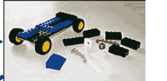


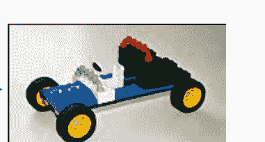

## 但说正经的

- 许多乐高零件的特性
  - *模块化*
  - *可重用性*
- 每个零件可以在不同的地方和方式中使用
  - *设计的灵活性*
  - *兼容性*
- 与其他乐高套装
- 积木

## 建造者使用的类似技术：桥梁

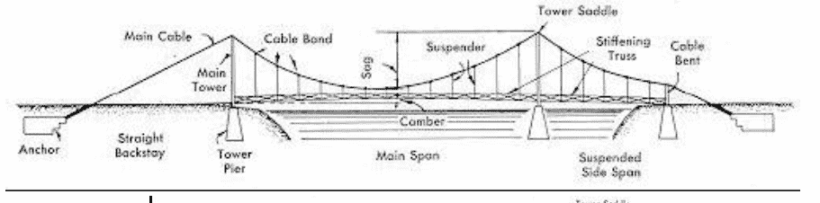

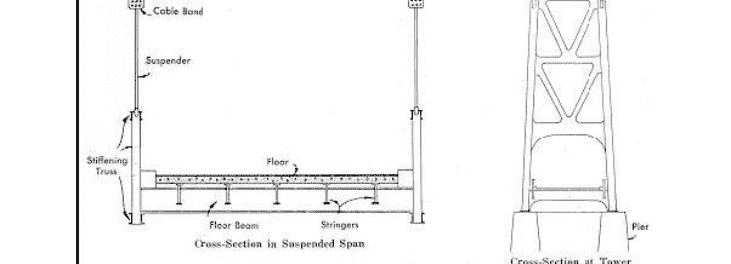

## 详细设计和规格

用于平行钢丝桥缆的镀锌桥钢丝。推荐直径 0.196 英寸。镀锌桥股——由各种直径的桥钢丝绞合而成。镀锌桥绳——由六股绞合在股芯周围组成。


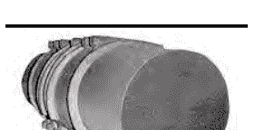

## 平行钢丝缆

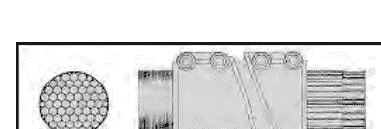

主缆和缆带的细节。右侧省略了缠绕钢丝以便清晰。注意其封闭结构和铝填充物。

## 他们也会犯错！

- 即使是好的设计也不能保证完美的产品
- 需要对所有产品包括软件进行测试

## 如何获得高质量的软件

## 两种方式

- ① 流程管理
  - CMM,PSP,TSP
  - 工程流程
- ② 测试

## 矩阵运算

A+B, AXB

你可以很容易地实现该算法。

*但，这正确吗？*

*你考虑过矩阵的所有可能性吗？*

## 软件测试

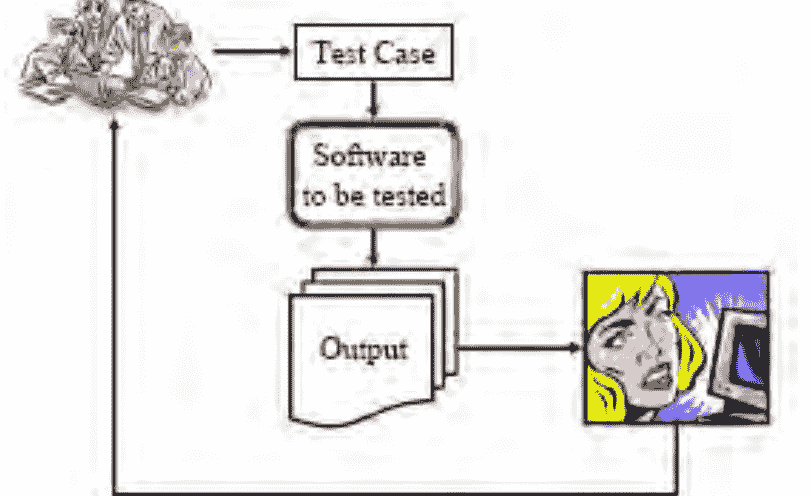

## 何时停止？

测试用例生成

测试用例

待测软件

输出

验证

足够吗？

否

是

测试覆盖率


## 一个真实的测试示例

测试用例

{1,3,2}

{1,2,3}

{3,2,3}

{}

{-1, -2}

只是一个列表。

一个已排序的列表。

重复条目。

空列表。

负数。

程序

输出

规格：
接收一个数字列表；
返回一个已排序的列表。

## 自动化测试

## 测试用例
生成


测试用例

软件
待测试

输出


验证

测试覆盖率

足够吗？

否

是

## 自动化测试

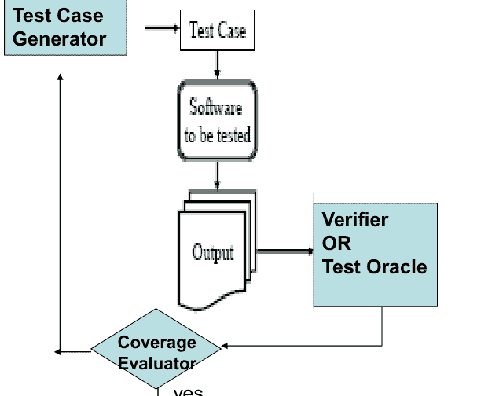

## 测试新版本

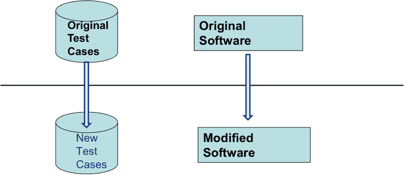

原始测试用例

新测试用例

原始软件

修改后的软件

## 如何生成新的测试用例？

## 讨论

- **不同类型的软件**
  - *面向对象*
  - *基于组件*
  - *并发*
  - *分布式*
  - *图形用户界面*
  - *Web*
- **测试的不同目标**
  - *功能*
  - *性能*
  - *安全性*
  - *可用性*
  - *正确性*
  - *…*

## 问答

### 1.2 概念和术语表

### 1.2.1 测试的目标

- 测试是执行程序以期发现错误的过程。
- 一个好的测试是具有较高概率发现尚未发现的错误的测试。
- 一个成功的测试是发现尚未发现的错误的测试。
- 目标是设计测试，以系统地发现不同类别的错误，并且在最少的时间和精力下完成。


- 证明软件功能似乎按照规范工作。
- 性能要求似乎已得到满足。
- 测试期间收集的数据对软件可靠性提供了良好指示，并对软件质量提供了一些指示。

测试无法证明缺陷的缺失，它只能证明软件缺陷的存在。

### 1.2.2 Facts About Testing

- 问题“程序 P 是否遵守规范 S”是不可判定的！
- 每种测试技术都体现了准确性与计算成本之间的某种权衡
- Facts
  - 不准确性不是技术的局限性，理论上不可能设计出完全准确的技术
  - 每种实用技术都必须在某种程度上牺牲准确性

#### Why?

The current development methods of software are:

- Depend on people’s intelligence
- Specification is informal or even chaos
- Software development tools are not self-contained
- Software development process is elective and without standards on detail

在当前的软件开发方法学指导下开发软件，软件测试仍是保证软件质量和可靠性的重要手段。

#### Cost/benefit

- 测试占软件开发总成本的 50% 以上
  - *对关键软件而言更多*
- 软件质量将成为主要的成功标准

#### The understanding of software test

> Exhausted test is impossible to realized.
> Software test can not ensure to uncover all errors of a software.
> Software test can not instead of other quality insurance methods

软件测试：巨大的效益和艰苦的工作并存

#### Some examples

##### 1 Exception

```cpp
if(state == 0)
{
    ...
}

if(state == 1)
{...} ;
```

##### 2 Data overflow

```cpp
Int count( int &a, int month_num)
{ int  month_income = 0, i;
    for( i = 0; i< month_num; i++)
    month_income+=a[i];
    return month_income;
}
```

//1000<a[i]<10000

##### 3 Beyond array boundary

```cpp
void input(...)
{
...
    strcpy( stu_name,name)
...
}
//char stu_name[20];
```

##### 4 Data is inaccurate

Every data type is limited by it’s bits.
Such as float variable accurate is 7 bit, so 123456799.00 is equal to 123456711.00.

### 1.2.3 Glossary(术语)

- **Error (ISO)(错误)**
  - *A good synonym is mistake. Errors tend to propagate;*
- **Fault(故障)**
  - *A fault is the result of an error. Defect (see the ISTQB Glossary) is a good synonym for fault.*
- **Failure (IEEE)(失效)**
  - *The inability of a system or component to perform its required functions within specified performance requirements.*
- **Incident(事件)**
  - *When a failure occurs, it may or may not be readily apparent to the user (or customer or tester). An incident is the symptom associated with a failure that alerts the user to the occurrence of a failure.*

#### About “bug”

- Bug的起源
- Grace Hopper (1906--1992)（Grace Murray Hopper）计算机科学先驱，美国海军准将。
- 她还有一个重要的荣誉，就是抓住了计算机历史上第一个bug。这只真正的臭虫，如今还荣幸地存放在计算机档案馆里供人瞻仰。

### 1.2.4 The basic concepts of software test

- Basic principle of software test (Myers principle)
- Independent principle
- Completive(完全性) principle
- The types of software test

#### Basic principle of software test (Myers principle)

- 尽早测试并持续测试
- 避免由程序员本人测试软件
- 测试用例 = 输入数据 + 预期结果
- 测试用例应包括预期（有效）输入数据和非预期（无效）输入数据
- 测试程序 = 它应该做什么 + 它不应该做什么
- 存在错误的概率与已发现的错误成正比。
- 彻底检查每次测试结果
- 软件测试是最具创新性的工作之一

#### Independent principle (start )

- 软件测试应由独立于开发组的组执行。

交互测试
第三方测试

#### Completive principle

- 按照测试计划完成所有测试用例
- 使用规定的测试用例生成方法。
- 达到预期目标（如覆盖率标准）
- 绘制曲线进行分析，显示不同时间段的错误。
- 应发现预期数量的错误。


#### 软件测试的类型

- 按过程：走查 → 单元测试 → 集成测试 → 系统测试
- 按技术：基于执行的验证 / 非基于执行的验证
- 按对象：功能测试、性能测试、可靠性测试、安全性测试、强度测试、回归测试

#### 测试阶段

- a. 走查（非基于执行的验证）
- b. 单元测试
- c. 集成测试
- d. 系统测试
- e. 验收测试

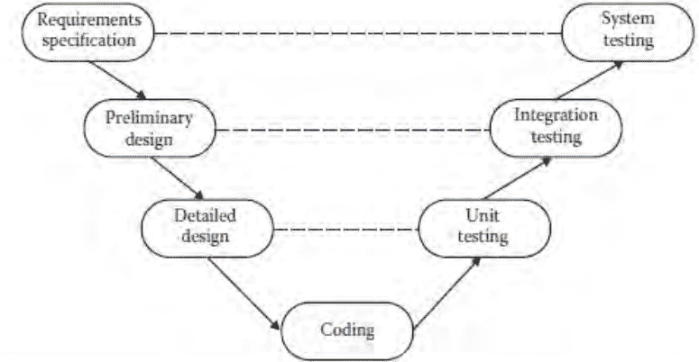

##### 1.2.5 故障分类

（由学生阅读）

**表 1.1 输入/输出故障**

| 类型 | 实例 |
|------|-----------|
| 输入 | 不接受正确输入 |
|  | 接受错误输入 |
|  | 描述错误或缺失 |
|  | 参数错误或缺失 |
| 输出 | 格式错误 |
|  | 结果错误 |
|  | 在错误的时间得到正确结果（过早或过晚） |
|  | 结果不完整或缺失 |
|  | 多余结果 |
|  | 拼写/语法错误 |
|  | 外观问题 |

**表 1.2 逻辑故障**

| 逻辑故障 |
| --- |
| 缺少情况 |
| 重复情况 |
| 忽略极端条件 |
| 误解 |
| 缺少条件 |
| 多余条件 |
| 测试了错误的变量 |
| 循环迭代错误 |
| 运算符错误（例如，使用 < 而不是 ≤） |

**表 1.3 计算故障**

| 计算故障 |
| --- |
| 算法错误 |
| 缺少计算 |
| 操作数错误 |
| 操作错误 |
| 括号错误 |
| 精度不足（舍入、截断） |
| 内置函数错误 |

**表 1.4 接口故障**

| 接口故障 |
| --- |
| 中断处理错误 |
| 输入/输出时序错误 |
| 调用了错误的过程 |
| 调用了不存在的过程 |
| 参数不匹配（类型、数量） |
| 类型不兼容 |
| 包含多余内容 |

**表 1.5 数据故障**

| 数据故障 |
| --- |
| 初始化错误 |
| 存储/访问错误 |
| 标志位/索引值错误 |
| 打包/解包错误 |
| 使用了错误的变量 |
| 数据引用错误 |
| 缩放或单位错误 |
| 数据维度错误 |
| 下标错误 |
| 类型错误 |
| 数据作用域错误 |
| 传感器数据超出限制 |
| 差一错误 |
| 数据不一致 |

## 课后作业

- 第 4 周之前阅读教材第一部分；
- 第 4 周之前组建测试小组；
- 第 3 周之前搜索一些适合测试的 Java 程序；

示例：日历、记事本、计算器（简单模型）、小游戏、服务器……

#### 问题

- 1945年9月9日，发生了一桩对计算机界而言非常重要的轶事。那天因为天气很热，他们都把窗户给打开了，然后飞进来一只蛾，结果那只蛾被打死在一支继电器里面，造成电路不通，让机器当机，使他们没办法算出他们要的结果。经过了近一天的检查，Hopper 找到了那只蛾，她用她的发夹去把那只蛾给弄出来，还把那只蛾的尸体贴在她的管理日志上，上面写着：「就是这个 bug，害我们今天的工作无法完成。」

- 这个消息传开之后，那个实验室里的人每逢老板询问为何还没做出结果时，都把过错推给 bug。尔后，在计算机界中，遇到程序中有错，就称之为 bug。除错叫做 debug。

返回

## 第 2 章
### 软件测试的数学知识基础

- 2.1 集合论
- 2.2 函数
- 2.3 关系
- 2.4 命题逻辑
- 2.5 概率论
- 2.6 图论
- 2.7 有限状态机
- 2.8 Petri 网
- 2.9

### 2.1 集合论

- **集合定义**
  - A = {元素列表}; B = {元素列表};
  - a ∈ A, b ∉ B;
- **集合运算**
  - A ∩ B = {x: x ∈ A ∧ x ∈ B};
  - A ∪ B = {x: x ∈ A ∨ x ∈ B};
  - A′ = {x: x ∉ A};
  - A − B = {x: x ∈ A ∧ x ∉ B};
  - A ⊕ B = (A ∪ B) − (A ∩ B);
  - A × B = {<x, y>: x ∈ A ∧ y ∈ B}

### 2.2 函数

**定义**

给定集合 A 和 B，函数 f 是 A × B 的一个子集，使得对于 a_i, a_j ∈ A，b_i, b_j ∈ B，且 f(a_i) = b_i，f(a_j) = b_j，

如果 b_i ≠ b_j ⇒ a_i ≠ a_j

或 f: A → B, f ⊆ A × B。

**函数类型**

- f 是从 A 到 B 的满射函数，当且仅当 f(A) = B（上函数）
- f 是从 A 到 B 的内射函数，当且仅当 f(A) ⊂ B（注意这里是 proper subset！中函数）
- f 是从 A 到 B 的一一函数，当且仅当对于所有 a_i, a_j ∈ A，a_i ≠ a_j ⇒ f(a_i) ≠ f(a_j)
- f 是从 A 到 B 的多对一函数，当且仅当存在 a_i, a_j ∈ A，a_i ≠ a_j，使得 f(a_i) = f(a_j)


## 2.3 关系

- **定义：**
给定两个集合 A 和 B，关系 R 是笛卡尔积 A × B 的一个子集。

关系 R ⊆ A × A 是

自反的：当且仅当对所有 a ∈ A，<a, a> ∈ R

对称的：当且仅当 <a, b> ∈ R ⇒ <b, a> ∈ R

反对称的：<a, b>, <b, a> ∈ R ⇒ a = b

传递的：当且仅当 <a, b>, <b, c> ∈ R ⇒ <a, c> ∈ R：

关系 R ⊆ A × A 是序关系，如果 R 是自反的、反对称的且传递的。
例如：≥

关系 R ⊆ A × A 是等价关系，如果 R 是自反的、对称的且传递的。
例如：
(classmates, roommates)

## 2.4 命题逻辑

- **定义：**
  命题是一个句子，它要么为真要么为假。
  例如：6>2、 Earth is a star;
  但：water is cold, The mountain is very high, 不是命题。

- **逻辑运算符**
  and : ∧
  or : ∨
  not : ¬
  exclusive-or : ⊕
  IF-THEN: →

| p | q | p ⊕ q | p → q |
|---|---|---|---|
| T | T | F | T |
| T | F | T | F |
| F | T | T | T |
| F | F | F | T |

## 2.5 概率论

### 定义

命题 p 为真的概率，记为 Pr(p)，是

|T(p)|/|U|.

T(p) 是宇宙 U 中使 p 为真的所有元素的集合。

例如：一个袋子中有10个红球，10个兰球；从中任取一个球，是红球的几率？

再取一个是红球的几率？

连续2个是红球的几率？

## 2.6 图论

- 定义

图 G = (V, E) 由一个有限的且非空的节点集合 V 和一组无序的节点对集合 E 组成。

示例 1：

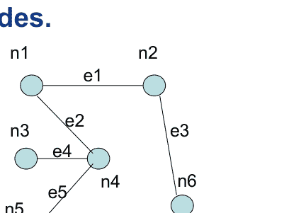

V={n1,n2,n3,n4,n5};

E={e1,e2,e3,e4,e5}

={(n1,n2),(n1,n4),(n2,n6),(n3,n4),(n4,n5)};

节点的度：以该节点为端点的边的数量。

deg(n1)=2, deg(n2)=2,...deg(n6)=1

**关联矩阵：** 关联矩阵：具有 m 个节点和 n 条边的关联矩阵是一个 m × n 矩阵，其中第 i 行第 j 列的元素当且仅当节点 i 是边 j 的端点时为 1；否则，该元素为 0。

|   | e1 | e2 | e3 | e4 | e5 |
|---|---:|---:|---:|---:|---:|
| n1 | 1 | 1 | 0 | 0 | 0 |
| n2 | 1 | 0 | 1 | 0 | 0 |
| n3 | 0 | 0 | 0 | 1 | 0 |
| n4 | 0 | 1 | 0 | 1 | 1 |
| n5 | 0 | 0 | 0 | 0 | 1 |
| n6 | 0 | 0 | 1 | 0 | 0 |

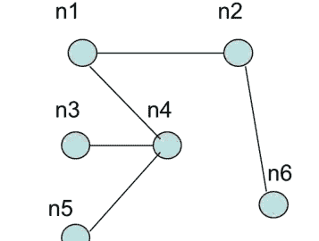

### 邻接矩阵：

图 G = (V, E) 的邻接矩阵，其中有 m 个节点，是一个 m × m 矩阵，其中第 i 行第 j 列的元素当且仅当节点 i 和节点 j 之间存在边时为 1；否则，该元素为 0。

| | n1 | n2 | n3 | n4 | n5 | n6 |
|---|---|---|---|---|---|---|
| n1 | 0 | 1 | 0 | 1 | 0 | 0 |
| n2 | 1 | 0 | 0 | 0 | 0 | 1 |
| n3 | 0 | 0 | 0 | 1 | 0 | 0 |
| n4 | 1 | 0 | 1 | 0 | 1 | 0 |
| n5 | 0 | 0 | 0 | 1 | 0 | 0 |
| n6 | 0 | 1 | 0 | 0 | 0 | 0 |

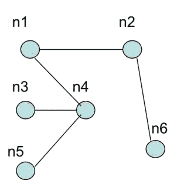

#### 有向图的邻接矩阵

|   | n1 | n2 | n3 | n4 | n5 | n6 |
|---|---|---|---|---|---|---|
| n1 | 0 | 1 | 0 | 1 | 0 | 0 |
| n2 | 0 | 0 | 0 | 0 | 0 | 1 |
| n3 | 0 | 0 | 0 | 1 | 0 | 0 |
| n4 | 0 | 0 | 0 | 0 | 1 | 0 |
| n5 | 0 | 0 | 0 | 0 | 0 | 0 |
| n6 | 0 | 0 | 0 | 0 | 0 | 0 |

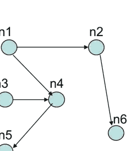

#### 路径和半路径

(有向) 路径：边的序列，使得序列中任意相邻的边对 ei, ej 中，第一条边的终点是第二条边的起点。

环：一条有向路径，其开始和结束于同一节点。

链：节点的序列，使得每个内部节点入度 = 1 且出度 = 1。

(有向) 半路径：边的序列，使得序列中至少有一对相邻的边 ei, ej 中，第一条边的起点是第二条边的起点，或第一条边的终点是第二条边的终点。

例如：

从 n1 到 n6 的一条路径；n1 与 n3 之间的一条半路径；

n2 与 n4 之间的一条半路径；n5 与 n6 之间的一条半路径

#### n-连通性

0-连通：当且仅当 ni 与 nj 之间不存在路径。

1-连通：当且仅当 ni 与 nj 之间存在半路径但不存在路径。

2-连通：当且仅当 ni 与 nj 之间存在路径。

3-连通：当且仅当存在从 ni 到 nj 的路径且存在从 nj 到 ni 的路径。


大量的执行路径来源于嵌套循环。凝聚图消除了循环（或至少将它们凝聚成一个单一节点）；因此，我们可以用此作为一种策略来简化那些否则在计算上不可行的情况。

- 程序图（省略）

## 2.7 有限状态机

有限（穷）状态机是形式化描述的有效方法，在计算机调度、管理中得到了广泛的应用。

我们通过一个简单的例子来说明有穷状态机的基本概念。

司机驾驶汽车，有以下状态。打开车门；车挡在启动档，插钥匙，打火发动汽车；挂前进档，汽车前行；挂后退档，汽车后退；挂启动档，熄火，拔钥匙；下车关门。

当然，油门和刹车也是两个重要的动作，一个是为了提速，一个是为了减速，但它们都不影响汽车的状态，这里予以简化。空档是一个过渡状态，为了简洁，也予以简化。

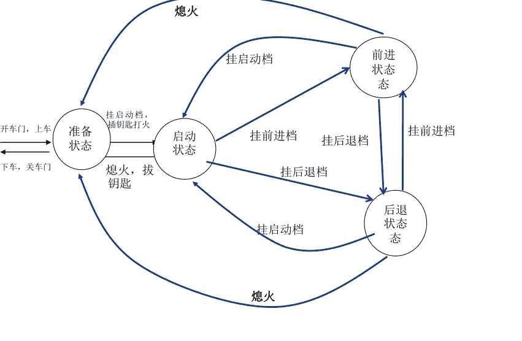

状态转换图在实际设计中往往被状态转换表所代替，下表是汽车驾驶的状态转换表。

| 当前状态/执行动作 | 准备状态 | 启动状态 | 前进状态 | 后退状态 |
|---|---|---|---|---|
| （挂启动档）打火 | 启动状态 | 启动状态 | 无效 | 无效 |
| 挂前进档 | 准备状态 | 前进状态 | ／ | 前进状态 |
| 挂后退档 | 准备状态 | 后退状态 | 后退状态 | ／ |
| 挂启动档 | 准备状态 | 启动状态 | 启动状态 | 启动状态 |
| 熄火 | 准备状态 | 准备状态 | 准备状态 | 准备状态 |

汽车驾驶的状态转换表

从上面的例子我们可以看到，一个有穷状态机包括以下5个部分：状态集J、输入（动作）集K、状态转换函数（转换表）T、初始态S和终止态F。对于上面的例子有穷状态机的各个部分如下：

- ◆ 状态集J：{准备状态，启动状态，前进状态，后退状态};
- ◆ 输入集K：{打火，熄火，挂前进档，挂后退档，挂启动档};
- ◆ 转换函数T：如表13-1所示;
- ◆ 初始态S：{准备状态};
- ◆ 终止态F：{准备状态};

由上面的说明，我们可以将有穷状态机表示为一个5元组（J, K, T, S, F），其中：

- J 是一个有穷的非空状态集；
- K 是一个有穷的非空输入集；
- T 是一个从（J-F）×K到J的转换函数；
- S ∈ J，是唯一的初始态；
- F J，是若干个终止态。

有穷状态机在计算机系统中应用的十分广泛。如操作系统中的作业调度与管理，GUI图形用户界面的驱动等。

## 2.8 Petri Net 说明

- Petri Net 的介绍与第11讲 交互测试密切关联，因此放在第11讲介绍。

## 2.9 状态图

StateChart 记法：设计一种视觉记法，结合了 Venn 图表达层次结构的能力和有向图表达连通性的能力（Harel, 1988）。

如果一个状态包含子状态，如状态 A 所示，则边“引用”所有子状态。

因此，从 A 到 D 的边意味着转换可以从状态 B 或从状态 C 发生。

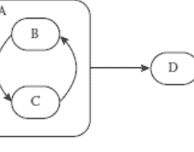

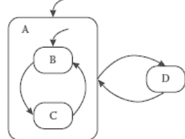

## 其它

对于软件测试而言，并不是仅仅需要本节介绍的数学知识。

形式化描述、数学验证、数据结构与算法等都是可能用到的数学。

在本课程中，将以软件测试的实践为主，不再过多介绍数学的知识。

## Q&A

## Chapter 3

## 软件测试的基础理论与方法

- 3.1 基于非执行的验证
- 3.2 基于执行的验证
- 3.3 形式化验证
- 3.4 其他方法

### 3.1 基于非执行的验证

不执行程序，测试人员可以使用一些工具来审查和分析规范和程序代码。

- 逐行检查
- 检查

#### 3.1.1 逐行检查

- 组成一个逐行检查测试小组
- 检查程序代码逻辑
- 生成测试用例，包括输入数据和预期结果。
- 将数据输入程序代码，如果计算结果不等于预期结果，则发现一个错误。
- 逐行检查代码。

SQA 的一名成员

实施方的代表之一或多名

下一阶段的代表

客户代表


逐行检查团队应由 **四到六** 名个人组成

- 逐行检查团队的目标是检测缺陷，而不是纠正它们。
- 主持逐行检查的人员引导团队其他成员浏览代码。
- 逐行检查可以由团队成员编制的问题清单驱动，也可以由代码本身驱动，团队成员在适当的时候提出他们的关注点。
- 在这两种情况下，每个问题都会在出现时进行讨论，并解决为需要处理的缺陷或在讨论中澄清的困惑点

#### 3.1.2 检查

- 检查比代码逐行检查更正式的活动。
- 它由三到六人组成的团队进行

主持人

下一阶段的代表

实施方的代表之一或多名

记录员


评审流程包含五个正式步骤：

- 在 **overview** 步骤中，模块的作者向团队进行演示。
- 在 **preparation** 步骤中，参与者尝试详细理解代码并编制按严重性(严重性)排序的问题清单。在此过程中，他们会得到一份潜在缺陷检查清单的帮助，以便留意这些缺陷。
- 在 **inspection** 步骤中，对代码进行彻底的逐行审查，旨在通过完整覆盖代码来发现缺陷。在检查后的一天内，主持人会制作一份细致（小心翼翼）的书面报告。
- 在 **rework** 步骤中，负责代码的个人解决书面报告中记录的所有缺陷和问题。（Individual Reviewer Issues Spreadsheet）
- 在 **follow-up** 步骤中，主持人必须确保每个问题都已通过修复代码或澄清令人困惑的点来解决。（Review Report Spreadsheet）

#### Individual Reviewer Issues Spreadsheet

| <Work product information> |  |  |  |  |
| <Reviewer Name> |  |  |  |  |
| <Preparation Date> |  |  |  |  |
| <Reviewer Preparation Time> |  |  |  |  |
|  | Location | Checklist |  |  |
| Issue # | Page | Line | Item | Severity | Description |
| 1 | 1 | 18 | Typo | 1 | Change "accound" to "account" |

#### Review Report Spreadsheet

| Review Team Members | Preparation Time | |
|---|---|---|
| Leader | | |
| Recorder | | |
| Reviewer | | |
| Reviewer | | |
| Reviewer | | |
| Reviewer | | |
|  | Total prep time | |
| Meeting date | | |

<Review Recommendation>

| Issue # | Reviewer | Location |  | Checklist |  | Description |
|---|---|---|---|---|---|---|
|  |  | Page | Line | Item | Severity |  |
| 1 |  | 1 | 18 | Typo | 1 | Change “accord” to “account” |

- 检查的一个重要成果是按严重程度评定的发现的缺陷数量和种类。([Here is a sample outline of a review report](#))
- 如果一个模块在检查中表现出比系统中其他模块显著更多的缺陷，它就是重写的良好候选者。
- 如果对两个或三个模块的检查显示出大量特定类型的错误，这可能需要（重新）检查其他模块是否存在类似错误。
- 如果超过 5% 的检查材料必须返工，团队必须重新召集进行全面复检。

### 3.2 Execution-based Verification

使用测试用例执行程序，获取执行的所有结果。

有两种基本的方法来测试模块，每种方法都有其自身的弱点。

- Testing to Specifications，也称为黑盒测试。
- Testing to Code，也称为玻璃盒、白盒测试。

#### 3.2.1 Black-box test

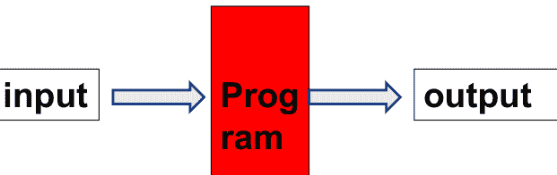

- 寻求验证模块是否符合指定的输入和输出，同时忽略实际代码
- 很少可能对所有模块的所有可能的输入情况进行测试，这可能是一个巨大的模块数量

- 等价类测试是一种基于输入规范给出软件产品应以相同方式工作的值范围的想法而建立的技术。
- 边界值分析寻求使用位于等价类边界上以及边界两侧的输入值来测试产品。

例如输入是 (a,b)，至少有 5 个等价类：


**functional testing**，测试人员识别模块中实现的每个功能项或每个函数，并使用数据测试每个函数。

#### 3.2.2 White-box test

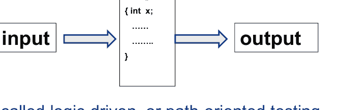

- 也称为逻辑驱动或路径导向测试。
- 即使对于简单的流程图，测试代码中的每条路径通常也是不可行的。
- 此外，即使测试了每条路径也可能找不到现有缺陷，因为例如，缺陷在于选择路径之间的决策标准。


- **语句覆盖**：相当于运行测试，其中代码中的每个语句至少执行一次。
- **分支覆盖**：确保每个分支点至少被测试一次。
- **路径覆盖**：确保每条不同的路径至少被测试一次。

#### 示例：黑盒测试

- 讨论：MAC/ATM 机器
  - 规格
    - 不能提取超过 $300
    - 不能提取超过你的账户余额

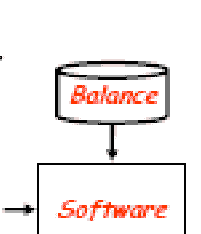

#### 测试用例？

**X**

1. >300
2. 0~300
3. <0

**余额**

1. ≥300
2. 0~300

#### 白盒测试

- 示例：`x: 1..1000;`

```
1 INPUT-FROM-USER(x);
if (x <= 300) {
2   INPUT-FROM-FILE(BALANCE);
    if (x <= BALANCE)
3       GiveMoney x;
4   else Print "You don’t have $x in your account!!"
}
else
5   Print "You cannot withdraw more than $300";
6 Eject Card;
```

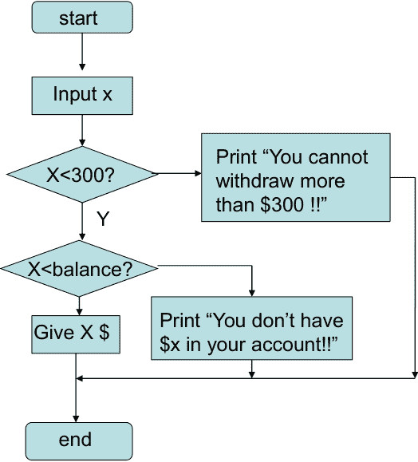

```
start
Input x
X ≤ 300?
Print "You cannot withdraw more than $300!!"
X ≤ balance?
Give X $
Print "You don’t have $x in your account!!"
end
```

#### 测试用例？

示例 2 怎么样？

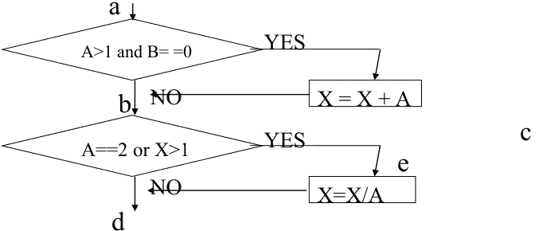

对于示例 2，分支覆盖为：点 A 应该有 A > 1，A ≤ 1，B = 0，B ≠ 0；点 B 应该有 A = 2，A ≠ 2，X > 1，X ≤ 1。所以 `{2, 0 | 2, 5}` 和 `{0, 1 | 0, 0}` 就足够了。

路径覆盖怎么样？

4 个谓词。测试用例为：2 × 2 × 2 × 2 = 16。

- 循环怎么办？
- 分支覆盖为两个，
- 但路径覆盖为 N+1！

*覆盖能保证没有缺陷吗？*

- 我们总能得到 100% 覆盖吗？

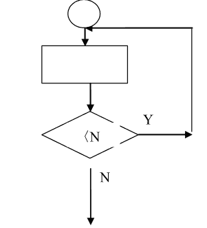

#### 惊喜测验

- 确定测试用例，使得每个打印语句至少执行一次

```
input(x);
if (x < 100)
    print "Line 1";
else {
    if (x < 50) print "Line 2";
    else print "Line 3";
}
```

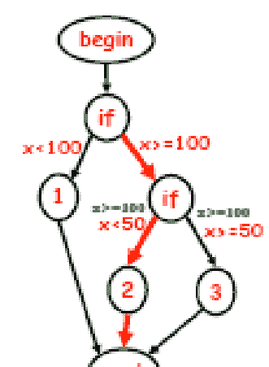

#### 问题

- 黑盒测试的弱点是什么？
- 白盒测试的弱点是什么？

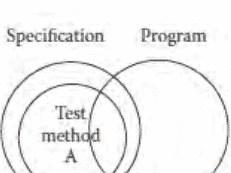

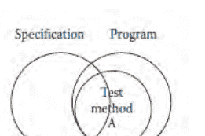

### 3.3 形式化验证

#### 正确性证明

这是一种数学技术，用于证明产品是正确的，换句话说，它满足其规格。

要了解正确性是如何证明的，请考虑片段（下一张幻灯片）。

我们现在证明代码片段是正确的：执行后，变量 `s` 将包含数组 `y` 的 `n` 个元素的总和。

```
int k, s;
int y[n];

k = 0;
s = 0;
while (k < n)
{
    s = s + y[k];
    k = k + 1;
}
```

*代码片段*

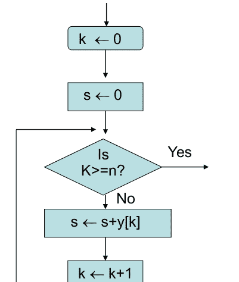

*流程图*

#### 在每个语句之前和之后放置断言，位置标记为 A 到 H

```
n ∈ {1, 2, 3, …} （输入规格）

k ← 0

k = 0

s ← 0

k = 0 and s = 0

k ≤ n and s = y[0] + y[1] + ... + y[k-1] （循环不变式）

Is k ≥ n?

Yes
k = n and s = y[0] + y[1] + ... + y[n-1] （输出规格）

No
k < n and s = y[0] + y[1] + ... + y[k-1]

s ← s + y[k]

k < n and s = y[0] + y[1] + ... + y[k]

k ← k + 1

k ≤ n and s = y[0] + y[1] + ... + y[k-1]
```

输入规格：n 是正整数。

**A:** n ∈ {1, 2, 3, …}

输出规格是如果控制到达点 **H**，**s** 的值包含存储在数组 **y** 中的 **n** 个值的总和：

**H:** s = y[0] + y[1] + … + y[n-1]

更强的输出规格是：

**H:** k = n and s = y[0] + y[1] + … + y[n-1]

如何从 **A** 证明到 **H**？关键是证明循环的不变式，即

**D:** k ≤ n and s = y[0] + y[1] + … + y[k-1]

#### 首先

**B:** k = 0

这很容易证明，因为赋值语句 `k ← 0` 被执行。

在点 C，第二个赋值语句 `s ← 0` 被执行，并且以下断言为真：

`k = 0 and s = 0` (6)

现在进入循环。在循环执行之前，断言 (6) 成立 k = 0 and s = 0。根据断言 (1)，n ≥ 1，因此可得出 k ≤ n 是必需的。因为 k = 0，所以 k − 1 = −1，因此 (4) 中的和为空，s = 0。因此循环不变式 (4) 在进入第一次循环之前为真。

现在，假设在代码片段执行期间的某个阶段，循环不变式成立。也就是说，k 有某个值 k₀，0 ≤ k₀ ≤ n：

**D:** k₀ ≤ n and s = y[0] + y[1] + ... + y[k₀−1] (7)

我们应该证明在执行代码片段后，循环不变式仍然为真，或者我们得到输出规格。


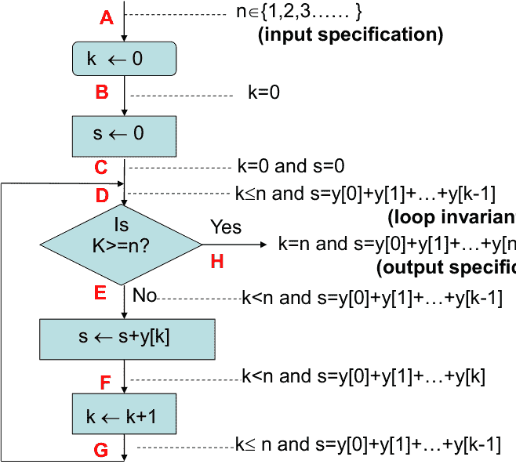

#### n∈{1,2,3,.....}

**（输入规格说明）**

k = 0

k=0 且 s=0

k<n 且 s=y[0]+y[1]+...+y[k-1]

**（循环不变量）**

是

k=n 且 s=y[0]+y[1]+...+y[n-1]

**（输出规格说明）**

否

k<n 且 s=y[0]+y[1]+...+y[k-1]

k<n 且 s=y[0]+y[1]+...+y[k]

k≤n 且 s=y[0]+y[1]+...+y[k-1]

传递到测试框。如果 k₀≥n，那么根据假设 k₀≤n，可知 k₀=n，这意味着

H：K₀=n 且 s=y[0]+y[1]+...+y[n-1] (8)

正是输出规格说明(3)。

另一方面，k₀<n，且(7)变为

E：k₀<n 且 s=y[0]+y[1]+...+y[k₀-1] (9)

正是 E 的断言，然后执行语句 s ← s+y[k₀]，点 F 为

F：k₀<n 且 s= y[0]+y[1]+...+y[k₀-1]+y[k₀] = y[0]+y[1]+...+y[k₀] (10)

接下来要执行的语句是 k₀ ← k₀+1。因为在增加之前 k₀<n，现在 k₀≤n。且(10)变为

G：k₀ ≤ n 且 s= y[0]+y[1]+...+y[k₀-1] (11)

断言(11)等于断言(7)。根据假设，它在点 D 成立。

现在我们证明了 0≤k≤n，即不变量(4)为真。

最后证明循环的终止性。由于初始 k 为 0，每次迭代循环将 k 增加 1，k 必定会达到 n，即 k=n。然后根据断言(8)，得到输出规格说明(3)。

从这个例子我们可以知道，仅仅 5 行简单的代码，其正确性证明就需要 5 页！

所以对于更大型的程序代码，不可能对所有代码都使用正确性证明。即使它是最可靠的方法。

### 3.4 其他方法

- 定使用测试（Def-use test）
- 变异测试（Mutation test）
- 回归测试（Regression Test）
- 故障统计与可靠性分析（Fault Statistics and Reliability Analysis）
- 净室（Clean room）

#### 3.4.1 定使用测试

#### 基于数据流的充分性准则

- 所有定义准则
  - *每个定义到某个可达使用*
- 所有使用准则
  - *定义到每个可达使用*
- 所有定使用准则
  - *每个定义到每个可达使用*

#### 3.4.3 回归测试

- 开发出软件的第一版本
- 对第一版本进行了充分的测试
- 修改了软件；现在需要测试第二版本
- 如何测试第二版本？

- 方法
  - 从头开始重新测试整个软件
  - 只测试变更的部分，忽略未变更的部分，因为它们已经测试过
  - 修改是否会对软件中未变更的部分产生不利影响？

#### 回归测试

> “对修改后的程序执行的软件维护任务，旨在确保修改是正确的，并且没有对程序中未修改的部分产生不利影响。”

#### 3.4.4 故障统计

- 故障统计**为决定是继续测试某个模块或产品，还是重写该模块或产品提供了一个有用的度量指标。**
- 必须记录通过基于执行和非执行的技术检测到的故障数量。
- 通过代码检查发现的不同类型故障的数据（例如误解设计、初始化不当、变量使用不一致等故障）可以纳入检查清单，用于后续对同一产品和未来产品的评审中。

#### 捕捞计数与故障注入

例如，罗格河放养了 1000 条带标记的鳟鱼；在钓鱼季节，捕捞报告显示总共捕获了 500 条鱼，其中 300 条是带标记的鳟鱼。

河流管理部门会得出结论：罗格河中 60% 的鳟鱼是养殖（放养）鱼。总种群数量也可以估计；在这种情况下，捕获的 500 条鱼占总种群的 30%。鱼类总种群为 1667 条。

同样的思路可以应用于估计测试用例的成功率，以及现有测试用例未能捕获的剩余故障数量。

净室技术在基于执行的测试之前发现并清除故障方面取得了相当大的成功。

在一个案例中，所有故障都是通过正确性证明技术找到的，主要使用非正式证明，但也包含少量正式证明。结果代码在编译和执行时都被证明没有错误。

在对另外 17 个净室软件产品的研究中，这些产品虽然没有做到完全无故障，但仍实现了非常低的故障率，平均每千行代码（KLOC）仅有 2.3 个故障。

但平均而言，每千行代码有 25 个故障！


## 摘要

+   1. 基于非执行的验证
+      - 演练
+      - 检查
+   2. 基于执行的验证
+      - 黑盒
+      - 白盒
+   2. 形式化验证
+   3. 其他方法
+      - 定义—使用测试
+      - 变异测试
+      - 回归测试
+      - 故障统计与可靠性分析
+      - 净室

## 测试计划实例与作业一

## XXXX支撑软件与可视化软件

测试计划

## 目录

+   1、简介
+   1.1 编写目的
+   1.2 项目背景
+   1.3 测试范围
+   1.4 参考文档
+   2、测试参考文档和测试提交文档
+   2.1 测试参考文档
+   2.2 测试提交文档
+   3、测试进度
+   4、测试资源
+   4.1 人力资源
+   4.2 测试环境
+   4.3 测试工具
+   5、测试策略

### 5.1功能测试

### 5.1.1 XXX系统管理软件功能测试

### 5.1.2 XXX系统实时通信软件功能测试

### 5.1.3目标三维动态显示模型及可视化软件功能测试

### 5.1.4XXX三维动态显示模型及可视化软件功能测试

### 5.1.5 XXX交会显示软件功能测试

### 5.1.6XXX系统数据管理软件功能测试

### 5.1.7 XXX文件与AutoCAD、Creator的转换软件功能测试

### 5.2性能测试

### 5.2.1 通讯性能测试

### 5.2.2 实验性能测试

### 5.2.3 数据库性能测试

### 5.2.4 显示性能测试

### 5.2.5 其它性能测试

### 5.3故障测试

### 5.3.1网络故障

### 5.3.2 服务器故障

### 5.3.3 管理计算机故障

### 5.3.4 计算节点机故障

### 5.3.5 图形工作站故障测试

### 5.4安全性测试

### 5.4.1 管理软件安全性测试

### 5.4.2 数据管理软件安全性测试

## 1、简介

### 1.1 编写目的

为了全面、系统地对 “XXX支撑软件与可视化软件” 进行评估与测试，从而保证系统长期稳定的运行，组织对该软件进行系统的总体综合测试。

### 1.2 项目背景

“XXX验证平台” 是中国兵器工业XXX研究所承担的国防基础科研项目。XXX所与XXX大学合作，对该项目的关键技术——XXX支撑技术和可视化技术展开研究。本项目就是在此背景下开展的，通过应用虚拟试验技术、计算机网络技术、可视化技术、数据库技术等，研制 “XXX的支撑软件和可视化软件”，并最终集成在 “XXX中。

本软件系统由以下7个二级软件组成：
系统管理、实时通讯、三维显示、。。。

### 1.3测试范围

本次系统测试将采用开发相关测试软件和利用成熟的测试工具相结合的方式，现场对系统进行测试。按照系统需求任务书的要求，分别进行系统的功能测试、性能测试、故障测试以及安全性测试等相关内容。

本次测试的主要目标包括：

+   - 系统软件单元功能测试——根据软件详细设计文档的要求，完成各个软件模块的单元功能测试工作；
+   - 系统软件集成功能测试——根据软件需求规格说明的要求，完成软件功能测试工作；
+   - 系统软件性能测试——根据技术协议书和软件需求规格说明的要求，完成软件性能测试工作；
+   - 系统故障测试——对软件系统在网络故障、数据库故障等异常情况下进行测试工作；
+   - 安全性测试——对系统用户登陆、密码保护等安全管理进行测试工作。

### 1.4参考文档

+   《GB 8566-88 计算机软件开发规范》
+   《GJB 438A-97 武器系统软件开发文档》
+   Xxxxxxxx

## 2、测试参考文档和测试提交文档

### 2.1测试参考文档

本测试计划参照GB8567——88标准编制，下表列出了制定测试计划时所使用的文档，并标明了各文档的可用性：

### 2.2测试提交文档

在测试完成后，需要提交给用户相关的测试评估报告与改进报告，并提交详细的测试报告。

## 3、测试进度

| 测试活动 | 计划开始日期 | 实际开始日期 | 结束日期 |
|---|---|---|---|
| 单元功能测试 | 20XX年 3月16日 | 20XX年3月16日 | 20XX年3月26日 |
| 集成功能测试 | 20XX年3月27日 | 20XX年3月27日 | 20XX年3月31日 |
| 性能测试 | 20XX年4月2日 | 20XX年4月3日 | 20XX年4月5日 |
| 故障测试 | 20XX年4月8日 | 20XX年4月8日 | 20XX年4月9日 |
| 安全测试 | 20XX年4月10日 | 20XX年4月10日 | 20XX年4月11日 |
| 对测试进行评估 | 20XX年4月15日 | 20XX年4月16日 | 20XX年4月18日 |
| 用户验收测试 | 20XX年5月11日 |  |  |

## 4、测试资源

### 4.1 人力资源

| 姓名 | 角色 | 具体职责或注释 |
| --- | --- | --- |
| 胡 飞 | 总体策划人、方案设计人 | 策划总体规模，测试内容，规划测试方案 |
| A | 方案设计人、测试技术设计人 | 制定测试方案，确定测试深度，测试技术设计 |
| B | 计划人、记录人 | 计划测试进程，记录测试情况 |
| C | 计划人、测试人、记录人 | 计划整个进程以及各个阶段的进度安排、重点任务；测试并记录测试情况 |
| D | 计划人、测试人、记录人 | 测试并记录测试情况 |
| E | 测试人、记录人 | 测试并记录测试情况 |
| F | 测试人、记录人 | 测试并记录测试情况 |
| G | 测试人、记录人 | 测试并记录测试情况 |

### 4.2 测试环境

下表列出了测试的系统环境：

| 机器名环境 | 数据库服务器 | 图形工作站 | 管理计算机 |
|---|---|---|---|
| 软件环境（相关软件、操作系统等） | Windows XP<br>Oracle 9i |  | Windows XP |
| 硬件环境（设备、网络等） | Xeon Mp 2.7×2 CPU/4smp/2GB/DVD/1000M×2 | HP Workstation xw6200 | HP Workstation xw6200 |

## 4.3 测试工具

下表列出此项目测试中使用的工具：

| 用途 | 工具名称 | 生产厂商/自产 | 版本 |
|---|---|---|---|
| 压力与性能测试 | Jmeter | Jakarta | 1.9.1 |
| 压力测试网络检测 | Webstress | 国外软件 | 6.18 |
| 申请一定量的内存 | Men | 自产 | 1.0 |

## 五、测试策略

### 5.1 功能测试

由于对测试对象的功能测试应侧重于所有可直接追踪到用例或业务功能和业务规则的测试需求。这种测试的目标是核实数据的接受、计算、处理和输出是否正确，以及业务规则的实施是否恰当，所以此次的功能测试全部为黑盒测试，测试的主要目的是检测以下错误：

+   1）是否有不正确或遗漏的功能？
+   2）在接口上，输入是否能正确的接受？能否输出正确的结果？
+   3）是否有数据错误或外部信息（例如数据文件）访问错误？
+   4）是否有初始化或终止性错误？


测试方法：

+   1）等价类划分
+   
+   XXXXXXXXXXXXXX
+   
+   XXXXXXXXXXXXXX
+   
+   2）边界值分析
+   
+   Xxxxxxxxxxxxxxxx
+   
+   Xxxxxxxxxxxxxxxx
+   
+   3）确立测试用例

#### 5.1.1 具体功能模块1

#### 5.1.2 具体功能模块2

Xxxxxxxxxxxxxxxx

#### 5.1.n 具体功能模块n

学生作业样本（电子学习）

## 作业一

## 软件功能性测试

寻找具有需求说明的（或熟悉软件功能需求）软件，采用面向功能的测试方法，生成黑盒测试用例，使用测试记录工具，报告所有发现的错误。

提交的报告：

+   - 测试计划
+   - 测试报告
+   - 测试结果分析报告

作业提交时间：第6周周六以前（10月25日前）

## 审查报告大纲

+   1. 引言
+      a. 工作产品标识
+      b. 审查团队成员及角色
+   2. 初步问题列表
+      a. 潜在故障
+      b. 严重程度
+   3. 按优先级排序的行动项列表
+      a. 已识别的故障
+      b. 严重程度
+   4. 个人报告摘要
+   5. 审查统计
+      a. 花费的总时间
+      b. 按严重程度分类的故障
+      c. 按位置分类的故障
+   6. 审查建议
+   7. 附录：完整的审查资料包


# 第四章
## 单元测试环境和工具
### JUnit 和 EMMA

- 1. Java
- 2. Eclipse
- 3. JUNIT
- 4. EMMA

## 4.1 Java
### 为什么选择 Java？
- 易于获取源代码和文档
- 完整的测试环境
- 更多的免费测试工具

### 安装JDK（Java Development Kit）
- JDK 是整个Java的核心，包括了Java运行环境，Java工具和Java基础的类库。
- 没有JDK的话，无法安装或者运行java程序。

JDK共有3个版本，分别为：
- SE(Java SE), standard edition, 标准版
- EE(Java EE), enterprise edition, 企业版
- ME(Java ME), micro edition, 主要用于移动设备、嵌入式设备上的java应用程序

目前JDK的最新版本为： Java SE Development Kit 8u51。

下载地址：
- http://www.oracle.com/technetwork/java/javase/downloads/jdk8-downloads-2133151.html

### 安装与配置
- 下载与安装，假设安装到C:\Program Files\Java\jdk1.8.0_20

- 配置PATH: 相当于C++中的GCC 配置

- 我的电脑点右键，选择“属性”，选择“高级”标签，进入“环境变量设置，在系统变量里找到PATH变量，选择→编辑，里面已经有很多的变量值，变量值的最前面加上C:\Program Files\Java\jdk1.8.0_51\bin;

- 配置CLASSPATH: 寻找标准类库位置

- 我的电脑点右键，选择“属性”，选择“高级”标签，进入环境变量设置，在系统变量那一栏中点新建→ CLASSPATH，并且设置

- classpath=.; C:\Program Files\Java\jdk1.8.0_51\lib;C:\Program Files\Java\jdk1.8.0_51\lib\tools.jar;

## 4.2 Eclipse

Eclipse 是一种通用平台——一个开放可扩展的 IDE，用于任何事物和特定事物。它提供了一个功能丰富的开发环境，使开发人员能够高效地创建与 Eclipse 平台无缝集成的工具。

[www.eclipse.org](http://www.eclipse.org)

### 在Eclipse下开发java程序
### 使用Eclipse编写Java程序步骤：
- 1. 创建一个Java项目
- 2. 创建" source folder"命名为src，创建包
- 3. 创建Java源程序
- 4. 编译Java源程序
- 5. 运行程序

### 示例： HelloJava.java

Eclipse 示例

## 4.3 JUNIT
- JUnit是由 Erich Gamma 和 Kent Beck 编写的一个回归测试框架（regression testing framework）。
- Junit测试是程序员开发测试工具，即所谓白盒测试，因为程序员知道被测试的件如何（How）完成功能和完成怎样（What）的功能。Junit是一套框架，继承TestCase类，就可以由Junit进行自动测试了。
- http://www.junit.org

### JUNIT安装（省略）
- 1. 从 [http://www.junit.org/](http://www.junit.org/) 下载 JUNIT 包 `JUNIT.JAR`
- 2. 将 JAR 文件拷贝到 JDK 的 LIB 目录，`C:\Java\jdk1.8.0_20\lib`。
- 3. 在 CLASSPATH 目录下增加一条 `C:\Java\jdk1.8.0_51\lib\junit.jar;`

新版 eclipse 中已经集成了 JUnit 3 和 JUnit 4。

### 在 Eclipse 中使用 JUNIT
- 测试对于保证软件开发质量有着非常重要的作用，单元测试更是必不可少，JUnit是一个非常强大的单元测试包，可以对一个/多个类的单个/多个方法测试，可以将不同的TestCase组合成TestSuit，使测试任务自动化。
- 我们创建一个Java工程，添加一个example.Hello类，先我们给Hello类添加一个abs()方法，作用是返回绝对值：

```
1 package example;
2
3 public class Hello {
4
5     public static void main(String[] args) {
6
7
8     public int abs(int n) {
9         return n>=0 ? n : (-n);
10     }
11 }
12
```

下一步，我们准备对这个方法进行测试，确保功能正常。中 Hello.java，右键点击，选择New->JUnit Test Case；

Eclipse会询问是否添加junit.jar包，确定后新建一个HelloTest类，用来测试Hello类。一般自己导入下载的junit包。

### New JUnit Test Case
### JUnit Test Case

Select the name of the new JUnit test case. You have the options to specify the class under test and on the next page, to select methods to be tested.

Source Folder: Hello/src

Package: example

Name: HelloTest

Superclass: junit.framework.TestCase

Which method stubs would you like to create?
- public static void main(String[] args)
- Add teardown statement for
- setUp()
- tearDown()
- constructor()

Class Under Test: example.Hello

< Back   Next >   Finish   Cancel

选择要测试的方法，我们选中abs(int)方法，完成后在HelloTest.java中输入：

```java
package example;
import junit.framework.TestCase;

public class HelloTest extends TestCase {
    private Hello hello;

    protected void setUp() throws Exception {
        super.setUp();
        hello = new Hello();
    }

    protected void tearDown() throws Exception {
        super.tearDown();
    }

    public void testAbs() {
        assertEquals(hello.abs(14), 14);
        assertEquals(hello.abs(-5), 5);
        assertEquals(hello.abs(0), 0);
    }
}
```

### JUnit会以以下顺序执行测试：（大致的代码）

```
try {
HelloTest test = new HelloTest(); // 建立测试类实例
test.setUp(); // 初始化测试环境
test.testAbs(); // 测试某个方法
test.tearDown(); // 清理资源
}
catch...
```


- `setUp()`是建立测试环境，创建一个Hello类的实例；`tearDown()`用于清理资源，如打开的文件等等。以`test`开头的方法被认为是测试方法，JUnit会依次执行`testXxx()`方法。在`testAbs()`方法中，我们对`abs()`的测试分别择正数，负数和0，如果方法返回值与期待结果相同，则`assertEquals`不会产生异常。
- 如果有多个`testXxx`方法，JUnit会创建多个`XxxTest`实例，每次运行一个`testXxx`方法，`setUp()`和`tearDown()`会在`testXxx`前后被调用，因此，不要在一个`testA()`中依赖`testB()`。

直接运行 Run->Run As->JUnit Test，就可以看到JUnit测试结果；绿色表示测试通过，只要有1个测试未通过，就会显示红色并列出未通过测试的方法。可以试图改变 abs() 的代码，故意返回错误的结果（比如 return n+1;），然后再运行JUnit就会报告错误。

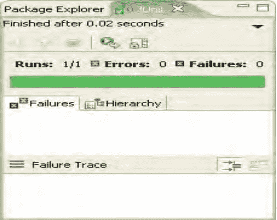

JUnit 单元测试，能在开发一段就找出许多 Bug，并且，多个 Test Case 可以组合成 Test Suite，让整个测试自动完成，尤其合于 XP 方法。每增加一个小的新功能或者对代码行了小的修改，就立刻运行一 Test Suite，确保新增和修改的代码不会破坏原有的功能，大大增强软件的可维护性，免代码渐“腐烂”。

## 示例
- 1. 建立hello（）类
- 2. 建立abs()方法；
- 3. 建立单元测试 Test Case——helloTest（）
- 4. 建立另一个math（）类
- 5. 建立add（）和 times（）方法
- 6. 建立单元测试 Test Case——mathTest（）
- 7. 建立测试 Test Suite

## 4.4 EMMA
- 测试覆盖率（Code Coverage）
- 测试覆盖率，简单的说，就是评价测试活动覆盖产品代码的指标。测试的目的，是确认产品代码按照预期一样工作，也可以看作是产品代码工作方式的说明文档。进一步考虑，测试覆盖率可以看作是产品代码质量的间接指标——之所以说是间接指标，因为测试覆盖率评价的是测试代码的质量，并不是产品代码的质量。
- 代码覆盖率是一种白盒测试，因为测试覆盖率是评价产品代码类内的指标，而不是评价系统接口或规约。测试覆盖率尤其用于评价测试代码是否已经覆盖了产品代码所有的路径。

## EMMA
- EMMA 是一种用来衡量 java 软件覆盖率的工具。它对于不可达代码的检测，以及验证测试和交互式测试对程序的覆盖情况是很必要的。
- EMMA的设计目标有以下几个，
- 1. 在不增加创建或执行开销的情况下，提供丰富的覆盖分析数据；
- 2. 促进困难开发展效率，同时，也能加快单元开发—测试周期；
- 3. 促进小型java软件的开发效率，同时，提高包含大类的的大型企业软件的开发。
- EMMA与其他覆盖测试工具的区别在于它面向极简编程，目的是促使循环的开发—测试软件开发模型。

- 衡量测试覆盖率的指标很多，常用的指标有：
- **Statement coverage**，也称作Line coverage，用于评价测试的代码语句覆盖率。
- **Basic block coverage**，是Statement coverage的一个变种，它把没有一个分支的代码区域作为一个计算单位，而不是简单的代码行，用于一个if-else分支代码行数大于另一个的情况，在这种情况下，statement coverage指标并不适用。
- **Decision coverage**（也称作Branch coverage），用于评价代码分支的测试覆盖率。
- **Path coverage**，和Decision coverage相似，用于评价代码从开始到结束所有路径的测试覆盖率。
- **Function coverage**，用于评价代码方法的测试覆盖率。
- **EMMA目前支持四种Coverage类型：**
  - class、method、line和basic block。

## 安装EclEmma插件
- EclEmma是一个基于EMMA的Java代码覆盖工具。它的目的是让你可以在Eclipse工作平台中使用强大的Java代码覆盖工具EMMA。EclEmma是非侵入式的不要修改你的项目或执行其它任何安装，它能够在工作平台中启动像运行JUnit测试一样直接对代码覆盖进行分析。
- 安装 EclEmma 插件的流程和大部分Eclipse 插件相同，既可以 Eclipse 标准的 Update 机制来进行安装 EclEmma 插件，也可以从站点下 zip 文件并解压到 eclipse 所在的目录中。

## 安装 EclEmma 插件
Eclipse的标准 Update 机制流程安装 EclEmma 插件

添加 EclEmma 更新站点
- Help →Install New Software... →Add

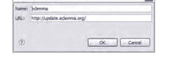
- Name: EclEmma
- URL: http://update.ecllemma.org/

## Available Software
Check the items that you wish to install.

Work with: Eclemma - http://update.eclemma.org/

Add...

Find more software by working with the "Available Software Sites" preferences.

type filter text

| Name | Version |
|------|---------|
| ☑ EclEmma |  |

Select All

Deselect All

1 item selected

Details

☑ Show only the latest versions of available software

☑ Group items by category

☐ Show only software applicable to target environment

☑ Contact all update sites during install to find required software

☑ Hide items that are already installed

What is already installed?

< Back

Next >

Finish

Cancel

## 使用EclEmma 进行测试覆盖率
示例：
- 利用EclEmma测试程序行覆盖率
- 生成EclEmma测试JUnit覆盖率报告
- 导出EclEmma覆盖率报告

## 4.5 实例
## XXXX支撑软件与可视化软件
## 测试计划

## 目录
- 1、简介
- 1.1 编写目的
- 1.2 背景
- 1.3 测试范围
- 1.4 参考文档
- 2、测试参考文档和测试提交文档
- 2.1 测试参考文档
- 2.2 测试提交文档
- 3、测试策略
- 4、测试资源
- 4.1 人力资源
- 4.2 测试环境
- 4.3 测试工具
- 5、测试策略

- 5.1功能测试
- 5.1.1 XXX系统管理软件功能测试
- 5.1.2 XXX系统实时通信软件功能测试
- 5.1.3目标三维动态显示模型及可视化软件功能测试
- 5.1.4XXX三维动态显示模型及可视化软件功能测试
- 5.1.5 XXX交会显示软件功能测试
- 5.1.6XXX系统数据管理软件功能测试
- 5.1.7 XXX文件与AutoCAD、Creator的转换软件功能测试
- 5.2性能测试
- 5.2.1 讯性能测试
- 5.2.2 实时性能测试
- 5.2.3 数据库性能测试
- 5.2.4 显示性能测试
- 5.2.5 其它性能测试
- 5.3故障测试
- 5.3.1网络故障
- 5.3.2 服务器故障
- 5.3.3 管理计算机故障
- 5.3.4 计算节点机故障
- 5.3.5 图形工作站故障测试
- 5.4安全性测试
- 5.4.1管理软件安全性测试
- 5.4.2 数据管理软件安全性测试

## # 1、简介
## ## 1.1 编写目的
为了全面、系统地对“XXX支撑软件与可视化软件”进行评估与测试，从而保证系统期望稳定的运行，组织对该软件进行系统的总体综合测试。

## ## 1.2 项目背景
“XXX证评平台”是中国兵器工业XXX研究所承担的国防基础科研项目。XXX所与XXX大学合作，对该项目的关键技术——XXX支撑技术和可视化技术开展研究。本项目就是在此背景下开展的，主要应用虚拟试验技术、计算机网络技术、可视化技术、数据库技术等，研制“XXX的支撑软件和可视化软件”，并最终集成在“XXX中”。

本软件系统由以下7个二级软件组成：
- 系统管理、实时通讯、三维显示、……


### 1.3 测试范围

本次系统测试将采用开发相关测试件与成熟测试工具相结合的方式，对系统进行现场测试。按照系统需求任务书的要求，分别开展系统功能测试、性能测试、故障测试以及安全性测试等相关工作。

本次测试的主要目标包括：

- 系统件单元功能测试——根据件详细设计文档的要求，完成各个件模块的单元功能测试工作；
- 系统件集成功能测试——根据件需求规格说明的要求，完成件功能测试工作；
- 系统件性能测试——根据技术协议书和件需求规格说明的要求，完成件性能测试工作；
- 系统故障测试——对件系统在网络故障、数据库故障等异常情况下进行测试；
- 安全性测试——对系统用户登录、密码保护等安全管理功能进行测试。

### 1.4 参考文档

- 《GB 8566-88 计算机件开发规范》
- 《GJB 438A-97 武器系统件开发文档》
- Xxxxxxxx

## 2、测试参考文档和测试提交文档

### 2.1 测试参考文档

本测试计划参照 GB8567——88 标准编制，下表列出了制定测试计划时所使用的文档，并标明了各文档的可用性：

### 2.2 测试提交文档

测试完成后，应向用户提交相关的测试评估报告与修改报告，并提交详细的测试报告。

## 3、测试进度

| 测试活动 | 计划开始日期 | 实际开始日期 | 结束日期 |
|---|---|---|---|
| 单元功能测试 | 2006年 3月16日 | 2006年3月16日 | 2004年3月26日 |
| 集成功能测试 | 2006年3月27日 | 2006年3月27日 | 2006年3月31日 |
| 性能测试 | 2006年4月2日 | 2006年4月3日 | 2006年4月5日 |
| 故障测试 | 2006年4月8日 | 2006年4月8日 | 2006年4月9日 |
| 安全测试 | 2006年4月10日 | 2006年4月10日 | 2006年4月11日 |
| 对测试进行评估 | 2006年4月15日 | 2006年4月16日 | 2006年4月18日 |
| 用户验收测试 | 2006年5月11日 |  |  |

## 4.1 测试资源

### 4.1 人力资源

| 姓名 | 角色 | 具体职责或注释 |
| --- | --- | --- |
| 胡 飞 | 总体策划人、方案设计人 | 策划总体规模，测试内容，规划测试方案 |
| A | 方案设计人、测试技术设计人 | 制定测试方案，确定测试深度，测试技术设计 |
| B | 计划人、记录人 | 计划测试进程，记录测试情况 |
| C | 计划人、测试人、记录人 | 计划整个进程以及各个阶段的进度安排、重点任务；测试并记录测试情况 |
| D | 计划人、测试人、记录人 | 测试并记录测试情况 |
| E | 测试人、记录人 | 测试并记录测试情况 |
| F | 测试人、记录人 | 测试并记录测试情况 |
| G | 测试人、记录人 | 测试并记录测试情况 |

## 4.3 测试工具

下表列出此次测试中使用的工具：

| 用途 | 工具名称 | 生产厂商/自产 | 版本 |
|---|---|---|---|
| 压力与性能测试 | Jmeter | Jakarta | 1.9.1 |
| 压力测试网络检测 | Webstress | 国外软件 | 6.18 |
| 申请一定量的内存 | Men | 自产 | 1.0 |

## 五、测试策略

### 5.1 功能测试

由于对测试对象的功能测试应侧重于所有可直接追踪到用例、业务功能和业务规则的测试。这种测试的目标是核实数据的接受、计算、处理和输出是否正确，以及业务规则的实施是否恰当，因此此次功能测试全部为符合性测试，测试的主要目的是检测以下错误：

- 1) 是否存在不正确或遗漏的功能？
- 2) 在接口上，输入是否能够被正确接受？能否输出正确的结果？
- 3) 是否存在数据错误或外部信息（例如数据文件）访问错误？
- 4) 是否存在初始化或终止性错误？

测试方法：

- 1）等价类划分

XXXXXXXXXXXXX

XXXXXXXXXXXXX

- 2）边界分析

Xxxxxxxxxxxxxxx

Xxxxxxxxxxxxxxx

- 3) 确立测试用例

#### 5.1.1 具体功能模块1

#### 5.1.2 具体功能模块2

Xxxxxxxxxxxxxxxx

#### 5.1.n 具体功能模块n

学生作业样本（电子学习）

说明：P15~P28 的 6 个案例需要大家自行阅读和理解。

- 1. 三角形
- 2. NextDate
- 3. 佣
- 4. SATM系统
- 5. 货币转换
- 6. 挡玻璃刷
- ?

## 第 5 章

## 功能测试

- 1. 边界值测试
- 2. 等价类测试
- 3. 基于判定表的测试
- 4. 因果图法

### 5.1 边界值测试

函数 F：Y = F(x₁, x₂)

输入变量 x₁ 和 x₂ 将具有一些（可能未明确说明的）边界：

a ≤ x₁ ≤ b

c ≤ x₂ ≤ d

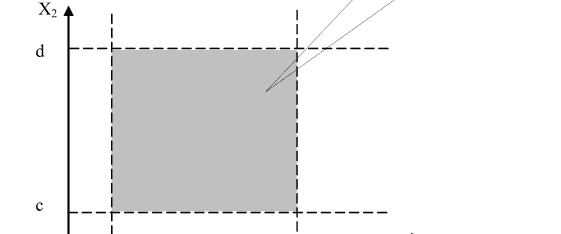

#### 一般边界值测试

将这些值称为 min、min+、nom、max− 和 max。

**“单故障”假设：**故障很少是两个（或更多）故障同时发生的结果。

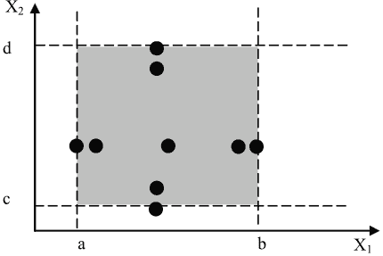

如果有一个包含 n 个变量的函数，边界值分析将产生 **4n + 1** 个不同的测试用例。

#### 边界值分析的局限性

- 边界值分析适用于待测试程序是由若干相互独立的变量构成的函数，且这些变量表示有界的物理量的情况。
- 为什么？
- 1. 这些变量需要能够通过真正的序关系进行描述。
- 2. 值分析假定这些变量确实彼此独立。
- 3. 不考虑函数的性质，也不考虑变量的语义含义。

#### 最坏情况边界值测试

- **拒绝单故障假设**
  - 对包含 n 个变量的函数进行最坏情况测试：生成 5ⁿ 个测试用例。
  - 对包含 n 个变量的函数进行健壮最坏情况测试：生成 7ⁿ 个测试用例。
- **三角形问题的测试用例**
  - 3 条边：a、b、c；
  - 每条边： （1~200）
  - 一般边界值测试：4×3+1=13 个（表 5.1）
  - 最坏情况边界值测试：5³=125 个（表 5.2）

#### 表 5.1 一般边界值测试用例

| 用例 | a | b | c | 预期输出 |
|---|---|---|---|---|
| 1 | 100 | 100 | 1 | 等腰三角形 |
| 2 | 100 | 100 | 2 | 等腰三角形 |
| 3 | 100 | 100 | 100 | 等边三角形 |
| 4 | 100 | 100 | 199 | 等腰三角形 |
| 5 | 100 | 100 | 200 | 不是三角形 |
| 6 | 100 | 1 | 100 | 等腰三角形 |
| 7 | 100 | 2 | 100 | 等腰三角形 |
| 8 | 100 | 100 | 100 | 等边三角形 |
| 9 | 100 | 199 | 100 | 等腰三角形 |
| 10 | 100 | 200 | 100 | 不是三角形 |
| 11 | 1 | 100 | 100 | 等腰三角形 |
| 12 | 2 | 100 | 100 | 等腰三角形 |
| 13 | 100 | 100 | 100 | 等边三角形 |
| 14 | 199 | 100 | 100 | 等腰三角形 |
| 15 | 200 | 100 | 100 | 不是三角形 |


#### 表 5.2（选）最坏情况边界值测试用例

| Case | a | b | c | Expected Output |
|---|---|---|---|---|
| 1 | 1 | 1 | 1 | Equilateral |
| 2 | 1 | 1 | 2 | Not a triangle |
| 3 | 1 | 1 | 100 | Not a triangle |
| 4 | 1 | 1 | 199 | Not a triangle |
| 5 | 1 | 1 | 200 | Not a triangle |
| 6 | 1 | 2 | 1 | Not a triangle |
| 7 | 1 | 2 | 2 | Isosceles |
| 8 | 1 | 2 | 100 | Not a triangle |
| 9 | 1 | 2 | 199 | Not a triangle |
| 10 | 1 | 2 | 200 | Not a triangle |
| 11 | 1 | 100 | 1 | Not a triangle |
| 12 | 1 | 100 | 2 | Not a triangle |
| 13 | 1 | 100 | 100 | Isosceles |
| 14 | 1 | 100 | 199 | Not a triangle |
| 15 | 1 | 100 | 200 | Not a triangle |
| 16 | 1 | 199 | 1 | Not a triangle |
| 17 | 1 | 199 | 2 | Not a triangle |
| 18 | 1 | 199 | 100 | Not a triangle |
| 19 | 1 | 199 | 199 | Isosceles |
| 20 | 1 | 199 | 200 | Not a triangle |
| 21 | 1 | 200 | 1 | Not a triangle |
| 22 | 1 | 200 | 2 | Not a triangle |
| 23 | 1 | 200 | 100 | Not a triangle |
| 24 | 1 | 200 | 199 | Not a triangle |
| 25 | 1 | 200 | 200 | Isosceles |

#### 随机测试

- 即使所有边界值的测试都已完成，程序的错误也未被发现，并且在非边界值中存在一些错误。
- 而不是总是选择有界变量的 min、min+、nom、max- 和 max 值，使用随机数生成器来选择测试用例值。
- 需要多少个随机测试用例才足够？

### 5.2 等价类测试

#### 1) 弱常规等价类测试

函数：Y = f(x₁, x₂)

a ≤ x₁ ≤ d, 区间为 [a, b), [b, c), [c, d], P₁=3

e ≤ x₂ ≤ g, 区间为 [e, f), [f, g], P₂=2

测试用例为划分中子集数最多的类

测试用例 = 3

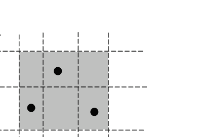

#### 2) 强常规等价类测试

基于多故障假设，从等价类的笛卡尔积的每个元素中获取测试用例

测试用例：N × M。

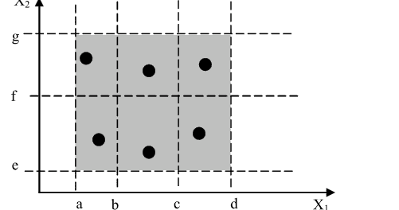

#### 3) 弱健壮等价类测试

weak：单故障假设

robust：无效值

测试用例：子集数最多（3）加上无效输入（2）

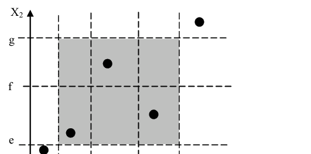

#### 考虑：

**weak:** 单故障假设

robust：无效值

测试用例：子集数最多（3）加上无效输入（2 × 输入类）

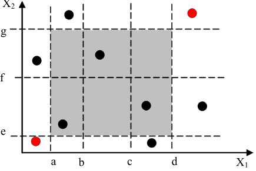

#### 4) 强健壮等价类测试

strong：多故障假设。

robust：无效值

测试用例：所有等价类的笛卡尔积，既有效又无效。 (N+2) × (M+2)

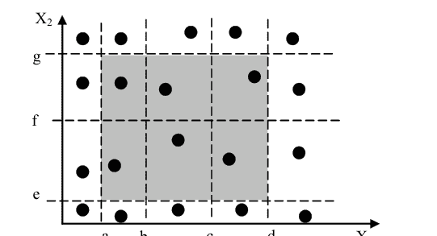

#### 三角形问题的等价类测试用例

#### 三角形问题

输入 3 条边，四种可能的输出：

R1 = {\<a, b, c\>: 边为 a、b 和 c 的三角形是等边三角形}

R2 = {\<a, b, c\>: 边为 a、b 和 c 的三角形是等腰三角形}

R3 = {\<a, b, c\>: 边为 a、b 和 c 的三角形是不等边三角形}

R4 = {\<a, b, c\>: 边 a、b 和 c 不能构成三角形}

#### 四个弱常规等价类测试用例

| Test case | a | b | c | Expected Output |
|---|---|---|---|---|
| 1 | 5 | 5 | 5 | Equilateral |
| 2 | 2 | 2 | 3 | Isosceles |
| 3 | 3 | 4 | 5 | Scalene |
| 4 | 4 | 1 | 2 | Not a triangle |

#### 强健壮等价类测试用例：额外的无效值组合

| Test case | a | b | c | Expected Output |
|---|---|---|---|---|
| 1 | -1 | -1 | 5 | a, b are min- |
| 2 | 5 | -1 | -1 | b, c are min- |
| 3 | -1 | 5 | -1 | a, c are min- |
| 4 | -1 | -1 | -1 | a, b, c are min- |

这里仅对 min- 进行说明，不再对 max+ 进行说明。

## 记住：第 2 章中的 7 个示例，应自行阅读。

- 1. The Triangle Problem
- 2. The NextDate Function
- 3. The Commission Problem
- 4. The SATM System
- 5. The Currency Converter
- 6. Saturn Windshield Wiper Controller
- 7. Garage Door Opener


#### NextDate 函数的等价类测试用例

#### NextDate

三个变量：month、day 和 year。有效值定义如下：

- M1（月）= 1~12
- D1（日）= 1~31
- Y1（年）= 1812~2012

无效的等价类为：

- M2 = {month: month < 1}, M3 = {month: month > 12}
- D2 = {day: day < 1}, D3 = {day: day > 31}
- Y2 = {year: year < 1812}, Y3 = {year: year > 2012}

#### 弱一般等价类测试用例

| 案例编号 | 月 | 日 | 年 | 预期输出 |
|---|---:|---:|---:|---|
| 1 | 6 | 12 | 2001 | 2001年6月13日 |

#### 弱健壮测试用例

| 案例编号 | 月 | 日 | 年 | 预期输出 |
|---|---:|---:|---:|---|
| 1 | 6 | 12 | 2001 | 2001-6-13 |
| 2 | -1 | 12 | 2001 | Invalid month |
| 3 | 13 | 12 | 2001 | Invalid month |
| 4 | 6 | -1 | 2001 | Invalid day |
| 5 | 6 | 31 | 2001 | Invalid day |
| 6 | 6 | 12 | 1811 | Invalid year |
| 7 | 6 | 12 | 2013 | Invalid year |

强健壮等价类测试需要考虑所有等价类的笛卡尔积。这里不再赘述。

进一步分析：月份包括大月（31天）、小月（30天）和二月（28天）；月末日包括29、30和31；年份可能是闰年或平年。

M1 = {月份为30天}, M2 = {月份为31天}

M3 = {月份为二月}

D1 = {1 ≤ day ≤ 28}, D2 = {day = 29}, D3 = {day = 30}, D4 = {day = 31}

Y1 = {year = 2000}, Y2 = {year 为非世纪闰年}, Y3 = {year 为平年}

#### 强一般等价类测试用例

| 案例编号 | 月 | 日 | 年 | 预期输出 |
|---|---:|---:|---:|---|
| SN1 | 6 | 14 | 2000 | 6/15/2000 |
| SN2 | 6 | 14 | 1996 | 6/15/1996 |
| SN3 | 6 | 14 | 2002 | 6/15/2002 |
| SN4 | 6 | 29 | 2000 | 6/30/2000 |
| SN5 | 6 | 29 | 1996 | 6/30/1996 |
| SN6 | 6 | 29 | 2002 | 6/30/2002 |
| SN7 | 6 | 30 | 2000 | Invalid input date |
| SN8 | 6 | 30 | 1996 | Invalid input date |
| SN9 | 6 | 30 | 2002 | Invalid input date |
| SN10 | 6 | 31 | 2000 | Invalid input date |
| SN11 | 6 | 31 | 1996 | Invalid input date |
| SN12 | 6 | 31 | 2002 | Invalid input date |
| SN13 | 7 | 14 | 2000 | 7/15/2000 |
| SN14 | 7 | 14 | 1996 | 7/15/1996 |
| SN15 | 7 | 14 | 2002 | 7/15/2002 |
| SN16 | 7 | 29 | 2000 | 7/30/2000 |
| SN17 | 7 | 29 | 1996 | 7/30/1996 |
| SN18 | 7 | 29 | 2002 | 7/30/2002 |
| SN19 | 7 | 30 | 2000 | 7/31/2000 |
| SN20 | 7 | 30 | 1996 | 7/31/1996 |
| SN21 | 7 | 30 | 2002 | 7/31/2002 |
| SN22 | 7 | 31 | 2000 | 8/1/2000 |
| SN23 | 7 | 31 | 1996 | 8/1/1996 |
| SN24 | 7 | 31 | 2002 | 8/1/2002 |
| SN25 | 2 | 14 | 2000 | 2/15/2000 |
| SN26 | 2 | 14 | 1996 | 2/15/1996 |
| SN27 | 2 | 14 | 2002 | 2/15/2002 |
| SN28 | 2 | 29 | 2000 | 3/1/2000 |
| SN29 | 2 | 29 | 1996 | 3/1/1996 |
| SN30 | 2 | 29 | 2002 | Invalid input date |
| SN31 | 2 | 30 | 2000 | Invalid input date |
| SN32 | 2 | 30 | 1996 | Invalid input date |
| SN33 | 2 | 30 | 2002 | Invalid input date |
| SN34 | 2 | 31 | 2000 | Invalid input date |
| SN35 | 2 | 31 | 1996 | Invalid input date |
| SN36 | 2 | 31 | 2002 | Invalid input date |

决策表有四个部分：桩部分、入口部分、条件部分和动作部分。

| 桩 | Rule 1 | Rule 2 | Rule 3, 4 | Rule 5 | Rule 6 | Rule 7, 8 |
|---|---|---|---|---|---|---|
| c1 | T | T | T | F | F | F |
| c2 | T | T | F | T | T | F |
| c3 | T | F | — | T | F | — |
| a1 | X | X |  | X |  |  |
| a2 | X |  |  |  | X |  |
| a3 |  | X |  | X |  |  |
| a4 |  |  | X |  |  | X |

条件部分

动作部分

要使用决策表识别测试用例，我们将条件解释为输入，动作解释为输出。

#### 三角形问题的决策表

| 条件 / 动作 | 1 | 2 | 3 | 4 | 5 | 6 | 7 | 8 |
|---|---|---|---|---|---|---|---|---|
| c1: a, b, c 构成三角形？ | N | Y | Y | Y | Y | Y | Y | Y |
| c2: a = b? | — | Y | Y | Y | Y | N | N | N |
| c3: a = c? | — | Y | Y | N | N | Y | Y | N |
| c4: b = c? | — | Y | N | Y | N | Y | N | Y |
| a1: 不是三角形 | X |  |  |  |  |  |  |  |
| a2: 不等边 |  |  |  |  |  |  |  | X |
| a3: 等腰 |  |  |  | X |  | X | X |  |
| a4: 等边 |  | X |  |  |  |  |  |  |
| a5: 不可能 |  |  | X | X |  | X |  |  |


#### 精炼决策

- c1: a < b + c;
- c2: b < a + c;
- c3: c < a + b;
- c4: a = b;
- c5: a = c;
- c6: b = c;

#### 表 7.3 三角形问题的精炼决策表

| 条件/动作 | 1 | 2 | 3 | 4 | 5 | 6 | 7 | 8 | 9 | 10 |
|---|---|---|---|---|---|---|---|---|---|---|
| c1: a < b + c? | F | T | T | T | T | T | T | T | T | T |
| c2: b < c + a? | — | F | T | T | T | T | T | T | T | T |
| c3: c < a + b? | — | — | F | T | T | T | T | T | T | T |
| c4: a = b? | — | — | — | T | T | T | T | F | F | F |
| c5: a = c? | — | — | — | T | T | F | F | T | T | F |
| c6: b = c? | — | — | — | T | F | T | F | T | F | T |
| a1: 不是三角形 | X | X | X |  |  |  |  |  |  |  |
| a2: 不等边 |  |  |  |  |  |  |  |  |  | X |
| a3: 等腰 |  |  |  |  |  |  | X |  | X | X |
| a4: 等边 |  |  |  | X |  |  |  |  |  |  |
| a5: 不可能 |  |  |  |  | X | X |  | X |  |  |

#### NextDate 函数的测试用例

##### 第一次尝试，等价类集合接近：

- M1 = {month: month has 30 days}
- M2 = {month: month has 31 days}
- M3 = {month: month is February}
- D1 = {day: 1 ≤ day ≤ 28}
- D2 = {day: day = 29}
- D3 = {day: day = 30}
- D4 = {day: day = 31}
- Y1 = {year: year is a leap year}
- Y2 = {year: year is not a leap year}

| Conditions |  |  |
|---|---|---|
| c1: Month in M1? |  |  |
| c2: Month in M2? |  |  |
| c3: Month in M3? |  |  |
| c4: Day in D1? |  |  |
| c5: Day in D2? |  |  |
| c6: Day in D3? |  |  |
| c7: Day in D4? |  |  |
| c8: Year in Y1? |  |  |
| a1: Impossible |  |  |
| a2: NextDate |  |  |

将有 2⁸ = 256 条规则！

#### 第二次尝试，关注 NextDate 函数的闰年方面

M1 = {month: month has 30 days}

M2 = {month: month has 31 days}

M3 = {month: month is February}

D1 = {day: 1 ≤ day ≤ 28}

D2 = {day: day = 29}

D3 = {day: day = 30}

D4 = {day: day = 31}

Y1 = {year: year = 2000}

Y2 = {year: year is a non-century leap year}

Y3 = {year: year is a common year}

#### 这些条件将导致一个包含 36 条规则的决策表

| | 1 | 2 | 3 | 4 | 5 | 6 | 7 | 8 |
|---|---|---|---|---|---|---|---|---|
| c1: Month in | M1 | M1 | M1 | M1 | M2 | M2 | M2 | M2 |
| c2: Day in | D1 | D2 | D3 | D4 | D1 | D2 | D3 | D4 |
| c3: Year in | — | — | — | — | — | — | — | — |
| Rule count | 3 | 3 | 3 | 3 | 3 | 3 | 3 | 3 |
| a1: Impossible |  |  |  | X |  |  |  |  |
| a2: Increment day | X | X |  |  | X | X | X |  |
| a3: Reset day |  |  | X |  |  |  |  | X |
| a4: Increment month |  |  | X |  |  |  |  | ? |
| a5: Reset month |  |  |  |  |  |  |  | ? |
| a6: Increment year |  |  |  |  |  |  |  | ? |

#### 第三次尝试，具体说明二月和十二月中的天数

M1 = {month: month has 30 days}

M2 = {month: month has 31 days except December}

M3 = {month: month is December}

M4 = {month: month is February}

D1 = {day: 1 ≤ day ≤ 27}

D2 = {day: day = 28}

D3 = {day: day = 29}

D4 = {day: day = 30}

D5 = {day: day = 31}

Y1 = {year: year is a leap year}

Y2 = {year: year is a common year}

#### 表 7.14 NextDate 函数的决策表

| | 1 | 2 | 3 | 4 | 5 | 6 | 7 | 8 | 9 | 10 |
|---|---|---|---|---|---|---|---|---|---|---|
| c1: Month in | M1 | M1 | M1 | M1 | M1 | M2 | M2 | M2 | M2 | M2 |
| c2: Day in | D1 | D2 | D3 | D4 | D5 | D1 | D2 | D3 | D4 | D5 |
| c3: Year in | — | — | — | — | — | — | — | — | — | — |
| Actions |  |  |  |  |  |  |  |  |  |  |
| a1: Impossible |  |  |  |  | X |  |  |  |  |  |
| a2: Increment day | X | X | X |  |  | X | X | X | X |  |
| a3: Reset day |  |  |  | X |  |  |  |  |  | X |
| a4: Increment month |  |  |  | X |  |  |  |  |  | X |
| a5: Reset month |  |  |  |  |  |  |  |  |  |  |
| a6: Increment year |  |  |  |  |  |  |  |  |  |  |

#### 22 条规则

| | 11 | 12 | 13 | 14 | 15 | 16 | 17 | 18 | 19 | 20 | 21 | 22 |
|---|---|---|---|---|---|---|---|---|---|---|---|---|
| c1: Month in | M3 | M3 | M3 | M3 | M3 | M4 | M4 | M4 | M4 | M4 | M4 | M4 |
| c2: Day in | D1 | D2 | D3 | D4 | D5 | D1 | D2 | D2 | D3 | D3 | D4 | D5 |
| c3: Year in | — | — | — | — | — | — | Y1 | Y2 | Y1 | Y2 | — | — |
| Actions |  |  |  |  |  |  |  |  |  |  |  |  |
| a1: Impossible |  |  |  |  |  |  |  |  |  | X | X | X |
| a2: Increment day | X | X | X | X |  | X | X |  |  |  |  |  |
| a3: Reset day |  |  |  |  | X |  |  | X | X |  |  |  |
| a4: Increment month |  |  |  |  |  |  |  | X | X |  |  |  |
| a5: Reset month |  |  |  |  | X |  |  |  |  |  |  |  |
| a6: Increment year |  |  |  |  | X |  |  |  |  |  |  |  |


# 表7.15 NextDate函数的简化决策表

|  | 1~3 | 4 | 5 | 6~9 | 10 | 11~14 |
|---|---|---|---|---|---|---|
| c1:月份输入 | M1 | M1 | M1 | M2 | M2 | M3 |
| c2:日期输入 | D1,D2,D3 | D4 | D5 | D1,D2,D3,D4 | D5 | D1,D2,D3,D4 |
| c3:年份输入 | — | — | — | — | — | — |
| 动作 |  |  |  |  |  |  |
| a1:不可能 |  |  | X |  |  |  |
| a2:递增日期 | X |  |  | X |  | X |
| a3:重置日期 |  | X |  |  | X |  |
| a4:递增月份 |  | X |  |  | X |  |
| a5:重置月份 |  |  |  |  |  |  |
| a6:递增年份 |  |  |  |  |  |  |

# 共13个测试规则,具体测试用例(略)

|  | 15 | 16 | 17 | 18 | 19 | 20 | 21,22 |
|---|---|---|---|---|---|---|---|
| c1:月份输入 | M3 | M4 | M4 | M4 | M4 | M4 | M4 |
| c2:日期输入 | D5 | D1 | D2 | D2 | D3 | D3 | D4,D5 |
| c3:年份输入 | — | — | Y1 | Y2 | Y1 | Y2 | — |
| 动作 |  |  |  |  |  |  |  |
| a1:不可能 |  |  |  |  |  | X | X |
| a2:递增日期 |  | X | X |  |  |  |  |
| a3:重置日期 | X |  |  | X | X |  |  |
| a4:递增月份 |  |  |  | X | X |  |  |
| a5:重置月份 | X |  |  |  |  |  |  |
| a6:递增年份 | X |  |  |  |  |  |  |

从第一次的256个测试规则到现在的13个测试规则，测试等价类的完备性是一样的。换言之，从决策表测试方法，我们可以充分地认识到，测试用例越多，并不能增加测试的完备性。而通过分析与合并，使用尽可能少的测试用例来达到测试完备性要求，正是测试技术研究的核心内容和目标。

# 从之前的介绍，我们可以清楚地得出以下结论：

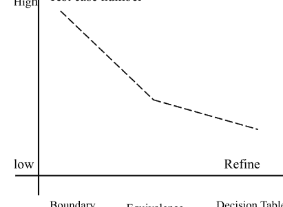

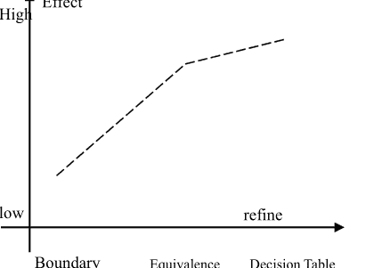

软件测试技术研究的目标:使用尽可能少的测试用例,发现尽可能多的软件错误。提高测试的效率。

有关测试效率的问题，在后续的章节中还要多次提到。

# 指南与观察

+ 1. 决策表技术适用于具有以下任何特征的应用：
+ a. 突出的if-then-else逻辑
+ b. 输入变量之间的逻辑关系
+ c. 涉及输入变量子集的计算
+ d. 输入与输出之间的因果关系
+ e. 高的圈复杂度（参见第9章）

+ 2. 决策表扩展性不佳（具有n个条件的有限条目表有2ⁿ条规则）。

+ 3. 你识别出的第一组条件和动作可能不令人满意。将其作为垫脚石并逐步改进，直到你对决策表感到满意。

# 问答

## 第6章

## 软件标准与文档

+ 1. 软件工程标准化
+ 2. 软件文档
+ 3. 软件质量认证

### 6.1 软件工程标准化

#### 6.1.1 软件工程标准化定义

1983年我国公布的国家标准(GB3935.1-83)中对“标准”的定义是：“标准是对重复性事物和概念所做的统一规定。它以科学、技术、实践经验和综合成果为基础，经有关方面协商一致，由主管机构批准，以特定形式发布，作为共同遵守的准则和依据。”

1983年国际标准化组织发布的ISO第二号指南(第四版)对“标准”的新定义是：“由有关各方根据科学技术成就与先进经验，共同合作起草，一致或基本上同意的技术规范或其他公开文件，其目的在于促进最佳的公众利益，并由标准化团体批准。”

在2000年发布的GB/T1.1-2000“标准化工作导则”中，将标准定义为：“为在一定的范围内获得最佳秩序，对活动或其结果规定共同的和重复使用的规则、导则或特性文件。该文件经协商一致制定，并经一个公认机构的批准。标准应以科学、技术和经济的综合成果为基础，以促进最佳社会效益为目的。”

+ - 统一性
+ - 科学性
+ - 权威性

#### 6.1.2 软件工程标准的范围

整个软件生存期: 从？到？

跨越软件生存期各个阶段的技术管理工作：？

如：工程管理、配置管理、产品管理等

如：产品分析、测试、评审和审计等

+ - 所有这些方面建立的标准或规范，即是软件工程标准化。

#### 6.1.3 软件工程标准化的作用

+ (1)可提高软件的可读性、可维护性和可移植性，从而提高软件产品的质量；
+ (2)可提高软件人员的技水平和软件的生产率；
+ (3)可提高软件人员之间的信息效率，减少差异和误解；
+ (4)为科学地进行软件管理奠定了基础；
+ (5)有利于降低软件产品的成本和运行维护成本；
+ (6)有利于缩短软件开发周期；
+ (7)标准化是软件研究、生产、使用三者之间的桥梁。

#### 6.1.4 软件工程标准的层次

用的范围有所不同，它可分为五个级别，即国家标准、国家标准、行业标准、企业(机构)标准及项目标准。

1) 国家标准：ISO

+ （3）FIPS(NBS)
+ （4）BS
+ （5）DIN
+ （6）JIS

##### 3) 行业标准

由行业机构、学术团体或国际机构制定，并用于某个业务域的标准。

+ 1. IEEE
+ 2. GJB
+ 3. DOD-STD
+ 4. MIL-S


#### 6.1.4 常见的国际标准化组织

+ - 国际标准化委员会（ISO）
+ - 国际电工委员会（IEC）
+ - 电气与电子工程师协会（IEEE）
+ - 美国国家标准学会（ANSI）
+ - 美国电信工协会（TIA）
+ - 美国电子工程协会（EIA）
+ - 欧洲电工标准化委员会CENELEC与欧洲标准化委员会CEN

#### 6.1.5 常见的国家标准化管理委员会批准的软件工程国家标准

| 中国软件工程标准 |  |  |
|---|---|---|
| 分类 | 标准名称 | 标准号 |
| 基础标准 | 信息技术 软件工程术语 | GB、T 11457-2006 |
| 开发标准 | 软件开发规范 | GB 8566-2001 |
|  | 软件生成周期过程 用于项目管理的指南 | GB/Z 20156-2006 |
|  | 软件生成周期过程 配置管理 | GB/T 20158-2006 |
|  | 信息技术 软件维护 | GB/T 20157-2006 |
| 文档标准 | 软件文档管理指南 | GB |
|  | 计算机软件产品开发文件编制指南 | GB 8567-2006 |


| 质量标准 | 信息技术 软件产品评价-质量特性及其使用指南 | GB |
| --- | --- | --- |
|  | 产品质量 第1部分：质量模型 | GB/T 16260.1-2006 |
|  | 产品质量 第2部分：外部度量 | GB/T 16260.2-2006 |
|  | 产品质量 第3部分：内部度量 | GB/T 16260.3-2006 |
|  | 产品质量 第4部分：使用质量的度量 | GB/T 16260.4-2006 |

##### 附件：软件工程国家标准

### 6.2 软件文档

#### 6.2.1 软件文档的含义

软件文档(Document)也称文件，常指的是一 些记录的数据和数据媒体，它具有固定不变的形式，可被人和计算机 读。

软件 =?
程序 + 文档

#### 6.2.2 软件文档的作用

- 1. 软件文档是开发管理工作的依据，软件文档是检查软件开发进度和开发质量的标准。
- 2. 提供联系和开发效率。对各阶段的工作有详细掌握，减少工作量，便于发现错误和不一致性，并及时进行纠正。
- 3. 软件文档也是开发人员一定阶段的工作成果和结束标志。
- 4. 便于以后软件的开发、使用和维护。
- 5. 提供软件的运行、维护和培训的有关信息。
- 6. 能充分展示软件的功能、性能等各项指标，为用户购买符合自己需要的软件提供参照。

可以说，文档是软件开发规范的体现和标准，按规范要求生成一整套文档的过程，就是按照软件开发规范完成一个软件开发的过程。

#### 6.2.3 常用软件文档

国家标准局在1988年1月 发布了《计算机 软件开发规范》和《 软件产品开发文件编制指南》，指出 软件全 程应提交的文档为以下13种：

- 1. 可行性研究报告：
  - 技术可行？
  - 经济可行？
  - 社会因素？

- 2. 项目开发计划：
  - 进度
  - 人员
  - 经费 预算
  - 硬件和 软件资源

##### 3. 软件需求规格说明：

功能、性能
界面、环境

##### 4. 数据需求规格说明：

数据类型、格式、  、存储要求

##### 5. 概要设计规格说明：

功能分  、模块划分
接口设计、  行设计（工作流程）
数据结构、出  处理

##### 6. 详细设计规格说明：

每个模块：实现算法、  流程等。

##### 7. 用户手册：

详细描述 软件的功能、性能和用户界 面，使用户了解如何使用该 软件。

##### 8. 操作手册：

为操作人员提供该 软件各种  运行情况的有关知识，特别是操作方法细节。

##### 9. 测试计划：

内容、 范围、 进度、 条件 、人员、
测试用例的 取原则、测试结果允许的偏差范围等。

##### 10.测试分析报告：

测试分析
测试结论

##### 11.开发 进度月报：

计划与实  进度差

成果、

计划调整

##### 12. 项目开发总结报告：

进度、成果、成本、资源

经验 与教训

##### 13.维护修改建议：

修正、更改建议

#### 必不可少的报告：

- 1. 项目开发计划
- 2. 软件 需求规格说明
- 3. 系统设计报告(概要)
- 4. 详细设计报告
- 5. 用户(操作)手册
- 6. 测试计划与报告(包含分析报告)
- 7. 项目开发总结报告

#### 文档实例1：软件项目开发计划
（学生自学用）

##### 1) 引言

**编写目的：**　明确编写软件计划的目的，指出读者对象。

**背景：**　包括 项目委托单位、开发单位和主管  ；该系统与其他系统的关系。

**定义：**　列出本文档中用到的专 业术语的定义和缩略词的原文。

**参考资料：** 包括 项目经核准的计划任务书、合同或上级机关的批文；文档所引用的资料、规范等；列出资料的作者、标 题、编号、发布日期、出版单位或资料来源。

##### 2) 目标

**摘要说明**　目的各 主要工作，介绍所开发 软件的功能性能等。

**条件与限制：**　明确完成 项目应具备的条件；开发单位已具备的条件以及尚 需创造的条件。必要时，应说明用户及分合商承担的工作、完成期 限及其他条件与 限制。

（学生自学用）

**产品：**

- (1)程序：列出应交付的程序名称使用的语言及存储形式。

- (2)文档：列出应交付的文档。

- (3) 运行环境：应包括硬件环境和 软件环境。

- (4)服务： 明开发单位可向用户提供的服务，如人员培训、安装、维护和其他 运行支持。

- (5) 验收标准。

##### 3) 实施计划

任务分解：任务的划分及各 任务的负责人。

进度：按 阶段完成的 项目，用图表说明开始时 间完成时 间。

预算：描 述本 项目的总费用概算。

关 键：说明可能影响 项目的关键 ，如设备条件技 术 点或其他 因素，并说明对策。

人员组织及分工。

##### 4) 交付期

#### 文档实例2：软件需求规格说明
（学生自学用）

- 1) 引言
  - (1) 编写目的
  - (2) 项目背景
  - (3) 定义
  - (4) 参考资料

- 2) 任务概
  - (1) 目标
  - (2) 运行环境
  - (3) 条件与 限制
  - (4) 数据描 述，包括： 静态数据；动态数据(包括 输入数据和输出数据)；数据库描 述(给出使用数据库的名称和类型)；数据字典；数据 。

（学生自学用）
(5)功能 需求, 包括: 功能划分; 功能描 述。
(6)性能 需求, 包括: 数据精确度; 时 间特性(如响应时 间、更新处理时 间、数据转化与传时 间、 运行时 间等); 适应性(在操作方式、运行环境与其他 软件的接口以及开发计划等发生变化时, 应具有的 适应能力)。
(7) 运行 需求, 包括: 用户界 面(如屏幕格式、报表格式、菜单格式、 输入 输出时 等); 硬件接口; 软件接口; 故 障处理。
(8)其他 需求: 如可使用性、安全保密性、可维护性、可移植性等。

#### 文档实例3：测试计划
（学生自学用）

- 一、简介
- 1.1 编写目的
- 1.2 项目背景
- 1.3 测试范围
- 1.4 参考文档
- 二、测试参考文档和测试提交文档
- 2.1 测试参考文档
- 2.2 测试提交文档
- 三、测试 进度
- 四、测试资源
- 4.1 人力资源
- 4.2 测试环境
- 4.3 测试工具
- 五、测试策略

#### 6.2.4 软件文档的标准化检查

软件文档

- - 正确性
- - 完整性
- - 一致性（文档与文档、文档与程序）
- - 及时性

#### 文档中的章节编号
（学生自学用）

要求使用：

- 1
- 1. 1
- 1. 1. 1

不可以用：

- 一
- （一）
- （1）
- 1）

#### 文档中关于图的说明

（学生自学用）

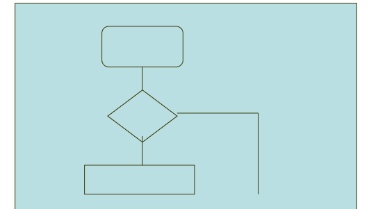

图 2 流程图实例

#### 文档中关于表的说明

（学生自学用）

表 5 成绩单

|   |   |   |   |   |
|---|---|---|---|---|
|   |   |   |   |   |
|   |   |   |   |   |
|   |   |   |   |   |
|   |   |   |   |   |

### 6.3 软件质量认证

- 1. 质量认证与质量保证的区别？
- 2. 你知有哪些质量认证？
  - ISO9000（1987）
  - CMM（1990）、CMMI（2001）
  - ISO27001（2005）
  - 其它？

#### 6.3.1 ISO 9000 标准概述

#### ISO9000

- - 名称：质量 管理和质量 保证标准系列
- - 时 间： 1987年3月
- - 目的：为了满足国际 贸易的 需求。
- - 供方：
- - 核心：对供方的质量 要求和管理方法

中国获得ISO认证承认： 1998年1月

#### 发展历程

| ISO9000: 1987 | ISO9000: 1994 | ISO9000: 2000 |
|---|---|---|
| ● 历史性综合
● 6项标准
● 主要针对制造业
  由其是较大企业 | ● 战术性换版
● 22项标准
● 补充内容、扩大范围
● 开始考虑服务业应用
● 按产品导向建立 20个要素 | ● 战略性换版
● 5项加技术报告书
● 充分考虑一切组织,包括小企业、服务业
● 按过程导向建立 PDCA循环 |

2000年12月15日，2000版的ISO9000族标准正式发布实施，2000版ISO9000族国际标准的核心标准共有四个：

- 1、ISO9000:2000 质量管理体系——基础和术语；
- 2、ISO9001:2000 质量管理体系——要求；
- 3、ISO9004:2000 质量管理体系——业绩改进指南；
- 4、ISO19011:2000 质量和环境管理体系审核指南。


我国等同用ISO9000系列标准，于2001年12月28日发布，2001年6月30日实施，标准号

- 1. GB/T19000
- 2. GB/T19001
- 3. GB/T19004

#### ISO 9000标准的特点

- (1) 国际性
- 120多个国家和地区用为国家标准

- (2) 完整性
- 20个标准

- (3) 兼容性
- 设计、生产、管理、销售、服务

- (4) 主动性
- 生产者推动

(5) 可信性

独立性

标准化

(6) 指导性

质量管理和质量保证的原则

(7) 科学性

现代质量管理的科学原理

(8) 实践性

基于国外大的质量管理实践

有关ISO的资料

#### 6.3.2 CMM/CMMI 概述

##### ① 什么是CMM?

CMM(Capability Maturity Model)即能力成熟度模型，是美国卡内基•梅隆大学软件工程研究所(SEI)在美国国防部(DoD)资助下，于20世纪80年代末建立的，用于评价软件机构的软件工程能力成熟度。

（1）初始级

（2）可重复级

（3）已定义级

（4）已管理级

（5）优化级

有制度的过程

标准、一致的过程

可预测的过程

不断改进的过程

第一级（初始级）：无序

第二级（可重复级）：软件项目目的策划和跟踪是稳定的，提供了可重复以前成功实践的项目环境。

第三级（已定义级）：定义了完整的软件过程(过程模型)，并在软件过程工程活动和软件项目工程活动中，实现了标准化和文档化。

第四级（已管理级）：建立了定量的质量目标，所有项目的关键过程活动是可度量的。

第五级（优化级）：软件机构能够集中精力进行不断的过程改进。

#### 从CMM到CMMI

- CMMI在CMM的基础上增加了集成产品和过程开发（IPPD）等专业领域，不再局限于软件。

- 增加的有：系统工程能力成熟度模型（SE-CMM），软件采购能力成熟度模型（SA-CMM），集成产品开发能力成熟度模型（IPD-CMM）

也分为5级

- 1. 级别1（初始级）
- 2. 级别2（已管理级）
- 3. 级别3（严格定义级）
- 4. 级别4（定量管理级）
- 5. 级别5（优化级）

#### 6.3.3 ISO27001

#### 什么是ISO27001

信息安全管理标准

它来源于英国标准协会（British Standards Institute, BSI）于1995年2月制定的信息安全管理标准--BS7799, BS7799分两个部分,

- BS7799-1, 信息安全管理实施规则
- BS7799-2, 信息安全管理体系规范。

其第一部分于2000年被ISO组织纳入, 正式成为ISO/IEC 17799标准。该标准2005年经最新改版, 发展成为 ISO/IEC 17799:2005标准。

BS7799标准的第二部分经多次讨论修订, 也于2005年成为正式的ISO标准, 即ISO/IEC 27001:2005。

是建立信息安全管理体系（ISMS）的一套规范（Specification for Information Security Management Systems），其中详细说明了建立、实施和维护信息安全管理体系的要求，指出实施机构应该遵循的评估标准。

是信息与企业最重要的资质之一

?

- 1、 P（Plan）-计划，确定方向和目标，确定活动计划；
- 2、 D（Do）-执行，实地去做，实现计划中的内容；
- 3、 C（Check）-检查，总结执行计划的结果，注意效果，找出问题；
- 4、 A（Action）-行动，对总结检查的结果进行处理，成功的经验加以肯定并适当推广、标准化；失败的教训加以总结，以避免出现，未解决的放到下一个PDCA循环。

在质量管理中，PDCA循环得到了广泛的应用，也称PDCA循环是质量管理的基本方法。

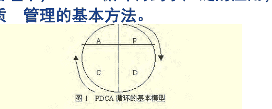

- 1. GB/T1526: 1989 信息处理—数据流程图、程序流程图、系统流程图、程序网络图和系统资源图的文件编制符号及约定 有效 ISO 5807 1985
- 2. GB/T8566: 2001 信息技术 软件生存周期过程 修订 ISO/IEC 12207-1995
- 3. GB/T8567: 1988 计算机软件产品开发文件编制指南 修订
- 4. GB/T9385: 1988 计算机软件需求说明编制指南 修订 ANSI/IEEE 830-1984
- 5. GB/T9386: 1988 计算机软件测试文件编制规范 修订 ANSI/IEEE 829-1983
- 6. GB/T11457: 1995 软件工程术语 修订 IEEE 729
- 7. GB/T12504: 1990 计算机软件质量保证计划规范 废止 IEEE 730
- 8. GB/T12505: 1990 计算机软件配置管理计划规范 废止 IEEE 828
- 9. GB/T13502: 1992 信息处理程序构造及其表示的约定 有效 ISO 8631-1989

10. GB/T14079: 1993 计算机软件维护指南 废止

11. GB/T14085: 1993 信息处理系统 计算机系统配置图符号及其约定 有效 ISO 8790 - 1987

12. GB/T14394: 1993 计算机软件可靠性维护性管理 修订

13. GB/T15189: 1994 DOS中文信息处理系统接口规范

14. GB/T15532: 1995 计算机软件单元测试 修订

15. GB/T15535: 1995 信息处理 单命中判定表规范 有效 ISO 5806 - 1984

16. GB/T15538: 软件工程标准分类法 废止

17. GB/T15697: 1995 信息处理 按记录组处理顺序文卷的程序流程 废止 ISO 6593 - 1985

18. GB/T15853: 1995 软件支持环境 废止

19. GB/T16260: 1996 信息技术 软件产品评价 质量特性及其使用指南 修订 ISO/IEC 9126 - 1991

20. GB/T16680: 1996 软件文档管理指南 有效 ISO/IEC TR 9294 - 1990

21. GB/T17544: 1998 信息技术 软件包质量要求和测试 有效 ISO/IEC 12119 - 1994

22. GB/T18234: 2000 信息技术 CASE工具的评价与选择指南 有效 ISO/IEC 14102 - 1995

23. GB/T18491.1: 2001 信息技术 软件度量 功能规模度量 第1部分：概念定义 有效 ISO/IEC 14143-1 - 1998

24. GB/T18492: 2001 信息技术 系统及软件完整性级别 有效 ISO/IEC 15026 - 1998

25. GB/T18493: 2001 信息技术 软件生存周期过程指南 有效 ISO/IEC 15271 - 1998

26. GB/T18905.1: 2002 软件工程 产品评价 第1部分：概览 有效
ISO/IEC 14598-1 - 1999

27. GB/T18905.2: 2002 软件工程 产品评价 第2部分：策划和管理 有效
ISO/IEC 14598-2 - 2000

28. 28 GB/T18905.3:2002 软件工程 产品评价 第3部分：开发者用的过程 有效 ISO/IEC 14598-3 - 2000

29. 29 GB/T18905.4: 2002 软件工程 产品评价 第4部分：购买方用的过程
有效 ISO/IEC 14598-4 - 1999

30. 30 GB/T18905.5: 2002 软件工程 产品评价 第5部分：评估者用的过程 有效 ISO/IEC 14598-5 - 1998

31. 31 GB/T18905.6: 2002 软件工程 产品评价 第6部分：评估模块的文档编制 有效 ISO/IEC 14598-6 - 2001

32. 32 GB/T18914: 2002 信息技术 软件工程 CASE工具的选用指南
ISO/IEC 14471 – 1999

## 第7章

## 结构测试

### 7.1 路径测试

### 7.2 数据流测试

### 7.3 单元测试回顾

### 7.1 路径测试

#### 7.1.1 DD（决策到决策路径）路径

程序图是一个有向图，其中节点是语句片段，边表示控制流。

对于给定的程序，可以使用几个不同的程序图，所有这些图都归结为唯一的DD路径图。

三角形问题的程序图如图8.2所示。


##### 程序伪代码(5分钟程序阅读)

```
1 Program triangle2
2 Dim a,b,c As Integer
3 Dim IsATriangle As Boolean
4 Output("Enter 3 integers which are sides of a triangle")
5 Input(a,b,c)
6 Output("Side A is", a)
7 Output("Side B is", b)
8 Output("Side C is", c)
9 If (a < b + c) AND (b < a + c) AND (c < a + b)
10     Then IsATriangle = True
11     Else IsATriangle = False
12 EndIf
13 If IsATriangle
14     Then If (a = b) AND (b = c)
15         Then Output ("Equilateral")
16         Else If (a ≠ b ) AND (a ≠ c ) AND (b ≠ c )
17             Then Output ("Scalene")
18             Else Output ("Isosceles")
19         EndIf
20     EndIf
21 Else Output("Not a Triangle")
22 EndIf
23 End triangle2
```

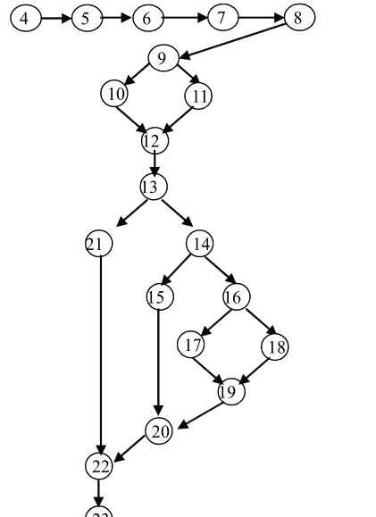

分支覆盖(branch coverage): ?

路径覆盖(path coverage): ?

- 分支覆盖又称为判定覆盖，它要求设计足够的测试用例，使得程序中每个判定至少有一次为真值，有一次为假值，即：程序中的每个分支至少执行一次。
- 路径覆盖,它要求设计足够的测试用例，使得程序中所有可能的执行路径都被执行一次。

branch coverage:
1. abd
2. ace

path coverage:
1. abd，abe
2. acd，ace

##### 进一步考虑：

A>1?、B==0?

A==2?、X>1?

一共有2X2X2X2=16条不同路径！ Predicate test

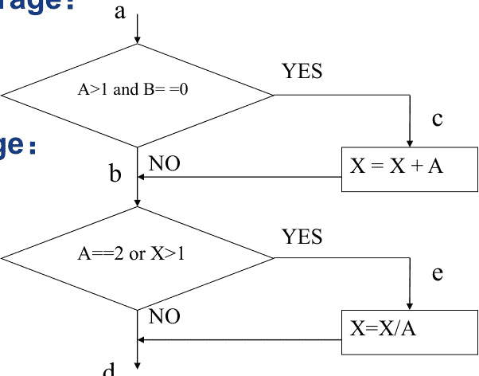

- Figure 8.3 is a graph of a simple program; it is typical of the kind of example detractors use to show the impossibility of completely testing even simple programs.
- If the loop may have up to 18 repetitions, some 5¹⁸ = 4.77 trillion distinct program execution paths exist.

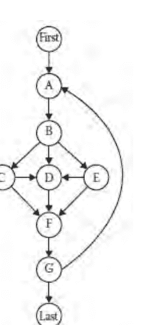

Figure 8.3 Trillions of paths.

##### DD-Path Definition

A DD-path is a sequence of nodes in a program graph such that

- Case 1: It consists of a single node with indeg = 0.
- Case 2: It consists of a single node with outdeg = 0.
- Case 3: It consists of a single node with indeg ≥ 2 or outdeg ≥ 2.
- Case 4: It consists of a single node with indeg = 1 and outdeg = 1.
- Case 5: It is a maximal chain of length ≥ 1.

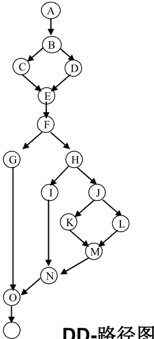

##### DD-路径图

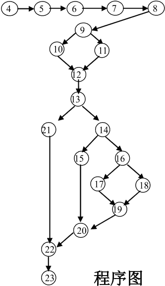

##### 程序图

In practice, it is reasonable to manually create DD-path graphs for programs up to about 100 source lines. Beyond that, most testers look for a tool.

##### 7.1.2 测试覆盖指标

G_node : node coverage

G_edge : edge coverage

##### 7.1.2 测试覆盖指标

| 指标 | 覆盖描述 |
|---|---|
| C₀ | **Every statement**（语句覆盖） |
| C₁ | **Every DD-path**（分支覆盖） |
| C₁p | **Every predicate to each outcome**（条件判断） |
| C₂ | **C1 coverage + loop coverage** |
| Cᵈ | **C1 coverage + every dependent pair of DD-paths** |
| Cₘcc | **Multiple condition coverage** |
| Cᵢk | **Every program path that contains up to k repetitions of a loop (usually k = 2)** |
| Cₛₜₐᵣₜ | **“Statistically significant” fraction of paths** |
| C∞ | **All possible execution paths** |

- DD-路径覆盖：最低要求
- 多条件覆盖：
  组合条件、 MCDC 下一讲介绍。
- 循环覆盖：？
- 全路径覆盖：穷尽覆盖

##### 循环测试

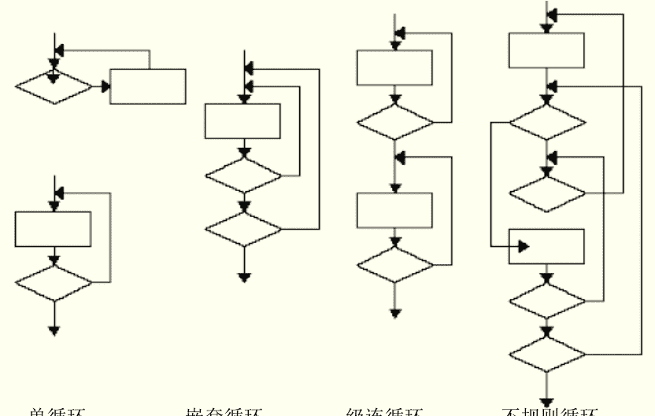

单循环

嵌套循环

级连循环

不规则循环

##### 单循环测试

假设循环次数为N

- a. 直接跳过循环
- b. 循环次数为1
- c. 循环次数为2
- d. 循环次数为M， M<N
- e. 循环次数为N-1， N， N+1

##### 嵌套循环测试

- a. 先测试最内部循环，其它循环次数为1
- b. 测试第二层循环，其它循环次数为1，
- c. 直到最外部循环完成测试

##### 级连循环测试

分别采用单循环测试方法进行测试

##### 不规则循环测试 无法测试——重新设计！

#### 7.1.3 McCabe’s Basis Path Method

##### 基路径的概念与方法

“基”：向量空间的概念，向量空间的基是相互独立的一组向量，基“覆盖”整个向量空间。使得该空间中的任何其它向量都可以用基向量表示。

基路径：程序图中相互独立的一组路径，使得该程序中的所有路径都可以用基路径表示。

Cyclomatic number (圈数) of a strongly connected graph is the number of linearly independent circuits in the graph.

##### McCabe圈数V（G）计算方法：

V（G）=e-n+2p

e： 边数；

n： 节点数

p： 连接区域数

对于右图： V（G）=10-7+2p=5

为避免混乱，不再说明强连接有向图的计算公式
(不满足单入口、单出口条件)。

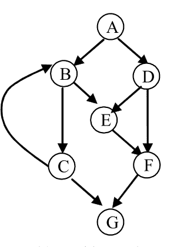

##### 5 independent paths:

- P1: A, B, C, G;
- P2: A, B, C, B, C, G;
- P3: A, B, E, F, G;
- P4: A, D, E, F, G;
- P5: A, D, F, G。

Any path could be a combination of 5 independent paths.

Example : A、B、C、B、E、F、G = P2+P3-P1

其中，加法是一条路径后接一条路径；乘法是路径的重复，而减法则只有数学上去除边的含义，而缺少实际意义。

=A, B, C, B, C, G+ A, B, E, F, G- A, B, C, G ;
AB+BC+CB+BC+CG+AB+BE+EF+FG-AB-BC-CG
= A、B、C、B、E、F、G

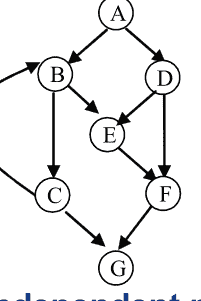


###### 如何寻找McCabe路径？

###### 图的搜索与遍历算法！

- 深度优先算法
- 广度优先算法

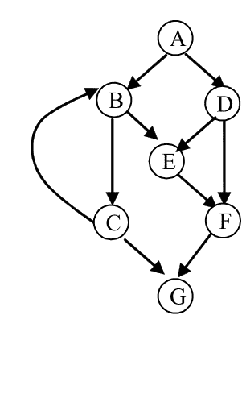

###### Essential Complexity

一般而言，当程序结构良好时，即仅由结构化编程构造组成，它始终可以简化为具有一条路径的图。


#### 7.1.4 Insights from a Venn Diagram

基于路径的测试，从另一个角度去考虑程序测试的完备性，但是没有考虑数据功能，即使满足DD-路径覆盖，和考虑圈复杂度指标，也仅是测试的下限指标。

如左图：

- S：已说明行为的路径集合；
- P：已编程实现的路径集合；
- T：拓扑可达的路径集合；

区域：

- 1：测试的重点，可测；
- 2、6：已实现的，就应该是拓扑可行的，
- 3：已实现和可达的，应该是有用的！
- 4：已描述的，拓扑可达，却没有实现的；要增加，可测；
- 5：没有实现的已说明路径，不可测，
- 7：未说明，未实现，拓扑可达，测试无意义！


可行的和在拓扑结构上可能的路径

### 7.2 Data Flow Testing

数据流测试是指关注变量接收值的位置以及这些值被使用的位置的结构化测试形式。

#### 7.2.1 Define/Use Testing

1. 程序图 G(P) 如第 4 章所述构造，以语句片段作为节点，以表示节点序列的边。

2. 节点 n ∈ G(P) 是变量 v ∈ V 的定义节点，记为 DEF(v, n)，当且仅当变量 v 的值由对应于节点 n 的语句片段定义。

3. 节点 n ∈ G(P) 是变量 v ∈ V 的使用节点，记为 USE(v, n)，当且仅当变量 v 的值在对应于节点 n 的语句片段中被使用。

4. 使用节点 USE(v, n) 是谓词使用，记为 P-use，当且仅当语句 n 是谓词语句；否则，USE(v, n) 是计算使用，记为 C-use。

5. 关于变量 v 的定义/使用路径，记为 du-path，是 PATHS(P) 中的一条路径，使得对于某个 v ∈ V，存在定义节点和用法节点 DEF(v, m) 和 USE(v, n)，使得 m 和 n 是该路径的初始节点和最终节点。

6. 关于变量 v 的定义清晰路径，记为 dc-path，是 PATHS(P) 中的一条定义/使用路径，其初始节点和最终节点为 DEF(v, m) 和 USE(v, n)，使得路径中没有其他节点是 v 的定义节点。

#### Example: the commission problem

（P162 Figure 9.1，8分钟阅读）

```
7.  lockPrice=45.0
8.  stockPrice=30.0
9.  barrelPrice=25.0
10. totalLocks=0
11. totalStocks=0
12. totalBarrels=0

13. Input(locks)
14. While NOT(locks==-1)
15. Input(stocks,barrels)
16. totalLocks=totalLocks+locks
17. totalStocks=totalStocks+stocks
18. totalBarrels=totalBarrels+barrels
19. Input(locks)
20. ENDWhile
```

p5=<16,17,18,19,20,21>
p6=<16,17,18,19,20,21,22,23,24>

两者都存在循环迭代问题，因此两者都不是定义清晰的。

其他变量的分析由学生自行阅读。

#### Define/Use Test Coverage Metrics

- All-Defs criterion: 对于程序 P，当且仅当对于每个变量 v ∈ V，T 包含从 v 的每个定义节点到 v 的使用的定义清晰路径。

- All-Uses criterion: 对于程序 P，当且仅当对于每个变量 v ∈ V，T 包含从 v 的某个定义节点到 v 的每个使用的定义清晰路径，以及到每个 USE(v, n) 的后继节点。

- All-P-Uses/Some C-Uses criterion: 对于程序 P，当且仅当对于每个变量 v ∈ V，T 包含从 v 的每个定义节点到 v 的每个谓词使用的定义清晰路径；并且如果 v 的一个定义没有 P-use，则定义清晰路径通向至少一个计算使用。

- All-C-Uses/Some P-Uses criterion: 对于程序 P，当且仅当对于每个变量 v ∈ V，T 包含从 v 的每个定义节点到 v 的每个计算使用的定义清晰路径；并且如果 v 的一个定义没有 C-use，则定义清晰路径通向至少一个谓词使用。

##### Example

- ⊙ Variable locks have 2 use nodes (14, 16) and 2 defining nodes (13, 19), then:

  ```
  S1: S(locks,13) = {13}
  S2: S(locks,14) = {13,14,19,20}
  S3: S(locks,16) = {13,14,16,19,20}
  S4: S(locks,19) = {19}
  ```

- ⊙ stocks and barrels variables are to be influenced by the loop variable locks, so

  ```
  S5: S(stocks,15) = {15}?
  S5: S(stocks,15) = {13,14,15,19,20}
  S6: S(stocks,17) = {13,14,15,17,19,20}
  S7: S(barrels,15) = {13,14,15,19,20}
  S8: S(barrels,18) = {13,14,15,18,19,20}
  ```


totalLocks：节点 10 是定义节点，节点 16 既是定义节点又是使用节点，同时还会受到循环变量 locks 的影响。节点 21 和 24 是输出节点和计算节点。因此：

S9：S（totalLocks,10）={10}  
S10：S（totalLocks,16）={10,13,14,16,19,20}  
S11：S（totalLocks,21）=S（totalLocks,24）=S10

变量 totalStocks 和 totalBarrels 的情况与 totalLocks 类似。

+   - lockPrice、stockPrice、barrelPrice 各有 1 个定义节点和 1 个使用节点，不存在循环，因此不再赘述。
+   - 变量 sales 有 1 个定义节点 27，以及 28、29、33、34、37、38 共 6 个使用节点，但它会受到除 commission 之外所有变量的影响。因此，变量 sales 在其所有使用节点上具有相同的切片。

S₂₄~₃₀：
={7,8,9,10,11,12,13,14,15,16,17,18,19,20,24,25,26,27}

变量 commission 有 6 个定义节点和 4 个使用节点。因此：

S₃₁：S（commission,31）={31}  
S₃₂：S（commission,32）={31,32}  
S₃₃：由于包含变量 sales，因此：

S（commission,33）={7~33}

S₃₄：S（commission,36）={36}  
S₃₅：S（commission,37）={7~37}  
S₃₆：S（commission,38）={7~38}  
S₃₇：S（commission,41）={7~41}

将切片表示为片段编号的集合符合我们的定义，但了解切片如何由之前切片的集合构成也很有帮助。


**图 9.9 commission 上的完整格。**

不同变量程序片的补集，为变量的分段划分提供了方法。  
例如：S（commission，41）-S（sales，28）  
={29~41}；  
将 commission 的计算分为 sales 计算和之后的计算，为错误定位提供了依据。

#### 7.3.1 遍历摆锤

## 三角形程序

共有 88 条拓扑上可能的路径，但其中只有 11 条是可行的。

P1:1-2-3-4-5-6-7-13-16-18-20

P2：

P3：

P4：

................................

................................

P10:1-3-5-7-8-9-10-12

P11:1-3-5-7-8-9-10-11


## 假设我们使用边界值测试来定义测试用例，需要多少个测试用例？下面是一些示例。

表 10.2 名义边界值的路径覆盖

| 测试用例 | a | b | c | 预期输出 | 路径 |
|---|---|---|---|---|---|
| 1 | 100 | 100 | 1 | 等腰三角形 | P6 |
| 2 | 100 | 100 | 2 | 等腰三角形 | P6 |
| 3 | 100 | 100 | 100 | 等边三角形 | P1 |
| 4 | 100 | 100 | 199 | 等腰三角形 | P6 |
| 5 | 100 | 100 | 200 | 非三角形 | P7 |
| ... | ... | ... | ... | ... | ... |

## 判定表三角形程序

| C1 匹配数 = | 0 |  |  |  | 1 |  |  |  | 2 |  |  |  |
|---|---|---|---|---|---|---|---|---|---|---|---|---|
| c2. a + b < c？ | T | F | F | F | T | F | F | F | T | F | F | F |
| c3. a + c < b？ | F | T | F | F | F | T | F | F | F | T | F | F |
| c4. b + c < a？ | F | F | T | F | F | F | T | F | F | F | T | F |
| a2. 不是三角形 | X | X | X |  | X |  |  |  |  | X |  |  |
| a1. 不等边三角形 |  |  |  | X |  |  |  |  |  |  |  | X |
| a3.等腰三角形 |  |  |  |  |  |  |  | X |  |  |  |  |
| a4. 等边三角形 |  |  |  |  |  |  |  |  |  |  |  |  |
| a5. 不可能情况 |  |  |  |  | X | X |  | X |  | X |  |  |

## 表 10.5 三角形程序的度量指标

| 方法 | m | n | s | C(M,S)=n/s | R(M,S)=m/s | NR(M,S)=m/n |
|---|---|---|---|---|---|---|
| 名义值 | 13 | 7 | 11 | 0.64 | 1.18 | 1.86 |
| 最坏情况 | 125 | 11 | 11 | 1.0 | 11.36 | 11.36 |
| 目标 | s | s | s | 1.0 | 1.0 | 1.0 |

## 表 10.6 佣金问题的度量指标

| 方法 | m | n | s | C(M,S)=n/s | R(M,S)=m/s |
|---|---|---|---|---|---|
| 边界值 | 25 | 11 | 11 | 1 | 2.27 |
| 判定表 | 3 | 11 | 11 | 1 | 0.27 |
| DD 路径 | 25 | 11 | 11 | 1 | 2.27 |
| du 路径 | 25 | 33 | 33 | 1 | 0.76 |
| 切片 | 25 | 40 | 40 | 1 | 0.63 |

## 保险费案例研究

（自行学习）

#### 问题

-   除了结构化的覆盖率指标外，还有其他覆盖率指标吗？

例如：通讯录  
内容：姓、名、职位、单位、地址、办公电话、家庭电话、传真、手机、电子邮箱、照片等；  
功能：新建、查询、修改、删除、导出、导入（可选）等；  
二级功能  
查询：按某一属性查询、列表；  
导出：输出为文本文件；  
导入：从文本文件导入；

