# sjtu_se222_算法原理


## Course Overview

- Why study Algorithms
- Outline of the course
- Course Policies

## What is Algorithm?

The word ‘algorithm’ is derived from the name of


http://en.wikipedia.org/wiki/File:Abu_Abdullah_Muhammad_ibn_Musa_al-Khwarizmi_edit.png

Muḥammad ibn Mūsā al-Khwārizmī (780?-850?)

a Muslim mathematician whose works introduced Arabic numerals and algebraic concepts to Western mathematics.

> (American Heritage Dictionary)

## Why study Algorithms?

- 1. Their impact is broad and far-reaching.

Internet, Biology, Computers, Computer graphics, Security, Multimedia, Physics ......


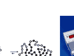


> "Computer Science is the study of algorithms."
> 
> -- Donald E. Knuth

2. to become a proficient programmer


> “Algorithms + Data Structures = Programs.”
> -- Niklaus Wirth

> “Bad programmers worry about the code. Good programmers worry about data structures and their relationships.”
> -- Linus Torvalds


3. For intellectual stimulation, be a wise person

> “有人天生喜欢“遍历”，踏遍千山万水，遍享万种风情……
> 有人一生“贪婪”，眼界不宽，及时行乐；
> 有人注定适用“穷搜”，辛辛苦苦勤勤恳恳一辈子，付出很多，收获有限；
> 有人善用“时空权衡”，用最少的时间办最多的事情，的确精明；
> 有人会“分治”，再多的难题也能迎刃而解；
> 有人常“回溯”，错的太多，后悔太多；
> 有的人压根没有算法，于是盲目生活，盲目做事，最后所获无几；……”

4. For profit

- 1. Their impact is broad and far-reaching.
- 2. to become a proficient programmer.
- 3. For intellectual stimulation, be a wise person
- 4. For profit
- 5. Old roots, new opportunities.
- 6. To solve problems that could not otherwise be addressed.
- 7. They may unlock the secrets of life and of the universe.
- ......

Why study anything else?


(Source from "Algorithms" by R. Sedgewick and K. Wayne)

## Where are we?

- Why study Algorithms
- **Outline of the course**
- Course Policies

## References

- 1. Algorithms: Design Techniques and Analysis, M.H. Alsuwayel
- 2. Introduction to Algorithms, T. H. Cormen, C. E. Leiserson, R. L. Rivest, C. Stein
- 3. Algorithms, S, Dasgupta, C. Papadimitriou, U. Vazirani
- 4. Algorithms, 4th edition, R. Sedgewick, K. Wayne


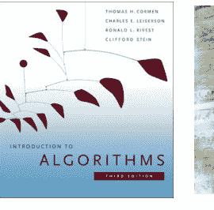

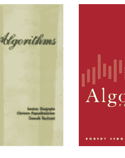


## Course Overview

| Weeks | Lectures | Topics | Readings | Dates |
|---|---|---|---|---|
| #1 | Lecture 1 slides1, slides2 | Introduction | [0] ch 4.3, [1] ch 5.1.4, [2] ch 21, [3] ch 1.5 | Sep. 15 (Tuesday) |
|  | Lecture 2 | Fundamentals | [0] ch 1.8-1.14, [1] ch 0, [2] ch 3, [3] ch 1.4 | Sep. 17 (Thursday) |
| #2 | Lecture 3 | Induction&Sort(I) | [0] ch 5, [1] ch 1 | Sep. 22 (Tuesday) |
| #3 | Lecture 4 | Sorting(II) | [0] ch 1.5, 1.7, 5.2, 5.3, 6.3, 6.6 [1] ch 2.3, 2.4, [2] ch 6, 7, 8, [3] ch 2 | Sep. 29 (Tuesday) |
|  |  | Holiday |  | Oct. 1 (Thursday) |
| #4 | Lecture 5 | Sort(III) | [0] ch 1.5, 1.7, 5.2, 5.3, 6.3, 6.6 [1] ch 2.3, 2.4, [2] ch 6, 7, 8, [3] ch 2 | Oct. 6 (Tuesday) |
| #5 | Lecture 6 | Divide-and-conquer | [0] ch 2, 6, [1] ch 4, [2] ch 9, [3] ch 2.2 | Oct. 13 (Tuesday) |
|  | Lecture 7 | Graph Traversal, part 1 | [0] 9 [1] 3 [2] 22 [3] 4 | Oct. 15 (Thursday) |
| #6 | Lecture 7 | Graph Traversal, part 2 | [0] 9 [1] 3 [2] 22 [3] 4 | Oct. 20 (Tuesday) |
| #7 | Lecture 8 | Shortest paths | [0] ch 4.2, 8.2, [1] ch 4, [2] ch 24, [3] ch 4 | Oct. 27 (Tuesday) |
|  |  |  |  | Oct. 29 (Thursday) |
| #8 | Lecture 9 | Greedy approach | [0] ch 8, [1] ch 5, [2] ch 16 | Nov. 3 (Tuesday) |
| #9 | Lecture 10 | Dynamic programming | [0] ch 7, [1] ch 6, [2] ch 15 | Nov. 10 (Tuesday) |
|  |  |  |  | Nov. 12 (Thursday) |
| #10 | Lecture 11 | Network flow | [0] ch 16,17, [1] ch 6, [2] ch 26 | Nov. 18 (Tuesday) |
| #11 | Lecture 12 | P and NP | [0] ch 10, [1] ch 8, [2] ch 34 | Nov. 24 (Tuesday) |
|  |  |  |  | Nov. 26 (Thursday) |
| #12 | Lecture 13 | Lower bounds | [0] ch 12, [2] ch 8.1 | Dec. 1 (Tuesday) |
| #13 | Lecture 14 | String |  | Dec. 8 (Tuesday) |
|  | Lecture 15 | Data compression |  | Dec. 10 (Thursday) |
| #14 | Lecture 16 | Randomized algorithms | [0] ch 14, [1] ch 5 | Dec. 15 (Tuesday) |
| #15 | Lecture 17 | Approximation algorithms | [0] ch 15, [1]ch 9.2, [2] ch 35 | Dec. 22 (Tuesday) |
|  | Lecture 18 | Computational geometry | [0] ch 18, [2] ch 33 | Dec. 24 (Thursday) |
| #16 | Wrap up | Review |  | Dec. 29 (Tuesday) |


## 课程目标

- 能够熟练应用基础的*算法设计技巧*
- 熟悉*算法分析*中使用的主要理论工具
- 学习并分析许多“标准”*算法问题*的不同算法
- 向学生介绍算法研究中一些*重要子领域*，他们或许希望在这些领域继续深造

## 我们讲到哪里了？

- 为什么学习算法
- 课程大纲
- 课程政策

## 评分政策

- 作业 25%
  - 每次课后在课程网站上发布
  - 每周二提交
- 编程作业 15%
  - LeetCode (http://leetcode.com)
- 期末考试 60%

## 助教

- 助教
  - Bingbing Fang（方冰冰）, fke_htj@sjtu.edu.cn
  - Wenbo Zhang（张文博）, wbzhang@sjtu.edu.cn
- 课程主页：
  http://basics.sjtu.edu.cn/~xiao juan/algo15/

## 关于 LeetCode 的更多说明

- 提交：


- 每周六晚上 23:59 截止

- 将随机选择一名学生，在周二报告其解法（5 分钟）。

## 教学技巧

- 一分钟反馈


## 来自学长学姐的寄语

- 算法是用来娱乐身心、课余刷题、公司面试、学会使用编程思想来看待各种问题的课程
- 用心学算法，很有意思的，这是程序员的内力修为，别太在意考试面试
- 坚持到期末
- 算法无论从哪个次元来看都是程序员的基础。
- 好好听课，不然会对自己失去信心。
- 这是我在软院上过最有意思最有收获的一门课。
- 算法很重要，但更重要的是思想。或许将来我们不会用到今天学习的算法，但是某个算法的思想会帮我们解决很多实际问题。
- 大神们请低调，给学渣们活路啊！
- 冬天还是从被窝里爬起来吧，对找工作还是很重要滴
- ...

## 尽情享受！

## 第一讲：引言

- 问题：动态连通性
- 解决方案：正确性、复杂度、改进
- 应用

## 问题

问题：动态连通性（DynamicConnectivity）
输入：n 个节点，m 次操作（union 或 connected 查询）
输出：所有 connected 查询的答案

```
union(4, 3)
union(3, 8)
union(6, 5)
union(9, 4)
union(2, 1)
connected(0, 7)  X
connected(8, 9)  ✓
union(5, 0)
union(7, 2)
union(6, 1)
connected(0, 7)  ✓
union(1, 0)
```

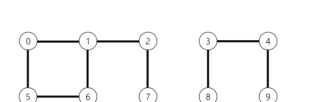

## 更复杂的例子

问：Connected(p, q)

答：是。

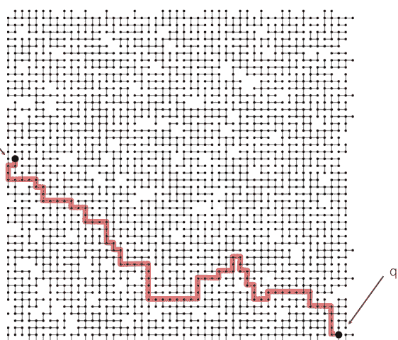

## 我们讲到哪里了？

- 问题：动态连通性
- 解决方案：正确性、复杂度、改进
- 应用

## 你的想法

## 问题建模

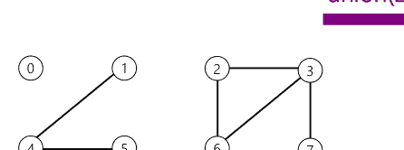

union(2, 5)

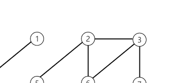

{ 0 } { 1 4 5 } { 2 3 6 7 }

3 个连通分量

{ 0 } { 1 2 3 4 5 6 7 }

2 个连通分量

Connected(2, 5)：2 和 5 在同一个连通分量中吗？

## 解法一：快速查找（Quick find）

id[]
0 1 2 3 4 5 6 7 8 9
0 1 1 8 8 0 0 1 8 8

0、5 和 6 是连通的

1、2 和 7 是连通的

3、4、8 和 9 是连通的

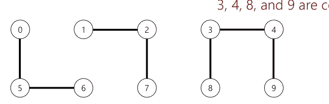

Find(p,q)：检查 p 和 q 是否有相同的 id。

Union(p,q)：合并包含 p 和 q 的分量时，将所有 id 等于 id[p] 的项改为 id[q]。

## 随堂测验

假设有 N 个节点，最坏情况下，

- *quick-find* 的 *union* 需要 () 次数组访问。
- *quick-find* 的 *find* 需要 () 次数组访问。

A. N    B. 1    C. N²    D. logN

## 解法二：快速合并（Quick union）

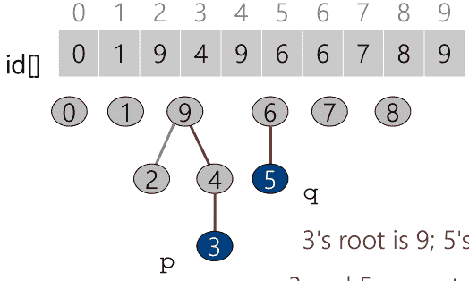

3 的根是 9；5 的根是 6

3 和 5 不连通

**Find(p,q).** 检查 p 和 q 是否有相同的根。

**Union(p,q).** 合并包含 p 和 q 的分量时，将 p 的根的 id 设为 q 的根的 id。

## 随堂测验

假设有 N 个节点，最坏情况下，

- *quick-union* 的 *union* 需要 () 次数组访问。
- *quick-union* 的 *find* 需要 () 次数组访问。

A. N    B. 1    C. N²    D. logN

## 复杂度

| 算法 | 初始化 | 合并 | 查找 |
| quick-find | N | N | 1 |
| quick-union | N | N | N |

我们还能做得更好吗？


## S3: 加权合并

Find(p, q)。检查 p 和 q 是否具有相同的根。

```
Union(p, q):
    if size[root(p)] <= size[root(q)]
        then id[root(p)] = id[root(q)]
    else id[root(q)] = id[root(p)]
```

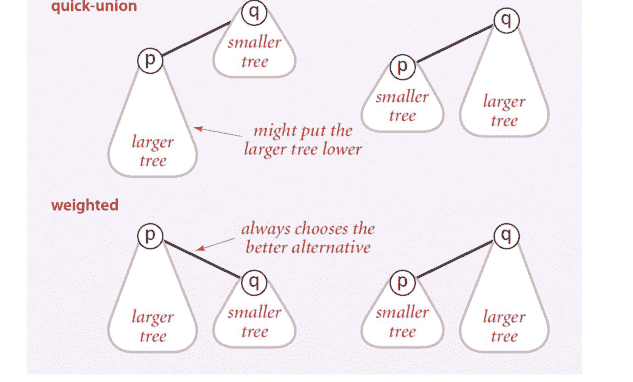

快速合并和加权快速合并（100 个站点，88 次 union() 操作）

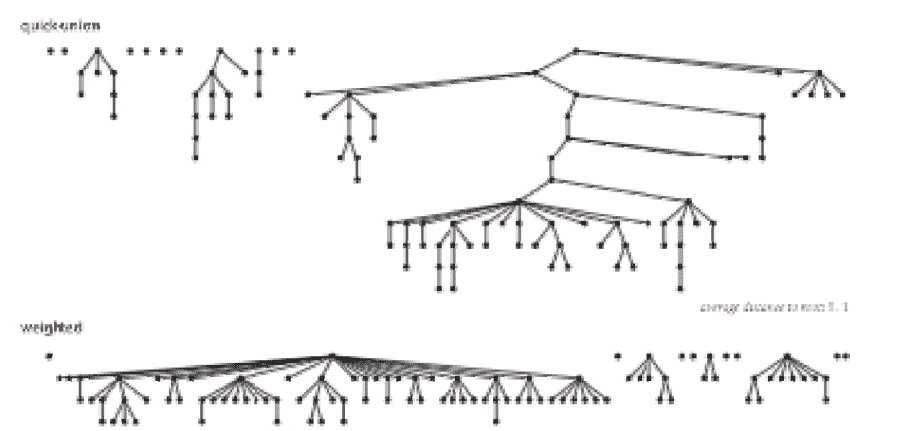

## 测验

假设有 N 个站点，则在最坏情况下，

- *weighted-QU* 需要 ( ) 次数组访问用于 *union*。
- *weighted-QU* 需要 ( ) 次数组访问用于 *find*。

A. N    B. 1    C. N²    D. log N

## 复杂度

命题。任意节点 x 的深度至多为 log N。

| algorithm | initialize | union | connected |
|---|---|---|---|
| quick-find | N | N | 1 |
| quick-union | N | N | N |
| weighted QU | N | log N | log N |

## S4: 路径压缩

带路径压缩的快速合并。计算 p 的根之后，将路径上每个节点的 id 设置为指向该根。

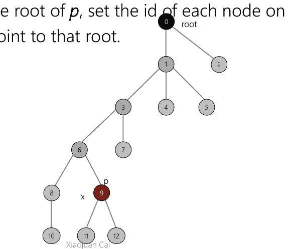

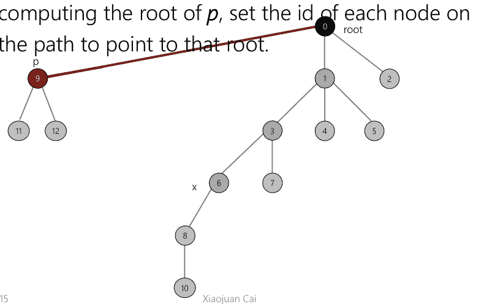

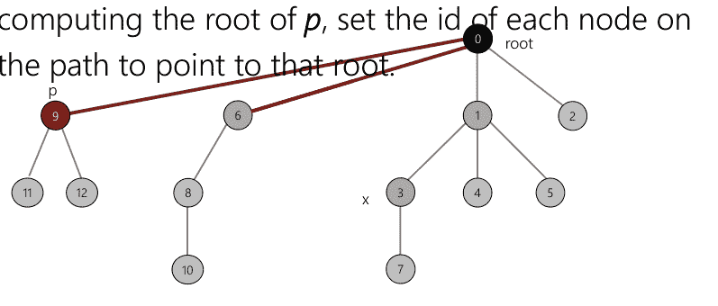

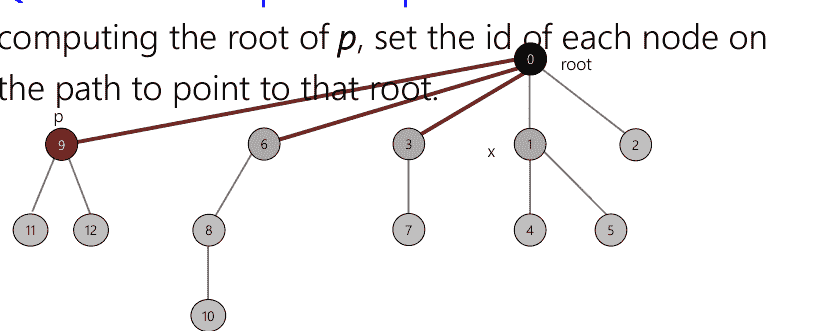

## 复杂度

命题。从空的数据结构开始，对 N 个对象进行的任意 M 次并查集操作最多按比例进行 N + M log* N 次数组访问。


Bob Tarjan (Turing Award '86)

| N | log* N |
|---:|---:|
| 1 | 0 |
| 2 | 1 |
| 4 | 2 |
| 16 | 3 |
| 65536 | 4 |
| 2^65536 | 5 |

证明参见 [textbook] 4.3 和 [DPV] 5.1.4。

我们能做得更好吗？

惊人的事实。不存在线性时间算法。

## 我们在哪里？

- Problem: Dynamic Connectivity
- Solutions:
  - correctness, complexity, improvements
- Applications

## 应用

- Percolation. [Coursera. AlgoPartI. PA1]
- Dynamic connectivity.
- Hindley-Milner polymorphic type inference.
- Kruskal's minimum spanning tree algorithm.
- Compiling equivalence statements in Fortran.
- ......

## 渗流

## 结论

- Model a problem
- Solve it, then ask three questions:
  - Is it correct?
  - How much time does it take?
  - Can we do better?
- Applications

## Lecture 2 Analysis of Algorithms

- How to estimate time complexity?
- Analysis of algorithms
- Techniques based on Recursions

## ROADMAP

- How to estimate time complexity?
- Analysis of algorithms
  - worst case, best case?
  - Big-O notation

## 观察

Problem: 3-Sum
Input: N distinct integers
Output: the number of triples sum to exactly zero?

30 -40 -20 -10 40 0 10 5

| a[i] | a[j] | a[k] | sum |
|---|---|---|---|
| 30 | -40 | 10 | 0 |
| 30 | -20 | -10 | 0 |
| -40 | 40 | 0 | 0 |
| -10 | 0 | 10 | 0 |


## 观察

系统相关效应。

- Hardware: CPU, memory, cache, ...
- Software: compiler, interpreter, garbage collector, ...
- System: operating system, network, other applications, ...

容易，但难以获得精确的测量。


## 数学模型

总运行时间 = 所有操作的 cost × frequency 之和。

- Cost 取决于机器、编译器。
- Frequency 取决于算法、输入数据。

```
% 1-sum
int count = 0;
for (int i = 0; i < N; i++)
    if (a[i] == 0)
        count++;
```

## 数学模型

- 相对而非绝对。
- 与机器无关。
- 关于大输入实例
- 算法的 **时间复杂度** 是输入大小 *n* 的函数。

## 输入规模

```
Algorithm 1.9 FIRST
Input: A positive integer n and an array A[1..n] with A[j] = j for 1 ≤ j ≤ n.
Output: ∑_{j=1}^n A[j].
1. sum ← 0;
2. for j ← 1 to n
3.   sum ← sum + A[j]
4. end for
5. return sum
```

```
Algorithm 1.10 SECOND
Input: A positive integer n.
Output: ∑_{j=1}^n j.
1. sum ← 0;
2. for j ← 1 to n
3.   sum ← sum + j
4. end for
5. return sum
```

|  | Algo 1.9 | Algo 1.10 |
|---|---|---|
| input size | n | □log n□ +1 |
| time | n | n |
| relation | Linear | Exponential |

## 输入规模 -- 惯例

- 排序和搜索：数组的大小
- 图：顶点和边的数量
- 计算几何：点或线段的数量
- 矩阵运算：输入矩阵的维度
- 数论和密码学：输入的位数。

## 我们在哪里？

- 如何估计时间复杂度？
- 算法分析
  - 最坏情况，最好情况？
  - Big-O 记号

## 搜索

**问题：搜索**  
**输入：** 整数数组 *A[1...n]*，和整数 *x*  
**输出：** *x* 是否存在于 *A* 中？

45 是否存在于：

9, 8, 9, 6, 2, 56, 12, 5, 4, 30, 67, 93, 25, 44, 96

2, 4, 5, 6, 8, 9, 9, 12, 25, 30, 44, 56, 67, 93, 96

## 线性搜索 v.s. 二分搜索

## 二分搜索

2, 4, 5, 6, 8, 9, 9, 12, 25, 30, 44, 56, 67, 93, 96

mid

low

high

```
Algorithm 1.2 BinarySearch
Input: An array A[1..n] of n elements sorted in nondecreasing order and an element x.
Output: j if x = A[j], 1 ≤ j ≤ n, and 0 otherwise.
1. low ← 1; high ← n; j ← 0
2. while low ≤ high and j = 0
3.   mid ← ⌊(low + high)/2⌋
4.   if x = A[mid] then j ← mid
5.   else if x < A[mid] then high ← mid − 1
6.   else low ← mid + 1
7. end while
8. return j
```

## 测验

|  | Linear Searching | Binary Searching |
|---|---|---|
| Best case |  |  |
| Worst case |  |  |

A. 1    B. logn.    C. n    D. none of above

## 计算复杂度

|  | Linear Searching | Binary Searching |
|---|---|---|
| Worst case | n | log n |

| 10⁻⁶s per instruction | Linear Searching | Binary Searching |
|---|---|---|
| n=1024 | 0.001s | 0.00001s |
| n=2⁴⁰ | 12.7day | 0.00004s |

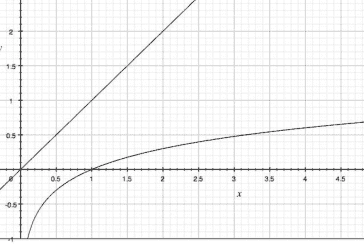

## 我们在哪里？

- 如何估计时间复杂度？
- 算法分析
  - 最坏情况，最好情况？
  - Big-O 记号

## Big-O 记号

Definition (O-notation)
Let f(n) and g(n) : ℕ → ℝ⁺ ∪ {0}
    f(n) is said to be O(g(n)), written f(n) = O(g(n)),
    if ∃ c>0. ∃ n₀. ∀ n ≥ n₀. f(n) ≤ c g(n)

- O-记号提供了运行时间的上界；
- f 的增长速度不快于 g 的某个常数倍。

## Big-Ω 记号

Definition (Ω-notation)
Let f(n) and g(n): ℕ → ℝ⁺ ∪ {0}
f(n) is said to be Ω(g(n)), written f(n) = Ω(g(n)), if ∃ c>0, ∃ n₀. ∀ n ≥ n₀, f(n) ≥ c g(n)

- Ω-记号提供了运行时间的下界；
- f(n) = O(g(n)) 当且仅当 g(n) = Ω(f(n))。

## 示例

- log n^k = Ω(log n).
- log n! = Ω(n log n).
- n! = Ω(2^n).
- Searching: T(n) = Ω(1)

是否存在 f,g，使得 f = O(g) 且 f = Ω(g)？

## Big-Θ 记号

### Definition (Θ-notation)

f(n)=Θ(g(n)), if both f(n)=O(g(n)) and f(n)=Ω(g(n)).

- log n! = Θ(n log n).
- 10n² + 20 n = Θ(n²)

## Small o-记号

### Definition (o-notation)

Let f(n) and g(n) : ℕ → ℝ⁺ ∪ {0}

f(n) is said to be o(g(n)), written f(n) = o(g(n)), if ∀ c. □ n₀. ∀ n ≥ n₀. f(n) < c g(n)

- log n! = o(n log n)?
- 10n² + 20 n = o(n²)?
- n log n = o(n²)?


## 测验

| f(n) | g(n) |
|------|------|
| n^1.01 | n log² n |
| n log n | log(n!) |
| 1+1/2+1/3+...+1/n | log n |
| n 2^n | 3^n |

A. O    B. Ω.    C. Θ    D. 以上都不是

## 对数

log_b xy = log_b x + log_b y

log_b c^y = y log_b c

log_b x = \frac{log_a x}{log_a b}

x^{log_a y} = y^{log_a x}

## 鸽巢原理

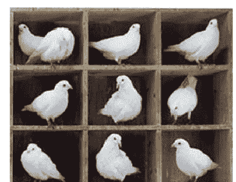

（来源：维基百科）

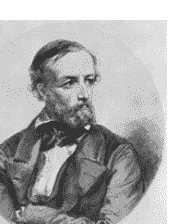

Johann Dirichlet

（来源：维基百科）

证明存在一个由7和0组成的数，能整除13。

## 求和

∑_{j=1}^{n} j = n(n + 1)/2 = Θ(n²)

∑_{j=0}^{n} c^{j} = (c^{n+1} - 1)/(c - 1) = Θ(c^{n})

## 通过积分近似

∫_{m-1}^{n} f(x)dx ≤ ∑_{j=m}^{n} f(j) ≤ ∫_{m}^{n+1} f(x)dx

∫_{m}^{n+1} f(x)dx ≤ ∑_{j=m}^{n} f(j) ≤ ∫_{m-1}^{n} f(x)dx

∑_{j=1}^{n} j^{k} = Θ(n^{k+1})

H_{n} = ∑_{j=1}^{n} 1/j = Θ(ln n) = Θ(log n)

∑_{j=1}^{n} log j = Θ(n log n)

## 根据极限

假设 $\lim_{n\to\infty}\frac{f(n)}{g(n)}$ 存在

$\lim_{n\to\infty}\frac{f(n)}{g(n)} \neq \infty \quad \text{意味着} \quad f(n) = O(g(n))$

$\lim_{n\to\infty}\frac{f(n)}{g(n)} \neq 0 \quad \text{意味着} \quad f(n) = \Omega(g(n))$

$\lim_{n\to\infty}\frac{f(n)}{g(n)} = c \quad \text{意味着} \quad f(n) = \Theta(g(n))$

$\lim_{n\to\infty}\frac{f(n)}{g(n)} = 0 \quad \text{意味着} \quad f(n) = o(g(n))$

$\lim_{n\to\infty}\frac{f(n)}{g(n)} = \infty \quad \text{意味着} \quad f(n) = \omega(g(n))$

## 复杂度类别

### 定义（复杂度类别）

在复杂度函数集合上定义等价关系 R 如下：

f R g 当且仅当 f(n) = Θ(g(n))。

1 ≺ log log n ≺ log n ≺ √n ≺ n^{3/4} ≺ n ≺ n log n ≺ n² ≺ 2ⁿ ≺ n! ≺ 2^{n²}

## 增长阶

| 阶 | 名称 | 示例 | N = 1000 | N = 2000 |
|---|---|---|---|---|
| 1 | 常数 | 两数相加 | 瞬间 | 瞬间 |
| log N | 对数 | 二分查找 | 瞬间 | 瞬间 |
| N | 线性 | 查找最大值 | 瞬间 | 瞬间 |
| N log N | 线性对数 | 归并排序 | 瞬间 | 瞬间 |
| N² | 二次 | 2-sum | ~1秒 | ~2秒 |
| 2^N | 指数 | 汉诺塔 | 永远 | 永远 |

假设计算机每条指令耗时 10⁻⁶秒

## 增长阶

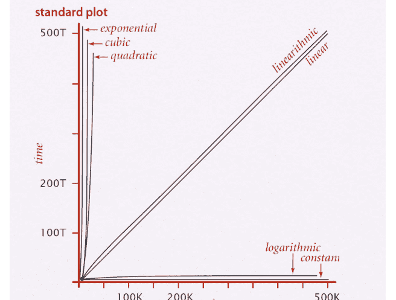

## 测验

```
Algorithm 1.7 Count1
Input: n = 2^k, for some positive integer k.
Output: count = number of times Step 4 is executed.
1. count ← 0;
2. while n ≥ 1
3.   for j ← 1 to n
4.     count ← count + 1
5.   end for
6.   n ← n/2
7. end while
8. return count
```

- A. Θ(n²)
- B. Θ(n).
- C. Θ(nlogn)
- D. 以上都不是

## 测验

算法 1.7 Count1

输入：$n = 2^k$，其中 $k$ 是某个正整数。

输出：$count$ = 第4步被执行的次数。

- 1. $count \leftarrow 0$;
- 2. **while** $n \ge 1$
- 3. **for** $j \leftarrow 1$ **to** $n$
- 4. $count \leftarrow count + 1$
- 5. **end for**
- 6. $n \leftarrow n/2$
- 7. **end while**
- 8. **return** $count$

```
$n + \frac{n}{2} + \frac{n}{2^2} + \cdots + \frac{n}{2^j} + \cdots + \frac{n}{2^{\log n}} = 2n - 1 = \theta(n)$
```

## 测验

算法 1.8 Count2

输入：一个正整数 n。

输出：count = 第5步被执行的次数。

- 1. count ← 0;
- 2. for i ← 1 to n
- 3. m ← ⌊n/i⌋
- 4. for j ← 1 to m
- 5. count ← count + 1
- 6. end for
- 7. end for
- 8. return count

A. Θ(n²)    B. Θ(n).    C. Θ(nlogn)    D. 以上都不是

## 测验

### 算法 1.8 Count2

输入：一个正整数 n。

输出：count = 第5步被执行的次数。

- 1. count ← 0;
- 2. for i ← 1 to n
- 3. m ← ⌊n/i⌋
- 4. for j ← 1 to m
- 5. count ← count + 1
- 6. end for
- 7. end for
- 8. return count

A. Θ(n²)    B. Θ(n).


## 测验

```
Algorithm 1.9 Count3
Input: n = 2^{2^k}, k is a positive integer.
Output: count = number of times Step 6 is executed.

1. count ← 0;
2. for i ← 1 to n
3.     j ← 2;
4.     while j ≤ n
5.         j ← j²;
6.         count ← count + 1
7.     end while
8. end for
9. return count
```

- A. Θ(n²)
- B. Θ(n).
- C. Θ(n log n)
- D. 以上都不是


## 测验

```
**算法1.9** Count3  
**输入：** $n = 2^{2^k}$，$k$ 是一个正整数。  
**输出：** $count$ = 步骤6被执行的次数。  

1. $count \leftarrow 0;$
2. **for** $i \leftarrow 1$ **to** $n$
3.     $j \leftarrow 2;$
4.     **while** $j \leq n$
5.         $j \leftarrow j^2;$
6.         $count \leftarrow count + 1$
7.     **end while**
8. **end for**
9. **return** $count$
```

- A. $\Theta(n^2)$  
- B. $\Theta(n)$.  
- C. $\Theta(n\log n)$  
- D. *以上都不是*


## 摊还分析

```
1. for j ← 1 to n
2.   x ← A[j]
3.   Append x to the list
4.   if x is even then
5.     while pred(x) is odd do delete pred(x)
6.   end if
7. end for
```

`append` 的总次数为 *n*。
`delete` 的总次数在 *0* 到 *n-1* 之间。
因此时间复杂度为 *O(n)*。

## 内存

- 时间：时间复杂度
  - 越快越好。
- 内存：空间复杂度
  - 越少越好。
- 空间复杂度 ≤ 时间复杂度

## 结论

- 如何估算时间复杂度？
- 算法分析
  - 最坏情况、最好情况？
  - 大O记号

## 3-Sum，更好的解法

问题：3-Sum
输入：N个不同的整数
输出：有多少个三元组之和正好为零？

30 -40 -20 -10 40 0 10 5

| a[i] | a[j] | a[k] | sum |
|---|---|---|---|
| 30 | -40 | 10 | 0 |
| 30 | -20 | -10 | 0 |
| -40 | 40 | 0 | 0 |
| -10 | 0 | 10 | 0 |

- O(N²)

## 第3讲 归纳与排序（1）

- 算法设计技术：归纳
- 选择排序、插入排序、希尔排序……

## 路线图

- 算法设计技术：归纳
  - 排列
  - 多数元素
  - 基数排序
- 选择排序、插入排序、希尔排序……
  - 证明与比较

## 基于递归的技术

- 归纳或尾递归
  - 迭代，
  - 证明：用归纳法证明不变量
- 非重叠子问题
  - 分治法
- 重叠子问题
  - 动态规划

## 归纳示例

选择排序

问题规模：6      9, 8, 9, 6, 2, 56

问题规模：5      2, 8, 9, 6, 9, 56

算法设计：问题规模 n --> n-1

正确性证明：使用数学归纳法。

## 排列

问题：排列

输入：n个元素的数组
输出：n个元素的所有排列

- 1 2 3
- 1 3 2
- 2 1 3
- 2 3 1
- 3 1 2
- 3 2 1

## 排列1

## 排列2

## 排列

排列1：

a₁ a₂ a₃ a₄

1 2 3
1 3 2
2 1 3
2 3 1
3 1 2
3 2 1

排列2：

a₁ a₂ a₃ a₄

## 排列 1

算法5.7 排列1

输入：一个正整数 n。

输出：数字 1,2,...,n 的所有排列。

- 1. for j ← 1 to n
- 2. P[j] ← j
- 3. end for
- 4. perm1(1)

过程 perm1(m)

- 1. if m = n then output P[1..n]
- 2. else
- 3. for j ← m to n
- 4. interchange P[j] and P[m]
- 5. perm1(m + 1)
- 6. interchange P[j] and P[m]
- 7. comment: 此时 P[m..n] = m, m + 1, ..., n。
- 8. end for
- 9. end if

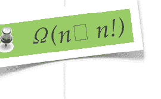

## 排列 2

算法5.8 排列2

输入：一个正整数 n。

输出：数字 1, 2, …, n 的所有排列。

- 1. for j ← 1 to n
- 2. P[j] ← 0
- 3. end for
- 4. perm2(n)

## 过程 perm2(m)

- 1. if m = 0 then output P[1..n]
- 2. else
- 3. for j ← 1 to n
- 4. if P[j] = 0 then
- 5. P[j] ← m
- 6. perm2(m − 1)
- 7. P[j] ← 0
- 8. end if
- 8. end for
- 9. end if

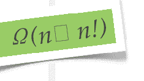

## 测验

哪个输出是按字母顺序排列的？

- A. 排列1
- B. 排列2
- C. 两者都是
- D. *以上都不是*

## 多项式

p(x) = ∑_{i=0}^{n} a_i x^i = a_0 + a_1 x + a_2 x^2 + a_3 x^3 + ⋯ + a_n x^n

问题：多项式求值
输入：a[0...n] 和 x
输出：p(x) 的值


威廉·乔治·霍纳
（来源：维基百科）

## 霍纳法则

p(x) = a_0 + x(a_1 + x(a_2 + ⋯ + x(a_{n-1} + a_n x)⋯))


## Horner 法则

```
**Algorithm 5.6** Horner

**Input:** A sequence of \(n+2\) real numbers \(a_0, a_1, \ldots, a_n\) and \(x\).

**Output:** \(P_n(x)=a_nx^n+a_{n-1}x^{n-1}+\cdots+a_1x+a_0\).

1. \(p \leftarrow a_n\)
2. **for** \(j \leftarrow 1\) **to** \(n\)
3. \(\quad p \leftarrow xp+a_{n-j}\)
4. **end for**
5. **return** \(p\)
```

## 寻找多数元素

Problem: MajorityElement
Input: a sequence of integers A[1...n]
Output: An integer a in A that appears more than n/2 times, otherwise, output none.

1 2 3 3 4 2 2 2 3 2      none

1 5 1 1 4 2 1 3 1 1      1

### Observation

If two different elements in the original sequence are removed, then the majority in the original sequence remains the majority in the new sequence.

## 寻找多数元素

### Algorithm 5.9 Majority

Input: An array A[1..n] of n elements.

Output: The majority element if it exists; otherwise none.

+   1. c ← candidate(1)
+   2. count ← 0
+   3. for j ← 1 to n
+   4. if A[j] = c then count ← count + 1
+   5. end for
+   6. if count > ⌊n/2⌋ then return c
+   7. else return none

### Procedure candidate(m)

+   1. j ← m; c ← A[m]; count ← 1
+   2. while j < n and count > 0
+   3. j ← j + 1
+   4. if A[j] = c then count ← count + 1
+   5. else count ← count − 1
+   6. end while
+   7. if j = n then return c
+   8. else return candidate(j + 1)

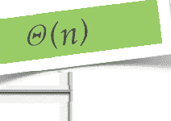

## 正确性证明

Lemma (Invariants)
Given a[1..N], Candidates(i) returns the majority element of a[i...N] if there exists a majority element.

Proof. (Inductive proof)

Base step. Lemma holds for i = N

Inductive step.

Induction Hypothesis. Assume for j > i, the lemma holds.

Prove it holds for i.

## 基数排序

All numbers in the array consists of EXACTLY k digits.

7467
1247
3275
6792
9187
9134
4675
1239

6792
9134
3275
4675
7467
1247
9187
1239

9134
1239
1247
7467
3275
4675
9187
6792

9134
9187
1239
1247
3275
7467
4675
6792

1239
1247
3275
4675
6792
7467
9134
9187


## 正确性证明

Lemma (Invariants)
In Radix sort, if the i-th digits are sorted, then the numbers consisting of i, i-1, ...,1 digits are sorted..

Proof. (Inductive proof)
Base step. Lemma holds for i = 1
Inductive step.
Induction Hypothesis. Assume for j < i, the lemma holds.
Prove it holds for i.

## 我们在哪里？

+   - Algorithm design techniques: induction
+     - Permutation
+     - Majority element
+     - Radix sort
+   - Selection sort, Insertion sort, Shell sort ...
+     - Proofs and comparisons


?


## 选择排序

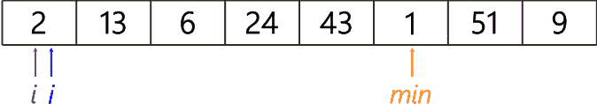

|  | Best case | Worst case |
|---|---|---|
| #Comparision: | $\frac{n(n-1)}{2}$ | $\frac{n(n-1)}{2}$ |
| #Interchange: | 0 | $n-1$ |

## 选择排序

### Lemma (Invariants)

+   - Entries the left of ↑ (including ↑) fixed and in ascending order.
+   - No entry to right of ↑ is smaller than any entry to the left of ↑.

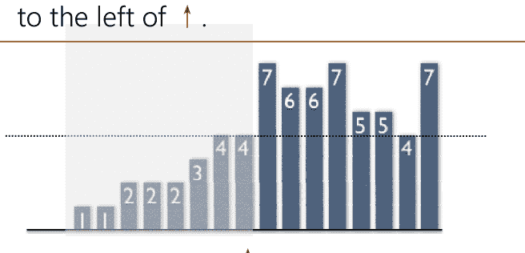

in final order

## 插入排序

| 2 | 13 | 6 | 24 | 43 | 1 | 51 | 9 |

|  | Best case | Worst case |
|---|---|---|
| #Comparison: | n - 1 | n(n - 1)/2 |
| #Move: | 0 | (n + 2)(n - 1)/2 |

## 插入排序

### Lemma (Invariants)

+   - Entries to the left of ↑ (including ↑) are in ascending order.
+   - Entries to the right of ↑ have not yet been seen.

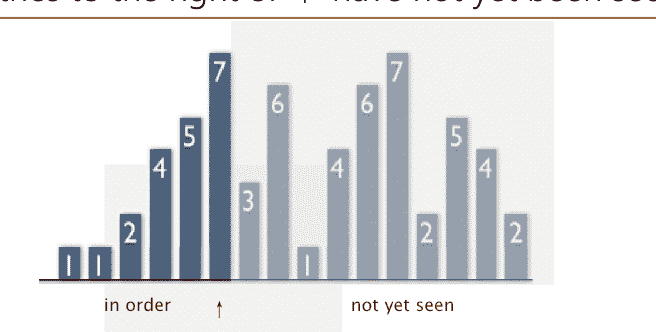

## Shell 排序 (3-1)

| 2 | 13 | 6 | 24 | 43 | 1 | 51 | 9 | 10 |

Correctness: The last round of shell sort is insertion sort.

## 比较

http://www.sorting-algorithms.com/

|  | worst | average | best | remarks |
|---|---|---|---|---|
| selection | N² / 2 | N² / 2 | N² / 2 | N exchanges |
| insertion | N² / 2 | N² / 4 | N | for small N or partially ordered |
| shell | ? | ? | N | tight code, subquadratic |


## 稳定性与原地

定义：稳定性
稳定排序保持具有相等键的元素的相对顺序。

定义：原地
如果排序算法使用的额外内存 ≤ c log N，则该算法是原地的。

|  | 是否原地? | 是否稳定? |
|---|---|---|
| 选择 | ? | ? |
| 插入 | ? | ? |
| 希尔 | ? | ? |

## 比较

|  | 是否原地? | 是否稳定? | 最坏 | 平均 | 最好 | 备注 |
|---|---|---|---|---|---|---|
| 选择 | x |  | N² / 2 | N² / 2 | N² / 2 | N 次交换 |
| 插入 | x | x | N² / 2 | N² / 4 | N | 对于小 N 或部分有序 |
| 希尔 | x |  | ? | ? | N | 代码紧凑，次二次方 |

## 结论

- 算法设计技术：归纳
- 排列
- 主元素
- 基数排序
- 选择排序，插入排序，希尔排序 ...
- 证明与比较

## 下一个排列

1 3 2
Next_perm 2 1 3

1 4 3 2 5
Next_perm 1 4 3 5 2

## Lecture 4 Sort(2)

- 归并排序
- 快速排序

## 路线图

- 归并排序
- 快速排序

## 归并排序


## 归并排序

- 将数组分为两半。
- *递归地* 排序每一半。
- 合并两半。

2 | 13 | 6 | 24 | 43 | 1 | 51 | 9 | 10

2 13 6 24 1 43 9 10

2 6 13 24 9 10 51

1 9 10 43 51

1 2 6 9 10 13 24 43 51

## 合并

2, 13, 43, 45, 89

6, 24, 51, 90, 93

2, 6, 13, 24, 43, 45, 51, 89, 90, 93

假设我们需要合并两个已排序的数组，分别有 M、N 个元素。那么

- 最好情况下的比较次数是多少？
- 最坏情况下的比较次数是多少？

A. M+N    B. max{M,N}    C. min{M,N}    D. M+N-1

## MERGE(A,p,q,r)

A ..., 2, 13, 43, 45, 89, 6, 24, 51, 90, 93, ...
    p          q                r

```
1. s ← p; t ← q + 1; k ← p
2. while s ≤ q and t ≤ r
3.   if A[s] ≤ A[t] then
4.     B[k] ← A[s]
5.     s ← s + 1
6.   else
7.     B[k] ← A[t]
8.     t ← t + 1
9.   end if
10.  k ← k + 1
11. end while
12. if s = q + 1 then B[k..r] ← A[t..r]
13. else B[k..r] ← A[s..q]
14. end if
15. A[p..r] ← B[p..r]
```

## 复杂度

$D(N) = 2D(N/2) + N$

通过图计算。

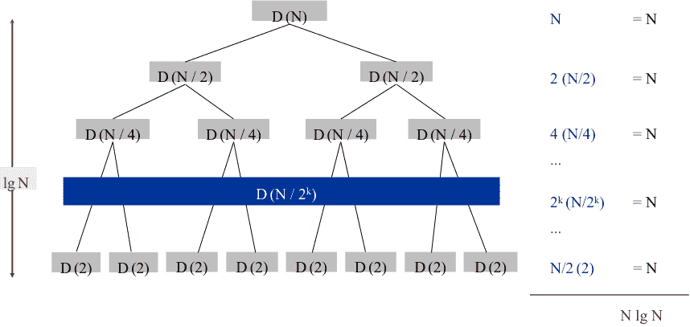

## 复杂度

- 笔记本电脑执行 10⁸ 次比较/秒。
- 超级计算机执行 10¹² 次比较/秒。

| 计算机 | 插入排序 (N²) <br> 千 | 插入排序 (N²) <br> 百万 | 插入排序 (N²) <br> 十亿 | 归并排序 (N log N) <br> 千 | 归并排序 (N log N) <br> 百万 | 归并排序 (N log N) <br> 十亿 |
|---|---|---|---|---|---|---|
| 家用 | 瞬间 | 2.8 小时 | 317 年 | 瞬间 | 1 秒 | 18 分钟 |
| 超级 | 瞬间 | 1 秒 | 1 周 | 瞬间 | 瞬间 | 瞬间 |

*好的算法胜过超级计算机。*

## 讨论

- 归并排序是
  - 稳定的？
  - 原地的？
- 递归消耗空间。

## 自底向上归并排序

1 2 6 9 10 13 24 43 51

1 2 6 9 13 24 43 51 | 10

2 6 13 24 | 1 9 43 51 | 10

2 13 | 6 24 | 1 43 | 9 51 | 10

2 | 13 | 6 | 24 | 43 | 1 | 51 | 9 | 10

## 自底向上归并排序

```
Input: An array A[1..n] of n elements.
Output: A[1..n] sorted in nondecreasing order.

1. t ← 1
2. while t < n
3.   s ← t; t ← 2s; i ← 0
4.   while i + t ≤ n
5.     Merge(A, i + 1, i + s, i + t)
6.     i ← i + t
7.   end while
8.   if i + s < n then Merge(A, i + 1, i + s, n)
9. end while
```

## 测验

Mergesort, BottomupMergesort,
哪个更高效？
哪个更容易理解和调试？
你更喜欢哪个？

- A. Mergesort
- B. BottomupMergesort

## O(nlogn) 排序算法

| n=2^k | 最好情况 | 最坏情况 |
|---|---|---|
| 自底向上归并 | (n log n)/2 | n log n − n + 1 |
| 归并 | (n log n)/2 | n log n − n + 1 |

空间 Θ(n)

Quicksort: 最坏 O(n²)，平均 O(nlogn)，空间 O(logn)
Heapsort: 最坏 O(nlogn)，空间 O(1)

## 排序

| n | 选择排序 | 插入排序 | 自底向上排序 | 归并排序 | 快速排序 |
|---|---|---|---|---|---|
| 500 | 124750 | 62747 | 3852 | 3852 | 6291 |
| 1000 | 499500 | 261260 | 8682 | 8704 | 15693 |
| 1500 | 1124250 | 566627 | 14085 | 13984 | 28172 |
| 2000 | 1999000 | 1000488 | 19393 | 19426 | 34020 |
| 2500 | 3123750 | 1564522 | 25951 | 25111 | 52513 |
| 3000 | 4498500 | 2251112 | 31241 | 30930 | 55397 |
| 3500 | 6123250 | 3088971 | 37102 | 36762 | 67131 |
| 4000 | 7998000 | 4042842 | 42882 | 42859 | 79432 |
| 4500 | 10122750 | 5103513 | 51615 | 49071 | 98635 |
| 5000 | 12497500 | 6180358 | 56888 | 55280 | 106178 |


## 我们现在讲到哪里了？

- 归并排序
- 快速排序

## 快速排序

快速排序被誉为20世纪科学与工程领域十大算法之一。

## 归并排序

- Java 对对象的排序。
- Perl、C++ 稳定排序、Python 稳定排序、Firefox JavaScript 等。

## 快速排序

- Java 对基本类型的排序。
- C `qsort`、Unix、Visual C++、Python、MATLAB、Chrome JavaScript 等。

## 快速排序

- 打乱数组。
- 进行切分，使得对于某个 `j`：
  - 元素 `a[j]` 就位。
  - `j` 左侧没有更大的元素。
  - `j` 右侧没有更小的元素。
- 递归地对每一部分排序。

## 切分 #1

```text
Algorithm 6.5 Split
Input: An array of elements A[low..high].
Output: A with its elements rearranged and w the new position of the splitting element A[low].
1. i ← low
2. x ← A[low]
3. for j ← low + 1 to high
4.   if A[j] ≤ x then
5.     i ← i + 1
6.     if i ≠ j then interchange A[i] and A[j]
7.   end if
8. end for
9. interchange A[low] and A[i]
10. w ← i
11. return A and w
```

## 切分 #1

10  
*i*  
13  
*j*  
6  
24  
43  
1  
51  
9

## 切分 #2

- 由 Sedgewick 提供

```java
private static int partition(Comparable[] a, int lo, int hi)
{
    int i = lo, j = hi+1;
    while (true)
    {
        while (less(a[++i], a[lo]))
            if (i == hi) break;

        while (less(a[lo], a[--j]))
            if (j == lo) break;

        if (i >= j) break;
        exch(a, i, j);
    }

    exch(a, lo, j);
    return j;
}
```

## 复杂度

最好情况：数组总是被分成两个大小相等的子数组，类似于归并排序，`O(N log N)`。

最坏情况：数组总是被分成一个大小为 0 和一个大小为 `N - 1` 的子数组，类似于选择排序，`O(N²)`。

平均情况：

`C_N = (N + 1) + (C_0 + C_{N-1})/N + (C_1 + C_{N-2})/N + ... + (C_{N-1} + C_0)/N`

`C_N ~ 2(N + 1) ln N ≈ 1.39 N lg N`

## 复杂度

- 笔记本电脑每秒执行 `10⁸` 次比较。
- 超级计算机每秒执行 `10¹²` 次比较。

|  | 插入排序 (`N²`) |  |  | 归并排序 (`N log N`) |  |  | 快速排序 (`N log N`) |  |  |
|---|---|---|---|---|---|---|---|---|---|
| 计算规模 | 千 | 百万 | 十亿 | 千 | 百万 | 十亿 | 千 | 百万 | 十亿 |
| 家用电脑 | 瞬时 | 2.8 小时 | 317 年 | 瞬时 | 1 秒 | 18 分钟 | 瞬时 | 0.6 秒 | 12 分钟 |
| 超级计算机 | 瞬时 | 1 秒 | 1 周 | 瞬时 | 瞬时 | 瞬时 | 瞬时 | 瞬时 | 瞬时 |

*好的算法比超级计算机更好。*

*伟大的算法比好的算法更好。*

## 重复键

芝加哥 09:25:52  
芝加哥 09:03:13  
芝加哥 09:21:05  
芝加哥 09:19:46  
芝加哥 09:19:32  
芝加哥 09:00:00  
芝加哥 09:35:21  
芝加哥 09:00:59  
休斯顿 09:01:10  
休斯顿 09:00:13  
凤凰城 09:37:44  
凤凰城 09:00:03  
凤凰城 09:14:25  
西雅图 09:10:25  
西雅图 09:36:14  
西雅图 09:22:43  
西雅图 09:10:11  
西雅图 09:22:54

B A A B A B B B C C C  
A A A A A A A A A A A

Dijkstra 的三向切分

## 小测验

使用以下方法对下列数组进行快速排序切分后，给出得到的数组：

- a) 切分 #1
- b) 切分 #2
- c) Dijkstra 的三向切分

`H J B R H R H B C V S`

- A. `C B H H B H R J R V S`
- B. `H C B B H H R R J V S`
- C. `C B B H H H R R V S J`
- D. 以上都不是

## 排序总结

|  | 原地？ | 稳定？ | 最坏 | 平均 | 最好 | 备注 |
|---|---|---|---|---|---|---|
| 选择排序 | x |  | N² / 2 | N² / 2 | N² / 2 | N 次交换 |
| 插入排序 | x | x | N² / 2 | N² / 4 | N | 适用于小 N 或部分有序 |
| 希尔排序 | x |  | ? | ? | N | 代码紧凑，亚二次复杂度 |
| 快速排序 | x |  | N² / 2 | 2 N ln N | N lg N | N log N 概率保证；实际最快 |
| 三向快速排序 | x |  | N² / 2 | 2 N ln N | N | 在存在重复键时改进快速排序 |
| 归并排序 |  | x | N lg N | N lg N | N lg N | N log N 保证，稳定 |

## 练习

- 从课程主页下载 `hw4.pdf`。
- 下周二截止。


## Quicksort Partitioning Demo

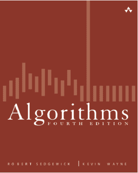

- Sedgewick 2-way
- Dijkstra 3-way
- Bentley-McIlroy 3-way

## Sedgewick 2-way Partitioning

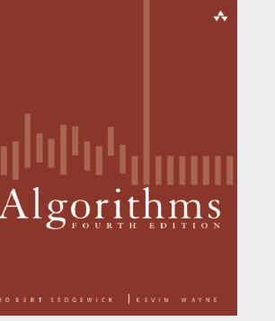

## Quicksort partitioning

Repeat until i and j pointers cross.

- Scan i from left to right so long as a[i] < a[lo].
- Scan j from right to left so long as a[j] > a[lo].
- Exchange a[i] with a[j].

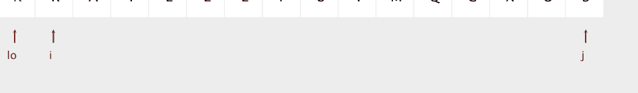

stop i scan because a[i] >= a[lo]

## Quicksort partitioning

Repeat until i and j pointers cross.

- Scan i from left to right so long as a[i] < a[lo].
- Scan j from right to left so long as a[j] > a[lo].
- Exchange a[i] with a[j].

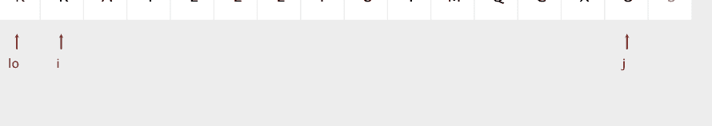

## Quicksort partitioning

Repeat until i and j pointers cross.

- Scan i from left to right so long as a[i] < a[lo].
- Scan j from right to left so long as a[j] > a[lo].
- Exchange a[i] with a[j].

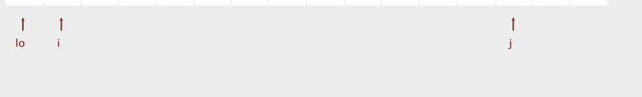

## Quicksort partitioning

Repeat until i and j pointers cross.

- Scan i from left to right so long as a[i] < a[lo].
- Scan j from right to left so long as a[j] > a[lo].
- Exchange a[i] with a[j].

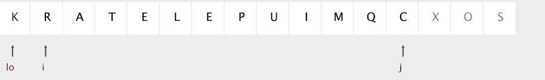

stop j scan and exchange a[i] with a[j]

## Quicksort partitioning

Repeat until i and j pointers cross.

- Scan i from left to right so long as a[i] < a[lo].
- Scan j from right to left so long as a[j] > a[lo].
- Exchange a[i] with a[j].

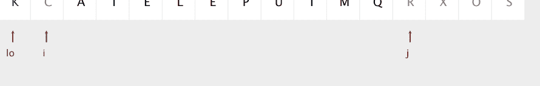

## Quicksort partitioning

Repeat until *i* and *j* pointers cross.

- Scan *i* from left to right so long as `a[i] < a[lo]`.
- Scan *j* from right to left so long as `a[j] > a[lo]`.
- Exchange `a[i]` with `a[j]`.


## Quicksort partitioning

Repeat until i and j pointers cross.

- Scan i from left to right so long as a[i] < a[lo].
- Scan j from right to left so long as a[j] > a[lo].
- Exchange a[i] with a[j].


stop i scan because a[i] >= a[lo]

## Quicksort partitioning

Repeat until i and j pointers cross.

- Scan i from left to right so long as a[i] < a[lo].
- Scan j from right to left so long as a[j] > a[lo].
- Exchange a[i] with a[j].


## Quicksort partitioning

Repeat until i and j pointers cross.

- Scan i from left to right so long as a[i] < a[lo].
- Scan j from right to left so long as a[j] > a[lo].
- Exchange a[i] with a[j].


## Quicksort partitioning

Repeat until i and j pointers cross.

- Scan i from left to right so long as a[i] < a[lo].
- Scan j from right to left so long as a[j] > a[lo].
- Exchange a[i] with a[j].

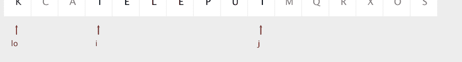

stop j scan and exchange a[i] with a[j]

## Quicksort partitioning

Repeat until i and j pointers cross.

- Scan i from left to right so long as a[i] < a[lo].
- Scan j from right to left so long as a[j] > a[lo].
- Exchange a[i] with a[j].


## Quicksort partitioning

Repeat until i and j pointers cross.

- Scan i from left to right so long as a[i] < a[lo].
- Scan j from right to left so long as a[j] > a[lo].
- Exchange a[i] with a[j].


## Quicksort partitioning

Repeat until i and j pointers cross.

- Scan i from left to right so long as a[i] < a[lo].
- Scan j from right to left so long as a[j] > a[lo].
- Exchange a[i] with a[j].


stop i scan because a[i] >= a[lo]


## 快速排序分区

重复直到 i 和 j 指针交叉。

- 从左到右扫描 i，只要 `a[i] < a[lo]`。
- 从右到左扫描 j，只要 `a[j] > a[lo]`。
- 交换 `a[i]` 与 `a[j]`。

当指针交叉时。

- 交换 `a[lo]` 与 `a[j]`。


停止 j 扫描并交换 `a[i]` 与 `a[j]`。


停止 i 扫描因为 `a[i] >= a[lo]`。


停止 j 扫描因为 `a[j] <= a[lo]`。


指针交叉：交换 `a[lo]` 与 `a[j]`。

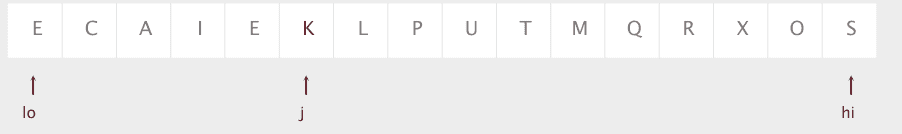

已分区！

## Dijkstra 三路分区

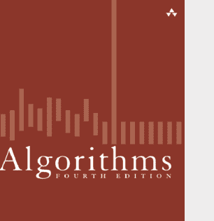

- 设 `v` 为分区项 `a[lo]`。
- 从左到右扫描 `i`。
  - `(a[i] < v)`: 交换 `a[lt]` 与 `a[i]` 并同时递增 `lt` 和 `i`
  - `(a[i] > v)`: 交换 `a[gt]` 与 `a[i]` 并递减 `gt`
  - `(a[i] == v)`: 递增 `i`


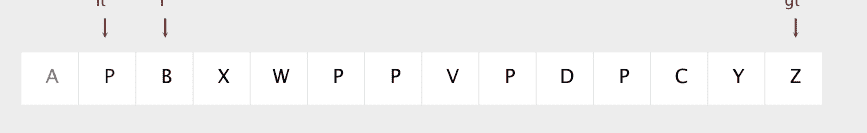


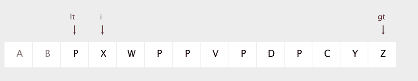

不变式


不变式


## Dijkstra 三路划分
- 设 v 为划分项 a[lo]。
- 从左到右扫描 i。
  - (a[i] < v): 将 a[lt] 与 a[i] 交换并同时递增 lt 和 i
  - (a[i] > v): 将 a[gt] 与 a[i] 交换并递减 gt
  - (a[i] == v): 递增 i


不变式


不变式


不变式


不变式


- 设 `v` 为划分项 `a[lo]`。
- 从左到右扫描 `i`。
  - `(a[i] < v):` 将 `a[lt]` 与 `a[i]` 交换并同时递增 `lt` 和 `i`
  - `(a[i] > v):` 将 `a[gt]` 与 `a[i]` 交换并递减 `gt`
  - `(a[i] == v):` 递增 `i`


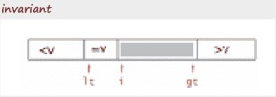


不变式


不变式


不变式


不变式


## Bentley-McIlroy 三路划分

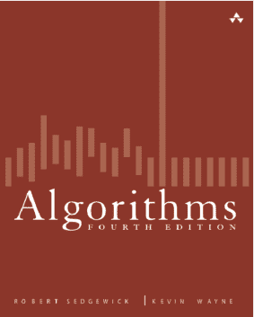

## Bentley-McIlroy 三路划分

重复直到 i 和 j 指针交叉。

- 从左到右扫描 i，只要 a[i] < a[lo]。
- 从右到左扫描 j，只要 a[j] > a[lo]。
- 将 a[i] 与 a[j] 交换。
- 如果 a[i] == a[lo]，将 a[i] 与 a[p] 交换并递增 p。
- 如果 a[j] == a[lo]，将 a[j] 与 a[q] 交换并递减 q。

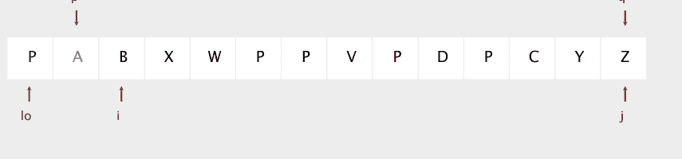


## Bentley-McIlroy 三路划分

重复直到 *i* 和 *j* 指针交叉。

- 从左到右扫描 *i*，只要 `a[i] < a[lo]`。
- 从右到左扫描 *j*，只要 `a[j] > a[lo]`。
- 交换 `a[i]` 与 `a[j]`。
- 如果 `a[i] == a[lo]`，交换 `a[i]` 与 `a[p]` 并递增 `p`。
- 如果 `a[j] == a[lo]`，交换 `a[j]` 与 `a[q]` 并递减 `q`。

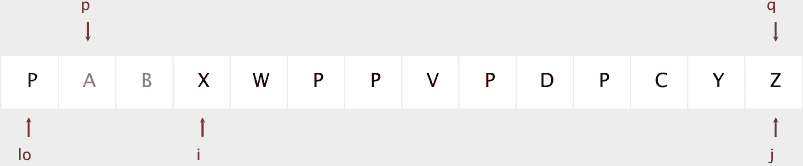

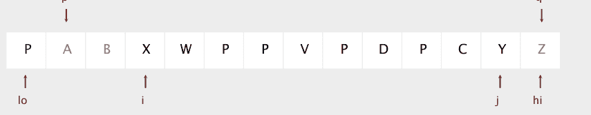

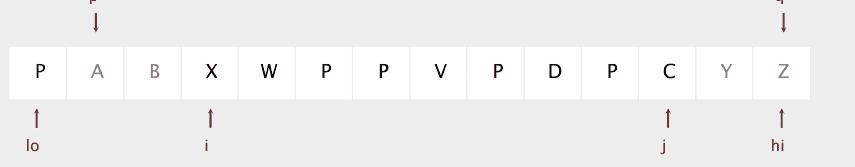

交换 `a[i]` 与 `a[j]`

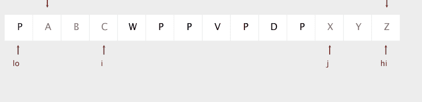

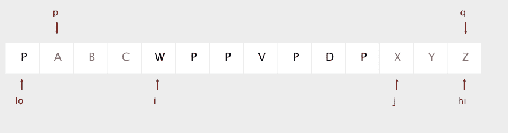

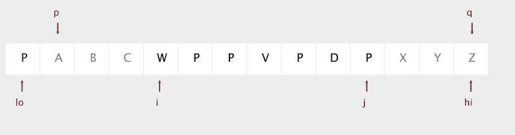

交换 `a[i]` 与 `a[j]`

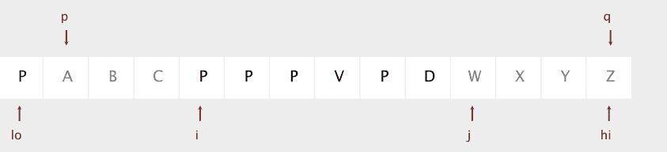

交换 `a[i]` 与 `a[p]` 并递增 `p`

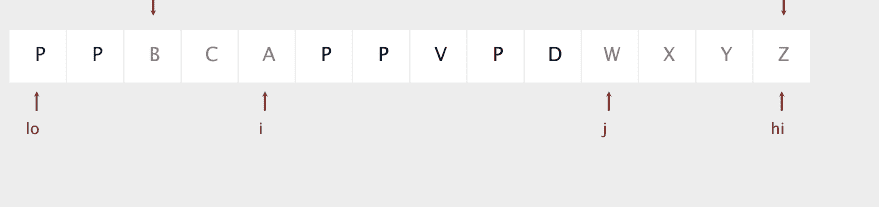

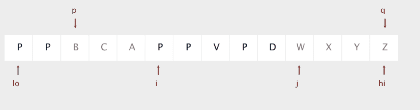


交换 `a[i]` 与 `a[j]`


## Bentley-McIlroy 3-way partitioning

重复直到 i 和 j 指针交叉。

- 从左到右扫描 i，只要 a[i] < a[lo]。
- 从右到左扫描 j，只要 a[j] > a[lo]。
- 交换 a[i] 与 a[j]。
- 如果 a[i] == a[lo]，交换 a[i] 与 a[p] 并递增 p。
- 如果 a[j] == a[lo]，交换 a[j] 与 a[q] 并递减 q。


exchange a[i] with a[j]

exchange a[j] with a[q] and decrement q


pointers cross

## Bentley-McIlroy 3-way partitioning

之后，将相等键交换到中心。

- 从右到左扫描 j 和 p 并交换 a[j] 与 a[p]。
- 从左到右扫描 i 和 q 并交换 a[i] 与 a[q]。


exchange a[j] with a[p]


## Bentley-McIlroy 三路划分

之后，将相等键交换到中心。

- 从右到左扫描 j 和 p 并交换 a[j] 与 a[p]。
- 从左到右扫描 i 和 q 并交换 a[i] 与 a[q]。


exchange a[j] with a[p]

## Bentley-McIlroy 三路划分

之后，将相等键交换到中心。

- 从右到左扫描 j 和 p 并交换 a[j] 与 a[p]。
- 从左到右扫描 i 和 q 并交换 a[i] 与 a[q]。


exchange a[j] with a[p]

## Bentley-McIlroy 三路划分

之后，将相等键交换到中心。

- 从右到左扫描 j 和 p 并交换 a[j] 与 a[p]。
- 从左到右扫描 i 和 q 并交换 a[i] 与 a[q]。


exchange a[i] with a[q]

## Bentley-McIlroy 三路划分

之后，将相等键交换到中心。

- 从右到左扫描 j 和 p 并交换 a[j] 与 a[p]。
- 从左到右扫描 i 和 q 并交换 a[i] 与 a[q]。


exchange a[i] with a[q]

## Bentley-McIlroy 三路划分

之后，将相等键交换到中心。

- 从右到左扫描 j 和 p 并交换 a[j] 与 a[p]。
- 从左到右扫描 i 和 q 并交换 a[i] 与 a[q]。


## Lecture 5 Sort(III)

- 优先队列和堆排序
- 线性时间排序

## Priority queues

*priority queue* 是一种用于维护元素集合 S 的数据结构，每个元素都有一个相关联的值称为 *key*。
*max-priority queue* 支持以下操作：

- insert(S, x)
- max(S)
- delete-max(S)
- decrease-key(x, key)

## Array and sorted array

|  | Maximum | Insert | DeleteMax |
|---|---|---|---|
| Array | O(n) | O(1) | O(n) |
| Sorted array | O(1) | O(n) | O(1) |

Data structure matters.

## Binary tree

### Almost complete binary tree

### Array representation

complete tree with N = 16 nodes (height = 4)

Property. Height of an almost complete tree with N nodes is ⌊log N⌋.

Heap representations


## Binary tree


## Binary Heap

A *max-heap* (*min-heap*) is an *almost complete* *binary tree* with vertices satisfying the *max-heap* (*min-heap*) *property*:

*If v and p(v) are a vertex and its parent respectively, then p(v) ≥ v (p(v) ≤ v).*


## Insert: SiftUp


## Insert: SiftUp


## Insert: SiftUp


## Insert: SiftUp


## Insert: SiftUp


O(logn)

## Insert: SiftUp


Algorithm 3.3 Insert

Input: A heap H[1..n] and a heap element x.

Output: A new heap H[1..n + 1] with x being one of its elements.

- 1. n ← n + 1
- 2. H[n] ← x
- 3. SiftUp(H, n)

SiftUp(H,i)

- 1. done ← false
- 2. if i = 1 then exit
- 3. repeat
- 4. if key(H[i]) > key(H[⌊i/2⌋])
- 5. then interchange H[i] and H[⌊i/2⌋]
- 6. else done ← true
- 7. i ← ⌊i/2⌋
- 8. until i = 1 or done


## Decrease-key: SiftUp


O(logn)

## Delete-maximum: SiftDown


O(2 log n)

```
SiftDown(H,i)
1. done ← false
2. if 2i > n then exit
3. repeat
4.   i ← 2i
5.   if i + 1 ≤ n and key(H[i + 1]) > key(H[i])
6.   then i ← i + 1
7.   if key(H[⌊i/2⌋]) < key(H[i])
8.   then interchange H[i] and H[⌊i/2⌋]
9.   else done ← true
10. until 2i > n or done
```


## 堆与数组

|  | 最大值 | 插入 | 删除最大值 |
|---|---|---|---|
| 数组 | O(n) | O(1) | O(n) |
| 有序数组 | O(1) | O(n) | O(1) |
| 堆 | O(1) | O(log n) | O(log n) |

## 如何建堆


## 堆排序

- 用全部 N 个键创建最大堆。
- 重复移除最大键。

问题：如何建堆？


## 如何建堆

```
Algorithm 3.6 MakeHeap
Input: An array A[1..n] of n elements.
Output: A[1..n] is transformed into a heap.
1. for i ← ⌊n/2⌋ downto 1
2. SiftDown(A, i)
3. end for
```

## 堆排序


算法 3.7 堆排序
输入：包含 n 个元素的数组 A[1..n]。
输出：数组 A[1..n] 按非递减顺序排序。

- 1. MakeHeap(A)
- 2. for j ← n downto 2
- 3. interchange A[1] and A[j]
- 4. SiftDown(A[1..j − 1],1)
- 5. end for

## 测验

给出对以下 10 个键的数组执行建堆后得到的数组：
X U M V Y T A J I N

给出在上述构建的最大堆上连续执行 3 次删除最大值后得到的数组。

- A. Y X T V M U A N I J
- B. Y X T V U M A J I N
- C. U N T J I M A
- D. U N T I J M A

## 测验

建堆的时间复杂度是多少？
堆排序的时间复杂度是多少？

- A. Θ(n)
- B. Θ(n log n)
- C. Θ(n²)
- D. 以上都不是

## 应用

- 事件驱动模拟。[排队的顾客]
- 数据压缩。[哈夫曼编码]
- 图搜索。[迪杰斯特拉算法、普里姆算法]
- 统计。[维护序列中最大的 M 个值]
- 操作系统。[负载均衡、中断处理]
- 离散优化。[装箱、调度]
- ......

## 排序总结

|  | 原地？ | 稳定？ | 最坏 | 平均 | 最好 | 备注 |
|---|---|---|---|---|---|---|
| 选择排序 | x |  | N² / 2 | N² / 2 | N² / 2 | N 次交换 |
| 插入排序 | x | x | N² / 2 | N² / 4 | N | 适用于小 N 或部分有序 |
| 希尔排序 | x |  | ? | ? | N | 代码紧凑，亚二次复杂度 |
| 快速排序 | x |  | N² / 2 | 2 N ln N | N lg N | N log N 概率保证，实践中最快 |
| 三向快速排序 | x |  | N² / 2 | 2 N ln N | N | 存在重复键时改进快速排序 |
| 归并排序 |  | x | N lg N | N lg N | N lg N | N log N 保证，稳定 |
| 堆排序 | x |  | 2 N lg N | 2 N lg N | N lg N | N log N 保证，原地 |
| ??? | x | x | N lg N | N lg N | N lg N | 排序算法的圣杯 |

## 排序的复杂度

比较次数

树的高度 =
最坏情况下的
比较次数

每种可能的排列至少对应一个叶子节点


## 排序的复杂度


树的高度 = 最坏情况下的比较次数

> **命题。** *任何基于比较的排序算法在最坏情况下至少需要* `log (n!) ~ nlogn` *次比较。*

## 排序总结

|  | 原地？ | 稳定？ | 最坏 | 平均 | 最好 | 备注 |
|---|---|---|---|---|---|---|
| 选择排序 | x |  | N² / 2 | N² / 2 | N² / 2 | N 次交换 |
| 插入排序 | x | x | N² / 2 | N² / 4 | N | 适用于小 N 或部分有序 |
| 希尔排序 | x |  | ? | ? | N | 代码紧凑，亚二次复杂度 |
| 快速排序 | x |  | N² / 2 | 2 N ln N | N lg N | N log N 概率保证，实践中最快 |
| 三向快速排序 | x |  | N² / 2 | 2 N ln N | N | 存在重复键时改进快速排序 |
| 归并排序 |  | x | N lg N | N lg N | N lg N | N log N 保证，稳定 |
| 堆排序 | x |  | 2 N lg N | 2 N lg N | N lg N | N log N 保证，原地 |
| 基数排序 |  | x | kN | kN | kN | 适用于 k 位数字或字符串 |
| ??? | x | x | N lg N | N lg N | N lg N | 排序算法的圣杯 |

## 哪种排序算法？

| 原始 | ? | ? | ? | ? | 已排序 |
|---|---|---|---|---|---|
| l ifo | find | data | data | data | data |
| fifo | fifo | fifo | fifo | exch | exch |
| data | data | find | find | fifo | fifo |
| type | exch | hash | hash | find | find |
| hash | hash | heap | heap | hash | hash |
| heap | heap | l ifo | l ifo | heap | heap |
| sort | less | link | link | leaf | leaf |
| link | left | list | list | left | left |
| list | leaf | push | push | less | less |
| push | l ifo | root | root | l ifo | l ifo |
| find | push | sort | sort | link | link |
| root | root | type | type | list | list |
| leaf | list | leaf | leaf | sort | next |
| tree | tree | left | tree | tree | node |
| null | null | node | null | null | null |
| path | path | null | path | path | path |
| node | node | path | node | node | push |
| left | link | tree | left | type | root |
| less | sort | exch | less | root | sink |
| exch | type | less | exch | push | sort |
| sink | sink | next | sink | sink | swap |
| swim | swim | sink | swim | swim | swim |
| next | next | swap | next | next | tree |
| swap | swap | swim | swap | swap | type |


## 哪个排序算法？

| original | quicksort | mergesort | insertion | selection | sorted |
|---|---|---|---|---|---|
| lifo | find | data | data | data | data |
| fifo | fifo | fifo | fifo | exch | exch |
| data | data | find | find | fifo | fifo |
| type | exch | hash | hash | find | find |
| hash | hash | heap | heap | hash | hash |
| heap | heap | lifo | lifo | heap | heap |
| sort | less | link | link | leaf | leaf |
| link | left | list | list | left | left |
| list | leaf | push | push | less | less |
| push | lifo | root | root | lifo | lifo |
| find | push | sort | sort | link | link |
| root | root | type | type | list | list |
| leaf | list | leaf | leaf | sort | next |
| tree | tree | left | tree | tree | node |
| null | null | node | null | null | null |
| path | path | null | path | path | path |
| node | node | path | node | node | push |
| left | link | tree | left | type | root |
| less | sort | exch | less | root | sink |
| exch | type | less | exch | push | sort |
| sink | sink | next | sink | sink | swap |
| swim | swim | sink | swim | swim | swim |
| next | next | swap | next | next | tree |
| swap | swap | swim | swap | swap | type |

## Heapsort Demo


click to begin demo

Starting point. Array in arbitrary order.

we assume array entries are indexed 1 to N


| S | O | R | T | E | X | A | M | P | L | E |
|---|---|---|---|---|---|---|---|---|---|---|
| 1 | 2 | 3 | 4 | 5 | 6 | 7 | 8 | 9 | 10 | 11 |

## Heap construction.

Build max heap using bottom-up method.


Heap construction. Build max heap using bottom-up method.

sink 5


Heap construction. Build max heap using bottom-up method.

sink 5

3-node heap


Heap construction. Build max heap using bottom-up method.

sink 4


S O R T L X A M P E E
4

## Heap construction. Build max heap using bottom-up method.

sink 4


3-node heap


## Heapsort

Heap construction. Build max heap using bottom-up method.

sink 3


| S | O | X | T | L | R | A | M | P | E | E |
|---|---|---|---|---|---|---|---|---|---|---|
|   |   | 3 |   |   | 6 |   |   |   |   |   |

## Heap construction. Build max heap using bottom-up method.

sink 3


3-node heap


## Heap construction. Build max heap using bottom-up method.

sink 2


| S | O | X | T | L | R | A | M | P | E | E |
|---|---|---|---|---|---|---|---|---|---|---|

2

## Heap construction. Build max heap using bottom-up method.

sink 2


| S | T | X | O | L | R | A | M | P | E | E |
|---|---|---|---|---|---|---|---|---|---|---|
|   | 2 |   | 4 |   |   |   |   |   |   |   |

## Heap construction. Build max heap using bottom-up method.

sink 2


| S | T | X | P | L | R | A | M | O | E | E |
|---|---|---|---|---|---|---|---|---|---|---|
|   | 2 |   | 4 |   |   |   |   | 9 |   |   |

## Heap construction. Build max heap using bottom-up method.

sink 2

7-node heap


S T X P L R A M O E E

## Heap construction. Build max heap using bottom-up method.

sink 1


| S | T | X | P | L | R | A | M | O | E | E |
|---|---|---|---|---|---|---|---|---|---|---|


堆构建。 使用自底向上方法构建最大堆。

下沉 1


## 堆构建。 使用自底向上方法构建最大堆。

构建阶段结束

11 节点堆


| X | T | S | P | L | R | A | M | O | E | E |

## 堆排序

**下沉排序。** 反复删除剩余的最大项。

交换 1 和 11


| X | T | S | P | L | R | A | M | O | E | E |
|---|---|---|---|---|---|---|---|---|---|---|
| 1 |   |   |   |   |   |   |   |   |   | 11 |

## 下沉排序。

反复删除剩余的最大项。

交换 1 和 11


## 下沉排序。

反复删除剩余的最大项。

下沉 1


下沉排序。 反复删除剩余的最大项。

下沉 1


| T | E | S | P | L | R | A | M | O | E | X |
| 1 | 2 |   |   |   |   |   |   |   |   |   |

## 下沉排序。

反复删除剩余的最大项。

下沉 1


| T | P | S | E | L | R | A | M | O | E | X |
| 1 | 2 |   | 4 |   |   |   |   |   |   |   |

## 下沉排序。

反复删除剩余的最大项。

下沉 1


T P S O L R A M E E X
1 2   4     9

下沉排序。 反复删除剩余的最大项。


下沉排序。 反复删除剩余的最大项。

交换 1 和 10


## 下沉排序。

反复删除剩余的最大项。

交换 1 和 10


E P S O L R A M E T X
1                 10

## 下沉排序。

反复删除剩余的最大项。

下沉 1


| E | P | S | O | L | R | A | M | E | T | X |
|---|---|---|---|---|---|---|---|---|---|---|
1

下沉排序。 反复删除剩余的最大项。

下沉 1


## 下沉排序。

反复删除剩余的最大项。

下沉 1


S P R O L E A M E T X
1   3     6

下沉排序。 反复删除剩余的最大项。


## 堆排序

**下沉排序。** 反复删除剩余的最大项。

交换 1 和 9


| S | P | R | O | L | E | A | M | E | T | X |
|---|---|---|---|---|---|---|---|---|---|---|
| 1 |   |   |   |   |   |   |   | 9 |   |   |

下沉排序。 反复删除剩余的最大项。

交换 1 和 9


下沉排序。 反复删除剩余的最大项。

下沉 1


## 下沉排序。

反复删除剩余的最大项。

下沉 1


| R | P | E | O | L | E | A | M | S | T | X |
| 1 |   | 3 |   |   |   |   |   |   |   |   |

## 堆排序

下沉排序。 反复删除剩余的最大项。


## 下沉排序。

反复删除剩余的最大项。

交换 1 和 8


S T X

| R | P | E | O | L | E | A | M | S | T | X |
|---|---|---|---|---|---|---|---|---|---|---|
| 1 |   |   |   |   |   |   | 8 |   |   |   |

## 下沉排序。

反复删除剩余的最大项。

交换 1 和 8


| M | P | E | O | L | E | A | R | S | T | X |
|---|---|---|---|---|---|---|---|---|---|---|
| 1 |   |   |   |   |   |   | 8 |   |   |   |


## 下沉排序。
反复删除剩余的最大元素。

下沉 1


| M | P | E | O | L | E | A | R | S | T | X |
|---|---|---|---|---|---|---|---|---|---|---|
| 1 |   |   |   |   |   |   |   |   |   |   |

下沉排序。反复删除剩余的最大元素。

下沉 1


R   S   T   X


下沉排序。反复删除剩余的最大元素。

下沉 1

R   S   T   X

| P | O | E | M | L | E | A | R | S | T | X |
|---|---|---|---|---|---|---|---|---|---|---|
| 1 | 2 |   | 4 |   |   |   |   |   |   |   |


下沉排序。反复删除剩余的最大元素。


## 堆排序
下沉排序。反复删除剩余的最大元素。

交换 1 和 7


R S T X

P O E M L E A R S T X
1       7

## 下沉排序。
反复删除剩余的最大元素。

交换 1 和 7


R   S   T   X

| A | O | E | M | L | E | P | R | S | T | X |
| 1 |   |   |   |   |   | 7 |   |   |   |   |

## 下沉排序。
反复删除剩余的最大元素。

下沉 1


P

R   S   T   X

| A | O | E | M | L | E | P | R | S | T | X |
| 1 |   |   |   |   |   |   |   |   |   |   |

## 下沉排序。
反复删除剩余的最大元素。

下沉 1


R S T X

P


## 下沉排序。
反复删除剩余的最大元素。

下沉 1


R   S   T   X   P


下沉排序。反复删除剩余的最大元素。

下沉 1


R S T X

P

O M E A L E P R S T X

## 下沉排序。反复删除剩余的最大元素。
交换 1 和 6


R S T X P


下沉排序。反复删除剩余的最大元素。

交换 1 和 6


R S T X P

| E | M | E | A | L | O | P | R | S | T | X |
| 1 |   |   |   |   | 6 |   |   |   |   |   |

下沉排序。反复删除剩余的最大元素。

下沉 1


## 下沉排序。
反复删除剩余的最大元素。

下沉 1


下沉排序。反复删除剩余的最大元素。


下沉排序。反复删除剩余的最大元素。

交换 1 和 5


M L E A E O P R S T X
1       5

## 下沉排序。
反复删除剩余的最大元素。

交换 1 和 5


R S T X O P


下沉排序。反复删除剩余的最大元素。

下沉 1


下沉排序。反复删除剩余的最大元素。

下沉 1


| L | E | E | A | M | O | P | R | S | T | X |
|---|---|---|---|---|---|---|---|---|---|---|
| 1 | 2 |   |   |   |   |   |   |   |   |   |

下沉排序。反复删除剩余的最大元素。


| L | E | E | A | M | O | P | R | S | T | X |

下沉排序。反复删除剩余的最大元素。

交换 1 和 4


L E E A M O P R S T X


## Sortdown.

反复删除剩余的最大项。

交换 1 和 4


## Sortdown.

反复删除剩余的最大项。

下沉 1


```
L     M     O     P

R   S   T   X
```

| A | E | E | L | M | O | P | R | S | T | X |
| --- | --- | --- | --- | --- | --- | --- | --- | --- | --- | --- |
| 1 |   |   |   |   |   |   |   |   |   |   |

## Sortdown.

反复删除剩余的最大项。

下沉 1


## Heapsort

**Sortdown.** 反复删除剩余的最大项。


```
E A E L M O P R S T X
```

## Sortdown.

反复删除剩余的最大项。

交换 1 和 3


```
L   M   O   P

R   S   T   X
```

| E | A | E | L | M | O | P | R | S | T | X |
| --- | --- | --- | --- | --- | --- | --- | --- | --- | --- | --- |
| 1 |   | 3 |   |   |   |   |   |   |   |   |

## Sortdown.

反复删除剩余的最大项。

交换 1 和 3


## Sortdown.

反复删除剩余的最大项。

下沉 1

```
E A E L M O P R S T X
```

## Sortdown.

反复删除剩余的最大项。

## Sortdown.

反复删除剩余的最大项。

交换 1 和 2


```
E
L   M     O     P
R   S   T   X
```

| E | A | E | L | M | O | P | R | S | T | X |
| --- | --- | --- | --- | --- | --- | --- | --- | --- | --- | --- |
| 1 | 2 |   |   |   |   |   |   |   |   |   |

## Heapsort

**Sortdown.** 反复删除剩余的最大项。

**交换 1 和 2**


## Sortdown.

反复删除剩余的最大项。

## Sortdown.

反复删除剩余的最大项。

排序下沉阶段结束

```
A

E       E

L   M       O   P

R   S   T   X

A E E L M O P R S T X
```

结束点。数组已按排序顺序排列。

| A | E | E | L | M | O | P | R | S | T | X |
| --- | --- | --- | --- | --- | --- | --- | --- | --- | --- | --- |
| 1 | 2 | 3 | 4 | 5 | 6 | 7 | 8 | 9 | 10 | 11 |

## 整数指数

问题：整数指数

输入：一个实数 x 和一个非负整数 n。

输出：xⁿ

```text
Algorithm 5.4 ExpRec
Input: A real number x and a nonnegative integer n.
Output: xⁿ.

1. power(x, n)

Procedure power(x, m)
1. if m ≡ 0 then y ← 1
2. else
3.   y ← power(x, ⌊m/2⌋)
4.   y ← y²
5.   if m is odd then y ← x y
6. end if
7. return y
```

## 概述

- 主定理
- 设计分治算法
  - 最小-最大
  - 乘法
  - 矩阵乘法
  - 选择

## 分治法

- **划分步骤**：输入被划分为 *p* ≥ 1 个部分，每个部分都严格小于 *n*。
- **征服步骤**：对较小的部分进行 *p* 次递归调用。
- **合并步骤**：将已解决的部分合并以获得所需输出。

## 分治法

- **划分步骤**：输入被划分为 *p* ≥ 1 个部分，每个部分都严格小于 *n*。
- **征服步骤**：对较小的部分进行 *p* 次递归调用。
- **合并步骤**：将已解决的部分合并以获得所需输出。

哪一步更困难？

## 归并排序

划分 2 13 6 24 43 1 51 9

征服 2 6 13 24 1 9 43 51

合并 1 2 6 9 13 24 43 51

D(N) = 2 D(N/2) + N

## 快速排序

划分 1 2 6 24 43 13 51 9

征服 1 2 6 9 13 24 43 51

合并 1 2 6 9 13 24 43 51

D(N) = 2 D(N/2) + N

## 分治法

- **划分步骤**：输入被划分为 $p \ge 1$ 个部分，每个部分都严格小于 $n$。
- **征服步骤**：$p$ 次对较小的部分的递归调用。
- **合并步骤**：将已解决的部分合并以获得所需输出。

f(n) = a f(n/b) + c n^d

## 主定理

### 简化的主定理

设 $a \ge 1$，$b > 1$ 且 $c,d,w \ge 0$ 为常数，且 $T(n)$ 在非负整数上由递推式定义

```text
f(n) = { w               if n = 1
          a f(n/b) + c n^d   if n > 1 }
```

则

```text
f(n) = { Θ(n^d)          if a < b^d
          Θ(n^d log n)    if a = b^d
          Θ(n^{log_b a})  if a > b^d }
```


## 主定理


## 测验

给出以下函数的增长阶：

- \(f(n) = f(n/2) + 1\)
- \(f(n) = 2f(n/2) + n^2\)
- \(f(n) = 9f(n/3) + n\)
- \(f(n) = 5f(n/2) + n^3\)

A. \(\Theta(\log n)\)　 B. \(\Theta(n\log n)\)　 C. \(\Theta(n^2)\)　 D. \(\Theta(n^3)\)

## 我们在哪里？

- 主定理
- 设计分治算法
  - 最值
  - 乘法
  - 矩阵乘法
  - 选择

## MinMax：哪一个更好？

**问题：** MinMax  
**输入：** 整数序列 \(A[1...n]\)  
**输出：** \(A[1...n]\) 中的最大元素和最小元素

```
1. x ← A[1]; y ← A[1]
2. for i ← 2 to n
3.   if A[i] < x then x ← A[i]
4.   if A[i] > y then y ← A[i]
5. end for
6. return (x, y)
```

```
Procedure minimax(low, high)
1. if high − low = 1 then
2.   if A[low] < A[high] then return (A[low], A[high])
3.   else return (A[high], A[low])
4. end if
5. else
6.   mid ← ⌊(low + high)/2⌋
7.   (x1, y1) ← minimax(low, mid)
8.   (x2, y2) ← minimax(mid + 1, high)
9.   x ← min{x1, x2}
10.  y ← max{y1, y2}
11.  return (x, y)
12. end if
```

## MinMax：哪一个更好？

**问题：** MinMax  
**输入：** 整数序列 \(A[1...n]\)，\(n = 2^k\)  
**输出：** \(A[1...n]\) 中的最大元素和最小元素

```
1. x ← A[1], y ← A[1]
2. for i ← 2 to n
3.     if A[i] < x then x ← A[i]
4.     if A[i] > y then y ← A[i]
5. end for
6. return (x, y)
```

**Procedure** `minmax(low, high)`

```
1. if high − low = 1 then
2.     if A[low] < A[high] then return (A[low], A[high])
3.     else return (A[high], A[low])
4.     end if
5. else
6.     mid ← (low + high) / 2
7.     (x₁, y₁) ← minmax(low, mid)
8.     (x₂, y₂) ← minmax(mid + 1, high)
9.     x ← min(x₁, x₂)
10.    y ← max(y₁, y₂)
11.    return (x, y)
12. end if
```

\(\#\mathrm{comp} = 2n - 2\)

\(\#\mathrm{comp} = 3n/2 - 2\)  
Cost more spaces

## 乘法

**问题：** 乘法  
**输入：** 两个 \(n\)-位二进制整数 \(x\) 和 \(y\)  
**输出：** \(x \times y\)


\[
O(n) + O(n) + \cdots + O(n) = (n-1)O(n) = O(n^2)
\]

## 乘法

**问题：** 乘法  
**输入：** 两个 \(n\)-位二进制整数 \(x\) 和 \(y\)  
**输出：** \(x \times y\)

\[
x = 2^{n/2}w + u
\]

\[
y = 2^{n/2}z + v
\]

\[
xy = (2^{n/2}w + u)(2^{n/2}z + v)
= 2^n wz + 2^{n/2}(uz + wv) + uv
\]

\[
T(n) = 4T(n/2) + \Theta(n) = \Theta(n^2)
\]

## 乘法

**问题：** 乘法  
**输入：** 两个 \(n\)-位二进制整数 \(x\) 和 \(y\)  
**输出：** \(x \times y\)

\[
xy = (2^{n/2}w + u)(2^{n/2}z + v)
= 2^n wz + 2^{n/2}(uz + wv) + uv
\]

\[
(w + u)(z + v) = wz + uz + wv + uv
\]

\[
uz + wv = (w + u)(z + v) - uv - wz
\]

\[
T(n) = 3T(n/2) + \Theta(n) = \Theta(n^{\log 3})
\]

## 矩阵乘法

where

\[
\begin{pmatrix}
a_{11} & \dots & a_{1n}\\
\vdots & & \vdots\\
a_{n1} & \dots & a_{nn}
\end{pmatrix}
\begin{pmatrix}
b_{11} & \dots & b_{1n}\\
\vdots & & \vdots\\
b_{n1} & \dots & b_{nn}
\end{pmatrix}
=
\begin{pmatrix}
c_{11} & \dots & c_{1n}\\
\vdots & & \vdots\\
c_{n1} & \dots & c_{nn}
\end{pmatrix}
\]

\[
c_{ij} = \sum_{k=1}^{n} a_{ik}b_{kj}
\]

\[
T(n) = \Theta(n^3)
\]

## 矩阵乘法

\[
\begin{pmatrix}
A_{11} & A_{12}\\
A_{21} & A_{22}
\end{pmatrix}
\begin{pmatrix}
B_{11} & B_{12}\\
B_{21} & B_{22}
\end{pmatrix}
=
\begin{pmatrix}
C_{11} & C_{12}\\
C_{21} & C_{22}
\end{pmatrix}
\]

\[
\begin{pmatrix}
C_{11} & C_{12}\\
C_{21} & C_{22}
\end{pmatrix}
=
\begin{pmatrix}
A_{11}B_{11} + A_{12}B_{21} &
A_{11}B_{12} + A_{12}B_{22}\\
A_{21}B_{11} + A_{22}B_{21} &
A_{21}B_{12} + A_{22}B_{22}
\end{pmatrix}
\]

\[
T(n) =
\begin{cases}
m, & \text{if } n = 1,\\
8T(n/2) + 4(n/2)^2a, & \text{if } n \ge 2
\end{cases}
\]

\[
T(n) = \Theta(n^3)
\]

## Strassen 算法

\[
D_1 = (A_{11} + A_{22})(B_{11} + B_{22})
\]

\[
D_2 = (A_{21} + A_{22})B_{11}
\]

\[
D_3 = A_{11}(B_{12} - B_{22})
\]

\[
D_4 = A_{22}(B_{21} - B_{11})
\]

\[
D_5 = (A_{11} + A_{22})B_{22}
\]

\[
D_6 = (A_{21} - A_{11})(B_{11} + B_{12})
\]

\[
D_7 = (A_{12} - A_{22})(B_{21} + B_{22})
\]

\[
\begin{pmatrix}
C_{11} & C_{12}\\
C_{21} & C_{22}
\end{pmatrix}
=
\begin{pmatrix}
D_1 + D_4 - D_5 + D_7 & D_3 + D_5\\
D_2 + D_4 & D_1 + D_3 - D_2 + D_6
\end{pmatrix}
\]

\[
T(n) =
\begin{cases}
m, & \text{if } n = 1,\\
7T(n/2) + 18(n/2)^2a, & \text{if } n \ge 2
\end{cases}
\]

\[
T(n) = \Theta(n^{\log 7}) = \Theta(n^{2.81})
\]

## 中位数和顺序统计量

**问题：** 中位数  
**输入：** \(n\) 个元素的数组 \(A[1..n]\)  
**输出：** \(A[1..n]\) 中第 \(\lfloor n/2\rfloor\) 小的元素。

**问题：** OrderStatistic（选择）  
**输入：** \(n\) 个数字的数组 \(A[1..n]\)，以及正整数 \(k\)  
**输出：** \(A[1..n]\) 中第 \(k\) 小的元素。


## 选择

第5小的元素？

第3小的元素？

2 13 6 24 43 1 51 9

1 2 13 6 24 43 51 9

6 9 13 24 43 51

## 快速选择

划分数组，使得：

- 条目 a[j] 位于正确位置。
- j 的左侧没有更大的条目。
- j 的右侧没有更小的条目。

根据 j 的值在其中一个子数组中重复；当 j 等于 k 时结束。


## 线性时间选择


[作者：M. Blum, R. Floyd, V. Pratt 和 R. Rivest]

## 选择

步骤1：将每5个元素分组排序。

3 2 4 99 92 4 2 84 84 21 328 74 83 45 75 183 38 17 37 38 92
29 451 5 3 95 27 7 7 91 9 727 41 1 42 25 45 79 26

| 3 | 4 | 328 | 183 | 92 | 95 | 9 | 25 |
| 2 | 2 | 74 | 38 | 29 | 27 | 727 | 45 |
| 4 | 84 | 83 | 17 | 451 | 7 | 41 | 79 |
| 99 | 84 | 45 | 37 | 5 | 7 | 1 | 26 |
| 92 | 21 | 75 | 38 | 3 | 91 | 42 |  |

## 选择

步骤1：将每5个元素分组排序。

3 2 4 99 92 4 2 84 84 21 328 74 83 45 75 183 38 17 37 38 92
29 451 5 3 95 27 7 7 91 9 727 41 1 42 25 45 79 26

| 2 | 2 | 45 | 17 | 3 | 7 | 1 | 25 |
| 3 | 4 | 74 | 37 | 5 | 7 | 9 | 26 |
| 4 | 21 | 75 | 38 | 29 | 27 | 41 | 45 |
| 92 | 84 | 83 | 38 | 92 | 91 | 42 | 79 |
| 99 | 84 | 328 | 183 | 451 | 95 | 727 |  |

## 选择

步骤2：找出中位数的中位数。

3 24 99 92 4 2 84 84 213 28 74 83 45 75 183 38 17 37 38 92
29 451 5 3 95 27 7 7 91 9 727 411 42 25 45 79 26

| 2 | 2 | 45 | 17 | 3 | 7 | 1 | 2 |
|---|---|---|---|---|---|---|---|
| 3 | 4 | 74 | 37 | 5 | 7 | 9 |  |
| 4 | 21 | 75 | 38 | 29 | 27 | 41 | 45 |
| 92 | 84 | 83 | 38 | 92 | 91 | 42 | 79 |
| 99 | 84 | 328 | 183 | 451 | 95 | 727 |  |


## 选择

步骤3：将中位数作为基准。

3 2 4 99 92 4 2 84 84 21 328 74 83 45 75 183 38 17 37 38 92

29 451 5 3 95 27 7 7 91 9 727 41 1 42 25 45 79 26

| 2 | 2 | 45 | 17 | 3 | 7 | 1 |  |
| 3 | 4 | 74 | 37 | 5 | 7 | 9 |  |
| 4 | 21 | 75 | 38 | 29 | 27 | 41 | 45 |
| 92 | 84 | 83 | 38 | 92 | 91 | 42 | 79 |
| 99 | 84 | 328 | 183 | 451 | 95 | 727 |  |


## 选择

为什么中位数的中位数
能保证良好的划分？

3 24 99 92 4 2 84 84 213 28 74 83 45 75 183 38 17 37 38 92
29 451 5 3 95 27 7 7 91 9 727 411 142 25 45 79 26

| 2 | 2 | 7 | 3 | 17 | 45 | 1 | 25 |
|---|---|---|---|---|---|---|---|
| 3 | 4 | 7 | 5 | 37 | 74 | 9 | 26 |
| 4 | 21 | 27 | **29** | 38 | 75 | 41 | 45 |
| 92 | 84 | 91 | 92 | 38 | 83 | 42 | 79 |
| 99 | 84 | 95 | 451 | 183 | 328 | 727 |  |

## 选择

|\overline{A_1}| ≥ 3⌈⌊n/5⌋/2⌉ ≥ 3/2⌊n/5⌋

|A_1| ≤ n - 3/2⌊n/5⌋ ≤ n - 3/2((n - 4)/5) = 0.7n + 1.2

T(n) ≤ T(⌊n/5⌋) + T(⌊3n/4⌋) + a n，其中 n ≥ 44

| 2 | 2 | 7 | 3 | 17 | 45 | 1 |  |
| 3 | 4 | 7 | 5 | 37 | 74 |  |  |
| 4 | 21 | 27 | 29 | 38 | 75 | 41 | 45 |
| 92 | 84 | 91 | 92 | 38 | 83 | 42 | 79 |
| 99 | 84 | 95 | 451 | 183 | 328 | 727 |  |


## 选择：算法

- 过程选择(A, low, high, k)
- 1. p ← high − low + 1
- 2. 如果 p < 44，则对 A 排序并返回 (A[k])
- 3. 令 q = ⌊p/5⌋。将 A 分成 q 组，每组 5 个元素。如果 5 不能整除 p，则丢弃剩余的元素。
- 4. 分别对每组 q 进行排序并提取其中位数。令中位数的集合为 M。
- 5. mm ← 选择(M, 1, q, ⌈q/2⌉)
- 6. 将 A[low..high] 划分为三个数组：
- A₁ = {a | a < mm}; A₂ = {a | a = mm}
- A₃ = {a | a > mm}
- 7. 情况：
|A₁| ≥ k：返回选择(A₁, 1, |A₁|, k)
|A₁| < k 且 |A₁| + |A₂| ≥ k：返回 mm
|A₁| + |A₂| < k：返回选择(A₃, 1, |A₃|, k − |A₁| − |A₂|)
- 8. 结束情况

## 最近点对问题

问题：最近点对

输入：平面上 n 个点的集合 S

输出：使得 p1 和 p2 之间的欧几里得距离最小的点对 p1 = (x1, y1) 和 p2 = (x2, y2)。

划分

解决

合并


## 最近点对问题

**Algorithm 6.7 ClosestPair**  
**Input:** 平面上的 *n* 个点集合。  
**Output:** *S* 中两点实现的最小分离距离。  

1. 按 *x*-坐标非递减顺序对 *S* 中的点进行排序。  
2. *Y* ← 按 *y*-坐标非递减顺序排序的 *S* 中的点。  
3. δ ← cp(1, *n*)

Procedure cp(low, high)
1. p ← high − low + 1
2. if high − low + 1 ≤ 3 then compute δ
3. else
4.   mid ← ⌊(low + high)/2⌋
5.   x₀ ← x(S[mid])
6.   δₗ ← cp(low, mid)
7.   δᵣ ← cp(mid + 1, high)
8.   δ ← min{δₗ, δᵣ}
9.   k ← 0
10.  for i ← 1 to n
11.    if |x(Y[i]) − x₀| ≤ δ then
12.      k ← k + 1; T[k] ← Y[i] end if
13.  end for
14.  δ′ ← δ
15.  for i ← 1 to k − 1
16.    for j ← i + 1 to min{i + 7, k}
17.      if d′(T[i], T[j]) < δ′ then δ′ ← d′(T[i], T[j])
18.    end for
19.  end for
20. end if
21. return δ′

## 最近点对问题

T(n) = { 1 if n = 2
3 if n = 3
2T(n/2) + Θ(n) if n > 3 }

T(n) = Θ(n log n)

## 结论

- 主定理
- 设计分治算法
  - 最小-最大
  - 乘法
  - 矩阵乘法
  - 选择

## 选择算法中的分组

如果每个组包含的不是 5 个元素，那么以下哪一项不会保持 Θ(n) 复杂度？

- A. 3
- B. 7
- C. 9
- D. 以上全部

## Lecture 7 图遍历

- 图
- 无向图
- 有向图

## 概述

- 图
- 无向图
  - DFS, BFS, 应用
- 有向图
  - DFS, BFS, 应用

## 图无处不在


## 图术语


无向图


有向图

## 邻接矩阵 v.s. 邻接表

G=<V, E>


有向：n + m
无向：n + 2m

有向：n²
无向：n²

对于与 v 相连的每条边...
u 和 v 是否通过边相连？

## 重要图问题

- 路径。是否存在从 *s* 到 *t* 的有向路径？
- 最短路径。从 *s* 到 *t* 的最短有向路径是什么？
- 拓扑排序。你能画出有向图使所有边都向上指向吗？
- 强连通性。顶点对之间是否存在有向路径？
- 传递闭包。对于每个顶点 *v* 和 *w*，是否存在从 *v* 到 *w* 的路径？

## 我们在哪里？

- 图
- 无向图
  - DFS, BFS, 应用
- 有向图
  - DFS, BFS, 应用


## DFS


深度优先搜索。

- 在身后展开一团线。
- 标记每个已访问的交叉点和每个已访问的通道。
- 当没有未访问的选项时回溯。

## 迷宫探索

## 深度优先搜索

pre/post = 0/0


DFS 树

## 深度优先搜索

time = 0    pre/post


DFS 树

## Algorithm 9.1 DFS

Input: 有向或无向图 G = (V, E)。

Output: 对应深度优先树中顶点的先序和后序。

- 1. predfn ← 0; postdfn ← 0
- 2. for each vertex v ∈ V
- 3. mark v unvisited
- 4. end for
- 5. for each vertex v ∈ V
- 6. if v is marked unvisited then dfs(v)
- 7. end for

# Procedure dfs(v)

- 1. mark v visited
- 2. predfn ← predfn + 1
- 3. for each edge (v, w) ∈ E
- 4. if w is marked unvisited then dfs(w)
- 5. end for
- 6. postdfn ← postdfn + 1


## 算法 9.1 DFS

**输入：** 有向图或无向图 G = (V, E)。

**输出：** 对应深度优先树中顶点的先序和后序。

```text
predfn ← 0; postdfn ← 0
time ← 0
for each vertex v ∈ V
    mark v unvisited
    v.pre ← infinity
    v.post ← infinity
end for
for each vertex v ∈ V
    if v is marked unvisited then dfs(v)
end for
```

### 过程 dfs(v)

```text
mark v visited
predfn ← predfn + 1
time ← time + 1
v.pre ← time
for each edge (v, w) ∈ E
    if w is marked unvisited then dfs(w)
end for
postdfn ← postdfn + 1
time ← time + 1
v.post ← time
```

## 测验：复杂度

| | | 时间 | 空间 |
|---|---|---|---|
| 无向 | 邻接矩阵 | ? | ? |
| 无向 | 邻接表 | ? | ? |

## 复杂度

| | | 时间 | 空间 |
|---|---|---|---|
| 无向 | 邻接矩阵 | O(\|V\|²) | O(\|V\|) |
| 无向 | 邻接表 | O(\|V\| + 2\|E\|) | O(\|V\|) |

## DFS 正确性

**命题**

DFS 在与时间成比例于其度之和的时间内标记所有与 s 相连的顶点。

## DFS 应用？


## 广度优先搜索


BFS 树

## 算法 9.4 BFS

**输入：** 有向图或无向图 G = (V, E)。

**输出：** 顶点在广度优先搜索顺序中的编号。

```text
bfn ← 0
for each vertex v ∈ V
    mark v unvisited
end for
for each vertex v ∈ V
    if v is marked unvisited then bfs(v)
end for
```

### 过程 bfs(v)

```text
Q ← {v}
mark v visited
while Q ≠ ∅
    v ← Pop(Q)
    bfn ← bfn + 1
    for each edge (v, w) ∈ E
        if w is marked unvisited then
            Push(w, Q)
            mark w visited
        end if
    end for
end while
```

## 测验：复杂度

| | | 时间 | 空间 |
|---|---|---|---|
| 无向 | 邻接矩阵 | ? | ? |
| 无向 | 邻接表 | ? | ? |

## 复杂度

| | | 时间 | 空间 |
|---|---|---|---|
| 无向 | 邻接矩阵 | O(\|V\|²) | O(\|V\|) |
| 无向 | 邻接表 | O(\|V\| + 2\|E\|) | O(\|V\|) |

## BFS 应用：最短路径


讨论：如何记录最短路径？

## 广度优先搜索


| 顶点 | 父节点 |
|---|---|
| u |  |
| v | u |
| x | u |
| y | v |
| w | y |
| z | y |
| a | w |
| b | z |


BFS 树

## 算法 9.4 BFS

**输入：** 有向图或无向图 G = (V, E)。

**输出：** 顶点在广度优先搜索顺序中的编号。

```text
bfn ← 0
for each vertex v ∈ V
    mark v unvisited
end for
for each vertex v ∈ V
    if v is marked unvisited then bfs(v)
end for
```

### 过程 bfs(v)

```text
Q ← {v}
mark v visited
while Q ≠ ∅
    v ← Pop(Q)
    bfn ← bfn + 1
    for each edge (v, w) ∈ E
        if w is marked unvisited then
            Push(w, Q)
            mark w visited
        end if
    end for
end while
```

## 算法 9.4 BFS

**输入：** 有向图或无向图 G = (V, E)。

**输出：** 顶点在广度优先搜索顺序中的编号。

```text
bfn ← 0
for each vertex v ∈ V
    mark v unvisited
end for
for each vertex v ∈ V
    if v is marked unvisited then bfs(v)
end for
```

### 过程 bfs(v)

```text
Q ← {v}
mark v visited
while Q ≠ ∅
    v ← Pop(Q)
    bfn ← bfn + 1
    for each edge (v, w) ∈ E
        if w is marked unvisited then
            Push(w, Q)
            mark w visited
            w.parent ← v
        end if
    end for
end while
```

## 连通性

**定义**  
无向图是**连通的**，如果任意一对顶点之间存在路径。  
**连通分量**是内部连通但与剩余顶点没有边的子图。

\#trees == \#connected components


## 图的无环性

禁止反向边！

如何判断反向边？

## 我们在哪？

- 图
  - 无向图
    - DFS，BFS，应用
  - 有向图
    - DFS，BFS，应用


## DFS 树：有向

time = 0

DFS 树


## DFS 树

- 树边：
- 反向边：
- 前向边：
- 交叉边：

| type | edge(u,v) |
|------|-----------|
| tree | [u [v ]v ]u |
| back | [v [u ]u ]v |
| forward | [u [v ]v ]u |
| cross | [v ]v [u ]u |


## 测验

对以下图运行 DFS。以下边的类型分别是什么：CB，DC，FC

（每当你有多个顶点可供探索时，始终选择字母顺序最靠前的那个。）


- A. tree edge
- B. back edge
- C. forward edge
- D. cross edge

## 应用：垃圾回收器

[Mark-sweep algorithm.](#) [McCarthy, 1960]

- Mark: mark all reachable objects.
- Sweep: if object is unmarked, it is garbage (so add to free list).

[Memory cost.](#) Uses 1 extra mark bit per object (plus DFS stack).


## 图的无环性

禁止反向边！

有向无环图通常称为 DAG。

如何判断反向边？

## 图的无环性


- 树边：
- 反向边：
- 前向边：
- 交叉边：

一条边 (u,v) 是 **反向边** 当且仅当

pre(u) > pre(v) && post(u) < post(v)

| type | edge(u,v) |
|------|-----------|
| tree | [u [v ]v ]u |
| back | [v [u ]u ]v |
| forward | [u [v ]v ]u |
| cross | [v ]v [u ]u |

## 应用


Microsoft Excel 无法计算公式。
公式中的单元格引用指向公式的结果，造成循环引用。请尝试以下操作：

- 如果你不小心创建了循环引用，请单击确定。这将显示循环引用工具栏并提供使用它来更正公式的帮助。
- 如果要继续保留公式不变，请单击取消。

## DAG：拓扑排序

**Problem:** TopoSort
**Input:** A DAG (directed acyclic graph) G = (V, E)
**Output:** A linear ordering of its vertices in such a way that if (v,w) ∈ E, then v appears before w in the ordering.


## DAG：拓扑排序

### TOPOLOGICAL-SORT(G)

1. Call DFS(G) to compute finishing times of each vertex v
2. As each vertex is finished, insert it onto the front of a linked list
3. Return the linked list of vertices


## 正确性

### Proposition

For every edge (u,v), *post[v] < post[u]*.

- 树边：
- 反向边：
- 前向边：
- 交叉边：


| type | edge(u,v) |
|------|-----------|
| tree | [u [v ]v ]u |
| back | [v [u ]u ]v |
| forward | [u [v ]v ]u |
| cross | [v ]v [u ]u |

## 测验

给出以下图的拓扑排序算法，给出拓扑顺序。
（每当你有多个顶点可供探索时，始终选择字母顺序最靠前的那个。）


- A. BACEDFGH
- B. ABCDEFGH
- C. ABCEDFHG
- D. None of above

## 连通性

### Definition

A directed graph is **connected**, if there is a path from any vertices to another.
A **strong connected component** is a maximal connected subgraph.

`#trees == #connected components`


## 强连通分量


## 生态食物网


## 强连通分量


引理 每个有向图都是其强连通分量的 DAG。

## 一些性质


## 性质 1

如果从节点 u 开始进行 dfs，那么它将在从 u 可达的所有节点都被访问时精确终止。

## 性质 2

在 DFS 中获得最高 post 数的节点必须位于源强连通分量中。

## 性质 3

如果 C 和 C' 是 scc，并且从 C 中的一个节点到 C' 中的一个节点存在一条边，则 C 中的最高 post 数大于 C' 中的最高 post 数。

## Kosaraju-Sharir 算法

反向图


## Kosaraju-Sharir 算法

- 1. 在 Gᴿ 上运行 DFS。
- 2. 在 G 上运行无向连通分量算法，并在 DFS 过程中，按步骤 1 中得到的 post 数的 *递减顺序* 处理顶点。


## Tarjan

- 对所有顶点 u 进行尝试，如果 u 未被访问，则 DFS(u)
- DFS(u)，将 u 加入栈，初始化 num[u] 和 low[u]
- 对 u 的所有邻居 v 进行尝试
- 如果 v 是空闲的，则 DFS(v)
- 更新 low[u]
- 如果 low[u]==num[u]
- 从栈中弹出直到得到 u；

## 割点

问题：ArticulationPoints
输入：一个无向图 G = (V , E )
输出：割点。 （点 v 是割点当且仅当其他两点之间的任意路径都必须经过 v）。


## 结论

- 图
- 无向图
  - DFS, BFS, 应用
- 有向图
  - DFS, BFS, 应用

## BFS, DFS 应用


## BFS, DFS 应用

BFS。

- 选择根网页作为源 s。
- 维护一个待探索网站的队列。
- 维护一个已发现网站的集合。
- 出队下一个网站并入队其链接到的网站（前提是之前未做过）。


## BFS, DFS 应用


- 顶点：像素。
- 边：两个相邻灰色像素之间。
- Blob：与给定像素相连的所有像素。


## BFS, DFS 应用

每个程序都是一个有向图。

- 顶点 = 指令的基本块
- 边 = 跳转。

死代码消除。
查找（并移除）不可达代码。

无限循环检测。
确定出口是否不可达。


## 测验

以下哪些陈述对 *无向图* 成立？

- A. 如果 u 与 v 相连且 v 与 w 相连，则 u 与 w 相连。
- B. 从连通图 G 中移除任意一条边会将图拆分为两个连通分量。
- C. 无环图 G 在当且仅当它有 V-1 条边时是连通的。
- D. 如果向图 G 添加两条边，其分量数最多减少 2。

## 测验

以下哪些陈述对 *有向图* 成立？

- A. 具有 V 个顶点的有向图如果边数少于 V 条，则包含多于一个强连通分量。
- B. 如果我们修改 Kosaraju-Sharir 算法，用 BFS 替换第二次 DFS，那么它仍然能找到强连通分量。
- C. 如果 u 与 v 强连通且 v 与 w 强连通，则 u 与 w 强连通。
- D. 如果向有向图添加两条边，其强连通分量数最多减少 2。


## 练习

- 从我们的课程主页下载 hw7.pdf
- 截止日期为 10 月 28 日

## 挑战

### Challenge 1

**Problem.** Is a graph bipartite?

### How difficult?

- Any programmer could do it.
- Need to be a typical diligent SE222 student.
- Hire an expert.
- Intractable.
- No one knows.
- Impossible.


### Challenge 1

**Problem.** Is a graph bipartite?

### How difficult?

- Any programmer could do it.
- Need to be a typical diligent SE222 student.
- Hire an expert.
- Intractable.
- No one knows.
- Impossible.


### Challenge 3

**Problem.** Find a cycle that uses every edge exactly once. (Eulerian tour)

### How difficult?

- Any programmer could do it.
- Need to be a typical diligent SE222 student.
- Hire an expert.
- Intractable.
- No one knows.
- Impossible.


0-1-2-3-4-2-0-6-4-5-0


### Challenge 4

**Problem.** Find a cycle that uses every vertex exactly once. (Hamiltonian tour)

### How difficult?

- Any programmer could do it.
- Need to be a typical diligent SE222 student.
- Hire an expert.
- Intractable. ✓
- No one knows.
- Impossible.


### Challenge 5

**Problem.** Are two graphs identical except for vertex names? (Graph isomorphism)

### How difficult?

- Any programmer could do it.
- Need to be a typical diligent SE222 student.
- Hire an expert.
- Intractable.
- No one knows. ✓
- Impossible.


```
0-1
0-2
0-5
0-6
3-4
3-5
4-5
4-6
```


```
0-4
0-5
0-6
1-4
1-5
2-4
3-4
5-6
```

0 → 4, 1 → 3, 2 → 2, 3 → 6, 4 → 5, 5 → 0, 6 → 1

### Challenge 6

**Problem.** Lay out a graph in the plane without crossing edges?

### How difficult?

- Any programmer could do it.
- Need to be a typical diligent SE222 student.
- Hire an expert. ✓
- Intractable.
- No one knows.
- Impossible.


```
0-1
0-2
0-5
0-6
3-4
3-5
4-5
4-6
```


## 4.1 Breadth-First Search


click to begin demo

### Breadth-first search

Repeat until queue is empty:

- Remove vertex v from queue.
- Add to queue all unmarked vertices adjacent to v and mark them.


graph G

```
tinyDG.txt
V 6
E 8
0 5
2 4
2 3
1 2
0 1
3 4
3 5
0 2
```

### Breadth-first search

Repeat until queue is empty:

- Remove vertex v from queue.
- Add to queue all unmarked vertices adjacent to v and mark them.


queue

| v | edgeTo[v] |
|---|---|
| 0 | - |
| 1 | - |
| 2 | - |
| 3 | - |
| 4 | - |
| 5 | - |

add 0 to queue

### Breadth-first search

Repeat until queue is empty:

- Remove vertex *v* from queue.
- Add to queue all unmarked vertices adjacent to *v* and mark them.


dequeue 0

### Breadth-first search

Repeat until queue is empty:

- Remove vertex $v$ from queue.
- Add to queue all unmarked vertices adjacent to $v$ and mark them.


queue

| v | edgeTo[v] |
|---|---|
| 0 | — |
| 1 | — |
|   | 0 |
| 2 | — |
| 3 | — |
| 4 | — |
| 5 | — |

dequeue 0

### Breadth-first search

Repeat until queue is empty:

- Remove vertex v from queue.
- Add to queue all unmarked vertices adjacent to v and mark them.


queue

| v | edgeTo[v] |
|---|---|
| 0 | — |
| 1 | 0 |
| 2 | 0 |
| 3 | — |
| 4 | — |
| 5 | — |

dequeue 0


## 广度优先搜索

重复直到队列为空：

- 从队列中移除顶点 *v*。
- 将与 *v* 相邻的所有未标记顶点加入队列并标记它们。


队列

| v | edgeTo[v] |
|---|---|
| 0 | - |
| 1 | 0 |
| 2 | 0 |
| 3 | - |
| 4 | 0 |
| 5 | - |

出队 0


| v | edgeTo[v] |
|---|---|
| 0 | - |
| 1 | 0 |
| 2 | 0 |
| 3 | - |
| 4 | - |
| 5 | 0 |

0 完成


| queue |
|---|
|  |
|  |
| 5 |
| 1 |
| 2 |

| v | edgeTo[v] |
|---|---|
| 0 | - |
| 1 | 0 |
| 2 | 0 |
| 3 | - |
| 4 | - |
| 5 | 0 |


队列


| v | edgeTo[v] |
|---|---|
| 0 | - |
| 1 | 0 |
| 2 | 0 |
| 3 | - |
| 4 | - |
| 5 | 0 |

出队 2


队列

| v | edgeTo[v] |
|---|---|
| 0 | - |
| 1 | 0 |
| 2 | 0 |
| 3 | - |
| 4 | - |
| 5 | 0 |

出队 2


出队 2


队列

| v | edgeTo[v] |
|---|---|
| 0 | - |
| 1 | 0 |
| 2 | 0 |
| 3 | 2 |
| 4 | - |
| 5 | 0 |


| queue |
|---|
|  |
| 4 |
| 3 |
| 5 |
| 1 |

| v | edgeTo[v] |
|---|---|
| 0 | - |
| 1 | 0 |
| 2 | 0 |
| 3 | 2 |
| 4 | 2 |
| 5 | 0 |


| v | edgeTo[v] |
|---|---|
| 0 | - |
| 1 | 0 |
| 2 | 0 |
| 3 | 2 |
| 4 | 2 |
| 5 | 0 |


| queue | v | edgeTo[v] |
|---|---:|---:|
|  | 0 | - |
| 4 | 1 | 0 |
| 3 | 2 | 0 |
| 5 | 3 | 2 |
|  | 4 | 2 |
|  | 5 | 0 |

1 完成


| queue | v | edgeTo[v] |
|---|---:|---:|
|  | 0 | - |
| 4 | 1 | 0 |
| 3 | 2 | 0 |
| 5 | 3 | 2 |
|  | 4 | 2 |
|  | 5 | 0 |

出队 5


队列


| v | edgeTo[v] |
|---|---|
| 0 | - |
| 1 | 0 |
| 2 | 0 |
| 3 | 2 |
| 4 | 2 |
| 5 | 0 |

出队 5


## 广度优先搜索

重复直到队列为空：
- 从队列中移除顶点 v。
- 将与 v 相邻且未标记的所有顶点加入队列并标记它们。


队列

v edgeTo[v]
0 -
1 0
2 0
3 2
4 2
5 0

dequeue 5

## 广度优先搜索

重复直到队列为空：
- 从队列中移除顶点 *v*。
- 将与 *v* 相邻且未标记的所有顶点加入队列并标记它们。


| queue | v | edgeTo[v] |
|---|---|---|
|  | 0 | - |
|  | 1 | 0 |
|  | 2 | 0 |
|  | 3 | 2 |
| 4 | 4 | 2 |
| 3 | 5 | 0 |

## 广度优先搜索

重复直到队列为空：
- 从队列中移除顶点 v。
- 将与 v 相邻且未标记的所有顶点加入队列并标记它们。


队列


| v | edgeTo[v] |
|---|-----------|
| 0 | – |
| 1 | 0 |
| 2 | 0 |
| 3 | 2 |
| 4 | 2 |
| 5 | 0 |

dequeue 3

## 广度优先搜索

重复直到队列为空：
- 从队列中移除顶点 v。
- 将与 v 相邻且未标记的所有顶点加入队列并标记它们。


队列

4

| v | edgeTo[v] |
|---|-----------|
| 0 | – |
| 1 | 0 |
| 2 | 0 |
| 3 | 2 |
| 4 | 2 |
| 5 | 0 |

dequeue 3

## 广度优先搜索

重复直到队列为空：
- 从队列中移除顶点 $v$。
- 将与 $v$ 相邻且未标记的所有顶点加入队列并标记它们。


队列

| v | edgeTo[v] |
|---|-----------|
| 0 | – |
| 1 | 0 |
| 2 | 0 |
| 3 | 2 |
| 4 | 2 |
| 5 | 0 |

dequeue 3

## 广度优先搜索

重复直到队列为空：
- 从队列中移除顶点 $v$。
- 将与 $v$ 相邻且未标记的所有顶点加入队列并标记它们。


队列


| v | edgeTo[v] |
|---|-----------|
| 0 | - |
| 1 | 0 |
| 2 | 0 |
| 3 | 2 |
| 4 | 2 |
| 5 | 0 |

dequeue 3

## 广度优先搜索

重复直到队列为空：
- 从队列中移除顶点 *v*。
- 将与 *v* 相邻且未标记的所有顶点加入队列并标记它们。


| v | edgeTo[v] |
|---|---|
| 0 | — |
| 1 | 0 |
| 2 | 0 |
| 3 | 2 |
| 4 | 2 |
| 5 | 0 |

3 done

## 广度优先搜索

重复直到队列为空：
- 从队列中移除顶点 v。
- 将与 v 相邻且未标记的所有顶点加入队列并标记它们。


队列

| v | edgeTo[v] |
|---|-----------|
| 0 | – |
| 1 | 0 |
| 2 | 0 |
| 3 | 2 |
| 4 | 2 |
| 5 | 0 |

dequeue 4

## 广度优先搜索

重复直到队列为空：
- 从队列中移除顶点 *v*。
- 将与 *v* 相邻且未标记的所有顶点加入队列并标记它们。


| v | edgeTo[v] |
|---|---|
| 0 | — |
| 1 | 0 |
| 2 | 0 |
| 3 | 2 |
| 4 | 2 |
| 5 | 0 |

dequeue 4

## 广度优先搜索

重复直到队列为空：
- 从队列中移除顶点 v。
- 将与 v 相邻且未标记的所有顶点加入队列并标记它们。


队列

| v | edgeTo[v] |
|---|-----------|
| 0 | – |
| 1 | 0 |
| 2 | 0 |
| 3 | 2 |
| 4 | 2 |
| 5 | 0 |

dequeue 4

## 广度优先搜索

重复直到队列为空：
- 从队列中移除顶点 *v*。
- 将与 *v* 相邻且未标记的所有顶点加入队列并标记它们。


| v | edgeTo[v] |
|---|---|
| 0 | – |
| 1 | 0 |
| 2 | 0 |
| 3 | 2 |
| 4 | 2 |
| 5 | 0 |

4 done

## 4.2 深度优先搜索


click to begin demo

## 深度优先搜索

要访问顶点 v：
- 将顶点 v 标记为已访问。
- 递归访问从 v 指向的所有未标记顶点。


a directed graph

4 2
2 3
3 2
6 0
0 1
2 0
11 12
12 9
9 10
9 11
8 9
10 12
11 4
4 3
3 5
6 8
8 6
5 4
0 5
6 4
6 9
7 6


## 深度优先搜索

要访问顶点 $v$ ：

- 将顶点 $v$ 标记为已访问。
- 递归访问从 $v$ 出发的所有未标记顶点。


一个有向图

| v | marked[] | edgeTo[] |
|---|---|---|
| 0 | F | - |
| 1 | F | - |
| 2 | F | - |
| 3 | F | - |
| 4 | F | - |
| 5 | F | - |
| 6 | F | - |
| 7 | F | - |
| 8 | F | - |
| 9 | F | - |
| 10 | F | - |
| 11 | F | - |
| 12 | F | - |


访问 0

| v | marked[] | edgeTo[] |
|---|---|---|
| 0 | T | - |
| 1 | F | - |
| 2 | F | - |
| 3 | F | - |
| 4 | F | - |
| 5 | F | - |
| 6 | F | - |
| 7 | F | - |
| 8 | F | - |
| 9 | F | - |
| 10 | F | - |
| 11 | F | - |
| 12 | F | - |


访问 5

| v | marked[] | edgeTo[] |
|---|---|---|
| 0 | T | - |
| 1 | F | - |
| 2 | F | - |
| 3 | F | - |
| 4 | F | - |
| 5 | T | 0 |
| 6 | F | - |
| 7 | F | - |
| 8 | F | - |
| 9 | F | - |
| 10 | F | - |
| 11 | F | - |
| 12 | F | - |


| v | marked[] | edgeTo[] |
|---|---|---|
| 0 | T | - |
| 1 | F | - |
| 2 | F | - |
| 3 | F | - |
| 4 | T | 5 |
| 5 | T | 0 |
| 6 | F | - |
| 7 | F | - |
| 8 | F | - |
| 9 | F | - |
| 10 | F | - |
| 11 | F | - |
| 12 | F | - |

访问 4


| v | marked[] | edgeTo[] |
|---|---|---|
| 0 | T | - |
| 1 | F | - |
| 2 | F | - |
| 3 | T | 4 |
| 4 | T | 5 |
| 5 | T | 0 |
| 6 | F | - |
| 7 | F | - |
| 8 | F | - |
| 9 | F | - |
| 10 | F | - |
| 11 | F | - |
| 12 | F | - |

访问 3


访问 3

| v | marked[] | edgeTo[] |
|---|---|---|
| 0 | T | - |
| 1 | F | - |
| 2 | F | - |
| 3 | T | 4 |
| 4 | T | 5 |
| 5 | T | 0 |
| 6 | F | - |
| 7 | F | - |
| 8 | F | - |
| 9 | F | - |
| 10 | F | - |
| 11 | F | - |
| 12 | F | - |


| v | marked[] | edgeTo[] |
|---|---|---|
| 0 | T | — |
| 1 | F | — |
| 2 | T | 3 |
| 3 | T | 4 |
| 4 | T | 5 |
| 5 | T | 0 |
| 6 | F | — |
| 7 | F | — |
| 8 | F | — |
| 9 | F | — |
| 10 | F | — |
| 11 | F | — |
| 12 | F | — |

访问 2


访问 2

| v | marked[] | edgeTo[] |
|---|---|---|
| 0 | T | - |
| 1 | F | - |
| 2 | T | 3 |
| 3 | T | 4 |
| 4 | T | 5 |
| 5 | T | 0 |
| 6 | F | - |
| 7 | F | - |
| 8 | F | - |
| 9 | F | - |
| 10 | F | - |
| 11 | F | - |
| 12 | F | - |


完成 2

| v | marked[] | edgeTo[] |
|---|---|---|
| 0 | T | - |
| 1 | F | - |
| 2 | T | 3 |
| 3 | T | 4 |
| 4 | T | 5 |
| 5 | T | 0 |
| 6 | F | - |
| 7 | F | - |
| 8 | F | - |
| 9 | F | - |
| 10 | F | - |
| 11 | F | - |
| 12 | F | - |


| v | marked[] | edgeTo[] |
|---|---|---|
| 0 | T | — |
| 1 | F | — |
| 2 | T | 3 |
| 3 | T | 4 |
| 4 | T | 5 |
| 5 | T | 0 |
| 6 | F | — |
| 7 | F | — |
| 8 | F | — |
| 9 | F | — |
| 10 | F | — |
| 11 | F | — |
| 12 | F | — |

完成 3


## 深度优先搜索

要访问顶点 v：

- 将顶点 v 标记为已访问。
- 递归访问从 v 指向的所有未标记顶点。


| v | marked[] | edgeTo[] |
|---|---|---|
| 0 | T | - |
| 1 | F | - |
| 2 | T | 3 |
| 3 | T | 4 |
| 4 | T | 5 |
| 5 | T | 0 |
| 6 | F | - |
| 7 | F | - |
| 8 | F | - |
| 9 | F | - |
| 10 | F | - |
| 11 | F | - |
| 12 | F | - |

访问 4

## 深度优先搜索

要访问顶点 v：

- 将顶点 v 标记为已访问。
- 递归访问从 v 指向的所有未标记顶点。


| v | marked[] | edgeTo[] |
|---|---|---|
| 0 | T | - |
| 1 | F | - |
| 2 | T | 3 |
| 3 | T | 4 |
| 4 | T | 5 |
| 5 | T | 0 |
| 6 | F | - |
| 7 | F | - |
| 8 | F | - |
| 9 | F | - |
| 10 | F | - |
| 11 | F | - |
| 12 | F | - |

完成 4

## 深度优先搜索

要访问顶点 v：

- 将顶点 v 标记为已访问。
- 递归访问从 v 指向的所有未标记顶点。


完成 5

| v | marked[] | edgeTo[] |
|---|---|---|
| 0 | T | - |
| 1 | F | - |
| 2 | T | 3 |
| 3 | T | 4 |
| 4 | T | 5 |
| 5 | T | 0 |
| 6 | F | - |
| 7 | F | - |
| 8 | F | - |
| 9 | F | - |
| 10 | F | - |
| 11 | F | - |
| 12 | F | - |

## 深度优先搜索

要访问顶点 v：

- 将顶点 v 标记为已访问。
- 递归访问从 v 指向的所有未标记顶点。


| v | marked[] | edgeTo[] |
|---|---|---|
| 0 | T | - |
| 1 | F | - |
| 2 | T | 3 |
| 3 | T | 4 |
| 4 | T | 5 |
| 5 | T | 0 |
| 6 | F | - |
| 7 | F | - |
| 8 | F | - |
| 9 | F | - |
| 10 | F | - |
| 11 | F | - |
| 12 | F | - |

访问 0

## 深度优先搜索

要访问顶点 *v*：

- 将顶点 *v* 标记为已访问。
- 递归访问从 *v* 指向的所有未标记顶点。


| v | marked[] | edgeTo[] |
|---|---|---|
| 0 | T | – |
| 1 | T | 0 |
| 2 | T | 3 |
| 3 | T | 4 |
| 4 | T | 5 |
| 5 | T | 0 |
| 6 | F | – |
| 7 | F | – |
| 8 | F | – |
| 9 | F | – |
| 10 | F | – |
| 11 | F | – |
| 12 | F | – |

访问 1

## 深度优先搜索

要访问顶点 v：

- 将顶点 v 标记为已访问。
- 递归访问从 v 指向的所有未标记顶点。


| v | marked[] | edgeTo[] |
|---|---|---|
| 0 | T | - |
| 1 | T | 0 |
| 2 | T | 3 |
| 3 | T | 4 |
| 4 | T | 5 |
| 5 | T | 0 |
| 6 | F | - |
| 7 | F | - |
| 8 | F | - |
| 9 | F | - |
| 10 | F | - |
| 11 | F | - |
| 12 | F | - |

完成 1

## 深度优先搜索

要访问顶点 v：

- 将顶点 v 标记为已访问。
- 递归访问从 v 指向的所有未标记顶点。


| v | marked[] | edgeTo[] |
|---|---|---|
| 0 | T | - |
| 1 | T | 0 |
| 2 | T | 3 |
| 3 | T | 4 |
| 4 | T | 5 |
| 5 | T | 0 |
| 6 | F | - |
| 7 | F | - |
| 8 | F | - |
| 9 | F | - |
| 10 | F | - |
| 11 | F | - |
| 12 | F | - |

完成 0

## 深度优先搜索

要访问顶点 v：

- 将顶点 v 标记为已访问。
- 递归访问从 v 指向的所有未标记顶点。


完成

| v | marked[] | edgeTo[] |
|---|---|---|
| 0 | T | - |
| 1 | T | 0 |
| 2 | T | 3 |
| 3 | T | 4 |
| 4 | T | 5 |
| 5 | T | 0 |
| 6 | F | - |
| 7 | F | - |
| 8 | F | - |
| 9 | F | - |
| 10 | F | - |
| 11 | F | - |
| 12 | F | - |

## 深度优先搜索

要访问顶点 v：

- 将顶点 v 标记为已访问。
- 递归访问从 v 指向的所有未标记顶点。


可从顶点 0 到达

可从 0 到达

| v | marked[] | edgeTo[] |
|---|---|---|
| 0 | T | - |
| 1 | T | 0 |
| 2 | T | 3 |
| 3 | T | 4 |
| 4 | T | 5 |
| 5 | T | 0 |
| 6 | F | - |
| 7 | F | - |
| 8 | F | - |
| 9 | F | - |
| 10 | F | - |
| 11 | F | - |
| 12 | F | - |

## 4.2 Kosaraju-Sharir 算法


点击开始演示


## Kosaraju-Sharir

### Phase 1. Compute reverse postorder in $G^R$.

- DFS in reverse graph
- DFS in original graph


digraph G


digraph G


reverse digraph Gᴿ

| v | marked[v] |
|---|-----------|
| 0 | - |
| 1 | - |
| 2 | - |
| 3 | - |
| 4 | - |
| 5 | - |
| 6 | - |
| 7 | - |
| 8 | - |
| 9 | - |
| 10 | - |
| 11 | - |
| 12 | - |

| v | marked[v] |
|---|-----------|
| 0 | T |
| 1 | F |
| 2 | F |
| 3 | F |
| 4 | F |
| 5 | F |
| 6 | F |
| 7 | F |
| 8 | F |
| 9 | F |
| 10 | F |
| 11 | F |
| 12 | F |

visit 0

visit 6

| v | marked[v] |
|---|-----------|
| 0 | T |
| 1 | F |
| 2 | F |
| 3 | F |
| 4 | F |
| 5 | F |
| 6 | T |
| 7 | F |
| 8 | F |
| 9 | F |
| 10 | F |
| 11 | F |
| 12 | F |


visit 8

| v | marked[v] |
|---|-----------|
| 0 | T |
| 1 | F |
| 2 | F |
| 3 | F |
| 4 | F |
| 5 | F |
| 6 | T |
| 7 | F |
| 8 | T |
| 9 | F |
| 10 | F |
| 11 | F |
| 12 | F |


| v | marked[v] |
|---|-----------|
| 0 | T |
| 1 | F |
| 2 | F |
| 3 | F |
| 4 | F |
| 5 | F |
| 6 | T |
| 7 | F |
| 8 | T |
| 9 | F |
| 10 | F |
| 11 | F |
| 12 | F |

8 done

8


visit 7

| v | marked[v] |
|---|-----------|
| 0 | T |
| 1 | F |
| 2 | F |
| 3 | F |
| 4 | F |
| 5 | F |
| 6 | T |
| 7 | T |
| 8 | T |
| 9 | F |
| 10 | F |
| 11 | F |
| 12 | F |

7 8


7 done

| v | marked[v] |
|---|-----------|
| 0 | T |
| 1 | F |
| 2 | F |
| 3 | F |
| 4 | F |
| 5 | F |
| 6 | T |
| 7 | T |
| 8 | T |
| 9 | F |
| 10 | F |
| 11 | F |
| 12 | F |


| v | marked[v] |
|---|-----------|
| 0 | T |
| 1 | F |
| 2 | F |
| 3 | F |
| 4 | F |
| 5 | F |
| 6 | T |
| 7 | T |
| 8 | T |
| 9 | F |
| 10 | F |
| 11 | F |
| 12 | F |

6 done


| v | marked[v] |
|---|-----------|
| 0 | T |
| 1 | F |
| 2 | F |
| 3 | F |
| 4 | F |
| 5 | F |
| 6 | T |
| 7 | T |
| 8 | T |
| 9 | F |
| 10 | F |
| 11 | F |
| 12 | F |

visit 0

6 7 8


visit 2

| v | marked[v] |
|---|-----------|
| 0 | T |
| 1 | F |
| 2 | T |
| 3 | F |
| 4 | F |
| 5 | F |
| 6 | T |
| 7 | T |
| 8 | T |
| 9 | F |
| 10 | F |
| 11 | F |
| 12 | F |

6 7 8

visit 4

| v | marked[v] |
|---|-----------|
| 0 | T |
| 1 | F |
| 2 | T |
| 3 | F |
| 4 | T |
| 5 | F |
| 6 | T |
| 7 | T |
| 8 | T |
| 9 | F |
| 10 | F |
| 11 | F |
| 12 | F |


6 7 8

visit 11

| v | marked[v] |
|---|-----------|
| 0 | T |
| 1 | F |
| 2 | T |
| 3 | F |
| 4 | T |
| 5 | F |
| 6 | T |
| 7 | T |
| 8 | T |
| 9 | F |
| 10 | F |
| 11 | T |
| 12 | F |


6 7 8


visit 9

| v | marked[v] |
|---|-----------|
| 0 | T |
| 1 | F |
| 2 | T |
| 3 | F |
| 4 | T |
| 5 | F |
| 6 | T |
| 7 | T |
| 8 | T |
| 9 | T |
| 10 | F |
| 11 | T |
| 12 | F |


## Kosaraju-Sharir

### 第 1 阶段。 在 $G^R$ 中计算逆后序。

6 7 8


| v | marked[v] |
|---|---|
| 0 | T |
| 1 | F |
| 2 | T |
| 3 | F |
| 4 | T |
| 5 | F |
| 6 | T |
| 7 | T |
| 8 | T |
| 9 | T |
| 10 | F |
| 11 | T |
| 12 | T |

访问 12

6 7 8


| v | marked[v] |
|---|---|
| 0 | T |
| 1 | F |
| 2 | T |
| 3 | F |
| 4 | T |
| 5 | F |
| 6 | T |
| 7 | T |
| 8 | T |
| 9 | T |
| 10 | F |
| 11 | T |
| 12 | T |

访问 12

6 7 8

访问 10

| v | marked[v] |
|---|---|
| 0 | T |
| 1 | F |
| 2 | T |
| 3 | F |
| 4 | T |
| 5 | F |
| 6 | T |
| 7 | T |
| 8 | T |
| 9 | T |
| 10 | T |
| 11 | T |
| 12 | T |


10 6 7 8

| v | marked[v] |
|---|---|
| 0 | T |
| 1 | F |
| 2 | T |
| 3 | F |
| 4 | T |
| 5 | F |
| 6 | T |
| 7 | T |
| 8 | T |
| 9 | T |
| 10 | T |
| 11 | T |
| 12 | T |

10 完成

12 10 6 7 8


| v | marked[v] |
|---|---|
| 0 | T |
| 1 | F |
| 2 | T |
| 3 | F |
| 4 | T |
| 5 | F |
| 6 | T |
| 7 | T |
| 8 | T |
| 9 | T |
| 10 | T |
| 11 | T |
| 12 | T |

12 完成

12 10 6 7 8


| v | marked[v] |
|---|---|
| 0 | T |
| 1 | F |
| 2 | T |
| 3 | F |
| 4 | T |
| 5 | F |
| 6 | T |
| 7 | T |
| 8 | T |
| 9 | T |
| 10 | T |
| 11 | T |
| 12 | T |

访问 9

12 10 6 7 8


访问 9

| v | marked[v] |
|---|---|
| 0 | T |
| 1 | F |
| 2 | T |
| 3 | F |
| 4 | T |
| 5 | F |
| 6 | T |
| 7 | T |
| 8 | T |
| 9 | T |
| 10 | T |
| 11 | T |
| 12 | T |

9 12 10 6 7 8

| v | marked[v] |
|---|---|
| 0 | T |
| 1 | F |
| 2 | T |
| 3 | F |
| 4 | T |
| 5 | F |
| 6 | T |
| 7 | T |
| 8 | T |
| 9 | T |
| 10 | T |
| 11 | T |
| 12 | T |

9 完成

11 9 12 10 6 7 8

访问 4

| v | marked[v] |
|---|---|
| 0 | T |
| 1 | F |
| 2 | T |
| 3 | F |
| 4 | T |
| 5 | F |
| 6 | T |
| 7 | T |
| 8 | T |
| 9 | T |
| 10 | T |
| 11 | T |
| 12 | T |


11 9 12 10 6 7 8


| v | marked[v] |
|---|---|
| 0 | T |
| 1 | F |
| 2 | T |
| 3 | F |
| 4 | T |
| 5 | F |
| 6 | T |
| 7 | T |
| 8 | T |
| 9 | T |
| 10 | T |
| 11 | T |
| 12 | T |

访问 4

11 9 12 10 6 7 8


访问 5

| v | marked[v] |
|---|---|
| 0 | T |
| 1 | F |
| 2 | T |
| 3 | F |
| 4 | T |
| 5 | T |
| 6 | T |
| 7 | T |
| 8 | T |
| 9 | T |
| 10 | T |
| 11 | T |
| 12 | T |

11 9 12 10 6 7 8


访问 3

| v | marked[v] |
|---|---|
| 0 | T |
| 1 | F |
| 2 | T |
| 3 | T |
| 4 | T |
| 5 | T |
| 6 | T |
| 7 | T |
| 8 | T |
| 9 | T |
| 10 | T |
| 11 | T |
| 12 | T |

11 9 12 10 6 7 8


| v | marked[v] |
|---|---|
| 0 | T |
| 1 | F |
| 2 | T |
| 3 | T |
| 4 | T |
| 5 | T |
| 6 | T |
| 7 | T |
| 8 | T |
| 9 | T |
| 10 | T |
| 11 | T |
| 12 | T |

访问 3

3 11 9 12 10 6 7 8


3 完成

| v | marked[v] |
|---|---|
| 0 | T |
| 1 | F |
| 2 | T |
| 3 | T |
| 4 | T |
| 5 | T |
| 6 | T |
| 7 | T |
| 8 | T |
| 9 | T |
| 10 | T |
| 11 | T |
| 12 | T |


## Kosaraju-Sharir

**阶段 1.** 在 $G^R$ 中计算逆后序。

3  11  9  12  10  6  7  8


| v | marked[v] |
|---|---|
| 0 | T |
| 1 | F |
| 2 | T |
| 3 | T |
| 4 | T |
| 5 | T |
| 6 | T |
| 7 | T |
| 8 | T |
| 9 | T |
| 10 | T |
| 11 | T |
| 12 | T |

访问 5

## 阶段 1. 在 $G^R$ 中计算逆后序。

5 3 11 9 12 10 6 7 8


5 完成

| v | marked[v] |
|---|-----------|
| 0 | T |
| 1 | F |
| 2 | T |
| 3 | T |
| 4 | T |
| 5 | T |
| 6 | T |
| 7 | T |
| 8 | T |
| 9 | T |
| 10 | T |
| 11 | T |
| 12 | T |

## 阶段 1. 在 $G^R$ 中计算逆后序。

4 5 3 11 9 12 10 6 7 8


| v | marked[v] |
|---|-----------|
| 0 | T |
| 1 | F |
| 2 | T |
| 3 | T |
| 4 | T |
| 5 | T |
| 6 | T |
| 7 | T |
| 8 | T |
| 9 | T |
| 10 | T |
| 11 | T |
| 12 | T |

4 完成

## 阶段 1. 在 $G^R$ 中计算逆后序。

4 5 3 11 9 12 10 6 7 8


访问 2

| v | marked[v] |
|---|-----------|
| 0 | T |
| 1 | F |
| 2 | T |
| 3 | T |
| 4 | T |
| 5 | T |
| 6 | T |
| 7 | T |
| 8 | T |
| 9 | T |
| 10 | T |
| 11 | T |
| 12 | T |

## 阶段 1. 在 $G^R$ 中计算逆后序。

2 4 5 3 11 9 12 10 6 7 8


2 完成

| v | marked[v] |
|---|-----------|
| 0 | T |
| 1 | F |
| 2 | T |
| 3 | T |
| 4 | T |
| 5 | T |
| 6 | T |
| 7 | T |
| 8 | T |
| 9 | T |
| 10 | T |
| 11 | T |
| 12 | T |

## 阶段 1. 在 $G^R$ 中计算逆后序。

0 2 4 5 3 11 9 12 10 6 7 8


0 完成

| v | marked[v] |
|---|-----------|
| 0 | T |
| 1 | F |
| 2 | T |
| 3 | T |
| 4 | T |
| 5 | T |
| 6 | T |
| 7 | T |
| 8 | T |
| 9 | T |
| 10 | T |
| 11 | T |
| 12 | T |

## 阶段 1. 在 $G^R$ 中计算逆后序。

0 2 4 5 3 11 9 12 10 6 7 8


访问 1

| v | marked[v] |
|---|-----------|
| 0 | T |
| 1 | T |
| 2 | T |
| 3 | T |
| 4 | T |
| 5 | T |
| 6 | T |
| 7 | T |
| 8 | T |
| 9 | T |
| 10 | T |
| 11 | T |
| 12 | T |

## 阶段 1. 在 $G^R$ 中计算逆后序。

1 0 2 4 5 3 11 9 12 10 6 7 8


1 完成

| v | marked[v] |
|---|-----------|
| 0 | T |
| 1 | T |
| 2 | T |
| 3 | T |
| 4 | T |
| 5 | T |
| 6 | T |
| 7 | T |
| 8 | T |
| 9 | T |
| 10 | T |
| 11 | T |
| 12 | T |

## 阶段 1. 在 $G^R$ 中计算逆后序。

1 0 2 4 5 3 11 9 12 10 6 7 8


| v | marked[v] |
|---|-----------|
| 0 | T |
| 1 | T |
| 2 | T |
| 3 | T |
| 4 | T |
| 5 | T |
| 6 | T |
| 7 | T |
| 8 | T |
| 9 | T |
| 10 | T |
| 11 | T |
| 12 | T |

检查 2 3 4 5 6 7 8 9 10 11 12

## Kosaraju-Sharir

**阶段 1.** 在 $G^R$ 中计算逆后序。

1  0  2  4  5  3  11  9  12  10  6  7  8


反向图 $G^R$

- 在反向图上进行 DFS
- 在原图上进行 DFS

## 阶段 2. 在 $G$ 上运行 DFS，按 $G^R$ 的逆后序访问未标记顶点。

1 0 2 4 5 3 11 9 12 10 6 7 8


原始有向图 G

| v | scc[v] |
|---|--------|
| 0 | - |
| 1 | - |
| 2 | - |
| 3 | - |
| 4 | - |
| 5 | - |
| 6 | - |
| 7 | - |
| 8 | - |
| 9 | - |
| 10 | - |
| 11 | - |
| 12 | - |

## 阶段 2. 在 $G$ 上运行 DFS，按 $G^R$ 的逆后序访问未标记顶点。

1 0 2 4 5 3 11 9 12 10 6 7 8


| v | scc[v] |
|---|--------|
| 0 | _ |
| 1 | 0 |
| 2 | _ |
| 3 | _ |
| 4 | _ |
| 5 | _ |
| 6 | _ |
| 7 | _ |
| 8 | _ |
| 9 | _ |
| 10 | _ |
| 11 | _ |
| 12 | _ |

访问 1

## 阶段 2. 在 $G$ 上运行 DFS，按 $G^R$ 的逆后序访问未标记顶点。

1 0 2 4 5 3 11 9 12 10 6 7 8


| v | scc[v] |
|---|--------|
| 0 | - |
| 1 | 0 |
| 2 | - |
| 3 | - |
| 4 | - |
| 5 | - |
| 6 | - |
| 7 | - |
| 8 | - |
| 9 | - |
| 10 | - |
| 11 | - |
| 12 | - |

1 完成


## 第 2 阶段。在 G 中运行 DFS，按 G^R 的逆后序访问未标记的顶点。

1 0 2 4 5 3 11 9 12 10 6 7 8


访问 0

| v | scc[v] |
|---|--------|
| 0 | 1 |
| 1 | 0 |
| 2 | - |
| 3 | - |
| 4 | - |
| 5 | - |
| 6 | - |
| 7 | - |
| 8 | - |
| 9 | - |
| 10 | - |
| 11 | - |
| 12 | - |

## 第 2 阶段。在 G 中运行 DFS，按 G^R 的逆后序访问未标记的顶点。

1 0 2 4 5 3 11 9 12 10 6 7 8


| v | scc[v] |
|---|--------|
| 0 | 1 |
| 1 | 0 |
| 2 | - |
| 3 | - |
| 4 | - |
| 5 | 1 |
| 6 | - |
| 7 | - |
| 8 | - |
| 9 | - |
| 10 | - |
| 11 | - |
| 12 | - |

访问 5

## 第 2 阶段。在 G 中运行 DFS，按 G^R 的逆后序访问未标记的顶点。

1 0 2 4 5 3 11 9 12 10 6 7 8


| v | scc[v] |
|---|--------|
| 0 | 1 |
| 1 | 0 |
| 2 | - |
| 3 | - |
| 4 | 1 |
| 5 | 1 |
| 6 | - |
| 7 | - |
| 8 | - |
| 9 | - |
| 10 | - |
| 11 | - |
| 12 | - |

访问 4

## 第 2 阶段。在 G 中运行 DFS，按 G^R 的逆后序访问未标记的顶点。

1 0 2 4 5 3 11 9 12 10 6 7 8


| v | scc[v] |
|---|--------|
| 0 | 1 |
| 1 | 0 |
| 2 | - |
| 3 | 1 |
| 4 | 1 |
| 5 | 1 |
| 6 | - |
| 7 | - |
| 8 | - |
| 9 | - |
| 10 | - |
| 11 | - |
| 12 | - |

访问 3

## 第 2 阶段。在 G 中运行 DFS，按 G^R 的逆后序访问未标记的顶点。

1 0 2 4 5 3 11 9 12 10 6 7 8


| v | scc[v] |
|---|--------|
| 0 | 1 |
| 1 | 0 |
| 2 | - |
| 3 | 1 |
| 4 | 1 |
| 5 | 1 |
| 6 | - |
| 7 | - |
| 8 | - |
| 9 | - |
| 10 | - |
| 11 | - |
| 12 | - |

访问 3

## 第 2 阶段。在 G 中运行 DFS，按 G^R 的逆后序访问未标记的顶点。

1 0 2 4 5 3 11 9 12 10 6 7 8


| v | scc[v] |
|---|--------|
| 0 | 1 |
| 1 | 0 |
| 2 | 1 |
| 3 | 1 |
| 4 | 1 |
| 5 | 1 |
| 6 | - |
| 7 | - |
| 8 | - |
| 9 | - |
| 10 | - |
| 11 | - |
| 12 | - |

访问 2

## 第 2 阶段。在 G 中运行 DFS，按 G^R 的逆后序访问未标记的顶点。

1 0 2 4 5 3 11 9 12 10 6 7 8


访问 2

| v | scc[v] |
|---|--------|
| 0 | 1 |
| 1 | 0 |
| 2 | 1 |
| 3 | 1 |
| 4 | 1 |
| 5 | 1 |
| 6 | – |
| 7 | – |
| 8 | – |
| 9 | – |
| 10 | – |
| 11 | – |
| 12 | – |

## 第 2 阶段。在 $G$ 中运行 DFS，按 $G^R$ 的逆后序访问未标记的顶点。

1  **0**  2  4  5  3  11  9  12  10  6  7  8


| v | scc[v] |
|---|---|
| 0 | 1 |
| 1 | 0 |
| 2 | 1 |
| 3 | 1 |
| 4 | 1 |
| 5 | 1 |
| 6 | – |
| 7 | – |
| 8 | – |
| 9 | – |
| 10 | – |
| 11 | – |
| 12 | – |

2 完成

## 第 2 阶段。在 G 中运行 DFS，按 G^R 的逆后序访问未标记的顶点。

1 0 2 4 5 3 11 9 12 10 6 7 8


| v | scc[v] |
|---|--------|
| 0 | 1 |
| 1 | 0 |
| 2 | 1 |
| 3 | 1 |
| 4 | 1 |
| 5 | 1 |
| 6 | - |
| 7 | - |
| 8 | - |
| 9 | - |
| 10 | - |
| 11 | - |
| 12 | - |

3 完成

## 第 2 阶段。在 G 中运行 DFS，按 G^R 的逆后序访问未标记的顶点。

1 0 2 4 5 3 11 9 12 10 6 7 8


| v | scc[v] |
|---|--------|
| 0 | 1 |
| 1 | 0 |
| 2 | 1 |
| 3 | 1 |
| 4 | 1 |
| 5 | 1 |
| 6 | – |
| 7 | – |
| 8 | – |
| 9 | – |
| 10 | – |
| 11 | – |
| 12 | – |

访问 4

## 第 2 阶段。在 G 中运行 DFS，按 G^R 的逆后序访问未标记的顶点。

1 0 2 4 5 3 11 9 12 10 6 7 8


| v | scc[v] |
|---|--------|
| 0 | 1 |
| 1 | 0 |
| 2 | 1 |
| 3 | 1 |
| 4 | 1 |
| 5 | 1 |
| 6 | - |
| 7 | - |
| 8 | - |
| 9 | - |
| 10 | - |
| 11 | - |
| 12 | - |

4 完成

## 第 2 阶段。在 G 中运行 DFS，按 G^R 的逆后序访问未标记的顶点。

1 0 2 4 5 3 11 9 12 10 6 7 8


| v | scc[v] |
|---|--------|
| 0 | 1 |
| 1 | 0 |
| 2 | 1 |
| 3 | 1 |
| 4 | 1 |
| 5 | 1 |
| 6 | - |
| 7 | - |
| 8 | - |
| 9 | - |
| 10 | - |
| 11 | - |
| 12 | - |

访问 0


## Phase 2. 在 G 中运行 DFS，按 G^R 的逆后序访问未标记顶点。

1 0 2 4 5 3 11 9 12 10 6 7 8


| v | scc[v] |
|---|--------|
| 0 | 1 |
| 1 | 0 |
| 2 | 1 |
| 3 | 1 |
| 4 | 1 |
| 5 | 1 |
| 6 | - |
| 7 | - |
| 8 | - |
| 9 | - |
| 10 | - |
| 11 | - |
| 12 | - |

0 完成

## Phase 2. 在 G 中运行 DFS，按 G^R 的逆后序访问未标记顶点。

1 0 2 4 5 3 11 9 12 10 6 7 8


| v | scc[v] |
|---|--------|
| 0 | 1 |
| 1 | 0 |
| 2 | 1 |
| 3 | 1 |
| 4 | 1 |
| 5 | 1 |
| 6 | - |
| 7 | - |
| 8 | - |
| 9 | - |
| 10 | - |
| 11 | - |
| 12 | - |

强连通分量：0 2 3 4 5

## Phase 2. 在 G 中运行 DFS，按 G^R 的逆后序访问未标记顶点。

1 0 2 4 5 3 11 9 12 10 6 7 8


| v | scc[v] |
|---|--------|
| 0 | 1 |
| 1 | 0 |
| 2 | 1 |
| 3 | 1 |
| 4 | 1 |
| 5 | 1 |
| 6 | - |
| 7 | - |
| 8 | - |
| 9 | - |
| 10 | - |
| 11 | - |
| 12 | - |

检查 2

## Phase 2. 在 G 中运行 DFS，按 G^R 的逆后序访问未标记顶点。

1 0 2 4 5 3 11 9 12 10 6 7 8


| v | scc[v] |
|---|--------|
| 0 | 1 |
| 1 | 0 |
| 2 | 1 |
| 3 | 1 |
| 4 | 1 |
| 5 | 1 |
| 6 | - |
| 7 | - |
| 8 | - |
| 9 | - |
| 10 | - |
| 11 | - |
| 12 | - |

检查 4

## Phase 2. 在 G 中运行 DFS，按 G^R 的逆后序访问未标记顶点。

1 0 2 4 5 3 11 9 12 10 6 7 8


| v | scc[v] |
|---|--------|
| 0 | 1 |
| 1 | 0 |
| 2 | 1 |
| 3 | 1 |
| 4 | 1 |
| 5 | 1 |
| 6 | - |
| 7 | - |
| 8 | - |
| 9 | - |
| 10 | - |
| 11 | - |
| 12 | - |

检查 5

## Phase 2. 在 G 中运行 DFS，按 G^R 的逆后序访问未标记顶点。

1 0 2 4 5 3 11 9 12 10 6 7 8


| v | scc[v] |
|---|--------|
| 0 | 1 |
| 1 | 0 |
| 2 | 1 |
| 3 | 1 |
| 4 | 1 |
| 5 | 1 |
| 6 | - |
| 7 | - |
| 8 | - |
| 9 | - |
| 10 | - |
| 11 | - |
| 12 | - |

检查 3

## Phase 2. 在 G 中运行 DFS，按 G^R 的逆后序访问未标记顶点。

1 0 2 4 5 3 11 9 12 10 6 7 8


访问 11

| v | scc[v] |
|---|--------|
| 0 | 1 |
| 1 | 0 |
| 2 | 1 |
| 3 | 1 |
| 4 | 1 |
| 5 | 1 |
| 6 | - |
| 7 | - |
| 8 | - |
| 9 | - |
| 10 | - |
| 11 | 2 |
| 12 | - |

## Phase 2. 在 G 中运行 DFS，按 G^R 的逆后序访问未标记顶点。

1 0 2 4 5 3 11 9 12 10 6 7 8


访问 11

| v | scc[v] |
|---|--------|
| 0 | 1 |
| 1 | 0 |
| 2 | 1 |
| 3 | 1 |
| 4 | 1 |
| 5 | 1 |
| 6 | - |
| 7 | - |
| 8 | - |
| 9 | - |
| 10 | - |
| 11 | 2 |
| 12 | - |

## Phase 2. 在 G 中运行 DFS，按 G^R 的逆后序访问未标记顶点。

1 0 2 4 5 3 11 9 12 10 6 7 8


访问 12

| v | scc[v] |
|---|--------|
| 0 | 1 |
| 1 | 0 |
| 2 | 1 |
| 3 | 1 |
| 4 | 1 |
| 5 | 1 |
| 6 | – |
| 7 | – |
| 8 | – |
| 9 | – |
| 10 |  |
| 11 | 2 |
| 12 | 2 |

## Kosaraju-Sharir

**Phase 2.** 在 $G$ 中运行 DFS，按 $G^R$ 的逆后序访问未标记顶点。

1 0 2 4 5 3 11 9 12 10 6 7 8


| v | scc[v] |
|---|---|
| 0 | 1 |
| 1 | 0 |
| 2 | 1 |
| 3 | 1 |
| 4 | 1 |
| 5 | 1 |
| 6 | — |
| 7 | — |
| 8 | — |
| 9 | 2 |
| 10 | — |
| 11 | 2 |
| 12 | 2 |

访问 9

## Kosaraju-Sharir

**Phase 2.** 在 $G$ 中运行 DFS，按 $G^R$ 的逆后序访问未标记顶点。

1 0 2 4 5 3 11 9 12 10 6 7 8


| v | scc[v] |
|---|---|
| 0 | 1 |
| 1 | 0 |
| 2 | 1 |
| 3 | 1 |
| 4 | 1 |
| 5 | 1 |
| 6 | – |
| 7 | – |
| 8 | – |
| 9 | 2 |
| 10 | – |
| 11 | 2 |
| 12 | 2 |

访问 9

## Phase 2. 在 G 中运行 DFS，按 G^R 的逆后序访问未标记顶点。

1 0 2 4 5 3 11 9 12 10 6 7 8


访问 10

| v | scc[v] |
|---|--------|
| 0 | 1 |
| 1 | 0 |
| 2 | 1 |
| 3 | 1 |
| 4 | 1 |
| 5 | 1 |
| 6 | - |
| 7 | - |
| 8 | - |
| 9 | 2 |
| 10 | 2 |
| 11 | 2 |
| 12 | 2 |


## 第 2 阶段。在 G 中运行 DFS，按 G^R 的逆后序访问未标记的顶点。

1 0 2 4 5 3 11 9 12 10 6 7 8


| v | scc[v] |
|---|--------|
| 0 | 1 |
| 1 | 0 |
| 2 | 1 |
| 3 | 1 |
| 4 | 1 |
| 5 | 1 |
| 6 | - |
| 7 | - |
| 8 | - |
| 9 | 2 |
| 10 | 2 |
| 11 | 2 |
| 12 | 2 |

9 完成

## 第 2 阶段。在 G 中运行 DFS，按 G^R 的逆后序访问未标记的顶点。

1 0 2 4 5 3 11 9 12 10 6 7 8


| v | scc[v] |
|---|--------|
| 0 | 1 |
| 1 | 0 |
| 2 | 1 |
| 3 | 1 |
| 4 | 1 |
| 5 | 1 |
| 6 | - |
| 7 | - |
| 8 | - |
| 9 | 2 |
| 10 | 2 |
| 11 | 2 |
| 12 | 2 |

12 完成

## 第 2 阶段。在 G 中运行 DFS，按 G^R 的逆后序访问未标记的顶点。

1 0 2 4 5 3 11 9 12 10 6 7 8


| v | scc[v] |
|---|--------|
| 0 | 1 |
| 1 | 0 |
| 2 | 1 |
| 3 | 1 |
| 4 | 1 |
| 5 | 1 |
| 6 | - |
| 7 | - |
| 8 | - |
| 9 | 2 |
| 10 | 2 |
| 11 | 2 |
| 12 | 2 |

11 完成

## 第 2 阶段。在 G 中运行 DFS，按 G^R 的逆后序访问未标记的顶点。

1 0 2 4 5 3 11 9 12 10 6 7 8


| v | scc[v] |
|---|--------|
| 0 | 1 |
| 1 | 0 |
| 2 | 1 |
| 3 | 1 |
| 4 | 1 |
| 5 | 1 |
| 6 | - |
| 7 | - |
| 8 | - |
| 9 | 2 |
| 10 | 2 |
| 11 | 2 |
| 12 | 2 |

强连通分量：9 10 11 12

## 第 2 阶段。在 G 中运行 DFS，按 G^R 的逆后序访问未标记的顶点。

1 0 2 4 5 3 11 9 12 10 6 7 8


检查 9

| v | scc[v] |
|---|--------|
| 0 | 1 |
| 1 | 0 |
| 2 | 1 |
| 3 | 1 |
| 4 | 1 |
| 5 | 1 |
| 6 | - |
| 7 | - |
| 8 | - |
| 9 | 2 |
| 10 | 2 |
| 11 | 2 |
| 12 | 2 |

## 第 2 阶段。在 G 中运行 DFS，按 G^R 的逆后序访问未标记的顶点。

1 0 2 4 5 3 11 9 12 10 6 7 8


| v | scc[v] |
|---|--------|
| 0 | 1 |
| 1 | 0 |
| 2 | 1 |
| 3 | 1 |
| 4 | 1 |
| 5 | 1 |
| 6 | - |
| 7 | - |
| 8 | - |
| 9 | 2 |
| 10 | 2 |
| 11 | 2 |
| 12 | 2 |

检查 12

## 第 2 阶段。在 $G$ 中运行 DFS，按 $G^R$ 的逆后序访问未标记的顶点。

1 0 2 4 5 3 11 9 12 10 6 7 8


| v | scc[v] |
|---|---|
| 0 | 1 |
| 1 | 0 |
| 2 | 1 |
| 3 | 1 |
| 4 | 1 |
| 5 | 1 |
| 6 | - |
| 7 | - |
| 8 | - |
| 9 | 2 |
| 10 | 2 |
| 11 | 2 |
| 12 | 2 |

检查 10

## 第 2 阶段。在 G 中运行 DFS，按 G^R 的逆后序访问未标记的顶点。

1 0 2 4 5 3 11 9 12 10 6 7 8


| v | scc[v] |
|---|--------|
| 0 | 1 |
| 1 | 0 |
| 2 | 1 |
| 3 | 1 |
| 4 | 1 |
| 5 | 1 |
| 6 | 3 |
| 7 | - |
| 8 | - |
| 9 | 2 |
| 10 | 2 |
| 11 | 2 |
| 12 | 2 |

访问 6

## 第 2 阶段。在 G 中运行 DFS，按 G^R 的逆后序访问未标记的顶点。

1 0 2 4 5 3 11 9 12 10 6 7 8


| v | scc[v] |
|---|--------|
| 0 | 1 |
| 1 | 0 |
| 2 | 1 |
| 3 | 1 |
| 4 | 1 |
| 5 | 1 |
| 6 | 3 |
| 7 | - |
| 8 | - |
| 9 | 2 |
| 10 | 2 |
| 11 | 2 |
| 12 | 2 |

访问 6

## 第 2 阶段。在 G 中运行 DFS，按 G^R 的逆后序访问未标记的顶点。

1 0 2 4 5 3 11 9 12 10 6 7 8


| v | scc[v] |
|---|--------|
| 0 | 1 |
| 1 | 0 |
| 2 | 1 |
| 3 | 1 |
| 4 | 1 |
| 5 | 1 |
| 6 | 3 |
| 7 | - |
| 8 | - |
| 9 | 2 |
| 10 | 2 |
| 11 | 2 |
| 12 | 2 |

访问 6

## 第 2 阶段。在 G 中运行 DFS，按 G^R 的逆后序访问未标记的顶点。

1 0 2 4 5 3 11 9 12 10 6 7 8


| v | scc[v] |
|---|--------|
| 0 | 1 |
| 1 | 0 |
| 2 | 1 |
| 3 | 1 |
| 4 | 1 |
| 5 | 1 |
| 6 | 3 |
| 7 | - |
| 8 | 3 |
| 9 | 2 |
| 10 | 2 |
| 11 | 2 |
| 12 | 2 |

访问 8

## 第 2 阶段。在 G 中运行 DFS，按 G^R 的逆后序访问未标记的顶点。

1 0 2 4 5 3 11 9 12 10 6 7 8


| v | scc[v] |
|---|--------|
| 0 | 1 |
| 1 | 0 |
| 2 | 1 |
| 3 | 1 |
| 4 | 1 |
| 5 | 1 |
| 6 | 3 |
| 7 | - |
| 8 | 3 |
| 9 | 2 |
| 10 | 2 |
| 11 | 2 |
| 12 | 2 |

8 完成


## 阶段 2：在 G 中运行 DFS，按照 G^R 的逆后序访问未标记的顶点。

1 0 2 4 5 3 11 9 12 10 6 7 8


| v | scc[v] |
|---|--------|
| 0 | 1 |
| 1 | 0 |
| 2 | 1 |
| 3 | 1 |
| 4 | 1 |
| 5 | 1 |
| 6 | 3 |
| 7 | — |
| 8 | 3 |
| 9 | 2 |
| 10 | 2 |
| 11 | 2 |
| 12 | 2 |

访问 6


6 已完成


强连通分量：6 8

| v | scc[v] |
|---|--------|
| 0 | 1 |
| 1 | 0 |
| 2 | 1 |
| 3 | 1 |
| 4 | 1 |
| 5 | 1 |
| 6 | 3 |
| 7 | 4 |
| 8 | 3 |
| 9 | 2 |
| 10 | 2 |
| 11 | 2 |
| 12 | 2 |

访问 7


访问 7


7 已完成


强连通分量：7


## Kosaraju-Sharir

**阶段 2.** 在 $G$ 中运行 DFS，按照 $G^R$ 的逆后序访问未标记的顶点。

1 0 2 4 5 3 11 9 12 10 6 7 **8**


| v | scc[v] |
|---|--------|
| 0 | 1 |
| 1 | 0 |
| 2 | 1 |
| 3 | 1 |
| 4 | 1 |
| 5 | 1 |
| 6 | 3 |
| 7 | 4 |
| 8 | 3 |
| 9 | 2 |
| 10 | 2 |
| 11 | 2 |
| 12 | 2 |

检查 8

## 阶段 2：在 G 中运行 DFS，按照 G^R 的逆后序访问未标记的顶点。

1 0 2 4 5 3 11 9 12 10 6 7 8


| v | scc[v] |
|---|--------|
| 0 | 1 |
| 1 | 0 |
| 2 | 1 |
| 3 | 1 |
| 4 | 1 |
| 5 | 1 |
| 6 | 3 |
| 7 | 4 |
| 8 | 3 |
| 9 | 2 |
| 10 | 2 |
| 11 | 2 |
| 12 | 2 |

完成

## 4.2 拓扑排序演示


点击开始演示

## 拓扑排序算法

- 运行深度优先搜索。
- 按逆后序返回顶点。


一个有向无环图


后序

访问 1


后序

访问 4


## 拓扑排序算法

- 运行深度优先搜索。
- 按反向后序返回顶点。


后序

4

访问 1


后序

4 1

1 完成


后序

4 1

访问 0


后序
4 1

访问 2


后序
4 1 2

2 完成


后序
4 1 2

访问 0


后序
4 1 2

访问 5


后序
4 1 2

访问 5


后序
4 1 2 5

5 完成


后序
4 1 2 5

访问 0


后序
4 1 2 5 0

检查 1


后序

4 1 2 5 0

检查 2


后序
4 1 2 5 0

访问 3


后序
4 1 2 5 0

访问 3


后序

4 1 2 5 0

访问 3


后序
4 1 2 5 0

访问 6


后序
4 1 2 5 0 6

访问 3


后序
4 1 2 5 0 6 3

检查 4


后序
4 1 2 5 0 6 3

检查 5


## 拓扑排序算法
- 运行深度优先搜索。
- 以逆后序返回顶点。


postorder
4 1 2 5 0 6 3

check 6

## 拓扑排序算法
- 运行深度优先搜索。
- 以逆后序返回顶点。


postorder
4 1 2 5 0 6 3

topological order
3 6 0 5 2 1 4

done

## Lecture 8 Shortest Path
- Shortest-path problems
- Single-source shortest path
- All-pair shortest path

## Overview
- Shortest-path problems
- Single-source shortest path algorithms
  - Bellman-Ford algorithm
  - Dijkstra algorithm
- All-Pair shortest path algorithms
  - Floyd-Warshall algorithm

## Shortest Path

Optimal substructure:
Subpaths of shortest paths are shortest paths.

Cycles. Can a shortest path contains cycles?

Negative weights.


## Where are we?
- Shortest-path problems
- Single-source shortest path algorithms
  - Bellman-Ford algorithm
  - Dijkstra algorithm
- All-Pair shortest path algorithms
  - Floyd-Warshall algorithm

## Relaxing

The process of *relaxing* an edge $(u,v)$ consists of testing whether we can improve the shortest path to $v$ found so far by going through $u$.


## Shortest-path properties

Notation: We fix the source to be s.

λ[v]: the length of path computed by our algorithms from s to v.

δ[v]: the length of the shortest path from s to v.

Triangle property
δ[v] <= δ[u] + w(u,v) for any edge (u,v).

Upper-bound property
δ[v] <= λ[v] for any vertex v.

Convergence property
If s⇒ u→v is a shortest path, and if λ[u] = δ[u], then after relax(u,v), we have λ[v] = δ[v].

## Bellman-Ford algorithm

E = {(t,x),(t,y),(t,z),(x,t),(y,x),(y,z),(z,x),(z,s),(s,t),(s,y)}


```
BELLMAN-FORD(G, w, s)
1 INITIALIZE-SINGLE-SOURCE(G, s)
2 for i = 1 to |G.V| − 1
3   for each edge (u, v) ∈ G.E
4     RELAX(u, v, w)
5 for each edge (u, v) ∈ G.E
6   if v.d > u.d + w(u, v)
7     return FALSE
8 return
```


## Negative cycle

0.741 * 1.366 * .995 = 1.00714497


An arbitrage opportunity

## Correctness

Correctness of Bellman-Ford
If G contains no negative-weight cycles reachable from s, then the algorithm returns TRUE, and for all v, λ[v] = δ[v], otherwise the algorithm returns FALSE.

Proof.

No negative cycle. By the fact that the length of simple paths is bounded by |V| - 1.
After i-th iteration of relax, λ[vi] = δ[vi].


Negative cycle. After i-th iteration of relax,
λ[vi] + w(vi,vj) < λ[vj].
The length of negative cycle is at most |V|.

## Observation 1

If there is no cycle (DAG), ...


Relax in topological order.


## Weighted DAG application


## Observation 2

If there is no negative edge, ...


If (s, vi) is the lightest edge sourcing from s, then λ[vi] = δ[vi]

## Dijkstra algorithm


Edsger Wybe Dijkstra in 2002

## Dijkstra algorithm

```
1. X ← {1}; Y ← V \ {1}; λ[1] ← 0
2. for y ← 2 to n
3.   if y is adjacent to 1 then λ[y] ← length[1, y]
4.   else λ[y] ← ∞ end if
5. end for
6. for j ← 1 to n − 1
7.   Let y ∈ Y be such that λ[y] is minimum
8.   X ← X ∪ {y}
9.   Y ← Y \ {y}
10.  for each edge (y, w)
11.   if w ∈ Y and λ[y] + length[y, w] < λ[w]
12.   then λ[w] ← λ[y] + length[y, w]
13.  end for
14. end for
```


## 正确性

### 定理（迪杰斯特拉算法的正确性）

在算法 Dijkstra 中，当顶点 \(u\) 在第 7 步被选择时，如果其标签 \(\lambda[u]\) 为有限值，则 \(\lambda[u] = \delta[u]\)。

假设 \(u\) 在第 7 步被选择，且

1. \(\lambda[u] > \delta[u]\)
2. \(s \Rightarrow x \rightarrow y \Rightarrow u\) 是最短路径


\[
\delta[u] = \delta[x] + w(x,y) + w(p_2)
          = \lambda[x] + w(x,y) + w(p_2)
          \ge \lambda[x] + w(x,y)
          \ge \lambda[y] \ge \lambda[u]
\]

## 时间复杂度

```
1. X ← {1}; Y ← V \ {1}; λ[1] ← 0
2. for y ← 2 to n
3.   if y is adjacent to 1 then λ[y] ← length[1, y]
4.   else λ[y] ← ∞ end if
5. end for
6. for i ← 1 to n − 1
7.   Let y ∈ Y be such that λ[y] is minimum
8.   X ← X ∪ {y}
9.   Y ← Y \ {y}
10.  for each edge (y, w)
11.    if w ∈ Y and λ[y] + length[y, w] < λ[w]
12.    then λ[w] ← λ[y] + length[y, w]
13.  end for
14. end for
```

Θ(n²)

```
1. Y ← V \ {1}; λ[1] ← 0; key(1) ← λ[1]
2. for y ← 2 to n
3.   if y is adjacent to 1 then
4.     λ[y] ← length[1,y]
5.     key(y) ← λ[y]
6.     Insert(H,y)
7.   else
8.     λ[y] ← ∞
9.     key(y) ← λ[y]
10.  end if
11. end for
12. for j ← 1 to n − 1
13.   y ← DeleteMin(H)
14.   Y ← Y \ {y}
15.   for each edge (y, w) such that w ∈ Y
16.     if λ[y] + length[y, w] < λ[w] then
17.       λ[w] ← λ[y] + length[y, w]
18.       key(w) ← λ[w]
19.     end if
20.     if w ∉ H then Insert(H, w)
21.     else SiftUp(H, H⁻¹(w))
22.     end if
23.   end for
24. end for
```

时间复杂度是多少？

如果使用 d-堆呢？

## 比较

|  | 数组 | 二叉堆 | d-叉堆 |
|---|---|---|---|
| Dijkstra | \(O(n^2)\) | \(O(m \log n)\) | \(O(dn \log_d n + m \log_d n)\) |

## 稠密图

- 稠密：\(m = n^{1+\varepsilon}\)，\(\varepsilon\) 不太小。
- d-堆，\(d = m/n\)
- 复杂度：\(O(d n \log_d n + m \log_d n) = O(m)\)

## 我们在哪里？

- 最短路径问题
- 单源最短路径算法
  - Bellman-Ford 算法
  - Dijkstra 算法
- 全源最短路径算法
  - Floyd-Warshall 算法

## 全源最短路径

定义 \(d^k_{i,j}\) 为从 \(i\) 到 \(j\) 的最短路径长度，该路径不经过 \(\{k+1, k+2, \ldots, n\}\) 中的任何顶点。显然，

\[
d^k_{i,j} =
\begin{cases}
l[i,j], & \text{if } k = 0,\\
\min\left\{d^{k-1}_{i,j},\ d^{k-1}_{i,k} + d^{k-1}_{k,j}\right\}, & \text{if } 1 \le k \le n.
\end{cases}
\]

所有中间顶点在 \(\{1,2,\ldots,k-1\}\)    所有中间顶点在 \(\{1,2,\ldots,k-1\}\)


\(p\): 所有中间顶点在 \(\{1,2,\ldots,k\}\)

## Floyd-Warshall 算法


### 算法 7.3 Floyd

输入：一个 \(n \times n\) 矩阵 \(l[1..n, 1..n]\)，其中 \(l[i,j]\) 是有向图 \(G = (\{1,\ldots,n\}, E)\) 中边 \((i,j)\) 的长度。

输出：一个矩阵 \(D\)，其中 \(D[i,j] =\) 从 \(i\) 到 \(j\) 的距离。

```
1. D ← l
2. for k ← 1 to n
3.   for i ← 1 to n
4.     for j ← 1 to n
5.       D[i,j] = min{D[i,j], D[i,k] + D[k,j]}
6.     end for
7.   end for
8. end for
```


## 测验

对以下图运行 Floyd-Warshall 算法：


## 结论

**Dijkstra 算法。**

- 当权重非负时接近线性时间。

**无环边加权有向图。**

- 比 Dijkstra 算法更快。
- 负权重不是问题。

**负权重和负环。**

- 如果没有负环，可通过 Bellman-Ford 找到最短路径。
- 如果有负环，可通过 Bellman-Ford 找到一个。

**全源最短路径。**

- 可通过 Floyd-Warshall 求解
- Floyd-Warshall 还可以计算有向图的传递闭包。

## 4.4 BELLMAN-FORD DEMO


重复 V 次：松弛所有 E 条边。


| v | distTo[] | edgeTo[] |
|---|---|---|
| 0 | 0.0 | - |
| 1 |   |   |
| 2 |   |   |
| 3 |   |   |
| 4 |   |   |
| 5 |   |   |
| 6 |   |   |
| 7 |   |   |


## Bellman-Ford 算法演示

重复 V 次：松弛所有 E 条边。


| v | distTo[] | edgeTo[] |
|---|---|---|
| 0 | 0.0 | - |
| 1 |  |  |
| 2 |  |  |
| 3 |  |  |
| 4 |  |  |
| 5 |  |  |
| 6 |  |  |
| 7 |  |  |

第 0 轮

0→1 0→4 0→7 1→2 1→3 1→7 2→3 2→6 3→6 4→5 4→6 4→7 5→2 5→6 7→5 7→2

## Bellman-Ford 算法演示

重复 *V* 次：松弛所有 *E* 条边。


| v | distTo[] | edgeTo[] |
|---|---:|---|
| 0 | 0.0 | — |
| 1 | 5.0 | 0→1 |
| 2 |  |  |
| 3 |  |  |
| 4 |  |  |
| 5 |  |  |
| 6 |  |  |
| 7 |  |  |

第 0 轮

0→1  0→4  0→7  1→2  1→3  1→7  2→3  2→6  3→6  4→5  4→6  4→7  5→2  5→6  7→5  7→2

## Bellman-Ford 算法演示

重复 *V* 次：松弛所有 *E* 条边。


| v | distTo[] | edgeTo[] |
|---|---:|---|
| 0 | 0.0 | - |
| 1 | 5.0 | 0→1 |
| 2 |  |  |
| 3 |  |  |
| 4 |  |  |
| 5 |  |  |
| 6 |  |  |
| 7 |  |  |

第 0 轮

+   0→1  0→4  0→7  1→2  1→3  1→7  2→3  2→6  3→6  4→5  4→6  4→7  5→2  5→6  7→5  7→2

## Bellman-Ford 算法演示

重复 V 次：松弛所有 E 条边。

| v | distTo[] | edgeTo[] |
|---|---|---|
| 0 | 0.0 | - |
| 1 | 5.0 | 0→1 |
| 2 |  |  |
| 3 |  |  |
| 4 | 9.0 | 0→4 |
| 5 |  |  |
| 6 |  |  |
| 7 |  |  |

第 0 轮

+   0→1 0→4 0→7 1→2 1→3 1→7 2→3 2→6 3→6 4→5 4→6 4→7 5→2 5→6 7→5 7→2


重复 V 次：松弛所有 E 条边。


| v | distTo[] | edgeTo[] |
|---|---|---|
| 0 | 0.0 | - |
| 1 | 5.0 | 0→1 |
| 2 |  |  |
| 3 |  |  |
| 4 | 9.0 | 0→4 |
| 5 |  |  |
| 6 |  |  |
| 7 |  |  |

第 0 轮

0→1 0→4 0→7 1→2 1→3 1→7 2→3 2→6 3→6 4→5 4→6 4→7 5→2 5→6 7→5 7→2

重复 V 次：松弛所有 E 条边。


| v | distTo[] | edgeTo[] |
|---|---|---|
| 0 | 0.0 | - |
| 1 | 5.0 | 0→1 |
| 2 |  |  |
| 3 |  |  |
| 4 | 9.0 | 0→4 |
| 5 |  |  |
| 6 |  |  |
| 7 | 8.0 | 0→7 |

第 0 轮

0→1 0→4 0→7 1→2 1→3 1→7 2→3 2→6 3→6 4→5 4→6 4→7 5→2 5→6 7→5 7→2

重复 V 次：松弛所有 E 条边。


| v | distTo[] | edgeTo[] |
|---|---|---|
| 0 | 0.0 | - |
| 1 | 5.0 | 0→1 |
| 2 |  |  |
| 3 |  |  |
| 4 | 9.0 | 0→4 |
| 5 |  |  |
| 6 |  |  |
| 7 | 8.0 | 0→7 |

第 0 轮

0→1 0→4 0→7 1→2 1→3 1→7 2→3 2→6 3→6 4→5 4→6 4→7 5→2 5→6 7→5 7→2

重复 V 次：松弛所有 E 条边。


| v | distTo[] | edgeTo[] |
|---|---|---|
| 0 | 0.0 | - |
| 1 | 5.0 | 0→1 |
| 2 | 17.0 | 1→2 |
| 3 |  |  |
| 4 | 9.0 | 0→4 |
| 5 |  |  |
| 6 |  |  |
| 7 | 8.0 | 0→7 |

第 0 轮

0→1 0→4 0→7 1→2 1→3 1→7 2→3 2→6 3→6 4→5 4→6 4→7 5→2 5→6 7→5 7→2

## Bellman-Ford 算法演示

重复 V 次：松弛所有 E 条边。


| v | distTo[] | edgeTo[] |
|---|---|---|
| 0 | 0.0 | - |
| 1 | 5.0 | 0→1 |
| 2 | 17.0 | 1→2 |
| 3 |  |  |
| 4 | 9.0 | 0→4 |
| 5 |  |  |
| 6 |  |  |
| 7 | 8.0 | 0→7 |

第 0 轮

0→1 0→4 0→7 1→2 1→3 1→7 2→3 2→6 3→6 4→5 4→6 4→7 5→2 5→6 7→5 7→2

重复 V 次：松弛所有 E 条边。


| v | distTo[] | edgeTo[] |
|---|---|---|
| 0 | 0.0 | - |
| 1 | 5.0 | 0→1 |
| 2 | 17.0 | 1→2 |
| 3 | 20.0 | 1→3 |
| 4 | 9.0 | 0→4 |
| 5 |  |  |
| 6 |  |  |
| 7 | 8.0 | 0→7 |

第 0 轮

0→1 0→4 0→7 1→2 1→3 1→7 2→3 2→6 3→6 4→5 4→6 4→7 5→2 5→6 7→5 7→2

重复 V 次：松弛所有 E 条边。


| v | distTo[] | edgeTo[] |
|---|---|---|
| 0 | 0.0 | - |
| 1 | 5.0 | 0→1 |
| 2 | 17.0 | 1→2 |
| 3 | 20.0 | 1→3 |
| 4 | 9.0 | 0→4 |
| 5 |  |  |
| 6 |  |  |
| 7 | 8.0 | 0→7 |

第 0 轮

0→1 0→4 0→7 1→2 1→3 1→7 2→3 2→6 3→6 4→5 4→6 4→7 5→2 5→6 7→5 7→2

重复 V 次：松弛所有 E 条边。


| v | distTo[] | edgeTo[] |
|---|---|---|
| 0 | 0.0 | - |
| 1 | 5.0 | 0→1 |
| 2 | 17.0 | 1→2 |
| 3 | 20.0 | 1→3 |
| 4 | 9.0 | 0→4 |
| 5 |  |  |
| 6 |  |  |
| 7 | 8.0 | 0→7 |

第 0 轮

0→1 0→4 0→7 1→2 1→3 1→7 2→3 2→6 3→6 4→5 4→6 4→7 5→2 5→6 7→5 7→2


重复 V 次：松弛所有 E 条边。


| v | distTo[] | edgeTo[] |
|---|---|---|
| 0 | 0.0 | - |
| 1 | 5.0 | 0→1 |
| 2 | 17.0 | 1→2 |
| 3 | 20.0 | 1→3 |
| 4 | 9.0 | 0→4 |
| 5 |  |  |
| 6 | 28.0 | 2→6 |
| 7 | 8.0 | 0→7 |

pass 0

0→1 0→4 0→7 1→2 1→3 1→7 2→3 2→6 3→6 4→5 4→6 4→7 5→2 5→6 7→5 7→2

重复 V 次：松弛所有 E 条边。


| v | distTo[] | edgeTo[] |
|---|---|---|
| 0 | 0.0 | - |
| 1 | 5.0 | 0→1 |
| 2 | 17.0 | 1→2 |
| 3 | 20.0 | 1→3 |
| 4 | 9.0 | 0→4 |
| 5 |  |  |
| 6 | 28.0 | 2→6 |
| 7 | 8.0 | 0→7 |

pass 0

0→1 0→4 0→7 1→2 1→3 1→7 2→3 2→6 3→6 4→5 4→6 4→7 5→2 5→6 7→5 7→2

## Bellman-Ford 算法演示

重复 V 次：松弛所有 E 条边。


| v | distTo[] | edgeTo[] |
|---|---|---|
| 0 | 0.0 | - |
| 1 | 5.0 | 0→1 |
| 2 | 17.0 | 1→2 |
| 3 | 20.0 | 1→3 |
| 4 | 9.0 | 0→4 |
| 5 |  |  |
| 6 | 28.0 | 2→6 |
| 7 | 8.0 | 0→7 |

pass 0

0→1 0→4 0→7 1→2 1→3 1→7 2→3 2→6 3→6 4→5 4→6 4→7 5→2 5→6 7→5 7→2

## Bellman-Ford 算法演示

重复 V 次：松弛所有 E 条边。


| v | distTo[] | edgeTo[] |
|---|---|---|
| 0 | 0.0 | - |
| 1 | 5.0 | 0→1 |
| 2 | 17.0 | 1→2 |
| 3 | 20.0 | 1→3 |
| 4 | 9.0 | 0→4 |
| 5 | 13.0 | 4→5 |
| 6 | 28.0 | 2→6 |
| 7 | 8.0 | 0→7 |

pass 0

0→1 0→4 0→7 1→2 1→3 1→7 2→3 2→6 3→6 4→5 4→6 4→7 5→2 5→6 7→5 7→2

## Bellman-Ford 算法演示

重复 V 次：松弛所有 E 条边。


| v | distTo[] | edgeTo[] |
|---|---|---|
| 0 | 0.0 | - |
| 1 | 5.0 | 0→1 |
| 2 | 17.0 | 1→2 |
| 3 | 20.0 | 1→3 |
| 4 | 9.0 | 0→4 |
| 5 | 13.0 | 4→5 |
| 6 | 28.0 | 2→6 |
| 7 | 8.0 | 0→7 |

pass 0

0→1 0→4 0→7 1→2 1→3 1→7 2→3 2→6 3→6 4→5 4→6 4→7 5→2 5→6 7→5 7→2

重复 V 次：松弛所有 E 条边。


| v | distTo[] | edgeTo[] |
|---|---|---|
| 0 | 0.0 | - |
| 1 | 5.0 | 0→1 |
| 2 | 17.0 | 1→2 |
| 3 | 20.0 | 1→3 |
| 4 | 9.0 | 0→4 |
| 5 | 13.0 | 4→5 |
| 6 | 28.0 | 2→6 |
| 7 | 8.0 | 0→7 |

pass 0

0→1 0→4 0→7 1→2 1→3 1→7 2→3 2→6 3→6 4→5 4→6 4→7 5→2 5→6 7→5 7→2

## Bellman-Ford 算法演示

重复 *V* 次：松弛所有 *E* 条边。


| v | distTo[] | edgeTo[] |
|---:|---:|:---|
| 0 | 0.0 | - |
| 1 | 5.0 | 0→1 |
| 2 | 17.0 | 1→2 |
| 3 | 20.0 | 1→3 |
| 4 | 9.0 | 0→4 |
| 5 | 13.0 | 4→5 |
| 6 | 28.0 | 2→6 |
| 7 | 8.0 | 0→7 |

### pass 0

0→1  0→4  0→7  1→2  1→3  1→7  2→3  2→6  3→6  4→5  4→6  4→7  5→2  5→6  7→5  7→2

重复 V 次：松弛所有 E 条边。


| v | distTo[] | edgeTo[] |
|---|---|---|
| 0 | 0.0 | - |
| 1 | 5.0 | 0→1 |
| 2 | 14.0 | 5→2 |
| 3 | 20.0 | 1→3 |
| 4 | 9.0 | 0→4 |
| 5 | 13.0 | 4→5 |
| 6 | 28.0 | 2→6 |
| 7 | 8.0 | 0→7 |

pass 0

0→1 0→4 0→7 1→2 1→3 1→7 2→3 2→6 3→6 4→5 4→6 4→7 5→2 5→6 7→5 7→2

## Bellman-Ford 算法演示

重复 V 次：松弛所有 E 条边。


| v | distTo[] | edgeTo[] |
|---|---|---|
| 0 | 0.0 | - |
| 1 | 5.0 | 0→1 |
| 2 | 14.0 | 5→2 |
| 3 | 20.0 | 1→3 |
| 4 | 9.0 | 0→4 |
| 5 | 13.0 | 4→5 |
| 6 | 28.0 | 2→6 |
| 7 | 8.0 | 0→7 |

pass 0

0→1 0→4 0→7 1→2 1→3 1→7 2→3 2→6 3→6 4→5 4→6 4→7 5→2 5→6 7→5 7→2

重复 V 次：松弛所有 E 条边。


| v | distTo[] | edgeTo[] |
|---|---|---|
| 0 | 0.0 | - |
| 1 | 5.0 | 0→1 |
| 2 | 14.0 | 5→2 |
| 3 | 20.0 | 1→3 |
| 4 | 9.0 | 0→4 |
| 5 | 13.0 | 4→5 |
| 6 | 26.0 | 5→6 |
| 7 | 8.0 | 0→7 |

pass 0

0→1 0→4 0→7 1→2 1→3 1→7 2→3 2→6 3→6 4→5 4→6 4→7 5→2 5→6 7→5 7→2

重复 V 次：松弛所有 E 条边。


| v | distTo[] | edgeTo[] |
|---|---|---|
| 0 | 0.0 | - |
| 1 | 5.0 | 0→1 |
| 2 | 14.0 | 5→2 |
| 3 | 20.0 | 1→3 |
| 4 | 9.0 | 0→4 |
| 5 | 13.0 | 4→5 |
| 6 | 26.0 | 5→6 |
| 7 | 8.0 | 0→7 |

pass 0

```
0→1 0→4 0→7 1→2 1→3 1→7 2→3 2→6 3→6 4→5 4→6 4→7 5→2 5→6 7→5 7→2
```


## Bellman-Ford 算法演示

重复 V 次：松弛所有 E 条边。


| v | distTo[] | edgeTo[] |
|---|---|---|
| 0 | 0.0 | - |
| 1 | 5.0 | 0→1 |
| 2 | 14.0 | 5→2 |
| 3 | 20.0 | 1→3 |
| 4 | 9.0 | 0→4 |
| 5 | 13.0 | 4→5 |
| 6 | 26.0 | 5→6 |
| 7 | 8.0 | 0→7 |

第 0 次遍历

0→1 0→4 0→7 1→2 1→3 1→7 2→3 2→6 3→6 4→5 4→6 4→7 5→2 5→6 7→5 7→2

## Bellman-Ford 算法演示

重复 V 次：松弛所有 E 条边。


| v | distTo[] | edgeTo[] |
|---|---|---|
| 0 | 0.0 | - |
| 1 | 5.0 | 0→1 |
| 2 | 14.0 | 5→2 |
| 3 | 20.0 | 1→3 |
| 4 | 9.0 | 0→4 |
| 5 | 13.0 | 4→5 |
| 6 | 26.0 | 5→6 |
| 7 | 8.0 | 0→7 |

第 1 次遍历

0→1 0→4 0→7 1→2 1→3 1→7 2→3 2→6 3→6 4→5 4→6 4→7 5→2 5→6 7→5 7→2

## Bellman-Ford 算法演示

重复 V 次：松弛所有 E 条边。


| v | distTo[] | edgeTo[] |
|---|---|---|
| 0 | 0.0 | - |
| 1 | 5.0 | 0→1 |
| 2 | 14.0 | 5→2 |
| 3 | 20.0 | 1→3 |
| 4 | 9.0 | 0→4 |
| 5 | 13.0 | 4→5 |
| 6 | 26.0 | 5→6 |
| 7 | 8.0 | 0→7 |

第 1 次遍历

0→1 0→4 0→7 1→2 1→3 1→7 2→3 2→6 3→6 4→5 4→6 4→7 5→2 5→6 7→5 7→2

## Bellman-Ford 算法演示

重复 V 次：松弛所有 E 条边。


| v | distTo[] | edgeTo[] |
|---|---|---|
| 0 | 0.0 | - |
| 1 | 5.0 | 0→1 |
| 2 | 14.0 | 5→2 |
| 3 | 20.0 | 1→3 |
| 4 | 9.0 | 0→4 |
| 5 | 13.0 | 4→5 |
| 6 | 26.0 | 5→6 |
| 7 | 8.0 | 0→7 |

第 1 次遍历

0→1 0→4 0→7 1→2 1→3 1→7 2→3 2→6 3→6 4→5 4→6 4→7 5→2 5→6 7→5 7→2

## Bellman-Ford 算法演示

重复 V 次：松弛所有 E 条边。


| v | distTo[] | edgeTo[] |
|---|---|---|
| 0 | 0.0 | - |
| 1 | 5.0 | 0→1 |
| 2 | 14.0 | 5→2 |
| 3 | 20.0 | 1→3 |
| 4 | 9.0 | 0→4 |
| 5 | 13.0 | 4→5 |
| 6 | 26.0 | 5→6 |
| 7 | 8.0 | 0→7 |

第 1 次遍历

0→1 0→4 0→7 1→2 1→3 1→7 2→3 2→6 3→6 4→5 4→6 4→7 5→2 5→6 7→5 7→2

## Bellman-Ford 算法演示

重复 V 次：松弛所有 E 条边。


| v | distTo[] | edgeTo[] |
|---|---|---|
| 0 | 0.0 | - |
| 1 | 5.0 | 0→1 |
| 2 | 14.0 | 5→2 |
| 3 | 20.0 | 1→3 |
| 4 | 9.0 | 0→4 |
| 5 | 13.0 | 4→5 |
| 6 | 26.0 | 5→6 |
| 7 | 8.0 | 0→7 |

第 1 次遍历

0→1 0→4 0→7 1→2 1→3 1→7 2→3 2→6 3→6 4→5 4→6 4→7 5→2 5→6 7→5 7→2

重复 V 次：松弛所有 E 条边。

2-3 在第 1 次遍历中成功松弛，但在第 0 次遍历中未松弛


| v | distTo[] | edgeTo[] |
|---|---|---|
| 0 | 0.0 | - |
| 1 | 5.0 | 0→1 |
| 2 | 14.0 | 5→2 |
| 3 | 17.0 | 2→3 |
| 4 | 9.0 | 0→4 |
| 5 | 13.0 | 4→5 |
| 6 | 26.0 | 5→6 |
| 7 | 8.0 | 0→7 |

第 1 次遍历

0→1 0→4 0→7 1→2 1→3 1→7 2→3 2→6 3→6 4→5 4→6 4→7 5→2 5→6 7→5 7→2

重复 V 次：松弛所有 E 条边。


| v | distTo[] | edgeTo[] |
|---|---|---|
| 0 | 0.0 | - |
| 1 | 5.0 | 0→1 |
| 2 | 14.0 | 5→2 |
| 3 | 17.0 | 2→3 |
| 4 | 9.0 | 0→4 |
| 5 | 13.0 | 4→5 |
| 6 | 26.0 | 5→6 |
| 7 | 8.0 | 0→7 |

第 1 次遍历

0→1 0→4 0→7 1→2 1→3 1→7 2→3 2→6 3→6 4→5 4→6 4→7 5→2 5→6 7→5 7→2

## Bellman-Ford 算法演示

重复 V 次：松弛所有 E 条边。

2-6 在第 0 次遍历和第 1 次遍历中均成功松弛

| v | distTo[] | edgeTo[] |
|---|---|---|
| 0 | 0.0 | - |
| 1 | 5.0 | 0→1 |
| 2 | 14.0 | 5→2 |
| 3 | 17.0 | 2→3 |
| 4 | 9.0 | 0→4 |
| 5 | 13.0 | 4→5 |
| 6 | 25.0 | 2→6 |
| 7 | 8.0 | 0→7 |

第 1 次遍历

0→1 0→4 0→7 1→2 1→3 1→7 2→3 2→6 3→6 4→5 4→6 4→7 5→2 5→6 7→5 7→2


重复 V 次：松弛所有 E 条边。


| v | distTo[] | edgeTo[] |
|---|---|---|
| 0 | 0.0 | - |
| 1 | 5.0 | 0→1 |
| 2 | 14.0 | 5→2 |
| 3 | 17.0 | 2→3 |
| 4 | 9.0 | 0→4 |
| 5 | 13.0 | 4→5 |
| 6 | 25.0 | 2→6 |
| 7 | 8.0 | 0→7 |

第 1 次遍历

0→1 0→4 0→7 1→2 1→3 1→7 2→3 2→6 3→6 4→5 4→6 4→7 5→2 5→6 7→5 7→2

重复 V 次：松弛所有 E 条边。


| v | distTo[] | edgeTo[] |
|---|---|---|
| 0 | 0.0 | - |
| 1 | 5.0 | 0→1 |
| 2 | 14.0 | 5→2 |
| 3 | 17.0 | 2→3 |
| 4 | 9.0 | 0→4 |
| 5 | 13.0 | 4→5 |
| 6 | 25.0 | 2→6 |
| 7 | 8.0 | 0→7 |

第 1 次遍历

0→1 0→4 0→7 1→2 1→3 1→7 2→3 2→6 3→6 4→5 4→6 4→7 5→2 5→6 7→5 7→2


## Bellman-Ford 算法演示

重复 $V$ 次：松弛所有 $E$ 条边。


| v | distTo[] | edgeTo[] |
|---|---------:|---------|
| 0 | 0.0 | - |
| 1 | 5.0 | 0→1 |
| 2 | 14.0 | 5→2 |
| 3 | 17.0 | 2→3 |
| 4 | 9.0 | 0→4 |
| 5 | 13.0 | 4→5 |
| 6 | 25.0 | 2→6 |
| 7 | 8.0 | 0→7 |

**第 1 趟**

0→1  0→4  0→7  1→2  1→3  1→7  2→3  2→6  3→6  4→5  4→6  4→7  5→2  5→6  7→5  7→2

**第 2、3、4 趟……（无进一步变化）**

0→1  0→4  0→7  1→2  1→3  1→7  2→3  2→6  3→6  4→5  4→6  4→7  5→2  5→6  7→5  7→2

从顶点 s 出发的最短路径树

## 4.4 Dijkstra 算法演示


## Dijkstra 算法

- 按与 s 的距离递增顺序考虑顶点（distTo[] 值最小的非树顶点）。
- 将该顶点加入树，并松弛从该顶点出发的所有边。


一个边加权有向图

| edge | weight |
|:---|---:|
| 0→1 | 5.0 |
| 0→4 | 9.0 |
| 0→7 | 8.0 |
| 1→2 | 12.0 |
| 1→3 | 15.0 |
| 1→7 | 4.0 |
| 2→3 | 3.0 |
| 2→6 | 11.0 |
| 3→6 | 9.0 |
| 4→5 | 4.0 |
| 4→6 | 20.0 |
| 4→7 | 5.0 |
| 5→2 | 1.0 |
| 5→6 | 13.0 |
| 7→5 | 6.0 |
| 7→2 | 7.0 |


| v | distTo[] | edgeTo[] |
|---|---------:|---------|
| 0 | 0.0 | - |
| 1 |  |  |
| 2 |  |  |
| 3 |  |  |
| 4 |  |  |
| 5 |  |  |
| 6 |  |  |
| 7 |  |  |

选择源顶点 0


## Dijkstra 算法

- 按距离 s 的递增顺序考虑顶点（非树顶点中 `distTo[]` 值最低的）。
- 将顶点加入树并放松从该顶点发出的所有边。


| v | distTo[] | edgeTo[] |
|---|---|---|
| 0 | 0.0 | - |
| 1 |  |  |
| 2 |  |  |
| 3 |  |  |
| 4 |  |  |
| 5 |  |  |
| 6 |  |  |
| 7 |  |  |

relax all edges incident from 0

## Dijkstra 算法

- 按距离 s 的递增顺序考虑顶点（非树顶点中 `distTo[]` 值最低的）。
- 将顶点加入树并放松从该顶点发出的所有边。


| v | distTo[] | edgeTo[] |
|---|---|---|
| 0 | 0.0 | - |
| 1 | 5.0 | 0→1 |
| 2 |  |  |
| 3 |  |  |
| 4 | 9.0 | 0→4 |
| 5 |  |  |
| 6 |  |  |
| 7 | 8.0 | 0→7 |

relax all edges incident from 0

## Dijkstra 算法

- 按距离 s 的递增顺序考虑顶点（非树顶点中 `distTo[]` 值最低的）。
- 将顶点加入树并放松从该顶点发出的所有边。


| v | distTo[] | edgeTo[] |
|---|---|---|
| 0 | 0.0 | - |
| 1 | 5.0 | 0→1 |
| 2 |  |  |
| 3 |  |  |
| 4 | 9.0 | 0→4 |
| 5 |  |  |
| 6 |  |  |
| 7 | 8.0 | 0→7 |

## Dijkstra 算法

- 按距离 s 的递增顺序考虑顶点（非树顶点中 `distTo[]` 值最低的）。
- 将顶点加入树并放松从该顶点发出的所有边。


| v | distTo[] | edgeTo[] |
|---|---|---|
| 0 | 0.0 | - |
| 1 | 5.0 | 0→1 |
| 2 |  |  |
| 3 |  |  |
| 4 | 9.0 | 0→4 |
| 5 |  |  |
| 6 |  |  |
| 7 | 8.0 | 0→7 |

choose vertex 1

## Dijkstra 算法

- 按距离 s 的递增顺序考虑顶点（非树顶点中 `distTo[]` 值最低的）。
- 将顶点加入树并放松从该顶点发出的所有边。


| v | distTo[] | edgeTo[] |
|---|---|---|
| 0 | 0.0 | - |
| 1 | 5.0 | 0→1 |
| 2 |  |  |
| 3 |  |  |
| 4 | 9.0 | 0→4 |
| 5 |  |  |
| 6 |  |  |
| 7 | 8.0 | 0→7 |

relax all edges incident from 1

## Dijkstra 算法

- 按距离 s 的递增顺序考虑顶点（非树顶点中 `distTo[]` 值最低的）。
- 将顶点加入树并放松从该顶点发出的所有边。


| v | distTo[] | edgeTo[] |
|---|---|---|
| 0 | 0.0 | - |
| 1 | 5.0 | 0→1 |
| 2 | 17.0 | 1→2 |
| 3 | 20.0 | 1→3 |
| 4 | 9.0 | 0→4 |
| 5 |  |  |
| 6 |  |  |
| 7 | 8.0 | 0→7 |

relax all edges incident from 1

## Dijkstra 算法

- 按距离 s 的递增顺序考虑顶点（非树顶点中 `distTo[]` 值最低的）。
- 将顶点加入树并放松从该顶点发出的所有边。


| v | distTo[] | edgeTo[] |
|---|---|---|
| 0 | 0.0 | - |
| 1 | 5.0 | 0→1 |
| 2 | 17.0 | 1→2 |
| 3 | 20.0 | 1→3 |
| 4 | 9.0 | 0→4 |
| 5 |  |  |
| 6 |  |  |
| 7 | 8.0 | 0→7 |

## Dijkstra 算法

- 按距离 s 的递增顺序考虑顶点（非树顶点中 `distTo[]` 值最低的）。
- 将顶点加入树并放松从该顶点发出的所有边。


| v | distTo[] | edgeTo[] |
|---|---|---|
| 0 | 0.0 | - |
| 1 | 5.0 | 0→1 |
| 2 | 17.0 | 1→2 |
| 3 | 20.0 | 1→3 |
| 4 | 9.0 | 0→4 |
| 5 |  |  |
| 6 |  |  |
| 7 | 8.0 | 0→7 |

choose vertex 7

## Dijkstra 算法

- 按距离 s 的递增顺序考虑顶点（非树顶点中 `distTo[]` 值最低的）。
- 将顶点加入树并放松从该顶点发出的所有边。


| v | distTo[] | edgeTo[] |
|---|---|---|
| 0 | 0.0 | - |
| 1 | 5.0 | 0→1 |
| 2 | 15.0 | 7→2 |
| 3 | 20.0 | 1→3 |
| 4 | 9.0 | 0→4 |
| 5 | 14.0 | 7→5 |
| 6 |  |  |
| 7 | 8.0 | 0→7 |

relax all edges incident from 7


## Dijkstra 算法

- 按距离 s 的递增顺序考虑顶点（非树顶点中 `distTo[]` 值最低的）。
- 将顶点添加到树中并放松从该顶点发出的所有边。


| v | distTo[] | edgeTo[] |
|---|---|---|
| 0 | 0.0 | - |
| 1 | 5.0 | 0→1 |
| 2 | 15.0 | 7→2 |
| 3 | 20.0 | 1→3 |
| 4 | 9.0 | 0→4 |
| 5 | 14.0 | 7→5 |
| 6 |  |  |
| 7 | 8.0 | 0→7 |

## Dijkstra 算法

- 按距离 *s* 的递增顺序考虑顶点（非树顶点中 `distTo[]` 值最低的）。
- 将顶点添加到树中并放松从该顶点发出的所有边。


| v | distTo[] | edgeTo[] |
|---|---|---|
| 0 | 0.0 | - |
| 1 | 5.0 | 0→1 |
| 2 | 15.0 | 7→2 |
| 3 | 20.0 | 1→3 |
| 4 | 9.0 | 0→4 |
| 5 | 14.0 | 7→5 |
| 6 |  |  |
| 7 | 8.0 | 0→7 |

select vertex 4

## Dijkstra 算法

- 按距离 *s* 的递增顺序考虑顶点（非树顶点中 `distTo[]` 值最低的）。
- 将顶点添加到树中并放松从该顶点发出的所有边。


| v | distTo[] | edgeTo[] |
|---|---|---|
| 0 | 0.0 | - |
| 1 | 5.0 | 0→1 |
| 2 | 15.0 | 7→2 |
| 3 | 20.0 | 1→3 |
| 4 | 9.0 | 0→4 |
| 5 | 14.0 | 7→5 |
| 6 |  |  |
| 7 | 8.0 | 0→7 |

relax all edges incident from 4

## Dijkstra 算法

- 按距离 s 的递增顺序考虑顶点
- （非树顶点中 `distTo[]` 值最低的）。
- 将顶点添加到树中并放松从该顶点发出的所有边。


| v | distTo[] | edgeTo[] |
|---|---|---|
| 0 | 0.0 | - |
| 1 | 5.0 | 0→1 |
| 2 | 15.0 | 7→2 |
| 3 | 20.0 | 1→3 |
| 4 | 9.0 | 0→4 |
| 5 | 13.0 | 4→5 |
| 6 | 29.0 | 4→6 |
| 7 | 8.0 | 0→7 |

relax all edges incident from 4

## Dijkstra 算法

- 按距离 *s* 的递增顺序考虑顶点（非树顶点中 `distTo[]` 值最低的）。
- 将顶点添加到树中并放松从该顶点发出的所有边。


| v | distTo[] | edgeTo[] |
|---|---|---|
| 0 | 0.0 | - |
| 1 | 5.0 | 0→1 |
| 2 | 15.0 | 7→2 |
| 3 | 20.0 | 1→3 |
| 4 | 9.0 | 0→4 |
| 5 | 13.0 | 4→5 |
| 6 | 29.0 | 4→6 |
| 7 | 8.0 | 0→7 |

## Dijkstra 算法

- 按距离 *s* 的递增顺序考虑顶点（非树顶点中 `distTo[]` 值最低的）。
- 将顶点添加到树中并放松从该顶点发出的所有边。


| v | distTo[] | edgeTo[] |
|---|---|---|
| 0 | 0.0 | - |
| 1 | 5.0 | 0→1 |
| 2 | 15.0 | 7→2 |
| 3 | 20.0 | 1→3 |
| 4 | 9.0 | 0→4 |
| 5 | 13.0 | 4→5 |
| 6 | 29.0 | 4→6 |
| 7 | 8.0 | 0→7 |

select vertex 5

## Dijkstra 算法

- 按距离 *s* 的递增顺序考虑顶点（非树顶点中 `distTo[]` 值最低的）。
- 将顶点添加到树中并放松从该顶点发出的所有边。


| v | distTo[] | edgeTo[] |
|---|---|---|
| 0 | 0.0 | - |
| 1 | 5.0 | 0→1 |
| 2 | 15.0 | 7→2 |
| 3 | 20.0 | 1→3 |
| 4 | 9.0 | 0→4 |
| 5 | 13.0 | 4→5 |
| 6 | 29.0 | 4→6 |
| 7 | 8.0 | 0→7 |

relax all edges incident from 5

## Dijkstra 算法

- 按距离 *s* 的递增顺序考虑顶点（非树顶点中 `distTo[]` 值最低的）。
- 将顶点添加到树中并放松从该顶点发出的所有边。


| v | distTo[] | edgeTo[] |
|---|---|---|
| 0 | 0.0 | - |
| 1 | 5.0 | 0→1 |
| 2 | 14.0 | 5→2 |
| 3 | 20.0 | 1→3 |
| 4 | 9.0 | 0→4 |
| 5 | 13.0 | 4→5 |
| 6 | 26.0 | 5→6 |
| 7 | 8.0 | 0→7 |

relax all edges incident from 5

## Dijkstra 算法

- 按距离 *s* 的递增顺序考虑顶点（非树顶点中 `distTo[]` 值最低的）。
- 将顶点添加到树中并放松从该顶点发出的所有边。


| v | distTo[] | edgeTo[] |
|---:|---:|:---|
| 0 | 0.0 | – |
| 1 | 5.0 | 0→1 |
| 2 | 14.0 | 5→2 |
| 3 | 20.0 | 1→3 |
| 4 | 9.0 | 0→4 |
| 5 | 13.0 | 4→5 |
| 6 | 26.0 | 5→6 |
| 7 | 8.0 | 0→7 |


## Dijkstra 算法
- 按与 *s* 的距离递增顺序考虑顶点（`distTo[]` 值最小的非树顶点）。
- 将该顶点加入树中，并松弛从该顶点出发的所有边。


| v | distTo[] | edgeTo[] |
|---|---|---|
| 0 | 0.0 | - |
| 1 | 5.0 | 0→1 |
| 2 | 14.0 | 5→2 |
| 3 | 20.0 | 1→3 |
| 4 | 9.0 | 0→4 |
| 5 | 13.0 | 4→5 |
| 6 | 26.0 | 5→6 |
| 7 | 8.0 | 0→7 |

选择顶点 2

## Dijkstra 算法
- 按与 s 的距离递增顺序考虑顶点（distTo[] 值最小的非树顶点）。
- 将该顶点加入树中，并松弛从该顶点出发的所有边。


| v | distTo[] | edgeTo[] |
|---|---|---|
| 0 | 0.0 | - |
| 1 | 5.0 | 0→1 |
| 2 | 14.0 | 5→2 |
| 3 | 20.0 | 1→3 |
| 4 | 9.0 | 0→4 |
| 5 | 13.0 | 4→5 |
| 6 | 26.0 | 5→6 |
| 7 | 8.0 | 0→7 |

松弛从顶点 2 出发的所有边

## Dijkstra 算法
- 按与 $s$ 的距离递增顺序考虑顶点（distTo[] 值最小的非树顶点）。
- 将该顶点加入树中，并松弛从该顶点出发的所有边。


| v | distTo[] | edgeTo[] |
|---|---|---|
| 0 | 0.0 | - |
| 1 | 5.0 | 0→1 |
| 2 | 14.0 | 5→2 |
| 3 | 17.0 | 2→3 |
| 4 | 9.0 | 0→4 |
| 5 | 13.0 | 4→5 |
| 6 | 25.0 | 2→6 |
| 7 | 8.0 | 0→7 |

松弛从顶点 2 出发的所有边

## Dijkstra 算法
- 按与 s 的距离递增顺序考虑顶点（distTo[] 值最小的非树顶点）。
- 将该顶点加入树中，并松弛从该顶点出发的所有边。


| v | distTo[] | edgeTo[] |
|---|---|---|
| 0 | 0.0 | - |
| 1 | 5.0 | 0→1 |
| 2 | 14.0 | 5→2 |
| 3 | 17.0 | 2→3 |
| 4 | 9.0 | 0→4 |
| 5 | 13.0 | 4→5 |
| 6 | 25.0 | 2→6 |
| 7 | 8.0 | 0→7 |

## Dijkstra 算法
- 按与 *s* 的距离递增顺序考虑顶点（`distTo[]` 值最小的非树顶点）。
- 将该顶点加入树中，并松弛从该顶点出发的所有边。


| v | distTo[] | edgeTo[] |
|---|---|---|
| 0 | 0.0 | - |
| 1 | 5.0 | 0→1 |
| 2 | 14.0 | 5→2 |
| 3 | 17.0 | 2→3 |
| 4 | 9.0 | 0→4 |
| 5 | 13.0 | 4→5 |
| 6 | 25.0 | 2→6 |
| 7 | 8.0 | 0→7 |

选择顶点 3

## Dijkstra 算法
- 按与 *s* 的距离递增顺序考虑顶点（`distTo[]` 值最小的非树顶点）。
- 将该顶点加入树中，并松弛从该顶点出发的所有边。


| v | distTo[] | edgeTo[] |
|---|---|---|
| 0 | 0.0 | - |
| 1 | 5.0 | 0→1 |
| 2 | 14.0 | 5→2 |
| 3 | 17.0 | 2→3 |
| 4 | 9.0 | 0→4 |
| 5 | 13.0 | 4→5 |
| 6 | 25.0 | 2→6 |
| 7 | 8.0 | 0→7 |

松弛从顶点 3 出发的所有边

## Dijkstra 算法
- 按与 *s* 的距离递增顺序考虑顶点（`distTo[]` 值最小的非树顶点）。
- 将该顶点加入树中，并松弛从该顶点出发的所有边。


| v | distTo[] | edgeTo[] |
|---|---|---|
| 0 | 0.0 | - |
| 1 | 5.0 | 0→1 |
| 2 | 14.0 | 5→2 |
| 3 | 17.0 | 2→3 |
| 4 | 9.0 | 0→4 |
| 5 | 13.0 | 4→5 |
| 6 | 25.0 | 2→6 |
| 7 | 8.0 | 0→7 |

松弛从顶点 3 出发的所有边

## Dijkstra 算法
- 按与 *s* 的距离递增顺序考虑顶点（`distTo[]` 值最小的非树顶点）。
- 将该顶点加入树中，并松弛从该顶点出发的所有边。


| v | distTo[] | edgeTo[] |
|---|---|---|
| 0 | 0.0 | - |
| 1 | 5.0 | 0→1 |
| 2 | 14.0 | 5→2 |
| 3 | 17.0 | 2→3 |
| 4 | 9.0 | 0→4 |
| 5 | 13.0 | 4→5 |
| 6 | 25.0 | 2→6 |
| 7 | 8.0 | 0→7 |

## Dijkstra 算法
- 按与 s 的距离递增顺序考虑顶点（distTo[] 值最小的非树顶点）。
- 将该顶点加入树中，并松弛从该顶点出发的所有边。


| v | distTo[] | edgeTo[] |
|---|---|---|
| 0 | 0.0 | - |
| 1 | 5.0 | 0→1 |
| 2 | 14.0 | 5→2 |
| 3 | 17.0 | 2→3 |
| 4 | 9.0 | 0→4 |
| 5 | 13.0 | 4→5 |
| 6 | 25.0 | 2→6 |
| 7 | 8.0 | 0→7 |

松弛从顶点 6 出发的所有边


## Dijkstra 算法

- 按与 *s* 的距离递增顺序考虑顶点（即 `distTo[]` 值最小的非树顶点）。
- 将该顶点加入树中，并松弛所有与该顶点关联的边。


| v | distTo[] | edgeTo[] |
|---|---|---|
| 0 | 0.0 | - |
| 1 | 5.0 | 0→1 |
| 2 | 14.0 | 5→2 |
| 3 | 17.0 | 2→3 |
| 4 | 9.0 | 0→4 |
| 5 | 13.0 | 4→5 |
| 6 | 25.0 | 2→6 |
| 7 | 8.0 | 0→7 |


| v | distTo[] | edgeTo[] |
|---|---|---|
| 0 | 0.0 | - |
| 1 | 5.0 | 0→1 |
| 2 | 14.0 | 5→2 |
| 3 | 17.0 | 2→3 |
| 4 | 9.0 | 0→4 |
| 5 | 13.0 | 4→5 |
| 6 | 25.0 | 2→6 |
| 7 | 8.0 | 0→7 |

从顶点 *s* 出发的最短路径树

## Floyd-Warshall 算法


|   | s | t | x | y | z |
|---|---|---|---|---|---|
| s | 0 | 10 | ∞ | 5 | ∞ |
| t | ∞ | 0 | 1 | 2 | ∞ |
| x | ∞ | ∞ | 0 | ∞ | 4 |
| y | ∞ | 3 | 9 | 0 | 2 |
| z | 2 | ∞ | 6 | ∞ | 0 |

从 *u* 到 *v* 且不经过任何顶点的最短路径

## Floyd-Warshall 算法


|   | s | t | x | y | z |
|---|---|---|---|---|---|
| s | 0 | 10 | ∞ | 5 | ∞ |
| t | ∞ | 0 | 1 | 2 | ∞ |
| x | ∞ | ∞ | 0 | ∞ | 4 |
| y | ∞ | 3 | 9 | 0 | 2 |
| z | 2 | ∞ | 6 | ∞ | 0 |

从 *u* 到 *v* 且不经过任何顶点的最短路径

## Floyd-Warshall 算法


|   | s | t | x | y | z |
|---|---|---|---|---|---|
| s | 0 | 10 | ∞ | 5 | ∞ |
| t | ∞ | 0 | 1 | 2 | ∞ |
| x | ∞ | ∞ | 0 | ∞ | 4 |
| y | ∞ | 3 | 9 | 0 | 2 |
| z | 2 | ∞ | 6 | ∞ | 0 |

从 *u* 到 *v* 且不经过任何顶点的最短路径

## Floyd-Warshall 算法


从 *u* 到 *v* 且不经过任何顶点的最短路径

## Floyd-Warshall 算法


从 *u* 到 *v* 且不经过任何顶点的最短路径

## Floyd-Warshall 算法


从 *u* 到 *v* 且不经过任何顶点的最短路径

## Floyd-Warshall 算法


|   | s | t | x | y | z |
|---|---|---|---|---|---|
| s | 0 | 10 | ∞ | 5 | ∞ |
| t | ∞ | 0 | 1 | 2 | ∞ |
| x | ∞ | ∞ | 0 | ∞ | 4 |
| y | ∞ | 3 | 9 | 0 | 2 |
| z | 2 | 12 | 6 | 7 | 0 |

从 *u* 到 *v* 且不经过任何顶点的最短路径

## Floyd-Warshall 算法


|   | s | t | x | y | z |
|---|---|---|---|---|---|
| s | 0 | 10 | ∞ | 5 | ∞ |
| t | ∞ | 0 | 1 | 2 | ∞ |
| x | ∞ | ∞ | 0 | ∞ | 4 |
| y | ∞ | 3 | 9 | 0 | 2 |
| z | 2 | 12 | 6 | 7 | 0 |

从 *u* 到 *v* 且可能经过 *s* 的最短路径

## Floyd-Warshall 算法


|   | s | t | x | y | z |
|---|---|---|---|---|---|
| s | 0 | 10 | 11 | 5 | ∞ |
| t | ∞ | 0 | 1 | 2 | ∞ |
| x | ∞ | ∞ | 0 | ∞ | 4 |
| y | ∞ | 3 | 9 | 0 | 2 |
| z | 2 | 12 | 6 | 7 | 0 |

从 *u* 到 *v* 且可能经过 *s* 的最短路径

## Floyd-Warshall 算法


从 *u* 到 *v* 且可能经过 *s* 的最短路径

## Floyd-Warshall 算法


|   | s | t | x | y | z |
|---|---|---|---|---|---|
| s | 0 | 10 | 11 | 5 | ∞ |
| t | ∞ | 0 | 1 | 2 | ∞ |
| x | ∞ | ∞ | 0 | ∞ | 4 |
| y | ∞ | 3 | 4 | 0 | 2 |
| z | 2 | 12 | 6 | 7 | 0 |

从 *u* 到 *v* 且可能经过 *s* 的最短路径

## Floyd-Warshall 算法


|   | s | t | x | y | z |
|---|---:|---:|---:|---:|---:|
| s | 0 | 10 | 11 | 5 | ∞ |
| t | ∞ | 0 | 1 | 2 | ∞ |
| x | ∞ | ∞ | 0 | ∞ | 4 |
| y | ∞ | 3 | 4 | 0 | 2 |
| z | 2 | 12 | 6 | 7 | 0 |

从 *u* 到 *v* 且可能经过 *s*、*t* 的最短路径


## Floyd-Warshall 算法


|   | s | t | x | y | z |
|---|---:|---:|---:|---:|---:|
| s | 0 | 10 | 11 | 5 | ∞ |
| t | ∞ | 0 | 1 | 2 | ∞ |
| x | ∞ | ∞ | 0 | ∞ | 4 |
| y | ∞ | 3 | 4 | 0 | 2 |
| z | 2 | 12 | 6 | 7 | 0 |

可能经过 s、t 的从 u 到 v 的最短路径

## Floyd-Warshall 算法


可能经过 s、t 的从 u 到 v 的最短路径

## Floyd-Warshall 算法


|   | s | t | x | y | z |
|---|---:|---:|---:|---:|---:|
| s | 0 | 10 | 11 | 5 | 15 |
| t | ∞ | 0 | 1 | 2 | 5 |
| x | ∞ | ∞ | 0 | ∞ | 4 |
| y | ∞ | 3 | 4 | 0 | 2 |
| z | 2 | 12 | 6 | 7 | 0 |

可能经过 s、t 的从 u 到 v 的最短路径

## Floyd-Warshall 算法


|   | s | t | x | y | z |
|---|---|---|---|---|---|
| s | 0 | 10 | 11 | 5 | 15 |
| t | ∞ | 0 | 1 | 2 | 5 |
| x | ∞ | ∞ | 0 | ∞ | 4 |
| y | ∞ | 3 | 4 | 0 | 2 |
| z | 2 | 12 | 6 | 7 | 0 |

可能经过 s、t、x 的从 u 到 v 的最短路径

## Floyd-Warshall 算法


可能经过 s、t、x 的从 u 到 v 的最短路径

## Floyd-Warshall 算法


|   | $s$ | $t$ | $x$ | $y$ | $z$ |
|---|---:|---:|---:|---:|---:|
| $s$ | 0 | 10 | 11 | 5 | 7 |
| $t$ | $\infty$ | 0 | 1 | 2 | 4 |
| $x$ | $\infty$ | $\infty$ | 0 | $\infty$ | 4 |
| $y$ | $\infty$ | 3 | 4 | 0 | 2 |
| $z$ | 2 | 12 | 6 | 7 | 0 |

可能经过 s、t、x 的从 u 到 v 的最短路径

## Floyd-Warshall 算法


|   | s | t | x | y | z |
|---|---|---|---|---|---|
| s | 0 | 10 | 11 | 5 | 7 |
| t | ∞ | 0 | 1 | 2 | 4 |
| x | ∞ | ∞ | 0 | ∞ | 4 |
| y | ∞ | 3 | 4 | 0 | 2 |
| z | 2 | 10 | 6 | 7 | 0 |

可能经过 s、t、x 的从 u 到 v 的最短路径

## Floyd-Warshall 算法


可能经过 s、t、x 的从 u 到 v 的最短路径

## Floyd-Warshall 算法


|   | s | t | x | y | z |
|---|---|---|---|---|---|
| s | 0 | 8 | 9 | 5 | 7 |
| t | ∞ | 0 | 1 | 2 | 4 |
| x | ∞ | ∞ | 0 | ∞ | 4 |
| y | ∞ | 3 | 4 | 0 | 2 |
| z | 2 | 10 | 6 | 7 | 0 |

可能经过 s、t、x 的从 u 到 v 的最短路径

## Floyd-Warshall 算法


|   | s | t | x | y | z |
|---|---|---|---|---|---|
| s | 0 | 8 | 9 | 5 | 7 |
| t | ∞ | 0 | 1 | 2 | 4 |
| x | ∞ | ∞ | 0 | ∞ | 4 |
| y | ∞ | 3 | 4 | 0 | 2 |
| z | 2 | 10 | 6 | 7 | 0 |

可能经过 s、t、x 的从 u 到 v 的最短路径

## Floyd-Warshall 算法


可能经过 s、t、x、y 的从 u 到 v 的最短路径

## Floyd-Warshall 算法


可能经过 s、t、x、y 的从 u 到 v 的最短路径

## Floyd-Warshall 算法


可能经过 s、t、x、y 的从 u 到 v 的最短路径

## Floyd-Warshall 算法


|   | s | t | x | y | z |
|---|---|---|---|---|---|
| s | 0 | 8 | 9 | 5 | 7 |
| t | ∞ | 0 | 1 | 2 | 4 |
| x | ∞ | ∞ | 0 | 11 | 4 |
| y | 4 | 3 | 4 | 0 | 2 |
| z | 2 | 10 | 6 | 7 | 0 |

可能经过 s、t、x、y 的从 u 到 v 的最短路径

## Floyd-Warshall 算法


|   | s | t | x | y | z |
|---|---|---|---|---|---|
| s | 0 | 8 | 9 | 5 | 7 |
| t | ∞ | 0 | 1 | 2 | 4 |
| x | ∞ | 14 | 0 | 11 | 4 |
| y | 4 | 3 | 4 | 0 | 2 |
| z | 2 | 10 | 6 | 7 | 0 |

可能经过 s、t、x、y 的从 u 到 v 的最短路径


## Floyd-Warshall 算法


|   | s | t | x | y | z |
|---|---:|---:|---:|---:|---:|
| s | 0 | 8 | 9 | 5 | 7 |
| t | 6 | 0 | 1 | 2 | 4 |
| x | 6 | 14 | 0 | 11 | 4 |
| y | 4 | 3 | 4 | 0 | 2 |
| z | 2 | 10 | 6 | 7 | 0 |

可能经过 s、t、x、y 的从 u 到 v 的最短路径


## 路线图

- 最小生成树
- 如何设计贪心算法
  - 找零问题
  - 活动选择问题
  - 哈夫曼编码
  - 背包问题

## MST

给定一个带正边权的无向图 G（连通）。

**定义.** G 的生成树是连通且无环的子图 T。


不连通


不无环

## 最小生成树

**问题：** MinSpanning
**输入：** 一个连通无向图 G = (V, E)，其中每条边都有加权长度
**输出：** G 的成本最小的生成树


## 割性质


**定义：割**
割 {S, T} 是顶点集 V 的一个划分为两个子集 S 和 T。

**定理（割性质）** 给定任意割，跨越该割的最小权重的边在某个 MST 中。

## Kruskal 算法

(h, g), (c, i), (g, f), (a, b), (c, f), (c, d), (i, g), (i, h), (b, c), (a, h), (d, e), (e, f), (b, h)


### 算法 8.3 Kruskal

```text
Input: A weighted connected undirected graph G = (V, E) with n vertices.
Output: The set of the edges T of a minimum cost spanning tree for G.

1. Sort the edges in E by nondecreasing weight.
2. for each vertex v ∈ V do Makeset({v}) end for
3. T = {}
4. while |T| < n − 1
5.   Let (x, y) be the next edge in E
6.   if Find(x) ≠ Find(y) then
7.     Add(x, y) to T
8.     Union(x, y)
9.   end if
10. end while
```

## Prim 算法


### 算法 8.4 Prim

```text
Input: A weighted connected undirected graph G = (V, E), where V = {1, 2, …, n}.
Output: The set of edges T of minimum cost spanning tree for G.

1. T ← {}; X ← {1}; Y ← V \ {1}
2. for y ← 2 to n
3.   if y is adjacent to 1 then
4.     N[y] ← 1
5.     C[y] ← c[1, y]
6.   else C[y] ← ∞
7.   end if
8. end for
9. for j ← 1 to n − 1
10.   Let y be such that C[y] is minimum
11.   T ← T ∪ {(y, N[y])}
12.   X ← X ∪ {y}
13.   Y ← Y \ {y}
14.   for each edge (y, w) such that w ∈ Y
15.     if c[y, w] < C[w] then
16.       N[w] ← y
17.       C[w] ← c[y, w]
18.     end if
19.   end for
20. end for
```

Θ(n²)

Heap: Θ(m log n)

## 稠密图

- dense: $m = n^{1+\varepsilon}$, $\varepsilon$ is not too small.
- d-heap, $d = m/n$
- complexity: $O(nd\log_d n + m\log_d n) = O(m)$

## 比较

| 算法 | 一般情况 | 稠密 |
|---|---:|---:|
| Prim | O(m log n) | O(m) |
| Kruskal | O(m log m) | O(m log m) |
| Dijkstra | O(m log n) | O(m) |


Kruskal 演示


Prim 演示

## 正确性

**定理（GeneralMSTAlgorithm）**
设 A 是包含在 G 的某个 MST 中的 E 的子集，设 {S, V − S} 是尊重 A 的 G 的任意割，且 (u, v) 是跨越 S、V − S 的最轻边。
则 A ∪ {(u, v)} 包含在某个 MST 中。

**定理**
Kruskal 算法和 Prim 算法能正确找到最小成本生成树。


## 贪婪是好的。

贪婪，找不到更好的词，就是好的。贪婪是对的。贪婪有效。贪婪澄清、穿透并捕捉到进化精神的本质。贪婪，以其各种形式；对生命、钱、金钱、爱情、知识的贪婪，标志着人类向上的飞跃，而贪婪，我向你保证，不仅会拯救泰尔达纸业，而且会拯救那个运转失灵的公司——美国。

---- 迈克尔·道格拉斯，《华尔街》

## 贪心方法

贪心算法总是做出在*此刻*看起来最好的选择。

**局部**最优选择 --> **全局**最优解。

贪心算法并不总是能产生最优解，但对于许多问题它们可以。

Dijkstra算法，Prim算法，Kruskal算法

## 我们在哪？

- 最小生成树
- 如何设计贪心算法
  - 找零问题
  - 活动选择问题
  - 哈夫曼编码
  - 背包问题

## 找零

问题：ChangeMaking
输入：一个整数 m 和一个硬币系统 a₁, a₂, ..., aₙ
输出：所需的最小硬币数

1 2 5

1 2 7 10 16?


## 活动选择

```
GREEDY-ACTIVITY-SELECTOR(s, f)
1  n = s.length
2  A = {a₁}
3  k = 1
4  for m = 2 to n
5    if s[m] ≥ f[k]
6      A = A ∪ {aₘ}
7      k = m
8  return A
```

## 定理

考虑任何非空子问题 Sₖ，并设 aₘ 是 Sₖ 中具有最早结束时间的活动。那么 aₘ 被包含在 Sₖ 的某个最大规模的相互兼容活动子集中。

## 哈夫曼编码

Robert Fano

Claude Shannon

David Huffman

## 歧义

摩尔斯电码：
SOS ?
V7 ?
IAMIE ?
EEWNI ?


## 哈夫曼编码

|  | a | b | c | d | e | f |
|---|---|---|---|---|---|---|
| 频率 | 45 | 13 | 12 | 16 | 9 | 5 |
| 定长 | 000 | 001 | 010 | 011 | 100 | 101 |
| Huffman code | 0 | 101 | 100 | 111 | 1101 | 1100 |

100,000 characters, Fixed length code: 300,000 bits
Huffman code: 224,000 bits

## 哈夫曼编码

|  |  |
|---|---|
| a | 45 |
| b | 13 |
| c | 12 |
| d | 16 |
| e | 9 |
| f | 5 |


O(n log n)

## 哈夫曼编码

Algorithm 8.6 Huffman

Input: A set C = {c₁, c₂, …, cₙ} of n characters and their frequencies {f(c₁), f(c₂), …, f(cₙ)}.

Output: A Huffman tree (V, T) for C.

- 1. Insert all characters into a min-heap H according to their frequencies.
- 2. V ← C; T ← ∅
- 3. for j ← 1 to n − 1
- 4. c ← DeleteMin(H)
- 5. c′ ← DeleteMin(H)
- 6. f(v) ← f(c) + f(c′)
- 7. Insert(H, v)
- 8. V ← V ∪ {v}
- 9. T ← T ∪ {(v, c), (v, c′)}
- 10. end for

## 正确性

Lemma
设 *x* 和 *y* 是 *C* 中频率最低的两个字符。
则存在 *C* 的一个最优前缀码，其中 *x* 和 *y* 具有相同的长度且仅在最后一位上不同。

Lemma
设 *x* 和 *y* 是 *C* 中频率最低的两个字符。
*C'* = *C* - {*x*,*y*} + {*z*}, *f_z* = *f_x* + *f_y*.
如果 *T'* 是 *C'* 的最优前缀码，则 *T* = *T'* + {(*z*,*x*), (*z*,*y*)} 是 *C* 的最优前缀码。

Theorem
Procedure HUFFMAN produces an optimal prefix code.

## 背包问题


问题：Knapsack
输入：一个物品集合 U = {u1,...,un}，其大小为 s1,s2,...,sn，价值为 v1,v2,...,vn，以及一个背包容量 C
输出：可以放入背包中的最大价值

## 背包问题

如果小偷可以拿取物品的一部分怎么办？


0-1 knapsack

## Horn formula

布尔变量：

- x = 凶杀案发生在厨房
- y = 管家是无辜的
- z = 上校在晚上8点睡着了

Horn formula：

蕴含 $(z \land w) \Rightarrow u$

否定子句 $(\bar{u} \lor \bar{v} \lor \bar{y})$


## Horn 公式

Problem: HornFormula
Input: Horn formula
Output: a satisfying assignment, if one exists

(w ∧ y ∧ z) ⇒ x, (x ∧ z) ⇒ w, x ⇒ y,
⇒ x, (x ∧ y) ⇒ w, (¬w ∨ ¬x ∨ ¬y), (¬z).

- 1. set all variables to false
- 2. while there is an implication that is not satisfied:
- 3. set the right-hand variable of the implication to true
- 4. if all pure negative clauses are satisfied:
- 5. return the assignment
- 6. else:
- 7. return "formula is not satisfiable"

## Correctness

> **Theorem**
> 
> If a certain set of variables is set to true, then they must be true in any satisfying assignment.

## Conclusion

- Minimum spanning tree
- How to design greedy algorithms
  - Change-making problem
  - Activity selection problem
  - Huffman code
  - Knapsack problem

## Lecture 10 Dynamic programming

- What is Dynamic Programming
- How to write Dynamic Programming paradigm
- When to apply Dynamic Programming

## Roadmap

- What is Dynamic Programming
- How to write DP paradigm
  - Knapsack problem
  - Longest common subsequence
  - Matrix chain multiplication
- When to apply Dynamic Programming
- Practice

## Techniques Based on Recursion

- Induction or Tail recursion
- Non-overlapping subproblems
- Overlapping subproblems

## An Introductory Example

Fib(0) = 0
Fib(1) = 1
Fib(n) = Fib(n−1) + Fib(n−2)


19th century statue of Fibonacci in Camposanto, Pisa.
(Source from Wikipedia)

Problem: Fibonacci
Input: A positive integer n
Output: Fib(n)

## Quiz

Problem: Fibonacci
Input: A positive integer n
Output: Fib(n)

Give your solution of Fibonacci and explain the time/space complexity.

## Recursion implementation

```
int fib_rec (int n){
    if (n==1 || n==2) {
        return 1;
    }
    else {
        return fib_rec(n-1) + fib_rec(n-2);
    }
}
```

T(n) = T(n−1) + T(n−2) + 2,  T(1), T(2) < 3
T(n) > Fib_n
S(n) = O(n)

## O(n) time, O(n) space

```
int fib (int n) {
    int* array = new int[n];
    array[0] = 0;
    array[1] = 1;
    for (int i = 2; i <= n; i++)
        array[i] = array[i-1] + array[i-2];
    return array[n];
}
```

T(n) = n + 1
S(n) = n + 1

## O(n) time, O(1) space

```
int fib (int n){
    if (n < 2) return n;

    int f0 = 0;
    int f1 = 1;
    int i = 2;
    while (i <= n) {
        f1 = f1 + f0;
        f0 = f1 - f0;
        i++;
    }
    return f1;
}
```

T(n) < 3n
S(n) = 3

We can do even better: T(n) = O(log n)

## O(log n) time, O(1) space

\begin{pmatrix} f_n & f_{n-1} \\ f_{n-1} & f_{n-2} \end{pmatrix} = \begin{pmatrix} 1 & 1 \\ 1 & 0 \end{pmatrix} \times \begin{pmatrix} f_{n-1} & f_{n-2} \\ f_{n-2} & f_{n-3} \end{pmatrix}

\begin{pmatrix} f_n & f_{n-1} \\ f_{n-1} & f_{n-2} \end{pmatrix} = \begin{pmatrix} 1 & 1 \\ 1 & 0 \end{pmatrix}^{n-2} \times \begin{pmatrix} f_2 & f_1 \\ f_1 & f_0 \end{pmatrix}

T(n) = T(n/2) + Θ(1)
T(n) = Θ(log n)

Use Divide-and-conquer

## Fibonacci

Fib(0) = 0
Fib(1) = 1
Fib(n) = Fib(n−1) + Fib(n−2)

Overlapping subproblems


19th century statue of Fibonacci in Camposanto, Pisa.
(Source from Wikipedia)

Recursion? No, thanks.

## Dynamic programming

Non-recursively handle recursive problems

Time-Memory tradeoff

- 1. Find smaller subproblems
- 2. Write the relation expression
- 3. Use an array to save the intermediate results
- 4. Update the array iteratively.

## All-pairs shortest path

Define dᵏᵢ,ⱼ to be the length of a shortest path from i to j that does not pass any vertex in {k + 1, k + 2, ..., n}. Clearly

```
dᵏᵢ,ⱼ = { l[i,j]               if k = 0
          min{dᵏ⁻¹ᵢ,ⱼ , dᵏ⁻¹ᵢ,ₖ + dᵏ⁻¹ₖ,ⱼ}   if 1 ≤ k ≤ n }
```

all intermediate vertices in {1, 2, ..., k − 1}    all intermediate vertices in {1, 2, ..., k − 1}


p: all intermediate vertices in {1, 2, ..., k}


## 我们在哪里？

- 什么是动态规划
- 如何编写 DP 范式
  - 背包问题
  - 最长公共子序列
  - 矩阵链乘法
- 何时应用动态规划
- 练习

## 背包问题


问题：背包
输入：物品集合 U = {u1,...,un}，大小为 s1,s2,...,sn，价值为 v1,v2,...,vn，以及背包容量 C
输出：可以放入背包中的最大价值

## 背包问题

如果小偷可以拿取物品的一部分呢？


0-1 背包

## 背包问题

```
Algorithm 7.4 Knapsack
1. for i ← 0 to n do V[i, 0] ← 0
2. for j ← 0 to C do V[0, j] ← 0
3. for i ← 1 to n
4.   for j ← 1 to C
5.     V[i, j] ← V[i − 1, j]
6.     if sᵢ ≤ j then V[i, j] ← max{V[i, j], V[i − 1, j − sᵢ] + vᵢ}
7.   end for
8. end for
9. return V[n, C]
```

时间：Θ(nC)
空间：Θ(nC)

伪多项式算法

## 如何构造解？


## 背包问题

如果小偷抢劫一家超市呢？可重复背包。


## 最长公共子序列

问题：LCS
输入：两个字符串 A=a1a2...an 和 B=b1b2...bm
输出：A 和 B 的最长公共子序列

L[i,j]：A[1..i] 和 B[1..j] 的最长公共子序列的长度

ababe

abcabc

解：L[n,m]

L[i,j] = { 0 if i = 0 or j = 0
L[i - 1, j - 1] + 1 if i > 0, j > 0 and a_i = b_j
max[L[i - 1, j], L[i, j - 1}] if i > 0, j > 0 and a_i ≠ b_j }

## LCS

L[i,j] = { 0 if i = 0 or j = 0
L[i-1,j-1] + 1 if i > 0, j > 0 and a_i = b_j
max{L[i-1,j], L[i,j-1]} if i > 0, j > 0 and a_i ≠ b_j }


## LCS

### 算法 7.1 LCS

输入：长度为 n 和 m 的两个字符串 A 和 B，来自 Σ。

输出：A、B 的最长公共子序列的长度。

1. for i ← 0 to n do L[i,0] ← 0 end for
2. for j ← 0 to m do L[0,j] ← 0 end for
3. for i ← 1 to n
4. for j ← 1 to m
5. if a_i = b_j then L[i,j] ← L[i-1,j-1] + 1
6. else L[i,j] ← max{L[i-1,j], L[i,j-1]}
7. end if
8. end for
9. end for
10. return L[n,m]

时间：Θ(mn)
空间：Θ(max{m,n})

## 最长公共子串？

L[i,j]：a[1..i] 和 b[1..j] 的最长公共后缀的长度。

L[i,j] = { 0 if i = 0 or j = 0
L[i-1,j-1] + 1 if i > 0, j > 0 and a_i = b_j
0 if i > 0, j > 0 and a_i ≠ b_j }

解：所有 i>0 且 j>0 的最大 L[i,j]

## 矩阵链乘法

计算以下乘法的最 **高效** 方法是什么？


乘法的顺序很重要。

## 测验

有多少种不同的方式来计算

M1 * M2 * ... * Mn

## 矩阵链乘法

问题：MCM
输入：矩阵链 M₁M₂...Mₙ，秩为 r₁r₂..rₙrₙ₊₁
输出：乘法的最小成本

ABCD

50,20,1,10,100

| 加括号方式 | 成本计算 | 成本 |
|---|---|---|
| A × {(B × C) × D} | 20·1·10 + 20·10·100 + 50·20·100 | 120,200 |
| (A × {B × C}) × D | 20·1·10 + 50·20·10 + 50·1·100 | 60,200 |
| (A × B) × (C × D) | 50·20·1 + 1·10·100 + 50·1·100 | 7,000 |

## 动态规划

C[i,j]：乘法 MiMi+1 ... Mj 的最小成本

```
C[i,j] = min_{i<k≤j}{C[i,k-1] + C[k,j] + r_i r_k r_{j+1}}
```

记忆化

|   | A | B | C | D |
|---|---|---|---|---|
| A | 0 | 1000 | 1500 | 7000 |
| B |  | 0 | 200 | 3000 |
| C |  |  | 0 | 1000 |
| D |  |  |  | 0 |

ABCD
50,20,1,10,100

## MCM

### 算法 7.2 MatChain

1. for i ← 1 to n
2. C[i,i] ← 0
3. end for
4. for d ← 1 to n − 1
5. for i ← 1 to n − d
6. j ← i + d
7. C[i,j] ← ∞
8. for k ← i + 1 to j
9. C[i,j] ← min{C[i,j], C[i,k−1] + C[k,j] + r[i]r[k]r[j+1]}
10. end for
11. end for
12. end for
13. return C[1,n]

∑_{d=1}^{n−1} ∑_{i=1}^{n−d} ∑_{k=1}^{d} c = (c n³ − c n)/6 = Θ(n³)


## 动态规划

C[i,j]: 乘法 MiMi+1 ... Mj 的最小代价

```
C[i,j] = min_{i<k≤j}{C[i,k-1] + C[k,j] + r_i r_k r_{j+1}}
```

ABCD

50,20,1,10,100

|   | A | B | C | D |
|---|---|---|---|---|
| A | 0 | 1000 | 1500 | 7000 |
| B |   | 0 | 200 | 3000 |
| C |   |   | 0 | 1000 |
| D |   |   |   | 0 |

|   | A | B | C | D |
|---|---|---|---|---|
| A | 1 | 2 | 3 | 3 |
| B |   | 2 | 3 | 4 |
| C |   |   | 3 | 4 |
| D |   |   |   | 4 |

## 动态规划

C[i,j]: 乘法 MiMi+1...Mj 的最小代价

C[i,j] = min_{i<k≤j}{C[i,k-1] + C[k,j] + r_i r_k r_{j+1}}

|   | A | B | C | D |
|---|---|---|---|---|
| A | 0 | 1000 | 1500 | 7000 |
| B |   | 0 | 200 | 3000 |
| C |   |   | 0 | 1000 |
| D |   |   |   | 0 |

ABCD
50,20,1,10,100

## 我们在哪里？

- 什么是动态规划
- 如何编写 DP 范式
  - 背包问题
  - 最长公共子序列
  - 矩阵链乘法
- 何时应用动态规划
- 练习

## DP 的要素

- 最优子结构
  - 如果一个问题的最优解包含了其子问题的最优解，则该问题具有最优子结构。
- 重叠子问题

## 最优子结构

给定一个图 G=<V,E>，哪个问题具有最优子结构，最长简单路径问题还是最短简单路径问题？

## 最优二叉搜索树

问题：BinarySearching
输入：一个有序整数数组 K[1...n]，和一个整数 x
输出：x 是否存在于 A 中？

二叉搜索树（BST）

给定搜索可能落在以下区间的概率：

| <k1 | k1 | >k1,<k2 | k2 | >k2,<k3 | ... | kn | >kn |
|---|---|---|---|---|---|---|---|
| q0 | p1 | q1 | p2 | q2 | ... | pn | qn |

∑ᵢ₌₀ⁿ qᵢ + ∑ᵢ₌₁ⁿ pᵢ = 1

## 搜索代价

| d0 | k1 | d1 | k2 | d2 | k3 | d3 | k4 | d4 | k5 | d5 |
|---|---|---|---|---|---|---|---|---|---|---|
| 0.05 | 0.15 | 0.10 | 0.10 | 0.05 | 0.05 | 0.05 | 0.10 | 0.05 | 0.20 | 0.10 |


```
cost = Σ_{i=0}^{n} q_i · (depth(d_i) + 1) + Σ_{i=1}^{n} p_i · (depth(k_i) + 1)
```

## OPT BST

最优子结构 & 重叠子问题

e[i,j]: $k_i, k_{i+1}, ..., k_j$ 的最优二叉搜索树的代价

| d0 | k1 | d1 | k2 | d2 | k3 | d3 | k4 | d4 | k5 | d5 |
|---|---|---|---|---|---|---|---|---|---|---|
| 0.05 | 0.15 | 0.10 | 0.10 | 0.05 | 0.05 | 0.05 | 0.10 | 0.05 | 0.20 | 0.10 |

e[i,j] = q_j if j = i-1

e[i,j] = min_{i<=r<=j}{e[i,r-1] + e[r+1,j] + w[i,j]} if j >= i

其中

w[i,j] = q_i if j = i-1

w[i,j] = w[i,r-1] + w[r+1,j] + p_r if j >= i

## 记忆化


## 练习

- 子集和
- 最长回文子序列
- 编辑距离
- 最长递增子序列
- 规划公司聚会

## 子集和问题

问题：SubsetSum
输入：一组数字 A={a₁,a₂,...,aₙ}，和一个和 s
输出：如果存在子集 B ⊆ A 使得 B 的和等于 s，则为 Yes；否则为 No。

L[i,j]: 是否存在 {a₁,...,aᵢ} 的子集 B 使得 B 的和等于 j

L[i,j] = { 0 if i = 0
1 if j = 0
L[i-1,j] if i > 0, j > 0, j < aᵢ
L[i-1,j-aᵢ] ∨ L[i-1,j] if i > 0, j > 0, j ≥ aᵢ }

解：L[n,s]

## 最长回文子序列

回文是指在某个字母表上非空的字符串，正向和反向读起来相同。
civic, racecar

问题：PalindromeSubsequence
输入：一个字符串 A=a1a2...an
输出：A 的最长回文子序列的长度

我们也可以将此问题归约为 a1a2..an 和 an...a2a1 的最长公共子序列问题。
（由 Qiu Zhe 提出。）

L[i,j] = max{ L[i+1,j], L[i,j-1] } O.W

## 编辑距离

snowy --> sunny


两个字符串之间的编辑距离是它们最佳可能对齐的代价。

E[i,j]: a1...ai 和 b1...bj 的编辑距离

```
E[i,j] = { j if i = 0
 i if j = 0
 min E[i-1,j-1], E[i-1,j]+1, E[i,j-1]+1 if i,j > 0 and a_i = b_i
 min E[i-1,j-1]+1, E[i-1,j]+1, E[i,j-1]+1 if i,j > 0 and a_i ≠ b_i }
```


## 编辑距离

E[i] = { j if i = 0
 i if j = 0
 min{E[i-1,j-1], E[i-1,j]+1, E[i,j-1]+1} if i > 0, j > 0 and a_i = b_j
 min{E[i-1,j-1]+1, E[i-1,j]+1, E[i,j-1]+1} if i > 0, j > 0 and a_i ≠ b_j }

|   | 0 | s | n | o | w | y |
|---|---|---|---|---|---|---|
| 0 | 0 | 1 | 2 | 3 | 4 | 5 |
| s | 1 | 0 | 1 | 2 | 3 | 4 |
| u | 2 | 1 | 1 | 2 | 3 | 4 |
| n | 3 | 2 | 1 | 2 | 3 | 4 |
| n | 4 | 3 | 2 | 2 | 3 | 4 |
| y | 5 | 4 | 3 | 3 | 3 | 3 |

## 最长递增
子序列


`L[j]`: A[1..j] 中最长递增子序列的长度

L(i) = 1 + max{L(j) : (i,j) ∈ E}

**解法:** L[n]

## 规划公司聚会


我们喜欢热闹的朋友。
我们不会同时邀请员工及其直接主管。

如何最大化热闹程度？

C[u] = max {c[u] + Σ_{grandchildren w of u} C[w], Σ_{children w of u} C[w]}

## DAG 中的单源最长路径


D[s] = 0
D[v] = max_{(u,v) in E} {D[u] + w(u,v)}

## 独立集

图 G = (V,E) 的 *独立集* 如果它们之间没有边。


- □
- {1}
- {1,5}
- {2,4,6}

问题: IndSetInTree
输入: 一棵树 T=(V,E)
输出: T 中最大独立集的大小

## 树的独立集


I(u): 从 u 悬挂的子树的最大独立集的大小

I(u) = max { 1 + Σ_{grandchildren w of u} I(w), Σ_{children w of u} I(w) }.

## 子集和

| L[i,j] | 0 | 1 | 2 | 3 | 4 | 5 | 6 |
|---|---|---|---|---|---|---|---|
| 0 |  | 0 | 0 | 0 | 0 | 0 | 0 |
| 3 | 1 | 0 | 0 | 1 | 0 | 0 | 0 |
| 5 | 1 | 0 | 0 | 1 | 0 | 1 | 0 |
| 7 | 1 | 0 | 0 | 1 | 0 | 1 | 0 |
| 2 | 1 | 0 | 1 | 1 | 0 | 1 | 0 |
| 3 | 1 | 0 | 1 | 1 | 0 | 1 | 1 |

## 结论

- 什么是动态规划
- 如何编写 DP 范式
  - 背包问题
  - 最长公共子序列
  - 矩阵链乘法
- 何时应用动态规划
- 练习

## 第 11 讲 网络流

- 最大流和最小割
- Ford-Fulkerson 方法
- 应用

## 路线图

- 最大流和最小割
- Ford-Fulkerson 方法
- 应用

## 历史

该问题最早由 T.E. Harris 于 1954 年提出，作为苏联铁路交通流的简化模型。


连接苏联与东欧国家的铁路网络
（地图于 1999 年由五角大楼解密）

1955 年，L. Ford 和 D. Fulkerson 提出了第一个已知算法 --- Ford-Fulkerson 算法。

多年来，人们发现了各种改进的最大流问题解决方案：

- Edmonds 和 Karp
- Dinits (Dinic)
- Goldberg 和 Tarjan
- .....

## 流网络


*流网络* 是

- 1. 有向图 G<V,E>，
- 2. 边上的权重表示 *容量*。
- 3. 两个特殊顶点：s 和 t，表示 *源点* 和 *汇点*。

定义: *st-流* 函数 f: V×V→R 是 *st-流 (流)* 如果满足：

∀ u,v∈V. f(u,v) = -f(v,u).
∀ u,v∈V. f(u,v) ≤ c(u,v).
∀ u ∈ V\{s,t}. Σv∈V f(u,v) = 0.
∀ v∈V. f(v,v)=0.

流 f 的 *值*：

|f| = f(s,V) = Σv∈V f(s,v)
|f| ≥ 0

## 最大流

问题: Maxflow
输入: 网络 G(V, E)，s，t 和容量函数 c。
输出: 值最大的流。


max ||f|| = 7

## 最小割

定义: 割
割 {S,T} 是将顶点集 V 分成两个子集 S 和 T 的划分，使得 s ∈ S 且 t ∈ T。
割 {S,T} 的容量，记为 c(S,T)，为
c(S,T) = Σ_{u∈S, v∈T} c(u,v)


引理
对于任意割 {S,T} 和流 f，|f| = f(S,T) ≤ c(S,T)。


## 测验

计算以下图的 最大流 和 最小割。


A. 22   B. 23   C. 24   D. 2,000,000

## 我们在哪里？

- 最大流与最小割
- Ford-Fulkerson 方法
- 应用

## 残差图

流 f 的残差图是 有向图 R = (V, E_f)，其容量由 r 定义 且
E_f = {(u,v) | r(u,v) > 0} 其中 r(u,v)=c(u,v)-f(u,v)


## 残差图中的流


> **引理**  
> 设 *f* 是 *G* 中的流，*f′* 是 f 的残差图 *R* 中的流。  
> 则函数 *f + f′* 是 *G* 中值为  
> \[|f+f′|=|f|+|f′|>|f|.\]

## 增广路径

定义：增广路径
给定 G 中的流，增广路径 p 是残差图 R 中从 s 到 t 的有向路径。
p 的瓶颈容量是沿 p 的最小残差容量。p 的边数将记为 |p|。


## 基本 Ford-Fulkerson

```
**Algorithm 16.1** Ford-Fulkerson  
**Input:** A network \((G, s, t, c)\).  
**Output:** A flow \(f\) in \(G\).  

1. Initialize the residual graph by setting \(R = G\).  
2. for each edge \((u, v) \in E\) do \(f(u, v) \leftarrow 0\)  
3. while there is an augmenting path \(p = s, \ldots, t\) in \(R\) do  
   4. Let \(\Delta\) be the bottleneck capacity of \(p\)  
   5. for each edge \((u, v)\) in \(p\) do \(f(u, v) \leftarrow f(u, v) + \Delta\)  
   6. Update the residual graph \(R\)  
   7. end while
```

## 测验

对以下图应用 FF 来计算最大流。


## 问题

- 如何计算最小割？
- 如何找到增广路径？
- 如果 FF 终止，它是否总是计算最大流？
- FF 是否总是终止？如果是，经过多少次增广？

## 最大流-最小割定理

## 最大流-最小割定理

设 *(G,s,t,c)* 为网络，*f* 为 G 中的流。以下三个陈述是等价的：

- 1. *f* 是 G 中的最大流。
- 2. 不存在增广路径。
- 3. 存在割 *{S,T}* 使 *c(S,T)=|f|*。

## 计算最小割 (S,T)


- 使用 FF 计算最大网络流
- 最终残差图 Gʳ 中不存在增广路径。
- 计算 S = Gʳ 中与 s 相连的顶点集合
- 计算 T = V\S。

## 问题

- 如何计算最小割？ ✓
- 如何找到增广路径？ BFS 效果很好。 ✓
- 如果 FF 终止，它是否总是计算最大流？ 根据最大流-最小割定理。 ✓
- FF 是否总是终止？如果是，经过多少次增广？

## Ford-Fulkerson 方法

对于整数容量，$O(mf^*)$，其中 $f^*$ 是最大流。
如果容量为无理数，Ford-Fulkerson 可能 **不会** 停止，或者可能不收敛到最大值。


$r = (\sqrt{5} - 1)/2$

$p0 = \{s,v2,v3,t\}$
$p1 = \{s,v4,v3,v2,v1,t\}$
$p2 = \{s,v2,v3,v4,t\}$
$p3 = \{s,v1,v2,v3,t\}$

$p0,p1,p2,p1,p3,p1,p2,\ldots$

## Edmonds 和 Karp 的改进

- 最大容量增广：O(V²E log c*)
- 最短路径增广：O(VE²)


## 解决方案

| 方法 | 复杂度 |
|---|---|
| Ford–Fulkerson | $O(E\ \mathrm{max}\ f)$ |
| Edmonds–Karp | $O(V^2E\log^* V),\ O(VE^2)$ |
| Dinitz blocking flow | $O(V^2E)$ |
| General push-relabel maximum flow | $O(V^2E)$ |
| Push-relabel with FIFO vertex selection rule | $O(V^3)$ |
| Dinitz blocking flow with dynamic trees | $O(VE\log(V))$ |
| Push-relabel with dynamic trees | $O(VE\log(V^2/E))$ |


## 我们在哪里？

- 最大流和最小割
- Ford-Fulkerson 方法
- 应用
  - 最大二分匹配
  - 边不相交路径
  - 顶点不相交路径
  - 网络连通性

## 应用：二分匹配

问题：MaxMatch
输入：一个无向图 G(V, E)
匹配是指一个子集 M ⊆ E，使得 M 中的任意两条边都没有公共顶点。
输出：寻找最大基数匹配


## 应用：二分匹配

N 名学生申请 N 个工作。


每个人获得多个 offer。


有没有办法将所有学生匹配到工作？


## 二分匹配问题

- 1 Alice
  - Adobe
  - Amazon
  - Google
- 2 Bob
  - Adobe
  - Amazon
- 3 Carol
  - Adobe
  - Facebook
  - Google
- 4 Dave
  - Amazon
  - Yahoo
- 5 Eliza
  - Amazon
  - Yahoo
- 6 Adobe
  - Alice
  - Bob
  - Carol
- 7 Amazon
  - Alice
  - Bob
  - Dave
  - Eliza
- 8 Facebook
  - Carol
- 9 Google
  - Alice
  - Carol
- 10 Yahoo
  - Dave
  - Eliza

## 应用：二分匹配

问题：BipartiteMatch
输入：一个二分图 G(V, E)
输出：G 中最大的匹配。


## 稳定匹配

一对未匹配的 m-w 是不稳定的，如果男人 m 和女人 w 更喜欢彼此而不是当前伴侣。
稳定匹配是没有不稳定对的完美匹配。

|  | 1st | 2nd | 3rd |
|---|---|---|---|
| Xavier | Amy | Bertha | Clare |
| Yancey | Bertha | Amy | Clare |
| Zeus | Amy | Bertha | Clare |

男性的偏好档案

|  | 1st | 2nd | 3rd |
|---|---|---|---|
| Amy | Yancey | Xavier | Zeus |
| Bertha | Xavier | Yancey | Zeus |
| Clare | Xavier | Yancey | Zeus |

女性的偏好档案

X-C, Y-B, Z-A      不稳定
X-A, Y-B, Z-C      稳定

## 应用：边不相交路径

问题：EdgeDisjointPath
输入：一个图 G(V, E)，和两个顶点 s,t
输出：s 和 t 之间边不相交路径的最大数量


## 应用：顶点不相交路径

**问题：** VertexDisjointPath  
**输入：** 一个图 G(V, E)，和两个顶点 s,t  
**输出：** s 和 t 之间顶点不相交路径的最大数量


## 应用：顶点不相交路径

问题：VertexDisjointPath
输入：一个图 G(V, E)，和两个顶点 s,t
输出：s 和 t 之间顶点不相交路径的最大数量


## 应用：顶点不相交路径

问题：VertexDisjointPath
输入：一个图 G(V, E)，和两个顶点 s,t
输出：s 和 t 之间顶点不相交路径的最大数量


归约为边不相交路径问题

## 应用：网络连通性

问题：NetworkConnectivity
输入：一个图 G(V, E)，和两个顶点 s,t
输出：使 t 与 s 断开所需移除的最少边数


找到最小割

## 结论

- **最小割问题**。找到容量最小的 st-cut。
  **最大流问题**。找到值最大的 st-flow。
  **对偶性**。最大流的值 = 最小割的容量。
- 已证明的**成功方法**。
  **Ford-Fulkerson**（各种增广路径策略）。
  **Preflow-push**（各种版本）。
- 开放的研究挑战。
  **实践**：以线性时间求解实际最大流/最小割问题。
  **理论**：证明其对最坏情况输入成立。

## Lecture 12 **P 和 NP**

- 计算复杂性的介绍
- 类 P 和 NP
- 类 NPC（NP-完全）

## 路线图

- 计算复杂性的介绍
- 类 P 和 NP
- 类 NPC

## 计算问题

- 什么是通用计算机？
- 数字计算机的能力是否存在极限？


## 图灵机


图灵机的艺术表现
(Source from Wikipedia)


艾伦·图灵，
1912年6月23日 – 1954年6月7日
(Source from Wikipedia)

## 图灵机

Definition: TuringMachine
一个（一磁带）图灵机是一个 6 元组 <Q, Γ, b, δ, q0, F> 其中

- Q: 是一个有限的、非空的状态集合
- Γ: 是一个有限的、非空的磁带字母表/符号集合
- b: 是空白符号
- q0: 是初始状态
- F: 是终止或接受状态的集合。
- δ: 是转移函数 Q\F × Γ → Q × Γ × {L,R}


## QUIZ

构造一个图灵机来解决回文问题。


## Palindrome

□ | 1 | 0 | 1 | 0 | 1 | b | b | b | b | b | ...

M = <{s,f,q0,q1, q0',q1',r,a}, {0,1}, b, δ , s, {r,a}>

s, b -> a, b, R      q0, 0 -> q0, 0, R      q1, 0 -> q1, 0, R
s, 0 -> q0, b, R      q0, 1 -> q0, 1, R      q1, 1 -> q1, 1, R
s, 1 -> q1, b, R      q0, b -> q0', b, L      q1, b -> q1', b, L
                     q0', 0 -> f, b, L      q1', 0 -> r, _, _
                     q0', 1 -> r, _, _      q1', 1 -> f, b, L
f, 0 -> f, 0, L
f, 1 -> f, 1, L
f, b -> s, b, R

## Nondeterministic Turing machine

M = <{s,f,q0,q1,r,a}, {0,1}, b, δ, s, {r,a}>

s, b -> a, b, R    q0, 0 -> q0, 0, R    q1, 0 -> q1, 0, R
s, 0 -> q0, b, R    q0, 1 -> q0, 1, R    q1, 1 -> q1, 1, R
s, 1 -> q1, b, R    q0, 0 -> f, b, L    q1, 0 -> r, _, _
                   q0, 1 -> r, _, _    q1, 1 -> f, b, L
f, 0 -> f, 0, L    q0, b -> r, _, _    q1, b -> r, _, _
f, 1 -> f, 0, L
f, b -> s, b, R

## Church-Turing Thesis

ChurchTuringThesis.
每个 *可有效计算的* 函数都是一个 *可计算函数*。 (可以由图灵机计算。)

Remark. "Thesis" 不是数学定理，因为它是对物理世界的陈述而不受证明约束。

Models equivalent: simulation.

- Android simulator on iPhone.
- iPhone simulator on Android.

## Questions on Algorithms

Q: 哪些算法在实践中有用？

A: 在实践中有用（“高效”） = 对所有输入都是多项式时间。

（高效）使用归并排序对 N 个项目排序需要 N log N 次比较。

（低效）使用暴力搜索在 N 个点上寻找最佳 TSP 巡回需要 N ! 步。

## Exponential growth

假设你有一个 **巨型并行计算设备**...

- 拥有宇宙中电子一样多的处理器...
- 每个处理器具有当今超级计算机的性能...
- 每个处理器工作宇宙的寿命...

| quantity | value |
|---|---|
| electrons in universe † | 10^79 |
| supercomputer instructions per second † | 10^13 |
| age of universe in seconds † | 10^17 |

† estimated

*Will not* help solve 1,000 city TSP problem via brute force.

1000! >> 10^1000 >> 10^{79+13+17}

## Exponential growth


2⁶⁴ - 1 = 18,446,744,073,709,551,615

## Decision problems

*决策问题* 是指其解只有两种可能结果的问题：*是* 或 *否*。

*决策问题* v.s. *优化问题*

## Decision v.s. Optimization

DecisionProblem: Coloring
Input: 一个无向图 G = (V , E ) 和一个正整数 k
Output: G 是否 k-可着色？

OptimizationProblem: Coloring
Input: 一个无向图 G = (V , E )
Output: G 的色数

## Decision v.s. Optimization

DecisionProblem: Clique
Input: 一个无向图 G = (V , E ) 和一个正整数 k
Output: G 是否有大小为 k 的团？

OptimizationProblem: MaxClique
Input: 一个无向图 G = (V , E )
Output: G 的最大团大小

给定一个决策问题的算法，如何求解其对应的优化问题？


## 效率

- 有些 **问题** 可以在 *多项式时间* 内解决。 (*可处理*)
- 对于某些 **问题**，我们仍然找不到 *多项式时间* 解法。 (*不可处理*)


判定问题

图灵机

## 我们在哪里？

- 不可处理性的介绍
- P 类和 NP 类
- NPC 类

## P 类

### 定义：ClassP

问题 π 当且仅当存在一台确定性图灵机 M，使得

- M 在所有输入上都以多项式时间运行
- 对于所有答案为 Yes 的实例，M 以接受状态终止
- 对于所有答案为 No 的实例，M 以拒绝状态终止

## NP 类

Definition: ClassNP
问题 π 当且仅当存在一台非确定性图灵机 M，使得

- M 在所有输入上都以多项式时间运行
- 对于所有答案为 Yes 的实例，存在 M 的一条路径以接受状态终止
- 对于所有答案为 No 的实例，所有路径都以拒绝状态终止

猜测一个见证 --> 验证见证是否有效

## 示例

DecisionProblem: 2-Coloring
Input: A graph G=<V,E>
Output: Is G 2-colorable?

DecisionProblem: 3-Coloring
Input: A graph G=<V,E>
Output: Is G 3-colorable?

## 示例

DecisionProblem: ShortestPath
Input: A weighted graph G=<V,E>, vertex s, t and a number k
Output: Does the shortest path between s and t have length k?

DecisionProblem: LongestPath
Input: A weighted graph G=<V,E>, vertex s, t and a number k
Output: Does the longest path between s and t have length k?

## 示例

DecisionProblem: EulerianTour
Input: A graph G=<V,E>
Output: Does G have a Eulerian tour?

DecisionProblem: HamiltonianTour
Input: A graph G=<V,E>
Output: Does G have a Hamiltonian tour?

## P 在 NP 中

Lemma. P ⊆ NP.

NP = P? or P ⊆ NP?

## co-P 类和 co-NP 类

*decision problem* 的 [decision problem]( ) *补* 是将 *yes* 和 *no* 答案反转后得到的判定问题。

如果问题 π 在 P 中（NP 中），则其补问题在 co-P 中（co-NP 中）。

*co-P = P*      *co-NP = NP?*

## 示例

DecisionProblem:2-Coloring
Input: A graph G=<V,E>
Output: Is G 2-colorable?

DecisionProblem: Co-2-Coloring
Input: A graph G=<V,E>
Output: Is G not 2-colorable?

DecisionProblem:3-Coloring
Input: A graph G=<V,E>
Output: Is G 3-colorable?

DecisionProblem: Co-3-Coloring
Input: A graph G=<V,E>
Output: Is G not 3-colorable?

## co-P 类和 co-NP 类

*decision problem* 的 [decision problem]( ) *补* 是将 yes 和 no 答案反转后得到的判定问题。
如果问题 π 在 P 中（NP 中），则其补问题在 co-P 中（co-NP 中）。


## 可能的图片


## P = NP?


## 我们在哪里？

- 不可处理性的介绍
- P 类和 NP 类
- NPC 类

## 归约

> " Give me a lever long enough and a fulcrum on which to place it, and I shall move the world. "
> 
> -- Archimedes


I shall move the world reduce to ∞

Give me a lever long enough and a fulcrum on which to place it

## 多项式时间归约

Q 是多项式归约到 Q'


Polynomial-time

Q ≤ₚ Q' : Q' 比 Q 更难

## 示例

Longest palindrome subsequence

∝ₚ

Longest common subsequence

Bipartite matching ∝ₚ Max flow

Median ∝ₚ Sorting

Uniqueness ∝ₚ Sorting

……

## NP 完全:
NP 中最难的问题

**Definition: NP-Complete**
判定问题 \(\pi\) 被称为 *NP-complete* 如果满足以下两个性质：

- 1. \(\pi \in \mathrm{NP}\) and
- 2. 对于每个问题 \(\pi' \in \mathrm{NP}\)，\(\pi' \leq_p \pi\)。


## 第一个 NPC 问题

DecisionProblem: SAT
Input: 一个布尔公式
Output: 该公式是否可满足？

2-SAT: (x ∨ y) ∧ (x ∨ z̄) ∧ (y ∨ z)

3-SAT: (x ∨ y ∨ z) ∧ (x ∨ ȳ ∨ z̄) ∧ (x̄ ∨ y ∨ z) ∧ (y ∨ ȳ ∨ z̄)

Cook-Levin 定理 [Cook, 1971; Levin, 1973]
SAT 是 NP-完全的

如何找到第二个 NPC 问题？

## 第 2、3、... 个 NPC 问题

Lemma
对于任意两个属于 NP 的判定问题 A,B，
如果
A 是 NP-完全的
并且
A ≤ₚ B，
则
B 是 NP-完全的。


## SAT --> 3-SAT

φ = ((x₁ → x₂) ∨ ¬((¬x₁ ↔ x₃) ∨ x₄)) ∧ ¬x₂


φ' = y₁ ∧ (y₁ ↔ (y₂ ∧ ¬x₂)) ∧ (y₂ ↔ (y₃ ∨ y₄)) ∧ (y₃ ↔ (x₁ → x₂)) ∧ (y₄ ↔ ¬y₅) ∧ (y₅ ↔ (y₆ ∨ x₄)) ∧ (y₆ ↔ (¬x₁ ↔ x₃))

## 3-SAT --> Clique

C₁ = x₁ ∨ ¬x₂ ∨ ¬x₃

C₂ = ¬x₁ ∨ x₂ ∨ x₃

C₃ = x₁ ∨ x₂ ∨ x₃


## Clique --> Vertex Cover


## Vertex Cover --> Hamiltonian


## Hamiltonian --> TSP


## 3-SAT --> Subset Sum

C₁ ∧ C₂ ∧ C₃ ∧ C₄

C₁ = (x₁ ∨ ¬x₂ ∨ ¬x₃)

C₂ = (¬x₁ ∨ ¬x₂ ∨ ¬x₃)

C₃ = (¬x₁ ∨ ¬x₂ ∨ x₃)

C₄ = (x₁ ∨ x₂ ∨ x₃)

|  | x₁ | x₂ | x₃ | C₁ | C₂ | C₃ | C₄ |
|---|---|---|---|---|---|---|---|
| ν₁ = | 1 | 0 | 0 | 1 | 0 | 0 | 1 |
| ν₁' = | 1 | 0 | 0 | 0 | 1 | 1 | 0 |
| ν₂ = | 0 | 1 | 0 | 0 | 0 | 0 | 1 |
| ν₂' = | 0 | 1 | 0 | 1 | 1 | 1 | 0 |
| ν₃ = | 0 | 0 | 1 | 0 | 0 | 1 | 1 |
| ν₃' = | 0 | 0 | 1 | 1 | 1 | 0 | 0 |
| s₁ = | 0 | 0 | 0 | 1 | 0 | 0 | 0 |
| s₁' = | 0 | 0 | 0 | 2 | 0 | 0 | 0 |
| s₂ = | 0 | 0 | 0 | 0 | 1 | 0 | 0 |
| s₂' = | 0 | 0 | 0 | 0 | 2 | 0 | 0 |
| s₃ = | 0 | 0 | 0 | 0 | 0 | 1 | 0 |
| s₃' = | 0 | 0 | 0 | 0 | 0 | 2 | 0 |
| s₄ = | 0 | 0 | 0 | 0 | 0 | 0 | 1 |
| s₄' = | 0 | 0 | 0 | 0 | 0 | 0 | 2 |
| t = | 1 | 1 | 1 | 4 | 4 | 4 | 4 |

## Conclusion

- 1. 什么是 P、NP 和 NPC？
- 2. 如何证明一个问题是 NPC？
- 3. NP 理论可能的图景是什么？


NPI = □ ?

- 可能的候选：
- • 因式分解
- • 图同构

Ladner’s Theorem [Ladner,1975]
如果 P ≠ NP，则 NPI 非空；

## Class NP

1.On input x, a nondeterministic algorithm consists of two phases:The guessing phase. Guess a solution in polynomial time.The verification phase. Use a polynomial-time deterministic algorithm to verify whether the guess is really a solution or not.

Let A be a nondeterministic algorithm for a problem π. We say that A accepts an instance I of π iff on input I there is a guess that leads to a ‘yes’ answer.

3-color, k-clique

## Lecture 14 Lower Bounds

- Decision tree model
- Linear-time reduction

## Lower & Upper Bounds

Upper bounds of a problem A: there is an algorithm for the problem that is O(f(n)).

Lower bounds of a problem A: ALL algorithms for the problem that are Ω(f(n)).

An optimal algorithm for some problem is an algorithm with its upper bound asymptotically equivalent to the lower bound of this problem.

## Trivial lower bounds

- Finding the maximum element of a list of *n* elements: Ω(*n*).
- Multiplying two *n* × *n* matrix: Ω(*n*²).

## Roadmap

- Decision tree model
- Linear-time reduction

## Decision tree model

**Definition: Decision Tree Model**

*Decision tree model* 是计算模型，其中算法被视为 **决策树**，即 *基于对某些量进行比较的分支操作序列。*

## Searching problem

Problem: Search
Input: 一个数组 A[1..n] 包含 n 个元素，以及一个元素 a
Output: 若 A[i]=a 则返回索引 i，否则返回 0


n+1 leaves

□log(n+1)□ = Θ(log n)


## 排序问题

Problem: Sorting
Input: An array A[1..n] of n elements
Output: The sorted array of A[1..n]


n! leaves

□log(n!)□ = Θ(nlogn)

## 决策树

Definition: Simple Decision tree model

Every decision is based on the comparison of two numbers within constant time

Definition: Algebra Decision tree model

Every decision is based on some polynomial function:

f(x₁,x₂,...,xₙ) = 0?

## 元素唯一性

**Problem:** ElementUniqueness  
**Input:** A set of *n* numbers  
**Output:** *yes*, if there does not exist two of them that are equal; *no*, otherwise

> **Theorem**  
> Any algorithm base on *algebraic decision tree model* to determine element uniqueness requires **Ω(nlogn)** comparisons in the worst case.

## 路线图

- Decision tree model
- Linear-time reduction

## 多项式时间归约

*Q is polynomially reduced to Q′*


Polynomial-time

Q ⪯ₚ Q′: Q′ is harder than Q

> Review (P v.s. NP)

## 线性时间归约

A ⪯ₗ B: A has lower bound Ω(f(n)) implies B has lower bound Ω(f(n))

f(n) = Ω(n)


## 凸包问题


Sorting 𝒪(nlog n) ConvexHull

## 最近点对问题


ElementUniqueness ≤ₗ ClosestPair

## 欧几里得最小生成树问题


## Lecture 14 Approximation algorithms

- Approximation algorithms
- Hardness result: Traveling sales man problem
- Easiness result: Subset Sum problem

## 近似算法

An approximation algorithm for an optimization problem Π is a (polynomial time) algorithm such that given an instance I, it outputs some solution.

Approximation ratio

|A(I) - OPT(I)|

or

A(I) / OPT(I)

Reason1.

Planar graph coloring problem

|A(I) - OPT(I)| < 4

Reason2.

Knapsack problem

for any k. there DOES NOT exist A, s.t.
|A(I) - OPT(I)| <= k

## 我们在哪里？

- Approximation algorithms:
  - Vertex cover problem
  - Knapsack problem
  - Euclidean TSP problem
- Hardness result: Traveling Sales Person problem
- Easiness result: Subset Sum problem

## 顶点覆盖问题


None is correct.
Which one has the best approx. ratio?

Algorithm1: Pick up a node v --> delete v and all edges incident to v.
R1 = ∞

Algorithm2: Pick up an edge e(u,v) --> add u, v to the cover --> delete all edges incident to u,v.
R2 <= 2

Algorithm3(Greedy): Pick up a node v with max degree --> delete v and all edges incident to v.
R3 = ∞

## VC - Greedy


R >= ln n

## 贪心求解背包问题

Algorithm1: Repeatedly choose the item with the largest value/size ratio.

What about U={u1,u2}, v1=2, s1=1; v2=s2=C>2?

R1 = ∞

Algorithm2: Repeatedly choose the item with the largest value/size ratio. Then compare the total value with the item with maximum value.

R2 <= 2

## 贪心求解背包问题

```
**Algorithm 15.3 KNAPSACKGREEDY**

**Input:** `2n + 1` positive integers corresponding to item sizes `(s₁, s₂, …, sₙ)`, item values `(v₁, v₂, …, vₙ)` and the knapsack capacity `C`.

**Output:** A subset `Z` of the items whose total size is at most `C`.

1. Renumber the items so that `v₁/s₁ ≥ v₂/s₂ ≥ ⋯ ≥ vₙ/sₙ`.
2. `j ← 0; K ← 0; V ← 0; J ← ∅`
3. **while** `j < n` and `K < C`
4. `j ← j + 1`
5. **if** `sⱼ ≤ C − K` **then**
6. `Z ← Z ∪ {j}; K ← K + sⱼ; V ← V + vⱼ`
7. **end if**
8. **end while**
```


## R <= 2

Let X = {u1, u2, ..., um} be the set of items of an optimal solution, assuming

v_j / s_j ≥ v_{j+1} / s_{j+1}.

If |X| ≤ 1 then the solution of the algorithm is optimal. So suppose |X| > 1. Let u_m be the first item of X not included into the knapsack by the algorithm. If no such items exists then the output of the algorithm is optimal. So assume that u_m exists.

The optimal solution can be rewritten as

OPT(I) = Σ_{j=1}^{m-1} v_j + Σ_{j=m}^{z} v_j

Let W denote the set of items packed by the algorithm before u_m but not in {u1, u2, ..., u_{m-1}}. In other words, u_j ∈ W iff u_j ∉ {u1, u2, ..., u_{m-1}} and

v_j / s_j ≥ v_m / s_m

Now A(I) can be written as

A(I) ≥ Σ_{j=1}^{m-1} v_j + Σ_{j∈W} v_j

Let

C' = C - Σ_{j=1}^{m-1} s_j

and

C'' = C' - Σ_{u_j ∈ W} s_j

By the definition of u_m, we have

C'' < s_m


## 附录A 致谢

本论文的完成离不开老师、同学、朋友和家人热心帮助，在此表示诚挚的谢意。

首先，感谢我的导师XXX教授。本论文是在XXX教授的悉心指导下完成的，从论文的选题、资料收集、写作进度安排到最后论文的修改和定稿，都得到了XXX老师精心的指导和帮助。XXX老师严谨求实的治学态度、渊博的学识和精益求精的工作作风，使我受益匪浅。同时，也要感谢XXX老师在生活中给予我的关心和支持，在此向XXX老师致以诚挚的谢意和崇高的敬意。

感谢在研究生学习期间给我授课的各位老师，你们的辛勤教学使我掌握了扎实的专业知识，为我完成论文奠定了坚实的基础。感谢XXX老师、XXX老师等在论文开题和预答辩时给我提出的宝贵意见和建议。

感谢实验室的同学们，感谢你们在学习和生活中给予我的帮助和鼓励。特别感谢XXX、XXX等同学在论文写作过程中与我进行的有益讨论并给予我的支持。一同走过的日子将成为我美好的回忆。

感谢我的室友XXX、XXX，感谢你们让我的研究生生活充满欢乐与温暖，感谢你们在我遇到困难时给予的安慰与支持。

感谢我的父母和家人，感谢你们多年来对我无私的付出和默默的支持。你们的理解和关爱是我不断前进的动力，你们的健康和幸福是我最大的心愿。

最后，衷心感谢百忙之中抽出时间审阅本论文的各位专家教授，感谢答辩委员会的各位老师和专家们对我的论文提出的宝贵意见。

由于本人学识有限，论文中难免有疏漏和不足之处，恳请各位老师批评指正。

XXX

2026年6月

## 欧几里得旅行商问题

满足三角不等式的 TSP：ab + ad >= bd


## 一个简单的近似算法

APP-ETSP-MST


## 一个简单的近似算法

APP-ETSP-MST


> 定理。R < 2。

2OPT(I) > 2MST(I) > A(I)

## 一个改进的启发式算法


算法 15.1 ETSPAPPROX
输入：平面上 n 个点的集合 S。
输出：S 的一个欧拉回路 τ。
1. 构造 S 的最小生成树 T
2. 确定 T 中奇数度顶点的集合 X
3. 在 X 上找到一个最小权匹配 M
4. 在 T ∪ M 中找到一个欧拉回路 τₑ
5. 按边遍历 τₑ 并绕过每个已访问过的顶点。
6. 令 τ 为得到的回路

定理 R < 3/2。

OPT(I) > MST(I)
OPT(I) >= 2Matching(I)
MST(I) + Matching(I) > A(I)

## 装箱问题


箱子：20

物品：15,14,9,8,7,6,5,4

## 路线图

- 近似算法：
  - 顶点覆盖问题
  - 背包问题
  - 欧几里得旅行商问题
- 困难性结果：旅行商问题
- 易解性结果：子集和问题

## 旅行商问题

定理

除非 NP = P，否则对于旅行商问题不存在近似算法 A 使得 R_A < ∞。

Hamiltonian cycle => 近似 TSP 且 R<k


## 路线图

- 近似算法：
  - 顶点覆盖问题
  - 背包问题
  - 欧几里得旅行商问题
- 困难性结果：旅行商问题
- 易解性结果：子集和问题

## 子集和

问题：SubsetSum
输入：一个数字集合 A={a₁,a₂,...,aₙ}，和一个和 s
输出：如果存在子集 B ⊆ A 使得 B 的和等于 s，则为 Yes；否则为 No。

问题：SubsetSumOpt
输入：一个数字集合 A={a₁,a₂,...,aₙ}，和一个和 s
输出：选择一组物品，使其大小之和最大化但不超过和 s。

## APP_SUBSETSUM

我们构造一个新的实例 I′ 并对其应用子集和算法：

$K = C/(2(k+1)n)$  
$C' \overset{def}{=} \lfloor C/K \rfloor$  
$s'_j \overset{def}{=} \lfloor s_j/K \rfloor$

时间复杂度：O(nC/K) = O(kn²)

$S=\{104,102,201,101\},\quad C=308,\ k=5/2$

$S=\{109,109,208,109\},\quad C=308,\ k=5/2$

## 子集和的 FPTAS

## 定理

设 ε = 1/k 对某个 k ≥ 1。则 APP_SUBSETSUM 的运行时间为 O(k n²)，其性能比为 1 + ε。

## 易解性结果

## 多项式近似方案 (PAS, 或 PTAS)

给定任意 ε = 1/k 对某个正整数 k，我们可以为背包问题构造一个近似算法，使得 R < 1+ε，且算法的运行时间是输入实例长度的多项式。

## 完全多项式近似方案 (FPTAS)

给定任意 ε = 1/k 对某个正整数 k，我们可以为子集和问题构造一个近似算法，使得 R < 1+ε，且算法的运行时间是输入实例长度和 k 的多项式。


## 背包问题的 PAS

> **定理**
> 
> 设 ε = 1/k，其中 k ≥ 1。则 APP_KNAPSACK 的运行时间为 O(k n^{k+1})，其性能比为 1 + ε。

## 证明

+   1. 设 U = {u₁, u₂, . . . , uₙ} 且 C 为背包容量。
+   2. 设 X 为最优解的物品集合。若 |X| ≤ k 则算法的解是最优的。于是假设 |X| > k。
+   3. 设 Y = {u₁,u₂,...,uₖ} 为 X 中价值最大的 k 个物品的集合。
+   4. 设 Z = {uₖ₊₁,uₖ₊₂,...,uᵣ} 为 X 中剩余的物品，假设 vₖ₊₁/sₖ₊₁ ≥ vₖ₊₂/sₖ₊₂ ≥ . . . ≥ vᵣ /sᵣ。


## 证明


v_j ≤ OPT(I)/(k + 1) 对于 j = k + 1, k + 2, …, r

存在一次迭代使得：

+   1. 选择并放入 {u₁,…,uₖ} 到背包中
+   2. 运行贪心算法且 uₘ 是 Z 中第一个未被贪心算法选择的物品。
+   3. W={uⱼ | uⱼ 被 A 选择，且 uⱼ ∉ {u₁,…,uₘ} 但 vⱼ/sⱼ >= vₘ/sₘ }
+   4. X′ 包含 {u₁,…,uₘ₋₁} 和 W。


## 证明

\(C' = C + \sum_{j=1}^{k} s_j - \sum_{j=k+1}^{m-1} s_j\)

\(C'' = C' - \sum_{u_j\in W} s_j\)

\(C'' < s_m\)

\(v_j \leq \frac{\mathrm{OPT}(I)}{k+1}\quad\text{for } k < j \leq r\)

\(\mathrm{OPT}(I)=\sum_{j=1}^{k}v_j+\sum_{j=k+1}^{m-1}v_j+\sum_{j=m}^{r}v_j\)

\(A(I)\geq\sum_{j=1}^{k}v_j+\sum_{j=k+1}^{m-1}v_j+\sum_{j\in W}v_j\)

\(\mathrm{OPT}(I)\leq\sum_{j=1}^{k}v_j+\sum_{j=k+1}^{m-1}v_j+C'\frac{v_m}{s_m}\)

## 背包问题的 PAS

定理

设 ε = 1/k，其中 k ≥ 1。则 APP_KNAPSACK 的运行时间为 O(k n^{k+1})，其性能比为 1 + ε

运行时间是指数级依赖于 k。

## 结论

+   - 近似算法是 **多项式** 算法。
+   - **精度** 与 **时间** 之间的权衡
+   - 困难性结果：旅行商问题
+   - 易解性结果：子集和问题

## 第 15 讲 **计算几何**

+   - 几何扫描
+   - 几何预备知识
+   - 一些基础几何算法

## 计算几何

+   - 计算几何致力于研究可以用几何术语表述的算法的研究。


## 路线图

+   - 最近点对
+   - 几何扫描
+   - 几何预备知识
+   - 一些基础几何算法
+     - 凸包问题
+     - 点集的直径
+     - 线段相交

## 最近点对问题

**问题：** ClosestPair  
**输入：** 平面上的 n 个点构成的集合 $S$  
**输出：** 点对 $p1=(x1,y1)$ 和 $p2=(x2,y2)$，使得 $p1$ 与 $p2$ 之间的欧几里得距离最小。


## 最近点对问题


至多有 8 个点可以位于此 R×2R 矩形内。

## 最近点对问题

```
Algorithm 6.7 ClosestPair
Input: A set of n points in the plane.
Output: The minimum separation realized by two points in S.

1. Sort the points in S in nondecreasing order of their x-coordinates.
2. Y ← the points in S sorted in nondecreasing order of their y-coordinates.
3. δ ← cp(1, n)
```

## 最近点对问题

```
Procedure cp(low, high)
1. p ← high − low + 1
2. if high − low + 1 ≤ 3 then compute δ
3. else
4.   mid ← ⌊(low + high)/2⌋
5.   x₀ ← x(S[mid])
6.   δₗ ← cp(low, mid)
7.   δᵣ ← cp(mid + 1, high)
8.   δ ← min{δₗ, δᵣ}
9.   k ← 0
10.  for i ← 1 to n
11.    if |x(Y[i]) − x₀| ≤ δ then
12.      k ← k + 1; T[k] ← Y[i] end if
13.  end for
14.  δ′ ← δ
15.  for i ← 1 to k − 1
16.    for j ← i + 1 to min{i + 7, k}
17.      if d′(T[i], T[j]) < δ′ then δ′ ← d′(T[i], T[j])
18.    end for
19.  end for
20. end if
21. return δ′
```

## 最近点对问题

T(n) = { 1 if n = 2
3 if n = 3
2T(n/2) + Θ(n) if n > 3 }

T(n) = Θ(n log n)


## 我们在哪里？

- 最近点对
- 几何扫描
- 几何预备知识
- 一些基础几何算法
  - 凸包问题
  - 点集的直径
  - 线段相交

## 最大点问题

点 $p_2 = (x_2, y_2)$ **支配** 点 $p_1 = (x_1, y_1)$，记为 $p_1 \square p_2$，如果 $x_1 \le x_2$ 且 $y_1 \le y_2$。


点 $p$ 是 **最大点** 如果不存在点 $q$ 使得 $p \ne q$ 且 $p \square q$。

## 最大点问题

问题：MaximalPoints
输入：点集及其坐标 (x_i,y_i)。
输出：集合中的所有最大点。

事件

Θ(nlogn)

扫描线


## 城市天际线

8
(1, 1)
(2, 2)
(3, 3)
(4, 2)
(5, 3)
(6, 2)
(7, 0)
(8, 1)


## 几何预备知识

- 点：p(x,y)
- 线段：((x1,y1),(x2,y2))
- **凸** 多边形：多边形 P 是 **凸** 的，如果 P 中任意两点连成的线段完全位于 P 内。


## 左转和右转

面积 = ?

D = | x₁ y₁ 1 |
      | x₂ y₂ 1 |
      | x₃ y₃ 1 |

D > 0

D < 0


## 左转和右转

- 判断一个点是在线段下方还是上方。
- 判断两条线段是否相交。

## 我们在哪里？

- 最近点对
- 几何扫描
- 几何预备知识
- 一些基础几何算法
  - 凸包问题
  - 点集的直径
  - 线段相交

## 凸包

问题：ConvexHull
输入：平面上 n 个点的集合 S={p₁, p₂, ..., pₙ}，
输出：CH(S)


- Graham scan
- Jarvis’ march (gift-wrapping algorithm)
- Quick-hull

## Jarvis’ march

- 从某个 *极值点* 开始，该点保证在包上。
- 在每一步，测试每个点，并找到使 *右转最大* 的点。该点必须是包上的下一个点。


## Quick hull

- 给定凸包的弦 $p_i p_j$
- 找到离弦最远的点 $p_k$
- 三角形 $p_i p_j p_k$ 内部的点不可能在包上。将位于边 $p_i p_k$ 外部的点放入集合 s1，将位于边 $p_j p_k$ 外部的点放入集合 s2。
- 递归求解 s1 和 s2 的问题。


## Graham Scan


Ronald Graham
(source from Wikipedia)


## Graham scan


## 我们在哪里？

- 最近点对
- 几何扫描
- 几何预备知识
- 一些基础几何算法
  - 凸包问题
  - 点集的直径
  - 线段相交

## 点集的直径


点集 *P* 的直径等于 *CH(P)* 的直径。

任何两点如果承认两条平行支撑线则称为 *antipodal pair*。

凸多边形中实现直径的任意一对顶点都是 *antipodal pair*。

如何找到 antipodal pairs？


## 点集的直径


有多少对反极点？

## 旋转卡尺


m + m/2 对反极点，m ≤ n

## 算法 18.4 DIAMETER

输入：平面上 n 个点的集合。

输出：Diam(S)，S 的直径。

- 1. {p₁, p₂, …, pₘ} ← CH(S)
- 2. A ← {}
- 3. k ← 2
- 4. while dist(pₘ, p₁, pₖ₊₁) > dist(pₘ, p₁, pₖ)
- 5. k ← k + 1
- 6. end while
- 7. i ← 1; j ← k

- 8. while i ≤ k and j ≤ m
- 9. A ← A ∪ {(pᵢ, pⱼ)}
- 10. while dist(pᵢ, pᵢ₊₁, pⱼ₊₁) > dist(pᵢ, pᵢ₊₁, pⱼ) and j < m
- 11. A ← A ∪ {(pᵢ, pⱼ)}
- 12. j ← j + 1
- 13. end while
- 14. i ← i + 1
- 15. end while
- 16. Scan A to obtain an antipodal pair (pᵣ, pₛ) with maximum separation
- 17. return the distance between pᵣ and pₛ


## 两个凸多边形的并集


## 正交线段的交点

从左到右扫描垂直线。

- x 坐标定义事件。
- h-线段（左端点）：将 y 坐标插入 BST。
- h-线段（右端点）：从 BST 中移除 y 坐标。
- v-线段：对 y 端点区间进行范围搜索。


## 正交线段的交点

从左到右扫描垂直线。

- x 坐标定义事件。
- h-线段（左端点）：将 y 坐标插入 BST。
- h-线段（右端点）：从 BST 中移除 y 坐标。
- v-线段：对 y 端点区间进行范围搜索。


## 正交线段的交点

回顾：二叉搜索树

1d 范围搜索。查找 lo 和 hi 之间的所有键。


BST 中的范围搜索

命题。运行时间与 R + log N 成正比（假设 BST 平衡）。

Pf. 检查的节点数 = 到 lo 的搜索路径 + 到 hi 的搜索路径 + 匹配的键。

## 正交线段的交点


Θ(nlogn + m)

## 线段的交点

问题：交点
输入：平面上 n 条线段的集合 L={l₁, l₂, ..., lₙ}，
输出：它们相交的点集。


假设没有三条线段在同一点相交。

## 线段的交点


- 1. 如果 a 和 b 相交，则在某个时刻（在交点之前），a 和 b 在扫描线上相邻。
- 2. 当扫描线经过 a、b 的交点时，a、b 的顺序将被反转。

## 线段的交点

从左到右扫描端点和交点

- l 的左端点，插入 l，并查看 l 是否与 above(l) 和 below(l) 相交；如果是，则添加交点。
- l 的右端点，移除 l，并查看 above(l) 和 below(l) 是否相交；如果是，则添加交点；
- (l,l') 的交点；查看 l 和 below(l')；l' 和 above(l) 是否相交；如果是，则添加交点；交换 (l,l')。


## 线段的交点

```
**Algorithm 18.2** INTERSECTIONS\\
**Input:** A set \(L = \{l_1, \ldots, l_n\}\) of \(n\) line segments in the plane.\\
**Output:** The intersection points of the line segments in \(L\).\\

1. Sort the endpoints in nondecreasing order of their \(x\)-coordinates and insert them into a heap \(E\) (the event point schedule). Let \(S\) be the empty heap.
2. while \(E\) is not empty
3. &nbsp;&nbsp;&nbsp;&nbsp;\(p \leftarrow \operatorname{deletemin}(E)\)
4. &nbsp;&nbsp;&nbsp;&nbsp;if \(p\) is a left endpoint then
5. &nbsp;&nbsp;&nbsp;&nbsp;&nbsp;&nbsp;&nbsp;&nbsp;let \(l\) be the line segment whose left endpoint is \(p\)
6. &nbsp;&nbsp;&nbsp;&nbsp;&nbsp;&nbsp;&nbsp;&nbsp;\(\operatorname{insert}(l, S)\)
7. &nbsp;&nbsp;&nbsp;&nbsp;&nbsp;&nbsp;&nbsp;&nbsp;\(l_1 \leftarrow \operatorname{above}(l, S)\)
8. &nbsp;&nbsp;&nbsp;&nbsp;&nbsp;&nbsp;&nbsp;&nbsp;\(l_2 \leftarrow \operatorname{below}(l, S)\)
9. &nbsp;&nbsp;&nbsp;&nbsp;&nbsp;&nbsp;&nbsp;&nbsp;if \(l\) intersects \(l_1\) at point \(q_1\), then \(\operatorname{process}(q_1)\)
10. &nbsp;&nbsp;&nbsp;&nbsp;&nbsp;&nbsp;&nbsp;&nbsp;if \(l\) intersects \(l_2\) at point \(q_2\), then \(\operatorname{process}(q_2)\)
```


## 线段求交

```
11. else if p is a right endpoint then
12. let l be the line segment whose right endpoint is p
13. l1 <- above(l, S)
14. l2 <- below(l, S)
15. delete(l, S)
16. if l1 intersects l2 at q to the
17. else {p is an intersection point
18. Let the two intersecting line segment at p be l1 and l2
19. where l1 is above l2 to the left of p
20. l3 <- above(l1, S)
21. l4 <- below(l2, S)
22. if l2 intersects l3 at point q1 then process(q1)
23. if l1 intersects l4 at point q2 then process(q2)
24. interchange the ordering of l1 and l2 in S
25. end if
26. end while
```

Θ(n log n + (m+n) log n)

## 我们现在在哪里？

- 点集的直径
- 线段求交
- 矩形求交
- 最近邻搜索

## 矩形求交


微处理器设计变成了一个几何问题。

- 某些导线不能相交。
- 不同类型的导线之间需要保持特定间距。
- 调试 = 正交矩形相交搜索。


## 矩形求交

从左向右扫描垂直线。

- 左右端点的 x 坐标定义事件。
- 在区间搜索树中维护与扫描线相交的矩形集合（使用矩形的 y 区间）。
- 左端点：对矩形的 y 区间进行区间搜索；插入该 y 区间。
- 右端点：删除该 y 区间。


## 区间搜索树


二叉搜索树
（左端点为键）

以节点为根的子树中的
最大端点

插入 = BST 插入

## 区间搜索树

查找 (lo, hi)：

- 如果节点中的区间与查询区间相交，则返回该区间。
- 如果左子树为空，则向右。
- 如果左子树中的最大端点小于 lo，则向右。
- 否则向左。

区间相交查找
(23, 25)
(12, 14)
(21, 23)


## 鸟群


http://www.youtube.com/watch?v=XH-groCekbE

## 鸟群模拟


## 2d-树

递归地将平面划分为两个半平面。


## 结论

- **计算几何**致力于研究可以用**几何形式**表述的算法。
- 计算复杂度：O(n²) 与 O(n log n) 的差别，可能意味着计算时间是几天与几秒的差别。
- 应用包括：CAD/CAM、GIS、集成电路设计、计算机视觉……

## 第 16 讲 **字符串**

- 字符串排序
- Trie 树
- 子串查找：KMP、BM、RK

## 回顾：排序算法

| 算法 | 保证 | 随机 | 额外空间 | 稳定？ | 键操作 |
|---|---|---|---|---|---|
| **插入排序** | ½ *N*² | ¼ *N*² | 1 | ✔ | compareTo() |
| **归并排序** | *N* lg *N* | *N* lg *N* | *N* | ✔ | compareTo() |
| **快速排序** | 1.39 *N* lg *N*⁽* | 1.39 *N* lg *N* | *c* lg *N* |  | compareTo() |
| **堆排序** | 2 *N* lg *N* | 2 *N* lg *N* | 1 |  | compareTo() |

⁽* 概率性的

**下界。** 任何基于比较的算法都需要 ~*N*lg*N* 次比较。

## 键索引计数法的假设

假设：键是 0 到 R - 1 之间的整数。

含义：可以将键用作数组索引。

应用：

- 按首字母对字符串排序。
- 按组别对班级名册排序。
- 按区号对电话号码排序。
- 作为排序算法中的子程序。

| 输入 |  | 排序结果 |
| 姓名 | 组别 | （按组别） |
| Anderson | 2 | Harris | 1 |
| Brown | 3 | Martin | 1 |
| Davis | 3 | Moore | 1 |
| Garcia | 4 | Anderson | 2 |
| Harris | 1 | Martinez | 2 |
| Jackson | 3 | Miller | 2 |
| Johnson | 4 | Robinson | 2 |
| Jones | 3 | White | 2 |
| Martin | 1 | Brown | 3 |
| Martinez | 2 | Davis | 3 |
| Miller | 2 | Jackson | 3 |
| Moore | 1 | Jones | 3 |
| Robinson | 2 | Taylor | 3 |
| Smith | 4 | Williams | 3 |
| Taylor | 3 | Garcia | 4 |
| Thomas | 4 | Johnson | 4 |
| Thompson | 4 | Smith | 4 |
| White | 2 | Thomas | 4 |
| Williams | 3 | Thompson | 4 |
| Wilson | 4 | Wilson | 4 |
| | 键为小整数 |


## 基于键索引的计数演示

目标。对数组 a[] 中的 N 个整数进行排序，范围在 0 到 R - 1 之间。

- 使用键作为索引统计每个字母的频率。
- 计算频率累加和以指定目标位置。
- 使用键作为索引访问累加和以移动元素。
- 复制回原始数组。

```
int N = a.length;
int[] count = new int[R+1];

for (int i = 0; i < N; i++)
    count[a[i]+1]++;

for (int r = 0; r < R; r++)
    count[r+1] += count[r];

for (int i = 0; i < N; i++)
    aux[count[a[i]]++] = a[i];

for (int i = 0; i < N; i++)
    a[i] = aux[i];
```


计算累加和


| i | a[i] |   | r | count[r] |   | i | aux[i] |
|---|------|---|---|----------|---|----|--------|
| 0 | a    |   | a | 2        |   | 0  | a      |
| 1 | a    |   | b | 5        |   | 1  | a      |
| 2 | b    |   | c | 6        |   | 2  | b      |
| 3 | b    |   | d | 8        |   | 3  | b      |
| 4 | b    |   | e | 9        |   | 4  | b      |
| 5 | c    |   | f | 12       |   | 5  | c      |
| 6 | d    |   | - | 12       |   | 6  | d      |
| 7 | d    |   |   |          |   | 7  | d      |
| 8 | e    |   |   |          |   | 8  | e      |
| 9 | f    |   |   |          |   | 9  | f      |
|10 | f    |   |   |          |   |10  | f      |
|11 | f    |   |   |          |   |11  | f      |

# 基于键索引的计数分析

命题。基于键索引的计数所需时间与 N+R 成正比。

命题。基于键索引的计数使用的额外空间与 N+R 成正比。

稳定？是。


## 字符串排序

- key-indexed counting
- LSD radix sort
- MSD radix sort

### 最低有效位优先字符串排序

LSD string (radix) sort.

- 从右向左考虑字符。
- 使用第 $d_{th}$ 个字符作为键进行稳定排序（使用 key-indexed counting）。


### LSD 字符串排序：正确性证明

命题。LSD 对定长字符串进行升序排序。

Pf. 对 i 进行归纳：

在第 i 次遍历后，字符串按最后 i 个字符排序。

- 如果两个字符串在排序键上不同，key-indexed sort 会将它们放在正确的相对顺序中。
- 如果两个字符串在排序键上相同，稳定性会保持它们正确的相对顺序。


命题。LSD 排序是稳定的。

Pf. Key-indexed counting 是稳定的。

### 总结：排序算法

| algorithm | guarantee | random | extra space | stable? | operations on keys |
|---|---|---|---|---|---|
| insertion sort | ½ N² | ¼ N² | 1 | ✔ | compareTo() |
| mergesort | N lg N | N lg N | N | ✔ | compareTo() |
| quicksort | 1.39 N lg N * | 1.39 N lg N | c lg N |  | compareTo() |
| heapsort | 2 N lg N | 2 N lg N | 1 |  | compareTo() |
| LSD sort † | 2 W (N + R) | 2 W (N + R) | N + R | ✔ | charAt() |

\* probabilistic
† fixed-length W keys

## 字符串排序

- key-indexed counting
- LSD radix sort
- MSD radix sort

### 反向 LSD

- 从左向右考虑字符。
- 使用第 $d_{th}$ 个字符作为键进行稳定排序（使用 key-indexed counting）。


### 最高有效位优先字符串排序

MSD string (radix) sort.

- 根据第一个字符将数组划分为 *R* 个部分（使用 key-indexed counting）。
- 递归排序以每个字符开头的字符串（key-indexed counts 划定要排序的子数组）。


### MSD 字符串排序示例

input

need to examine every character in equal keys

end of string goes before any char value

output

Trace of recursive calls for MSD string sort (no cutoff for small subarrays, subarrays of size 0 and 1 omitted)

### 变长字符串

将字符串视为末尾多了一个字符（小于任何字符）。


C 字符串末尾多了一个字符 '\0' => 无需额外工作。

### MSD 字符串排序问题

Observation 1. 对小子数组来说太慢了。

- 每次函数调用都需要自己的 count[] 数组。
- ASCII (256 counts): 对于 N=2，比复制遍历慢 100 倍。
- Unicode (65536 counts): 对于 N=2，慢 32000 倍。

Observation 2. 由于递归，存在大量小子数组。


### 总结：排序算法

| algorithm | guarantee | random | extra space | stable? | operations on keys |
|---|---|---|---|---|---|
| insertion sort | ½ N² | ¼ N² | 1 | ✔ | compareTo() |
| mergesort | N lg N | N lg N | N | ✔ | compareTo() |
| quicksort | 1.39 N lg N * | 1.39 N lg N | c lg N |  | compareTo() |
| heapsort | 2 N lg N | 2 N lg N | 1 |  | compareTo() |
| LSD sort † | 2 W (N + R) | 2 W (N + R) | N + R | ✔ | charAt() |
| MSD sort ‡ | 2 W (N + R) | N log_R N | N + D R | ✔ | charAt() |

\* probabilistic
† fixed-length W keys
‡ average-length W keys
D = function-call stack depth (length of longest prefix match)

## Tries

- Retrieve
- DFA simulation

- Trie
- Radix Tree
- Suffix Trie (Tree)

### Alphabet

Word: {i, a, in, at, an, inn, int, ate, age, adv, ant}

letters on the path <=> prefix of the word

Common Prefix <=> Common Ancestor

Leaf Node <=> longest prefix


### Construct

- *Node*
  - Is Leaf? (Is End?)
  - Edge.
- *Find word*
  - Edge of next letter?
    - Exist: jump to next Node.
    - Not exist: return false.
  - Is end of the word?
- *Add word*
  - Edge of next letter?
    - Exist: jump to next Node.
    - Not exist: add new Node, jump to it.
  - Is end of the word?
    - Mark.


## 其他版本

- Child-Brother Tree
  - Binary Tree
- Double Array Trie
- Ternary search tries
- How to save edge?
  - Array
  - List
  - BST


## 分析

- 时间复杂度
  - Add: length of string
  - Find: length of string
- 空间复杂度
  - Total length of string


## Radix Tree

- Internal node has at least two children
- Leaf Node <= number of words
- Space complexity
  - Number of words


## 后缀树

- Suffix Trie: Trie by all of suffix words
- Example:
  - “BANANAS”’s suffix Trie:
    - Dictionary:
      - BANANAS,ANANAS,NANAS,ANAS, NAS,AS,S
- Path Compressed : Suffix Tree


## 后缀树：应用场景

- Find substring
- Find k-th substring in MSD string sort
- Count the number of different substring
- Find the repeat time of substring
  - Find longest repeat substring
- Longest common substring
  - >=2


## 后缀树：构造

- Time complexity
  - Construction A Trie
    - O(n^2)
  - Esko Ukkonen Algorithm
    - Nodes <= 2*letters
    - step by step letter by letter prefix by prefix
    - deferred update
    - E.g.
      - BAN(for BANANAS)


## 子串搜索

- Knuth-Morris-Pratt Algorithm
- Boyer-Moore Algorithm
- Rabin-Karp Algorithm

## 子串搜索

- Knuth-Morris-Pratt Algorithm
- Boyer-Moore Algorithm
- Rabin-Karp Algorithm

## Knuth-Morris-Pratt 算法

- Solution with DFA simulation
- How to construct DFA
- Analysis of KMP

## 概述

Consider the string B C B A A B A C A A B A B A C A A the pattern A B A B A C


## 步骤

- Construct the DFA
- DFA simulation

## 如何构造 DFA

- Match situations:


|   | 0 | 1 | 2 | 3 | 4 | 5 |
|---|---|---|---|---|---|---|
|   | A | B | A | B | A | C |
| A | 1 |   | 3 |   | 5 |   |
| B |   | 2 |   | 4 |   |   |
| C |   |   |   |   |   | 6 |

## 如何构造 DFA

- Mismatch situations:

Maintain the state of the substring start from s[1]

copy dfa[][X] to dfa[][j], X = dfa[pat.charAt(j)][X]

|   | X | 0 | 1 | 2 | 3 | 4 | 5 |
|---|---|---|---|---|---|---|---|
|   |   | A | B | A | B | A | C |
| A |   | 1 | 1 | 3 | 1 | 5 | 1 |
| B |   | 0 | 2 | 0 | 4 | 0 | 4 |
| C |   | 0 | 0 | 0 | 0 | 0 | 6 |

## 代码

```
public int search(String txt) {
// simulate operation of DFA on text
    int M = pat.length();
    int N = txt.length();
    int i, j;
    for (i = 0, j = 0; i < N && j < M; i++) {
        j = dfa[txt.charAt(i)][j];
    }
    if (j == M) return i - M;  // found
    return N;                // not found
}
```

## DFA 的含义

| j | 0 | 1 | 2 | 3 | 4 | 5 |
|---|---|---|---|---|---|---|
| pat.charAt(j) | A | B | A | B | A | C |
| dfa[][] A | 1 | 1 | 3 | 1 | 5 | 1 |
| dfa[][] B | 0 | 2 | 0 | 4 | 0 | 4 |
| dfa[][] C | 0 | 0 | 0 | 0 | 0 | 6 |

A B B
Prefix: A AB
Suffix: B BB

A B A B A B
Prefix: A AB ABA ABAB ABABA
Suffix: B AB BAB ABAB BABAB

## 子串搜索

- Knuth-Morris-Pratt Algorithm
- **Boyer-Moore Algorithm**
- Rabin-Karp Algorithm

## Brute Suffix Match

```
Algorithm: Brute-Suffix-Match(T, P)

1    j = 0;
2    while (j <= strlen(T) - strlen(P)) {
3        for (i = strlen(P) - 1; i >= 0 && P[i] == T[i + j]; --i)
4            if (i < 0)
5                match;
6            else
7                ++j;
8    }
```


## Brute Suffix Match

Algorithm: Brute-Suffix-Match(T, P)

```c
j = 0;
while (j <= strlen(T) - strlen(P)) {
    for (i = strlen(P) - 1; i >= 0 && P[i] == T[i + j]; --i)
        ;
    if (i < 0)
        match;
    else
        ++j;
}
```


## The Bad Symbol Heuristic: Easy Case

### Observation-1

If c is known not to occur in P, then we know we need not consider the possibility of an occurrence of P starting at T positions 1, 2, ... or length(P)


## The Bad Symbol Heuristic: More Interesting Case

### Observation-2

If the rightmost occurrence of c in P is *d* from the right end of P, then we know we can slide P down *d* positions without checking for matches.


## The Good Suffix Heuristic: Matched Suffix Occurs Elsewhere

### Observation-3

We know that the next m characters of T match the final m characters of P (subp). We can slide P down by some amount so that the discovered occurrence of subp in T is aligned with the rightmost occurrence of subp in P.


## Boyer-Moore Algorithm

```c
void preBmBc(char *x, int m, int bmBc[]) {
    int i;
    for (i = 0; i < ASIZE; ++i)
        bmBc[i] = m;
    for (i = 0; i < m - 1; ++i)
        bmBc[x[i]] = m - i - 1;
}

suffix[m - 1] = m;
for (i = m - 2; i >= 0; --i) {
    q = i;
    while (q >= 0 && P[q] == P[m - 1 - i + q])
        --q;
    suffix[i] = i - q;
}
```

```c
void preBmGs(char *x, int m, int bmGs[]) {
    int i, j, suff[XSIZE];
    suffixes(x, m, suff);
    for (i = 0; i < m; ++i)
        bmGs[i] = m;
    j = 0;
    for (i = m - 1; i >= 0; --i)
        if (suff[i] == i + 1)
            for (; j < m - 1 - i; ++j)
                if (bmGs[j] == m)
                    bmGs[j] = m - 1 - i;
    for (i = 0; i <= m - 2; ++i)
        bmGs[m - 1 - suff[i]] = m - 1 - i;
}
```

```c
j = 0;
while (j <= strlen(T) - strlen(P)) {
    for (i = strlen(P) - 1; i >= 0 && P[i] == T[i + j]; --i)
        ;
    if (i < 0)
        match;
    else
        j += max(bmGs[i], bmBc[T[i + j]] - (m - 1 - i));
}
```

Best: O(N/M)

Worst: O(NM)

## Substring Search

- Knuth-Morris-Pratt Algorithm
- Boyer-Moore Algorithm
- Rabin-Karp Algorithm

## Rabin Karp Algorithm

for string search

谢立伟

5130379098

2015.12

### Basic Idea

**Input:**

| Symbol | Meaning |
|---|---|
| P[1..m] | Target String |
| T[1..n] | Source Text (n >= m) |

**Output:**

s --> T[s+1, s+2, ..., s+m]

(s < n - m)

when m = 1:


Reduce to a simple linear search problem.

when m > 1:


Hash will help.

### Detailed Procedure

- (For convenience, numbers only.)


Optimization:


14152 ≡ 10 * (31415 - 3 * 10000) + 2 (mod 13) ≡ 10 * (7 - 3 * 3) + 2 (mod 13) ≡ 8 (mod 13)

(Dynamic Programming)

### Pseudo

```
RABIN-KARP-MATCHER(T, P, d, q)
n = T.length
m = P.length
h = d^(m-1) mod q
p = 0
t[0] = 0
for i = 1 to m
    p = (d*p + P[i]) mod q
    t[0] = (d*t[0] + T[i]) mod q
for s = 0 to n - m
    if p == t[s]
        if P[1..m] == T[s+1..s+m]
            print ("Find P with shift: " + s)
    if s < n - m
        t[s+1] = (d*(t[s] - T[s+1]*h) + T[s+m+1]) mod q
```

Space Complexity: O(n - m)

Time Complexity: O(m * (n - m))

### Analysis

When q increases

- **pros**
  - Reduce the chance of conflicts
  - Decrease the time of confirmation
- **cons**
  - (May) Increase the space requirement
  - (May) Increase the time of Mod operation

## 数据压缩


- 1 压缩基础
- 2 数据压缩
- 3 图像压缩
- 4 视频压缩

## 过渡页

- 1 压缩基础
- 2 数据压缩
- 3 图像压缩
- 4 视频压缩


## 数据压缩技术简单分类

表 1.2 数据压缩技术的简单分类

| 数据压缩 | 无冗余压缩(熵编码) | 统计编码 | 霍夫曼编码、游程编码、二进制信源编码等 |
| --- | --- | --- | --- |
|  |  |  | 算术编码 |
|  |  |  | 基于字典的编码, LZW 编码等 |
|  |  | 其他编码 | 完全可逆的小波分解+残差编码等 |
|  | 摘压缩 | 特征抽取 | 分析/综合编码 | 子带、小波、分形、模型基等 |
|  |  |  |  | 其他 |
|  |  | 量化 | 无记忆量化 | 均匀量化、Max 量化、压缩量化等 |
|  |  |  | 有记忆量化 | 序列化 | 预测编码 | 预测调制、线性预测、非线性预测、自适应预测、运动补偿预测等 |
|  |  |  |  |  | 其他方法 | 序贯量化等 |
|  |  |  |  |  | 直接映射 | 矢量量化、神经网络、方块截断等 |
|  |  |  | 分组量化 | 变换编码 | 正交变换: KLT、DCT、DFT、WHT 等 |
|  |  |  |  |  |  | 非正交变换 |
|  |  |  |  |  |  | 其他离散变换等 |

## 信息量

- - 扔硬币（两种情况 1 0）、球赛（三种情况 两位）
- - 假设一个字符（或字符串）在文件中出现的概率是p，那么在这个位置上最多可能出现1/p种情况。
- - 信息量：随机变量X取值为x时所携带信息的度量。

$I(x) = \log_2[1 / p(x)] = -\log_2 p(x)$

## 信息熵

$I(x)=\log_2[1/p(x)]=-\log_2 p(x)$

- - 若信源符号有n种取值：$U_1...U_i...U_n$，对应概率为：$P_1...P_i...P_n$，且各种符号的出现彼此独立
- - 信息熵：信息量的概率平均值、$I(x)$的数学期望值

$H(U)=E[-\log p_i]=-\sum_{i=1}^{n}p_i\log p_i$

## 信息熵

H(U) = E[-log p_i] = - ∑_{i=1}^{n} p_i log p_i

- - 两个文件都包含1024个符号，都是1KB。
- - 甲文件的内容50%是a，30%b，20%是c。
- - -0.5*log₂(0.5) - 0.3*log₂(0.3) - 0.2*log₂(0.2)
- - = 1.49
- - 乙文件的内容33%是a，33%是b，33%是c
- - -0.33*log₂(0.33)*3
- - = 1.58
- - 文件内容越是分散（随机），所需要的二进制位就越长。
- - 信息熵用来衡量文件内容的随机性（又称不确定性）。

## 压缩比与编码效率

- - 压缩比：


log m：压缩前每个信源符号的编码位数

l：压缩后平均每符号编码位数

- - 编码效率：


H(X)：信息熵


## 压缩比与编码效率

X = { a₁ a₂ a₃ a₄ \ 1/2 1/4 1/8 1/8 }      log m = 2

H(X) = -1/2 log 1/2 - 1/4 log 1/4 - 2×1/8 log 1/8 = 1.75 bit/字符

η = H(X) / l (%)      CR = log m / l

H(U) = E[-log pᵢ] = - Σᵢ₌₁ⁿ pᵢ log pᵢ

① { a₁ a₂ a₃ a₄ \ 00 01 10 11 }

平均码长为 l = 2× Σⱼ₌₁⁴ pⱼ = 2 bit/字符

CR = 2/2 = 1, η = 1.75/2 = 87.5%

② { a₁ a₂ a₃ a₄ \ 0 10 110 111 }

平均码长 l = Σ pⱼ·Lⱼ = 1/2×1 + 1/4×2 + 1/8×3 + 1/8×3 = 1.75 bit/字符

CR = CR_max = 2/1.75

η = 1.75/1.75 达到了 100%

## 统计编码-莫尔斯电码

## 表 4.1 莫尔斯码

| 字母 | 莫尔斯码 | 铅字数 | 字母 | 莫尔斯码 | 铅字数 |
|---|---|---|---|---|---|
| E | · | 12000 | M | -- | 3000 |
| T | - | 9000 | F | ··-· | 2500 |
| A | ·- | 8000 | W | ·-- | 2000 |
| I | ·· | 8000 | Y | ·-·· | 2000 |
| N | -· | 8000 | G | --· | 1700 |
| O | --- | 8000 | P | ·--· | 1700 |
| S | ··· | 8000 | B | -··· | 1600 |
| H | ···· | 6400 | V | ···- | 1200 |
| R | ·-· | 6200 | K | -·- | 800 |
| D | -·· | 4400 | Q | --·- | 500 |
| L | ·-·· | 4000 | J | ·--- | 400 |
| U | ··- | 3400 | X | -··- | 400 |
| C | -·-· | 3000 | Z | --·· | 200 |

## 费诺编码

- - 1、按照频率排序
- - 2、划分两部分，使得左右两部分概率和尽可能接近
- - 3、左边二进制为0，右边二进制为1
- - 4、递归应用2、3步骤

## 费诺编码

| 消息符号 | 各个消息概率 p(x_i) | 第一次分组 | 第二次分组 | 第三次分组 | 第四次分组 | 第五次分组 | 二元码字 | 码长 K_i |
|---|---|---|---|---|---|---|---|---|
| x₁ | 0.25 | 0 | 0 |  |  |  | 00 | 2 |
| x₂ | 0.2 | 0 | 1 |  |  |  | 01 | 2 |
| x₃ | 0.2 |  | 0 | 0 |  |  | 100 | 3 |
| x₄ | 0.1 |  | 0 | 1 |  |  | 101 | 3 |
| x₅ | 0.1 | 1 |  | 0 |  |  | 110 | 3 |
| x₆ | 0.08 | 1 | 1 |  | 0 |  | 1110 | 4 |
| x₇ | 0.05 | 1 | 1 | 1 | 1 | 0 | 11110 | 5 |
| x₈ | 0.02 | 1 | 1 | 1 | 1 | 1 | 11111 | 5 |

## 费诺编码实现

```
int Group(CodeType FanoNode[],int low,int high){
    float MinSum=FanoNode[low].data,MaxSum=FanoNode[high].data;
    FanoNode[low].bit[FanoNode[low].length++]=1;
    FanoNode[high].bit[FanoNode[high].length++]=0;
    while(low+1<high){
        if(MinSum>MaxSum){
            MaxSum+=FanoNode[--high].data;
            FanoNode[high].bit[FanoNode[high].length++]=0;
        }
        else{
            MinSum+=FanoNode[++low].data;
            FanoNode[low].bit[FanoNode[low].length++]=1;
        }
    }
    return low;
}
```

```
void FanoEncoding(CodeType FanoNode[],int s,int t){
    if(s<t){
        int pivotloc=Group(FanoNode,s,t);
        if(s<t-1){
            FanoEncoding(FanoNode,s,pivotloc);
            FanoEncoding(FanoNode,pivotloc+1,t);
        }
    }
}
```


## 费诺编码

| 消息符号 | 各个消息概率 $p(x_i)$ | 第一次分组 | 第二次分组 | 第三次分组 | 第四次分组 | 第五次分组 | 二元码字 | 码长 $K_i$ |
|---|---:|---:|---:|---:|---:|---:|---:|---:|
| $x_1$ | 0.25 | 0 | 0 |  |  |  | 00 | 2 |
| $x_2$ | 0.2 | 0 | 1 |  |  |  | 01 | 2 |
| $x_3$ | 0.2 | 1 | 0 | 0 |  |  | 100 | 3 |
| $x_4$ | 0.1 | 1 |  | 1 |  |  | 101 | 3 |
| $x_5$ | 0.1 | 1 |  | 0 |  |  | 110 | 3 |
| $x_6$ | 0.08 | 1 | 1 |  | 0 |  | 1110 | 4 |
| $x_7$ | 0.05 | 1 | 1 | 1 |  |  | 11110 | 5 |
| $x_8$ | 0.02 | 1 | 1 | 1 | 1 |  | 11111 | 5 |

**平均码长：**

$$\bar K=\sum_{i=1}^{s}p(x_i)K_i$$

$$=0.25\times2+0.2\times2+0.2\times3+0.1\times3+0.1\times3+0.08\times4+0.05\times5+0.02\times5$$

$$=2.77\ \text{码元/符号}$$

**信源熵：**

$$H(X)=-\sum_{i=1}^{s}p_i\log p_i$$

$$=0.050+0.464+0.464+0.332+0.332+0.292+0.216+0.113$$

$$=2.71\ \text{bit/符号}$$

**编码效率：**

$$\eta=\frac{H(X)}{\bar K}=\frac{2.71}{2.77}=0.98$$

## Huffman编码

- 概率排序
- 构建哈夫曼树，合并两个最小概率的事件，直到概率达到1为止
- 一个支路为0，一个支路为1
- 顺序记录路径上的1和0，即为哈夫曼码

## Huffman编码

| 信源符号 | 出现概率 | 码长 | 数字 |
|---|---|---|---|
| a₁ | 0.20 | 2 | 11 |
| a₂ | 0.19 | 2 | 10 |
| a₃ | 0.18 | 3 | 011 |
| a₄ | 0.17 | 3 | 010 |
| a₅ | 0.15 | 3 | 001 |
| a₆ | 0.10 | 4 | 0001 |
| a₇ | 0.01 | 4 | 0000 |

图 4.6 霍夫曼编码示例

## Huffman编码

```
1、根据权值初始化哈夫曼树
for(int i=0;i<n;i++)
{
    HTree[i].weight=a[i];
    HTree[i].LChild=-1;
    HTree[i].RChild=-1;
    HTree[i].parent=-1;
}
```


2、开始建立哈夫曼树，
int x,y;
for (int i=n;i<2*n-1;i++) {
    selectMin(x,y,0,i);//从1到i选择两个权值最小的
    HTree[x].parent=HTree[y].parent=i;
    HTree[i].weight=HTree[x].weight+HTree[y].weight;
    HTree[i].LChild=x;
    HTree[i].RChild=y;
    HTree[i].parent=-1;
}

## Huffman编码

```
二、建立哈夫曼编码表
void Huffman::CreateCodeTable(char b[], int n)
{
    HCodeTable = new HCode[n];
    for (int i = 0; i < n; i++)
    {
        HCodeTable[i].data = b[i]; //生成编码表
        int child = i;
        int parent = HTree[i].parent;
        int k = 0;
        while (parent != -1)
        {
            if (child == HTree[parent].lChild)
                HCodeTable[i].code[k] = '0'; //左孩子标“0”
            else
                HCodeTable[i].code[k] = '1'; //右孩子标“1”
            k++;
            child = parent;
            parent = HTree[child].parent;
        }
    }
}
```


## Huffman编码

四、解码：利用哈夫曼树进行解码，编码串左到右依次逐位判断，从根节点开始根据每一位是0还是1，确定是左分支还是右分支，直到到叶子节点为止，从编码表中找到对应字符并输出

```
void Huffman::Decode(char*s,char*d,int n)//s 为编码串
{
    while(*s!='0')
    {
        int parent=2*n-1-1;//根节点在 HTree 中的下标
        while(HTree[parent].LChild!=-1)
        {
            if(*s=='0')
                parent=HTree[parent].LChild;
            else
                parent=HTree[parent].RChild;
            s++;
        }
        *d=HCodeTable[parent].data;
        cout<<*d;
        d++;
    }
}
```


## Huffman编码特点

- 霍夫曼编码对不同的信源的编码效率是不同的。
- 当信源概率是 2 的负幂时，霍夫曼码的编码效率达到 100%；当信源概率相等时，其编码效率最低。
- 只有在概率分布很不均匀时，霍夫曼编码才会收到显著的效果。

- 解码时，必须参照这一霍夫曼编码表才能正确译码。
- 在信源的存储与传输过程中必须首先存储或传输这一霍夫曼编码表。在实际计算压缩效果时，必须考虑霍夫曼编码表占有的比特数。

## 提高编码效率

- X={x1,x2} = {黑,白}
- P(x1) = 0.9   P(x2) = 0.1
- H(X) = -0.9*log0.9 − 0.1*log0.1 = 0.469
- 码长至少要1位，则编码效率只有H(X)/1 = 46.9%

## 提高编码效率


{0,10,110,111}

平均编码长度：$l_2=0.81+0.09\times2+0.09\times3+0.01\times3=1.29\ \text{bit/pel}$，$l_2/2=0.645\ \text{bit/pel}$

编码效率：$\eta_2=\frac{H(X)}{l_2/2}=\frac{0.469}{0.645}=72.7\%$

## 提高编码效率


W³ = {0,100,101,110,11100,11101,11110,11111}

平均编码长度： l₃ = 0.729 + 3 × 3 × 0.081 + 5 × (3 × 0.009 + 0.001) = 1.598 bit/pel    l₃/3 = 0.5327 bit/pel。

编码效率： η₃ = H(X) / (l₃/3) = 0.469 / 0.5327 = 88.0%

## 游程编码

- 用一个符号值或串长代替具有相同值的连续符号
- 5555557777733322221111111
- （5，6）（7，5）（3，3）（2，4）（1，7）


## 算术编码

假设某个字符的出现概率为 80%，该字符事实上只需要 -log2(0.8) = 0.322 个二进制位进行编码

难道真的能只输出 0.322 个 0 或 0.322 个 1 吗？

## 算术编码


### 算术编码的输出是：一个小数

算术编码对整条信息（无论信息有多长），其输出仅仅是一个数，而且是一个介于0和1之间的二进制小数。
例如算术编码对某条信息的输出为1010001111，那么它表示小数0.1010001111，也即十进制数0.64

## 算术编码

例：考虑某条信息中可能出现的字符仅有 a b c 三种，我们要压缩保存的原始信息为 bccb

第一步：首先获取字符出现的概率表，我们将0-1区间按照概率的比例分配给三个字符，即a从0.0000到0.2500，b从0.2500到0.7500，c从0.7500到1.0000。用图形表示就是：

| 符号 | 概率 |
| --- | --- |
| a | 0.25 |
| b | 0.5 |
| c | 0.25 |

P_c = 1/4
P_b = 1/2
P_a = 1/4


## 算术编码

例：考虑某条信息中可能出现的字符仅有 a b c 三种，我们要压缩保存的原始信息为 bccb

第二步：现在我们拿到第一个字符b，让我们把目光投向b对应的区间0.2500-0.7500。让我们再按照概率分布比例划分0.2500-0.7500这一区间，划分的结果可以用图形表示为：

| 符号 | 概率 |
| --- | --- |
| a | 0.25 |
| b | 0.5 |
| c | 0.25 |


## 算术编码

例：考虑某条信息中可能出现的字符仅有 a、b、c 三种，我们要压缩保存的原始信息为 bccb。

**第五步：** 输入最后一个字符 b，因为是最后一个字符，不用再做进一步的划分了，上一步中得到的 b 的区间为 0.7421875~0.7421875，转化为二进制为（0.10101101...，0.10111101...），选取二进制的小数 0.1011111，去掉前面没有意义的 0 和小数点，我们可以输出 101111，这就是信息被压缩后的结果，我们完成了一次最简单的算术压缩过程。


输出：(0.734355)₁₀ = (0.101111)₂

## 算术编码

- 1. 获取信源概率表
- 2. 根据概率表不断压缩区间
- 3. 获得数值


## 算术编码实现问题

信源概率表的获取：

- 1. 经验数值
- 2. 提前扫描一遍数据

最终编码数值选取：

- 1. 区间内任意值
- 2. 区间特殊位置，如下边界
- 3. 最大相同位

## 算术解码

例：考虑某条信息中可能出现的字符仅有 a b c 三种，我们要压缩保存的编码信息为 101111

第一步：在101111前添加0.，变为0.101111，再将二进制码转为十进制码：
0.734355

## 算术解码

例：考虑某条信息中可能出现的字符仅有 a b c 三种，我们要压缩保存的编码信息为 101111

第二步：首先获取字符出现的概率表，我们将0-1区间按照概率的比例分配给三个字符，即a从0.0000到0.2500，b从0.2500到0.7500，c从0.7500到1.0000。用图形表示就是：
由于编码为：0.734355，在(0.25,0.75)区间，故我们得知原始信息第一位为b。

| 符号 | 概率 |
| --- | --- |
| a | 0.25 |
| b | 0.5 |
| c | 0.25 |

P_c = 1/4
P_b = 1/2
P_a = 1/4


## 算术解码

例：考虑某条信息中可能出现的字符仅有 a b c 三种，我们要压缩保存的编码信息为 101111

第三步：现在我们拿到第一个字符b，让我们把目光投向b对应的区间0.2500-0.7500。让我们再按照概率分布比例划分0.2500-0.7500这一区间。由于编码为0.734355，在c区间，故我们知道原始信息第二位为c

| 符号 | 概率 |
| --- | --- |
| a | 0.25 |
| b | 0.5 |
| c | 0.25 |

P_c = 1/4

P_b = 2/4

P_a = 1/4


## 算术解码

例：考虑某条信息中可能出现的字符仅有 a b c 三种，我们要压缩保存的编码信息为 101111

第四步：拿到字符c后，我们现在要关注上一步中得到的c的区间 0.6250-0.7500。我们用概率分布划分区间0.6250-0.7500。编码信息为：0.734355，获得第三位是c

| 符号 | 概率 |
| --- | --- |
| a | 0.25 |
| b | 0.5 |
| c | 0.25 |

P_c = 1/4
P_b = 1/2
P_a = 1/4


## 算术解码

例：考虑某条信息中可能出现的字符仅有 a b c 三种，我们要压缩保存的编码信息为 101111

第五步：关注上一步中得到的c的区间 0.71875-0.7500，我们来划分c的区间。
编码为：0.734355，第四位为b。

P_c = 1/4
P_b = 1/2
P_a = 1/4


## 算术解码的结束

- 1. 使用特殊位置的编码，如边界中值
- 2. 加入特殊字符，如！、EOF
- 3. 记录字符串长度

## 算术编码的自适应模型

在现实生活中，实现知道精确信源概率很难且不切实际的。静态模型需要在压缩前对信息内字符的分布进行统计，这一统计过程将消耗大量的时间，使得本来就比较慢的算术编码压缩更加缓慢

必须再消耗**一定的空间**保存静态模型统计出的概率分布，保存模型所用的空间将使我们重新远离熵值。

因此最有效的方法是**在编码过程中估算概率**。

## 算术编码

例：考虑某条信息中可能出现的字符仅有 a b c 三种，我们要压缩保存的原始信息为 bccb

第一步：在没有开始压缩过程之前，我们对 a b c 三者在信息中的出现概率一无所知，即认为三者的出现概率相等，都为1/3，我们将0-1区间按照概率的比例分配给三个字符，即a从0.0000到0.3333，b从0.3333到0.6667，c从0.6667到1.0000。用图形表示就是：


## 算术编码

例：考虑某条信息中可能出现的字符仅有 a b c 三种，我们要压缩保存的原始信息为 bccb

第二步：现在我们拿到第一个字符b，让我们把目光投向b对应的区间0.3333-0.6667。这时由于多了字符b，三个字符的概率分布变成：Pₐ=1/4，Pᵦ=2/4，Pᶜ=1/4。好，让我们按照新的概率分布比例划分0.3333-0.6667这一区间，划分的结果可以用图形表示为：


## 算术编码

例：考虑某条信息中可能出现的字符仅有 a b c 三种，我们要压缩保存的原始信息为 bccb

第三步：接着我们拿到字符c，我们现在要关注上一步中得到的c的区间 0.5834-0.6667。新添了c以后，三个字符的概率分布变成Pₐ=1/5，Pᵦ=2/5，P_c=2/5。我们用这个概率分布划分区间 0.5834-0.6667：


## 算术编码

例：考虑某条信息中可能出现的字符仅有 a、b、c 三种，我们要压缩保存的原始信息为 bccb。

第五步：输入最后一个字符 b，因为是最后一个字符，不用再做进一步的划分了，上一步中得到的 b 的区间为 0.6390–0.6501。好，让我们在这个区间内随便选择一个容易变成二进制的数，例如 0.640625，将它变成二进制 0.101001，去掉前面没有太多意义的 0 和小数点，我们可以输出 101001，这就是信息被压缩后的结果，我们完成了一次最简单的算术压缩过程。

P_c = 3/6  
P_b = 2/6  
P_a = 1/6  

0.6667  
0.6501  
0.6390  
0.6334  

输出：(0.640625)₁₀ = (0.101001)₂

## 算术解码

例：考虑某条信息中可能出现的字符仅有 a、b、c 三种，我们要压缩保存的编码信息为 101001。

第一步：在 101001 前添加 0，变为 0.101001，再将二进制码转为十进制码：0.640625。

第二步：假设我们对 a、b、c 三者在信息中的出现概率一无所知，即认为三者的出现概率相等，也就是都为 1/3，我们将 0–1 区间按照概率的比例分配给三个字符。用图形表示就是：

由于编码为 0.640625，我们获取到第一个字符为 b。

P_c = 1/3  
P_b = 1/3  
P_a = 1/3  


第三步：现在我们拿到第一个字符 b，让我们把目光投向 b 对应的区间 0.3333–0.6667。这时由于多了字符 b，三个字符的概率分布变成：P_a = 1/4，P_b = 2/4，P_c = 1/4。

由于编码为 0.640625，我们获取到第二个字符为 c。


译码同编码进行的过程一致，不断更新概率表，根据概率表划分区间，判断数值在哪个区间，找到对应的字符。

## 算术编码扩展

- 0阶：普通模型
- 1阶：如果我们将模型变成统计符号在某个特定符号后的出现概率，那么，模型就成为了 1 阶上下文自适应模型。
- 2阶、3阶：……

优点：
- 进一步压缩数据

缺点：
- 空间、查找时间

最理想的情况是采用 3 阶自适应模型。此时，如果结合算术编码，对信息的压缩效果将达到惊人的程度。采用更高阶的模型需要消耗的系统空间和时间，至少在目前还无法让人接受。

## 算术编码自适应模型

### 初始概率

- 初始值均设为 1
- 转义码
  - “转义码”是混在压缩数据流中的特殊的记号，用于通知解压缩程序下一个上下文在此之前从未出现过，需要使用低阶的上下文进行编码。

### 存储空间问题

- 采用数组结构存储所有可能出现的上下文：将 0 阶上下文表存储在数组中，每个数组元素包含了指向相应的 1 阶上下文表的指针，1 阶上下文表中又包含了指向 2 阶上下文表的指针……
- 采用树结构存储所有出现过的上下文：只有出现过的上下文才拥有已分配的节点，没有出现过的上下文不必占用内存空间。

## 算术编码评价

- 概率大的符号对应的区间大，描述所需的空间小。
- 随着输入序列长度增加，平均编码所用空间趋向于信源熵。

s 表示待编码的符号串，b 表示编码 s 所需要的位数。当 s 变长，其概率 P(s) 就变小，b 就变长。因此 b 的增长速度将与 −log₂P(s) 的缩小速度相同。因此两者的积应为常数或接近一个常数。信息论已经证明了下面的不等式

$$2 \le 2bP(s) < 4$$

同时取对数得

$$1-\log_2P(s) \le b < 2-\log_2P(s)$$

随着 s 变长，其概率 P(s) 就缩小，−log₂P(s) 也就变成了一个大数，所以 b 的极限就是 −log₂P(s)。

而 −log₂P(s) 是整个字符串的熵，所以算术编码理论上讲能把符号串压缩到其理论极限。

## 算术编码的局限性

- 算术编码过程中的移位和输出不均匀，需要缓冲存储器。因此只适用于分段信息。
- 算术编码每次递推都要做乘法，并且必须在一个信源符号的处理周期内完成，有时难以实时。
- 算术编码是一种对错误敏感的编码方法，如有一位出错，就会导致整个消息译错。要求高质量的信道，或采取检错反馈方式。
- 相比 Huffman 实现更复杂，特别是硬件实现。

## 算术编码的压缩效率

我们知道，表示一个 [0,1) 的小数，至少需要 $-\log_2\varepsilon$ 二进制位。假设 $\lambda$ 为我们最终得到的子区间长度，那么我们所需的那个数就可以用 $-\log_2\lambda$ 个二进制位表示，为什么呢？假设最终的区间为 [0.101100，0.101101)，那么区间长度为 0.000001。我们至少需要 $-\log_2\lambda$ 个二进制位表示，而我们最终需要的 0.10110 的位数比 0.000001 少，故而可以用 $-\log_2\lambda$ 个二进制位表示。

$$L_N=\prod_{i=1}^{N}p(s_i)$$

其中 $p(s_i)$ 表示我们编码的第 $i$ 个字符的频率。

故而我们每个字符平均需要的位数 $B_s=\frac{-\log_2\lambda+\sigma}{N}$，其中 $\sigma$ 是个常数，因为你编码中必须得存一下字符频率等相关信息，这些信息也是占用空间的。

and thus

$$B_S \le \frac{\sigma - \sum_{k=1}^{N} \log_2 p(s_k)}{N}\quad \text{bits/symbol.}\tag{1.23}$$ 

Defining $E\{\cdot\}$ as the expected value operator, the expected number of bits per symbol is

$$\bar{B}=E\{B_S\}\le \frac{\sigma - \sum_{k=1}^{N}E\{\log_2 p(s_k)\}}{N}=\frac{\sigma - \sum_{k=1}^{N}\sum_{m=0}^{M-1}p(m)\log_2 p(m)}{N}\tag{1.24}$$ 
$$\le H(\Omega)+\frac{\sigma}{N}$$ 

Since the average number of bits per symbol cannot be smaller than the entropy, we have

$$H(\Omega)\le \bar{B}\le H(\Omega)+\frac{\sigma}{N},\tag{1.25}$$ 

and it follows that

$$\lim_{N\to\infty}\{\bar{B}\}=H(\Omega),\tag{1.26}$$

## 算术编码 扩位

由于实际的计算机的精度不可能无限长，运算中出现溢出是一个明显的问题。

解决：

- 多数机器都有 16 位、32 位或者 64 位的精度，因此这个问题可使用比例缩放方法解决。
- 我们注意到，要是区间的上下界中前面几个字符是一样的，那么以后编码的时候它们还是不会变的。举个例子，要是编码区间为 [0.1101, 0.1111)，那么后来再怎么编码，得到的区间还是 [0.11~, 0.11~)，前面几个字符是一样的。那么我们是不是可以进行输出了呢，这样就可以避免溢出啦！

区间为 [0.01~, 0.10~) 始终这样下去的话，上述方法是无用的。


我们先看这个例子，假设区间是 [0.011, 0.101)，那么图来看的话区间就是处于 [3/8, 6/8] 之间，我们将原先区间的 [2/8, 6/8] 放大一倍，那么此时原先的子区间就变成了 [2/8, 1)，可以参见右图。我们注意到放大后，如果编码下一个字符的时候，子区间存在于上半部分，也就是上图右边 [4/8, 1) 之间，那么也就是上图左边 [4/8, 6/8] 的位置，这个部分的编码为 10，所以输出 10。


## 过渡页

- 1 压缩基础
- 2 数据压缩
- 3 图片压缩
- 4 视频压缩

## 数据压缩

### LZ系列算法

- 《A Universal Algorithm for Sequential Data Compression》
- By Jacob Ziv & Abraham Lempel 1977
- 他们提出的算法称为LZ77，之后又提出很多变种算法，基本都以LZ开头，包括gif使用的LZW。
- LZ及以后的改进算法，将变长的符号串映射为定长的编码。

#### LZ77

- LZ77算法使用 “滑动窗口压缩”
- 将部分字符串用类似指针的结构所替代

- 1、从当前压缩位置开始，考察未编码的数据，并试图在滑动窗口中找出最长的匹配字符串，如果找到，则进行步骤 2，否则进行步骤 3。
- 2、输出三元符号组（ off,len,c ）。其中 off 为窗口中匹配字符串相对窗口边界的偏移， len为可匹配的长度，c 为下一个字符，即不匹配的第一个字符。然后将窗口向后滑动 len+1 个字符，继续步骤 1。
- 3、输出三元符号组（ 0,0,c ）。其中 c 为下一个字符。然后将窗口向后滑动一个字符，继续步骤 1。

窗口大小10

abcd bbccaa abaeaaabaee

<off=0,len=2,c=a>

dbbcca aaba eaaabaee

<off=0,len=0,c=e>

bbccaaabae aaabaee

<off=4,len=6,c=e>

#### LZW

- 从原始文件中提取出一些字符，并用这些字符创建一个编码表。
- 编码表一般每项为12个bit，这样编码表一共有4096项。0~255一般是固定的，为ASCII码值。256通常表示新的编码表的开始，257表示压缩结束，写在压缩文件尾。从258开始，每个值都代表一个字符串（长度大于等于2）

编码表每一项的结构

```c
struct
{
    bool used; //该项是否被编码。
    int prev; //前缀编码索引(0~4095)。
    char c; //本项对应字符。
}
```

在一开始初始化编码表0~255项，设置prev为null，c为对应的字符

- 步骤1： 开始时的词典包含所有可能的根(Root)，设置他们的前缀P为空；
- 步骤2： 读取第一个字符C，并当做下一个字符的前缀；
- 步骤3： 判断前缀+字符P+C是否在词典中
    - (1) 如果“是”： P := P+C // (将两者合并，称为下一个字符的前缀)；
    - (2) 如果“否”
        - ① 把代表当前前缀P的码字输出到码字流；
        - ② 把P+C添加到词典；
        - ③ 令P= C；

ababcabcd

输出：97 98

**编码表：**

| 编码 | 前缀 | 当前字符 |
| --- | --- | --- |
| 258 | 97'a' | b |
| 259 | 98'b' | a |

ababcabcd

输出：97 98 258

**编码表：**

| 编码 | 前缀 | 当前字符 |
| --- | --- | --- |
| 258 | 97'a' | b |
| 259 | 98'b' | a |
| 260 | 258'ab' | c |

ababcabcd

输出：97 98 258 99

**编码表：**

| 编码 | 前缀 | 当前字符 |
| --- | --- | --- |
| 258 | 97'a' | b |
| 259 | 98'b' | a |
| 260 | 258'ab' | c |
| 261 | 99'c' | c |

ababcabcd

输出：97 98 258 99 260 100

**编码表：**

| 编码 | 前缀 | 当前字符 |
| --- | --- | --- |
| 258 | 97'a' | b |
| 259 | 98'b' | a |
| 260 | 258'ab' | c |
| 261 | 99'c' | c |
| 262 | 260'abc' | c |

## 过渡页


- 1 压缩基础
- 2 数据压缩
- 3 图片压缩
- 4 视频压缩

## 图片压缩

- 有损压缩——JPEG
- 无损压缩——PNG， GIF

### JPEG

- Joint Photographic Expert Group
- 有损压缩格式
- 允许用不同的压缩比例对文件进行压缩，支持多种压缩级别，压缩比率通常在10：1到40：1之间

```
Image split into blocks
(could also be
downsampled)

Forward Discrete
Cosine Transform

Quantization

Entropy encoding

Encoded JPEG image

Decoded image
reassembled from
blocks

Reverse Discrete
Cosine Transform

Dequantization

Entropy decoding

Encoded JPEG image
```

#### 颜色模式转换（Color Space Transformation）

- RGB -> YCbCr色彩系统（Y 亮度brightness， Cb, Cr代表色度chrominance(分别对于蓝色和红色)）

```text
Y' =     0.299·R' +     0.587·G' +     0.114·B'
P_B = -  0.168736·R' -  0.331264·G' +       0.5·B'
P_R =       0.5·R' -  0.418688·G' -  0.081312·B'
```

#### 采样（Downsampling）

- 人眼对亮度变换的敏感度要比对色彩变换的敏感度高出很多
- Y分量比Cb, Cr分量重要
- RGB888 -> YUV411和YUV422
- 接下来的操作Y， Cb， Cr被分开处理

#### 分块（Block Splitting）

- 将图像分成8*8的小块，长或宽不足8的倍数需要补足(比如用黑色块)

#### 离散余弦变换（Discrete Cosine Transform）

- 类似离散傅立叶变换，但是只使用实数
- 能量集中特性，大多数的自然信号(包括声音和图像)的能量都集中在离散余弦变换后的低频部分，人眼对高频部分不敏感（只涉及细节部分），因此将这些高频部分抛弃
- 图像数据转换为DCT频率系数

DCT把8*8的输入变成一个这64种模式的组合，这64种模式就是二维的DCT的基础函数，输出的值就是转换的系数


```text
[ 52 55 61 66 70 61 64 73 ]
[ 63 59 55 90 109 85 69 72 ]
[ 62 59 68 113 144 104 66 73 ]
[ 63 58 71 122 154 106 70 69 ]
[ 67 61 68 104 126 88 68 70 ]
[ 79 65 60 70 77 68 58 75 ]
[ 85 71 64 59 55 61 65 83 ]
[ 87 79 69 68 65 76 78 94 ]

g = [ -76 -73 -67 -62 -58 -67 -64 -55 ]
      [ -65 -69 -73 -38 -19 -43 -59 -56 ]
      [ -66 -69 -60 -15 16 -24 -62 -55 ]
      [ -65 -70 -57 -6 26 -22 -58 -59 ]
      [ -61 -67 -60 -24 -2 -40 -60 -58 ]
      [ -49 -63 -68 -58 -51 -60 -70 -53 ]
      [ -43 -57 -64 -69 -73 -67 -63 -45 ]
      [ -41 -49 -59 -60 -63 -52 -50 -34 ]

x →
↓ y.
```


$$
G_{u,v} = \frac{1}{4}\alpha(u)\alpha(v)\sum_{x=0}^{7}\sum_{y=0}^{7} g_{x,y} \cos\left[\frac{(2x+1)u\pi}{16}\right] \cos\left[\frac{(2y+1)v\pi}{16}\right]
$$

其中

- $u$ 是水平空间频率，为整数 $0 \le u < 8$。
- $v$ 是垂直空间频率，为整数 $0 \le v < 8$。
- $\alpha(u) = \begin{cases} \frac{1}{\sqrt{2}}, & \text{if } u = 0 \\ 1, & \text{otherwise} \end{cases}$ 是使变换正交归一化的归一化比例因子。
- $g_{x,y}$ 是坐标 $(x,y)$ 处的像素值。
- $G_{u,v}$ 是坐标 $(u,v)$ 处的 DCT 系数。

DC系数（DC coefficient）：决定了这个块的基础色调。

```
      u →
G = [ -415.38  -30.19  -61.20  27.24  56.12  -20.10  -2.39  0.46
  4.47  -21.86  -60.76  10.25  13.15  -7.09  -8.54  4.88
 -46.83  7.37  77.13  -24.56  -28.91  9.93  5.42  -5.65
 -48.53  12.07  34.10  -14.76  -10.24  6.30  1.83  1.95
  12.12  -6.55  -13.20  -3.95  -1.87  1.75  -2.79  3.14
 -7.73  2.91  2.38  -5.94  -2.38  0.94  4.30  1.85
 -1.03  0.18  0.42  -2.42  -0.88  -3.02  4.12  -0.66
 -0.17  0.14  -1.07  -4.19  -1.17  -0.10  0.50  1.68 ]
      ↓ v.
```

AC系数

## 量化（Quantization）

- 人的眼睛不擅于识别高频率的亮度变化，因此可以丢掉高频的信息
- 两个8×8的矩阵：处理亮度的频率系数；针对色度的频率系数
- 将频率系数除以量化矩阵的值之后取整
- 在JPEG算法中，由于对亮度和色度的精度要求不同，分别对亮度和色度采用不同的量化表。前者细量化，后者粗量化。
- 数字越大，压缩率越大
- 量化表是控制 JPEG 压缩比的关键
- 除掉了一些高频率，损失了很多细节信息。

$$
B_{j,k} = \operatorname{round}\left(\frac{G_{j,k}}{Q_{j,k}}\right) \quad \text{for } j = 0,1,2,\ldots,7;\ k = 0,1,2,\ldots,7
$$

其中 \(G\) 是未量化的 DCT 系数；\(Q\) 是上面的量化矩阵；\(B\) 是量化后的 DCT 系数。

|  |  |  |  |  |  |  |  |
|---|---|---|---|---|---|---|---|
| 16 | 11 | 10 | 16 | 24 | 40 | 51 | 61 |
| 12 | 12 | 14 | 19 | 26 | 58 | 60 | 55 |
| 14 | 13 | 16 | 24 | 40 | 57 | 69 | 56 |
| 14 | 17 | 22 | 29 | 51 | 87 | 80 | 62 |
| 18 | 22 | 37 | 56 | 68 | 109 | 103 | 77 |
| 24 | 35 | 55 | 64 | 81 | 104 | 113 | 92 |
| 49 | 64 | 78 | 87 | 103 | 121 | 120 | 101 |
| 72 | 92 | 95 | 98 | 112 | 100 | 103 | 99 |

```
B = \begin{bmatrix}
-26 & -3 & -6 & 2 & 2 & -1 & 0 & 0 \\
0 & -2 & -4 & 1 & 1 & 0 & 0 & 0 \\
-3 & 1 & 5 & -1 & -1 & 0 & 0 & 0 \\
-3 & 1 & 2 & -1 & 0 & 0 & 0 & 0 \\
1 & 0 & 0 & 0 & 0 & 0 & 0 & 0 \\
0 & 0 & 0 & 0 & 0 & 0 & 0 & 0 \\
0 & 0 & 0 & 0 & 0 & 0 & 0 & 0 \\
0 & 0 & 0 & 0 & 0 & 0 & 0 & 0
\end{bmatrix}
```

## 熵编码（Entropy Coding）

- 分别处理DC&AC

### DC系数的差分脉冲调制编码

- 8×8的图像块经过DCT变换之后得到的DC系数有两个特点:
  - 系数的数值比较大；
  - 相邻的8×8图像块的DC系数变化不大；
- 采用差分脉冲调制编码DPCM（Difference Pulse Code Modulation）
  - 取同一个图像分量中每个DC值与前一个DC值的差值来进行编码。对差值进行编码所需要的位数会比对原值进行编码所需要的位数少了很多。

### 中间格式的计算（DC&AC）

- JPEG中为了更进一步节约空间，并不直接保存数据的具体数值，而是将数据按照位数分为16组，保存在表里面。这也就是所谓的变长整数编码VLI。
  - 找到对应组
  - 从小到大的顺序

| 数值 | 组 | 实际保存值 |
|---|---|---|
| 0 | 0 | - |
| -1, 1 | 1 | 0, 1 |
| -3, -2, 2, 3 | 2 | 00, 01, 10, 11 |
| -7, -6, -5, -4, 4, 5, 6, 7 | 3 | 000, 001, 010, 011, 100, 101, 110, 111 |
| -15, ..., -8, 8, ..., 15 | 4 | 0000, ..., 0111, 1000, ..., 1111 |
| -31, ..., -16, 16, ..., 31 | 5 | 00000, ..., 01111, 10000, ..., 11111 |
| -63, ..., -32, 32, ..., 63 | 6 |  |
| -127, ..., -64, 64, ..., 127 | 7 | - |
| -255, ..., -128, 128, ..., 255 | 8 | - |
| -511, ..., -256, 256, ..., 511 | 9 |  |
| -1023, ..., -512, 512, ..., 1023 | 10 |  |
| -2047, ..., -1024, 1024, ..., 2047 | 11 | - |
| -4095, ..., -2048, 2048, ..., 4095 | 12 |  |
| -8191, ..., -4096, 4096, ..., 8191 | 13 | - |
| -16383, ..., -8192, 8192, ..., 16383 | 14 |  |
| -32767, ..., -16384, 16384, ..., 32767 | 15 |  |

### Zigzag 扫描排序（“Zigzag” Ordering）

将频率相近的放在一起，以便于将来使用RLE算法


- 顺序式编码（Sequential Encoding）：一次对一个块的系数进行编码（以 zigzag 方式）。
- 递增式编码（Progressive Encoding）：一次性对所有块的相似位置系数进行编码，随后再对所有块的下一个位置系数进行编码，依此类推。这里需要注意，一旦所有相似位置的系数都已编码，下一个要编码的位置就是按上图所示 zigzag 遍历顺序出现的下一个位置。


## AC系数的行程长度编码(RLC)
- 63个系数中含有很多值为0的系数。因此，可以采用行程编码RLC（Run Length Coding）来更进一步降低数据的传输量。
- Eg: 5,0,0,6,0,7,8 -> (0, 5), (2, 6), (1, 7), (0, 8)

## 最终结果
(0, 2)(-3); (1, 2)(-3); (0, 2)(-2); (0, 3)(-6); (0, 2)(2); (0, 3)(-4);
(0, 1)(1); (0, 2)(-3); (0, 1)(1); (0, 1)(1); (0, 3)(5); (0, 1)(1); (0, 2)(2);
(0, 1)(-1); (0, 1)(1); (0, 1)(-1); (0, 2)(2); (5, 1)(-1); (0, 1)(-1); (0, 0).

## 熵编码
- JPEG标准具体规定了两种熵编码方式： Huffman编码和算术编码。
- 一般使用熵编码
- Huffman编码时DC系数与AC系数分别采用不同的Huffman编码表，对于亮度和色度也采用不同的Huffman编码表。因此一共有四颗哈夫曼树
- 将(RUNLENGTH, SIZE)进行哈夫曼编码

## 范式哈夫曼编码（Canonical Huffman Code）
- 特点：可根据编码位长算出编码
- 中心思想：使用某些强制约定，仅通过很少的数据便能重构出哈夫曼编码树的结构
- 让所有缺的点在左边


| 序号 | 同组序号 | 符号 | 位长 | 编码 |
| --- | --- | --- | --- | --- |
| 0 | 0 | A | 2 | 00 |
| 1 | 1 | D | 2 | 01 |
| 2 | 2 | G | 2 | 10 |
| 3 | 0 | H | 3 | 110 |
| 4 | 0 | B | 5 | 11100 |
| 5 | 1 | C | 5 | 11101 |
| 6 | 2 | E | 5 | 11110 |
| 7 | 3 | F | 5 | 11111 |

## Huffman表
- DHT（Define Huffman Table）
- 标记代码： 2bytes      0xFFC4
- 数据长度： 2bytes
- 哈夫曼表： 数据长度 -2bytes
  - 表ID&类型： 1bytes
    - 0x00表示DC直流0号表；
    - 0x01表示DC直流1号表；
    - 0x10表示AC交流0号表；
    - 0x11表示AC交流1号表。
- 不同位数的码字数量 16bytes
- 编码内容      码字数量之和bytes

## 哈夫曼表的解析
- 在读出哈夫曼表的数据后，建立哈夫曼树：
  - 第一个码字位数为n，则它的码字为n个0
  - 第k+1个码字位数如果和第k个码字位数相同，则它的码字为第k个的码字+1，如果位数不相同则在+1后补足位数

```
11 00 02 02 00 05 01 06 01 00 00 00 00 00 00 00 00
00 01 11 02 21 03 31 41 12 51 61 71 81 91 22 13 32
```


## PNG
- **Portable Network Graphic， PNG**
- **PNG’s not GIF**
- 无损压缩算法——采用LZ77算法的派生算法进行压缩
- 支持透明通道**alpha**

## 参考资料
- https://www.cs.cf.ac.uk/Dave/Multimedia/node234.html
- https://en.wikipedia.org/wiki/JPEG
- http://blog.csdn.net/carson2005/article/details/7753499
- http://wenku.baidu.com/view/b086ae4bcf84b9d528ea7a9b.html

## 过渡页

- 1 压缩绪论
- 2 数据压缩
- 3 图像压缩
- 4 视频压缩

## MPEG


## MPEG4


## H.264


## 帧内预测
4x4块：9种模板
16x16块：前4种模板
校准所有模板，选择cost最小的一个


## 帧内预测 (Cont.)
## Cost计算
- **SAD（Sum of Absolute Difference）** 也可以称为SAE（Sum of Absolute Error），即绝对误差和。它的计算方法就是求出两个像素块对应像素点的差值，将这些差值分别求绝对值之后再进行累加。
- **SATD（Sum of Absolute Transformed Difference）** 即Hadamard变换后再绝对值求和。它和SAD的区别在于多了一个“变换”。
- **SSD（Sum of Squared Difference）** 也可以称为SSE（Sum of Squared Error），即差值的平方。它和SAD的区别在于多了一个“平方”。

## 运动估计
## 1/4像素插值
b=round( (E - 5F + 20G + 20H - 5I + J ) / 32 )
a=round( (G+b)/2 )
e=round( (b+h)/2 )


## 运动估计 (Cont.)
以搜索起点为中心，采用下图所示的小菱形模板（模板半径为1）搜索。计算各点的匹配误差，得到MBD（最小误差）点。如果MBD点在模板中心，则搜索结束，此时MBD点就是最优匹配点，对应的像素块就是最佳匹配块；如果MBD点不在模板中心位置，则以现在MBD点为中心点，继续进行小菱形搜索，直至MBD点落在中心点为止。


## DCT（离散余弦变换）


## 量化
|Zij| = (|Wij|*MF + f)>>qbits
sign(Zij) = sign (Wij)


| value | PF | MF (QP=5) |
|---|---|---|
| small | b*b/4 | 2893 |
| medium | a*b/2 | 4559 |
| big | a*a | 7282 |

## 熵编码
- CAVLC
- CABAC

- http://www.iqiyi.com/w_19rtmsdogd.html

## THANKS!


## Lecture 16 Review

## What I’ve taught ≠ What you’ve learnt


## 课程目标

- 熟练掌握基本 *算法设计技术* 的应用
- 熟悉 *算法分析* 中使用的主要理论工具
- 研究并分析许多“标准” *算法问题* 的不同算法
- 向学生介绍他们可能希望进一步研究的算法研究的 *主要子领域*

## 课程内容

- 算法设计技术
  - 分治法、贪心、动态规划
- 算法分析
  - O、Ω、Θ、最坏情况和平均情况、递推式、摊还分析
- “标准”算法问题
  - 排序、图论、网络流
- 主要子领域
  - NP 理论、回溯、随机化、近似、复杂度下界、计算几何、子串搜索、数据压缩

## 分治法

- **What:** Divide-conquer-combine
- **When:** Non-overlapping subproblems
- **Examples:** Quicksort, mergesort, Select, Closest pair......
- **Test:** *Given a sorted array of distinct integers* `A[1, ..., n]`, *you want to find out whether there is an index* `i` *for which* `A[i] = i`.

## 贪心

- **What:** Step by step, always choose local optimal solution
- **When:** local optimal -> global optimal
- **Examples:** Kruskal, Prim, Huffman code, Fractional knapsack......
- **Test:** *Show how to find the maximum spanning tree of a graph.*

## 动态规划

- **What:**
  1. write the paradigm: Problems -> subproblems
  2. solve it in a bottom-up way
- **When:** subproblems overlap
- **Examples:** Dijkstra, Knapsack, LCS, Matrix chain......
- **Test:** *Longest increasing subsequence*


## 课程内容

- 算法设计技术
  - 分治法、贪心、动态规划
- 算法分析
  - O、Ω、Θ、最坏情况和平均情况、递推式、摊还分析
- “标准”算法问题
  - 排序、图论、网络流
- 主要子领域
  - NP 理论、回溯、随机化、近似、复杂度下界、计算几何、子串搜索、数据压缩

## 复杂度分析工具

- Notation: O, Ω, Θ
- Recurrences and Master theorem

## 主定理

### 简化主定理

Let \(a \ge 1\), \(b > 1\) and \(c,d,w \ge 0\) be constants, and let \(T(n)\) be defined on the nonnegative integers by the recurrence

\[
T(n) = \begin{cases}
w & \text{if } n = 1 \\
a T(n/b) + c n^d & \text{if } n > 1
\end{cases}
\]

Then

\[
T(n) = \begin{cases}
\Theta(n^d) & \text{if } a < b^d \\
\Theta(n^d \log n) & \text{if } a = b^d \\
\Theta(n^{\log_b a}) & \text{if } a > b^d
\end{cases}
\]

## 复杂度分析工具

- Notation: O, Ω, Θ
- Recurrences and Master theorem
- Average-case, worst-case analysis
- Amortized analysis
- Test: \(n!\) and \(2^n\)
  - \(T(n) = 3T(n/2) + n\)
  - \(T(n) = T(n-1) + n\)

## 课程内容

- 算法设计技术
  - 分治法、贪心、动态规划
- 算法分析
  - O、Ω、Θ、最坏情况和平均情况、递推式、摊还分析
- “标准”算法问题
  - 排序、图论、网络流
- 主要子领域
  - NP 理论、回溯、随机化、近似、复杂度下界、计算几何、子串搜索、数据压缩

## 排序

| | Average | Worst |
|---|---|---|
| Insertion | \(O(n^2)\) | \(O(n^2)\) |
| Selection | \(O(n^2)\) | \(O(n^2)\) |
| Bubble | \(O(n^2)\) | \(O(n^2)\) |
| Quick | \(O(n \log n)\) | \(O(n^2)\) |
| Bottom-up merge | \(O(n \log n)\) | \(O(n \log n)\) |
| Merge | \(O(n \log n)\) | \(O(n \log n)\) |
| Heap | \(O(n \log n)\) | \(O(n \log n)\) |
| Radix | \(O(kn)\) | \(O(kn)\) |
| Bucket | \(O(n)\) | \(O(n^2)\) |

Test: Give an optimal algorithm for sorting

## 图遍历

| | Adj. Matrix | Adj. List | Application |
|---|---|---|---|
| BFS | \(O(n^2)\) | \(O(n+m)\) | Shortest path |
| DFS | \(O(n^2)\) | \(O(n+m)\) | Acyclicity<br>Topological sort<br>SCC |

**Test:** Give a linear-time algorithm to find an odd-length cycle in an undirected graph.


## 最小生成树

|  | 无 | 有 | DS |
|---|---|---|---|
| Kruskal | O(n²) | O(m/logm) | 并查集 |
| Prim | O(n²) | O(m/logn) | 堆 |

**测试：** 证明 Prim 或 Kruskal 对具有 *负* 权重的图是有效的。

## 最短路径

| 单源 | 图类型 | 复杂度 |
|---|---|---|
| Dijkstra | 正权重 | O(m log n) |
| Bellman-Ford | 任意 | O(mn) |
| 拓扑排序 | DAG | O(m+n) |

| 全源 | Floyd-Warshall | 任意 | O(n³) |

测试：给出一种算法来找到包含某条边 e 的最短环。

## 最大流

| Ford–Fulkerson | O(E |f*|) |
| Edmonds–Karp | O(V²E log c*), O(VE²) |

应用：二分匹配，边/顶点不相交路径......

测试：最大流的值。


## 课程内容

- 算法设计技术
  - 分治法，贪心，动态规划
- 算法分析
  - O, Ω, Θ, 最坏情况和平均情况，递推，摊还分析
- “标准”算法问题
  - 排序，图论，网络流
- 重要子领域
  - NP 理论，回溯，随机化，近似，复杂度下界，计算几何，子串搜索，数据压缩

## 重要子领域

- NP 理论
- 近似算法
- 下界
- 计算几何
- 子串搜索
- 数据压缩

## NP 理论

- **P:** 确定性 TM，多项式时间
- **NP:** 非确定性 TM，多项式时间
- **A ∝ₚ B:** 用 B 求解 A，A 比 B 更容易。
- **NPC:** NP 中最难的问题。
  3-SAT, 3-着色, 哈密顿, 顶点覆盖, TSP......
- **测试：** *给出顶点覆盖是 NPC 时，证明团是 NPC。*


## 回溯

- **是什么：** 一种智能穷举搜索
- **何时：** 部分解可以快速检查
- **例子：** 3-着色, 8-皇后.....

## 下界

- **是什么：** 如果该问题的所有算法都是 Ω(f(n))，则该问题具有下界 Ω(f(n))。
- 最优算法
- 在决策树模型中，*排序*，*元素唯一性*，*最近点对*，*凸包*，和 *欧几里得 MST* 具有下界 Ω(nlogn)。

## 随机化算法

- **是什么：** 掷骰子的算法。
- **类型：** Monte Carlo 和 Las Vegas
- **例子：** 随机化快速排序，字符串等价性检查，原性检查......
- *测试：* *说明 Monte Carlo 和 Las Vegas 算法之间的区别。*

## 近似算法

- **是什么：** 精度和时间之间的权衡。(多项式时间算法)
- **何时：** 优化问题
- 近似比，硬度结果
- **例子：** 顶点覆盖，背包，TSP.....
- **测试：** *证明除非 P=NP，否则 TSP 不存在常数比近似算法。*

## 计算几何

- **是什么：** 可以用几何术语表述的算法
- 几何扫描
- **例子：** 最大点，凸包，直径......

## 子串搜索

- **是什么：** 在文本中匹配模式。
  T (模式): UNDER
  S (文本): DOUUNDERSTANDME?
- Brute-Force, KMP, AC-automation, Rabin-Karp, suffix tree, ...

## 数据压缩

- 压缩减少文件大小：
  - 存储时节省空间。
  - 传输时节省时间。
  - 大多数文件具有大量冗余。
- Run length, Huffman, LZW, JPEG...

## 课程内容

- 算法设计技术
  - 分治法，贪心，动态规划

- 算法分析
  - O, Ω, Θ, 最坏情况和平均情况，递推，摊还分析

- “标准”算法问题
  - 排序，图论，网络流

- 重要子领域
  - NP 理论，回溯，随机化，近似，下界，计算几何，子串搜索，数据压缩


## 课程目标

- 熟练掌握基础*算法设计技术*的应用
- 熟悉算法分析中使用的主要理论工具
- 研究和分析许多"标准"*算法问题*的不同算法
- 向学生介绍算法研究中一些*重要子领域*，他们可能希望在这些领域继续深造

## 结束

