# sjtu_se315_操作系统


## 课程大纲

- 为什么选择这门课程？
- 课程信息
- 操作系统的8个重要问题

## 回顾

- 从程序员的角度看，什么是操作系统？
  - 一组API，即系统调用
  - 例如：`int 0x80`
- 与其他API有什么不同？
  - 系统调用通常与硬件相关
  - 例如：`fork`、文件操作、`socket`、`select/epoll`
- 谁调用系统调用？
  - 应用程序自身、库（如 `glibc`）
  - 应用程序通过库调用

## 软件栈

- 体系结构
  - 计算机系统的*功能*和*外观*，而非实现细节
  - 抽象层级 = 实现层
    - ISA、ABI、API

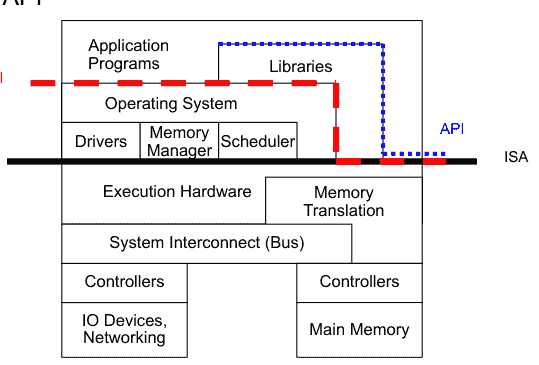

## 体系结构、实现层

### 实现层：ISA

- 指令集体系结构
- 划分硬件和软件
- ISA的概念源于IBM 360
  - IBM System/360型号（20、40、30、50、60、62、70、92、44、57、65、67、75、91、25、85、95、195、22）：1964~1971
  - 价格、处理能力、处理单元、设备各不相同
  - 但保证了*软件兼容性*
- 用户ISA和系统ISA

### 实现ISA

- 从系统角度看机器
  - ISA提供了系统和机器之间的接口

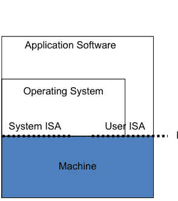

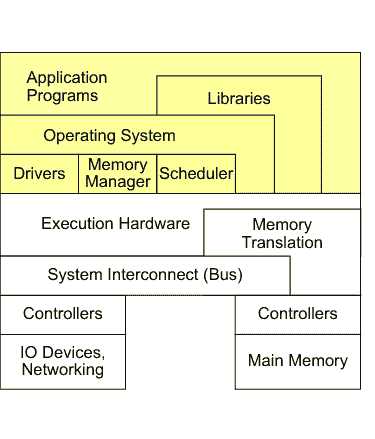

问题：ISA模拟？

### 实现层：ABI

- 应用二进制接口
- 为程序提供访问系统中硬件资源和服务的能力
- 由_用户ISA_和_系统调用接口_组成

### 实现ABI

- 从进程角度看机器
  - ABI提供了进程和机器之间的接口

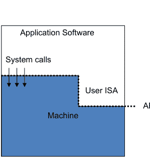

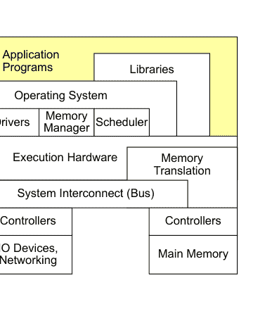

问题：ABI模拟？

### 实现层：API

- 应用程序编程接口
- 关键要素是标准库（或库）
- 通常在高级语言的源代码级别定义
- Unix环境中的`clib`：支持UNIX/C编程语言

## 为什么学习操作系统？

操作系统是一个成熟的领域

- 很难让人们切换操作系统
  - 那么为什么？
- 很多事情都是操作系统问题
  - 高性能
  - 资源消耗
  - 电池寿命、无线电频谱
  - 安全需要坚实的基础
  - 新的“智能”设备需要新的操作系统

问：哪些应用与操作系统高度相关，哪些不是？

操作系统是广泛的“系统领域”的核心

许多系统公司

- 微软、谷歌、IBM、EMC、CISCO、VMware
- 谷歌的核心是什么？
  - Google Cluster、GFS、MapReduce、BigTable
- 扎实的操作系统知识是获得好offer/晋升的必要条件
  - 在这些公司和顶尖大学

## 真实机器 vs. 抽象机器

许多课程强调抽象

- 抽象数据类型
- 渐近分析

这些抽象有局限性

- 尤其是在存在错误的情况下
- 需要理解底层实现的细节

学习这门课程的有用成果

- 成为更高效的程序员
  - 能够高效地发现和消除错误
  - 能够理解和调优程序性能
- 理解真实复杂系统的设计和实现
- 尝试自己构建一个（如图灵奖级别的操作系统）

## “简单”真的简单吗？

### 一个简单的程序？

```
#include <stdio.h>
int main() {
    printf("hello world\n");
    return 0;
}
```

### 它是如何执行的？

它如何被翻译成机器代码？

程序具体是如何执行的？

链接、加载、执行、结束？


## 课程视角

我们的课程以程序员为中心

目的是展示通过了解底层系统，可以更有效地作为程序员

使你能够

- 编写更可靠和高效的程序
- 集成需要操作系统钩子的功能
  - 例如，并发、信号处理程序
- 构建一个操作系统！

涵盖本课程中其他地方看不到的材料

不仅仅是一门为狂热黑客准备的课程

### 大纲

为什么我们要学习操作系统？

课程信息

操作系统的 8 个问题

## 教师信息

讲师

XIA Yubin 夏虞斌  CHEN Rong 陈榕

办公室：软件楼 3-402 室

办公时间：周五 13:00~14:00

联系方式：

xiayubin@sjtu.edu.cn, rongchen@sjtu.edu.cn

助教

- DONG Mingkai  MinGkaiDong@gmail.com
- YU Qianqian  kiki_yu@foxmail.com
- ZHENG Yang  tomsun.0.7@gmail.com

## 参考书籍

xv6: 一个简单的类 Unix 教学操作系统。
作者：Russ Cox, Frans Kaashoek, Robert Morris。
在线

Understanding Linux Kernel。

## 实验

实现 JOS：改编自 MIT 6.828 课程

- Lab1: 启动一台 PC
- Lab2: 内存管理
- Lab3: 用户环境
- Lab4:抢占式多任务

- *Lab 5: XXX
- *Lab 6: XXX

## Lab 1 启动 PC

熟悉 PC 启动过程

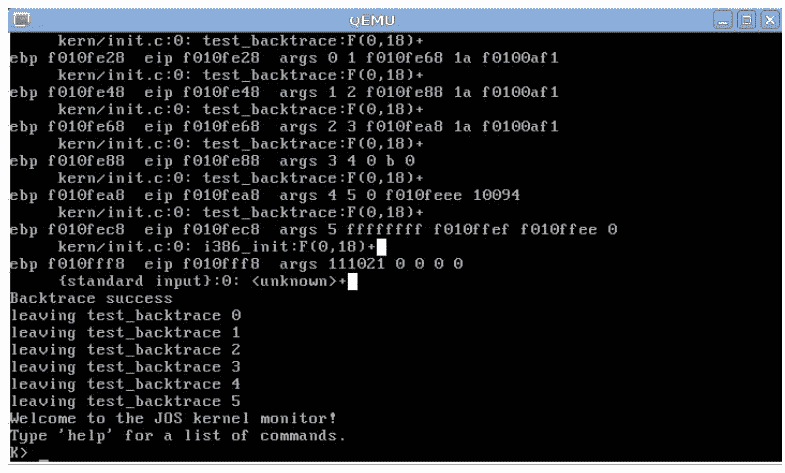

## Lab2 内存管理

为 JOS 设置虚拟内存映射

```
QEMU
SeaBIOS (version pre-0.6.3-20110315_112143-titi)

iPXE v1.0.0-591-g7aee315
iPXE (http://ipxe.org) 00:03.0 C900 PCI2.10 PnP PMM+07FC8D60+07F88D60 C900

Booting from Hard Disk...
6828 decimal is 15254 octal!
chnum1: 28 chnum2: 29
chnum1: -1
Physical memory: 66556K available, base = 640K, extended = 65532K
before check page allocate and page free
    page_free_list size: 16482--------------------------------
check_page_alloc() succeeded!
check_four_pages() succeeded!
check_page() succeeded!
after check page allocate and page free
    page_free_list size: 16482--------------------------------
check_kern_pgdir() succeeded!
check_page_installed_pgdir() succeeded!
Welcome to the JOS kernel monitor!
Type 'help' for a list of commands.
K> _
```

## Lab3: 用户环境

JOS 中的环境 = Linux 中的进程

在本实验中，只有一个单核上的环境

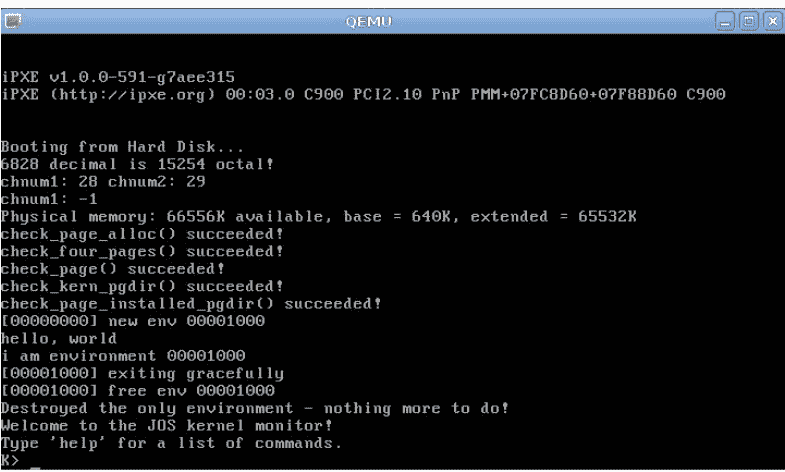

## Lab4: 抢占式多任务

多核

抢占式多任务

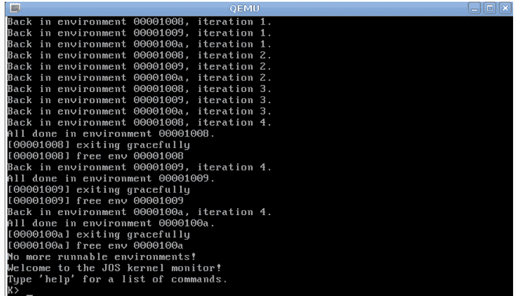

## 构建你的操作系统

将提供支持代码

仍然是一项困难但有趣的工作

提示：尽早开始工作并努力工作

## 实验规则

个人项目

不要从他人那里复制任何代码

可以阅读但不要复制其他操作系统（Linux、Open/FreeBSD 等。）

引用任何启发你代码的代码

请不要在 BBS/论坛上发布任何“攻略”或代码

## 评分

## 总体（暂定）

Lab 1~4：40%

期末考试：40%

实验将反映在考试中

作业：10%

帮助你理解操作系统/实验

课程表现（5%）

课堂问答、演讲

加分（5%）：Lab5 & Lab6

必须完成两者才能至少获得 80% 分数


## 操作系统中的 8 个重要问题

## 8 个重要问题
（非排名）

- 扩展
- 安全与隐私
- 能效
- 移动性
- 编写正确的（并行）代码
- 扩展外
- 非易失性存储
- 虚拟化

### #1：扩展（或性能可扩展性）

## 多核演进

多核最近在商业上很普遍
芯片上八核和十二核很常见
未来不久单芯片上将出现数百个核心

挑战#1：使软件性能跟上摩尔定律

1X

4X

8X

64X


## 为什么操作系统重要？

这里的操作系统术语

广义定义，包括 hypervisor、操作系统、
运行时环境

操作系统管理并隐藏应用程序的资源

- 隐藏繁琐复杂的低级细节
- 为应用程序提供执行环境

在许多情况下，操作系统决定应用程序性能

许多应用程序花费大量时间在系统软件中


### 操作系统遇上多核

20年前的操作系统

- 享受硬件带来的免费午餐（摩尔定律）
- 想起安迪-比尔定律

多核：免费午餐的终结！

- 软件必须随硬件变化而演进

操作系统：在应用程序与硬件之间架起桥梁的关键角色

- 需要随多核演进自身
- 需要为多核上的应用而演进

### 什么是可扩展性？

应用程序在N个核上完成的工作量应是在1个核上完成工作量的N倍

可扩展性可能受阿姆达尔定律限制：

锁、共享数据结构……共享硬件
（DRAM、NIC……）

1 / ((1 - P) + P/S)

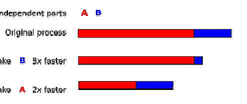

### 激励示例：文件描述符

### 理想的文件描述符性能曲线

### 实际的文件描述符性能

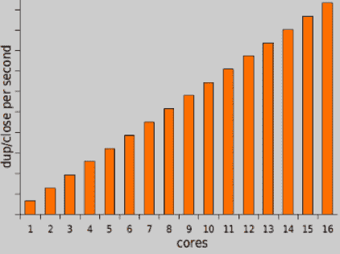

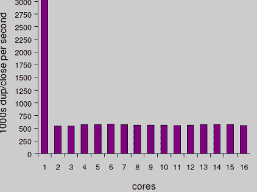

### 为什么吞吐量会下降？

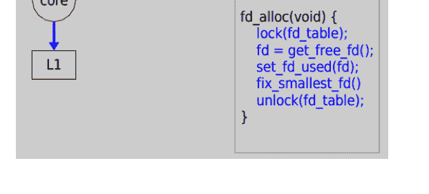

```
fd_alloc(void) {
    lock(fd_table);
    fd = get_free_fd();
    set_fd_used(fd);
    fix_smallest_fd()
    unlock(fd_table);
}
```

从L1加载fd_table数据只需3个周期。

### 现成的48核服务器

6核×8芯片 AMD

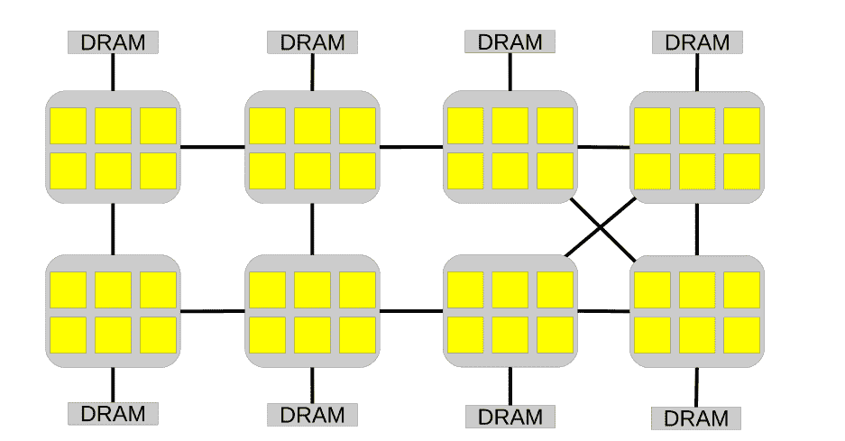

### 扩展操作系统

- 给用户应用提供更好的抽象
- 消除不可扩展的同步
- 最小化公共数据结构的共享
- 你来补充……

### 问题#2：安全与隐私

### 安全


来自维基百科：

安全是对伤害的抵抗程度或免受伤害的保护程度

### 为什么操作系统很重要？

操作系统（包括虚拟机监控器）位于计算机系统的最底层

如果不能妥善保护操作系统，如何保护你的应用和数据？

### 示例：do_brk() 漏洞

```
Asmlinkage unsigned long sys_brk(unsigned long brk) {
...
/* OK, looks good – let it rip. */
-if (do_mmap(NULL, oldbrk, newbrk-oldbrk,
-PRO T_READ|PROT_WRITE|PROT_EXEC,
-MAP_FIXED|MAP_PRIVATE, 0) != oldbrk)
+if (do_brk(oldbrk, newbrk-oldbrk) != oldbrk)
goto out;
```

- do_mmap() 做了正确的检查，do_brk() 几乎删除了所有检查
- do_brk() 的目的是加速来自 sys_brk() 的匿名 mmap 调用

### do_brk() 修复

```
if (!len)
return addr;
```

```
+ if ((addr + len)) > TASK_SIZE || (addr + len) < addr
+ return -EINVAL;
+
```

- TASK_SIZE 通常设置为 0xc0000000，即内核内存的起始地址

### 问题#3：能效

### 能效

更绿色的世界，更美好的生活！

再次强调，为什么这与操作系统有关？

操作系统控制着每台计算机和许多设备！

因此决定了每台计算机所消耗的功率


### 谷歌数据中心：芬兰


### 服务器的功率分解

| 组件 | 峰值功率 | 数量 | 总计 |
|---|---|---|---|
| CPU [16] | 40 W | 2 | 80 W |
| 内存 [18] | 9 W | 4 | 36 W |
| 磁盘 [24] | 12 W | 1 | 12 W |
| PCI插槽 [22] | 25 W | 2 | 50 W |
| 主板 | 25W | 1 | 25 W |
| 风扇 | 10 W | 1 | 10 W |
| 系统总计 |  |  | 213 W |

表1：典型服务器的组件峰值功率分解

12个变速风扇


138个风门


312个照明继电器


> 6,000 个检测与控制点

50个电气子电表


151个温度传感器


### 为什么操作系统很重要？

动态电压与频率调节
根据工作负载调整CPU频率

关闭设备以节省功耗
如磁盘、LCD，甚至内存

问题：能耗不随工作负载扩展
静态功耗、泄漏功耗

新增：近阈值电压


### Issue#4: 移动性

### 智能手机操作系统

- Symbian
- Windows Mobile
- RIM Blackberry OS
- Apple iOS
- Google Android
- Palm WebOS
- Windows Phone 7

### Android 软件栈

- Linux kernel
- Libraries
- Android run time
  - core libraries
  - Dalvik virtual machine
- application layer
- application protocol

### Android Architecture

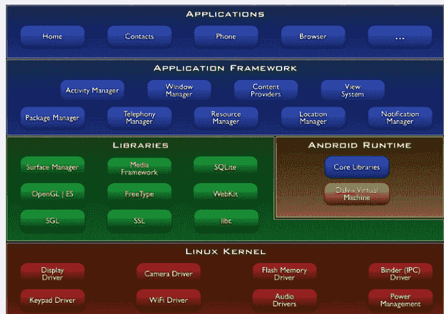

### What’s Unique for Mobile OS?

Energy Efficiency

Richer User Experience

But more limited resources

Security

More user data put into mobile OSes

### Issue#5: 编写正确的并行代码

### 编写并发程序很困难

并发程序容易出现并发错误

并发错误具有臭名昭著的特征

- Non-deterministic
- Hard to test and diagnose

但在多核时代，我们需要编写并发程序来发挥多核的性能

### Dijkstra 引言

> *I am convinced more than ever that this type of work is very difficult, and that every effort to do it with other than the best people is doomed to either failure or moderate success at enormous cost.*

*Edsger Dijkstra*
*The Structure of the “THE”–Multiprogramming System*
*1968*

### 最简单的例子

| Thread 1 | Thread 2 |
|---|---|
| ```c
if (thd->proc_info) {
    ...
    fputs(thd->proc_info, ...)
    ...
}
``` | ```c
thd->proc_info = NULL;
``` |

MySQL ha_innodb.hpp

### 解决问题的思路

- Concurrency bug detection
  - Race detection
  - Atomicity violation detection
  - Deadlock bug detection
- Concurrent program testing
  - Exhaustive testing
  - Different coverage criteria proposed
- Concurrent programming language/model design
  - Transactional memory

### Issue#6: 扩展外置（使用分布式系统）

### The Datacenter as a Computer

An Introduction to the Design of Warehouse-Scale Machines

Luiz André Barroso and Urs Hölzle
Google Inc.

SYNTHESIS LECTURES ON COMPUTER ARCHITECTURE # 6


### The Virtual Datacenter Dream

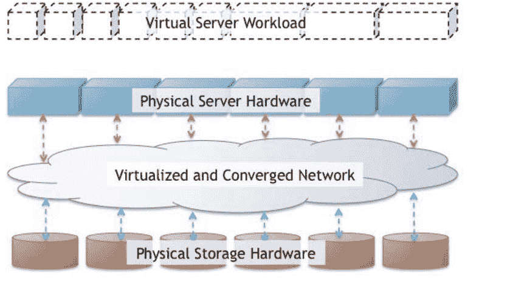

### What are distributed systems?

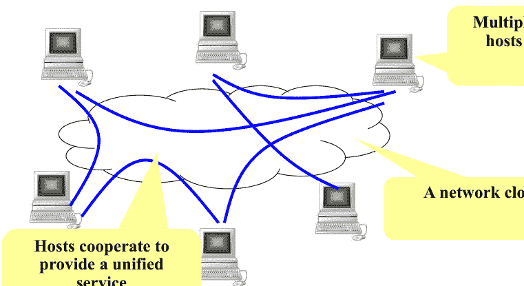

Multiple hosts

A network cloud

Hosts cooperate to provide a unified service

- Examples?

### Why distributed systems? for ease-of-use

Handle geographic separation

Provide users (or applications) with location transparency:

- Web: access information with a few “clicks”
- Network file system: access files on remote servers as if they are on a local disk, share files among multiple computers

### Why distributed systems? for availability

Build a reliable system out of unreliable parts

- Hardware can fail: power outage, disk failures, memory corruption, network switch failures...
- Software can fail: bugs, mis-configuration, upgrade ...
- To achieve 99.999% availability, replicate data/computation on many hosts with automatic failover

### Why distributed systems? for scalable capacity

Aggregate resources of many computers

- CPU: Dryad, MapReduce, Grid computing
- Bandwidth: Akamai CDN, BitTorrent
- Disk: Frangipani, Google file system

### Why distributed systems? for modular functionality

Only need to build a service to accomplish a single task well.

- Authentication server
- Backup server

### Challenges

#### System design

- What is the right interface or abstraction?
- How to partition functions for scalability?

#### Consistency

How to share data consistently among multiple readers/writers?

#### Fault Tolerance

How to keep system available despite node or network failures?

### Challenges (continued)

#### Different deployment scenarios

- Clusters
- Wide area distribution
- Sensor networks

#### Security

- How to authenticate clients or servers?
- How to defend against or audit misbehaving servers?

#### Implementation

- How to maximize concurrency?
- What’s the bottleneck?
- How to reduce load on the bottleneck resource?


## 警告

> 分布式系统就是这样一种系统：我无法完成工作，因为某个我从未听说过的计算机出故障了。
> 
> —— 莱斯利·兰波特

## 议题#7：非易失性存储

## 磁带已死
磁盘即磁带
闪存即磁盘
内存局部性为王

吉姆·格雷
微软
2006年12月

纪念吉姆·格雷


## 磁带已死
磁盘即磁带

1TB磁盘已经可用
预计5年内出现10+TB磁盘
单块磁盘成本：约400美元 → 约80美元

但：读取（顺序）约需5到15小时
读取（随机）约需15到150天

需要将大多数磁盘视为
冷存储归档

## 闪存存储？

1995年 16 Mb NAND闪存芯片
2005年 16 Gb NAND闪存
自1995年以来每年翻番
市场由手机、相机、iPod等驱动
入门成本低，
约30美元/芯片 → 约3美元/芯片
2012年 1 Tb NAND闪存
== 128 GB芯片
== 1TB或2TB“磁盘”
价格约400美元
或128GB磁盘40美元
或32GB磁盘5美元


## 存储层次结构

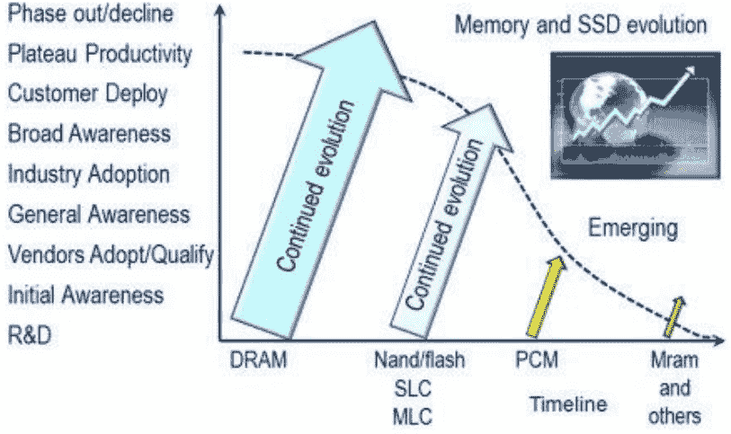

## 操作系统能做什么？

需要适应新的存储模型

非易失性改变了操作系统管理资源的方式

- 如崩溃恢复
- 回想fsck

更好的I/O性能

## 议题#8：虚拟化

> “计算机科学中的任何问题都可以通过增加一层间接层来解决。”

—— 大卫·惠勒在巴特勒·兰普森1992年ACM图灵奖演讲中的话。

## 虚拟化的概念

> “虚拟化”指的是创建虚拟机

虚拟机是一种机器的软件实现（即计算机），它像物理机一样执行程序

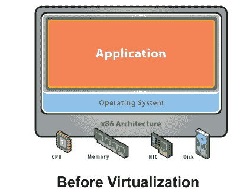

虚拟化之前

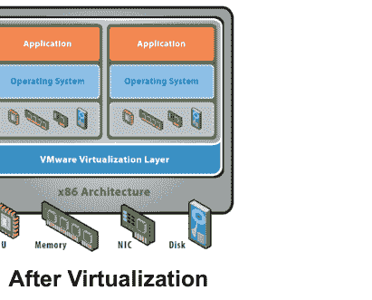

虚拟化之后

## 为什么需要虚拟化？

- 将操作系统与物理硬件解耦，支持
  - 最大化资源利用率
    - 多个操作系统环境可以共存于同一台计算机上，彼此强隔离
    - 服务器整合
  - 容错性
    - 故障与迁移
  - 可移植性
    - 可以使用任何操作系统
  - 可管理性
    - 易于维护

## 为什么要虚拟化？

服务器太多，工作太少

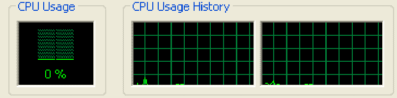

高昂的成本和基础设施需求

- 维护
- 网络
- 占地面积
- 冷却
- 电力
- 灾难恢复


## 虚拟化本质上是操作系统的另一层

进程和操作系统如何使用硬件资源？

|  | 进程 | 操作系统 |
|---|---|---|
| CPU | 非特权寄存器和指令 | +特权寄存器和指令 |
| 内存 | 虚拟内存 | +物理内存 |
| 异常 | 信号、错误 | +陷阱、中断 |
| I/O | 文件系统 | 编程I/O、DMA、中断 |

## 下次课程

PC编程入门

操作系统的启动

## 作业

- 用中文写出以下问题的答案
- 什么是do_brk()？如何利用？
  - http://www.csee.umbc.edu/courses/undergraduate/421/Spring12/02/slides/ULKV.pdf
  - 给出你自己的解释

## PC编程与启动

夏虞斌 & 陈榕

## 我们的工具

- 问答网站：
  - http://ipads.se.sjtu.edu.cn/courses/qa
- 参考资料
  - http://pdos.csail.mit.edu/6.828/2012/xv6.html
    - 包括代码和书籍
  - http://wiki.osdev.org
  - IA-32 Intel架构软件开发人员手册
    - 第3A卷：系统编程指南，第1部分
    - 第3B卷：系统编程指南，第2部分

## 从前
有一次……

- 莱昂的注释
- 基于UNIX v6
- 它不在x86上
  - 而是在PDP-11上
- Xv6
  - 是Unix v6
  - 针对x86！
  - 可运行！


## 一台 PC


如何让它做点有用的事？

## 提纲

- PC 体系结构
- 内存
- 执行
- PC 仿真

- PC 体系结构
  - 内存
  - 执行
  - PC 仿真

## PC 主板

- 奔腾 130MHz
- 处理器和风扇
- ISA 总线插槽
- 72 针 SIMM 内存插槽
- DIMM 内存插槽

## PC 主板——如今

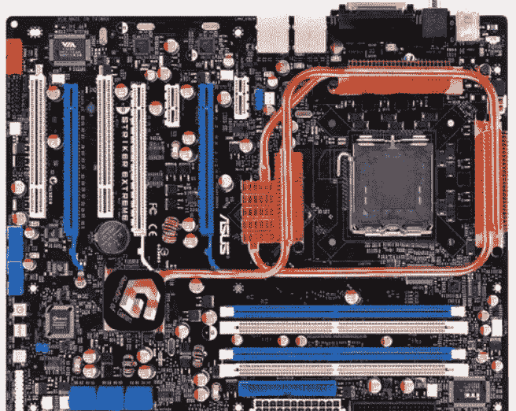

## 图灵机

计算 3+2：0000001110110000

|   |   |   |
|---|---|---|
| 1 | 0 | 0000001110110000 |
| 2 | 0 | 00 00001110110000 |
| 3 | 0 | 000 0001110110000 |
| 4 | 0 | 0000 001110110000 |
| 5 | 0 | 00000 01110110000 |
| 6 | 0 | 000000 1110110000 |
| 7 | 0 | 0000001 110110000 |
| 8 | 1 | 00000011 10110000 |
| 9 | 1 | 000000111 0110000 |
| 10 | 1 | 0000001110 110000 |
| 11 | 10 | 00000011111 10000 |
| 12 | 10 | 000000111111 0000 |
| 13 | 10 | 0000001111110 000 |
| 14 | 11 | 000000111111 10000 |
| 15 | 0 | 000000111110 0000 |

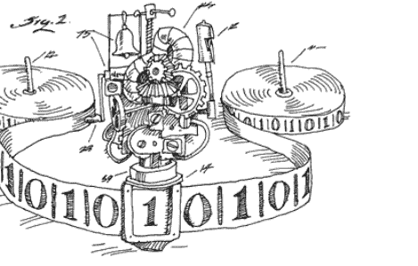


## 冯·诺依曼模型

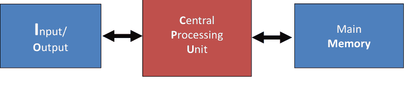

- **I/O**：与设备之间传输数据
- **CPU**：执行计算任务的数字逻辑电路
- **内存**：N 个字，每个字 B 位

## 存储程序计算机

CPU

主内存

```c
for (;;) {
  next instruction
}
```

```text
instruction
instruction
instruction
...
data
data
data
```

- **CPU** 是*指令*的解释器
- **内存** 存放*指令*和*数据*

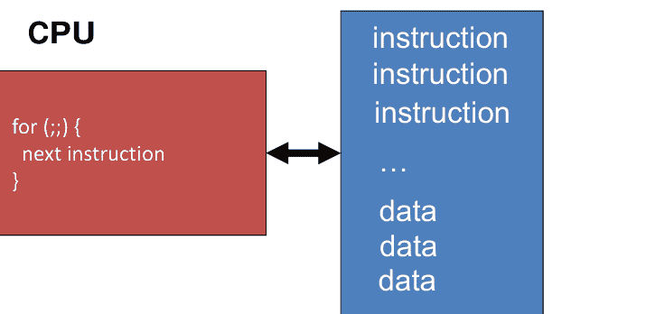

## x86 实现

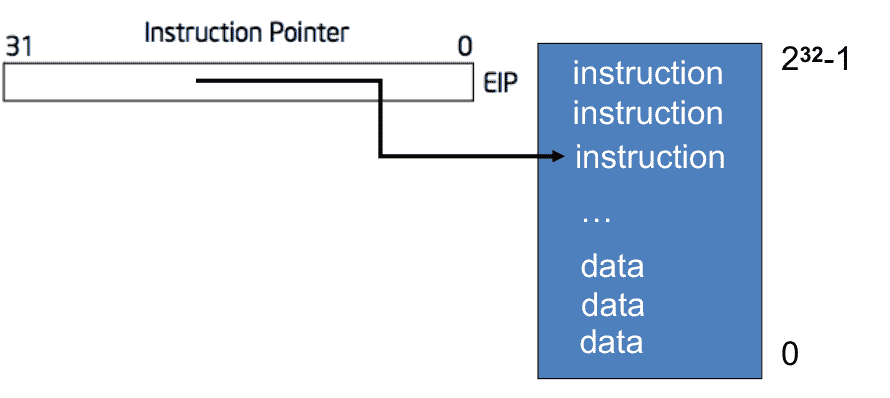

- **EIP** 在每条指令执行后递增
- 指令长度不等
- EIP 会被 CALL、RET、JMP 以及条件 JMP 修改

## 系统体系结构概述

第 3A 卷：系统编程指南，第 1 部分

- 2.1~2.5

- 模式

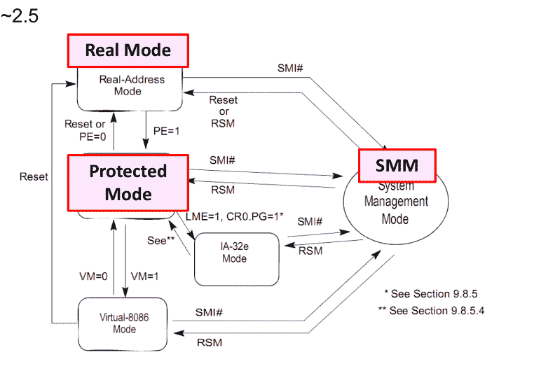

## 系统体系结构概述

- EFLAGS 中的系统标志

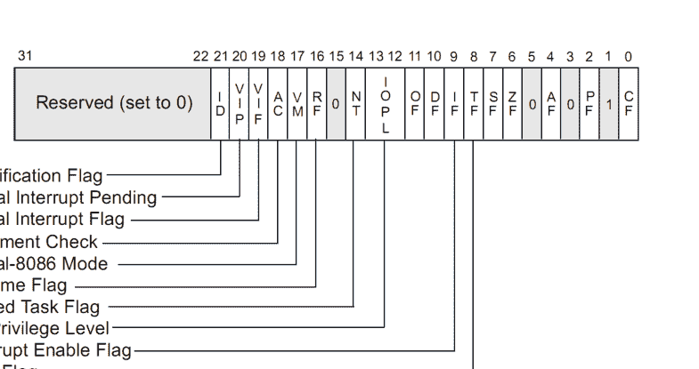

## 系统体系结构概述

- 控制寄存器

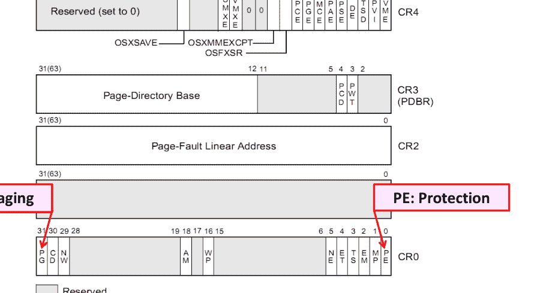

## 系统体系结构概述

- 内存管理寄存器
  - GDTR（全局描述符表寄存器）
    - 基地址、界限……
  - IDTR（中断描述符表寄存器）
    - 处理程序地址、环级别……
  - TR（任务寄存器）
    - TSS

- PC 体系结构
- **内存**
- 执行
- PC 仿真

## 内存模型

- 8086：16 位微处理器
  - 实模式：*物理地址 = 16 \* 段 + 偏移量*
  - 空间：64KB
- 外部地址扩展到 20 位
  - 空间：1MB
  - 额外的 4 位来自*段寄存器*
    - CS：代码段，用于 EIP
    - SS：栈段，用于 SP 和 BP
    - DS：数据段，用于通过其他寄存器进行加载/存储
    - ES：另一个数据段，字符串操作的目的地
    - *例如 CS=f000 IP=fff0 => 地址：fffff*

## 内存模型

- 80386：32 位数据和总线地址
  - 保护模式
- 现在：向 64 位地址过渡
- 向后兼容：
  - 以 16 位实模式启动，然后切换到 32 位保护模式
    - 参见：*boot/boot.S*

## 内存布局

```text
+-------------------+ <- 0xFFFFFFFF (4GB)
|  32位             |
|  内存映射         |
|  设备             |
+-------------------+
\/\/\/\/\/\/\/\/
\/\/\/\/\/\/\/\/
|      未使用       |
+-------------------+ <- 取决于内存大小
|  扩展内存         |
+-------------------+ <- 0x00100000 (1MB)
|     BIOS ROM      |
+-------------------+ <- 0x000F0000 (960KB)
|  16位设备，       |
|  扩展 ROM         |
+-------------------+ <- 0x000C0000 (768KB)
|   VGA 显示        |
+-------------------+ <- 0x000A0000 (640KB)
|    低内存         |
+-------------------+ <- 0x00000000
```


## I/O 空间

```c
#define DATA_PORT 0x378
#define STATUS_PORT 0x379
#define BUSY 0x80
#define CONTROL_PORT 0x37A
#define STROBE 0x01
void
lpt_putc(int c)
{
    /* wait for printer to consume previous byte */
    while((inb(STATUS_PORT) & BUSY) == 0)
        ;

    /* put the byte on the parallel lines */
    outb(DATA_PORT, c);

    /* tell the printer to look at the data */
    outb(CONTROL_PORT, STROBE);
    outb(CONTROL_PORT, 0);
}
```

```c
static __inline uint8_t inb(int port)
{
    uint8_t data;
    __asm __volatile("inb %w1,%0"
        : "=a" (data) : "d" (port));
    return data;
}
```

```c
static __inline void
    outb(int port, uint8_t data)
{
    __asm __volatile("outb %0,%w1"
        : : "a" (data), "d" (port));
}
```

## 内存映射 I/O

- 使用普通地址
  - 无需特殊指令
  - 无 1024 限制
  - 系统控制器路由至设备
- 像“神奇”的内存一样工作
  - 像内存一样寻址和访问
  - 但行为不像内存
  - 读写具有“副作用”
  - 读取结果可能因外部事件而改变
    - 回顾：“volatile”关键字

- PC 架构
- 内存
- 执行
- PC 仿真

## XV6 启动代码

```asm
# Start the first CPU: switch to 32-bit protected mode, jump into C.
# The BIOS loads this code from the first sector of the hard disk into
# memory at physical address 0x7c00 and starts executing in real mode
# with %cs=0 %ip=7c00.

.code16                              # Assemble for 16-bit mode
.globl start
start:
    cli                              # BIOS enabled interrupts; disable

    # Zero data segment registers DS, ES, and SS.
    xorw    %ax,%ax                  # Set %ax to zero
    movw    %ax,%ds                  # -> Data Segment
    movw    %ax,%es                  # -> Extra Segment
    movw    %ax,%ss                  # -> Stack Segment

    # Physical address line A20 is tied to zero so that the first PCs
    # with 2 MB would run software that assumed 1 MB. Undo that.
seta20.1:
    inb     $0x64,%al                # Wait for not busy
    testb   $0x2,%al
    jnz     seta20.1

    movb    $0xd1,%al                # 0xd1 -> port 0x64
    outb    %al,$0x64

seta20.2:
    inb     $0x64,%al                # Wait for not busy
    testb   $0x2,%al
    jnz     seta20.2

    movb    $0xdf,%al                # 0xdf -> port 0x60
    outb    %al,$0x60
```

```asm
# Switch from real to protected mode. Use a bootstrap GDT that makes
# virtual addresses map directly to physical addresses so that the
# effective memory map doesn't change during the transition.
lgdt gdt desc
movl %cr0, %eax
orl $CR0_PE, %eax
movl %eax, %cr0

# Complete transition to 32-bit protected mode by using long jmp
# to reload %cs and %eip. The segment descriptors are set up with no
# translation, so that the mapping is still the identity mapping.
ljmp $(SEG_KCODE<<3), $start32

.code32 # Tell assembler to generate 32-bit code now.
start32:
# Set up the protected-mode data segment registers
movw $(SEG_KDATA<<3), %ax # Our data segment selector
movw %ax, %ds # -> DS: Data Segment
movw %ax, %es # -> ES: Extra Segment
movw %ax, %ss # -> SS: Stack Segment
movw $0, %ax # Zero segments not ready for use
movw %ax, %fs # -> FS
movw %ax, %gs # -> GS

# Set up the stack pointer and call into C.
movl $start, %esp
call bootmain
```

```asm
# Bootstrap GDT
.p2align 2                         # force 4 byte alignment
gdt:
    SEG_NULLASM                    # null seg
    SEG_ASM(STA_X|STA_R, 0x0, 0xffffffff)  # code seg
    SEG_ASM(STA_W, 0x0, 0xffffffff)        # data seg

gdtdesc:
    .word   (gdtdesc - gdt - 1)             # sizeof(gdt) - 1
    .long   gdt                             # address gdt
```


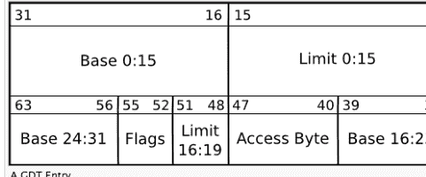

http://wiki.osdev.org/Global_Descriptor_Table

```c
void
bootmain(void)
{
    struct elfhdr *elf;
    struct proghdr *ph, *eph;
    void (*entry)(void);
    uchar* pa;

    elf = (struct elfhdr*)0x10000;  // scratch space

    // Read 1st page off disk
    readseg((uchar*)elf, 4096, 0);

    // Is this an ELF executable?
    if(elf->magic != ELF_MAGIC)
        return;  // let bootasm.S handle error

    // Load each program segment (ignores ph flags).
    ph = (struct proghdr*)((uchar*)elf + elf->phoff);
    eph = ph + elf->phnum;
    for(; ph < eph; ph++){
        pa = (uchar*)ph->paddr;
        readseg(pa, ph->filesz, ph->off);
        if(ph->memsz > ph->filesz)
            stosb(pa + ph->filesz, 0, ph->memsz - ph->filesz);
    }

    // Call the entry point from the ELF header.
    // Does not return!
    entry = (void(*)(void))(elf->entry);
    entry();
}
```


## Elf 文件映像

text.offset text.filesz data.offset data.filesz

Elf 头部 文本（代码） 头部 数据 文本（代码） 数据

## 内存中的可执行文件

text.memsz data.memsz text.vaddr data.vaddr

文本（代码） 数据 栈（4096）

可执行映像和 ELF 二进制文件可以相互映射

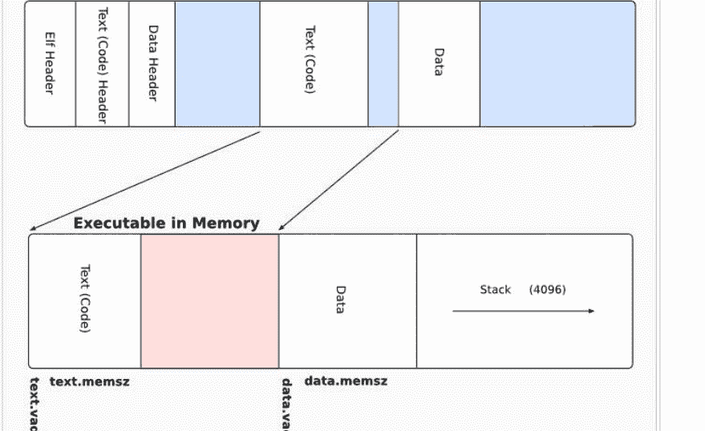

```
void
readsect(void *dst, uint offset)
{
    // Issue command.
    waitdisk();
    outb(0x1F2, 1);    // count = 1
    outb(0x1F3, offset);
    outb(0x1F4, offset >> 8);
    outb(0x1F5, offset >> 16);
    outb(0x1F6, (offset >> 24) | 0xE0);
    outb(0x1F7, 0x20);  // cmd 0x20 - read sectors

    // Read data.
    waitdisk();
    insl(0x1F0, dst, SECTSIZE/4);
}

// Read 'count' bytes at 'offset' from kernel into physical address 'pa'.
// Might copy more than asked.
void
readseg(uchar* pa, uint count, uint offset)
{
    uchar* epa;

    epa = pa + count;

    // Round down to sector boundary.
    pa -= offset % SECTSIZE;

    // Translate from bytes to sectors; kernel starts at sector 1.
    offset = (offset / SECTSIZE) + 1;

    // If this is too slow, we could read lots of sectors at a time.
    // We'd write more to memory than asked, but it doesn't matter --
    // we load in increasing order.
    for(; pa < epa; pa += SECTSIZE, offset++)
        readsect(pa, offset);
}
```

```
# By convention, the _start symbol specifies the ELF entry point.
# Since we haven't set up virtual memory yet, our entry point is
# the physical address of 'entry'.
.globl _start
_start = V2P_WO(entry)

# Entering xv6 on boot processor, with paging off.
.globl entry
entry:
    # Turn on page size extension for 4Mbyte pages
    movl    %cr4, %eax
    orl     $(CR4_PSE), %eax
    movl    %eax, %cr4
    # Set page directory
    movl    $(V2P_WO(entrypgdir)), %eax
    movl    %eax, %cr3
    # Turn on paging.
    movl    %cr0, %eax
    orl     $(CR0_PG|CR0_WP), %eax
    movl    %eax, %cr0

# Set up the stack pointer.
movl $(stack + KSTACKSIZE), %esp

# Jump to main(), and switch to executing at
# high addresses. The indirect call is needed because
# the assembler produces a PC-relative instruction
# for a direct jump.
mov $main, %eax
jmp *%eax

.comm stack, KSTACKSIZE
```

```
static void startothers(void);
static void mpmain(void) __attribute__((noreturn));
extern pde_t *kpgdir;
extern char end[]; // first address after kernel loaded from ELF file

// Bootstrap processor starts running C code here.
// Allocate a real stack and switch to it, first
// doing some setup required for memory allocator to work.
int
main(void)
{
    kinit1(end, P2V(4*1024*1024)); // phys page allocator
    kvmalloc();     // kernel page table
    mpinit();       // collect info about this machine
    lapicinit(mpcpu());
    seginit();      // set up segments
    cprintf("\ncpu%d: starting xv6\n\n", cpu->id);
    picinit();      // interrupt controller
    ioapicinit();   // another interrupt controller
    consoleinit();  // I/O devices & their interrupts
    uartinit();     // serial port
    pinit();        // process table
    tvinit();       // trap vectors
    binit();        // buffer cache
    fileinit();     // file table
    iinit();        // inode cache
    ideinit();      // disk
    if (!ismp)
        timerinit();    // uniprocessor timer
    startothers();  // start other processors
    kinit2(P2V(4*1024*1024), P2V(PHYSTOP)); // must come after startothers()
    userinit();     // first user process
    // Finish setting up this processor in mpmain.
    mpmain();
}
```

- PC 架构
- 内存
- 执行
- PC 仿真

## 使用 PC 仿真器进行开发

- Bochs PC 仿真器
  - **确实** 做了真实 PC **做** 的事情
  - 仅在软件中实现！

像普通程序一样在“宿主”操作系统上运行

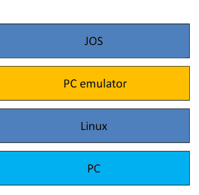

## CPU 仿真

```c
for (;;) {
    read_instruction();
    switch (decode_instruction_opcode()) {
    case OPCODE_ADD:
        int src = decode_src_reg();
        int dst = decode_dst_reg();
        regs[dst] = regs[dst] + regs[src];
        break;
    case OPCODE_SUB:
        int src = decode_src_reg();
        int dst = decode_dst_reg();
        regs[dst] = regs[dst] - regs[src];
        break;
    ...
    }
    eip += instruction_length;
}
```

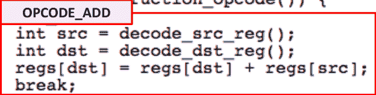


## 内存仿真

```
int32_t regs[8];
#define REG_EAX 1;
#define REG_EBX 2;
#define REG_ECX 3;
...
int32_t eip;
int16_t segregs[4];
...

char mem[256*1024*1024];
```

## x86 内存仿真

```
uint8_t read_byte(uint32_t phys_addr) {
    if (phys_addr < LOW_MEMORY)
        return low_mem[phys_addr];
    else if (phys_addr >= 960*KB && phys_addr < 1*MB)
        return rom_bios[phys_addr - 960*KB];
    else if (phys_addr >= 1*MB && phys_addr < 1*MB+EXT_MEMORY) {
        return ext_mem[phys_addr-1*MB];
    else ...
}

void write_byte(uint32_t phys_addr, uint8_t val) {
    if (phys_addr < LOW_MEMORY)
        low_mem[phys_addr] = val;
    else if (phys_addr >= 960*KB && phys_addr < 1*MB)
        ; /* ignore attempted write to ROM! */
    else if (phys_addr >= 1*MB && phys_addr < 1*MB+EXT_MEMORY) {
        ext_mem[phys_addr-1*MB] = val;
    else ...
}
```

低内存

扩展内存

## 设备仿真

- 硬盘：使用主机的一个文件
- VGA显示：在主机窗口中绘制
- 键盘：主机的键盘API
- 时钟芯片：主机的时钟
- 等等。

## 为什么需要仿真器

- 操作系统测试与调试
- 提高利用率
- 正如IBM虚拟化的原因
  - IBM的M44/44X，在20世纪60年代

## 致谢

下次课程：

PC启动与操作系统结构简介

## Xv6 启动与操作系统结构

Yubin Xia & Rong Chen

部分幻灯片基于Frans Kaashoek的幻灯片
[kaashoek@mit.edu](kaashoek@mit.edu)

## 回顾

- PC架构
  - 冯·诺依曼模型
- X86
  - 模式：实模式 / 保护模式 / SMM / ...
  - 寄存器：EFLAGS, CR[0-4], GDTR, IDTR, ...
  - 内存模型：16位 / 20位 / 32位 / 36位 / 64位
    - 内存映射I/O
    - 低内存：0-640 KB，扩展内存：1MB以上
  - 启动
    - BIOS：0xFFFF0（段是什么，偏移是什么？）
    - 第一条指令：0x7c00（什么指令？）

## XV6 启动代码

## Makefile

```
82 xv6.img: bootblock kernel fs.img
83   dd if=/dev/zero of=xv6.img count=10000
84   dd if=bootblock of=xv6.img conv=notrunc
85   dd if=kernel of=xv6.img seek=1 conv=notrunc
```

```
92 bootblock: bootasm.S bootmain.c
93   $(CC) $(CFLAGS) -fno-pic -O -nostdinc -I. -c bootmain.c
94   $(CC) $(CFLAGS) -fno-pic -nostdinc -I. -c bootasm.S
95   $(LD) $(LDFLAGS) -N -e start -Ttext 0x7C00 -o bootblock.o bootasm.o bootmain.o
96   $(OBJDUMP) -S bootblock.o > bootblock.asm
97   $(OBJCOPY) -S -O binary -j .text bootblock.o bootblock
98   ./sign.pl bootblock
```

Sign.pl

```
13
14 $buf .= "\0" x (510-$n);
15 $buf .= "\x55\xAA";
16
```

```
# Start the first CPU: switch to 32-bit protected mode, jump into C.
# The BIOS loads this code from the first sector of the hard disk into
# memory at physical address 0x7c00 and starts executing in real mode
# with %cs=0 %ip=7c00.

.code16              # Assemble for 16-bit mode
.globl start
start:
    cli                 # BIOS enabled interrupts; disable

    # Zero data segment registers DS, ES, and SS.
    xorw    %ax,%ax        # Set %ax to zero
    movw    %ax,%ds        # -> Data Segment
    movw    %ax,%es        # -> Extra Segment
    movw    %ax,%ss        # -> Stack Segment

    # Physical address line A20 is tied to zero so that the first PCs
    # with 2 MB would run software that assumed 1 MB. Undo that.
seta20.1:
    inb    $0x64,%al       # Wait for not busy
    testb  $0x2,%al
    jnz    seta20.1

    movb   $0xd1,%al       # 0xd1 -> port 0x64
    outb   %al,$0x64

seta20.2:
    inb    $0x64,%al       # Wait for not busy
    testb  $0x2,%al
    jnz    seta20.2

    movb   $0xdf,%al       # 0xdf -> port 0x60
    outb   %al,$0x60
```

```
# Switch from real to protected mode. Use a bootstrap GDT that makes
# virtual addresses map directly to physical addresses so that the
# effective memory map doesn't change during the transition.
lgdt gdt desc
movl %cr0, %eax
orl $CR0_PE, %eax
movl %eax, %cr0

# Complete transition to 32-bit protected mode by using long jmp
# to reload %cs and %eip. The segment descriptors are set up with no
# translation, so that the mapping is still the identity mapping.
ljmp $(SEG_KCODE<<3), $start32

.code32 # Tell assembler to generate 32-bit code now.
start32:
# Set up the protected-mode data segment registers
movw $(SEG_KDATA<<3), %ax # Our data segment selector
movw %ax, %ds # -> DS: Data Segment
movw %ax, %es # -> ES: Extra Segment
movw %ax, %ss # -> SS: Stack Segment
movw $0, %ax # Zero segments not ready for use
movw %ax, %fs # -> FS
movw %ax, %gs # -> GS

# Set up the stack pointer and call into C.
movl $start, %esp
call bootmain
```


## Bootstrap GDT
.p2align 2                         # force 4 byte alignment
gdt:
    SEG_NULLASM                    # null seg
    SEG_ASM(STA_X|STA_R, 0x0, 0xffffffff)  # code seg
    SEG_ASM(STA_W, 0x0, 0xffffffff)        # data seg

gdtdesc:
    .word   (gdtdesc - gdt - 1)             # sizeof(gdt) - 1
    .long   gdt                             # address gdt

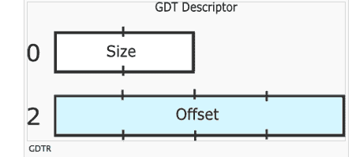


http://wiki.osdev.org/Global_Descriptor_Table

```c
void
bootmain(void)
{
    struct elfhdr *elf;
    struct proghdr *ph, *eph;
    void (*entry)(void);
    uchar* pa;

    elf = (struct elfhdr*)0x10000;  // scratch space

    // Read 1st page off disk
    readseg((uchar*)elf, 4096, 0);

    // Is this an ELF executable?
    if(elf->magic != ELF_MAGIC)
        return;  // let bootasm.S handle error

    // Load each program segment (ignores ph flags).
    ph = (struct proghdr*)((uchar*)elf + elf->phoff);
    eph = ph + elf->phnum;
    for(; ph < eph; ph++){
        pa = (uchar*)ph->paddr;
        readseg(pa, ph->filesz, ph->off);
        if(ph->memsz > ph->filesz)
            stosb(pa + ph->filesz, 0, ph->memsz - ph->filesz);
    }

    // Call the entry point from the ELF header.
    // Does not return!
    entry = (void(*)(void))(elf->entry);
    entry();
}
```

```c
void
readsect(void *dst, uint offset)
{
    // Issue command.
    waitdisk();
    outb(0x1F2, 1);    // count = 1
    outb(0x1F3, offset);
    outb(0x1F4, offset >> 8);
    outb(0x1F5, offset >> 16);
    outb(0x1F6, (offset >> 24) | 0xE0);
    outb(0x1F7, 0x20);  // cmd 0x20 - read sectors

    // Read data.
    waitdisk();
    insl(0x1F0, dst, SECTSIZE/4);
}

// Read 'count' bytes at 'offset' from kernel into physical address 'pa'.
// Might copy more than asked.
void
readseg(uchar* pa, uint count, uint offset)
{
    uchar* epa;

    epa = pa + count;

    // Round down to sector boundary.
    pa -= offset % SECTSIZE;

    // Translate from bytes to sectors; kernel starts at sector 1.
    offset = (offset / SECTSIZE) + 1;

    // If this is too slow, we could read lots of sectors at a time.
    // We'd write more to memory than asked, but it doesn't matter --
    // we load in increasing order.
    for(; pa < epa; pa += SECTSIZE, offset++)
        readsect(pa, offset);
}
```

## ELF Header :

ELF 头位于开头并保存着描述文件组织的路线图

```
#define EI_NIDENT 16
typedef struct {
    unsigned char e_ident [EI_NIDENT];
    Elf32_Half e_type;
    Elf32_Half e_machine ;
    Elf32_Word e_version ;
    Elf32_Addr e_entry ;
    Elf32_Off e_phoff;
    Elf32_Off e_shoff;
    Elf32_Word e_flags ;
    Elf32_Half e_ehsize ;
    Elf32_Half e_phentsize ;
    Elf32_Half e_phnum ;
    Elf32_Half e_shentsize ;
    Elf32_Half e_shnum ;
    Elf32_Half e_shstrndx ;
}Elf32_Ehdr ;
```

e_machine : 指定所需架构 :0 = 无机器 ... 3 = Intel 80386 4 = Motorola 68000 ...8 = MIPS RS3000

e_entry : 系统首次向其转移控制的虚拟地址，在启动进程时。如果文件没有关联的入口点，则此成员为零。

e_shoff : 保存节头表的字节文件偏移量。如果文件没有节头表，则此成员为零。

| 名称 | 大小 | 对齐 | 用途 |
|---|---|---|---|
| Elf32_Addr | 4 | 4 | 无符号程序地址 |
| Elf32_Half | 2 | 2 | 无符号中等整数 |
| Elf32_Off | 4 | 4 | 无符号文件偏移 |
| Elf32_Sword | 4 | 4 | 有符号大整数 |
| Elf32_Word | 4 | 4 | 无符号大整数 |
| Unsigned char | 1 | 1 | 无符号小整数 |

## Elf File Image

## Executable in Memory

text.offset text.filesz data.offset data.filesz

Elf Header Text (Code) Header Data Header Text (Code) Data

Text (Code) Data Stack (4096)

text.memsz data.memsz text.vaddr data.vaddr

可执行映像和 elf 二进制文件可以相互映射


# 按惯例，_start 符号指定 ELF 入口点。
# 由于我们尚未设置虚拟内存，我们的入口点是
# 'entry' 的物理地址。
.globl _start
_start = V2P_WO(entry)

# 在引导处理器上进入 xv6，分页关闭。
.globl entry
entry:
    # 为 4M 字节页面打开页面大小扩展
    movl    %cr4, %eax
    orl     $(CR4_PSE), %eax
    movl    %eax, %cr4
    # 设置页目录
    movl    $(V2P_WO(entrypgdir)), %eax
    movl    %eax, %cr3
    # 打开分页。
    movl    %cr0, %eax
    orl     $(CR0_PG|CR0_WP), %eax
    movl    %eax, %cr0

# 设置栈指针。
movl $(stack + KSTACKSIZE), %esp

# 跳转到 main()，并切换到高地址执行。需要间接调用是因为
# 汇编器为直接跳转生成 PC 相对指令
mov $main, %eax
jmp *%eax

.comm stack, KSTACKSIZE

Page Size Extension (PSE): for 4M pages

entry.S

static void startothers(void);
static void mpmain(void) __attribute__((noreturn));
extern pde_t *kpgdir;
extern char end[]; // first address after kernel loaded from ELF file

// Bootstrap processor starts running C code here.
// Allocate a real stack and switch to it, first
// doing some setup required for memory allocator to work.
int
main(void)
{
    kinit1(end, P2V(4*1024*1024)); // phys page allocator
    kvmalloc();     // kernel page table
    mpinit();       // collect info about this machine
    lapicinit(mpcpu());
    seginit();      // set up segments
    cprintf("\ncpu%d: starting xv6\n\n", cpu->id);
    picinit();      // interrupt controller
    ioapicinit();   // another interrupt controller
    consoleinit();  // I/O devices & their interrupts
    uartinit();     // serial port
    pinit();        // process table
    tvinit();       // trap vectors
    binit();        // buffer cache
    fileinit();     // file table
    iinit();        // inode cache
    ideinit();      // disk
    if (!ismp)
        timerinit();    // uniprocessor timer
    startothers();  // start other processors
    kinit2(P2V(4*1024*1024), P2V(PHYSTOP)); // must come after startothers()
    userinit();     // first user process
    // Finish setting up this processor in mpmain.
    mpmain();
}

## PC PROGRAMMING

- PC Architecture
- Memory
- Execution
- PC Emulation

## Emulation of CPU

```
for (;;) {
    read_instruction();
    switch (decode_instruction_opcode()) {
    case OPCODE_ADD:
        int src = decode_src_reg();
        int dst = decode_dst_reg();
        regs[dst] = regs[dst] + regs[src];
        break;
    case OPCODE_SUB:
        int src = decode_src_reg();
        int dst = decode_dst_reg();
        regs[dst] = regs[dst] - regs[src];
        break;
    ...
    }
    eip += instruction_length;
}
```

## Emulation of Memory

```
int32_t regs[8];
#define REG_EAX 1;
#define REG_EBX 2;
#define REG_ECX 3;
...
int32_t eip;
int16_t segregs[4];
...

char mem[256*1024*1024];
```

## Emulation of x86 Memory

```c
uint8_t read_byte(uint32_t phys_addr) {
    if (phys_addr < LOW_MEMORY)
        return low_mem[phys_addr];
    else if (phys_addr >= 960*KB && phys_addr < 1*MB)
        return rom_bios[phys_addr - 960*KB];
    else if (phys_addr >= 1*MB && phys_addr < 1*MB+EXT_MEMORY) {
        return ext_mem[phys_addr-1*MB];
    }
    else ...
}

void write_byte(uint32_t phys_addr, uint8_t val) {
    if (phys_addr < LOW_MEMORY)
        low_mem[phys_addr] = val;
    else if (phys_addr >= 960*KB && phys_addr < 1*MB)
        ; /* ignore attempted write to ROM! */
    else if (phys_addr >= 1*MB && phys_addr < 1*MB+EXT_MEMORY) {
        ext_mem[phys_addr-1*MB] = val;
    }
    else ...
}
```

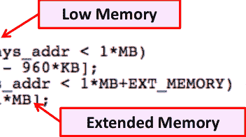

## Emulation of Devices

- Hard disk: using a file of the host
- VGA display: draw in a host window
- Keyboard: host’s keyboard API
- Clock chip: host’s clock
- Etc.


## 为什么需要模拟器

- 操作系统测试与调试
- 提高利用率

- 就像 IBM 虚拟化的原因一样
  - IBM 的 M44/44X，1960 年代

## 操作系统
架构

## 操作系统设计与实现

操作系统的设计与实现并非“可解”，但某些方法已被证明是成功的

- 不同操作系统的内部结构可能差异很大
- 从定义目标和规范开始
- 受硬件选择、系统类型的影响

> 记住“**Worse is better design**”

## 操作系统设计与实现

*用户* 目标和 *系统* 目标

### 用户目标

操作系统应方便使用、易于学习、可靠、安全且快速

### 系统目标

操作系统应易于设计、实现和维护，同时具有灵活性、可靠性、无错误和高效性

## 操作系统设计与实现（续）

需要分离的重要原则

**策略：** 将做什么？
**机制：** 如何做？

机制决定如何做某事

# 策略决定将做什么

将策略与机制分离是一个非常重要的原则

如果以后要更改策略决策，它允许最大程度的灵活性

## 简单结构

MS-DOS – 编写时旨在在最小空间内提供最多的功能（1981~1994）

未划分为模块

尽管 MS-DOS 有一定的结构，但其接口和功能级别并未很好地分离


## MS-DOS 层结构

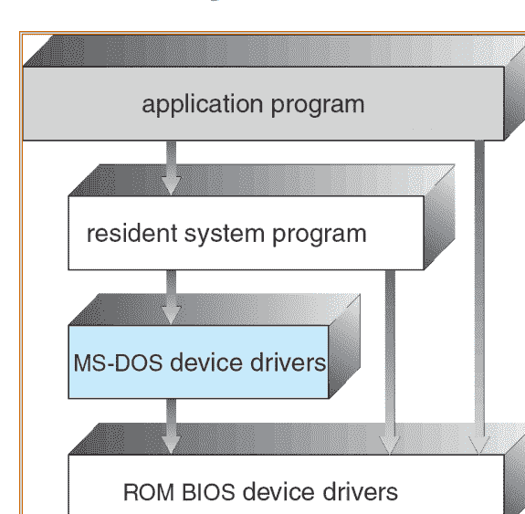

## 分层方法

操作系统被划分为若干层（级别）

- 每层都建立在较低层之上。
- 底层（第 0 层）是硬件；
- 最高层（第 N 层）是用户界面。

具有模块化，层被选择使得

- 每一层仅使用较低层的功能（操作）和服务

## 分层操作系统

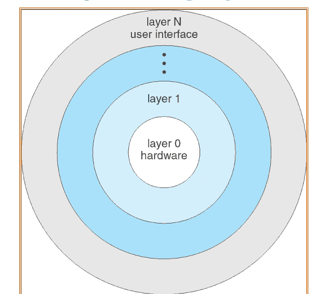

## UNIX

### UNIX – 受硬件功能限制

原始的 UNIX 操作系统具有有限的结构。

### UNIX 操作系统由两个可分离的部分组成

- 系统程序
- 内核

由系统调用接口以下和物理硬件以上的全部内容组成

提供文件系统、CPU 调度、内存管理以及其他操作系统功能；一个级别包含大量功能

## 微内核系统结构

将尽可能多的内容从内核移至“用户”空间

用户模块之间的通信使用消息传递进行

优点：
- 更容易扩展微内核
- 更容易将操作系统移植到新架构
- 更可靠（内核模式下运行的代码更少）
- 更安全

缺点：
- 用户空间到内核空间通信的性能开销

## 微内核结构与实例

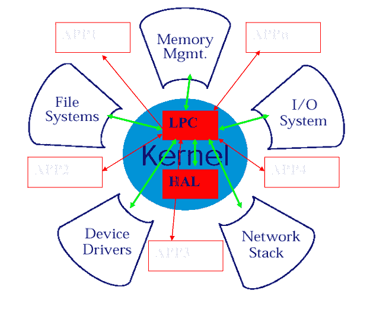

## 外核结构

### 概述

让内核将机器的物理资源分配给多个应用程序，并

让每个程序自行决定如何使用这些资源。

程序可以链接到一个操作系统库（libOS），该库实现操作系统抽象。

## 外核与 Corey

外核 [SOSP’95]
- 内核分类
- 动机
- 设计与实现
- 评估

Corey [OSDI’08]
- 多核时代与可扩展性问题
- 共享与地址范围
- 总结

## 内核

内核分类（wikipedia）

| 内核（架构） | 单体内核 | 微内核 | **外核** | 混合 |
|---|---|---|---|---|

### 单体内核

**单体内核** 是一种操作系统架构，其中整个操作系统在内核空间工作，并且单独处于监督模式。

Linux，BSD…


## 内核

## 微内核
是能够提供实现操作系统（OS）所需机制的最少量软件。

底层地址空间管理、线程管理和进程间通信（IPC）等等……

Mach、L4 内核

## 混合内核
是一种基于结合微内核和单内核架构特点的内核架构，用于计算机操作系统中。

Windows NT 内核

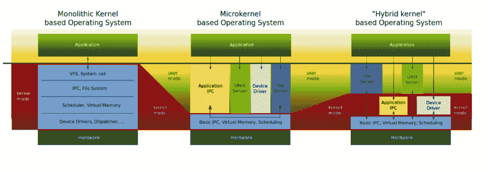

## 基于单内核的操作系统

## 基于微内核的操作系统

## 基于“混合内核”的操作系统

## 动机

## Exokernel 的动机

在传统操作系统中，*只有* <u>特权服务器</u> 和 <u>内核</u> 才能管理系统资源

不可信的应用需要通过某种<u>抽象模型</u>与硬件交互

*文件系统*用于磁盘存储，*虚拟地址空间*用于内存，等等。

## 应用程序的需求差异巨大！！

一个为适应所有应用程序而设计的接口必须预见到**所有可能的需求**

## Exokernel 的思想

让不可信的应用对物理资源拥有尽可能**多的控制**

尽可能**少的抽象**强加给开发者，使他们能够对硬件抽象做出尽可能**多的决策**。

- 让*内核*分配机器的基本物理资源
- 让*每个程序*决定如何使用这些资源

Exokernel 将*保护*与*管理*分离

- 它们**保护**资源，但将**管理**委托给应用程序

## 库操作系统

大多数程序将与*库*链接，而不是直接与 Exokernel 通信

这些库隐藏了底层资源

应用程序可以选择最适合其需求的库，甚至可以构建自己的库

内核只确保所请求的资源是空闲的，并允许该应用程序访问它。

允许程序员实现自定义抽象，省略不必要的抽象，通常是为了提高性能。

## Exokernel 示例 1

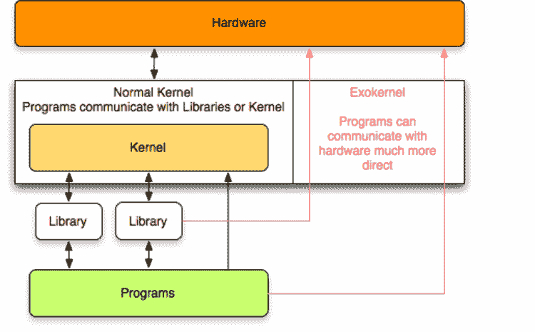

Exokernel 提供对硬件的更直接访问，从而移除大多数抽象

## Exokernel 示例 2

传统操作系统

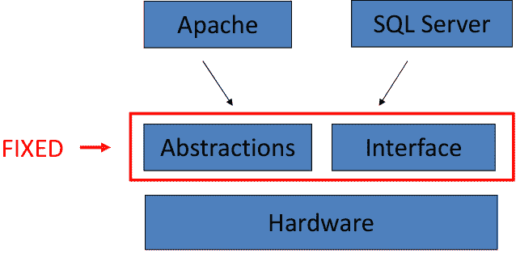

Apache

SQL Server

固定

抽象

接口

硬件

## Exokernel 示例 2

## Exokernel + 库操作系统

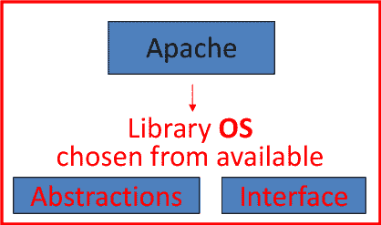

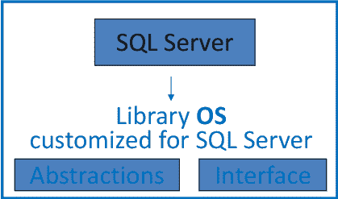


## 安全绑定

它是一种保护机制，将授权与实际资源使用解耦。

## 可提高性能

实施安全绑定所涉及的保护检查是用内核能够快速实现的简单操作来表述的。

安全绑定仅在绑定时刻执行授权，从而允许管理与保护解耦。

## 三种技术

硬件机制、软件缓存和下载应用程序代码

## 可见的资源回收

一种回收资源并打破它们（应用程序与资源）之间安全绑定的方法。

Exokernel 对大多数资源使用可见回收
传统上，操作系统以不可见的方式执行回收，在应用程序不参与的情况下释放资源。

Exokernel 与库操作系统之间的对话
库操作系统应组织资源列表

## 中止协议

Exokernel 还必须能够从那些未能对回收请求做出满意响应的库操作系统中夺取资源。

如果库操作系统未能快速响应，则需要“强制”打破安全绑定。

Exokernel 只需打破与该资源的所有安全绑定，并通知库操作系统。


## 外核示例 3

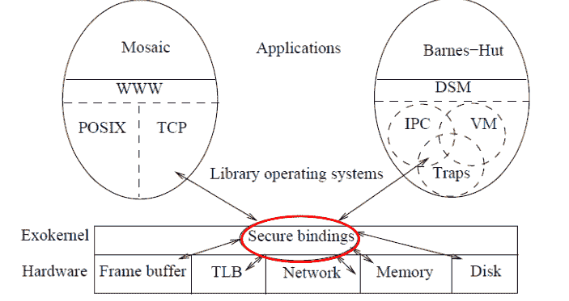

一个基于外核的示例系统，由一层薄薄的外核覆盖层组成，通过安全绑定将资源导出给库操作系统。

## 实现

### 原型（Xok / ExOS）

Xok

**外核**

运行在 x86 上（Aegis 运行在 DEC 上）

安全地多路复用物理资源

ExOS

**库操作系统**

在应用层，完全在使用它的应用程序的地址空间内管理基本的操作系统抽象

## 评估

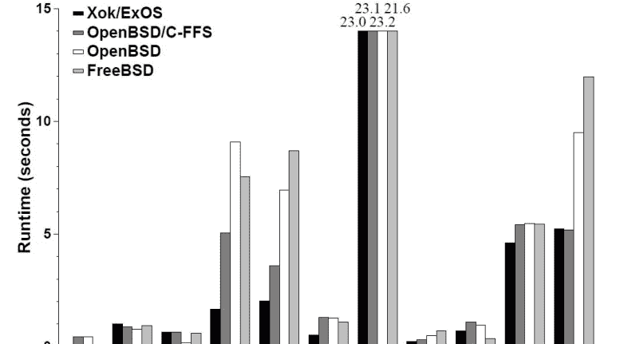


应用级控制可以显著提高应用程序的性能

## 作业

在 exokernel 中，与微内核或单内核相比，应用程序在内存和文件系统方面可以获得更好的性能，为什么？性能收益的代价是什么？

外核赋予应用程序对硬件资源更多的控制权。外核如何保护应用程序免受彼此的侵害？如何理解这篇论文的目标：将保护与管理分离？

开放性问题——你认为为什么外核没有像单内核（Linux）和混合内核（Windows NT）那样流行？

## 参考文献

- Exokernel: an operating system architecture for application-specific resource management, SOSP’95
- Application Performance and Flexibility on Exokernel Systems, SOSP’97
- Corey: An Operating System for Many Cores, OSDI’05

## 总结

操作系统不断演进

外核：应用程序管理资源

## 操作系统结构与 xv6 虚拟内存

## 回顾

- 操作系统功能
- 操作系统结构

## 复习

- 问：操作系统做什么？
- 问：操作系统的组成部分有哪些？

## 内核

### 内核分类（维基百科）

| 内核（架构） | 单内核 | 微内核 | 外核 | 混合内核 |

### 单内核

**单内核**是一种操作系统架构，其中整个操作系统在内核空间运行，并且单独处于监管者模式。

Linux、BSD……

### 微内核

微内核是能够提供实现操作系统（OS）所需机制的近乎最小量的软件。
底层地址空间管理、线程管理和进程间通信（IPC）等等……
Mach、L4 内核

### 混合内核

混合内核是一种基于微内核和单内核架构特点相结合的、用于计算机操作系统的内核架构。
Windows NT 内核

## 微内核系统结构

尽可能多地将功能从内核移入“用户”空间

用户模块之间通过消息传递进行通信

优点：

- 更容易扩展微内核
- 更容易将操作系统移植到新架构
- 更可靠（在内核模式下运行的代码更少）
- 更安全

缺点：

- 用户空间到内核空间通信的性能开销

## 微内核结构与实例


## 外核结构

### 概述

让内核将机器的物理资源分配给多个应用程序，并且

让每个程序决定如何处理这些资源。

程序可以链接到实现操作系统抽象的操作系统库（libOS）。

## 外核与 Corey

- Exokernel [SOSP’95]
  - 内核分类
  - 动机
  - 设计与实现
  - 评估
- Corey [OSDI’08]
  - 多核时代与可扩展性问题
  - 共享与地址范围
  - 总结

## 问题

这些内核的缺点是什么？
提示：这就是创建外核的原因

## 动机

### 外核的动机

在传统操作系统中，*只有* **特权服务器** 和 **内核** 可以管理系统资源

不受信任的应用程序必须通过某种 **抽象模型** 与硬件交互

*文件系统* 用于磁盘存储，*虚拟地址空间* 用于内存，等等。

应用程序的需求差异很大！！

一个为容纳所有应用程序而设计的接口必须预见到 **所有可能的需求**


## 库操作系统

大多数程序与*库*链接，而不是直接与外内核通信。

库隐藏了低级资源。

应用程序可以选择最适合其需求的库，甚至可以构建自己的库。

内核仅确保所请求的资源是空闲的，并允许应用程序访问它。

允许程序员实现自定义抽象，省略不必要的抽象，最常用于提高性能。

## Exokernel 示例 1


Exokernel 提供对硬件的更直接访问，从而移除了大多数抽象。

## Exokernel 示例 2

传统操作系统

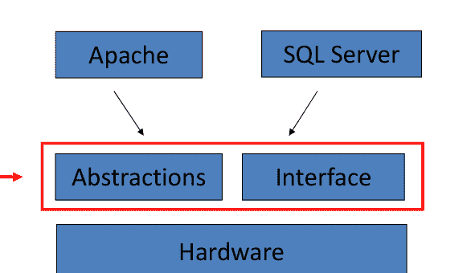

## Exokernel 示例 2

外内核 + 库操作系统

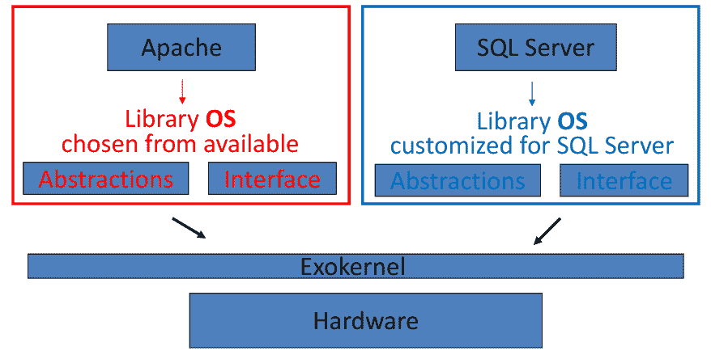

## 比较

操作系统

应用

逻辑

用户态

内核态

DOS

UNIX

微内核

外内核

## 外内核设计挑战

内核的新角色

- 跟踪资源所有权
- 确保资源保护
- 撤销资源访问

三种技术

- **安全绑定**
- **可见撤销**
- **中止协议**

## 安全绑定

它是一种保护机制，将授权与资源的实际使用分离。

## 可提升性能

强制安全绑定所涉及的保护检查以简单操作的形式表达，内核可以快速实现。

安全绑定仅在绑定时执行授权，从而允许将管理与保护分离。

## 三种技术

硬件机制、软件缓存和下载应用程序代码。

## 可见资源撤销

一种回收资源并打破其（应用程序与资源）安全绑定的方式。

外内核对大多数资源采用可见撤销。

传统上，操作系统以不可见的方式执行撤销，在应用程序不参与的情况下重新分配资源。

外内核与库操作系统之间的对话。

库操作系统应组织资源列表。

## 中止协议

外内核还必须能够从未能对撤销请求作出满意响应的库操作系统中夺取资源。

如果库操作系统未能快速响应，则需要“强制”打破安全绑定。

外内核只需打破对该资源的所有安全绑定，并通知库操作系统。

## 实现

## 原型（Xok / ExOS）

Xok

外内核

运行在 x86 上（Aegis 运行在 DEC 上）

安全地多路复用物理资源

ExOS

库操作系统

在应用程序级别，完全在使用它的应用程序的地址空间内管理基本操作系统抽象。

## 评估

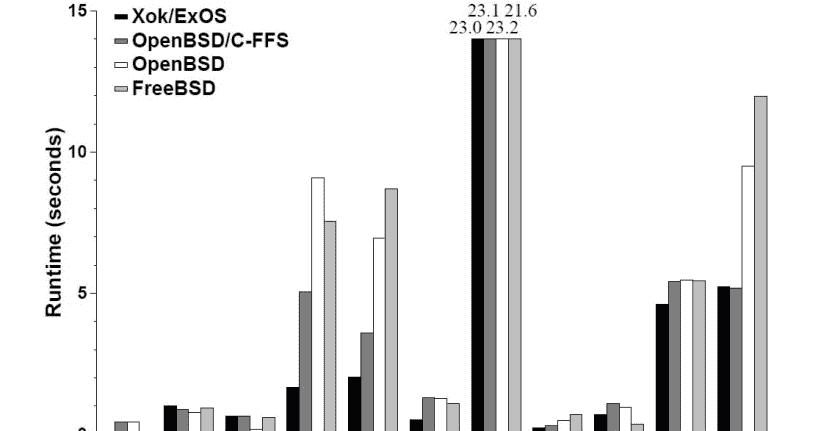

## 评估

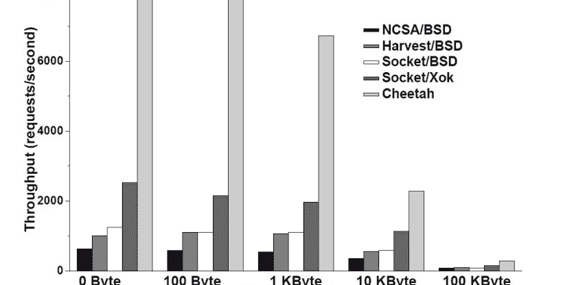

应用程序级别的控制可以显著提高应用程序的性能。

## 问题

与外内核相比，应用程序在外内核中可以获得比微内核或单体内核更好的内存和文件系统性能，为什么？性能提升的代价是什么？

外内核赋予应用程序对硬件资源的更多控制。外内核如何保护应用程序彼此免受干扰？如何理解本文的目标：将保护与管理分离？

开放问题——你认为为什么外内核不像单体内核（Linux）和混合内核（Windows NT）那样流行？

## 参考文献

外内核：一种面向特定应用程序资源管理的操作系统架构，SOSP’95

外内核系统上的应用程序性能与灵活性，SOSP’97

Corey：一种面向多核的操作系统，OSDI’08

## 作业

- 请阅读两篇同名论文
  - 虚拟机监视器是做得正确的微内核吗？
  - http://research.cs.wisc.edu/areas/os/ReadingGroup/OS/papers/hotos-ukernel.pdf
  - http://ssrg.nicta.com.au/publications/papers/Heiser_UL_06.pdf
- 请弄清楚它们讨论的内容，总结它们的论点，并给出你自己的理解


# XV6 & VM

Rong Chen & Yubin Xia

部分幻灯片基于 Frans Kaashoek 的幻灯片
kaashoek@mit.edu

## Outline

- Segment, Paging
- LA, VA, PA
- VM in xv6
  - Initial page table
  - Kernel page table
  - User page table
- Page Fault

## VIRTUAL MEMORY

## IA32 Arch Overview

此页映射示例适用于 4-KByte 页和常规 32 位物理地址大小。
*Physical Address

## Control Registers

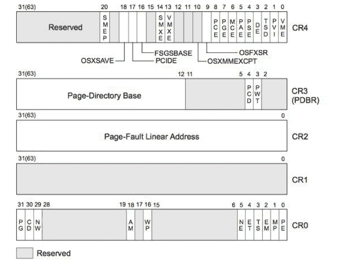

## Protected-mode Address Translation

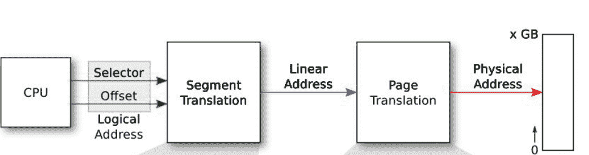

## Protected Mode Address Translation

Logical Address
Selector 16
Offset 32

Linear Address
Dir 10 Table 10 Offset 12

Physical Address
PPN 20 Offset 12

GDT/LDT
Base Limit Flags

CR3
Page Directory
PPN Flags
1023

Page Table
PPN Flags
1023
20 12

## what's going to happen when the kernel enables segment?

- virtual address translation comes into effect?
  - presumably the enabling instruction has address segment-base + 0xffffc
  - The address may not contain any valid instruction!
  - Solution
    - Ensure that the addresses are the same before and after

## Enable Segment

```
78 # Bootstrap GDT
79 .p2align 2                                 # force 4 byte alignment
80 gdt:
81     SEG_NULLASM                            # null seg
82     SEG_ASM(STA_XISTA_R, 0x0, 0xffffffff)   # code seg
83     SEG_ASM(STA_W, 0x0, 0xffffffff)          # data seg
84
85 gdtdesc:
86     .word    (gdtdesc - gdt - 1)            # sizeof(gdt) - 1
87     .long    gdt                            # address gdt
```

```
# Switch from real to protected mode. Use a bootstrap GDT that makes
# virtual addresses map directly to physical addresses so that the
# effective memory map doesn't change during the transition.
lgdt gdt-desc
movl %cr0, %eax
orl $CR0_PE, %eax
movl %eax, %cr0

# Complete transition to 32-bit protected mode by using long jmp
# to reload %cs and %eip. The segment descriptors are set up with no
# translation, so that the mapping is still the identity mapping.
ljmp $(SEG_KCODE<<3), $start32

.code32 # Tell assembler to generate 32-bit code now.
start32:
# Set up the protected-mode data segment registers
movw $(SEG_KDATA<<3), %ax # Our data segment selector
movw %ax, %ds # -> DS: Data Segment
movw %ax, %es # -> ES: Extra Segment
movw %ax, %ss # -> SS: Stack Segment
movw $0, %ax # Zero segments not ready for use
movw %ax, %fs # -> FS
movw %ax, %gs # -> GS

# Set up the stack pointer and call into C.
movl $start, %esp
call bootmain
```

## what's going to happen when the kernel enables paging?

- virtual address translation comes into effect?
  - presumably the enabling instruction has address 0x100xxx
  - 0x100xxx maps to user memory, not kernel instructions!
  - solution
    - temporary page table with kernel mapped at both 0x80100000 and 0x100000
    - that's what the first few kernel instructions set up


## entrypgdir

```c
// Boot page table used in entry.S and entryother.S.
// Page directories (and page tables), must start on a page boundary,
// hence the "__aligned__" attribute.
// Use PTE_PS in page directory entry to enable 4Mbyte pages.
__attribute__((__aligned__(PGSIZE)))
pde_t entrypgdir[NPDENTRIES] = {
  // Map VA's [0, 4MB) to PA's [0, 4MB)
  [0] = (0) | PTE_P | PTE_W | PTE_PS,
  // Map VA's [KERNBASE, KERNBASE+4MB) to PA's [0, 4MB)
  [KERNBASE>>PDXSHIFT] = (0) | PTE_P | PTE_W | PTE_PS,
};
```

## Recap: Integrating Caches and VM


## Recap: Integrating Caches and VM


## Translating with a k-level Page Table


## Super Page: 4M Page

| 31 30 29 28 27 26 25 24 23 22 21 20 19 18 17 16 15 14 13 12 11 10 9 8 7 6 5 4 3 2 1 0 |
| Address of page directory¹ | Ignored | P C D | P W T | Ignored | CR3 |
| Bits 31:22 of address of 2MB page frame | Reserved (must be 0) | Bits 39:32 of address² | P A T | Ignored | G | 1 | D | A | P C D | P W T | U / S | R / W | 1 | PDE: 4MB page |
| Address of page table | Ignored | 0 | I g n | A | P C D | P W T | U / S | R / W | 1 | PDE: page table |
| Ignored | | | | | | | | | | | | | | | | | | | | | | | | | | | | | | 0 | PDE: not present |
| Address of 4KB page frame | Ignored | G | P A T | D | A | P C D | P W T | U / S | R / W | 1 | PTE: 4KB page |
| Ignored | | | | | | | | | | | | | | | | | | | | | | | | | | | | | | 0 | PTE: not present |


## 地址转换：PAE-4k


图 3-18：启用 PAE 时的线性地址转换（4KB 页）

## 地址转换：PAE-2M


图 3-19：启用 PAE 时的线性地址转换（2MB 页）

## 测验 #1

在 IA32 架构中，当 %cr4 寄存器中的 CR4_PSE 位被设置时，超级页模式被启用，操作系统可以使用 4KB 大小的页面或 4MB 大小的页面。小页面和大页面之间存在权衡。
考虑以下场景：

a) 将通过 mmap() 函数映射到 RAM 的一个数百 MB 的大文件内容转储到另一个位置：

```
memcpy(addr_of_new_location, addr_of_mapped_file, sizeof_file);
```

b) 执行以下计算，其中 A、B 是 int 指针：

```
for(i=0; i<0x40000; ++i){
    A[i] += B[i] & 0x3FFFFF;
}
```

在每种场景中，哪种大小（4KB 或 4MB）的页面表现更好？给出你的理由。

```
17 int
18 main(void)
19 {
20     kinit1(end, P2V(4*1024*1024)); // phys page allocator
21     kvmalloc();         // kernel page table
22     mpinit();           // collect info about this machine
23     lapicinit();
24     seginit();          // set up segments
25     cprintf("\ncpu%d: starting xv6\n\n", cpu->id);
26     picinit();          // interrupt controller
27     ioapicinit();       // another interrupt controller
28     consoleinit();      // I/O devices & their interrupts
29     uartinit();         // serial port
30     pinit();            // process table
31     tvinit();           // trap vectors
32     binit();            // buffer cache
33     fileinit();         // file table
34     iinit();            // inode cache
35     ideinit();          // disk
36     if (!ismp)
37         timerinit();    // uniprocessor timer
38     startothers();      // start other processors
39     kinit2(P2V(4*1024*1024), P2V(PHYSTOP)); // must come after startothers()
40     userinit();         // first user process
41     // Finish setting up this processor in mpmain.
42     mpmain();
43 }
```

```c
extern char data[];  // defined by kernel.ld
pde_t *kpgdir;       // for use in scheduler()
struct segdesc gdt[NSEGS];

// Set up CPU's kernel segment descriptors.
// Run once on entry on each CPU.
void
seginit(void)
{
  struct cpu *c;

  // Map "logical" addresses to virtual addresses using identity map.
  // Cannot share a CODE descriptor for both kernel and user
  // because it would have to have DPL_USER, but the CPU forbids
  // an interrupt from CPL=0 to DPL=3.
  c = &cpus[cpunum()];
  c->gdt[SEG_KCODE] = SEG(STA_X|STA_R, 0, 0xffffffff, 0);
  c->gdt[SEG_KDATA] = SEG(STA_W,       0, 0xffffffff, 0);
  c->gdt[SEG_UCODE] = SEG(STA_X|STA_R, 0, 0xffffffff, DPL_USER);
  c->gdt[SEG_UDATA] = SEG(STA_W,       0, 0xffffffff, DPL_USER);

  // Map cpu and cpu-local
  c->gdt[SEG_KCPU] = SEG(STA_W, (uint)&c->cpu, 8, 0);

  lgdt(c->gdt, sizeof(c->gdt));
  loadgs(SEG_KCPU << 3);

  // Initialize cpu-local storage.
  cpu = c;
  proc = 0;
}
```


## xv6 虚拟地址方案概览

0x00000000:0x80000000
KERNBASE 以下的用户地址

0x80000000:0x80100000
映射低 1MB 设备（供内核使用）

0x80100000:?
内核指令/数据

? :0x8E000000
此处映射 224 MB DRAM

0xFE000000:0x00000000
更多内存映射设备

## 4 KB 页面

entrypgdir 很简单：
由 1024 个 PDE 组成的数组，每个映射 4 MB，但 4 MB 的页面大小太大了！
如果进程很小，这会非常浪费；xv6 程序只有几十 KB。
4 MB 页面需要分配完整 4 MB 的物理内存。
解决方案：x86 MMU 支持 4 KB 页面。

kvmalloc

```
17 int
18 main(void)
19 {
20   kinit1(end, P2V(4*1024*1024)); // phys page allocator
21   kvmalloc();        // kernel page table
22   mpinit();          // collect info about this machine
```

```
// Allocate one page table for the machine for the kernel address
// space for scheduler processes.
void
kvmalloc(void)
{
  kpgdir = setupkvm();
  switchkvm();
}
```

```
// Switch h/w page table register to the kernel-only page table,
// for when no process is running.
void
switchkvm(void)
{
  lcr3(v2p(kpgdir));   // switch to the kernel page table
}
```


## Setup_kvm

## 用法

- 创建一个页表
- 安装内核所需的映射
- 每个新进程都会调用一次

## 过程

- 必须分配 PD，分配一些 PT，将映射放入 PTE 中
- alloc 为 PD 分配一个物理页
  - 返回该页在 0x8000000 之上的虚拟地址
  - 因此在安装到 cr3 之前我们必须调用 V2P
- memset 使默认无转换（无 P 位）
- 对 kmap[] 中的每个条目调用一次 mappages

```
127 // Set up kernel part of a page table.
128 pde_t*
129 setupkvm(void)
130 {
131     pde_t *pgdir;
132     struct kmap *k;
133
134     if((pgdir = (pde_t*)kalloc()) == 0)
135         return 0;
136     memset(pgdir, 0, PGSIZE);
137     if (p2v(PHYSTOP) > (void*)DEVSPACE)
138         panic("PHYSTOP too high");
139     for(k = kmap; k < &kmap[NELEM(kmap)]; k++)
140         if(mappages(pgdir, k->virt, k->phys_end - k->phys_start,
141                     (uint)k->phys_start, k->perm) < 0)
142             return 0;
143     return pgdir;
144 }
```

## what is kmap[]?

每个内核虚拟地址空间区域的一个条目

与讲座早期地址空间设置相同

- 0x80000000 -> 0x00000000（内存映射设备）
- 0x80100000 -> 0x00100000（内核指令和数据）
- data -> data-0x80000000（内核加载后之后的物理内存）
- DEVSPACE -> DEVSPACE（更多内存映射设备）
- 注意 va 0x80000000 以下没有映射 —— 将来用户内存在那里

## mappages

参数为 PD, va, size, pa, perm
将一系列 va 的映射添加到对应的 pa
进行取整，因为其他用途会传入非页对齐地址
对于范围内的每个页对齐地址
调用 walkpgdir 找到 PTE 的地址 需要 PTE 的地址（而不仅仅是内容）因为我们想要修改

```
42 // Return the address of the PTE in page table pgdir
43 // that corresponds to virtual address va. If alloc!=0,
44 // create any required page table pages.
45 static pte_t *
46 walkpgdir(pde_t *pgdir, const void *va, int alloc)
47 {
48     pde_t *pde;
49     pte_t *pgtab;
50
51     pde = &pgdir[PDX(va)];
52     if(*pde & PTE_P){
53         pgtab = (pte_t*)p2v(PTE_ADDR(*pde));
54     } else {
55         if(!alloc || (pgtab = (pte_t*)kalloc()) == 0)
56             return 0;
57         // Make sure all those PTE_P bits are zero.
58         memset(pgtab, 0, PGSIZE);
59         // The permissions here are overly generous, but they can
60         // be further restricted by the permissions in the page table
61         // entries, if necessary.
62         *pde = v2p(pgtab) | PTE_P | PTE_W | PTE_U;
63     }
64     return &pgtab[PTX(va)];
65 }
```

```
13 static inline uint v2p(void *a) { return ((uint) (a)) - KERNBASE; }
14 static inline void *p2v(uint a) { return (void *) ((a) + KERNBASE); }
```

## walkpgdir

- 模仿分页硬件如何找到地址的 PTE
- 有点复杂，因为 xv6 延迟分配页表页
  - 可能不存在，可能必须分配
- PDX 提取最高十位
- &pgdir[PDX(va)] 是相关 PDE 的地址
- 现在 *pde 是 PDE
- 如果 PTE_P
  - 相关的页表页已存在
  - PTE_ADDR 从 PDE 中提取 PPN
  - p2v() 加上 0x80000000，因为 PTE 持有物理地址
- 如果不是 PTE_P
  - 分配一个页表页
  - 用 PPN 填充 PDE —— 因此 v2p
- 现在我们想要的 PTE 在页表页中
  - 在偏移 PTX(va) 处，即 va 的第二组十位

```
```c
// doing some setup required for memory allocator to work.
int
main(void)
{
  kinit1(end, P2V4*1024*1024); // phys page allocator
  kvmalloc();                   // kernel page table
  mpinit();                     // collect info about this machine
  lapicinit();
  seginit();                    // set up segments
  cprintf("\ncpu%d: starting xv6\n\n", cpun->id);
  picinit();                    // interrupt controller
  ioapicinit();                 // another interrupt controller
  consoleinit();                // I/O devices & their interrupts
  uartinit();                   // serial port
  pinit();                      // process table
  tvinit();                     // trap vectors
  binit();                      // buffer cache
  fileinit();                   // file table
  iinit();                      // inode cache
  ideinit();                    // disk
  if(ismp)
    timerinit();                // uniprocessor timer
  startothers();                // start other processors
  kinit2(P2V(4*1024*1024), P2V(PHYSTOP)); // must come after startothers()
  userinit();                   // first user process
  // Finish setting up this processor in mpmain.
  mpmain();
}
```
```


```c
78 void
79 userinit(void)
80 {
81     struct proc *p;
82     extern char _binary_initcode_start[], _binary_initcode_size[];
83
84     p = allocproc();
85     initproc = p;
86     if((p->pgdir = setupkvm()) == 0)
87         panic("userinit: out of memory?");
88     inituvm(p->pgdir, _binary_initcode_start, (int)_binary_initcode_size);
89     p->sz = PGSIZE;
90     memset(p->tf, 0, sizeof(*p->tf));
91     p->tf->cs = (SEG_UCODE << 3) | DPL_USER;
92     p->tf->ds = (SEG_UDATA << 3) | DPL_USER;
93     p->tf->es = p->tf->ds;
94     p->tf->ss = p->tf->ds;
95     p->tf->eflags = FL_IF;
96     p->tf->esp = PGSIZE;
97     p->tf->eip = 0;  // beginning of initcode.S
98
99     safestrcpy(p->name, "initcode", sizeof(p->name));
100    p->cwd = namei("/");
101
102    p->state = RUNNABLE;
103 }
```

## 用户虚拟内存映射

### 创建进程

- `inituvm`: 初始化用户虚拟内存
- `loaduvm`: 加载程序段

### 上下文切换

- `switchuvm`

### 增长/缩小/释放虚拟内存

- `allocuvm`
- `deallocuvm`
- `freevm`

### Fork

- `copyuvm`

```c
179 // Load the initcode into address 0 of pgdir.
// sz must be less than a page.
180 void
181 inituvm(pde_t *pgdir, char *init, uint sz)
182 {
183     char *mem;
184
185     if(sz >= PGSIZE)
186         panic("inituvm: more than a page");
187     mem = kalloc();
188     memset(mem, 0, PGSIZE);
189     mappages(pgdir, 0, PGSIZE, v2p(mem), PTE_W|PTE_U);
190     memmove(mem, init, sz);
191 }
```

```c
// Switch TSS and h/w page table to correspond to process p.
void
switchuvm(struct proc *p)
{
    pushcli();
    cpu->gdt[SEG_TSS] = SEG16(STS_T32A, &cpu->ts, sizeof(cpu->ts)-1, 0);
    cpu->gdt[SEG_TSS].s = 0;
    cpu->ts.ss0 = SEG_KDATA << 3;
    cpu->ts.esp0 = (uint)p->kstack + KSTACKSIZE;
    ltr(SEG_TSS << 3);
    if(p->pgdir == 0)
        panic("switchuvm: no pgdir");
    lcr3(v2p(p->pgdir));  // switch to new address space
    popcli();
}
```

```c
// Load a program segment into pgdir. addr must be page-aligned
// and the pages from addr to addr+sz must already be mapped.
int
loaduvm(pde_t *pgdir, char *addr, struct inode *ip, uint offset, uint sz)
{
    uint i, pa, n;
    pte_t *pte;

    if((uint) addr % PGSIZE != 0)
        panic("loaduvm: addr must be page aligned");
    for(i = 0; i < sz; i += PGSIZE){
        if((pte = walkpgdir(pgdir, addr+i, 0)) == 0)
            panic("loaduvm: address should exist");
        pa = PTE_ADDR(*pte);
        if(sz - i < PGSIZE)
            n = sz - i;
        else
            n = PGSIZE;
        if(readi(ip, p2v(pa), offset+i, n) != n)
            return -1;
    }
    return 0;
}
```

```c
// Allocate page tables and physical memory to grow process from oldsz to
// newsz, which need not be page aligned.  Returns new size or 0 on error.
int
allocuvm(pde_t *pgdir, uint oldsz, uint newsz)
{
    char *mem;
    uint a;

    if(newsz >= KERNBASE)
        return 0;
    if(newsz < oldsz)
        return oldsz;

    a = PGROUNDUP(oldsz);
    for(; a < newsz; a += PGSIZE){
        mem = kalloc();
        if(mem == 0){
            cprintf("allocuvm out of memory\n");
            deallocuvm(pgdir, newsz, oldsz);
            return 0;
        }
        memset(mem, 0, PGSIZE);
        mappages(pgdir, (char*)a, PGSIZE, v2p(mem), PTE_W|PTE_U);
    }
    return newsz;
}
```

```c
// Deallocate user pages to bring the process size from oldsz to
// newsz. oldsz and newsz need not be page-aligned, nor does newsz
// need to be less than oldsz. oldsz can be larger than the actual
// process size. Returns the new process size.
int
deallocuvm(pde_t *pgdir, uint oldsz, uint newsz)
{
  pte_t *pte;
  uint a, pa;

  if(newsz >= oldsz)
    return oldsz;

  a = PGROUNDUP(newsz);
  for(; a < oldsz; a += PGSIZE){
    pte = walkpgdir(pgdir, (char*)a, 0);
    if(!pte)
      a += (NPTENTRIES - 1) * PGSIZE;
    else if((*pte & PTE_P) != 0){
      pa = PTE_ADDR(*pte);
      if(pa == 0)
        panic("kfree");
      char *v = P2V(pa);
      kfree(v);
      *pte = 0;
    }
  }
  return newsz;
}
```


// Free a page table and all the physical memory pages
// in the user part.
void
freevm(pde_t *pgdir)
{
    uint i;

    if(pgdir == 0)
        panic("freevm: no pgdir");
    deallocuvm(pgdir, KERNBASE, 0);
    for(i = 0; i < NPDENTRIES; i++){
        if(pgdir[i] & PTE_P){
            char * v = p2v(PTE_ADDR(pgdir[i]));
            kfree(v);
        }
    }
    kfree((char*)pgdir);
}

// Given a parent process's page table, create a copy
// of it for a child.
pde_t*
copyuvm(pde_t *pgdir, uint sz)
{
    pde_t *d;
    pte_t *pte;
    uint pa, i;
    char *mem;

    if((d = setupkvm()) == 0)
        return 0;
    for(i = 0; i < sz; i += PGSIZE){
        if((pte = walkpgdir(pgdir, (void *) i, 0)) == 0)
            panic("copyuvm: pte should exist");
        if(!(*pte & PTE_P))
            panic("copyuvm: page not present");
        pa = PTE_ADDR(*pte);
        if((mem = kalloc()) == 0)
            goto bad;
        memmove(mem, (char*)p2v(pa), PGSIZE);
        if(mappages(d, (void*)i, PGSIZE, v2p(mem), PTE_W|PTE_U) < 0)
            goto bad;
    }
    return d;

bad:
    freevm(d);
    return 0;
}

// Map user virtual address to kernel address.
char*
uva2ka(pde_t *pgdir, char *uva)
{
    pte_t *pte;

    pte = walkpgdir(pgdir, uva, 0);
    if((*pte & PTE_P) == 0)
        return 0;
    if((*pte & PTE_U) == 0)
        return 0;
    return (char*)p2v(PTE_ADDR(*pte));
}

## 进程

Rong Chen, Yubin Xia
IPADS, SJTU

## 复习：LA->LA->PA


## 复习

- 启动：启用分段和分页
  - 分段：设置 GDT 并使用长跳转（ljmp）
  - 分页：使用临时页表（entrypgdir），内核同时映射在 0x80100000 和 0x100000
  - 不同页面大小：4KB 对比 4MB（2MB）

## 上节课的问题

```
39  # Switch from real to protected mode. Use a bootstrap GDT that makes
40  # virtual addresses map directly to physical addresses so that the
41  # effective memory map doesn't change during the transition.
42  lgdt    gdtdesc
43  movl    %cr0, %eax
44  orl     $CR0_PE, %eax
45  movl    %eax, %cr0

47  //PAGEBREAK!
48  # Complete transition to 32-bit protected mode by using long jmp
49  # to reload %cs and %eip. The segment descriptors are set up with no
50  # translation, so that the mapping is still the identity mapping.
51  ljmp    $(SEG_KCODE<<3), $start32

53  .code32 # Tell assembler to generate 32-bit code now.
54  start32:
55  # Set up the protected-mode data segment registers
56  movw    $(SEG_KDATA<<3), %ax  # Our data segment selector
57  movw    %ax, %ds              # -> DS: Data Segment
58  movw    %ax, %es              # -> ES: Extra Segment
59  movw    %ax, %ss              # -> SS: Stack Segment
60  movw    $0, %ax               # Zero segments not ready for use
61  movw    %ax, %fs              # -> FS
62  movw    %ax, %gs              # -> GS
```

## 解释

- Intel 手册 9.9.1
  - 紧跟在 MOV CR0 指令之后的 JMP 或 CALL 指令会改变执行流并使处理器串行化。
- Xv6-book-rev7
  - 启用保护模式不会立即改变处理器将逻辑地址转换为物理地址的方式；只有将新值加载到段寄存器时，处理器才会读取 GDT 并更改其内部的分段设置。不能直接修改 `%cs`，因此代码改为执行 `ljmp`（远跳转）指令（8453），该指令允许指定代码段选择子。跳转会继续在下一行（8456）执行，但在此过程中会将 `%cs` 设置为指向 GDT 中的代码描述符条目。该描述符描述了一个 32 位代码段，因此处理器会切换到 32 位模式。

## 超级页：4M 页

| 31 30 29 28 27 26 25 24 23 22 21 20 19 18 17 16 15 14 13 12 11 10 9 8 7 6 5 4 3 2 1 0 |
| 页目录地址¹ | 忽略 | P C D | P W T | 忽略 | CR3 |
| 2MB页帧地址的位31:22 | 保留 (必须为 0) | 地址的位39:32² | P A T | 忽略 | G | 1 | D | A | P C D | P W T | U / S | R / W | 1 | PDE: 4MB页 |
| 页表地址 | 忽略 | 0 | I g n | A | P C D | P W T | U / S | R / W | 1 | PDE: 页表 |
| 忽略 | | | | | | | | | | | | | | | | | | | | | | | | | | | | | | 0 | PDE: 不存在 |
| 4KB页帧地址 | 忽略 | G | P A T | D | A | P C D | P W T | U / S | R / W | 1 | PTE: 4KB页 |
| 忽略 | | | | | | | | | | | | | | | | | | | | | | | | | | | | | | 0 | PTE: 不存在 |


## XV6 中的进程

## 进程大纲
- 进程概念
- 进程调度
- 对进程的操作
- 进程间通信
- IPC 系统示例
- 客户端-服务器系统中的通信

## 进程：总览
- 程序比处理器多
  - 如何在程序之间共享数量有限的处理器？
- 观察：大多数程序并不需要连续占用处理器
  - 因为它们经常要等待输入（来自用户、磁盘、网络等）
- 思路：当一个程序必须等待时，它让出处理器，并将其交给另一个程序

## 线程
- 机制：计算线程，一种活跃的计算。
- 线程是一种抽象，它包含
  - 在某个时刻停止一个活跃的计算并在之后恢复它所需的最小状态。
- 该状态具体是什么取决于处理器
  - 在 x86 上，它是处理器寄存器。

## xv6 中的线程
```
34 // Saved registers for kernel context switches.
35 // Don't need to save all the segment registers (%cs, etc),
36 // because they are constant across kernel contexts.
37 // Don't need to save %eax, %ecx, %edx, because the
38 // x86 convention is that the caller has saved them.
39 // Contexts are stored at the bottom of the stack they
40 // describe; the stack pointer is the address of the context.
41 // The layout of the context matches the layout of the stack in swtch.S
42 // at the "Switch stacks" comment. Switch doesn't save eip explicitly,
43 // but it is on the stack and allocproc() manipulates it.
44 struct context {
45   uint edi;
46   uint esi;
47   uint ebx;
48   uint ebp;
49   uint eip;
50 };
```

## 地址空间与线程
- 地址空间和线程在原则上是相互独立的概念
  - 可以在同一个地址空间内从一个线程切换到另一个线程
  - 也可以在一个地址空间的不同线程之间切换，或切换到另一个地址空间的线程。

## 进程概念
- 进程：正在执行的程序
  - 一个地址空间 + 一个或多个计算线程
- 进程包括：
  - 程序计数器、栈、数据段
- 在 xv6 中，所有*用户*程序都包含一个计算线程和一个地址空间

## 进程状态
- 随着进程的执行，它会改变*状态*
  - **新建**：进程正在被创建
  - **运行**：指令正在被执行
  - **等待**：进程正在等待某个事件发生
  - **就绪**：进程正在等待被分配给处理器
  - **终止**：进程已完成执行
- 在 xv6 中
```
enum proc_state { UNUSED, EMBRYO, SLEEPING, RUNNABLE, RUNNING, ZOMBIE };
```

## 进程状态图


## 进程控制块（PCB）
与每个进程相关联的信息
- 进程状态
- 程序计数器
- CPU 寄存器
- CPU 调度信息
- 内存管理信息
- 记账信息
- I/O 状态信息

## 进程控制块（PCB）

|  |
|---|---|
| 进程状态 |
| 进程编号 |
| 程序计数器 |
| 寄存器 |
| 内存限制 |
| 打开文件列表 |
| ... |

## xv6 中的进程（proc.c）
```
54 // Per-process state
55 struct proc {
56   uint sz;                  // Size of process memory (bytes)
57   pde_t* pgdir;             // Page table
58   char *kstack;             // Bottom of kernel stack for this process
59   enum procstate state;     // Process state
60   volatile int pid;         // Process ID
61   struct proc *parent;      // Parent process
62   struct trapframe *tf;     // Trap frame for current syscall
63   struct context *context;  // swtch() here to run process
64   void *chan;               // If non-zero, sleeping on chan
65   int killed;               // If non-zero, have been killed
66   struct file *ofile[NOFILE]; // Open files
67   struct inode *cwd;        // Current directory
68   char name[16];            // Process name (debugging)
69 };
```


# 上下文切换

- 当CPU切换到另一个进程时，系统必须通过上下文切换来完成
  - 保存旧进程的状态
  - 为新进程加载已保存的状态；进程的上下文由PCB表示
- 上下文切换时间是开销
  - 切换期间系统不做任何有用工作
  - 时间取决于硬件支持

# CPU从进程到进程的切换


# xv6中的上下文切换
(swtch.S)

```
5 # Save current register context in old
6 # and then load register context from new.

.globl swtch        # Context switch
swtch:              #
  movl 4(%esp), %eax   #   void swtch(struct context **old, struct context *new);
  movl 8(%esp), %edx

# Save old callee-save registers
pushl %ebp
pushl %ebx
pushl %esi
pushl %edi

# Switch stacks
movl %esp, (%eax)
movl %edx, %esp

# Load new callee-save registers
popl %edi
popl %esi
popl %ebx
popl %ebp
ret
```


```c
scheduler(void)
{
  struct proc *p;

  for(;;){
    // Enable interrupts on this processor.
    sti();

    // Loop over process table looking for process to run.
    acquire(&ptable.lock);
    for(p = ptable.proc; p < &ptable.proc[NPROC]; p++){
      if(p->state != RUNNABLE)
        continue;

      // Switch to chosen process. It is the process's job
      // to release ptable.lock and then reacquire it
      // before jumping back to us.
      proc = p;
      switchuvm(p);
      p->state = RUNNING;
      swtch(&cpu->scheduler, proc->context);
      switchkvm();

      // Process is done running for now.
      // It should have changed its p->state before coming back.
      proc = 0;
    }
    release(&ptable.lock);
  }
}
```

```c
// Enter scheduler. Must hold only ptable.lock
// and have changed proc->state.
void
sched(void)
{
  int intena;

  if(!holding(&ptable.lock))
    panic("sched ptable.lock");
  if(cpu->ncli != 1)
    panic("sched locks");
  if(proc->state == RUNNING)
    panic("sched running");
  if(readeflags()&FL_IF)
    panic("sched interruptible");
  intena = cpu->intena;
  swtch(&proc->context, cpu->scheduler);
  cpu->intena = intena;
}
```


# 进程调度队列

- **作业队列** – 系统中所有进程的集合
- **就绪队列** – 驻留在主内存中、已准备好并等待执行的所有进程的集合
- **设备队列** – 等待I/O设备的进程集合
- 进程在各种队列之间迁移

# 就绪队列与各种I/O设备队列


# 进程调度的表示


# 调度程序

- **长期调度程序**（或作业调度程序）– 选择应将哪些进程引入就绪队列
- **短期调度程序**（或CPU调度程序）– 选择接下来应执行哪个进程并分配CPU

# 增加中期调度


# 调度程序（续）

- 短期调度程序被非常频繁地调用（毫秒级）⇒（必须快）
- 长期调度程序被非常不频繁地调用（秒、分钟级）⇒（可以慢）
- 长期调度程序控制*多道程序度*

# 调度程序（续）

- 进程可以被描述为以下两种之一：
  - **I/O密集型进程** – 花费更多时间进行I/O而非计算，有许多短的CPU突发
  - **CPU密集型进程** – 花费更多时间进行计算；很少有非常长的CPU突发

# 进程创建

- **父**进程创建**子**进程
  - 形成进程树
  - 通常，进程通过**进程标识符（pid）**进行标识和管理
- 资源共享策略
  - 共享所有资源
  - 共享父进程的部分资源
  - 不共享任何资源


## 进程创建（续）

- **执行**
  - 父进程和子进程并发执行
  - 父进程等待子进程终止
- **地址空间**
  - 子进程是父进程的副本
  - 子进程中加载了一个程序
- **UNIX 示例**
  - **fork** 系统调用创建新进程
  - **exec** 系统调用在 **fork** 之后使用，用来用 **新程序** 替换进程的内存空间

## 进程创建


## 典型 Solaris 上的进程树


```
125 // Create a new process copying p as the parent.
126 // Sets up stack to return as if from system call.
127 // Caller must set state of returned proc to RUNNABLE.
128 int
129 fork(void)
130 {
131   int i, pid;
132   struct proc *np;
133
134   // Allocate process.
135   if((np = allocproc()) == 0)
136     return -1;
137
138   // Copy process state from p.
139   if((np->pgdir = copyuvm(proc->pgdir, proc->sz)) == 0){
140     kfree(np->kstack);
141     np->kstack = 0;
142     np->state = UNUSED;
143     return -1;
144   }
145   np->sz = proc->sz;
146   np->parent = proc;
147   *np->tf = *proc->tf;
148
149   // Clear %eax so that fork returns 0 in the child.
150   np->tf->eax = 0;
151
152   for(i = 0; i < NOFILE; i++)
153     if(proc->ofile[i])
154       np->ofile[i] = filedup(proc->ofile[i]);
155   np->cwd = idup(proc->cwd);
156
157   pid = np->pid;
158   np->state = RUNNABLE;
159   safestrcpy(np->name, proc->name, sizeof(proc->name));
160   return pid;
161 }
```

## XV6 中的进程创建

阅读以下代码

- allocproc()

## 进程终止

- 进程执行最后一条语句并请求操作系统删除它（**exit**）
  - 通过 **wait** 将子进程的输出数据传递给父进程
  - 进程的资源由操作系统释放
- 父进程可以终止子进程的执行（**abort**）
  - 子进程超出了分配的资源
  - 分配给子进程的任务不再需要

## 进程终止（续）

- 如果父进程正在退出
  - 有些操作系统不允许子进程在其父进程终止后继续存在
    - 所有子进程均被终止 - **级联终止**

```
```c
exit(void)
{
  struct proc *p;
  int fd;

  if(proc == initproc)
    panic("init exiting");

  // Close all open files.
  for(fd = 0; fd < NOFILE; fd++){
    if(proc->ofile[fd]){
      fileclose(proc->ofile[fd]);
      proc->ofile[fd] = 0;
    }
  }

  iput(proc->cwd);
  proc->cwd = 0;

  acquire(&ptable.lock);

  // Parent might be sleeping in wait().
  wakeup1(proc->parent);

  // Pass abandoned children to init.
  for(p = ptable.proc; p < &ptable.proc[NPROC]; p++){
    if(p->parent == proc){
      p->parent = initproc;
      if(p->state == ZOMBIE)
        wakeup1(initproc);
    }
  }

  // Jump into the scheduler, never to return.
  proc->state = ZOMBIE;
  sched();
  panic("zombie exit");
}
```
```

## 协作进程

- **独立** 进程不能影响也不能被其他进程的执行所影响
- **协作** 进程可以影响或受其他进程执行的影响
- 进程协作的优势
  - 信息共享
  - 计算加速
  - 模块化
  - 便利性

## 通信模型


(a)

(b)

## IPC

- 协作进程需要 **进程间通信（IPC）**
- IPC 的两种模型
  - 共享内存
  - 消息传递

## 生产者-消费者问题

- *生产者* 进程产生信息，由 *消费者* 进程消费
  - *无界缓冲* 对缓冲区的大小没有实际限制
  - *有界缓冲* 假设缓冲区大小是固定的

## 有界缓冲 – 共享内存解决方案

- 共享数据
  ```
  #define BUFFER_SIZE 10
  typedef struct {
    ...
  } item;

  item buffer[BUFFER_SIZE];
  int in = 0;
  int out = 0;
  ```
- 解决方案是正确的，但只能使用 BUFFER_SIZE-1 个元素


## Bounded-Buffer – Producer

```
while (true) {
    /* Produce an item */
    while (((in = (in + 1) % BUFFER SIZE count)
            == out)
        ; /* do nothing -- no free buffers */
    buffer[in] = item;
    in = (in + 1) % BUFFER SIZE;
}
```

## Bounded Buffer – Consumer

```
while (true) {
    while (in == out)
        ; // do nothing -- nothing to consume

    // remove an item from the buffer
    item = buffer[out];
    out = (out + 1) % BUFFER SIZE;
    return item;
}
```

## Example of IPC in xv6: Pipe
(pipe.c)

```
12 struct pipe {
13   struct spinlock lock;
14   char data[PIPESIZE];
15   uint nread;     // number of bytes read
16   uint nwrite;    // number of bytes written
17   int readopen;   // read fd is still open
18   int writeopen;  // write fd is still open
19 };
```

```
77 int
78 pipewrite(struct pipe *p, char *addr, int n)
79 {
80     int i;
81
82     acquire(&p->lock);
83     for(i = 0; i < n; i++){
84         while(p->nwrite == p->nread + PIPESIZE){  //DOC: pipewrite-full
85             if(p->readopen == 0 || proc->killed){
86                 release(&p->lock);
87                 return -1;
88             }
89             wakeup(&p->nread);
90             sleep(&p->nwrite, &p->lock);  //DOC: pipewrite-sleep
91         }
92         p->data[p->nwrite++ % PIPESIZE] = addr[i];
93     }
94     wakeup(&p->nread);  //DOC: pipewrite-wakeup1
95     release(&p->lock);
96     return n;
97 }
```

```
99 int
100 piperead(struct pipe *p, char *addr, int n)
101 {
102     int i;
103
104     acquire(&p->lock);
105     while(p->nread == p->nwrite && p->writeopen){  //DOC: pipe-empty
106         if(proc->killed){
107             release(&p->lock);
108             return -1;
109         }
110         sleep(&p->nread, &p->lock); //DOC: piperead-sleep
111     }
112     for(i = 0; i < n; i++){  //DOC: piperead-copy
113         if(p->nread == p->nwrite)
114             break;
115         addr[i] = p->data[p->nread++ % PIPESIZE];
116     }
117     wakeup(&p->nwrite);  //DOC: piperead-wakeup
118     release(&p->lock);
119     return i;
120 }
```

## Interprocess Communication – Message Passing

- 用于进程间通信和同步其操作的机制
- 消息系统
  - 进程之间可以在不使用共享变量的情况下相互通信
- IPC 设施提供两个操作：
  - **send**(message) – 消息大小固定或可变
  - **receive**(message)

## Message Passing (Cont.)

- 如果 *P* 和 Q 希望通信，它们需要：
  - 在它们之间建立一个 *通信链路*
  - 通过 send/receive 交换消息
- 通信链路的实现
  - 物理的（例如，共享内存、硬件总线）
  - 逻辑的（例如，逻辑属性）

## Implementation Questions

- 链路是如何建立的？
- 一个链路能否关联到两个以上的进程？
- 通信进程的每对之间可以有多少条链路？
- 链路的容量是多少？
- 链路能够容纳的消息大小是固定的还是可变的？
- 链路是单向的还是双向的？

## Indirect Communication

- 消息被定向并从邮箱接收（也称为端口）
  - 每个邮箱都有一个唯一的 id
  - 进程只有在共享一个邮箱时才能通信

## Indirect Communication

- 通信链路的属性
  - 只有当进程共享一个公共邮箱时才建立链路
  - 一个链路可能与多个进程相关联
  - 每对进程可能共享多个通信链路
  - 链路可能是单向的或双向的

## Indirect Communication

- 操作
  - 创建一个新的邮箱
  - 通过邮箱发送和接收消息
  - 销毁一个邮箱
- 原语定义为：
  **send**(A, message) – 向邮箱 A 发送一条消息
  **receive**(A, message) – 从邮箱 A 接收一条消息


## 间接通信

- 邮箱共享
  - $P_1$, $P_2$, 和 $P_3$ 共享邮箱 A
  - $P_1$, 发送；$P_2$ 和 $P_3$ 接收
  - 谁收到消息？
- 解决方案
  - 允许一个链接最多关联两个进程
  - 允许一次只有一个进程执行接收操作
  - 允许系统任意选择接收者。发送者会被通知接收者是谁。

## 同步与异步

- 消息传递可能是阻塞或非阻塞
- **阻塞** 被认为是 **同步**
  - **阻塞发送** 使发送者在消息被接收前阻塞
  - **阻塞接收** 使接收者在有消息可用前阻塞
- **非阻塞** 被认为是 **异步**
  - **非阻塞** 发送使发送者发送消息后继续执行
  - **非阻塞** 接收使接收者接收有效消息或 null

## 缓冲

- 附加到链接的消息队列；以三种方式之一实现
  1. 零容量 – 0 条消息
     发送者必须等待接收者（会合）
  2. 有界容量 – *n* 条消息的有限长度
     链接满时发送者必须等待
  3. 无界容量 – 无限长度
     发送者永不等待

## IPC 系统示例 - POSIX

- POSIX 共享内存
  - 进程首先创建共享内存段
    `segment id = shmget(IPC PRIVATE, size, S IRUSR | S IWUSR);`
  - 想要访问该共享内存的进程必须附加到它
    `shared memory = (char *) shmat(id, NULL, 0);`
  - 现在进程可以写入共享内存
    `sprintf(shared memory, "Writing to shared memory");`
  - 完成后进程可以从其地址空间分离共享内存
    `shmdt(shared memory);`

## IPC 系统示例 - WinXP （续）

- 通信按如下方式进行：
  - 客户端打开对子系统连接端口对象的句柄
  - 客户端发送连接请求
  - 服务器创建两个私有通信端口并将其中一个的句柄返回给客户端
  - 客户端和服务器使用相应的端口句柄发送消息或回调并监听回复

## Windows XP 中的本地过程调用


## 客户端-服务器系统中的通信

- Sockets
- Remote Procedure Calls
- Remote Method Invocation (Java)

## 中断，陷阱，系统调用

## 要求

- 必须保存处理器的寄存器以便未来透明恢复
- 必须为在内核中执行而设置
- 必须选择内核开始执行的位置
- 必须能够检索有关事件的信息，例如系统调用参数
- 必须全部安全完成
- 必须保持用户进程和内核的隔离

## IDT

- IDT：中断描述符表
  - 有 256 个条目
  - 每个给出处理相应中断时使用的 %cs 和 %eip
- 系统调用
  - 程序调用 *int n*
  - *n* 指定 IDT 中的索引

## 内核栈


Figure 3-1. Kernel stack after an int instruction.

## tvinit

```
17 void
18 tvinit(void)
19 {
20     int i;
21
22     for(i = 0; i < 256; i++)
23         SETGATE(idt[i], 0, SEG_KCODE<<3, vectors[i], 0);
24         SETGATE(idt[T_SYSCALL], 1, SEG_KCODE<<3, vectors[T_SYSCALL], DPL_USER);
25
26         initlock(&tickslock, "time");
27 }
```

## IPC

Yubin Xia, Rong Chen
IPADS, SJTU

ACKs: Some slides are adapted from the textbook’s original slides and Frans’s OS course notes

## Review: Threads in xv6

```
// Saved registers for kernel context switches.
// Don't need to save all the segment registers (%cs, etc),
// because they are constant across kernel contexts.
// Don't need to save %eax, %ecx, %edx, because the
// x86 convention is that the caller has saved them.
// Contexts are stored at the bottom of the stack they
// describe; the stack pointer is the address of the context.
// The layout of the context matches the layout of the stack in swtch.S
// at the "Switch stacks" comment. Switch doesn't save eip explicitly,
// but it is on the stack and allocproc() manipulates it.
struct context {
  uint edi;
  uint esi;
  uint ebx;
  uint ebp;
  uint eip;
};
```


## 评述：xv6 中的进程 (proc.c)

```
54 // Per-process state
55 struct proc {
56   uint sz;                  // Size of process memory (bytes)
57   pde_t* pgdir;             // Page table
58   char *kstack;             // Bottom of kernel stack for this process
59   enum procstate state;     // Process state
60   volatile int pid;         // Process ID
61   struct proc *parent;      // Parent process
62   struct trapframe *tf;     // Trap frame for current syscall
63   struct context *context;  // swtch() here to run process
64   void *chan;               // If non-zero, sleeping on chan
65   int killed;               // If non-zero, have been killed
66   struct file *ofile[NOFILE]; // Open files
67   struct inode *cwd;        // Current directory
68   char name[16];            // Process name (debugging)
69 };
```

## 评述：xv6 中的上下文切换

```
5 # Save current register context in old
6 # and then load register context from new.
7
8 .globl swtch          # Context switch
9 swtch:                #
10     movl 4(%esp), %eax   # void swtch(struct context **old, struct context *new);
11     movl 8(%esp), %edx   #
12
13 # Save old callee-save registers
14 pushl %ebp
15 pushl %ebx
16 pushl %esi
17 pushl %edi
18
19 # Switch stacks
20 movl %esp, (%eax)
21 movl %edx, %esp
22
23 # Load new callee-save registers
24 popl %edi
25 popl %esi
26 popl %ebx
27 popl %ebp
28 ret
```

```
# Context switch
#
# void swtch(struct context **old, struct context *new);
```


## 评述：xv6 中的上下文切换

```
258 scheduler(void)
259 {
260   struct proc *p;
261 
262   for(;;){
263     // Enable interrupts on this processor.
264     sti();
265 
266     // Loop over process table looking for process to run.
267     acquire(&ptable.lock);
268     for(p = ptable.proc; p < &ptable.proc[NPROC]; p++){
269       if(p->state != RUNNABLE)
270         continue;
271 
272       // Switch to chosen process. It is the process's job
273       // to release ptable.lock and then reacquire it
274       // before jumping back to us.
275       proc = p;
276       switchuvm(p);
277       p->state = RUNNING;
278       swtch(&cpu->scheduler, proc->context);
279       switchkvm();
280 
281       // Process is done running for now.
282       // It should have changed its p->state before coming back.
283       proc = 0;
284     }
285     release(&ptable.lock);
286   }
287 }
```

```
290 // Enter scheduler. Must hold only ptable.lock
291 // and have changed proc->state.
292 void
293 sched(void)
294 {
295   int intena;
296 
297   if(!holding(&ptable.lock))
298     panic("sched ptable.lock");
299   if(cpu->ncli != 1)
300     panic("sched locks");
301   if(proc->state == RUNNING)
302     panic("sched running");
303   if(readeflags()&FL_IF)
304     panic("sched interruptible");
305   intena = cpu->intena;
306   swtch(&proc->context, cpu->scheduler);
307   cpu->intena = intena;
308 }
```

## 协作进程

- **独立**进程无法影响也不受其他进程执行的影响
- **协作**进程可以影响或受其他进程执行的影响
- 进程协作的优势
  - 信息共享
  - 计算加速
  - 模块化
  - 便利性

## 通信模型


## IPC

- 协作进程需要**进程间通信 (IPC)**
- IPC 的两种模型
  - 共享内存
  - 消息传递
- 在 POSIX 中
  - 管道、消息传递、信号、共享内存、信号量等。

## IPC 系统示例 - POSIX

- POSIX 共享内存
  - 进程首先创建共享内存段
    `segment_id = shmget(IPC_PRIVATE, size, S_IRUSR | S_IWUSR);`
  - 想要访问该共享内存的进程必须附加到它
    `shared_memory = (char *) shmat(id, NULL, 0);`
  - 现在进程可以写入共享内存
    `sprintf(shared_memory, "Writing to shared memory");`
  - 完成后进程可以将其从地址空间分离
    `shmdt(shared_memory);`


## 共享内存控制

- `shmctl` 系统调用允许用户对现有的共享内存段执行多种通用控制操作
  - 第一个参数 `shmid` 是由先前 `shmget` 系统调用生成的有效共享内存段标识符。
  - 第二个参数 `cmd` 指定 `shmctl` 要执行的操作。
  - 第三个参数 `buf` 是指向 `shmid_ds` 类型结构的引用。

## 使用文件作为共享内存

- `mmap` 系统调用可用于将文件映射到进程的虚拟内存地址空间。
- 在很多方面，`mmap` 比对应的共享内存系统调用更加灵活。
- 一旦建立映射，就可以使用标准系统调用而非专用系统调用来操作共享内存对象。
- 与内存不同，文件的内容是非易失性的，即使在系统关闭（并重新启动）后仍然可用。

## 进程间通信——消息传递

- 进程之间进行通信并同步其动作的机制
- 消息系统
  - 进程之间无需借助共享变量即可相互通信
- IPC 设施提供两个操作：
  - **发送**（消息）——消息大小固定或可变
  - **接收**（消息）

## 消息传递（续）

- 如果 *P* 和 *Q* 希望通信，它们需要：
  - 在它们之间建立*通信链路*
  - 通过发送/接收交换消息
- 通信链路的实现
  - 物理的（例如，共享内存、硬件总线）
  - 逻辑的（例如，逻辑属性）

## 实现问题

- 链路是如何建立的？
- 一条链路能否与两个以上的进程相关联？
- 每对通信进程之间可以存在多少条链路？
- 链路的容量是多少？
- 链路能够容纳的消息大小是固定的还是可变的？
- 链路是单向的还是双向的？

## 直接通信

- 进程必须显式地命名对方：
  - **发送**（*P*，消息）——向进程 P 发送消息
  - **接收**（*Q*，消息）——从进程 Q 接收消息
- 通信链路的属性
  - 链路自动建立
  - 一条链路恰好与一对通信进程相关联
  - 每对进程之间恰好存在一条链路
  - 链路可以是单向的，但通常是双向的

## 间接通信

- 消息通过邮箱（也称为端口）进行定向发送和接收
  - 每个邮箱都有唯一的 id
  - 进程只有共享邮箱才能通信

## 间接通信

- 通信链路的属性
  - 仅当进程共享一个公共邮箱时才建立链路
  - 一条链路可以与多个进程相关联
  - 每对进程可以共享多条通信链路
  - 链路可以是单向的或双向的

## 间接通信

- 邮箱共享
  - *P*₁、*P*₂ 和 *P*₃ 共享邮箱 A
  - *P*₁ 发送；*P*₂ 和 *P*₃ 接收
  - 谁收到消息？
- 解决方案
  - 允许一条链路最多与两个进程相关联
  - 一次只允许一个进程执行接收操作
  - 允许系统任意选择接收者。发送者会收到谁是接收者的通知。

## 同步与异步

- 消息传递可以是阻塞的或非阻塞的
- **阻塞**被认为是**同步**的
  - **阻塞发送**使发送者阻塞，直到消息被接收
  - **阻塞接收**使接收者阻塞，直到有消息可用
- **非阻塞**被认为是**异步**的
  - **非阻塞发送**使发送者发送消息后继续执行
  - **非阻塞接收**使接收者接收有效消息或空值


## 缓冲
- 附加到链路的消息队列；以三种方式之一实现
  1. 零容量 – 0 条消息
     发送方必须等待接收方（握手）
  2. 有界容量 – *n* 条消息的有限长度
     链路满时发送方必须等待
  3. 无界容量 – 无限长度
     发送方永不等待

## IPC 系统示例 – WinXP
- 以本地过程调用 LPC 设施为中心的报文传递
  - 仅在同一系统上的进程之间工作
  - 使用端口（类似邮箱）来建立和维护通信通道

## 生产者-消费者问题
- *生产者* 进程产生的信息由 *消费者* 进程消费
  - *无界缓冲区* 对缓冲区的大小不设实际限制
  - *有界缓冲区* 假设缓冲区大小固定

## 有界缓冲区 – 共享内存解决方案
- 共享数据
```
#define BUFFER_SIZE 10
typedef struct {
  ...
} item;

item buffer[BUFFER_SIZE];
int in = 0;
int out = 0;
```
- 解决方案是正确的，但只能使用 BUFFER_SIZE-1 个元素

## 有界缓冲区 – 生产者
```
while (true) {
    /* Produce an item */
    while (((in + 1) % BUFFER_SIZE) == out)
        ;  /* do nothing -- no free buffers */
    buffer[in] = item;
    in = (in + 1) % BUFFER_SIZE;
}
```

## 有界缓冲区 – 消费者
```
while (true) {
    while (in == out)
        ; // do nothing -- nothing to consume

    // remove an item from the buffer
    item = buffer[out];
    out = (out + 1) % BUFFER_SIZE;
    return item;
}
```

## xv6 中 IPC 示例：管道 pipe.c
```
struct pipe {
  struct spinlock lock;
  char data[PIPESIZE];
  uint nread;      // number of bytes read
  uint nwrite;     // number of bytes written
  int readopen;    // read fd is still open
  int writeopen; // write fd is still open
};
```

```
int
pipewrite(struct pipe *p, char *addr, int n)
{
    int i;

    acquire(&p->lock);
    for(i = 0; i < n; i++){
        while(p->nwrite == p->nread + PIPESIZE){  //DOC: pipewrite-full
            if(p->readopen == 0 || proc->killed){
                release(&p->lock);
                return -1;
            }
            wakeup(&p->nread);
            sleep(&p->nwrite, &p->lock);  //DOC: pipewrite-sleep
        }
        p->data[p->nwrite++ % PIPESIZE] = addr[i];
    }
    wakeup(&p->nread);  //DOC: pipewrite-wakeup1
    release(&p->lock);
    return n;
}
```

```
int
piperead(struct pipe *p, char *addr, int n)
{
    int i;

    acquire(&p->lock);
    while(p->nread == p->nwrite && p->writeopen){  //DOC: pipe-empty
        if(proc->killed){
            release(&p->lock);
            return -1;
        }
        sleep(&p->nread, &p->lock); //DOC: piperead-sleep
    }
    for(i = 0; i < n; i++){  //DOC: piperead-copy
        if(p->nread == p->nwrite)
            break;
        addr[i] = p->data[p->nread++ % PIPESIZE];
    }
    wakeup(&p->nwrite); //DOC: piperead-wakeup
    release(&p->lock);
    return i;
}
```

## 客户端服务器系统中的通信
- 套接字
- 远程过程调用
- 远程方法调用 Java

## 中断、陷阱、系统调用

## 概念
- 系统调用
  - 用户程序可以请求操作系统服务
- 异常
  - 指非法程序行为
- 中断
  - 指由硬件设备生成的信号

## 要求
- 必须保存处理器的寄存器以便将来透明恢复
- 必须为在内核中执行而设置
- 必须选择内核开始执行的位置
- 必须能够检索有关事件的信息，例如系统调用参数
- 必须全部安全完成
- 必须保持用户进程和内核的隔离


## 系统调用

+   1. 从 IDT 中获取第 *n* 个描述符，其中 *n* 是 int 的参数。
+   2. 检查 %cs 中的 CPL 是否 <= 描述符中的 DPL，其中 DPL 为特权级。
+   3. 将 %esp 和 %ss 保存到 CPU 内部寄存器中，但仅当目标段选择符的 PL < CPL 时。
+   4. 从任务段描述符加载 %ss 和 %esp。
+   5. 压栈 %ss、%esp、%eflags、%cs、%eip，
+   6. 清除 %eflags 的某些位
+   7. 将 %cs 和 %eip 设置为描述符中的值

## 内核栈


Figure 3-1. Kernel stack after an int instruction.

## 中断

+   - 中断与系统调用类似，只是设备可以在任何时候产生它们
+   - 主板上有硬件来向 CPU 发信号，指示设备需要关注（例如，用户在键盘上输入了字符）
+   - 我们必须编程设备以产生中断，并安排 CPU 接收该中断。

```
17 void
18 tvinit(void)
19 {
20     int i;
21
22     for(i = 0; i < 256; i++)
23         SETGATE(idt[i], 0, SEG_KCODE<<3, vectors[i], 0);
24     SETGATE(idt[T_SYSCALL], 1, SEG_KCODE<<3, vectors[T_SYSCALL], DPL_USER);
25
26     initlock(&tickslock, "time");
27 }
```

```
213 #define SETGATE(gate, istrap, sel, off, d) \
214 {
215     (gate).off_15_0 = (uint)(off) & 0xffff; \
216     (gate).cs = (sel); \
217     (gate).args = 0; \
218     (gate).rsv1 = 0; \
219     (gate).type = (istrap) ? STS_TG32 : STS_IG32; \
220     (gate).s = 0; \
221     (gate).dpl = (d); \
222     (gate).p = 1; \
223     (gate).off_31_16 = (uint)(off) >> 16; \
224 }
```


## Intel 保留的 ID 编号

+   - 在 256 个可能的中断 ID 号中，Intel 将前 32 个保留为“异常”
+   - Linux 等操作系统可以自由使用剩余的 224 个可用中断 ID 号用于自己的目的（例如，来自外部设备的服务请求，或系统调用等其他目的）
+   - 示例：
+     - 0: 除法溢出故障
+     - 6: 未定义操作码
+     - 7: 协处理器不可用
+     - 11: 段不存在故障
+     - 12: 栈故障
+     - 13: 通用保护异常
+     - 14: 页故障异常

## CPU 的“取指-执行”周期


```
10 #define IO_TIMER1        0x040        // 8253 Timer #1
11
12 // Frequency of all three count-down timers;
13 // (TIMER_FREQ/freq) is the appropriate count
14 // to generate a frequency of freq Hz.
15
16 #define TIMER_FREQ       1193182
17 #define TIMER_DIV(x)     ((TIMER_FREQ+(x)/2)/(x))
18
19 #define TIMER_MODE       (IO_TIMER1 + 3) // timer mode port
20 #define TIMER_SEL0       0x00    // select counter 0
21 #define TIMER_RATEGEN    0x04    // mode 2, rate generator
22 #define TIMER_16BIT      0x30    // r/w counter 16 bits, LSB first
23
24 void
25 timerinit(void)
26 {
27     // Interrupt 100 times/sec.
28     outb(TIMER_MODE, TIMER_SEL0 | TIMER_RATEGEN | TIMER_16BIT);
29     outb(IO_TIMER1, TIMER_DIV(100) % 256);
30     outb(IO_TIMER1, TIMER_DIV(100) / 256);
31     picenable(IRQ_TIMER);
32 }
```

## 定时器中断

```
49 switch(tf->trapno){
50 case T_IRQ0 + IRQ_TIMER:
51     if(cpu->id == 0){
52         acquire(&tickslock);
53         ticks++;
54         wakeup(&ticks);
55         release(&tickslock);
56     }
57     lapiceoi();
58 break;
```

```
58 int
59 sys_sleep(void)
60 {
61     int n;
62     uint ticks0;
63     if(argint(0, &n) < 0)
64         return -1;
65     acquire(&tickslock);
66     ticks0 = ticks;
67     while(ticks - ticks0 < n){
68         if(proc->killed){
69             release(&tickslock);
70             return -1;
71         }
72         sleep(&ticks, &tickslock);
73     }
74     release(&tickslock);
75     return 0;
77 }
```

## 早期主板

+   - PIC（可编程中断控制器）
+     - picirq.c
+     - 8259A 芯片
+     - 每个 PIC 处理 8 个中断，并将它们复用到处理器的中断引脚上
+     - PIC 可以级联
+       - 主设备：0 到 7
+       - 从设备：8 到 15
+     - 阅读 timer.c 以了解定时器初始化
+   - XV6 在单处理器上工作正确


## 中断硬件

Legacy PC Design
(for single-proc
systems)


Ethernet

SCSI Disk

Real-Time Clock

Slave
PIC
(8259)

Master
PIC
(8259)

x86
CPU

Keyboard Controller

Programmable Interval-Timer

IRQs

INTR

- I/O devices have (unique or shared) *Interrupt Request Lines* (IRQs)
- IRQs are mapped by special hardware to *interrupt vectors*, and passed to the CPU
- This hardware is called a *Programmable Interrupt Controller* (PIC)

## 多逻辑处理器


需要高级可编程中断控制器来执行‘路由’，将外设的 I/O 请求路由到 CPU

（启用 APIC 时，旧式 PIC 会被屏蔽）

## APIC, IO-APIC, LAPIC

- Advanced PIC (APIC) for SMP systems
  - Used in all modern systems
  - Interrupts “routed” to CPU over system bus
  - IPI: inter-processor interrupt
- Local APIC (LAPIC) versus “frontend” IO-APIC
  - Devices connect to front-end IO-APIC
  - IO-APIC communicates (over bus) with Local APIC
- Interrupt routing
  - Allows broadcast or selective routing of interrupts
  - Ability to distribute interrupt handling load
  - Routes to lowest priority process
    - Special register: Task Priority Register (TPR), i.e., locking
  - Arbitrates (round-robin) if equal priority

## 多处理器 PC 板

- Two parts in XV6
  - IO APIC, for the I/O system
    - ioapic.c
  - Local APIC, for each processor
    - lapic.c
- XV6 is designed for multi-processor
  - Each processor must be programmed to receive interrupts

## 为设备分配 IRQ

- IRQ assignment is hardware-dependent
  - Sometimes it’s hardwired, sometimes it’s set physically, sometimes it’s programmable
  - PCI bus usually assigns IRQs at boot
- Some IRQs are fixed by the architecture
  - IRQ0: Interval timer
  - IRQ2: Cascade pin for 8259A
- Linux device drivers request IRQs when the device is opened
  - Note: especially useful for dynamically-loaded drivers, such as for USB or PCMCIA devices
  - Two devices that aren’t used at the same time can share an IRQ, even if the hardware doesn’t support simultaneous sharing

## 为 IRQ 分配向量

- Vector: index (0-255) into interrupt descriptor table
- Vectors usually IRQ# + 32
  - Below 32 reserved for non-maskable intr & exceptions
  - Maskable interrupts can be assigned as needed
  - Vector 128 used for syscall
  - Vectors 251-255 used for IPI

```
31 // Initialize the 8259A interrupt controllers.
32 void
33 picinit(void)
34 {
35     // mask all interrupts
36     outb(IO_PIC1+1, 0xFF);
37     outb(IO_PIC2+1, 0xFF);
38
39     // Set up master (8259A-1)
40
41     // ICW1:  0001g0hi
42     //    g:  0 = edge triggering, 1 = level triggering
43     //    h:  0 = cascaded PICs, 1 = master only
44     //    i:  0 = no ICW4, 1 = ICW4 required
45     outb(IO_PIC1, 0x11);
46
47     // ICW2:  Vector offset
48     outb(IO_PIC1+1, T_IRQ0);
49
50     // ICW3:  (master PIC) bit mask of IR lines connected to slaves
51     //        (slave PIC) 3-bit # of slave's connection to master
52     outb(IO_PIC1+1, 1<<IRQ_SLAVE);
```

## 嵌套中断

- What if a second interrupt occurs while an interrupt routine is excuting?
- Generally a good thing to permit that — is it possible?
- And why is it a good thing?

## 最大化并行性

- You want to keep all I/O devices as busy as possible
- In general, an I/O interrupt represents the end of an operation; another request should be issued as soon as possible
- Most devices don’t interfere with each others’ data structures; there’s no reason to block out other devices

## 处理嵌套中断

- As soon as possible, unmask the global interrupt
- As soon as reasonable, re-enable interrupts from that IRQ
- But that isn’t always a great idea, since it could cause re-entry to the same handler
- IRQ-specific mask is not enabled during interrupt-handling


## 嵌套执行

- 中断可以被中断
  - 由不同的中断；处理程序不必可重入
  - 小部分代码在中断被禁用的情况下执行
  - 中断在被 CPU 确认前保持挂起
- 异常可以被中断
  - 由中断引起（需要服务的设备）
- 异常可以嵌套两层深
  - 异常表示编码错误
  - 异常代码（内核代码）不应该有 bug
  - 可能发生页错误（尝试访问用户数据）

## 中断屏蔽

- 两种不同类型：全局和每个 IRQ
- 全局 — 延迟所有中断
- 选择性 — 可以选择性地屏蔽单个 IRQ
- 选择性屏蔽通常是需要的 — 干扰最常见于同类型两个中断
- NMI（不可屏蔽中断）

## 综合起来


## /proc/interrupts

```
$ cat /proc/interrupts
             CPU0
 0:     865119901           IO-APIC-edge      timer
 1:            4           IO-APIC-edge      keyboard
 2:            0                XT-PIC          cascade
 8:            1           IO-APIC-edge      rtc
12:           20           IO-APIC-edge      PS/2 Mouse
14:      6532494           IO-APIC-edge      ide0
15:           34           IO-APIC-edge      ide1
16:            0           IO-APIC-level     usb-uhci
19:            0           IO-APIC-level     usb-uhci
23:            0           IO-APIC-level     ehci-hcd
32:           40           IO-APIC-level     ioc0
33:           40           IO-APIC-level     ioc1
48:    273306628           IO-APIC-level     eth0
NMI:            0
ERR:            0
```

- 列：IRQ、计数、中断控制器、设备

## /proc/pci 中的更多内容：

```
$ cat /proc/pci
PCI devices found:
    Bus  0, device   0, function  0:
        Host bridge: PCI device 8086:2550 (Intel Corp.) (rev 3).
            Prefetchable 32 bit memory at 0xe8000000 [0xebfffff].
    Bus  0, device  29, function  1:
        USB Controller: Intel Corp. 82801DB USB (Hub #2) (rev 2).
            IRQ 19.
            I/O at 0xd400 [0xd41f].
    Bus  0, device  31, function  1:
        IDE interface: Intel Corp. 82801DB ICH4 IDE (rev 2).
            IRQ 16.
            I/O at 0xf000 [0xf00f].
            Non-prefetchable 32 bit memory at 0x80000000 [0x800003ff].
    Bus  3, device   1, function  0:
        Ethernet controller: Broadcom NetXtreme BCM5703X Gigabit Eth (rev 2).
            IRQ 48.
            Master Capable.  Latency=64.  Min Gnt=64.
            Non-prefetchable 64 bit memory at 0xf7000000 [0xf700ffff].
```

## 总结：中断 vs 异常

- 术语不一，但对于 Intel：
  - **中断**（异步，设备产生）
    - 可屏蔽：设备产生，与 IRQ（中断请求线）相关联；可暂时禁用（仍挂起）
    - 不可屏蔽：某些关键硬件故障
  - **异常**（同步）
    - 处理器检测到
      - 故障 – 可纠正（可重启）；例如页错误
      - 陷阱 – 无需重新执行；例如断点
      - 中止 – 严重错误；进程通常终止（由信号）
    - 编程异常（**软件中断**）
      - int（系统调用），int3（断点）
      - into（溢出），bounds（地址检查）

## Linux 系统调用

- 一个系统调用将导致用户和内核之间两次上下文切换


## 问题

1) 这种模式如何减少模式切换的频率？（2’）

2) 实现这种模式最简单的方法是使用一个内核线程处理所有系统调用。描述它在单核机器上的工作原理。（提示：用户线程和内核线程如何协作？）（6’）

3) 使用只有一个内核线程的缺点是什么？（2’）

## 问题

4) 如何缓解这一缺点？（3’）（请提供细节）

5) 在多核机器上，我们可以专门用一个核心只运行内核线程，其余核心运行用户线程。请描述其利弊。（3’）


## 灵活的系统调用

- 问题 2-2
  - 新的系统调用机制——灵活的系统调用
    - 用户线程与内核线程之间没有直接映射
    - *系统调用页*
    - 用户线程可以将系统调用请求推入系统调用页
    - 内核线程将从系统调用页中轮询取出系统调用请求

## 灵活的系统调用

- 基本思想
  - “无异常系统调用的灵活系统调用调度”
  - 多伦多大学
  - OSDI 2010

## 灵活的系统调用

- 基本思想


## 问题 2-2.1

- 这种模式如何降低模式切换的频率？
  - 使用系统调用页批量处理系统调用
  - 在一次切换往返内
    - 内核线程可以一起处理多个系统调用请求

## 问题 2-2.2

- 它在单核机器上是如何工作的？


## 问题 2-2.3

- 仅使用一个内核线程有什么缺点？
  - 阻塞的系统调用（例如从磁盘文件读取）可能会阻塞内核线程
  - 它会阻塞整台机器（而不是进程）

## 问题 2-2.4

- 如何缓解这个缺点？
  - 我们可以使用多个内核线程。
  - 当一个内核线程被阻塞时，调度另一个内核线程继续处理剩余的系统调用请求

## 问题 2-2.5

- 在多核机器中，我们可以专门用一个核心来运行内核线程，其余核心运行用户线程。请描述其优缺点。

## 问题 2-2.5-解答

- 优点：
  - 无需进行模式切换
  - 大多数内核数据/代码不会跨核心共享
- 缺点：
  - 用户/内核线程之间的远程数据交换代价高昂（跨核心数据访问）
  - 内核线程所在核心可能会过载
  - 内核线程所在核心可能会空闲

## 中断、陷阱、系统调用

陈海波，夏愚斌

IPADS，上海交通大学

致谢：部分幻灯片改编自教材原版幻灯片和frans的操作系统课程笔记

## 中断来源

- 1. **硬件中断：** 外部
  - *不可屏蔽中断*（NMI）输入引脚
  - *中断*（INTR）输入引脚


- 1. **软件中断：** 执行中断指令 INT

- 2. **错误条件：** 如果执行指令时出现某些错误条件。例如：
  - *除零中断：* 如果您尝试将操作数除以零，8086 将自动中断当前正在执行的程序

## 术语

- 向量、中断向量、陷阱号
- IRQ：中断请求
- 软IRQ：一种实现底半部的机制
- 中断、陷阱、故障、异常
- 软件中断 / 系统调用
- IDT：中断描述符表
- ISP：中断服务程序

## 要求

- 必须保存处理器的寄存器，以便将来透明地恢复
- 必须在内核中建立执行环境
- 必须为内核选择开始执行的位置
- 必须能够获取有关事件的信息，例如系统调用参数
- 必须安全地完成所有操作
- 必须维护用户进程与内核之间的隔离

## 中断

- 中断与系统调用类似，只是设备可以在任何时间产生中断
- 主板上存在硬件，当设备需要关注时（例如，用户在键盘上输入了一个字符）会向 CPU 发出信号
- 我们必须对设备进行编程以产生中断，并安排某个 CPU 接收该中断

## 中断类型

- **异步**
  - 来自外部源，例如 I/O 设备
  - 与正在执行的指令无关
- **同步**（也称为*异常*）
  - *处理器检测到的*异常：
    - *故障* — 可纠正；出错指令会被*重试*
    - *陷阱* — 通常用于调试；指令*不会重试*
    - *终止* — 严重错误（硬件故障）
  - *程序化*异常：
    - 请求内核干预（软件中断/系统调用）


## 系统调用

- 1. 从 IDT 中获取第 *n* 个描述符，其中 *n* 是 int 的参数。
- 2. 检查 %cs 中的 CPL 是否 <= 描述符中的 DPL，其中 DPL 为特权级。
- 3. 将 %esp 和 %ss 保存到 CPU 内部寄存器中，但仅当目标段选择子的 PL < CPL 时。
- 4. 从任务段描述符加载 %ss 和 %esp。
- 5. 压栈 %ss、%esp、%eflags、%cs、%eip，
- 6. 清除 %eflags 的某些位
- 7. 将 %cs 和 %eip 设置为描述符中的值

```
17 void
18 tvinit(void)
19 {
20     int i;
21
22     for(i = 0; i < 256; i++)
23         SETGATE(idt[i], 0, SEG_KCODE<<3, vectors[i], 0);
24     SETGATE(idt[T_SYSCALL], 1, SEG_KCODE<<3, vectors[T_SYSCALL], DPL_USER);
25
26     initlock(&tickslock, "time");
27 }
```

```
213 #define SETGATE(gate, istrap, sel, off, d) \
214 {
215     (gate).off_15_0 = (uint)(off) & 0xffff; \
216     (gate).cs = (sel); \
217     (gate).args = 0; \
218     (gate).rsv1 = 0; \
219     (gate).type = (istrap) ? STS_TG32 : STS_IG32; \
220     (gate).s = 0; \
221     (gate).dpl = (d); \
222     (gate).p = 1; \
223     (gate).off_31_16 = (uint)(off) >> 16; \
224 }
```


## Intel 保留的 ID 号

- 在 256 个可能的中断 ID 号中，Intel 将前 32 个保留为“异常”
- Linux 等操作系统可以自由使用剩余的 224 个可用中断 ID 号用于自己的目的（例如，来自外部设备的服务请求，或系统调用等其他用途）
- 示例：
  - 0: 除法溢出故障
  - 6: 未定义操作码
  - 7: 协处理器不可用
  - 11: 段不存在故障
  - 12: 栈故障
  - 13: 保护异常
  - 14: 页故障异常

## CPU 的“取指-执行”周期


## 中断响应序列

- 1. PUSH 标志寄存器
- 2. 清除 IF 和 TF
- 3. PUSH CS
- 4. PUSH IP
- 5. 获取中断向量内容并将其放入 IP 和 CS 以启动中断服务程序（ISP）


```
10 #define IO_TIMER1        0x040        // 8253 Timer #1
11
12 // Frequency of all three count-down timers;
13 // (TIMER_FREQ/freq) is the appropriate count
14 // to generate a frequency of freq Hz.
15
16 #define TIMER_FREQ       1193182
17 #define TIMER_DIV(x)     ((TIMER_FREQ+(x)/2)/(x))
18
19 #define TIMER_MODE       (IO_TIMER1 + 3) // timer mode port
20 #define TIMER_SEL0       0x00    // select counter 0
21 #define TIMER_RATEGEN    0x04    // mode 2, rate generator
22 #define TIMER_16BIT      0x30    // r/w counter 16 bits, LSB first
23
24 void
25 timerinit(void)
26 {
27     // Interrupt 100 times/sec.
28     outb(TIMER_MODE, TIMER_SEL0 | TIMER_RATEGEN | TIMER_16BIT);
29     outb(IO_TIMER1, TIMER_DIV(100) % 256);
30     outb(IO_TIMER1, TIMER_DIV(100) / 256);
31     picenable(IRQ_TIMER);
32 }
```

## 定时器中断

```
49 switch(tf->trapno){
50 case T_IRQ0 + IRQ_TIMER:
51     if(cpu->id == 0){
52         acquire(&tickslock);
53         ticks++;
54         wakeup(&ticks);
55         release(&tickslock);
56     }
57     lapiceoi();
58 break;
```

```
58 int
59 sys_sleep(void)
60 {
61     int n;
62     uint ticks0;
63     if(argint(0, &n) < 0)
64         return -1;
65     acquire(&tickslock);
66     ticks0 = ticks;
67     while(ticks - ticks0 < n){
68         if(proc->killed){
69             release(&tickslock);
70             return -1;
71         }
72         sleep(&ticks, &tickslock);
73     }
74     release(&tickslock);
75     return 0;
77 }
```

## 睡眠与唤醒

```
378 // Wake up all processes sleeping on chan.
379 // The ptable lock must be held.
380 static void
381 wakeup1(void *chan)
382 {
383     struct proc *p;
384 
385     for(p = ptable.proc; p < &ptable.proc[NPROC]; p++)
386         if(p->state == SLEEPING && p->chan == chan)
387             p->state = RUNNABLE;
388 }
389 
390 // Wake up all processes sleeping on chan.
391 void
392 wakeup(void *chan)
393 {
394     acquire(&ptable.lock);
395     wakeup1(chan);
396     release(&ptable.lock);
397 }
```

```
340 // Atomically release lock and sleep on chan.
341 // Reacquires lock when awakened.
342 void
343 sleep(void *chan, struct spinlock *lk)
344 {
345     if(proc == 0)
346         panic("sleep");
347 
348     if(lk == 0)
349         panic("sleep without lk");
350 
351     // Must acquire ptable.lock in order to
352     // change p->state and then call sched.
353     // Once we hold ptable.lock, we can be
354     // guaranteed that we won't miss any wakeup
355     // (wakeup runs with ptable.lock locked),
356     // so it's okay to release lk.
357     if(lk != &ptable.lock){ //DOC: sleeplock0
358         acquire(&ptable.lock); //DOC: sleeplock1
359         release(lk);
360     }
361 
362     // Go to sleep.
363     proc->chan = chan;
364     proc->state = SLEEPING;
365     sched();
366 
367     // Tidy up.
368     proc->chan = 0;
369 
370     // Reacquire original lock.
371     if(lk != &ptable.lock){ //DOC: sleeplock2
372         release(&ptable.lock);
373         acquire(lk);
374     }
375 }
```


## 早期板卡

- PIC（可编程中断控制器）
  - picirq.c
  - 8259A 芯片
  - 每个 PIC 处理 8 个中断，并将它们复用到处理器的中断引脚上
  - PIC 可以级联
    - 主片：0 到 7
    - 从片：8 到 15
  - 阅读 timer.c 以了解定时器初始化

## 8259A 可编程中断控制器（PIC）

- 8259A 是一款 28 引脚集成电路，专为 8088/8086 微处理器设计


## 中断硬件

Legacy PC Design
(for single-proc
systems)


Ethernet

SCSI Disk

Real-Time Clock

Slave
PIC
(8259)

Master
PIC
(8259)

x86
CPU

Keyboard Controller

Programmable Interval-Timer

IRQs

INTR

- I/O 设备具有（唯一或共享的）*中断请求线*（IRQs）
- IRQs 由特殊硬件映射到 *中断向量*，并传递给 CPU
- 该硬件称为 *可编程中断控制器*（PIC）

## 多个逻辑处理器


需要高级可编程中断控制器来执行 I/O 请求从外设到 CPU 的‘路由’

（启用 APIC 时，传统 PIC 被屏蔽）

## APIC、IO-APIC、LAPIC

- 高级 PIC（APIC）用于 SMP 系统
  - 用于所有现代系统
  - 中断通过系统总线“路由”到 CPU
  - IPI：处理器间中断
- 局部 APIC（LAPIC）与“前端” IO-APIC 的区别
  - 设备连接到前端 IO-APIC
  - IO-APIC 通过总线与局部 APIC 通信
- 中断路由
  - 允许广播或选择性路由中断
  - 能够分配中断处理负载
  - 路由到最低优先级进程
    - 特殊寄存器：任务优先级寄存器（TPR），即锁定
  - 若优先级相等则仲裁（轮询）

## 中断优先级

- 当不同类型中断（即软件、NMI、INTR 或异常）同时发生时，优先级最高的一个先被处理。Intel 微处理器使用以下优先级顺序：

| 中断类型 | 优先级 |
|---|---|
| 除法错误中断，INT n，INT0 | 最高 |
| NMI | ↕ |
| INTR | |
| TRAP 标志（单步） | 最低 |

## 多处理器 PC 板卡

- XV6 中的两部分
  - IO APIC，用于 I/O 系统
    - ioapic.c
  - 局部 APIC，用于每个处理器
    - lapic.c
- XV6 设计用于多处理器
  - 每个处理器必须被编程以接收中断

## 为设备分配 IRQ

- IRQ 分配取决于硬件
  - 有时是硬连线的，有时是物理设置的，有时是可编程的
  - PCI 总线通常在启动时分配 IRQ
- 一些 IRQ 由架构固定
  - IRQ0：间隔定时器
  - IRQ2：8259A 的级联引脚
- Linux 设备驱动程序在设备打开时请求 IRQ
  - 注意：对于动态加载的驱动程序尤其有用，例如 USB 或 PCMCIA 设备
  - 两个不同时使用的设备可以共享一个 IRQ，即使硬件不支持同时共享

## 为 IRQ 分配向量

- 向量：中断描述符表中的索引（0-255）
- 向量通常为 IRQ# + 32
  - 32 以下保留给不可屏蔽中断和异常
  - 可屏蔽中断可按需分配
  - 向量 128 用于系统调用
  - 向量 251-255 用于 IPI

## 嵌套中断

- 如果在中断例程执行时发生第二个中断会怎样？
- 通常允许这种情况是一个好事——是否可行？
- 为什么它是一个好事？

## 最大化并行性

- 你希望所有 I/O 设备尽可能保持忙碌
- 通常，中断表示操作的结束；应尽快发出另一个请求
- 大多数设备不会干扰彼此的数据结构；没有理由屏蔽其他设备


## 处理嵌套中断
- 尽快解除全局中断屏蔽
- 在合理的时间内尽快重新启用该 IRQ 的中断
- 但这并不总是一个好主意，因为它可能导致重新进入同一个处理程序
- 中断处理期间不启用特定 IRQ 的屏蔽

## 嵌套执行
- 中断可以被中断
  - 被不同的中断打断；处理程序无需可重入
  - 小部分代码在中断禁用状态下执行
  - 中断保持待处理状态，直到 CPU 确认（ack）
- 异常可以被中断
  - 被中断打断（设备需要服务时）
- 异常可以嵌套两层
  - 异常表明编码错误
  - 异常代码（内核代码）不应该有 Bug
  - 可能出现页错误（尝试访问用户数据时）

## 中断屏蔽
- 两种不同类型：全局（global）和每 IRQ（per-IRQ）
  - 全局——延迟所有中断
  - 选择性——可以单独屏蔽特定的 IRQ
  - 通常需要的是选择性屏蔽——最常见的干扰来自两个同类型的中断
- NMI（不可屏蔽中断）

## 三重故障
- 操作系统中绝不该做的事 #1：换出页面交换代码（三重故障来了）——Kemp
- 当发生故障时，CPU 会调用一个异常处理程序。
- 如果在调用异常处理程序的过程中又发生故障，这被称为双重故障（double fault），CPU 会尝试用另一个异常处理程序来处理它。
- 如果那一次调用也导致故障，系统将因三重故障（triple fault）而重启。

## 综合汇总


## /proc/interrupts

```
$ cat /proc/interrupts
             CPU0
 0:     865119901           IO-APIC-edge      timer
 1:            4           IO-APIC-edge      keyboard
 2:            0                XT-PIC          cascade
 8:            1           IO-APIC-edge      rtc
12:           20           IO-APIC-edge      PS/2 Mouse
14:      6532494           IO-APIC-edge      ide0
15:           34           IO-APIC-edge      ide1
16:            0           IO-APIC-level     usb-uhci
19:            0           IO-APIC-level     usb-uhci
23:            0           IO-APIC-level     ehci-hcd
32:           40           IO-APIC-level     ioc0
33:           40           IO-APIC-level     ioc1
48:    273306628           IO-APIC-level     eth0
NMI:            0
ERR:            0
```

- 列：IRQ、计数、中断控制器、设备

## /proc/pci 中的更多信息：

```
$ cat /proc/pci
PCI devices found:
    Bus  0, device   0, function  0:
        Host bridge: PCI device 8086:2550 (Intel Corp.) (rev 3).
            Prefetchable 32 bit memory at 0xe8000000 [0xebfffff].
    Bus  0, device  29, function  1:
        USB Controller: Intel Corp. 82801DB USB (Hub #2) (rev 2).
            IRQ 19.
            I/O at 0xd400 [0xd41f].
    Bus  0, device  31, function  1:
        IDE interface: Intel Corp. 82801DB ICH4 IDE (rev 2).
            IRQ 16.
            I/O at 0xf000 [0xf00f].
            Non-prefetchable 32 bit memory at 0x80000000 [0x800003ff].
    Bus  3, device   1, function  0:
        Ethernet controller: Broadcom NetXtreme BCM5703X Gigabit Eth (rev 2).
            IRQ 48.
            Master Capable.  Latency=64.  Min Gnt=64.
            Non-prefetchable 64 bit memory at 0xf7000000 [0xf700ffff].
```

## 三个关键数据结构
- 全局描述符表（GDT）
  定义了系统的内存段及其访问权限，CPU 有责任强制执行这些权限
- 中断描述符表（IDT）
  定义了处理所有“中断”和“异常”的各种代码例程的入口点
- 任务状态段（TSS）
  保存寄存器 SS 和 ESP 的值，CPU 在进入内核模式时会加载这些值

## CPU 如何找到 GDT/IDT？
- 两个专用寄存器：GDTR 和 IDTR
- 两者具有相同的 48 位格式：


内核必须在系统启动期间设置这些寄存器（设置后即可忘掉）

特权指令：LGDT 和 LIDT 用于设置这些寄存器值
非特权指令：SGDT 和 SIDT 用于读取寄存器值


## CPU 如何找到 TSS？

- 专用的系统段寄存器 TR 保存 GDT 中描述符的偏移量

内核必须设置 GDT 和 TSS 结构，并且必须加载 GDTR 和 TR 寄存器


CPU 知道任务状态段中字段的布局

## 总结：中断 vs 异常

- 术语各有不同，但对于 Intel 来说：
  - **中断**（异步，由设备产生）
    - 可屏蔽：由设备产生，与 IRQ（中断请求线）相关联；可暂时禁用（仍处于挂起状态）
    - 不可屏蔽：某些关键硬件故障
  - **异常**（同步，来自软件）
    - 处理器检测到
      - 故障 – 可纠正（可重启）；例如页故障
      - 陷阱 – 无需重新执行；例如断点
      - 中止 – 严重错误；进程通常被终止（由信号）
    - 编程异常（**软件中断**）
      - int（系统调用），int3（断点）
      - into（溢出），bounds（地址检查）

## 中断处理哲学

- 在中断处理程序中尽可能少做
- 将非关键操作推迟到以后
- 结构：上半部分和下半部分
  - 上半部分：做最少的工作并返回（ISR）
  - 下半部分：延迟处理（softirqs，tasklets，workqueues，kernel threads）


## 上半部分：现在就做！

- 技术上*就是*中断处理程序
- 执行最小的通用功能：保存寄存器，取消屏蔽*其他*中断。最终会撤销这些操作：恢复寄存器，返回到先前的上下文。
  - 通常用汇编语言编写
- IRQ 通常在上半部分持续时间内被屏蔽
- 最重要的一点：调用设备驱动程序中提供的正确中断处理程序（C 程序）
- 不想在这里做太多
  - IRQs 在一段时间内被屏蔽
  - 不希望栈变得太大
- 通常将请求排队并设置标志以便在下半部分中延迟处理

## 上半部分：找到处理程序

- 在现代硬件上，多个 I/O 设备可以共享单个 IRQ 以及中断向量
- 第一个区分因素是中断*向量*
- 多个*中断服务程序*（ISR）可以与一个向量相关联
- 调用与该 IRQ 相关的每个设备的 ISR
- 设备确定 IRQ 是否针对它

## 下半部分：稍后再做！

- 将工作推迟到以后的机制：
  - *softirqs*
  - *tasklets*（构建在 softirqs 之上）
  - *work queues*
  - *kernel threads*
- 所有都可以被中断


## 警告：无进程上下文

- 中断（与异常相反）与特定指令无关
- 它们也不与给定进程（用户程序）相关联
- 中断发生时正在运行的进程，与该中断没有任何关系
- 中断处理程序不能睡眠！

## 中断栈

- 当中断发生时，使用什么栈？
  - 异常：使用当前进程的*kernel stack*，无论它是什么（总是有某个进程在运行——如果没有其他进程，则是“空闲”进程）
  - 中断：硬 IRQ 栈（每个处理器一个）
  - SoftIRQs：软 IRQ 栈（每个处理器一个）
- 这些栈在启动时由内核在 IDT 和 TSS 中配置

## Softirqs

- **静态**分配：在内核编译时指定
- 数量有限：

| Priority | Type |
|---:|---|
| 0 | 高优先级 tasklets |
| 1 | 定时器中断 |
| 2 | 网络传输 |
| 3 | 网络接收 |
| 4 | 块设备 |
| 5 | 普通 tasklets |

## Softirqs 何时运行？

- 内核在以下各点运行：
  - 系统调用之后
  - 异常之后
  - 中断之后（上半部分/IRQs，包括定时器中断）
  - 当调度程序运行 ksoftirqd 时
- Softirq 例程可以在多个 CPU 上同时执行：
  - 代码必须是可重入的
  - 代码必须根据需要自行加锁
- 当 softirqs 运行时，硬件中断始终启用


## 重新调度软中断
- 软中断例程可以重新调度自身
- 这可能会导致用户级进程饥饿
- 软中断调度程序一次只运行有限数量的请求
- 其余的由内核线程 `ksoftirqd` 执行，该线程与用户进程竞争 CPU 时间

## Tasklets
- 基于软中断构建
- 可以动态创建和销毁
- 在调度它的 CPU 上运行（缓存亲和性）
- 执行期间单个 tasklet 被锁定；关于可重入性没有问题，代码无需加锁
- Tasklets 可以在多个 CPU 上并行运行
  - *相同* 的 tasklet 只能在一个 CPU 上运行
- 曾经是大多数延迟活动首选的机制，现在正在改变

## Tasklets 的问题
- 难以正确实现
- 必须小心不要睡眠
- 它们的优先级高于系统中的其他任务
- 如果编码不当，会产生不可控的延迟
- 正在讨论是否消除 tasklets
- 很可能会随着时间的推移慢慢淡出

## 工作队列
- 总是由内核线程运行
  - 由调度程序调度
- 软中断和 tasklets 在中断上下文中运行；工作队列具有伪进程上下文
  - 即，有内核上下文但没有用户上下文
- 因为它们具有伪进程上下文，所以可以睡眠
  - 工作队列由多个设备共享
  - 因此，睡眠会延迟队列上的其他工作
- 然而，它们仅限于内核；与之没有关联的用户模式
  - 不要尝试复制数据到/从用户空间

## 内核线程
- 总是在内核模式下运行
  - 同样，没有用户上下文
- 2.6.30 引入了 *线程化中断处理程序* 的概念
  - 从实时树引入
  - `request_threaded_irq()`
  - 现在每个下半部都有自己的上下文，不像工作队列
  - 想法是最终取代 tasklets 和工作队列

## 方法比较

| | ISR | SoftIRQ | Tasklet | WorkQueue | KThread |
|---|---|---|---|---|---|
| 会禁用所有中断吗？ | 短暂会 | 否 | 否 | 否 | 否 |
| 会禁用自身的其他实例吗？ | 是 | 是 | 否 | 否 | 否 |
| 优先级高于常规调度任务吗？ | 是 | 是* | 是* | 否 | 否 |
| 会在与 ISR 相同的处理器上运行吗？ | N/A | 是 | 是 | 是 | 也许 |
| 同一 CPU 上可以同时运行多个吗？ | 否 | 否 | 否 | 是 | 是 |
| 同一个可以在多个 CPU 上运行吗？ | 是 | 是 | 否 | 是 | 是 |
| 完整的上下文切换？ | 否 | 否 | 否 | 是 | 是 |
| 可以睡眠吗？（有自己的内核栈） | 否 | 否 | 否 | 是 | 是 |
| 可以访问用户空间吗？ | 否 | 否 | 否 | 否 | 否 |

*在限制范围内，可以由 ksoftirqd 运行

## I/O

Yubin Xia, Rong Chen
IPADS, SJTU

## 回顾
- 中断概念
  - IDT, Trap Num, 中断向量, IRQ, 系统调用号, …
  - 向量通常为 IRQ# + 32
  - 三重故障
- 中断过程
  - 设备, PIC (8259A), IDT, trap()
  - CPU 每个周期检查中断，如果中断已启用
  - 被屏蔽中断, 不可屏蔽中断

## Intel 保留的 ID 号
- 在 256 个可能的中断 ID 号中，Intel 将前 32 个保留为“异常”
- Linux 等操作系统可以自由使用剩余的 224 个可用中断 ID 号用于自己的目的（例如，来自外部设备的服务请求，或系统调用等其他用途）
- 示例：
  - 0: 除法溢出故障
  - 6: 未定义操作码
  - 7: 协处理器不可用
  - 11: 段不存在故障
  - 12: 栈故障
  - 13: 通用保护异常
  - 14: 页故障异常

## 总结：中断 vs 异常
- 术语各有不同，但对于 Intel：
  - **中断**（异步，设备生成）
    - 可屏蔽：设备生成，与 IRQs（中断请求线）相关联；可暂时禁用（仍处于挂起状态）
    - 不可屏蔽：某些关键硬件故障
  - **异常**（同步，来自软件）
    - 处理器检测到
      - 故障 – 可纠正（可重启）；例如页故障
      - 陷阱 – 无需重新执行；例如断点
      - 中止 – 严重错误；进程通常被终止（由信号）
    - 编程异常（**软件中断**）
      - int（系统调用），int3（断点）
      - into（溢出），bounds（地址检查）


## 中断处理哲学

- 在中断处理程序中尽量少做事情
- 将非关键操作推迟到稍后处理
- 结构：上半部和下半部
  - 上半部：做最少的工作并返回（ISR）
  - 下半部：延迟处理（软中断、tasklet、工作队列、内核线程）


## 警告：没有进程上下文

- 中断（与异常不同）不关联特定的指令
- 它们也不关联特定的进程（用户程序）
- 中断发生时正在运行的进程与该中断没有任何关系
- 中断处理程序不能休眠！

## 在中断处理程序中不能做什么？

- 不能休眠
  - 或调用可能休眠的函数
- 不能引用 `current`
- 不能用 `GPF_KERNEL` 分配内存（可能休眠），必须使用 `GPF_ATOMIC`（可能失败）
- 不能调用 `schedule()`
- 不能进行 `down()` 信号量调用
  - 但是，可以*进行* `up()`
- 不能与用户空间传输数据
  - 例如 `copy_to_user()`、`copy_from_user()`

## 中断栈

- 当中断发生时，使用哪个栈？
  - 异常：使用当前进程的*内核栈*，无论它是什么（总有一个进程在运行——如果没有别的，就是“空闲”进程）
  - 中断：硬 IRQ 栈（每个处理器一个）
  - 软中断：软 IRQ 栈（每个处理器一个）
- 这些栈由内核在启动时在 IDT 和 TSS 中配置

## 软中断

- **静态**分配：在内核编译时指定
- 数量有限：

| 优先级 | 类型 |
|---|---|
| 0 | 高优先级 tasklet |
| 1 | 定时器中断 |
| 2 | 网络传输 |
| 3 | 网络接收 |
| 4 | 块设备 |
| 5 | 普通 tasklet |

## 软中断何时运行？

- 由内核在多个时间点运行：
  - 系统调用之后
  - 异常之后
  - 中断之后（上半部/IRQ，包括定时器中断）
  - 当调度器运行 ksoftirqd 时
- 软中断例程可以在多个 CPU 上同时执行：
  - 代码必须是可重入的
  - 代码必须按需自行加锁
- 软中断运行时硬件中断始终启用

## 重新调度软中断

- 软中断例程可以重新调度自身
- 这可能会饿死用户级进程
- 软中断调度器一次只运行有限数量的请求
- 其余的由内核线程 `ksoftirqd` 执行，它会与用户进程竞争 CPU 时间

## Tasklet 的麻烦

- 难以正确使用
- 必须小心休眠问题
- 它们以高于系统中其他任务的优先级运行
- 如果编码不当，可能会产生不可控的延迟
- 关于消除 tasklet 的讨论持续进行中
- 可能会随着时间慢慢消失

## 工作队列

- 始终由内核线程运行
  - 由调度器调度
- 软中断和 tasklet 在中断上下文中运行；工作队列具有伪进程上下文
  - 即，有内核上下文但没有用户上下文
- 因为它们具有伪进程上下文，所以它们可以休眠
  - 工作队列由多个设备共享
  - 因此，休眠会延迟队列上的其他工作
- 然而，它们是内核专用的；没有与之关联的用户模式
  - 不要尝试将数据复制进/出用户空间

FLEXSC

## 灵活系统调用

- 基本思想
  - “无异常系统调用的灵活系统调用调度”
  - 多伦多大学
  - OSDI 2010


## 灵活的系统调用

- 新的系统调用机制 – 灵活的系统调用
- 用户线程与内核线程之间没有直接映射
- 系统调用页
- 用户线程可以将系统调用请求推入系统调用页
- 内核线程会轮询系统调用页中的系统调用请求

## FlexSC：另一种系统调用方式

- 无异常系统调用：通过解耦调用与执行来移除同步性


## 无异常系统调用

```
write(fd, buf, 4096);

entry = free_syscall_entry();
/* write syscall */
entry->syscall = 1;
entry->num_args = 3;
entry->args[0] = fd;
entry->args[1] = buf;
entry->args[2] = 4096;
entry->status = SUBMIT;

while (entry->status != DONE)
    do_something_else();

return entry->return_code;
```


```
write(fd, buf, 4096);

entry = free_syscall_entry();

/* write syscall */
entry->syscall = 1;
entry->num_args = 3;
entry->args[0] = fd;
entry->args[1] = buf;
entry->args[2] = 4096;
entry->status = SUBMIT;

while (entry->status != DONE)
    do_something_else();

return entry->return_code;
```

| 系统调用号 | 参数个数 | 参数 0 ... 6 | 状态 | 返回码 |
|---|---|---|---|---|
|  |  |  |  |  |
|  |  | ... |  |  |
| 1 | 3 | fd, buf, 4096 | DONE | 4096 |

## 在单核上运行

- 它在单核机器上如何工作？


## I/O

## 设备速率相差多个数量级


- I/O 子系统更好地处理这种宽范围
- 对快速设备不要有高开销/字节！
- 不要浪费时间等待慢速设备

## I/O 子系统的目标

- 尽管设备种类繁多，提供统一的接口
- 这段代码可在许多不同设备上运行：
  ```
  FILE fd = fopen("/dev/something","rw");
  for (int i = 0; i < 10; i++) {
      fprintf(fd,"Count %d\n",i);
  }
  close(fd);
  ```
- 为什么？
- 因为控制设备的代码（“设备驱动程序”）实现了标准接口。
- 提供 I/O 硬件的抽象层
- 管理并与硬件交互
- 隐藏硬件和操作细节

## 三种设备接口类型

- 三种常见的设备接口类型
- 字符设备
- 块设备
- 网络设备


## 字符设备

- 字符设备
- 示例：键盘/鼠标、串口、某些 USB 设备
- 顺序访问，一次一个字符
- I/O 命令：get()、put() 等
- 通常使用打开文件接口和语义

## 块设备和网络设备

- 块设备
- 示例：磁盘驱动器、磁带驱动器、DVD-ROM
- 统一的块 I/O 接口用于访问数据块
- 原始 I/O 或文件系统访问
- 支持内存映射文件访问
- 网络设备
- 示例：以太网、无线、蓝牙
- 与块/字符设备足够不同以拥有自己的接口
- 提供特殊的网络接口以支持各种网络协议
- 例如，发送/接收网络数据包

## 用户如何处理时序？

- **阻塞 I/O：**“等待”
  - 当请求数据（例如 read() 系统调用）时，将进程置于等待状态，直到数据准备好
  - 当写入数据（例如 write() 系统调用）时，将进程置于等待状态，直到设备准备好接收数据
- **非阻塞 I/O：**“不要等待”
  - 从 read 或 write 请求立即返回，已成功传输的字节数
  - Read 可能返回空，write 可能写入空
- **异步 I/O：**“稍后通知我”
  - 当请求数据时，取用户缓冲区的指针，立即返回；稍后内核填充缓冲区并通知用户
  - 当发送数据时，取用户缓冲区的指针，立即返回；稍后内核取走数据并通知用户


## 同步与异步 I/O


### I/O 架构：非常抽象的观点


CPU

总线

I/O

内存

### I/O 架构：一个现代示例

摘自 Computer Desktop Encyclopedia
© 2001 The Computer Language Co. Inc.


- “北桥”
  - 内存
  - AGP/PCI-Express
  - 内置显示器
- “南桥”
  - ATA/IDE
  - PCI 总线
  - USB/Firewire 总线
  - 串行/并行端口
  - DMA 控制器
  - 中断控制器
  - RTC、ACPI、BIOS 等

### I/O 硬件

- I/O 控制器
  - CPU 与 I/O 设备之间的接口
  - 为 CPU 提供特殊指令和寄存器
- I/O 地址
  - CPU 用于控制 I/O 硬件的“名称”
  - 内存位置或端口号
- 操作系统机制
  - 使用 I/O 指令和 I/O 地址来控制设备
  - 与 I/O 硬件交互的 3 种方式：轮询、中断驱动和 DMA

### CPU 究竟如何连接到设备？

- CPU 与控制器通信
- 通过以下两种方式
  - I/O 指令
  - 内存映射 I/O


### I/O 指令与内存映射 I/O

- I/O 指令
  - 通过 I/O 端口号访问设备的寄存器
  - 处理 I/O 的特殊 CPU 指令
  - Intel 架构示例：`out 0x21,AL`
- 内存映射 I/O（MMIO）
  - 设备的寄存器/内存出现在 CPU 的物理地址空间中
  - I/O 通过内存加载/存储指令完成
  - 由 MMU 映射，地址通过硬件跳线或启动时的编程设置
  - 可以使用页表进行保护

### 示例：内存映射显示控制器

- 只需写入显示内存即可改变屏幕上的图像
  - 地址：0x8000F000—0x8000FFFF
  - 也称为“帧缓冲”
- 可以将图形描述写入命令队列区域
  - 例如，输入一组描述某个场景的三角形
- 写入命令寄存器可能促使板载图形硬件执行某些操作
  - 比如执行命令队列区域中的命令
  - 例如渲染上述场景


物理地址空间

### 与控制器之间的数据传输

- 程序控制 I/O（PIO）：
  - 每个字节通过处理器的输入/输出或加载/存储指令传输
  - 优点：硬件简单，易于编程
  - 缺点：消耗的处理器周期与数据大小成正比
  - 适用于小型/简单的 I/O
- 直接内存访问（DMA）：
  - 赋予控制器访问内存总线的权限
  - 要求其直接将数据从内存传输到设备或反向传输
  - 优点：设备传输数据时无需占用 CPU
  - 缺点：需要设置
  - 适用于高吞吐量的 I/O

### DMA 传输的步骤


1. 设备驱动程序被告知将磁盘数据传输到地址 X 处的缓冲区
2. 设备驱动程序告诉磁盘控制器将 C 字节从磁盘传输到地址 X 处的缓冲区
3. 磁盘控制器发起 DMA 传输
4. 磁盘控制器将每个字节发送给 DMA 控制器
5. DMA 控制器将字节传输到缓冲区 X，递增内存地址并递减 C，直到 C = 0
6. 当 C = 0 时，DMA 中断 CPU 以通知传输完成

CPU

缓存

CPU 内存总线

X 内存

缓冲区

DMA/总线/中断控制器

PCI 总线

IDE 磁盘控制器

磁盘

磁盘

磁盘

磁盘

### I/O 设备通知操作系统

- 操作系统需要知道以下时刻：
  - I/O 设备已完成某项操作
  - I/O 操作遇到错误
- 两种方法
  - 轮询
  - 中断驱动
- 轮询：
  - I/O 设备将完成/错误信息放入设备特定的状态寄存器中
  - 操作系统定期检查状态寄存器
  - 优点：开销低
  - 缺点：如果 I/O 操作不频繁或不可预测，轮询可能会浪费大量周期


# 中断驱动

- CPU 在 I/O 之前设置中断处理程序向量
- CPU 发出 I/O 请求并继续执行其他任务
- I/O 设备处理 I/O 请求
- I/O 设备触发 CPU 中断请求线
- 中断处理程序接收中断并分派给正确的处理程序

# 中断驱动

- 优点：能够很好地处理不可预测的事件
- 缺点：中断开销相对较高

- 某些设备可能同时结合轮询和中断驱动
  - 高带宽网络设备示例：
    - 第一个到达的数据包使用中断
    - 后续数据包使用轮询，直到硬件队列为空

# 中断驱动 I/O 周期


# 直接内存访问（DMA）

- 操作系统使用 DMA 的步骤：
  - 设置 DMA 通道（地址、寄存器、方向）
  - 准备并注册中断服务例程
  - 告诉 DMA 控制器开始
  - 当传输完成时，控制器会发起中断

# 内核 I/O 结构


# 设备驱动程序

- 内核中与设备硬件直接交互的设备特定代码
  - 支持标准的内部接口
  - 相同的内核 I/O 系统可以轻松地与不同的设备驱动程序交互
  - 通过 ioctl() 系统调用支持特定的设备专用配置
- 设备驱动程序通常分为两部分：
  - 上半部
  - 下半部

# I/O 请求的生命周期


```
// Print to the console. only understands %d, %x, %p, %s.
void
cprintf(char *fmt, ...)
{
  int i, c, locking;
  uint *argp;
  char *s;

  locking = cons.locking;
  if(locking)
    acquire(&cons.lock);

  if (fmt == 0)
    panic("null fmt");

  argp = (uint*)(void*)(&fmt + 1);
  for(i = 0; (c = fmt[i] & 0xff) != 0; i++){
    if(c != '%'){
      consputc(c);
      continue;
    }

    c = fmt[++i] & 0xff;
    if(c == 0)
      break;
    switch(c){
    case 'd':
      printint(*argp++, 10, 1);
      break;
    case 'x':
```

# 示例：字符设备

```
160 void
161 consputc(int c)
162 {
163     if(panicked){
164         cli();
165         for(;;)
166             ;
167     }
168     
169     if(c == BACKSPACE){
170         uartputc('\b'); uartputc(' '); uartputc('\b');
171     } else
172         uartputc(c);
173     cgaputc(c);
174 }
```

```
51 void
52 uartputc(int c)
53 {
54     int i;
     
55     if(!uart)
56         return;
57     for(i = 0; i < 128 && !(inb(COM1+5) & 0x20); i++)
58         microdelay(10);
59     outb(COM1+0, c);
60 }
```

# CGA
操作

```
static void
cgaputc(int c)
{
    int pos;
    // Cursor position: col + 80*row.
    outb(CRTPORT, 14);
    pos = inb(CRTPORT+1) << 8;
    outb(CRTPORT, 15);
    pos |= inb(CRTPORT+1);
    if(c == '\n')
        pos += 80 - pos%80;
    else if(c == BACKSPACE){
        if(pos > 0) --pos;
    } else
        crt[pos++] = (c&0xff) | 0x0700;  // black on white
    if((pos/80) >= 24){ // Scroll up.
        memmove(crt, crt+80, sizeof(crt[0])*23*80);
        pos -= 80;
        memset(crt+pos, 0, sizeof(crt[0])*(24*80 - pos));
    }
    outb(CRTPORT, 14);
    outb(CRTPORT+1, pos>>8);
    outb(CRTPORT, 15);
    outb(CRTPORT+1, pos);
    crt[pos] = ' ' | 0x0700;
}
```

# 回顾：read

- readi()->bread()
  - 首先调用 bget() 从缓冲区缓存中读取
  - 如果没有找到，则调用 iderw() 从磁盘读取，并标记为有效。

```
// Return a B_BUSY buf with the contents of the indicated disk sector.
struct buf*
bread(uint dev, uint sector)
{
    struct buf *b;

    b = bget(dev, sector);
    if(!(b->flags & B_VALID))
        iderw(b);
    return b;
}
```

# Xv6 磁盘驱动程序的设计与实现

- 设计概述
  - 支持 IDE 驱动程序
  - 使用 I/O 指令代替内存映射 I/O
    - in, out
  - 异步 I/O 模型
    - 使用简单的 I/O 请求队列
    - 使用中断来通知数据可用


# IDE 规范

- Xv6 使用相对较旧的 IDE 规范
  - 不是 PCI 协商
- IDE 端口
  - 0x1F0-0x1F7
    - 0x1f0: 读写端口
    - 0x1f2: 扇区数
    - 0x1f3-0x1f5: 扇区号
    - 0x1f6: 磁盘号和扇区号
    - 0x1f7: 命令寄存器，状态位
  - 0x3F6 中断控制线

# 轮询机制

```
32 // Wait for IDE disk to become ready.
33 static int
34 idewait(int checkerr)
35 {
36     int r;
37
38     while(((r = inb(0x1f7)) & (IDE_BSY|IDE_DRDY)) != IDE_DRDY)
39     ;
40     if(checkerr && (r & (IDE_DF|IDE_ERR)) != 0)
41         return -1;
42     return 0;
43 }
```

# IDE 初始化

```c
void
ideinit(void)
{
    int i;

    initlock(&idelock, "ide");
    picenable(IRQ_IDE);
    iopicenable(IRQ_IDE, ncpu - 1);
    idewait(0);

    // Check if disk 1 is present
    outb(0x1f6, 0xe0 | (1<<4));
    for(i=0; i<1000; i++){
        if(inb(0x1f7) != 0){
            havedisk1 = 1;
            break;
        }
    }

    // Switch back to disk 0.
    outb(0x1f6, 0xe0 | (0<<4));
}
```

# 同步 I/O
(iderw)

```
122 // Sync buf with disk.
123 // If B_DIRTY is set, write buf to disk, clear B_DIRTY, set B_VALID.
124 // Else if B_VALID is not set, read buf from disk, set B_VALID.
125 void
126 iderw(struct buf *b)
127 {
128
129     struct buf **pp;
130
131     if(!(b->flags & B_BUSY))
132         panic("iderw: buf not busy");
133     if((b->flags & (B_VALID|B_DIRTY)) == B_VALID)
134         panic("iderw: nothing to do");
135     if(b->dev != 0 && !havedisk1)
136         panic("iderw: ide disk 1 not present");
137
138     acquire(&idelock);  //DOC:acquire-lock
139
140     // Append b to idequeue.
141     b->qnext = 0;
142     for(pp=&idequeue; *pp; pp=&(*pp)->qnext)  //DOC:insert-queue
143         ;
144     *pp = b;
145
146     // Start disk if necessary.
147     if(idequeue == b)
148         idestart(b);
149
150     // Wait for request to finish.
151     while((b->flags & (B_VALID|B_DIRTY)) != B_VALID){
152         sleep(b, &idelock);
153     }
154
155     release(&idelock);
156 }
```

```c
// Atomically release lock and sleep on chan.
// Requires lock when awakened.
void
sleep(void *chan, struct spinlock *lk)
{
  if(proc == 0)
    panic("sleep");

  if(lk == 0)
    panic("sleep without lk");

  // Must acquire ptable.lock in order to
  // change p->state and then call sched.
  // Once we hold ptable.lock, we can be
  // guaranteed that we won't miss any wakeup
  // (wakeup runs with ptable.lock locked),
  // so it's okay to release lk.
  if(lk != &ptable.lock){  //DOC: sleeplock0
    acquire(&ptable.lock);  //DOC: sleeplock1
    release(lk);
  }

  // Go to sleep.
  proc->chan = chan;
  proc->state = SLEEPING;
  sched();

  // Tidy up.
  proc->chan = 0;

  // Reacquire original lock.
  if(lk != &ptable.lock){  //DOC: sleeplock2
    release(&ptable.lock);
    acquire(lk);
  }
}
```

```c
// Wake up all processes sleeping on chan.
// The ptable lock must be held.
static void
wakeup1(void *chan)
{
  struct proc *p;

  for(p = ptable.proc; p < &ptable.proc[NPROC]; p++)
    if(p->state == SLEEPING && p->chan == chan)
      p->state = RUNNABLE;
}

// Wake up all processes sleeping on chan.
void
wakeup(void *chan)
{
  acquire(&ptable.lock);
  wakeup1(chan);
  release(&ptable.lock);
}
```

# xv6 中的睡眠和唤醒机制

```
68 // Start the request for b. Caller must hold idelock.
69 static void
70 idestart(struct buf *b)
71 {
72     if(b == 0)
73         panic("idestart");
74
75     idewait(0);
76     outb(0x3f6, 0);  // generate interrupt
77     outb(0x1f2, 1);  // number of sectors
78     outb(0x1f3, b->sector & 0xff);
79     outb(0x1f4, (b->sector >> 8) & 0xff);
80     outb(0x1f5, (b->sector >> 16) & 0xff);
81     outb(0x1f6, 0xe0 | ((b->dev&1)<<4) | ((b->sector>>24)&0x0f));
82     if(b->flags & B_DIRTY){
83         outb(0x1f7, IDE_CMD_WRITE);
84         outsl(0x1f0, b->data, 512/4);
85     } else {
86         outb(0x1f7, IDE_CMD_READ);
87     }
88 }
```


```c
// Interrupt handler.
void
ideintr(void)
{
    struct buf *b;

    // First queued buffer is the active request.
    acquire(&idelock);
    if((b = idequeue) == 0){
        release(&idelock);
        // printf("spurious IDE interrupt\n");
        return;
    }
    idequeue = b->qnext;

    // Read data if needed.
    if((b->flags & B_DIRTY) && idewait(1) >= 0)
        insl(0x1f0, b->data, 512/4);

    // Wake process waiting for this buf.
    b->flags |= B_VALID;
    b->flags &= ~B_DIRTY;
    wakeup(b);

    // Start disk on next buf in queue.
    if(idequeue != 0)
        idestart(idequeue);

    release(&idelock);
}
```

```c
12 static inline void
13 insl(int port, void *addr, int cnt)
14 {
15     asm volatile("cld; rep insl" :
16                 "=D" (addr), "=c" (cnt) :
17                 "d" (port), "0" (addr), "1" (cnt) :
18                 "memory", "cc");
19 }
```

## IDE.c

- 驱动程序一次只能处理 1 个操作
  - 仅发送队列前端的缓冲区
  - 其他的只是等待轮到自己
- iderw() 维护一个请求队列
  - 将缓冲区 b 添加到队列末尾
  - 如果 b 是第一个，则调用 idestart()，如果不是，则只是等待
  - 然后只是睡眠，而不是轮询
- ideintr() 将处理第一个请求
  - 然后如果有的话启动其他请求

## Review

- FlexSC: 无异常系统调用：通过将调用与执行解耦来消除同步性
- 为什么需要 I/O 子系统：成千上万的设备，每个都略有不同
- 统一接口：文件
  - Open, read, write, seek, close, ...
  - 避免过度泛化
- 三种类型：块、字符、网络
- 阻塞 VS. 非阻塞
- 同步 VS. 异步
- PIO, MMIO, DMA
- 上半部 & 下半部

## I/O Device Notifying the OS

- 操作系统需要知道何时：
  - I/O 设备已完成一个操作
  - I/O 操作遇到错误
- 两种方法
  - 轮询
  - 中断驱动
- 轮询：
  - I/O 设备将完成/错误信息放在设备特定的状态寄存器中
  - 操作系统定期检查状态寄存器
  - 优点：开销低
  - 缺点：如果 I/O 操作不频繁或不可预测，可能会浪费大量周期在轮询上

## Interrupt Driven

- CPU 在 I/O 之前设置中断处理程序向量
- CPU 发出 I/O 请求并继续其他任务
- I/O 设备处理 I/O 请求
- I/O 设备触发 CPU 中断请求线
- 中断处理程序接收中断并分发到正确的处理程序

## Interrupt Driven

- 优点：处理不可预测事件效果好
- 缺点：中断相对开销较高
- 一些设备可能会同时结合轮询和中断驱动
  - 高带宽网络设备示例：
    - 第一个入站数据包中断
    - 直到硬件空为止轮询后续数据包

```c
36 void
37 trap(struct trapframe *tf)
38 {
39   if(tf->trapno == T_SYSCALL){
40     if(proc->killed)
41       exit();
42     proc->tf = tf;
43     syscall();
44     if(proc->killed)
45       exit();
46     return;
47   }
48 
49   switch(tf->trapno){
50   case T_IRQ0 + IRQ_TIMER:
51     if(cpu->id == 0){
52       acquire(&tickslock);
53       ticks++;
54       wakeup(&ticks);
55       release(&tickslock);
56     }
57     lapiceoi();
58     break;
59   case T_IRQ0 + IRQ_IDE:
60     ideintr();
61     lapiceoi();
62     break;
63   case T_IRQ0 + IRQ_IDE+1:
64     // Bochs generates spurious IDE1 interrupts.
65     break;
66   case T_IRQ0 + IRQ_KBD:
67     kbdintr();
68     lapiceoi();
69     break;
70   case T_IRQ0 + IRQ_COM1:
```

```c
46 void
47 kbdintr(void)
48 {
49   consoleintr(kbdgetc);
50 }
```

函数指针


```c
void
consoleintr(int (*getc)(void))
{
    int c;

    acquire(&input.lock);
    while((c = getc()) >= 0){
        switch(c){
        case C('P'):  // Process listing.
            procdump();
            break;
        case C('U'):  // Kill line.
            while(input.e != input.w &&
                input.buf[(input.e-1) % INPUT_BUF] != '\n'){
                input.e--;
                consputc(BACKSPACE);
            }
            break;
        case C('H'): case '\x7f':  // Backspace
            if(input.e != input.w){
                input.e--;
                consputc(BACKSPACE);
            }
            break;
        default:
            if(c != 0 && input.e-input.r < INPUT_BUF){
                c = (c == '\r') ? '\n' : c;
                input.buf[input.e++ % INPUT_BUF] = c;
                consputc(c);
                if(c == '\n' || c == C('D') || input.e == input.r+INPUT_BUF){
                    input.w = input.e;
                    wakeup(&input.r);
                }
            }
            break;
        }
    }
    release(&input.lock);
}
```


```c
int
kbdgetc(void)
{
  static uint shift;
  static uchar *charcode[4] = {
    normalmap, shiftmap, ctlmap, ctlmap
  };
  uint st, data, c;

  st = inb(KBSTATP);
  if((st & KBS_DIB) == 0)
    return -1;
  data = inb(KBDATAP);

  if(data == 0xE0){
    shift |= E0ESC;
    return 0;
  } else if(data & 0x80){
    // Key released
    data = (shift & E0ESC ? data : data & 0x7F);
    shift &= ~(shiftcode[data] | E0ESC);
    return 0;
  } else if(shift & E0ESC){
    // Last character was an E0 escape; or with 0x80
    data |= 0x80;
    shift &= ~E0ESC;
  }

  shift |= shiftcode[data];
  shift ^= togglecode[data];
  c = charcode[(CTL | SHIFT)][data];
  if(shift & CAPSLOCK){
    if('a' <= c && c <= 'z')
      c += 'A' - 'a';
    else if('A' <= c && c <= 'Z')
      c += 'a' - 'A';
  }
  return c;
}
```

```c
#define KBSTATP        0x64    // kbd controller status port(i)
#define KBS_DIB         0x01    // kbd data in buffer
#define KBDATAP         0x60    // kbd data port(i)

#define NO              0

#define SHIFT           (1<<0)
#define CTL             (1<<1)
#define ALT             (1<<2)

#define CAPSLOCK        (1<<3)
#define NUMLOCK         (1<<4)
#define SCROLLLOCK      (1<<5)

#define E0ESC           (1<<6)

// Special keycodes
#define KEY_HOME        0xE0
#define KEY_END         0xE1
#define KEY_UP          0xE2
#define KEY_DN          0xE3
#define KEY_LF          0xE4
#define KEY_RT          0xE5
#define KEY_PGUP        0xE6
#define KEY_PGDN        0xE7
#define KEY_INS         0xE8
#define KEY_DEL         0xE9
```

```c
void
computc(int c)
{
    if(panicked){
        cli();
        for(;;)
            ;
    }

    if(c == BACKSPACE){
        uartputc('\b'); uartputc(' '); uartputc('\b');
    } else
        uartputc(c);
    cgaput(c);
}
```

```c
void
cprintf(char *fmt, ...)
{
    int i, c, locking;
    uint *argp;
    char *s;

    locking = cons.locking;
    if(locking)
        acquire(&cons.lock);

    if (fmt == 0)
        panic("null fmt");

    argp = (uint*)(void*)(&fmt + 1);
    for(i = 0; (c = fmt[i] & 0xff) != 0; i++){
        if(c != '%'){
            consputc(c);
            continue;
        }
    }
}
```

```c
static void
cgaput(int c)
{
    int pos;

    // Cursor position: col + 80*row
    outb(CRTPORT, 14);
    pos = inb(CRTPORT+1) << 8;
    outb(CRTPORT, 15);
    pos |= inb(CRTPORT+1);

    if(c == '\n')
        pos += 80 - pos%80;
    else if(c == BACKSPACE){
        if(pos > 0) --pos;
    } else
        crt[pos++] = (c&0xff) | 0x0700;  // black on white

    if((pos/80) >= 24){  // Scroll up.
        memmove(crt, crt+80, sizeof(crt[0])*23*80);
        pos -= 80;
        memset(crt+pos, 0, sizeof(crt[0])*(24*80 - pos));
    }

    outb(CRTPORT, 14);
    outb(CRTPORT+1, pos>>8);
    outb(CRTPORT, 15);
    outb(CRTPORT+1, pos);
    crt[pos] = ' ' | 0x0700;
}
```

## Recall : read

- readi()->bread()
  - Call bget() to read from buffer cache first
  - If not found, call iderw() to read from disk, and mark as valid.

95 // Return a B_BUSY buf with the contents of the indicated disk sector.
96 struct buf*
97 bread(uint dev, uint sector)
98 {
99     struct buf *b;
100
101     b = bget(dev, sector);
102     if(!(b->flags & B_VALID))
103         iderw(b);
104     return b;
105 }

## Xv6 disk driver design & Implementation

- Design Overview
  - Support an IDE driver
  - Use I/O Instructions instead of Memory Mapped I/O
    - in, out
  - Asynchronous I/O model
    - Use a simple queue of I/O request
    - Use interrupt to notify the available of data

## IDE Specification

- Xv6 uses a relative old IDE specification
  - Not PCI negotiation

- IDE Ports
  - 0x1F0-0x1F7
    - 0x1f0: write/read port
    - 0x1f2: number of sectors
    - 0x1f3-0x1f5: sector number
    - 0x1f6: diskno and sector number
    - 0x1f7: command registers, status bit
  - 0x3F6 interrupt control line


## xv6 中的 I/O 指令

```
3 static inline uchar
4 inb(ushort port)
5 {
6   uchar data;
7
8   asm volatile("in %1,%0" : "=a" (data) : "d" (port));
9   return data;
10 }
```

```
21 static inline void
22 outb(ushort port, uchar data)
23 {
24   asm volatile("out %0,%1" : : "a" (data), "d" (port));
25 }
```

## 轮询机制

```
32 // Wait for IDE disk to become ready.
33 static int
34 idewait(int checkerr)
35 {
36     int r;
37
38     while(((r = inb(0x1f7)) & (IDE_BSY|IDE_DRdy)) != IDE_DRdy)
39     ;
40     if(checkerr && (r & (IDE_DF|IDE_ERR)) != 0)
41         return -1;
42     return 0;
43 }
```

## xv6 中的睡眠与唤醒机制

```
340 // Atomically release lock and sleep on chan.
341 // Reacquires lock when awakened.
342 void
343 sleep(void *chan, struct spinlock *lk)
344 {
345   if(proc == 0)
346     panic("sleep");
347
348   if(lk == 0)
349     panic("sleep without lk");
350
351   // Must acquire ptable.lock in order to
352   // change p->state and then call sched.
353   // Once we hold ptable.lock, we can be
354   // guaranteed that we won't miss any wakeup
355   // (wakeup runs with ptable.lock locked),
356   // so it's okay to release lk.
357   if(lk != &ptable.lock){ //DOC: sleeplock0
358     acquire(&ptable.lock); //DOC: sleeplock1
359     release(lk);
360   }
361
362   // Go to sleep.
363   proc->chan = chan;
364   proc->state = SLEEPING;
365   sched();
366
367   // Tidy up.
368   proc->chan = 0;
369
370   // Reacquire original lock.
371   if(lk != &ptable.lock){ //DOC: sleeplock2
372     release(&ptable.lock);
373     acquire(lk);
374   }
375 }
```

```
378 // Wake up all processes sleeping on chan.
379 // The ptable lock must be held.
380 static void
381 wakeup1(void *chan)
382 {
383   struct proc *p;
384
385   for(p = ptable.proc; p < &ptable.proc[NPROC]; p++)
386     if(p->state == SLEEPING && p->chan == chan)
387       p->state = RUNNABLE;
388 }
389
390 // Wake up all processes sleeping on chan.
391 void
392 wakeup(void *chan)
393 {
394   acquire(&ptable.lock);
395   wakeup1(chan);
396   release(&ptable.lock);
397 }
```

## 同步 I/O (iderw)

```
122 // Sync buf with disk.
123 // If B_DIRTY is set, write buf to disk, clear B_DIRTY, set B_VALID.
124 // Else if B_VALID is not set, read buf from disk, set B_VALID.
125 void
126 iderw(struct buf *b)
127 {
128     struct buf **pp;
129
130     if(!(b->flags & B_BUSY))
131         panic("iderw: buf not busy");
132     if((b->flags & (B_VALID|B_DIRTY)) == B_VALID)
133         panic("iderw: nothing to do");
134     if(b->dev != 0 && !havedisk1)
135         panic("iderw: ide disk 1 not present");
136
137     acquire(&idelock);  //DOC:acquire-lock
138
139     // Append b to idequeue.
140     b->qnext = 0;
141     for(pp=&idequeue; *pp; pp=&(*pp)->qnext)  //DOC:insert-queue
142         ;
143     *pp = b;
144
145     // Start disk if necessary.
146     if(idequeue == b)
147         idestart(b);
148
149     // Wait for request to finish.
150     while((b->flags & (B_VALID|B_DIRTY)) != B_VALID){
151         sleep(b, &idelock);
152     }
153
154     release(&idelock);
155 }
```

```
68 // Start the request for b.  Caller must hold idelock.
69 static void
70 idestart(struct buf *b)
71 {
72     if(b == 0)
73         panic("idestart");
74
75     idewait(0);
76     outb(0x3f6, 0);  // generate interrupt
77     outb(0x1f2, 1);  // number of sectors
78     outb(0x1f3, b->sector & 0xff);
79     outb(0x1f4, (b->sector >> 8) & 0xff);
80     outb(0x1f5, (b->sector >> 16) & 0xff);
81     outb(0x1f6, 0xe0 | ((b->dev&1)<<4) | ((b->sector>>24)&0x0f));
82     if(b->flags & B_DIRTY){
83         outb(0x1f7, IDE_CMD_WRITE);
84         outsl(0x1f0, b->data, 512/4);
85     } else {
86         outb(0x1f7, IDE_CMD_READ);
87     }
88 }
```

```
90 // Interrupt handler.
91 void
92 ideintr(void)
93 {
94     struct buf *b;
95
96     // First queued buffer is the active request.
97     acquire(&idelock);
98     if((b = idequeue) == 0){
99         release(&idelock);
100         // cprintf("spurious IDE interrupt\n");
101         return;
102     }
103     idequeue = b->qnext;
104
105     // Read data if needed.
106     if(!(b->flags & B_DIRTY) && idewait(1) >= 0)
107         insl(0x1f0, b->data, 512/4);
108
109     // Wake process waiting for this buf.
110     b->flags |= B_VALID;
111     b->flags &= ~B_DIRTY;
112     wakeup(b);
113
114     // Start disk on next buf in queue.
115     if(idequeue != 0)
116         idestart(idequeue);
117
118     release(&idelock);
119 }
```


```c
12 static inline void
13 insl(int port, void *addr, int cnt)
14 {
15     asm volatile("cld; rep insl" :
16         "=D" (addr), "=c" (cnt) :
17         "d" (port), "0" (addr), "1" (cnt) :
18         "memory", "cc");
19 }
```

## IDE.c

- 驱动程序一次只能处理 1 个操作
  - 仅发送队列最前面的缓冲区
  - 其他的只是等待轮到自己
- iderw() 维护一个请求队列
  - 将缓冲区 b 添加到队列末尾
  - 如果 b 是第一个，则调用 idestart()，如果不是，就等待
  - 然后只是休眠，而不是轮询
- ideintr() 将处理第一个请求
  - 然后如果有的话启动其他请求

## XV6, FAT32, NTFS, Ext4

Yubin Xia & Rong Chen

## Xv6 FS Design

- 实现一个最小的 Unix 文件系统接口
  - 超级块
  - 索引节点
  - 目录项
- 限制
  - 不关注文件系统布局
  - 不做任何磁盘调度。
  - 其缓存是写通的
    - 简化了保持磁盘数据结构一致
    - 对性能不利。

## xv6 File System

- 无磁盘调度

- 写通
  - 简化了保持磁盘上数据结构一致
  - 对性能不利

- 块大小：512 字节 (*BSIZE*)

## Disk Layout

- 块 0：未使用
- 块 1：超级块
- 块 2+
  - inode (ninodes / inodes_per_block)
  - 使用位图
  - 数据块
  - 日志块


## Recap: Free-Space List Bit Vector

- 将空闲块列表表示为位向量：
  - 111111111111111001110101011101111...
  - 如果位 i = 0 则块 i 是空闲的，否则已被分配
- 使用简单但这可能是一个很大的向量：
  - 160GB 磁盘 -> 40M 块 -> 5MB 的位
  - 然而，如果空闲扇区在磁盘上均匀分布
  - 那么在找到一个“0”之前必须扫描的位的期望数量是 n/r，其中
    - n = 磁盘上的总块数
    - r = 空闲块数
  - 如果磁盘已使用 90%，那么平均需要扫描的位数为 10，与磁盘大小无关

## Managing Disk Blocks

- 使用位图来维护磁盘块的可用性

```c
51 // Allocate a zeroed disk block.
52 static uint
53 balloc(uint dev)
54 {
55     int b, bi, m;
56     struct buf *bp;
57     struct superblock sb;
58
59     bp = 0;
60     readsbs(dev, &sb);
61     for(b = 0; b < sb.size; b += BPB){
62         bp = bread(dev, BBLOCK(b, sb.ninodes));
63         for(bi = 0; bi < BPB && b + bi < sb.size; bi++){
64             m = 1 << (bi % 8);
65             if((bp->data[bi/8] & m) == 0){ // Is block free?
66                 bp->data[bi/8] |= m; // Mark block in use.
67                 log_write(bp);
68                 brelse(bp);
69                 bzero(dev, b + bi);
70                 return b + bi;
71             }
72         }
73         brelse(bp);
74     }
75     panic("balloc: out of blocks");
76 }
```

## Recap: Multi-level Indexed Allocation


inode

1st Level Indirection Block

2nd Level Indirection Block

3rd Level Indirection Block

10 Data Blocks

n Data Blocks

n² Data Blocks

n³ Data Blocks

## Files

- 由一个 inode 表示

```
[fs.h]
#define NADDRS      (NDIRECT+1)
#define NDIRECT     12
#define INDIRECT    12
#define NINDIRECT   (BSIZE / sizeof(uint))
#define MAXFILE     (NDIRECT  + NINDIRECT)

// On-disk inode structure
struct dinode {
    short type;         // File type
    short major;        // Major device number (T_DEV only)
    short minor;        // Minor device number (T_DEV only)
    short nlink;        // Number of links to inode in file system
    uint size;          // Size of file (bytes)
    uint addrs[NDIRECT+1];  // Data block addresses
};
```

## Files (cont.)

- 文件大小
  - 小：最多 12 个块地址 (*NADDRS − 1*)
  - 大：inode 中的最后一个地址作为包含 128 个磁盘地址的块的磁盘地址 (512 / 4)
    - 最多 12 * 512 + 128 * 512 字节


## 目录

- 目录是特殊的文件
  - 带有一些结构的文件

```
// Directory is a file containing a sequence of dirent structures.
#define DIRSIZ 14

struct dirent {
    ushort inum;
    char name[DIRSIZ];
};
```

## 分配一个 inode

```
// Allocate a new inode with the given type on device dev.
// A free inode has a type of zero.
struct inode*
ialloc(uint dev, short type)
{
    int inum;
    struct buf *bp;
    struct dinode *dip;
    struct superblock sb;

    readsb(dev, &sb);

    for(inum = 1; inum < sb.ninodes; inum++){
        bp = bread(dev, IBLOCK(inum));
        dip = (struct dinode*)bp->data + inum%IPB;
        if(dip->type == 0){ // a free inode
            memset(dip, 0, sizeof(*dip));
            dip->type = type;
            log_write(bp);  // mark it allocated on the disk
            brelse(bp);
            return iget(dev, inum);
        }
        brelse(bp);
    }
    panic("ialloc: no inodes");
}
```

## 案例研究：read(fd, buf, 100)

- sys_read()->fileread()->readi()
  - 1. 如果是特殊设备文件，使用预定义操作
  - 2. 调用 bread() 获取文件缓冲区

```
int
sys_read(void)
{
    struct file *f;
    int n;
    char *p;

    if(argfd(0, 0, &f) < 0 || argint(2, &n) < 0 || argptr(1, &p, n) < 0)
        return -1;
    return fileread(f, p, n);
}
```

```
// Read from file f.
int
fileread(struct file *f, char *addr, int n)
{
    int r;

    if(f->readable == 0)
        return -1;
    if(f->type == FD_PIPE)
        return piperead(f->pipe, addr, n);
    if(f->type == FD_INODE){
        ilock(f->ip);
        if((r = readi(f->ip, addr, f->off, n)) > 0)
            f->off += r;
        iunlock(f->ip);
        return r;
    }
    panic("fileread");
}
```

```c
// Read data from inode.
int
readi(struct inode *ip, char *dst, uint off, uint n)
{
  uint tot, m;
  struct buf *bp;

  if(ip->type == T_DEV){
    if(ip->major < 0 || ip->major >= NDEV || !devsw[ip->major].read)
      return -1;
    return devsw[ip->major].read(ip, dst, n);
  }

  if(off > ip->size || off + n < off)
    return -1;
  if(off + n > ip->size)
    n = ip->size - off;

  for(tot=0; tot<n; tot+=m, off+=m, dst+=m){
    bp = bread(ip->dev, bmap(ip, off/BSIZE));
    m = min(n - tot, BSIZE - off%BSIZE);
    memmove(dst, bp->data + off%BSIZE, m);
    brelse(bp);
  }
  return n;
}
```

## 案例研究：read (cont.)

- readi()->bread()
  - 调用 bget() 先从缓冲区缓存中读取
  - 如果未找到，调用 ide_rw() 从磁盘读取，并标记为有效

// Return a B_BUSY buf with the contents of the indicated disk sector.
struct buf*
bread(uint dev, uint sector)
{
    struct buf *b;

    b = bget(dev, sector);
    if(!(b->flags & B_VALID))
        iderw(b);
    return b;
}

## 案例研究：read (cont.)

- readi()->bread()->bget()
  - 实现一个最近读取的磁盘块的简单缓冲区缓存
  - 1. 查看请求的块是否在缓存中
  - 2. 如果其他进程已锁定该块，等待其释放
  - 3. 如果不在缓存中，找到一个缓存条目来保存该块
  - 4. 标记为我们所有，但无效

```
// Look up and return the inode for a path name.
// If parent != 0, return the inode for the parent and copy the final
// path element into name, which must have room for DIRSIZ bytes.
static struct inode*
namex(char *path, int nameiparent, char *name)
{
    struct inode *ip, *next;
    if(*path == '/')
        ip = iget(ROOTDEV, ROOTINO);
    else
        ip = idup(proc->cwd);
    while((path = skip_elem(path, name)) != 0){
        ilock(ip);
        if(ip->type != T_DIR){
            iunlockput(ip);
            return 0;
        }
        if(nameiparent && *path == '\0'){
            // Stop one level early.
            iunlock(ip);
            return ip;
        }
        if((next = dirlookup(ip, name, 0)) == 0){
            iunlockput(ip);
            return 0;
        }
        iunlockput(ip);
        ip = next;
    }
    if(nameiparent){
        iput(ip);
        return 0;
    }
    return ip;
}
```

```
// Examples:
// skip_elem("a/bb/c", name) = "bb/c", setting name = "a"
// skip_elem("///a//bb", name) = "bb", setting name = "a"
// skip_elem("a", name) = "", setting name = "a"
// skip_elem("", name) = skip_elem("////", name) = 0
```


```
312 // Drop a reference to an in-memory inode.
313 // If that was the last reference, the inode cache entry can
314 // be recycled.
315 // If that was the last reference and the inode has no links
316 // to it, free the inode (and its content) on disk.
317 void
318 iput(struct inode *ip)
319 {
320   acquire(&icache.lock);
321   if(ip->ref == 1 && (ip->flags & I_VALID) && ip->nlink == 0){
322     // inode has no links: truncate and free inode.
323     if(ip->flags & I_BUSY)
324       panic("iput busy");
325     ip->flags |= I_BUSY;
326     release(&icache.lock);
327     itrunc(ip);
328     ip->type = 0;
329     iupdate(ip);
330     acquire(&icache.lock);
331     ip->flags = 0;
332     wakeup(ip);
333   }
334   ip->ref--;
335   release(&icache.lock);
336 }
```

```
219 // Find the inode with number inum on device dev
220 // and return the in-memory copy. Does not lock
221 // the inode and does not read it from disk.
222 static struct inode*
223 iget(uint dev, uint inum)
224 {
225   struct inode *ip, *empty;
226
227   acquire(&icache.lock);
228
229   // Is the inode already cached?
230   empty = 0;
231   for(ip = &icache.inode[0]; ip < &icache.inode[NINODE]; ip++){
232     if(ip->ref > 0 && ip->dev == dev && ip->inum == inum){
233       ip->ref++;
234       release(&icache.lock);
235       return ip;
236     }
237     if(empty == 0 && ip->ref == 0)    // Remember empty slot.
238       empty = ip;
239   }
240
241   // Recycle an inode cache entry.
242   if(empty == 0)
243     panic("iget: no inodes");
244
245   ip = empty;
246   ip->dev = dev;
247   ip->inum = inum;
248   ip->ref = 1;
249   ip->flags = 0;
250   release(&icache.lock);
251
252   return ip;
253 }
```

```
503 // Look for a directory entry in a directory.
504 // If found, set *poff to byte offset of entry.
505 struct inode*
506 dirlookup(struct inode *dp, char *name, uint *poff)
507 {
508     uint off, inum;
509     struct dirent de;
510
511     if(dp->type != T_DIR)
512         panic("dirlookup not DIR");
513
514     for(off = 0; off < dp->size; off += sizeof(de)){
515         if(readi(dp, (char*)&de, off, sizeof(de)) != sizeof(de))
516             panic("dirlink read");
517         if(de.inum == 0)
518             continue;
519         if(namecmp(name, de.name) == 0){
520             // entry matches path element
521             if(poff)
522                 *poff = off;
523             inum = de.inum;
524             return iget(dp->dev, inum);
525         }
526     }
527
528     return 0;
529 }
```

## EXT4 文件系统

## 文件大小上限与数据块寻址

| Block size | Direct | 1-Indirect | 2-Indirect | 3-Indirect |
|---|---|---|---|---|
| 1,024 | 12 KB | 268 KB | 64.26 MB | 16.06 GB |
| 2,048 | 24 KB | 1.02 MB | 513.02 MB | 256.5 GB |
| 4,096 | 48 KB | 4.04 MB | 4 GB | ~ 4 TB |

## Extent

- 间接块映射对于大文件来说效率极低
- 每 1024 个块就需要一次额外的块读取（和寻道）
- 删除大型 CD/DVD 镜像文件时尤其明显
- Extent 是对一段连续块的单个描述符
- 表示大文件的有效方式
- 更好的 CPU 利用率，更少的元数据 IO

## 从指针到 Extents

- 现代文件系统竭力尽量减少碎片
- 因为这会导致多次寻道，从而性能低下
- Extents 更适合连续文件


## 实现 Extents

- ext4 和 NTFS 使用 extents
- ext4 inode 包含 4 个 extents 而不是块指针
- 每个 extent 最多可寻址 128MB 的连续空间（假设 4KB 块）
- 如果需要更多 extents，则分配一个数据块
- 类似于一个间接指针块

## 重新审视目录

- 在 ext、ext2 和 ext3 中，每个目录都是一个包含条目列表的文件
- 条目未按排序顺序存储
- 如果已被删除，一些条目可能为空
- 问题：搜索大型目录中的文件需要 O(n) 时间
- 实际上，你不能在目录中存储 >10K 个文件
- 定位和打开文件花费的时间太长


## 从列表到B树

- ext4和NTFS将目录编码为B树，以将查找时间优化至O(log N)
- B树是一种为磁盘存储优化的平衡树
  - 条目按排序顺序存储在块中
- 假设条目*i*和*j*位于树的根节点中
  - 根节点必须有3个子节点，因为它有2个条目
  - 三个子组分别包含条目*a* < *i*、*i* < *a* < *j*和*a* > *j*

## B树示例

- ext4使用一种称为H树的B树变体
  - H代表哈希（有时称为B+树）
- 假设你尝试执行open("my_file", "r")

hash("my_file") = 0x0000C194


## ext4：优点与缺点

- 优点——ext4（以及NTFS）支持：
  - 我们所需的所有基本文件系统功能
  - 相比ext3块组的性能提升
  - 通过extent和B树目录文件带来的额外性能增益
- 缺点：
  - 下一代文件系统拥有更出色的特性
    - 写时复制语义（btrfs和ZFS）

## FAT文件系统

## 簇与扇区

- 扇区：磁盘上的最小存储单元
  - 512字节
- 簇：分配给文件的最小磁盘空间单位
  - 数据簇位于分区元数据之后
  - 簇大小随卷大小不同而变化

| 卷大小 | FAT32簇大小 |
|---|---|
| <32MB | 不支持 |
| 32MB ~ 64MB | 512字节 |
| 65MB ~ 128MB | 1KB |
| 129MB ~ 256MB | 2KB |
| 257MB ~ 8GB | 4KB |
| 8GB ~ 16GB | 8KB |
| 16GB ~ 32GB | 16KB |

默认FAT簇大小

## FAT卷的布局

| 引导扇区 | 保留扇区 | FAT 1 | FAT 2（副本） | 根文件夹 | 其他文件夹和所有文件 |

- 引导扇区
  - 卷的布局
  - 文件系统结构
  - 引导代码

- 根文件夹
  - 描述分区根目录下的文件和文件夹

- FAT 1
  - 原始FAT

- FAT 2（副本）
  - FAT的备份副本

- 其他文件夹和所有文件
  - 包含文件系统内文件和文件夹的数据。

- 存储文件系统的基本信息
  - FAT版本、引导文件位置
  - 总块数
  - FAT中根目录的索引

- 文件分配表（FAT）
  - 标记哪些块是空闲的或正在使用
  - **链表结构**用于管理大文件

- 存储文件和目录数据
  - 每个块大小固定（4KB – 64KB）
  - 文件可能跨越多个块

磁盘

超级块

## FAT引导扇区

- FAT引导扇区
  - 位于每个分区的第一个逻辑扇区
  - 格式化卷时创建
  - 以2字节扇区标记结尾（始终为0x55AA）
- 组成部分
  - x86架构CPU跳转指令
  - 原始设备制造商标识（OEM ID）
  - BIOS参数块（BPB）
  - 扩展BPB
  - 可执行引导代码

## 引导扇区的组成


- 跳转指令：跳过接下来的若干非可执行字节
- OEM ID：一串字符
  - 格式化卷的操作系统的名称和版本号
- BPB与扩展BPB：卷的信息
  - 每扇区字节数、每簇扇区数、FAT数量、根目录项数、介质描述符、每FAT扇区数……
- 引导代码：启动操作系统的可执行代码
- 标记：引导扇区的结尾

## FAT 1与FAT 2

- 文件分配表
  - 将所有簇标识为：
    - 未使用、被文件占用的簇、坏簇、
      文件中的最后一个簇
  - FAT 2用于一致性检查程序

## FAT根文件夹

- FAT根文件夹结构

| 根文件夹条目 | 大小 | 描述 |
|---|---|---|
| 名称 | 11B | 8.3格式的名称 |
| 属性字节 | 1B | 关于条目的信息（例如存档、系统、隐藏和只读） |
| 创建时间与日期 | 5B | 文件创建的时间和日期 |
| 最后访问日期 | 2B | 文件最后访问的日期 |
| 最后修改时间与日期 | 4B | 文件最后修改的时间和日期 |
| 起始簇 | 2B | 文件分配表中的起始簇号 |
| 文件大小 | 4B | 文件的大小 |


- FAT 文件系统
  - FAT 架构
  - FAT 物理结构
  - FAT 进程与交互

## 启动过程

- **BIOS** 和 CPU 启动加电自检
- **BIOS** 找到启动设备
- **BIOS** 加载第一个物理扇区 (**MBR**)
- 将 CPU 执行转移到 MBR
- MBR 扫描分区表
- 加载活动分区的 **引导扇区** 副本
- 将 CPU 执行转移到引导扇区

## FAT 集群上的文件处理

- 存储文件信息
  - 继续将文件信息存储在下一个可用集群中
    - 当文件需要的空间大于集群大小时。
  - e.g.
    - 三个文件：1 号为 (2-3-6-8)，2 号为 (4-5)，3 号为 (7)


## 文件命名 (续)

e.g. 文件名为 "The quick brown.fox" 和 "Thequi~1.fox"


## FAT：优点与缺点

- 优点 – FAT 支持：
  - 目录和文件的层次树结构
  - 可变长度文件
  - 基本的文件和目录元数据
- 缺点
  - 最多，FAT32 支持 2TB 磁盘
  - 定位空闲块需要扫描整个 FAT
  - 易受内部和外部碎片影响
    - 大块 → 内部碎片
  - **读取需要大量随机寻道**

## 大量寻道

- 考虑以下代码：

```
int fd = open("my_file.txt", "r");
int r = read(fd, buffer, 1024 * 4 * 4); // 4 4KB blocks
```

> FAT 可能具有非常低的空间局部性，因此产生大量随机寻道

FAT

| 56 | 57 | 58 | 59 | 60 | 61 | 62 | 63 | 64 | 65 | 66 | 67 |
|---|---|---|---|---|---|---|---|---|---|---|---|
| 67 | 0xFFFF | 0 | 0xFFFF | 63 | 0 | 56 | 57 | 0 | 0 | 59 | 60 |

Blocks


## NTFS 文件系统

- NTFS 架构
- NTFS 物理结构
- NTFS 进程与交互

- NTFS 文件系统
  - NTFS 架构
  - NTFS 物理结构
  - NTFS 进程与交互

## NTFS 集群

- 集群：分配给文件存储的最小磁盘空间
  - 从分区开始按顺序的逻辑集群编号
  - 集群从扇区 ZERO 开始（与 FAT 不同）
  - 软盘不使用 NTFS
  - 不同卷大小对应不同集群大小

| 卷大小 | NTFS 集群大小 |
|---|---|
| 7MB ~ 512MB | 512 bytes |
| 513MB ~ 1GB | 1KB |
| 1GB ~ 2GB | 2KB |
| 2GB ~ 2TB | 4KB |

默认 NTFS 集群大小

## NTFS 卷的组织结构

| NTFS 引导扇区 | 主文件表 | 文件系统数据 | 主文件表副本 |
|---|---|---|---|

### NTFS 引导扇区

- 卷的布局
- 文件系统结构
- 引导代码

### 文件系统数据

- 数据不包含在 MFT 中

### 主文件表

- 文件的属性
- 文件夹的属性

*(最重要)*

### 主文件表副本

- MFT 的副本

## NTFS 引导扇区

- NTFS 引导扇区
  - 位于每个分区的第一个逻辑扇区
  - 在格式化卷时创建
  - 以 2 字节扇区标记结尾（始终为 0x55AA）
- 组件
  - 一个 x86-b
  - 原始设备制造商标识 (OEM ID)
  - BIOS 参数块 (BPB)
  - 扩展 BPB
  - 可执行引导代码

与 FAT 文件系统相同

## 引导扇区组件

| 0x00 | 0x03 | 0x0B | 0x24 | 0x54 | 0x01FE |
|---|---|---|---|---|---|
| Jump | OEM ID | BPB | Ex-BPB | Bootstrap Code | Marker |
| 3Bs | 8Bs | 25Bs | 48Bs | 426Bs | 2Bs |

- Jump: 跳过下一个几个不可执行字节
- OEM ID: ...
  - 格式化该卷的操作系统的名称
- BPB & Ex-BPB: 卷的信息
  - 每扇区字节数，每集群扇区数，媒体描述符，总扇区数，“MFT”的逻辑集群编号，...
- Bootstrap Code: 启动操作系统的可执行代码
- Marker: 引导扇区结束


## 主文件表

- 主文件表 (MFT)
  - 一个关系型数据库
  - 行：文件记录
  - 列：文件属性
  - 包含每个文件的至少一个条目
- 元数据文件
  - 描述 MFT
  - MFT 的前 16 条记录为元数据文件
  - 以美元符号开头。例如 $Mft, $MftMirr, $LogFile, ...

## MFT 中的元数据文件

| 系统文件 | 名称 | Rec | 文件用途 |
|---|---|---|---|
| 主文件表 | $Mft | 0 | 包含 NTFS 卷上每个文件和文件夹的文件记录。 |
| 主文件表镜像 | $MftMirr | 1 | MFT 前四条记录的重复映像 |
| 日志文件 | $LogFile | 2 | 用于快速恢复而恢复元数据 |
| 卷文件 | $Volume | 3 | 包含有关卷的信息 |
| 属性定义 | $AttrDef | 4 | 列出属性名称、编号和描述 |
| 根文件名索引 | . | 5 | 根文件 |
| 簇位图 | $Bitmap | 6 | 通过显示空闲和未使用的簇来表示卷。 |

## MFT 中的元数据文件 (续)

| 系统文件 | 名称 | Rec | 文件用途 |
|---|---|---|---|
| 启动扇区 | $Boot | 7 | 包含 BPB 和额外的引导加载程序代码 |
| 坏簇文件 | $BadClus | 8 | 包含卷的坏簇 |
| 安全文件 | $Secure | 9 | 包含所有文件的唯一安全描述符 |
| 大写表 | $Upcase | 10 | 用于匹配 Unicode 大写字符 |
| NTFS 扩展文件 | $Extend | 11 | 可选扩展，如配额、重解析点数据 ... |
|  | 12-15 | 保留供将来使用 |

## MFT 区域

- MFT 包含卷上每个文件和文件夹的记录
  - 文件和文件夹记录各为 1KB
- MFT 区域
  - MFT 的专用使用
  - 防止碎片化
  - 默认占用卷的 12.5%
  - 按需分配额外的 MFT 区域

## NTFS 文件记录属性

- 文件属性
  - 将每个文件和文件夹视为一组文件属性
  - 驻留属性 vs. 非驻留属性
    - 小文件和文件夹完全包含在文件 MFT 记录内 (*通常，小于 900 字节*)
  - 类型：
    - 标准信息：访问模式、时间戳、链接计数 …
    - 属性列表：所有非驻留属性的位置
    - 文件名：长文件名和短文件名
    - 数据 / 索引：文件的数据或文件夹的索引
    - 对象 ID：卷唯一的标识符
    - …

## NTFS 文件记录属性

- 文件夹索引
  - 文件夹记录包含索引信息（目录项）
  - 大文件夹采用组织良好的 B 树结构
- 最后访问时间
  - 最新的 LAT 始终存储在内存中
  - 写入磁盘
    - 位置：文件的属性 AND 文件的目录项
    - 时间：超过一小时 OR 更新其他文件属性

## 启动过程

- **BIOS** 和 CPU 启动加电自检
- BIOS 找到启动设备
- BIOS 加载第一个物理扇区 (**MBR**)
- 转移 C...
- MBR 扫描...
- 加载活动分区的 **Boot Sector** 副本
- 将 CPU 执行转移到 Boot Sector

与
FAT 文件系统相同

## 文件命名

- Windows Server 2003 中的文件名
  - 支持长文件名，最长 255 个字符
  - NTFS 生成一个 8.3 短文件名
- 如何生成短文件名
  - 删除所有不支持的字符 *(例如 空格)*
  - 删除所有多余的句点 *(abc.def.txt)*
  - 将文件名截断为六个字符并附加波浪号(~)和一个数字
  - 将文件名和扩展名中的所有字符转换为大写
  "This is test 1.txt" -> "THISIS~1.TXT"

## 文件和文件夹的压缩

- NTFS 压缩
  - 在 NTFS 内实现
  - 压缩仅在磁盘中
  - 在将数据移至内存之前解压缩
- 移动和复制文件或文件夹
  - 更改压缩状态
  - 给系统增加开销


## 文件和文件夹的压缩

- 在 NTFS 卷内移动文件或文件夹
  - 无论移动到的文件夹的压缩状态如何，都保持其压缩状态
- 在 NTFS 卷内复制文件或文件夹
  - 采用复制到的文件夹的压缩状态。
- 在 FAT 和 NTFS 卷之间
  - FAT -> NTFS：采用目标文件夹的压缩属性
  - NTFS -> FAT：未压缩

## 硬链接

- 硬链接
  - 为硬链接添加目录项，而不复制原始文件
  - 应用程序可以通过其任何硬链接修改文件
  - 不能基于每个硬链接为文件提供不同的安全描述符

## 稀疏文件

- 稀疏文件
  - 专注于文件包含大量由零组成的数据段
  - 存储
    - 仅为应用程序明确指定的数据分配磁盘簇
    - 文件中未指定的范围由磁盘上的未分配空间表示
  - 读取
    - 从已分配的范围返回存储的数据
    - 从未分配的范围返回零

## 稀疏文件（续）

### 未设置稀疏文件属性


稀疏数据（零）  
10 gigabytes

使用的磁盘空间  
17 gigabytes

有意义的数据  
7 gigabytes

### 已设置稀疏文件属性


稀疏数据（零）  
10 gigabytes

使用的磁盘空间  
7 gigabytes

有意义的数据  
7 gigabytes

## 文件系统可恢复性

- 恢复 NTFS 文件结构
  - 将每个操作视为事务并将其作为一个整体单元管理
  - 每个事务
    - 在内存中缓存的日志文件中记录元数据操作
    - 在内存中记录实际的元数据操作
    - 将事务标记为已提交到缓存的日志文件
    - 将日志文件刷新到磁盘
    - 将实际的元数据操作刷新到磁盘

## MBR & MOUNT

## 主引导记录

| Address |  | Description | Size (Bytes) |
| Hex | Dec. |  |  |
| 0x000 | 0 | Bootstrap code area | 446 |
| 0x1BE | 446 | Partition Entry #1 | 16 |
| 0x1CE | 462 | Partition Entry #2 | 16 |
| 0x1DE | 478 | Partition Entry #3 | 16 |
| 0x1EE | 494 | Partition Entry #4 | 16 |
| 0x1FE | 510 | Magic Number | 2 |
|  |  | Total: 512 |  |

包括分区的起始 LBA 和长度


## 扩展分区

- 在某些情况下，您可能想要 >4 个分区
- 现代操作系统支持扩展分区


- 扩展分区可能使用特定于操作系统的分区表格式（元数据）
  - 因此，其他操作系统可能无法读取逻辑分区

## 根文件系统类型

- Windows 暴露了一个多根系统
  - 每个设备和分区都被分配一个字母
  - 内部维护一个单一根
- Linux 有一个单一根
  - 一个分区被挂载为 /
  - 所有其他分区都被挂载在 / 下的某个位置
- 通常，包含内核的分区被挂载为 / 或 C:


## 挂载文件系统

- 1. 读取目标文件系统的超级块
  - 包含有关文件系统的元数据
  - 版本、大小、磁盘上关键结构的位置等。
- 1. 确定挂载点
  - 在 Windows 上：选择一个驱动器号
  - 在 Linux 上：在特定目录下挂载新文件系统

| Filesystem | Size | Used | Avail | Use% | Mounted on |
|---|---|---|---|---|---|
| /dev/sda5 | 127G | 86G | 42G | 68% | /media/cbw/Data |
| /dev/sda4 | 61G | 34G | 27G | 57% | /media/cbw/Windows |
| /dev/sdb1 | 1.9G | 352K | 1.9G | 1% | /media/cbw/NDSS-2013 |

## 虚拟文件系统接口

- 问题：操作系统可能挂载包含不同底层文件系统的多个分区
  - 如果进程必须为不同的文件系统使用不同的 API 那就不好了
- Linux 使用虚拟文件系统接口（VFS）
  - 向进程公开 POSIX API
  - 将请求转发给底层文件系统特定驱动程序
- Windows 使用类似的系统


## VFS 流程图

进程（通常）不需要了解低级文件系统细节

相对简单地添加额外的文件系统驱动程序

Process 1

Process 2

Process 3

Virtual File System Interface

Kernel

ext3 Driver

NTFS Driver

FAT32 Driver

ext3 Partition

NTFS Partition

FAT32 Partition

## Mount 不仅仅用于启动

- 当你将存储设备插入正在运行的系统时，mount 会在后台执行
- 示例：插入一个 USB 闪存盘
- “安全弹出”设备意味着什么？
  - 将缓存的写入刷新到该设备
  - 清洁地卸载该设备上的文件系统


### Homework

- 请学习 **btrfs**，用自己的话描述其系统架构，并说明其优缺点（可以与 ext4/fat/ntfs 进行比较）
- （可选）你也可以查看 ReiserFS 和 ZFS，它们也有非常有趣的功能

## File System Durability & Crash Recovery

Yubin Xia & Rong Chen

Some of the materials are adopted from Frans’ 6.828 course

## Review: File Naming in FAT32

e.g. file with "The quick brown.fox" and "Thequi~1.fox"


2nd Long Entry (And Last)
Short Entry
1st Long Entry

long file name

short file name

## FAT32 Long File Name

- 使用 0xF 在目录项中
  - 表示该项是长文件名的一部分
  - 0xF 在 DOS/WIN32 中未使用（视为无效）
- 使用 unicode 进行存储
  - 2 字节（16 位）
- 短（8.3）文件名仍然存在
  - 系统在没有短名称的情况下无法工作

## Bind Short Name and Long Name

```c
int i,j,chksum=0;

for (i=11; i>0; i--)
{
    chksum = ((chksum & 1) ? 0x80 : 0)
           + (chksum >> 1)
           + shortname[j++];
}
```

## Question

- 通过长名称搜索文件的过程是什么？

## File Name Search in ExFAT

- 首先按哈希值搜索名称
  - 对文件名的<|message|>
  - 每个目录记录通过比较哈希值进行搜索
  - 当找到匹配项时，比较文件名以确保在发生冲突时定位到正确的文件
    - 为什么只需要比较两个字符？

## FS DURABILITY & CRASH CONSISTENCY

## File System Durability

Topic: tension between fs perf. and crash recovery

Disk performance is often a #1 bottleneck

"how many seeks will that take?"

Durability != Crash consistency

“Here is all of my data. But some of the metadata is wrong.”

Crash recovery is much harder than performance

"what if a crash occurred at this point?"

## An Example: Append a File

- Inside of I[v1]:
  - owner : yubin
  - permissions : read-only
  - size : 1
  - pointer : 4
  - pointer : null
  - pointer : null
  - pointer : null


- Inside of I[v2]:
  - owner : yubin
  - permissions : read-only
  - size : 2
  - pointer : 4
  - pointer : 5
  - pointer : null
  - pointer : null


## Crash Scenarios: 1 Succeeds

- 想象只有一次写入成功；因此有三种可能的结果：
- 1. 只有数据块（Db）被写入磁盘
  - 会发生什么？
- 2. 只有更新后的 inode（I[v2]）被写入磁盘
  - 会发生什么？
- 3. 只有更新后的位图（B[v2]）被写入磁盘
  - 会发生什么？

## Crash Scenarios: 2 Succeed

- 两个写入成功，最后一个失败：
- 1. inode（I[v2]）和位图（B[v2]）被写入磁盘，但数据（Db）没有
- 2. inode（I[v2]）和数据块（Db）被写入，但位图（B[v2]）没有
- 3. 位图（B[v2]）和数据块（Db）被写入，但 inode（I[v2]）没有


## 我们的期望

重启并运行恢复代码之后

- 1. 文件系统内部不变量得到维护
  例如，没有块同时位于空闲列表和文件中

- 2. 除最后少量操作外，其余操作均保存在磁盘上
  例如，我昨天写入的数据得以保留
  用户可能需要检查最后几个操作

- 3. 无顺序异常
  `$ echo 99 > result ; echo done > status`

## 我们的假设

简化假设：

- 磁盘是故障停止（fail-stop）磁盘，只执行文件系统发送给它的写入操作，不做其他任何事情
- 可能不会执行最后一次写入
- 因此：没有乱写，没有扇区衰减

## 为什么文件系统崩溃恢复很困难？

崩溃 = 停止/重启 CPU

让磁盘完成当前扇区的写入，假设没有硬件损坏，也没有对磁盘的乱写

目标：自动恢复

重启后，文件系统能否始终理解磁盘上的元数据？

考虑到崩溃可能发生在任意时刻？

示例

在 mkdir 期间崩溃，导致目录缺少 . 和 ..

在释放块期间崩溃

## 离线和在线恢复

离线恢复

文件系统检查工具，例如 Windows 中的 chkdsk 和 Linux 上的 fsck

例如 ext3

在线恢复

在操作期间，检查一些重要的不一致性

例如 ext4（也有离线 fsck，但简单得多）

## 文件系统操作属性的术语

应用在重启和恢复后会看到什么效果？
creat("a"); fd = creat("b"); write(fd,...); crash

持久性（Durable）：操作的效果可见
a 和 b 都可见

原子性（Atomic）：操作的所有步骤要么全部可见，要么全部不可见
要么 a 和 b 都可见，要么都不可见

有序性（Ordered）：恰好可见操作的某个前缀
如果 b 可见，那么 a 也可见

## 恢复方法

- 1. 同步元数据更新 + fsck
  用于 xv6-rev0
  在检查期间，同步元数据，例如文件大小
- 2. 软更新（Soft update）（在 FFS 上修改的 FreeBSD 文件系统）
  软更新，本课程不涉及
- 3. 日志（ext 3/4）、xv6-rev6 及后续版本
  在执行实际的元数据更新之前，先记录该事件
  崩溃后，从日志中恢复

## 同步元数据更新 + FSCK

## 典型的权衡集合

文件系统确保能够恢复其元数据（真实文件系统的最低要求）

- 内部一致性
- 无悬空引用
- inode 和块空闲列表只包含未使用的项
- 同一目录中名称唯一，等等

## 弱语义文件系统提供的有限保证

- 对 creat、rename、delete 的原子性
- 通常不提供任何持久性
  - （creat("a")，然后崩溃，a 不存在）
- 通常不提供顺序保证

## fsck 做什么？

- 1. 检查超级块
  - 例如，确保文件系统大小大于已分配的块数
  - 如果有错误，使用超级块的备用副本
- 2. 检查空闲块
  - 扫描 inode、间接块、双重间接块等
  - 利用这些信息生成正确的分配位图版本
  - inode 位图也同样处理

## fsck 做什么？

- 3. 检查 inode 状态
  - 检查类型：普通文件、目录、符号链接等
  - 清除可疑的 inode 并清除 inode 位图
- 4. 检查 inode 链接
  - 通过扫描整个文件系统树来检查链接计数
  - 如果计数不匹配，修复该 inode
  - 如果 inode 已分配但没有任何目录包含它，则放入 lost+found
- 5. 检查重复项
  - 两个 inode 引用同一个块
  - 如果其中一个 inode 明显损坏，则清除它；否则，复制该块并各给一份副本

## fsck 做什么？

- 6. 检查坏块
  - 例如，指向某个越界地址
  - fsck 应该怎么做？只需移除该指针
- 7. 检查目录
  - 目录是 fsck 了解其更多语义的唯一文件类型
  - 确保 “.” 和 “..” 是前两个条目
  - 确保没有目录被链接多次
  - 同一目录中不能有相同的文件名


# fsck 问题：太慢

fsck 需要多长时间？

一个示例服务器：fsck 对 70GB 磁盘、200 万个 inode 的磁盘需要 10 分钟

显然是顺序读取，而不是寻道

对于大型文件系统来说仍然需要很长时间

考虑成本

每次启动时扫描磁盘，进行多次写入

就像通过搜索整栋房子来找一把丢失的钥匙一样


# 崩溃后 xv6 FS 会在内部保持一致吗？

Xv6-rev0 策略：仔细安排磁盘写入顺序以避免悬空引用

+   1. 在创建目录项之前初始化新的 inode
+   2. 在标记 inode 为空闲之前删除目录项
+   3. 在将其添加到 inode addrs[] 之前标记块为已使用
+   4. 在标记为释放之前从 addrs[] 中移除块
+   5. 在标记为释放之前将块清零

存在一些可见的错误：

. 和 .. 在 mkdir() 期间，链接计数，大小

存在一些不可见的松散末端

可能会丢失已释放的块和 inode

# 示例

文件创建：同步写入的正确顺序是什么？

+   1. 标记 inode 已分配
+   2. 创建目录项

文件删除

+   1. 擦除目录项
+   2. 擦除 inode addrs[]，标记为空闲
+   3. 标记块为空闲

# 应用可见的系统调用语义如何？

+   - 持久化？是的
+     - 使用直写缓存，同步 I/O，O_SYNC
+   - 原子性？通常是
+     - Mkdir 是一个例外
+   - 有序？是的
+     - 如果所有写入都是同步的

# 回顾：同步 I/O 与异步 I/O

异步 I/O 对于以下方面来说是一个糟糕的抽象：

+   - 可靠性
+   - 排序
+   - 持久性
+   - 编程的简易性

同步 I/O 更优，但慢 100 倍

调用者在操作完成之前被阻塞

# 同步写入的问题

主要问题

+   - 正常操作期间非常慢
+   - 恢复期间非常慢

# 屏障：刷新磁盘

+   - 磁盘的写入缓冲区
+     - 磁盘会在写入仅被放置到磁盘的内存缓存中时就通知操作系统写入已完成
+     - 但数据还不在磁盘上！没有持久性！没有顺序！
+   - 一个解决方案：禁用缓冲区
+   - 另一个解决方案：使用刷新操作
+     - 强制磁盘将数据写入磁盘介质
+     - 又名，磁盘写入屏障
+   - 然而，磁盘可能不会按其声称的那样做…
+     - 一些磁盘只是为了更快而忽略刷新操作
+     - “快速几乎总是胜过缓慢，即使它是不正确的” --- Kahan”

# 同步元数据更新的普通性能？

创建文件并写入几个字节
需要 8 次写入，可能 80 毫秒
(ialloc, init inode, write dirent, alloc data block, add to inode, write data, set length in inode, xxx)

因此每秒只能创建大约十几个小文件！
想想 un-tar 或 rm *

# 如何获得更好的性能？

# 现实

RAM 很便宜

磁盘顺序吞吐量很高，50 MB/秒（也许有一天固态硬盘会改变格局）

# 为什么不使用大的写回磁盘缓存？

+   *无* 同步元数据更新操作
+   
+   *仅* 修改内存中的磁盘缓存（无磁盘写入）

+   - 因此 creat()、unlink()、write() 等几乎立即返回
+     缓冲区稍后写入磁盘
+   - 如果缓存已满，写入 LRU 脏块
+   - 每 30 秒写入所有脏块，以限制崩溃时的丢失
+   - 这就是旧的 Linux EXT2 文件系统的工作方式

# 创建 AI SDR

帮助你搭建24h*7无休的AI SDR Agent，如果使用得宜，它一个月就能帮你约到30-40个高意向会议

基于自有私域内容训练出自动接待销售 ↓ 点击画布处的图表方案


# 使用技巧

自动拉群邀约/聊天回复/发送资料卡片

# 技能配置方法

+   - 供应商配置：Gemini/OpenAI 等
+   - 模块配置：建联接待（模型推理+策略配置）
+   - 知识库：自定义/自动召回
+   - 模型调用：构建模块
+   - 策略配置：调用子 Agent 或 Workflow

```
Provider: Gemini / OpenAI
Block: 建联接待（模型推理+策略配置）
Knowledge: 自定义/自动召回
LLM Call: 构建模块
Strategy: 调用子 Agent 或 Workflow
```

# Outline

+   - Flash file system
+   - Google file system

# INTRO TO FLASH FILE SYSTEM

# 什么是闪存文件系统？

+   - 闪存文件系统是为在闪存存储设备上存储文件而设计的
+   - 传统文件系统能用于闪存文件系统吗？
+     - 当然，不能。
+   - 那么，闪存盘和磁性磁盘之间最大的区别是什么


## 闪存盘组织（1/2）

- 闪存盘组织
  - 一个**芯片**（例如 1GB）=> **块**（例如 512KB）=> **页**（例如 4KB）=> **单元**


## 闪存盘组织（2/2）

- 闪存单元：一种浮栅晶体管
  - 浮栅上的电子数量决定阈值电压 V
  - 阈值电压表示一个逻辑位值（0 或 1）


## SLC 与 MLC 闪存的比较


## 闪存盘特性（1/2）

- 不对称的**读/写**和**擦除**操作
  - “页”是读/写的单位
  - “块”是擦除的单位
- 物理限制
  - **先擦后写**限制
  - 每个块允许的擦除次数有限

## 一个真实的闪存文件系统研究 - FlexFS

- 消费者希望拥有一个具有高性能、高容量和高耐久性的存储系统
- 如何实现？？


## 灵活的单元编程

- 异构——使得能够发挥两种不同类型的 NAND 闪存优势


灵活的单元编程：
一种 MLC 闪存写入方法，允许每个存储单元作为 SLC 或 MLC 使用

## 我们的方法

- 提出一种名为 FlexFS 的闪存文件系统
  - 利用灵活的单元编程
  - 提供 SLC 闪存的高性能和 MLC 闪存的容量
  - 提供一种应对 MLC 闪存较差磨损特性的机制
  - 专为移动系统设计，如手机

## 总体架构


## FlexFS - 闪存管理器

- 处理异构单元
  - 三种类型的闪存块：SLC 块、MLC 块和空闲块
  - 将它们管理为两个区域和一个空闲块池


逻辑闪存视图

物理闪存视图

## 总体架构


## FlexFS – 性能管理器

- 管理 SLC 和 MLC 区域
  - 提供 SLC 性能和 MLC 容量
  - 利用 I/O 特性，如空闲时间和局部性
- 三项关键技术
  - 动态分配
  - 后台迁移
  - 局部性感知的数据管理


## 基线方法


## 后台迁移


## 动态分配

- 根据 α 将传入数据分布到两个区域中


α = T_predict / (N_p · T_copy)   (如果 T_predict ≥ N_p · T_copy，则 α = 1.0)

## 局部性感知的数据管理

- 热数据无需迁移


## 总体架构


## FlexFS – 磨损率控制

- FlexFS 如何控制磨损率
- 磨损率与 α 的值成正比


## 磨损率控制

- N_erase
- 预期擦除次数
- 实际擦除次数
- 实际擦除次数大于预期擦除次数 ⇒ 减小 α 的值
- t₁, t₂, t₃, t₄, L_min

## 磨损率控制

- N_erase
- 预期擦除次数
- 实际擦除次数
- 实际擦除次数小于预期擦除次数 ⇒ 增大 α 的值
- t₁, t₂, t₃, t₄, L_min


## 结论

- 为 MLC NAND 闪存提出了一种新的文件系统
  - 利用灵活的单元编程，在确保合理寿命的同时，实现 SLC 的性能和 MLC 的容量


## 其他解决方案

- SLC/MLC 混合存储
  - *[Chang 等人 (2008), Park 等人 (2008), Im 等人 (2009)]*
  - 由单个 SLC 芯片和多个 MLC 芯片组成
  - 使用 SLC 芯片作为 MLC 芯片的写入缓冲区
    - 将频繁访问的小数据重定向到 SLC 芯片
    - 将批量数据重定向到 MLC 芯片


## GFS 简介

## 谷歌文件系统简介

- 与之前的分布式文件系统有着相同目标，但也存在一些差异。
  - 组件故障被视为常态而非例外。
  - 按传统标准，文件非常巨大。
  - 大多数文件是通过追加新数据进行修改，而不是覆盖现有数据。
  - 协同设计文件系统和应用程序提高了开发灵活性。

## 设计假设

- 系统由**商用硬件**构建，硬件故障被视为常态。
  - 系统必须能够检测并从此类故障中恢复。
- 系统必须针对大文件（多 GB）进行优化。
- 两种**读取**类型
  - 大型流式读取
  - 小型随机读取

## 设计假设

- 大型**顺序**写入
  - 向很少再次修改的文件追加数据。
- 多个客户端**并发**写入时的原子性
- 高持续**带宽**比低**延迟**更有价值

## 架构


图例：
数据消息
控制消息

## 架构设计

- **GFS 集群（由客户端访问）**
  - 单个 Master + 多个 Chunkserver

- **Chunkserver**
  - 文件由固定大小的块组成
  - 每个块都有一个全局唯一的 64 位块句柄。

- **Master**
  - 维护文件系统元数据
    - 命名空间
    - 访问控制信息
    - 从文件到块的映射
    - 块的当前位置

## 单一 Master

- 客户端不通过 Master 进行读写
- Master 将相关 Chunkserver 的位置信息传递给客户端
- 客户端临时缓存 Chunkserver 数据并直接访问 Chunkserver
- 影子 Master（容错）

## 元数据

- 三种主要类型：
  - 块命名空间
  - 从文件到块的映射
  - 块副本的位置
- 块的位置不会持久化存储，而是在每次启动时重新读取
- 元数据存储在内存中
- Master 通过心跳消息监控每个块的位置

## Chunkserver

- 包含固定大小的块（数据块）
  - 64 MB
  - 块位置更少，元数据更少
- 块会被定期复制
  - 默认：3 路镜像（跨机器和机架）
- 通过 *心跳* 消息与 Master 通信

## 系统交互

- 变更（Mutation）
  - 写入（Write）
  - 追加（Append）
  - 作用于块的所有副本
- 租约（Lease）
  - 初始超时为 60 秒，可以续约或撤销。
- 数据流
  - 控制流与数据流分离
  - 数据线性推送，以避免瓶颈和高延迟链路

## 读取算法


## 读取算法


## 读取算法

1. 应用程序发出读取请求。
2. GFS 客户端将请求从（文件名，字节范围）转换为（文件名，块索引），并发送给 Master。
3. Master 返回块句柄和副本位置（即存储副本的 Chunkserver）。
4. 客户端选择一个位置，并向该位置发送（块句柄，字节范围）请求。
5. Chunkserver 将请求的数据发送给客户端。
6. 客户端将数据转发给应用程序。


## 写入算法


- 1. 应用程序发起写请求。
- 2. GFS 客户端将请求从（文件名，数据）转换为（文件名，块索引），并发送给主服务器。
- 3. 主服务器响应块句柄以及（主副本+次要副本）副本位置。
- 4. 客户端将写数据推送到所有位置。数据存储在块服务器的内部缓冲区中。
- 5. 客户端向主副本发送写命令。
- 6. 主副本确定其缓冲区中数据实例的串行顺序，并按该顺序将实例写入块。
- 7. 主副本将串行顺序发送给次要副本，并告知它们执行写入。
- 8. 次要副本响应主副本。
- 9. 主副本回复客户端。

*注意：如果写入在某个块服务器上失败，客户端会收到通知并重试写入。*

## 主服务器操作

- 1. 副本放置
- 2. 创建、再复制、再平衡
- 3. 垃圾回收
- 4. 过期副本检测

## 容错与诊断

- 快速恢复
  - 主服务器和块服务器被设计为可在数秒内恢复状态并启动
- 块复制：三路镜像
  - 跨多台机器、跨多个机架。
- 主服务器机制：
  - 所有元数据变更的日志。
  - 日志的定期检查点。
  - 日志和检查点在多台机器上复制。
  - 主服务器状态在多台机器上复制。
  - 当“真正”的主服务器宕机时，“影子”主服务器用于读取数据。
- 数据完整性
  - 一个块被划分为多个64-KB的子块
  - 每个子块都有其32位校验和
  - 在读写时进行验证
  - 还会对很少使用的数据进行后台扫描

## GFS总结

- 运行在商用硬件上且可扩展
- 对于前面提到的特定任务和假设表现良好
- 创新
  - 针对特定风格的工作负载量身定制的文件系统API
  - 简化协调的单主服务器设计
  - 元数据适合放入内存
- 元数据适合放入内存
- 扁平命名空间
- 对组件故障的专门关注
  - 硬盘故障、数据损坏、网络断开等
- 高吞吐量
  - 最小化主服务器的参与
    - 块服务器自身发送和接收客户端数据
    - 主服务器授予修改块的权限

## 致谢

- 下一课
  - 日志

## 日志：xv6与ext3

Yubin Xia & Rong Chen

鸣谢：幻灯片改编自Frans的6.828课程

### 大纲

- 回顾
- 日志
- xv6日志
- ext3日志

## 回顾：文件系统持久性

主题：文件系统性能与崩溃恢复之间的张力

磁盘性能通常是第一大瓶颈

> "那需要多少次寻道？"

但许多明显的修复手段会使崩溃/断电后的恢复变得困难

> "如果此时发生崩溃会怎样？"

崩溃恢复远比性能问题困难

## 回顾：恢复方法

- **同步元数据更新 + 文件系统检查（fsck）**
  - 在 xv6-rev0 中使用
  - 在检查期间，同步元数据，如文件大小
- **日志记录（ext3/4）、xv6-rev6及后续版本**
  - 在执行实际的元数据更新之前，记录事件日志
  - 崩溃后，从日志中恢复
- **软更新（在FFS上修改的FreeBSD文件系统）**
  - [软更新](#)，本课程不涉及

## 回顾：文件系统操作的属性术语

重启并恢复后，应用程序会看到什么效果？

```
creat("a"); fd = creat("b"); write(fd,...); crash
```

持久性：操作的效果可见

a 和 b 都可见

原子性：操作的所有步骤要么全部可见，要么全部不可见

要么 a 和 b 都可见，要么都不可见

有序性：恰好是操作序列的一个前缀可见

如果 b 可见，那么 a 可见


## 回顾：同步元数据更新？

Xv6-rev0 策略：谨慎安排磁盘写入顺序以避免悬空引用

+   1. 在创建目录项之前先初始化新的 inode
+   2. 在标记 inode 为空闲之前先删除目录项
+   3. 在将块添加到 inode addrs[] 之前先标记块为已使用
+   4. 在标记为自由之前先从 addrs[] 中移除块
+   5. 在标记为自由之前先将块清零

存在一些可见的 bug：

. 和 .. 在 mkdir() 期间，链接计数，大小

存在一些不可见的遗留问题

可能丢失已释放的块和 inode

## 日志记录（Journaling）

### 目标：

- 相对于崩溃，系统调用是原子的
- 快速恢复（无需数小时的 fsck）
- 正常操作下具有写回缓存的速度

### 方法

将分两步引入日志记录

- 首先是 xv6 的 log，仅提供安全性
- 然后是 Linux EXT3，它也很快

## 日志记录背后的基本思想

为了确保原子性：

+   系统调用的所有写入都执行，或都不执行
+   我们将一个原子操作称为“事务”
+   记录系统调用*将要*执行的全部写入到日志中
+   然后记录“完成”
+   然后执行写入
+   在崩溃+恢复时：
+   如果日志中有“完成”，则重放日志中的所有写入
+   如果没有“完成”，则忽略日志
+   这是一个预写日志

## Xv6 的简单日志记录

FS 在磁盘上有一个日志 syscall：

- begin_trans()
- bp = bread()
- bp->data[] = ...
- log_write(bp)
- 更多写入 ...
- commit_trans()


## 回顾：balloc

```
// Allocate a zeroed disk block.
static uint
balloc(uint dev)
{
  int b, bi, m;
  struct buf *bp;
  struct superblock sb;

  bp = 0;
  readsb(dev, &sb);
  for(b = 0; b < sb.size; b += BPB){
    bp = bread(dev, BBLOCK(b, sb.ninodes));
    for(bi = 0; bi < BPB && b + bi < sb.size; bi++){
      m = 1 << (bi % 8);
      if((bp->data[bi/8] & m) == 0){
        bp->data[bi/8] |= m;
        log_write(bp);
        brelse(bp);
        bzero(dev + b + bi);
        return b + bi;
      }
    }
    brelse(bp);
  }
  panic("balloc: out of blocks");
}
```


```
void
log_write(struct buf *b)
{
    int i;

    if (log.lh.n >= LOGSIZE || log.lh.n >= log.size - 1)
        panic("too big a transaction");
    if (!log.busy)
        panic("write outside of trans");

    for (i = 0; i < log.lh.n; i++) {
        if (log.lh.sector[i] == b->sector)    // log absorbtion?
            break;
    }
    log.lh.sector[i] = b->sector;
    struct buf *lbuf = bread(b->dev, log.start+i+1);
    memmove(lbuf->data, b->data, BSIZE);
    bwrite(lbuf);
    brelse(lbuf);
    if (i == log.lh.n)
        log.lh.n++;
    b->flags |= B_DIRTY; // XXX prevent eviction
}
```

## Xv6 中的事务语义

begin_trans:
  需要指示哪些写入组必须原子！
  锁定 -- xv6 一次只允许一个事务
log_write:
  记录扇区 #
  将缓冲区内容追加到日志
  保留修改后的块在缓冲区缓存中（但不写入）
commit_trans():
  在日志中记录“完成”和扇区 #s
  执行写入
  从日志中擦除“完成”
recovery:
  如果日志显示“完成”：将块从日志复制到磁盘上的真实位置

```
void
begin_trans(void)
{
    acquire(&log.lock);
    while (log.busy) {
        sleep(&log, &log.lock);
    }
    log.busy = 1;
    release(&log.lock);
}

void
commit_trans(void)
{
    if (log.lh.n > 0) {
        write_head();       // Write header to disk -- the real commit
        install_trans();    // Now install writes to home locations
        log.lh.n = 0;
        write_head();       // Erase the transaction from the log
    }
    acquire(&log.lock);
    log.busy = 0;
    wakeup(&log);
    release(&log.lock);
}
```

## Sys_unlink

struct inode *dp =
nameiparent(path, name)

```
begin_trans();
ilock(dp);
// Cannot unlink "." or ".."
if(namecmp(name, ".") == 0 || namecmp(name, "..") == 0)
    goto bad;
if((ip = dirlookup(dp, name, &off)) == 0)
    goto bad;
ilock(ip);
if(ip->nlink < 1)
    panic("unlink: nlink < 1");
if(ip->type == T_DIR && !isdirempty(ip)){
    iunlockput(ip);
    goto bad;
}
memset(&de, 0, sizeof(de));
if(writei(dp, (char*)&de, off, sizeof(de)) != sizeof(de))
    panic("unlink: writei");
if(ip->type == T_DIR){
    dp->nlink--;
    iupdate(dp);
}
iunlockput(dp);
ip->nlink--;
iupdate(ip);
iunlockput(ip);
commit_trans();
```


## xv6 日志的局限性

- 一次只能有一个事务
  - 两个系统调用可能会修改文件系统的不同部分
- 同步写入磁盘上的日志
  - 每次写入花费一次磁盘旋转时间
  - 提交又需要一次
  - 文件创建/删除涉及大约 10 次写入
  - 因此每次创建/删除需要 100 毫秒——非常慢！
- 微小更新 -> 整个块写入
  - 创建文件只会弄脏几十个字节
  - 但会产生很多 KB 的日志写入
- 提交后同步写入主位置
  - 即写穿（write-through），而不是写回（write-back）
  - 不能很好地利用内存中的磁盘缓存

## 问题

我们如何同时获得性能和安全性？

- 我们希望系统调用以内存速度运行
- 使用写回磁盘缓存
- 也就是说，让典型系统调用无需实际磁盘写入即可完成

## Linux 的 ext3 日志

对向文件系统添加日志所需细节的案例研究
Stephen Tweedie 2000 年演讲记录《EXT3，日志文件系统》
ext3 向 ext2 添加了日志，ext2 是一个类似 xv6 的、没有日志的文件系统
它有许多模式，从“日志数据”模式开始
日志同时包含元数据块和文件内容块

## ext3 的结构

- 内存中的写回块缓存
- 内存中按事务维护的待记录块列表
- 磁盘上的文件系统
- 磁盘上的循环日志文件

## ext3 日志中有什么？

- 超级块：起始偏移量和起始序列号
- 描述符块：魔数、序列号、块号
- 数据块（如描述符所述）
- 提交块：魔数、序列号

## ext3 如何获得良好的性能？

- 每次提交批量处理许多系统调用
- 将缓存块复制到日志的操作推迟到日志提交到磁盘时
- 寄望于多个系统调用修改了同一个块
- 因此，尽管系统调用很多，但日志中只有一个块副本
- “写吸收”

## ext3 事务

[此事务中缓存块的圆形集合]

当处于“打开”状态时，会添加新的系统调用句柄，并记住它们的块号
一次只能有一个打开的事务
ext3 每隔几秒（或调用 fsync() 时）提交当前事务

## 将事务提交到磁盘

- 为后续系统调用打开一个新事务
- 将事务标记为完成
- 等待进行中的系统调用停止（stop()）
- （也许它开始写块，然后等待，如果需要再写一次）
- 将带有块号列表的描述符写入磁盘上的日志
- 将每个块从缓存写入磁盘上的日志
- 等待所有日志写入完成
- 追加提交记录
- 现在允许缓存块写入磁盘上的主位置（但不强制）

## 并发系统调用时日志是否正确？

例如，在同一目录中创建“a”和“b”
inode 锁在更新目录时防止竞争
其他操作可以真正并发（访问缓存中不同的块）
事务合并了两个系统调用的更新

## 如果系统调用 B 读取了系统调用 A 未提交的结果怎么办？

A: echo hi > x
B: ls > y

B 能否在 A 之前提交，从而在崩溃时暴露出异常？

- 情况1：两者在同一事务中——没问题，要么都提交，要么都不提交
- 情况2：A 在 T1 中，B 在 T2 中——没问题，A 必须首先提交
- 情况3：B 在 T1 中，A 在 T2 中

B 会看到 A 的修改吗？

ext3 必须等待上一个事务中的所有操作完成
然后才允许下一个事务中的任何操作开始
这样旧事务中的操作就不会读取下一个事务的修改

## 性能

在一个目录中创建 100 个小文件
xv6 会花费超过 10 秒（每个系统调用有许多磁盘写入）
对缓存中相同的目录项、inode 和位图块的重复修改
写吸收……
然后一次提交几个元数据块加上 100 个文件块
完成一次提交需要多久？
以 50 MB/秒的顺序写入 100*4096：10 毫秒
等待磁盘确认“写入已在磁盘上”
然后写入提交记录
这会浪费一次旋转，又需要 10 毫秒
现代磁盘接口可以避免旋转浪费

## 如果崩溃怎么办？

崩溃可能会中断向磁盘日志写入最后一个事务的过程
因此磁盘上可能有一堆完整的事务，然后可能有一个部分事务
可能已将一些缓存块写入磁盘（主位置）
但仅限于完全提交的事务，而不是部分提交的最后一个事务


## 如何进行恢复？

+   1. 找到日志的开始和结束
+      日志文件开头处的 log "superblock"
+      log superblock 包含第一个事务的起始偏移和 seq#
+      扫描直到遇到损坏的记录或不是预期的 seq #
+      回到上一个提交记录
+      在提交过程中崩溃 -> 恢复时忽略最后一个事务
+   2. 按日志顺序重放所有块直到最后一个完成的事务

如果最后一个有效日志块之后的块看起来像日志描述符怎么办？

+   - 也许是日志上一次使用留下的残留？（**seq...**）
+   - 也许某些文件数据恰好看起来像描述符？（**magic #...**）

ext3 何时可以释放一个事务的日志空间？

在缓存块已写入磁盘上的 FS 之后
free == 前进日志 superblock 的起始指针/seq

## 问题

如果日志中没有足够的空闲空间用于一次系统调用怎么办？

假设我们开始将系统调用的块添加到 T2

进行到一半时，发现 T2 放不下磁盘

我们无法提交 T2，因为系统调用未完成

我们可以释放 T1 来腾出日志空间吗？

也许不行，由于之前的问题，T2 可能弄脏了 T1 中的一个块

死锁！

## 解决方案：预留

系统调用预先声明它可能需要的日志块数

在有足够空闲空间之前阻止系统调用开始

可能需要提交打开的事务，然后释放旧的事务

可以，因为预留意味着所有已启动的系统调用都可以完成 + 提交

## ext3 的持久性

ext3 没有 xv6 那么即时持久
creat() 返回 -> 也许数据还不在磁盘上！崩溃会撤销它。
需要 fsync(fd) 来强制提交当前事务并等待
如果在每次系统调用后提交，ext3 会有好的性能吗？
会记录更多块，没有吸收
每次系统调用 10 ms，而不是 0 ms
（“Rethink the Sync” [OSDI’06] 解决了这个问题）

## ext3 的问题

磁盘通常有写缓存并重排写入，以提高性能

有时很难关闭（磁盘在撒谎）

经常由于无知而为速度启用了重排

如果磁盘在之前的内容之前写入提交块则坏消息

那么恢复会重放带有随机块 # 的“描述符”！

并用随机内容写入它们！

如何解决这个问题？

使用校验和

## Ordered 模式 vs Journaled 模式

日志记录文件内容很慢，每个数据块写入两次

也许不需要保持 FS 内部一致

我们可以懒惰地写入文件内容块吗？

不行：

+   - 如果先更新元数据，崩溃可能导致文件指向别人数据的块

ext3 ordered 模式：

+   - 在提交包含新块 # 的 inode 之前，先将内容块写入磁盘
+   - 因此如果崩溃也不会看到陈旧数据

大多数人使用 ext3 ordered 模式

## Xv6 vs. ext3

ext3 是否修复了 xv6 日志性能问题？

+   - 一次只有一个事务 -- 是的
+   - 同步写入磁盘日志 -- 是的，但有 5 秒窗口
+   - 微小更新 -> 整个块写入 -- 是的（间接）
+   - 提交后同步写入主位置 -- 是的

ext3 非常成功

+   - 但：没有校验和 -- ext4
+   - 但：对使用 fsync() 的应用程序效率不高

## 问题

+   - 在 commit_trans 中，有三个步骤
+     - Write_head: 将日志“done”写入磁盘
+     - Install_trans: 将元数据 checkpoint 到主位置
+   - 这两个操作会重新排序或混合在一起吗？
+   - 我们如何使它们重新排序？

```
void
commit_trans(void)
{
    if (log.lh.n > 0) {
        write_head();    // Write header to disk -- the real commit
        install_trans(); // Now install writes to home locations
        log.lh.n = 0;
        write_head();    // Erase the transaction from the log
    }
}
```

## T2 在 T1 提交到磁盘日志时开始

+   - 如果 T2 中的系统调用想写入前一个事务中的块怎么办？
+   - 不能允许写入 T1 正在写入磁盘的缓冲区
+     - 那么新系统调用的写入将成为 T1 的一部分
+     - T1 提交后、T2 之前崩溃，会暴露更新
+   - T2 获取要修改的块的单独副本
+     - T1 保留旧副本以写入日志
+   - 缓冲区缓存中现在有 *两个* 版本的块吗？
+     - 不，只有新版本在缓冲区缓存中，旧版本不在
+   - 旧副本需要写入磁盘上的 FS 吗？
+     - 不：T2 会写入它


## 有序模式下的正确性

A. rmdir，将块复用于文件，对文件进行有序写入，在 rmdir 或写入提交前崩溃
- 现在目录块被乱写覆盖

修复：延迟释放块，直到释放操作被强制记录到磁盘日志中

## 有序模式下的正确性

B. rmdir，提交，将块复用到文件中，对文件进行有序写入，提交，
    崩溃，重放 rmdir

文件残留目录内容，例如 . 和 ..

修复：撤销记录，防止日志重放特定块

## 最后补充

- 打开一个文件，然后将其 unlink
- unlink 提交
- 文件处于打开状态，因此 unlink 会移除目录项，但不会
- 释放块时崩溃
- 日志中没有任何值得重放的内容
- inode 和块不在空闲列表中，也无法
- 通过任何名称访问
- 永远不会被释放！糟糕
- 解决方案：将 inode 加入从文件系统
- 超级块开始的链表，提交时同时移除目录项
- 恢复时检查该链表，完成删除

## 可扩展锁

陈荣
并行与分布式系统研究所
上海交通大学
http://ipads.se.sjtu.edu.cn/haibo_chen

### 大纲

可扩展性教程

不可扩展的锁

可扩展的锁

## 可扩展性教程

## 加锁

为什么内核通常使用锁？

锁支持一种基于互斥的并发编程风格

- 进入临界区时获取锁
- 退出时释放锁
- 如果锁被持有，则阻塞或自旋
- 每次只有一个线程执行临界区

锁防止并发访问，并使得可以对临界区代码进行顺序推理

## 示例：发送与接收

## 有界缓冲区

- 在模块之间共享
- 生产者与消费者

## 竞态条件

- 如果有多个写入者
- 使用锁来确保单一写入者原则

## 加锁

- 获取与释放
- 需要原子性
- RSM：读集合内存

## 阿姆达尔定律

1
(1 - P) + P/S

两个独立的部分 A B

原始进程

将 B 加速 5 倍

将 A 加速 2 倍


## 临界区效率


临界区效率 = T_c / T_c+T_a+T_r

*忽略临界区中的锁竞争和缓存冲突*

## 共享内存多处理器

规模

交换

（交错）
一级 $

（交错）
主存

共享缓存

P₁

Pₙ

互连网络

内存

集中式内存
Dance Hall，UMA

P₁

Pₙ

$

$

互连网络

分布式内存（NUMA）

内存

内存

P₁

Pₙ

$

$


## 你可能想知道的更多数字


（a）系统拓扑

| 指令 | 0跳 | 1跳 | 2跳 |
|---|---|---|---|
| 80核 Intel Xeon 机器 | | | |
| 加载 | 117 | 271 | 372 |
| 存储 | 108 | 304 | 409 |
| 64核 AMD Opteron 机器 | | | |
| 加载 | 228 | 419 | 498 |
| 存储 | 256 | 463 | 544 |

（b）不同距离下的延迟（周期）

```
fd_alloc(void) {
lock(fd_table);
fd = get_free_fd();
set_fd_used(fd);
fix_smallest_fd()
unlock(fd_table);
}
```

## 动机示例：文件描述符

## 理想的 FD 性能图

## 实际的 FD 性能


### 为什么吞吐量会下降？


```
fd_alloc(void) {
  lock(fd_table);
  fd = get_free_fd();
  set_fd_used(fd);
  fix_smallest_fd()
  unlock(fd_table);
}
```

从 L1 加载 fd_table 数据需要 3 个周期。

### 为什么吞吐量会下降？


```
fd_alloc(void) {
_lock(fd_table);
fd = get_free_fd();
set_fd_used(fd);
fix_smallest_fd()
unlock(fd_table);
}
```

现在需要 121 个周期！

## 不可扩展的锁
是危险的


## 原因：不可扩展的锁

- 不可扩展的锁
- 例如自旋锁
- 在竞争激烈时性能很差
- 许多系统都在使用不可扩展的锁
- **但它们很危险**

## 为什么它们很危险

- 添加几个核心时会导致性能崩溃
- 即使是一个很小的临界区也会导致这种性能崩溃

## Xv6 锁

```
// Acquire the lock.
// Loops (spins) until the lock is acquired.
// Holding a lock for a long time may cause
// other CPUs to waste time spinning to acquire it.
void
acquire(struct spinlock *lk)
{
  pushcli(); // disable interrupts to avoid deadlock.
  if(holding(lk))
    panic("acquire");

  // The xchg is atomic.
  // It also serializes, so that reads after acquire are not
  // reordered before it.
  while(xchg(&lk->locked, 1) != 0)
    ;

  // Record info about lock acquisition for debugging.
  lk->cpu = cpu;
  getcallerpcs(&lk, lk->pcs);
}

// Release the lock.
void
release(struct spinlock *lk)
{
  if(!holding(lk))
    panic("release");

  lk->pcs[0] = 0;
  lk->cpu = 0;

  // The xchg serializes, so that reads before release are
  // not reordered after it. The 1996 PentiumPro manual (Volume 3,
  // 7.2) says reads can be carried out speculatively and in
  // any order, which implies we need to serialize here.
  // But the 2007 Intel 64 Architecture Memory Ordering White
  // Paper says that Intel 64 and IA-32 will not move a load
  // after a store. So lock->locked = 0 would work here.
  // The xchg being asm volatile ensures gcc emits it after
  // the above assignments (and after the critical section).
  xchg(&lk->locked, 0);

  popcli();
}
```

## 案例研究：票据自旋锁

- 普通自旋锁有极其明显的 unfairness
- 即使在 8 核 CPU 上也是如此
- 票据自旋锁保证锁按获取者顺序授予
- 用于 Linux 内核
- 但它是一种不可扩展的锁

## 票据锁的伪代码

```
struct spinlock_t {
    int current_ticket;
    int next_ticket;
}

void spin_lock(spinlock_t *l) {
    int t = atomic_xadd(&l->next_ticket);
    while (t != l->current_ticket)
        ; // spin
}

void spin_unlock(spinlock_t *l) {
    l->current_ticket++;
}
```

```
struct spinlock_t {
    int current_ticket;    // Currently serving which one
    int next_ticket;       // Ticket for the next comer
}

void spin_lock(spinlock_t *l) {
    int t = atomic_xadd(&l->next_ticket);  // Add and get original value
    while (t != l->current_ticket)
        ; // spin
}

void spin_unlock(spinlock_t *l) {
    l->current_ticket++;
}
```

## 问题

`current_ticket` 和 `next_ticket` 如何协同工作以保证互斥？

## 缓存一致性的背景

- 在多核处理器上，每个核心都有自己的私有缓存
- 当某个 CPU 修改某段内存时，需要保持缓存内容同步
- 由缓存一致性协议实现

## 缓存一致性问题示例


## 基于目录的缓存一致性


P
P
Load
Cache
Interconnection Network
Probe message
Memory
Directory
Modified
presence bits
dirty bit


## 关于缓存一致性的几点说明

- 可能存在不止一个目录
- 尤其是对于 NUMA 系统
- 互连结构会影响缓存一致性性能
- 目录只是其中一种可能的实现
- Snooping 是另一种常用的方法


## 折叠现象的理解

关键点：带有修改缓存行的读取必须从持有者那里获取数据
一致性消息按顺序处理

锁持有者修改缓存，该缓存持有锁

等待者正在尝试读取锁

它们从锁持有者那里获取锁的值
更多的读取者意味着下一个锁持有者需要等待更长时间才能获得锁

分配一个票号
读取当前票号并自旋

```
void spin_lock(spinlock_t *lock)
{
    t = atomic_inc(lock->next_ticket);
    while (t != lock->current_ticket)
        ; /* Spin */
}
```

```
void spin_unlock(spinlock_t *lock)
{
    lock->current_ticket++;
}
```

```
struct spinlock_t {
    int current_ticket;
    int next_ticket;
}
```


分配一个票号
读取当前票号并自旋

```
void spin_lock(spinlock_t *lock)
{
    t = atomic_inc(lock->next_ticket);
    while (t != lock->current_ticket)
        ; /* Spin */
}
```

```
void spin_unlock(spinlock_t *lock)
{
    lock->current_ticket++;
}
```

```
struct spinlock_t {
    int current_ticket;
    int next_ticket;
}
```

缓存一致性消息


分配一个票号
读取当前票号并自旋

```
void spin_lock(spinlock_t *lock)
{
    t = atomic_inc(lock->next_ticket);
    while (t != lock->current_ticket)
        ; /* Spin */
}
```

```
void spin_unlock(spinlock_t *lock)
{
    lock->current_ticket++;
}
```

```
struct spinlock_t {
    int current_ticket;
    int next_ticket;
}
```

缓存一致性消息


分配一个票号
读取当前票号并自旋

```
void spin_lock(spinlock_t *lock)
{
    t = atomic_inc(lock->next_ticket);
    while (t != lock->current_ticket)
        ; /* Spin */
}
```

```
void spin_unlock(spinlock_t *lock)
{
    lock->current_ticket++;
}
```

```
struct spinlock_t {
    int current_ticket;
    int next_ticket;
}
```

120 ~ 420 个周期


```
void spin_lock(spinlock_t *lock)
{
    t = atomic_inc(lock->next_ticket);
    while (t != lock->current_ticket)
        ; /* Spin */
}
```

```
void spin_unlock(spinlock_t *lock)
{
    lock->current_ticket++;
}
```

```
struct spinlock_t {
    int current_ticket;
    int next_ticket;
}
```


锁被所有核心共享

```
void spin_lock(spinlock_t *lock)
{
    t = atomic_inc(lock->next_ticket);
    while (t != lock->current_ticket)
        ; /* Spin */
}
```

```
void spin_unlock(spinlock_t *lock)
{
    lock->current_ticket++;
}
```

```
struct spinlock_t {
    int current_ticket;
    int next_ticket;
}
```


锁持有者更新票号

```
void spin_lock(spinlock_t *lock)
{
    t = atomic_inc(lock->next_ticket);
    while (t != lock->current_ticket)
        ; /* Spin */
}
```

```
void spin_unlock(spinlock_t *lock)
{
    lock->current_ticket++;
}
```

```
struct spinlock_t {
    int current_ticket;
    int next_ticket;
}
```

失效消息


锁持有者更新票号

```
void spin_lock(spinlock_t *lock)
{
    t = atomic_inc(lock->next_ticket);
    while (t != lock->current_ticket)
        ; /* Spin */
}
```

```
void spin_unlock(spinlock_t *lock)
{
    lock->current_ticket++;
}
```

```
struct spinlock_t {
    int current_ticket;
    int next_ticket;
}
```

只有锁持有者的缓存中有锁


锁持有者更新票号

```
void spin_lock(spinlock_t *lock)
{
  t = atomic_inc(lock->next_ticket);
  while (t != lock->current_ticket)
    ; /* Spin */
}
```

```
void spin_unlock(spinlock_t *lock)
{
  lock->current_ticket++;
}
```

```
struct spinlock_t {
  int current_ticket;
  int next_ticket;
}
```

所有等待者读取锁


```c
void spin_lock(spinlock_t *lock)
{
    t = atomic_inc(lock->next_ticket);
    while (t != lock->current_ticket)
        ; /* Spin */
}
```

```c
void spin_unlock(spinlock_t *lock)
{
    lock->current_ticket++;
}
```

```c
struct spinlock_t {
    int current_ticket;
    int next_ticket;
}
```

500 ~ 4000 cycles!


所有等待者读取锁

```c
void spin_lock(spinlock_t *lock)
{
    t = atomic_inc(lock->next_ticket);
    while (t != lock->current_ticket)
        ; /* Spin */
}
```

```c
void spin_unlock(spinlock_t *lock)
{
    lock->current_ticket++;
}
```

```c
struct spinlock_t {
    int current_ticket;
    int next_ticket;
}
```

逐一回复读请求


所有等待者读取锁

```c
void spin_lock(spinlock_t *lock)
{
    t = atomic_inc(lock->next_ticket);
    while (t != lock->current_ticket)
        ;  /* Spin */
}
```

```c
void spin_unlock(spinlock_t *lock)
{
    lock->current_ticket++;
}

struct spinlock_t {
    int current_ticket;
    int next_ticket;
}
```

逐一回复读请求


所有等待者读取锁

```c
void spin_lock(spinlock_t *lock)
{
    t = atomic_inc(lock->next_ticket);
    while (t != lock->current_ticket)
        ; /* Spin */
}
```

```c
void spin_unlock(spinlock_t *lock)
{
    lock->current_ticket++;
}
```

```c
struct spinlock_t {
    int current_ticket;
    int next_ticket;
}
```

前一个锁持有者在发出 N/2 个回复后通知下一个锁持有者


所有等待者读取锁

## xv6 锁可扩展吗？

```c
// Acquire the lock.
// Loops (spins) until the lock is acquired.
// Holding a lock for a long time may cause
// other CPUs to waste time spinning to acquire it.
void
acquire(struct spinlock *lk)
{
  pushcli(); // disable interrupts to avoid deadlock.
  if(holding(lk))
    panic("acquire");

  // The xchg is atomic.
  // It also serializes, so that reads after acquire are not
  // reordered before it.
  while(xchg(&lk->locked, 1) != 0)
    ;

  // Record info about lock acquisition for debugging.
  lk->cpu = cpu;
  getcallerpcs(&lk, lk->pcs);
}

// Release the lock.
void
release(struct spinlock *lk)
{
  if(!holding(lk))
    panic("release");

  lk->pcs[0] = 0;
  lk->cpu = 0;

  // The xchg serializes, so that reads before release are
  // not reordered after it. The 1996 PentiumPro manual (Volume 3,
  // 7.2) says reads can be carried out speculatively and in
  // any order, which implies we need to serialize here.
  // But the 2007 Intel 64 Architecture Memory Ordering White
  // Paper says that Intel 64 and IA-32 will not move a load
  // after a store. So lock->locked = 0 would work here.
  // The xchg being asm volatile ensures gcc emits it after
  // the above assignments (and after the critical section).
  xchg(&lk->locked, 0);

  popcli();
}
```

## 可扩展锁

## 使票据自旋锁可扩展

常见方法：使用比例退避

```c
void spin_lock(spinlock_t *l) {
    int t = atomic_xadd(&l->next_ticket);
    while (t != lock->current_ticket)
        // wait more time with each failure
        ;
}
```

为什么这会有效？

## 示例修复

```
arch/x86/kernel/smp.c | 23 ++++++++++++++++++-----
1 file changed, 20 insertions(+), 3 deletions(-)
diff --git a/arch/x86/kernel/smp.c b/arch/x86/kernel/smp.c
index 20da354..aa743e9 100644
--- a/arch/x86/kernel/smp.c
+++ b/arch/x86/kernel/smp.c
@@ -117,11 +117,28 @@ static bool smp_no_nmi_ipi = false;
 */
void ticket_spin_lock_wait(arch_spinlock_t *lock, struct __raw_tickets inc)
{
+    __ticket_t head = inc.head, ticket = inc.tail;
+    __ticket_t waiters_ahead;
+    unsigned loops;
+
     for (;;) {
-        cpu_relax();
-        inc.head = ACCESS_ONCE(lock->tickets.head);
+        waiters_ahead = ticket - head - 1;
+        /*
+         * We are next after the current lock holder. Check often
+         * to avoid wasting time when the lock is released.
+         */
+        if (!waiters_ahead) {
+            do {
+                cpu_relax();
+            } while (ACCESS_ONCE(lock->tickets.head) != ticket);
+            break;
+        }
+        loops = 50 * waiters_ahead;
+        while (loops--) {
+            cpu_relax();
+        }
-        if (inc.head == inc.tail)
+        head = ACCESS_ONCE(lock->tickets.head);
+        if (head == ticket)
+            break;
     }
}
```


## Linus 的回应

http://linux-kernel.2935.n7.nabble.com/PATCH-v5-0-5-x86-smp-make-ticket-spinlock-proportional-backoff-w-auto-tuning-td596698i20.html

我认为：

- 在常见硬件上的真实负载中触发它 *真的* 很困难。
- 如果在任何半合理常见的设置（硬件/软件）中触发，我们很可能应该努力解决根本问题，而不是症状。
- 我们绝对不应该为此 *悲观化* 常见情况

## 感谢

- 下一节课
  - MCS 锁
  - 读写锁，无锁同步

### 大纲

- 回顾
- MCS 锁
- 读写锁
- 无锁协调

## 回顾：什么是可扩展性？

应用程序在 N 个核心上完成的工作是其在 1 个核心上可完成工作的 N 倍

可扩展性可能受 Amdahl 定律限制：
锁，共享数据结构，... 共享硬件
（DRAM，NIC，...）

## 回顾：为什么吞吐量下降？


```
fd_alloc(void) {
_lock(fd_table);
fd = get_free_fd();
set_fd_used(fd);
fix_smallest_fd()
unlock(fd_table);
}
```

现在它需要 121 个周期！

## 回顾：基于目录的缓存一致性


## 回顾：分配票据 读取当前票据并自旋

```
void spin_lock(spinlock_t *lock)
{
    t = atomic_inc(lock->next_ticket);
    while (t != lock->current_ticket)
        ; /* Spin */
}
```

```
void spin_unlock(spinlock_t *lock)
{
    lock->current_ticket++;
}
```

```
struct spinlock_t {
    int current_ticket;
    int next_ticket;
}
```


## 同步构造

- MCS 锁
- 读写锁
- 无锁

## 使用可扩展锁

存在许多现有的可扩展锁

主要思想是避免在单个缓存行上竞争

示例

- MCS（John M. Mellor-Crummey 和 Michael L. Scott）
- K42

## MCS 锁的一般思想


使用比较并交换将 mcs_lock 指向自身节点

检查前一个节点
本例中为 NULL，无需等待

## MCS 锁的一般思想

前一个节点不为 NULL
当前等待为 1

等待直到锁持有者将等待设置为 0


## MCS 锁的一般思想

mcs_lock

前一个节点不为 NULL
当前等待为 1

等待直到锁持有者将等待设置为 0

waiting: 0
next:

waiting: 0
next: NULL

## MCS 锁的一般思想

mcs_lock

waiting: 0
next: NULL

前一个节点不为 NULL
当前等待为 1

等待直到锁持有者将等待设置为 0

## 代码

```
mcs_node{
    mcs_node next;
    int is_locked;
}
mcs_lock{
    mcs_node queue;
}
function lock(mcs_lock lock, mcs_node my_node) {
    my_node.next = NULL;
    mcs_node predecessor =
        fetch_and_store(lock.queue, my_node);
    if (predecessor != NULL) {
        my_node.is_locked = true;
        predecessor.next = my_node;
        while (my_node.is_locked) {};
    }
}
```

```
function unlock(mcs_lock lock, mcs_node my_node) {
    if(my_node.next === NULL) {
        if(compare_and_swap(lock.queue, my_node, NULL) {
            return;
        }else{
            while(my_node.next === NULL) {};
        }
    }
    my_node.next.is_locked = false;
}
```

## 使用可扩展锁：FOPS


## 读写锁

## 动机示例：日历

目标：为一个班级提供在线日历

很多人可能同时读取它

只有一个人更新它（教授，助教）

共享数据

map<date, listOfEvents> EventMap

listOfEvents GetEvents(date)

AddEvent(data, newEvent)

## 基础代码 – 单线程

```
GetEvents(date) {
  List events = EventMap.find(date).copy();
  return events;
}
```

```
AddEvent(data, newEvent) {
  EventMap.find(date) += newEvent;
}
```


## 低效的多线程代码

```
GetEvents(date) {
  lock(mapLock);
  List events = EventMap.find(date).copy();
  unlock(mapLock);
  return events;
}
```

```
AddEvent(data, newEvent) {
  lock(mapLock);
  EventMap.find(date) += newEvent;
  unlock(mapLock);
}
```

## 如何使用读写锁？

```
GetEvents(date) {
  List events = EventMap.find(date).copy();
  return events;
}
```

```
AddEvent(data, newEvent) {
  EventMap.find(date) += newEvent;
}
```

## 读写锁

问题定义：

- 多个线程会读取和写入共享数据
- 当没有线程写入数据时，允许多个读取者访问共享数据
- 只有当没有其他线程正在读取或写入共享数据时，一个线程才能写入共享数据

## 接口

- readerStart()
- readerFinish()
- writerStart()
- writerFinish()

多个线程可以在 readStart 和 readerFinish 之间
只有一个线程可以在 writerStart 和 writerFinish 之间

## 如何使用读写锁？

```
GetEvents(date) {
  readerStart(mapRWLock);
  List events = EventMap.find(date).copy();
  readerFinish(mapRWLock);
  return events;
}
AddEvent(data, newEvent) {
  writerStart(mapRWLock);
  EventMap.find(date) += newEvent;
  writerFinish(mapRWLock);
}
```

## 额外的一层同步

并发程序

更高级别的同步

软件提供的<|message|> 高级同步

硬件提供的低级原子操作

## 使用监视器实现的读写锁

注意：实现读写锁作为抽象，而不是作为代码的集成部分

核心问题：

- 共享数据？
- 排序约束？

有多少个条件变量？

## 使用监视器实现的读写锁

注意：实现读写锁作为抽象，*不是*作为代码的集成部分

核心问题：

- 共享数据？ NumReaders, NumWriters
- 排序约束？

有多少个条件变量？

## 使用监视器实现的读写锁

注意：实现读写锁作为抽象，而不是作为代码的集成部分

### 核心问题：

- 共享数据？ NumReaders, NumWriters
- 排序约束？
  - readerStart 如果存在 writers 必须等待
  - writerStart 如果存在 readers 或 writes 必须等待
- 有多少个条件变量？

## 使用监视器实现的读写锁

注意：实现读写锁作为抽象，而不是作为代码的集成部分

核心问题：

- 共享数据？ NumReaders, NumWriters

排序约束？

- readerStart must wait if there are writers
- writerStart must wait if there are readers or writes

有多少个条件变量？

- 一个： condRW（没有 readers 或 writers）

## 基础实现

```
readerStart() {

}
```

```
readerFinish() {

}
```

## 基础实现

```
readerStart() {
    lock(lockRW);

    while(numWriters > 0){
        wait(lockRW, condRW);
    };

    numReaders++;

    unlock(lockRW);
}
```

```
readerFinish() {
    lock(lockRW);

    numReaders--;

    broadcast(lockRW, condWR);

    unlock(lockRW);
}
```

## 基础实现

```
writerStart() {
    lock(lockRW);

    while(numReaders > 0 ||
        numWriters >0){
        wait(lockRW, condRW);
    };

    numWriters++;

    unlock(lockRW);
}
```

```
writerFinish() {
    lock(lockRW);

    numWriters--;

    broadcast(lockRW, condWR);

    unlock(lockRW);
}
```

## 更好的实现

```
readerStart() {
    lock(lockRW);

    while(numWriters > 0){
        wait(lockRW, condRW);
    };

    numReaders++;

    unlock(lockRW);
}
```

```
readerFinish() {
    lock(lockRW);

    numReaders--;

    if(numReaders == 0){
        signal(lockRW, condWR);
    };
    unlock(lockRW);
}
```

## 读写锁的可扩展性


由于临界区效率问题，读写锁无法扩展！


## 读写自旋锁 (rwlock)
在 Linux 中

```
rwlock_t mr_rwlock = RW_LOCK_UNLOCKED;

read_lock(&mr_rwlock);
/* critical section (read only) ... */
read_unlock(&mr_rwlock);

write_lock(&mr_rwlock);
/* critical section (read and write) ... */
write_unlock(&mr_rwlock);
```

## rwlock 的可扩展性？

读取

Counter -> #readers

写入

Counter = -1


## 传统 RW 锁性能


## 问题

Reader Lock Acquisition

add_and_fetch(&counter)

Need to wait for message (current #reader)

Need to send message (next reader)

Acquisition serialized by messages!!

Occupies a great deal of message bandwidth!!

## 解决方案

Idea 1

Reduce time to wait for message (GOLL)

Idea 2

Reduce #message (BR lock)

## GOLL

Reduce time to wait for message


Waiting domain is split into pieces
Reduce #remote messages

## BR lock

Reduce #message


No reader messages if there’s no writer

## 感谢

Next class

Concurrency bugs, race detection

## Bug Survey

Rong Chen
Institute of Parallel and Distributed Systems
Shanghai Jiao Tong University
http://ipads.se.sjtu.edu.cn/rong_chen

### 大纲

- Recap
- Understanding Concurrency bugs
- OS Bugs
- Data race detection

## Recap: How to do with reader – write locks?

```
GetEvents(date) {
  readerStart(maRWLock);
  List events = EventMap.find(date).copy();
  readerFinish(mapRWLock);
  return events;
}
AddEvent(data, newEvent) {
  writerStart(maRWLock);
  EventMap.find(date) += newEvent;
  writerFinish(mapRWLock);
}
```

## Recap: Basic Implementation

```
readerStart() {
    lock(lockRW);

    while(numWriters > 0){
        wait(lockRW,condRW);
    };

    numReaders++;

    unlock(lockRW);
}
```

```
readerFinish() {
    lock(lockRW);

    numReaders--;

    broadcast(lockRW,condRW);

    unlock(lockRW);
}
```

## Recap: Basic Implementation

```
writerStart() {
    lock(lockRW);

    while(numReaders > 0||
        numWriters >0){
        wait(lockRW,condRW);
    };

    numWriters++;

    unlock(lockRW);
}
```

```
writerFinish() {
    lock(lockRW);

    numWriters--;

    broadcast(lockRW,condRW);

    unlock(lockRW);
}
```

## Recap: Better Implementation

```
readerStart() {
    lock(lockRW);

    while(numWriters > 0){
        wait(lockRW,condRW);
    };

    numReaders++;

    unlock(lockRW);
}
```

```
readerFinish() {
    lock(lockRW);
    numReaders--;
    if(numReaders == 0){
        signal(lockRW,condWR);
    };
    unlock(lockRW);
}
```

## 并发 BUG
特征

## 总结

105 real-world concurrency bugs from 4 large open source programs

Study from 4 dimensions

- Bug patterns
- Manifestation condition
- Diagnosing strategy
- Fixing methods

Implications for:

- Bug detection
- Software testing
- PL design

### 大纲

## 方法论

## 发现和启示

- Bug pattern
- Bug manifestation
- Bug fixing

## 结论

## 应用来源

|  | MySQL | Apache | Mozilla | OpenOffice |
|---|---|---|---|---|
| 软件类型 | Server | Server | Client | GUI |
| 语言 | C++/C | Mainly C | C++ | C++ |
| LOC (M line) | 2 | 0.3 | 4 | 6 |
| Bug DB history | 6 years | 7 years | 10 years | 8 years |

Different types of
real world applications

## Bug 来源

|  | MySQL | Apache | Mozilla | OpenOffice | Total |
|---|---|---|---|---|---|
| 非死锁 | 14 | 13 | 41 | 6 | 74 |
| 死锁 | 9 | 4 | 16 | 2 | 31 |

## 局限性

- No scientific computing applications
- No JAVA programs
- Never-enough bug samples

## 非死锁 Bug 模式

Classified based on root causes

Categories:

Atomicity violation

Desired atomicity of certain code region is violated

Order violation

The desired order between two (sets of) accesses is flipped

Others


## 原子性违例

某个代码区域期望的原子性被破坏


### 原子性违例示例

Thread 1                         Thread 2

```c
if (thd->proc_info) {
    ...

    fputs(thd->proc_info, ...)

    ...
}
```

MySQL ha_innodb.hpp

Thread 1

应被原子性执行

```c
if (thd->proc_info) {
  ...
  fputs(thd->proc_info, ...)
  ...
}
```

Thread 2

```c
thd->proc_info = NULL;
```

MySQL ha_innodb.hpp

Thread 1:

```c
if (thd->proc_info) {
```

Thread 2:

```c
thd->proc_info = NULL;
```

Thread 1:

```c
fputs(thd->proc_info, ...)
```

MySQL ha_innodb.hpp

## 顺序违例

- 两个访问集之间的期望顺序被颠倒


### 顺序违例示例

Thread 1:

```c
void NodeState::setDynamicId(int id)
{
    // initialized here
    dynamicid = id;
    ...
}
```

Thread 2:

```c
void MgmtSrvr::status(...)
{
    *myid =
        node.m_state.dynamicid;
    ...
}
```

MySQL NodeState.hpp

正确顺序

Thread 1:

```c
void NodeState::setDynamicId(int id)
{
    // initialized here
    dynamicid = id;
    ...
}
```

Thread 2:

```c
void MgmtSrvr::status(...)
{
    *myid =
        node.m_state.dynamicid;
    ...
}
```

MySQL NodeState.hpp

错误顺序

## 非死锁 bug 模式

### 含义

我们应关注原子性违例和顺序违例

期望有用于检测顺序违例 bug 的 bug 检测工具


## 如何触发 bug

### Bug 表现条件

一组最小内存访问之间特定的执行顺序

只要条件得到满足，bug 就必然会表现出来

- 涉及多少个线程？
- 涉及多少个变量？
- 涉及多少次访问？

## 单变量 vs. 多变量

### 发现


单变量更为常见

广泛使用的简化是合理的

多变量并发 bug 不容忽视

需要能够检测多变量并发 bug 的技术

## 多变量并发 Bug 示例

Thread 1:

```c
js_FlushPropertyCache ( ... ) {
    memset ( cache->table, 0, SIZE );
    ...
    cache->empty = TRUE;
}
```

Thread 2:

```c
js_PropertyCacheFill ( ... ) {
    cache->table[indx] = obj;
    ...
    cache->empty = FALSE;
}
```

控制对任一变量的访问顺序无法保证 bug 的表现

## 非死锁 bug

### 访问次数


7 (9%)

### 含义

只有很小比例的 bug 需要超过 4 次访问才能触发

并发程序测试可以聚焦于少量访问组

测试目标从指数级缩小到多项式级

### 涉及的线程数

101 out of 105 (96%) bugs involve at most two threads

大多数 bug 如果我们检查每对线程之间的所有可能交错，就能可靠地暴露

少数 bug 不能

示例：大量线程之间的激烈资源竞争导致意外的延迟

### 非死锁 Bug 如何被修复？

| 修复方式 | 数量 |
|---|---|
| 添加/更改锁 | 20 (27%) |
| 条件检查 | 19 (26%) |
| 数据结构变更 | 19 (26%) |
| 代码切换 | 10 (13%) |
| 其他 | 6 (8%) |

### 含义

- 修复并发 bug 没有银弹。
- 仅靠锁使用信息不足以修复 bug。


## 死锁 Bug 是如何被修复的？

可能会引入非死锁

- 放弃资源获取 19 (61%)
- 改变资源获取顺序 7 (23%)
- 将资源拆分为更小的资源 1 (3%)
- 其他 4 (13%)

我们需要关注“已修复”死锁 Bug 的正确性

## 其他发现

并发 Bug 的影响

~ 70% 导致程序崩溃或挂起

复现 Bug 对诊断至关重要

程序员缺乏诊断工具

大多数是通过代码审查诊断的

复现 Bug 极其困难且直接决定诊断时间

60% 首次补丁包含并发 Bug（旧的或新的）

## 总结

Bug 检测需要关注顺序违规 Bug 和多变量并发 Bug

测试可以针对更现实的交错覆盖目标

修复并发 Bug 并非易事且不容易做对

需要自动化工具的支持

## 异常处理器中的 BUG

## 一个由 trivial 错误导致的问题

> **用户：**
> 
> “当罕见的资源管理器重启发生时，MapReduce 作业会挂起。*我必须 ssh 到我们集群中的 4000 个节点并杀死所有作业。*”

```
catch (RebootException) {
    // TODO
    LOG(“Error event from RM: shutting down...”);
  + eventHandler.handle(exception_response);
}
```

## 为什么开发者会忽略错误处理？

- 开发者认为错误永远不会发生
- 代码演进可能会使错误成为可能
- 判断可能是错误的

```
} catch (IOException e) {
// will never happen
}
```

- 错误处理很困难
- 错误可能由第三方库返回

```
} catch (NoTransitionException e) {
/* Why this can happen? Ask God not me. */
}
```

- 功能开发被优先考虑

## 其他发现

- 故障只需不超过 3 个节点即可显现
  * 几乎全部 (98%)
- 故障可以通过单元测试离线复现
  - 触发事件记录在系统日志中
  * 日志嘈杂：每个故障打印的日志消息数量的中位数为 824。
- 非确定性故障仍可被确定性地复现
  * 至少一部分时序依赖可以由测试人员控制

## 意外的乐趣：错误处理器中的注释

```
/* If this happens, hell will unleash on earth. */
```

```
/* FIXME: this is a buggy logic, check with alex. */
```

```
/* TODO: this whole thing is extremely brittle. */
```

```
/* TODO: are we sure this is OK? */
```

```
/* I really thing we should do a better handling of these
* exceptions. I really do. */
```

```
/* I hate there was no piece of comment for code
* handling race condition.
* God knew what race condition the code dealt with! */
```

## 操作系统 BUG

## Bug 的代价？？

爱国者导弹防御系统
28 名士兵死亡，98 人受伤

Therac-25 医疗设备
数人死亡，其他人受伤

通用电气 XA/21
5000 万人失去水电。

## Bug 对你意味着什么？


學而日古人求學精神

## 本次讲座

典型操作系统 Bug 的一个分析示例

描述操作系统 Bug 查找的几条规则

基于不变量

JOS 中的不变量

## 如何查找 Bug？

你的信念集是什么？

- MUST 集
- MAY 集

隐含集是什么？

不一致意味着可能存在 Bug！！

##  trivial 一致性：NULL 指针

*p 意味着 MUST 信念：

p 不为 null

一次检查 (p == NULL) 意味着两个 MUST 信念：

POST: 在真分支上 p 为 null，在假分支上不为 null
PRE: 检查前 p 未知

```
/* 2.4.1: drivers/isdn/svmb1/capidrv.c */
if (!card)
    printk(KERN_ERR, “capidrv-%d: ...”, card->contrnr..)
```

```
/* drivers/net/wan/sdla_chdlc.c:3948 */
if (!card){
    lock_adapter_irq(&card->wandev.lock,&smp_flags);
    card->tty=NULL;
}
```


## 空指针趣谈

### 先使用后检查

```c
/* 2.4.7: drivers/char/mxser.c */
struct mxser_struct *info = tty->driver_data;
unsigned flags;
if (!tty || !info->xmit_buf)
    return 0;
```

### 矛盾/冗余检查

```c
/* 2.4.7/drivers/video/tdfxfb.c */
fb_info.regbase_virt = ioremap_nocache(...);
if (!fb_info.regbase_virt)
    return -ENXIO;
fb_info.bufbase_virt = ioremap_nocache(...);

if (!fb_info.regbase_virt) {
    iounmap(fb_info.regbase_virt);
}
```

## 内部一致性：发现安全漏洞

应用程序很糟糕：

- 规则：“不要解引用用户指针 `p`”
- 一次违反 = 一个安全漏洞
- 大问题：哪些是用户指针？？？

解决方案：对所有指针，交叉检查操作系统的两种信念

- “`*p`” 意味着安全的内核指针
- “`copyin(p)/copyout(p)`” 意味着危险用户指针
- 错误：指针 `p` 同时具有两种信念

## 统计方法：推导释放例程

释放后使用（use-after-free）错误非常可怕。

问题：大量未记录的子系统释放函数

解决方案：从行为上推导：指针 “p” 在调用 “foo(p)” 之后不再被使用，意味着可能（MAY）相信 “foo” 是一个释放函数

概念上：假设所有函数都释放所有参数

（实际上：过滤那些名称具有提示性的函数）

## 一个糟糕的释放错误

```c
/* drivers/block/cciss.c:cciss_ioctl */
if (iocommand.Direction == XFER_WRITE) {
    if (copy_to_user(...)) {
        cmd_free(NULL, c);
        if (buff != NULL) kfree(buff);
        return( -EFAULT);
    }
}
if (iocommand.Direction == XFER_READ) {
    if (copy_to_user(...)) {
        cmd_free(NULL, c);
        kfree(buff);
    }
}

cmd_free(NULL, c);
if (buff != NULL) kfree(buff);
```

## “A 后面必须跟着 B”

“a(); ... b();” 意味着可能相信 a() 后面跟随着 b()

你可能会认为 a-b 是配对的，也可能只是巧合

## 检查推导出的锁函数

### 最简单的例子

```c
/* fs/proc/inode.c:41:de_put: */
lock_kernel();
if (!de->count) {
    printk("de_put: entry already free!\n");
    return;
}
unlock_kernel();
```

### 最邪恶的例子

```c
/* 2.4.1: drivers/sound/trident.c:trident_release: */
lock_kernel();
card = state->card;
dmabuf = &state->dmabuf;
VALIDATE_STATE(state);

#define VALIDATE_MAGIC(FOO,MAG)
({ \
    if (!(FOO) || (FOO)->magic != MAG) { \
        printk(invalid magic, __FUNCTION__); \
        return -ENXIO; \
    } \
})

#define VALIDATE_STATE(a) VALIDATE_MAGIC(a,TRIDENT_STATE_MAGIC)
```

## 通用规则

- 不要在中断禁用或持有自旋锁时调用阻塞函数
- 检查 NULL 结果
- 不要分配大型栈变量
- 不要重用已分配的内存
- 在内核模式下使用用户指针之前先检查它们
- 释放已获取的锁

## JOS 中未说明的规则

- 在内核模式下，中断被禁用
- 只有 env 1 可以访问磁盘
- 所有寄存器在上下文切换时保存和恢复
- 应用程序代码永远不会在 CPL 0 下执行
- 不要分配已经分配的物理页
- 向用户应用程序传播错误信息（例如，资源不足）
- 派生的程序应只打开文件描述符 0、1 和 2
- 用户指针在内核使用前应经过 TRUP 检查

## 下一节课

- 数据竞争
- 死锁

## 数据竞争与死锁

Rong Chen

### 大纲

- 基于 Happens-before 的数据竞争检测
- 基于锁集合（Lockset）的数据竞争检测
- 死锁
- 使用锁集合分析检测死锁

## 数据竞争检测

## 什么是竞争？


## 数据竞争

数据竞争是一种不良情况，它发生在设备或系统试图同时执行两个或多个操作，而这些操作必须以正确的顺序执行才能正确完成时。

- 多线程
- 分布式程序

### 关键原因

- 独立的进程或执行线程依赖于相同的共享状态

## 数据竞争


## 数据竞争

```
v = 0
```

```
[thread-1]
%reg = v;
%reg++;
v = %reg;
```

```
[thread-2]
%reg = v;
%reg++;
v = %reg;
```

```
v = ?
```

v = 0 (memory)

```
T1 reads 0 to %reg
T1 increments %reg to 1
T1 stores %reg to v (v = 1)
T2 reads 1 to %reg
T2 increments %reg to 2
T2 stores %reg to v (v = 2)
```

v = 2; (memory)

## 数据竞争

```
v = 0

[thread-1]
%reg = v;
%reg++;
v = %reg;

[thread-2]
%reg = v;
%reg++;
v = %reg;

v = ?
```

v = 0 (memory)

```
T1 reads 0 to %reg
T2 reads 0 to %reg
T1 increments %reg to 1
T2 increments %reg to 1
T1 stores %reg to v (v = 1)
T2 stores %reg to v (v = 1)
```

v = 1; (memory)

## 数据竞争

数据竞争的定义：

- 1. 两个并发线程访问一个共享变量
- 2. 至少一次访问是写操作
- 3. 线程未使用显式机制防止访问同时发生。

## 消除竞争条件

临界区

```
v = 0
```

```
[thread-1]
%reg = v;
%reg++;
v = %reg;
```

```
[thread-2]
%reg = v;
%reg++;
v = %reg;
```

```
v = ?
```

## 消除竞争条件


```
```text
[thread-1]
lock(mu)
%reg = v;
%reg++;
v = %reg;
unlock(mu)

[thread-2]
lock(mu)
%reg = v;
%reg++;
v = %reg;
unlock(mu)
```
```

- ## 互斥
- - lock & unlock
- - cli & sti

## 数据竞争错误

## Thread-1

```
OpenInputStream()
{
    PostEvent();
    ...
    m_inputStream = ...
    ...
}
```

file:
nsSocketTransport.cc

## Thread-2

```
ProcessCurrentURL()
{
    WaitEvent();
    ...
    if (m_inputStream) {
        AsyncRead(m_inputStream);
    }
    ...
}
```

file: nsImapProtocol.cpp

*Mozilla 中的数据竞争错误

## 数据竞争检测器

两大主要类别：

- - 基于 Happens-before
- - 基于 Lockset

## 基于 HAPPENS-BEFORE

## Happens-before 关系

Happens-before 关系是根据并发系统中事件对的因果关系对事件进行排序的一种手段

- - 表示：→
- - 由 Leslie Lamport 提出
- - 事件上的严格偏序
- - 不使用物理时钟


## HB 关系中的规则

对于事件 A 和 B，

**HB1**：在同一顺序线程上，
A→B 如果 A 在 B 之前执行。

**HB2**：在不同线程上，
A→B 如果存在同步机制规定 A 先于 B。

**HB3**：如果 A→B 且 B→C 则 A→C


## 基于 HB 的检测器

数据竞争的定义：

- 1. 对同一内存位置的一对访问
- 2. 至少一次访问是写操作
- 3. 两者之间不存在 happens-before 关系

## 示例

```
v = 0
```

```
[thread-1]
%reg = v;
%reg++;
v = %reg;
```

```
[thread-2]
%reg = v;
%reg++;
v = %reg;
```

无 HB 关系 !!

```
v = ?
```

## 示例

无 HB 关系 !!

```
v = 0
```

```
[thread-1]
%reg = v;
%reg++;
v = %reg;
```

```
[thread-2]
%reg = v;
%reg++;
v = %reg;
```

```
v = ?
```

## 示例

```
v = 0
```

```
[thread-1]
lock(mu)
%reg = v;
%reg++;
v = %reg;
unlock(mu)
```

```
[thread-2]
lock(mu)
%reg = v;
%reg++;
v = %reg;
unlock(mu)
```

HB 关系！

```
v = 2
```


## 优点和缺点

## 优点：

检测真正的 数据竞争

## 缺点：

难以高效实现

- - 每个线程、共享内存位置和并发访问

依赖调度器产生的交错

- - 遗漏数据竞争

## 基于 LOCKSET

## 锁

锁的定义：

- 1. 用于**互斥**的同步对象
- 2. 锁要么**可用**要么被线程拥有。
- 3. 对锁 *m* 的操作是 **lock(m)** 和 **unlock(m)**

## 基于 Lockset 的检测器

数据竞争的定义：

- 1. 对同一内存位置的一对访问
- 2. 至少一次访问是写操作
- 3. 没有锁保护对同一数据的所有访问


## 锁集（Lockset）

### 锁定纪律（Locking Discipline）

- 一种确保不存在数据竞争的编程策略
  - 例如：“线程之间共享的每个变量都由互斥锁保护”

### 原理（Principle）

- 检查所有共享内存访问是否遵循一致的锁纪律
  - 监视所有读写操作，并从执行历史中推断保护关系

### 锁集算法（Algorithm of Lockset）

摘要：

1. 设 `locks_held(t)` 为线程 `t` 持有的锁集合
2. 对于每个 `v`，将 `C(v)` 初始化为所有锁的集合
3. 每次线程 `t` 访问 `v` 时，设置 `C(v) := C(v) ∩ locks_held(t)`；如果 `C(v) = {}`，则发出警告

### 示例（Example）

| 程序 | locks_held(t) | C(v) |
|---|---|---|
| lock(mu1); | {} | {mu1, mu2} |
| lock(mu2); | {mu1} | |
| v = v + 1; | {mu1, mu2} | {mu1, mu2} |
| unlock(mu2); | | |
| v = v + 2; | {mu1} | {mu1} |
| unlock(mu1); | | |
| lock(mu2); | {} | |
| v = v + 1; | {mu2} | {} 警告!! |
| unlock(mu2); | | |

### 三个挑战（Three Challenges）

**1. 初始化（Initialization）**

- 共享变量通常在未持有锁的情况下进行初始化

**2. 只读共享变量（Read-only Shared Variable）**

- 不加锁，只写一次，然后持续读取

**3. 读写锁（Read-Write Lock）**

### 对挑战 1 和 2 的解决方案

延迟精化，直到共享变量被初始化完毕

- 没有简单的方法知道初始化何时完成
- 启发式方法：变量第一次被第二个线程访问时

1. **初始状态（Virgin）**：变量是全新的，尚未被任何线程引用。
   - 被第一个线程读或写 → 独占状态（Exclusive）
2. **独占状态（Exclusive）**：变量仅被一个线程访问过。不更新 C(v)。
   - 被新线程读取 → 共享状态（Shared）
3. **共享状态（Shared）**：C(v) 被更新，但即使 C(v) 为空，也不报告数据竞争。
   - 读
   - 写
   - 被新线程写入 → 共享-修改状态（Shared-Modified）
4. **共享-修改状态（Shared-Modified）**：C(v) 被更新，且如果 C(v) 为空，则报告数据竞争。
   - 读或写

### 对挑战 3 的解决方案

**修改算法：**

1. 设 `locks_held(t)` 为线程 `t` 以任意模式持有的锁集合，`write_locks_held(t)` 为线程 `t` 以写模式持有的锁集合
2. 对于每个 `v`，将 `Cr(v)` 和 `Cw(v)` 初始化为所有锁的集合
3. 每次线程 `t` 读取 `v` 时，设置 `Cr(v) := Cr(v) ∩ locks_held(t)`；如果 `Cr(v) = {}`，则发出警告
4. 每次线程 `t` 写入 `v` 时，设置 `Cw(v) := Cw(v) ∩ write_locks_held(t)`；如果 `Cw(v) = {}`，则发出警告

### 优点与缺点（Pros and Cons）

**优点（Pros）：**

- 更高效地检测数据竞争
- 预测尚未显现的数据竞争

**缺点（Cons）：**

- 可能报告误报
  - 内存重用
- 将同步方法限制为锁

## 死锁（Deadlock）

### 什么是死锁（What is a deadlock）

“感谢你来面试。等我们降低标准后，会尽快给你答复。”

这家伙没有经验！！！

没有工作，我怎么能获得经验！！！


### 死锁定义（Deadlock Definition）

当一组进程中的每个进程都在等待一个只能由该组中某个进程产生的事件时，这组进程就处于死锁状态。


### 死锁的四个必要条件（Four requirements for Deadlock）

**互斥（Mutual exclusion）**

同一时刻只有一个线程可以使用一个资源。

**持有并等待（Hold and wait）**

一个线程持有至少一个资源，同时等待获取由其他线程持有的额外资源。

**不可抢占（No preemption）**

资源只能由持有它的线程在使用完后自愿释放。

**循环等待（Circular wait）**

存在一个由等待线程组成的集合 {T1, ..., Tn}

- T1 正在等待一个由 T2 持有的资源
- T2 正在等待一个由 T3 持有的资源
- ...
- Tn 正在等待一个由 T1 持有的资源

### 死锁的图论模型（A Graph Theoretic Model of Deadlock）

任何资源分配问题的基本组件：进程和资源

将计算机系统的状态建模为一个有向图（称为资源分配图，简称 RAG）

G = (V, E)

V = 顶点集合 = {P₁, ..., Pₙ} ∪ {R₁, ..., Rₘ}

E = 边集合 = {从资源到进程的边} ∪ {从进程到资源的边}


## 资源分配图
示例

一个等待帧缓冲锁的 PostScript 解释器和一个等待内存的可视化进程

V = {PS interpret, visualization} ∪ {memory frames, frame buffer lock}


## 资源分配图与死锁

定理：如果资源分配图不包含环，则没有进程处于死锁状态

RAG 中的环是死锁的必要条件

环的存在是充分条件吗？


## 单资源 RAG 与死锁

定理：如果所有资源都只有一个单元，则一组进程处于死锁状态当且仅当资源分配图中存在环


## 死锁的操作性定义

- 一组进程处于死锁状态 **iff** 同时满足以下条件
  1. 资源使用需要互斥
  2. 进程处于“持有并等待”状态
  3. 不允许抢占资源使用
  4. 存在循环等待（RAG 中存在环）


## 处理死锁

采用某种资源分配协议，确保死锁永远不会发生

## 死锁预防/避免

- 保证死锁永远不会发生
- 通常破坏以下条件之一：
  - Mutex, Hold-and-wait, No preemption, Circular wait

## 死锁检测与恢复

- 承认死锁可能发生并定期检查
- 检测到死锁时，终止
  - 破坏了不抢占条件

## 通过资源排序避免死锁

通过对所有锁（或信号量，或资源）进行排序来消除循环等待

所有代码都按预定义顺序获取锁

问题？

- 维护全局顺序很困难，尤其是在大型项目中
- 全局顺序可能迫使客户端比它希望的更早获取锁，从而使资源被占用太久

## 活锁

类似于死锁

进程的状态相对于彼此不断变化

没有进程取得进展


## 实际中的死锁陷阱

即使是 **无死锁** 的代码部署后也会死锁

由于依赖于易死锁的第三方库或运行时

示例：web browsers plug-ins, Java beans.

升级此类库/运行时可在执行期间引入新的死锁。


## Dimmunix 架构

### 应用线程

### 避免

lock(L)

unlock(L)

RAG cache

decide

request

go / yield

acquired

release

read-only

lock-free

async event queue

History

### 监控线程

RAQ 定期执行：
{ process events
search for cycles
if cycles found
save to history
}


## RaceX: 用于死锁的静态 LockSet 分析

## RacerX 经验

- 如何使用：
  - 列出锁定函数和入口点。数量较少：
    - Linux: 18 + 31, FreeBSD: 30 + 36, System X: 50 + 52
  - 从源代码发出树（编译成本的 2 倍）
  - 在发出的树上运行 RacerX
    - 将所有树链接到全局控制流图（CFG）
    - 检查死锁和竞争
    - Linux 约需 ~2-20 分钟。
  - 后处理以对错误进行排序（大部分 IQ 花在这里）
  - 检查


## Lockset 分析

- Lockset：当前持有的锁集合 [Eraser]
  - 对于每个根，进行流敏感的、跨过程 DFS 遍历，在每个语句计算 lockset
    - initial ⇒ lockset = {}
    - lock(l) ⇒ lockset = lockset ∪ { l }
    - unlock(l) ⇒ lockset = lockset - { l }
  - 速度：如果语句 s 已使用 lockset ls 访问过，则停止。
- 跨过程：
  - 例程可能以多个 lockset 退出：在调用点后使用每个 lockset 恢复 DFS。
  - 在 fn summary 中记录 <in-ls, {out-ls}>。如果 ls 在 summary 中，则获取缓存的 out-ls 并跳过 fn 体。


# Lockset

```
connect() {
  lock(a);      { a }
  open_conn();  { a }
  send();
}
```

{ a }

summary:
{ a } ➔ ?

```
open_conn() {
  if (x)          { a }
    lock(b);      { a, b }
  else            { a }
    lock(c);      { a, c }
}
```

{ a, b } { a, c }

# Lockset

```
connect() {
  lock(a);      { a }
  open_conn();  { a }
  send();       { a, b }, { a, c }
}
```

```
{ a, b }, { a, c }
```

summary:
{ a } ➔ { a, b }, { a, c }

```
open_conn() {
  if (x)          { a }
    lock(b);      { a, b }
  else            { a }
    lock(c);      { a, c }
}

{ a, b }, { a, c }
```

# 总体思路：死锁检测

- 第 1 遍：约束提取
  - 在 lockset 分析期间发出 1 级加锁依赖
    `lock(a); lock(b);` → “a→b”   `lock(b); lock(a);` → “b→a”
  - 第 2 遍：约束求解
    - 计算传递闭包并标记环。
    - “a→b→a” : T1 获取 a，T2 获取 b，boom。
  - 排序：
    - 全局锁优于局部锁
    - 调用链深度和条件分支数量（越少越好）
    - 涉及线程数量（越少越好）

# 最简单的死锁示例

```
// 2.5.62/drivers/char/rtc.c
int rtc_register(rtc_task_t **task) {
  spin_lock_irq(&rtc_lock);
  //...
  spin_lock(&rtc_task_lock);
  if (rtc_callback) {
    spin_unlock(&rtc_task_lock);
    spin_unlock_irq(&rtc_lock);
  }
}
```

```
//2.5.62/drivers/char/rtc.c
rtc_unregister(rtc_task_t **task)
{
  spin_lock_irq(&rtc_task_lock);
  //...
  spin_lock(&rtc_lock);
}
```

- 约束提取发出 “rtc_lock→rtc_task_lock” 和 “rtc_task_lock→rtc_lock”
- 约束求解标记出环：T1 获取 rtc_lock，T2 获取 rtc_task_lock。Boom。
- 排序很高：仅两个线程，全局锁，局部错误。

# 误报问题

- 大多数误报来自 lockset 中的错误锁
  - 通常由数据依赖处理不当引起
- 过于简化的典型示例
  - 朴素分析会认为有四条路径而非两条，其中一条假路径在第 5 行仍持有锁 a。
  - 过程间分析会使问题更糟。
  - 可以增加路径敏感性，但一般情况下不可判定

```
1: if(x)       {}
2:   lock(a);   {a}
3: if(x)        {a}
4:   unlock(a);
5: lock(b);     {a}  “a→b”
```

# Unlockset 分析

- **观察：**
  - 实践中，所有误报都源于 “A→B” 中的 **A**，大多数是因为 **A** 持有“太久”
  - 我们无意识地采用了检查在 “A→B” 之后显式释放 “A” 的错误的模式，因为这强烈暗示 “A” 被持有。

```
 // 2.5.62/drivers/char/rtc.c
 rtc_register(rtc_task_t *task) {
     spin_lock_irq(&rtc_lock);
     //...
     spin_lock(&rtc_task_lock);
     if (rtc_callback) {
         spin_unlock(&rtc_task_lock);
         spin_unlock_irq(&rtc_lock);
     }
 }
```

rtc_lock→rtc_task_lock

# Unlockset 分析

- 在语句 S 处，如果从 S 可达的后继语句 S’ 中不存在对 L 的 unlock，则从 lockset 中移除锁 L。

```
1: if(x)          {}
2:     lock(a);    {a}
3: if(x)           {a}
4:     unlock(a); 
5: lock(b);        {a} → {}
```

- 关键：lockset 仅包含分析可以处理的锁。随着分析精度的提升而扩展。

# Unlockset 实现草图

- 本质上计算到达定义
  - 从叶节点到根节点反向运行 lockset 分析
  - Unlockset 持有所有将被释放的锁

```
initial        ➔ unlockset = {}
lock(l)        ➔ unlockset = unlockset - {l}
unlock(l)      ➔ unlockset = unlockset ∪ {l}
s.unlockset = s.unlockset ∪ unlockset
```

- 在 lockset 分析期间：

```
lockset = intersect(s.unlockset, lockset);
```

- 主要复杂性：函数调用。
  - 不同调用点之后释放不同的锁。不要混淆这些（上下文敏感）

# 死锁结果

| 系统 | 已确认 | 未确认 | 误报 |
|---|---|---|---|
| System X | 2 | 3 | 7 |
| Linux 2.5.62 | 4 | 8 | 6 |
| FreeBSD | 2 | 3 | 6 |
| 总计 | 8 | 14 | 19 |

- 对 bug 数量偏低感到有点惊讶
  - 主要原因是同时持有的锁并不多
  - < 1000 个唯一约束，出现错误的可能性有限。


## 最令人惊讶的错误

```
// Entered holding scsiLock
int FindHandle(int handleID) {
    prevIRQL = SP_LockIRQ(&handleArrayLock, ...);
    Validate(handle);
    ...
int Validate(handle) {
    ASSERT(SP_IsLocked(&scsiLock));
    while (adapter->openInProgress) {
        CpuSched_Wait(&adapter->openInProgress,
            CPUSCHED_WAIT_SCSI, &scsiLock);
        SP_Lock(&scsiLock);
```

- T1 进入 FindHandle 并持有 scsiLock，调用 Validate，调用 CpuSched_Wait（释放 scsiLock，持有 handleArrayLock 时睡眠）
- T2 获取 scsiLock 并调用 FindHandle。爆炸。

## 实际世界中的锁分析

- Lockdep 分析
    - https://www.kernel.org/doc/Documentation/lockdep-design.txt

```
Chain exists of:
&of->mutex --> sr_mutex --> &mm->mmap_sem

Possible unsafe locking scenario:

        CPU0                  CPU1
        ----                  ----
lock(&mm->mmap_sem);

                        lock(sr_mutex);
                        lock(&mm->mmap_sem);

lock(&of->mutex);
*** DEADLOCK ***
```

```
======================================================
[ INFO: possible circular locking dependency detected ]
3.12.0+ #2 Not tainted
------------------------------------------------------

trinity-child0/9004 is trying to acquire lock:
(&of->mutex){+.+.+}, at: [<ffffffff8123c0cf>] sysfs_bin_mmap+0x4f/0x120

but already holding lock:
(&mm->mmap_sem){++++++}, at: [<ffffffff8116b5ff>] vm_mmap_pgoff+0x6f/0xc0
which lock already depends on the new lock.
```

## Valgrind：程序调试/分析的有用工具

## 什么是 Valgrind

- Linux, x86, 程序分析器
- 优点
    - 功能强大
    - 无需重新编译，只需二进制文件
    - 任何语言（！）
    - 可扩展，可配置
    - 免费，GPL 许可的优秀工具
- 速度变慢


## 现有的皮肤有哪些

- MemCheck
    - 重型内存检查器
- AddrCheck
    - 更快，更便宜
- Cachegrind
    - 缓存信息
- Helgrind
    - 线程语义
- 其他


## 其他功能


- 调用图
- 多个其他补丁
    - 打开的文件描述符
- 抑制
    - 选择性理解
- 忽略系统库
    - 是的，有 bug
- /dev/random

## 如何使用它

- apt-get install valgrind

你这样调用 Valgrind：

```
valgrind [valgrind-options] your-prog [your-prog-options]
```

最重要的选项是 --tool，它决定运行哪个 Valgrind 工具。

```
valgrind --tool=memcheck ls -l
```

## 示例代码

```
int main ( void )
{
    int r;
    pthread_mutex_t mx1, mx2;
    r = pthread_mutex_init( &mx1, NULL ); assert(r==0);
    r = pthread_mutex_init( &mx2, NULL ); assert(r==0);

    r = pthread_mutex_lock( &mx1 ); assert(r==0);
    r = pthread_mutex_lock( &mx2 ); assert(r==0);

    r = pthread_mutex_unlock( &mx1 ); assert(r==0);
    r = pthread_mutex_unlock( &mx2 ); assert(r==0);

    r = pthread_mutex_lock( &mx2 ); assert(r==0); /* error */
    r = pthread_mutex_lock( &mx1 ); assert(r==0);

    r = pthread_mutex_unlock( &mx1 ); assert(r==0);
    r = pthread_mutex_unlock( &mx2 ); assert(r==0);

    r = pthread_mutex_destroy( &mx1 );
    r = pthread_mutex_destroy( &mx2 );

    return 0;
}
```

## Valgrind 如何检测它

```
Thread #1: lock order "0x7FEFFFAB0 before 0x7FEFFFA80" violated
    at 0x4C23C91: pthread_mutex_lock (hg_intercepts.c:388)
    by 0x40081F: main (tc13_laog1.c:24)
Required order was established by acquisition of lock at 0x7FEFFFAB0
    at 0x4C23C91: pthread_mutex_lock (hg_intercepts.c:388)
    by 0x400748: main (tc13_laog1.c:17)
followed by a later acquisition of lock at 0x7FEFFFA80
    at 0x4C23C91: pthread_mutex_lock (hg_intercepts.c:388)
    by 0x400773: main (tc13_laog1.c:18)
```

## 还有许多其他有用的功能


## MemCheck 使用示例

```
#include <stdlib.h>

void f(void)
{
    int* x = malloc(10 * sizeof(int));
    x[10] = 0;
}

int main(void)
{
    f();
    return 0;
}
```

```
==19182== Invalid write of size 4
==19182==    at 0x804838F: f (example.c:6)
==19182==    by 0x80483AB: main (example.c:11)
==19182==  Address 0x1BA45050 is 0 bytes after a block of size 40 alloc'd
==19182==    at 0x1B8FF5CD: malloc (vg_replace_malloc.c:130)
==19182==    by 0x8048385: f (example.c:5)
==19182==    by 0x80483AB: main (example.c:11)
```

```
==19182== 40 bytes in 1 blocks are definitely lost in loss record 1 of 1
==19182==    at 0x1B8FF5CD: malloc (vg_replace_malloc.c:130)
==19182==    by 0x8048385: f (a.c:5)
==19182==    by 0x80483AB: main (a.c:11)
```

## Cachegrind：缓存分析器

## Cachegrind

- 缓存行为至关重要
  - L1 未命中：约 10 个周期
  - L2 未命中：约 200 个周期
- 但难以预测
- Cachegrind 提供三种输出：
  - 总的命中/未命中计数和比率（I1、D1、L2）
  - 每个函数的命中/未命中计数（按从多到少排序）
  - 每行代码的命中/未命中计数（源代码注释）
- 源代码注释最为有用
  - 最细粒度的数据
  - 程序员可以据此采取行动来加速程序的数据

## 输出示例

```
Ir I1mr I2mr    Dr D1mr D2mr    Dw    D1mw    D2mw
------------------------------------------------------------
14,789,396 547 544 6,329,792 751 689 2,111,757 1,113,292 1,094,855 PROGRAM TOTALS

Ir I1mr I2mr    Dr D1mr D2mr    Dw    D1mw    D2mw file:function
------------------------------------------------------------
14,688,273 1 1 6,294,531 0 0 2,098,178 1,113,088 1,094,656 example.c:main

-- Auto-annotated source: example.c
------------------------------------------------------------
Ir I1mr I2mr    Dr D1mr D2mr    Dw    D1mw    D2mw
. . . . . . . . . int main(void)
10 0 0 0 0 0 1 0 0 {
. . . . . . . . . int i, j, a[1024][1024];
4,100 1 1 2,049 0 0 1 0 0 for (i = 0; i < 1024; i++) {
4,198,400 0 0 2,098,176 0 0 1,024 0 0   for (j = 0; j < 1024; j++) {
5,242,880 0 0 2,097,152 0 0 1,048,576 65,536 56,320     a[i][j] = 0;  // fast
5,242,880 0 0 2,097,152 0 0 1,048,576 1,047,552 1,038,336     a[j][i] = 0;  // slow
. . . . . . . . . }
. . . . . . . . . }
1 0 0 0 0 0 0 0 0 return 0;
2 0 0 2 0 0 0 0 0 }
```

## Cachegrind 的工作原理

- 每条指令都会被插桩
  - 调用 C 缓存模拟函数
  - 针对加载、存储、修改使用不同函数
  - 为提高效率合并部分 C 调用
- 每行源代码都有一个*成本中心*
  - 保存计数器：访问次数、命中次数和未命中次数
  - 使用调试信息将每条指令映射到成本中心
- 在线模拟（即不收集踪迹）
- 成本中心在结束时转储到文件
  - 简单但紧凑的文本格式
  - 后处理脚本生成上一张幻灯片中的输出

## 缓存模拟

- 近似 AMD Athlon 的层次结构
  - I1、D1、包含式 L2
  - 写分配
  - LRU 替换
- 每个缓存均可通过命令行配置：
  - 缓存大小
  - 行大小
  - 关联度
- 在 x86/AMD64 上可使用 CPUID 自动检测这些参数
- 模拟可以轻松替换

## 不精确之处

- 地址踪迹并非完美
  - 不包含内核代码
  - 忽略其他进程（某种程度上也算优点）
  - 转换为 Valgrind 的 IR 会改变极少数加载/存储操作
- 地址不准确
  - 虚拟地址
  - 与原生环境相比，Cachegrind 下的内存布局和线程调度有所不同
- 预取和缓存旁路操作被忽略
  - 没有详细的微架构模拟，很难妥善处理
- 对于一般性见解仍然有用

## 如何使用？

- 特征分析：
  - 程序 A 对比程序 B
  - 缓存层次 A 对比缓存层次 B
- 优化：
  - 识别不利于缓存的代码
  - 修复此类代码需要一定的洞察力
  - 但比起没有这些数据时进行修复要更容易（并非不可能！）
- 优化评估：
  - 程序 A 对比优化后的程序 A


## Cachegrind 摘要

- Cachegrind 是一个缓存模拟器
- 提供总计、每个函数和每行命中/未命中计数
- 模拟不完美，但仍然有用
- 用于特征分析、优化和评估

## Callgrind：一个调用图分析器

## Callgrind

- Cachegrind 的扩展
- 由 Josef Weidendorfer 实现
- 还提供：
  - 调用图信息
  - 图形结果查看器（KCachegrind）
    - 允许交互式浏览结果
    - 也接受 Cachegrind 结果
  - 对分析代码的更大选择性


## KCachegrind 的树形图视图


- 框的大小代表相对计数
- 框的嵌套代表调用链
- 交互式：可以通过框进行下钻

## KCachegrind 的调用图视图


- 显示整个调用图
- 框显示计数比例
- 交互式

## 选择性分析

- 可以在特定时间转储计数
  - 在终止时（与 Cachegrind 相同）
  - 定期（每 N 个代码块）
  - 在命名函数的入口/出口处
  - 在特定程序点（使用客户端请求）
  - 任何时间（通过调用单独脚本）
- 每次转储后计数器清零
- 可以选择要计数的事件
  - 指令
  - 内存事件（用于缓存模拟）
  - 函数入口/出口

## 一个有趣的难题

- Callgrind 维护一个调用栈
  - 用于跟踪函数入口/出口
- 存在若干困难：
  - `setjmp/longjmp`
  - 尾递归
  - 动态链接
    - 通过跳转表调用
    - 跳转表在加载后首次调用时被修补
  - 栈切换
- 未捕获的入口/出口会使一切出错

## Massif：一个堆分析器

## Massif 堆图


## Massif

- 测量堆和栈
  - 每个堆分配点是一个带
  - 栈是一个带
- 还产生 HTML 输出
  - 表示分配的底层调用图
  - 用户可以从分配点通过调用链下钻
- 与 Valgrind 核心的简单交互
  - 仅使用函数包装
  - 不对代码块进行插装
  - 复杂性在工具内部，而非核心/工具边界

## 感谢

下次课程

虚拟化

## 系统虚拟化

Yubin Xia
软件学院
上海交通大学

### 大纲

- 虚拟化 CPU
- 虚拟化内存
- 虚拟化 I/O

## 什么是虚拟化


Linux

Linux（开发版）

XP

Vista

MacOS

虚拟机监视器

硬件

## 隔离

- 故障隔离
  - 虚拟化的基本属性
- 软件隔离
  - 软件版本控制
  - DLL 地狱
- 性能隔离
  - 通过调度和资源分配实现

## 封装

- 所有 VM 状态都可以捕获到一个文件中
  - 通过操作文件来操作 VM
  - mv, cp, rm
- 复杂性
  - 与虚拟 HW 模型成比例
  - 与客户软件配置无关

## 拦截

- 所有客户操作都经过监视器
- 监视器可以检查、修改、拒绝操作
- 例
  - 压缩
  - 加密
  - 分析
  - 翻译

## 为什么不是操作系统？

- 这关乎接口
  - VMM 在硬件接口处运行
  - 硬件接口通常比软件接口更小、定义更好
- 通用操作系统的微内核
- 位于监视器中的缺点
  - 对客户在做什么的可见性较低


## 虚拟化优势

- 提高资源利用率：
  - 服务器整合
- 移动性
- 增强安全性
- 可信计算
- 测试和部署
- ...

## 虚拟化：服务器整合

物理
服务器

虚拟
服务器
主机

虚拟
机器
客户机


## 移动性：负载均衡

服务器 1
CPU 利用率 = 90%

服务器 2
CPU 利用率 = 50%

虚拟机 客户机 1

无

虚拟机 客户机 3

虚拟机 客户机 4

虚拟机 客户机 5

虚拟机 客户机 2

虚拟机 客户机 6

虚拟机 客户机 7


## 可信计算


## 测试和部署


## 系统虚拟机监视器架构

- 传统
- 主机型
  - VMware Workstation
- 混合
  - VMware ESX
  - Xen
- 超visor

## 传统


- 示例：IBM VM/370, Stanford DISCO

## 主机型虚拟机

- 目标：
  - 在现有操作系统上作为应用程序运行虚拟机
- 为什么
  - 应用程序连续性
  - 重用现有设备驱动程序
  - 利用操作系统支持
    - 文件系统
    - CPU 调度器
  - 虚拟机管理平台

## 主机型监视器架构

用户应用

内核模块

主机操作系统 (Window XP)

客户操作系统 (Linux)

世界切换

虚拟机监视器

硬件

## 主机型监视器架构

用户应用

内核模块

主机操作系统 (Window XP)

客户操作系统 (Linux)

虚拟机监视器

CPU / 内存虚拟化

硬件

## 主机型监视器架构

用户应用

内核模块

主机操作系统 (Window XP)

客户操作系统 (Linux)

设备 I/O
网络、磁盘、
显示、键盘、
计时器、USB

虚拟机监视器

硬件

## 主机型监视器架构

用户应用

客户操作系统 (Linux)

内核模块

主机操作系统 (Window XP)

中断

虚拟机监视器

硬件

## 主机架构权衡

- 优点
  - 如同应用程序一样安装
    - 无需磁盘分区
    - 虚拟磁盘是主机文件系统上的文件
    - 无需主机重启
  - 如同应用程序一样运行
    - 使用主机调度器
- 缺点
  - I/O 路径缓慢
    - 需要世界切换
  - 依赖主机调度
    - 可能不适合密集型虚拟机工作负载

## VMware ESX 2.0


图 1：ESX 服务器架构

来源：http://www.vmware.com/pdf/esx2_performance_implications.pdf

## 混合示例 2 - Xen 3.0

- 准虚拟化
  - Linux 客户机
- 硬件支持的虚拟化
  - 未修改的 Windows
- 隔离设备驱动程序


来源：Ottawa Linux Symposium 2006 演示。
http://www.cl.cam.ac.uk/netos/papers/

## 超visor

- 硬件支持的单用途监视器
- 特征
  - 体积小
  - 在特殊硬件模式下运行
  - 客户操作系统在正常特权级别运行
- 用途
  - 安全性
  - 系统管理
  - 容错


## CPU 虚拟化

## 回顾：CPU 组织

- 指令集架构 (ISA)
  定义：
  - 程序员可见的状态
    - 寄存器和内存
  - 操作状态的指令
- ISA 通常分为 2 部分
  - 用户 ISA
    - 主要用于计算
  - 系统 ISA
    - 主要用于系统资源管理

## 回顾：用户 ISA - 状态

用户虚拟内存

专用寄存器

程序计数器

条件码

通用寄存器

寄存器 0

寄存器 1

寄存器 n-1

浮点寄存器

FP 0

FP 1

FP n-1


## 回顾：用户 ISA – 指令

### 典型指令流水线


| 整数 | 内存 | 控制流 | 浮点 |
|---|---|---|---|
| Add<br>Sub<br>And<br>Compare<br>... | Load byte<br>Load Word<br>Store Multiple<br>Push<br>... | Jump<br>Jump equal<br>Call<br>Return<br>... | Add single<br>Mult. double<br>Sqrt double<br>... |

### 指令分组

## 回顾：系统 ISA

- 特权级别
- 控制寄存器
- 陷阱和中断
  - 硬编码向量
  - 分发表
- 系统时钟
- MMU
  - 页表
  - TLB
- I/O 设备访问


## 虚拟化系统 ISA 的挑战

```
Linux
Linux (devel)
XP
Vista
MacOS

Mov $100, CR3
Mov $104, CR3
Mov $108, CR3
Mov $208, CR3
Mov $308, CR3

Virtual Machine Monitor
Mov $8, CR3

Hardware
```

## 虚拟化系统 ISA

- 监控器所需的硬件
  - 例如：监控器必须控制真实的硬件中断
- 访问硬件会允许 VM 损害隔离边界
  - 例如：访问 MMU 会允许 VM 写入任意页面
- 因此...
  - 来宾对虚拟系统 ISA 的所有访问都必须由监控器在软件中模拟。
  - 系统状态保存在内存中。
  - 系统指令在监控器中作为函数实现。

## 示例：CPUState

```c
static struct {
    uint32 GPR[16];
    uint32 LR;
    uint32 PC;
    int    IE;
    int    IRQ;
} CPUState;

void CPU_CLI(void)
{
    CPUState.IE = 0;
}

void CPU_STI(void)
{
    CPUState.IE = 1;
}
```

- CPU 虚拟化技术的目标
  - 尽可能快地处理普通指令
  - 将特权指令转发到模拟例程

## 虚拟化 VS. 多路复用

- 为什么不像用户应用一样运行虚拟机？
  - 虚拟机包括来宾内核和来宾应用
  - 问题是什么？

## 定义

- **敏感指令**
  - 检查或更改处理器系统状态的指令
  - 例如，mov 到 CR 寄存器
- **特权指令**
  - 在高特权级别执行的指令
- 如果一条指令是敏感的但不是特权的会怎样？

## 虚拟化的正式要求

- Popek & Goldberg, 1974 “Formal Requirements for Virtualizable Third Generation Architectures”
- 由“虚拟机监控器”提供，具有三个基本特征：
  - 基本上相同的执行环境（与真实机器相同）
  - VM 中程序的性能损失很小
  - VMM 对系统资源具有完全控制权

## x86 虚拟化挑战

- IA-32 指令集包含 17 条敏感的非特权指令：
  - 敏感寄存器指令：读取或更改敏感寄存器和/或内存位置，例如时钟寄存器或中断寄存器：
    - SGDT, SIDT, SLDT, SMSW, PUSHF, POPF
  - 保护系统指令：引用存储保护系统、内存或地址重定位系统：
    - LAR, LSL, VERR, VERW, POP, PUSH, CALL, JMP, INT n, RET, STR, MOV

## 解决方案

- 指令解释
- 陷阱并模拟
- 二进制翻译
- 准虚拟化

## 指令解释

- 在软件中模拟 Fetch/Decode/Execute 流水线
- 优点
  - 易于实现
  - 复杂度最小
- 缺点
  - 慢！

<!-- no content -->

## 陷阱并模拟


## 陷阱并模拟的问题

- 并非所有架构都支持它
- 陷阱成本可能很高
- 监控器使用一个特权级别
  - 需要虚拟化保护级别

## “严格可虚拟化”

如果处理器或处理器的模式在较低特权模式下执行时满足以下条件，则该处理器或模式是严格可虚拟化的：

- 访问特权状态的所有指令都会陷阱
- 所有指令要么陷阱要么完全相同地执行
- ...


## 软件 VMM

直接执行
（用户）

故障、系统调用、
中断

IRET、sysret

VMM

客户机内核
执行

跟踪、故障、
中断、I/O

翻译后的代码
（客户机内核）

## 二进制翻译器


## 基本块

客户机代码

vPC

```
mov   ebx, eax
cli
and   ebx, ~0xfff
mov   ebx, cr3
sti
ret
```

直线代码

控制流

基本块

## 二进制翻译

## 客户机代码

## 翻译缓存

```
vPC ->
mov ebx, eax
cli
and ebx, ~0xfff
mov ebx, cr3
sti
ret
```

```
mov ebx, eax
mov [CPU_IE], 0
and ebx, ~0xfff
mov [CO_ARG], ebx
call HANDLE_CR3
mov [CPU_IE], 1
test [CPU_IRQ], 1
jne ...
call HANDLE_INTS
jmp HANDLE_RET
```

开始

## 基本二进制翻译器

```
void BT_Run(void)
{
    CPUState.PC = _start;
    BT_Continue();
}

void BT_Continue(void)
{
    void *tcpc;

    tcpc = BTFindBB(CPUState.PC);

    if (!tcpc) {
        tcpc = BTTranslate(CPUState.PC);
    }

    RestoreRegsAndJump(tcpc);
}

void *BTTranslate(uint32 pc)
{
    void *start = TCTop;
    uint32 TCPC = pc;
```

## 基本二进制翻译器——第 2 部分

```
void BT_CalloutSTI(BTSavedRegs regs)
{
    CPUState.PC = BTFindPC(regs.tcpc);
    CPUState.GPR[] = regs.GPR[];

    CPU_STI();

    CPUState.PC += 4;

    if (CPUState.IRQ
        && CPUState.IE) {
        CPUVector();
        BT_Continue();
        /* NOT_REACHED */
    }

    return;
}
```

## 控制控制流

客户机代码

翻译缓存

vEPC

开始

```
test eax, 1
jeq ...........
add ebx, 18
mov ecx, [ebx]
mov [ecx], eax
ret
```

```
test eax, 1
jeq
call END_BB
call END_BB
```

## 控制控制流

## 客户机代码

## 翻译缓存

```
test  eax, 1
jeq   ........
add   ebx, 18
mov   ecx, [ebx]
mov   [ecx], eax
ret
```

```
test  eax, 1
jeq   ........
call  END_BB
call  END_BB
add   ebx, 18
mov   ecx, [ebx]
mov   [ecx], eax
call  HANDLE_RET
```


**eax == 0**

## 控制控制流

## 客户机代码

## 翻译缓存

```
test eax, 1
jeq ........
add ebx, 18
mov ecx, [ebx]
mov [ecx], eax
ret
```

```
test eax, 1
jeq ........
jmp ........
call END_BB
add ebx, 18
mov ecx, [ebx]
mov [ecx], eax
call HANDLE_RET
mov [ecx], eax
call HANDLE_RET
```

vEPC


eax == 1

## 控制控制流

## 客户机代码

## 翻译缓存

```
test eax, 1
jeq ..........
add ebx, 18
mov ecx, [ebx]
mov [ecx], eax
ret
```

```
test eax, 1
jeq ..........
jmp ..........
jmp
add ebx, 18
mov ecx, [ebx]
mov [ecx], eax
call HANDLE_RET
mov [ecx], eax
call HANDLE_RET
```

vEPC

eax == 1

## 二进制翻译的其他用途

+   - 跨 ISA 翻译器
+     - Digital FX!32
+   - 优化翻译器
+     - H.P. Dynamo
+   - 高级语言字节码翻译器
+     - Java
+     - .NET/CLI

## 混合方法


+   - 对内核采用二进制翻译
+   - 对用户采用直接执行（捕获并模拟）
+   - 美国专利 6,397,242

## 半虚拟化（例如 Xen）

+   - 修改操作系统，让操作系统与 VMM 协作
+     - 让操作系统运行在 Ring1，用户应用程序运行在 Ring3
+     - 将敏感指令改为对 VMM 的显式调用
+     - 无需捕获和模拟

## 内存虚拟化

## 虚拟化 CR3/页表

+   - 术语：现在有 3 种地址
+     - GVA->GPA->HPA（客户机虚拟地址、客户机物理地址、主机物理地址）
+     - 客户机 VM 的页表包含客户机物理地址
+     - 硬件页表必须指向主机物理地址
+   - 将 CR3 设置为指向客户机页表是行不通的
+     - 客户机 VM 中的进程可能会访问主机物理地址 0~1GB
+     - 但这些 HPA 可能不属于该客户机 VM


## 一种解决方案：影子页

- 1. VMM 截获客户机操作系统对虚拟 CR3 寄存器的设置
- 2. VMM 遍历客户机页表，构建相应的影子页表
- 3. 在影子页表中，每个客户机物理地址都被转换为主机物理地址
- 4. 最后，VMM 加载影子页表的主机物理地址
- 影子页表是每进程的

## 影子页表

| 31 | 12 | 11 | 9 | 8 | 7 | 6 | 5 | 4 | 3 | 2 | 1 | 0 |
|---|---|---|---|---|---|---|---|---|---|---|---|---|
| 物理页基地址 | AVL | G | A | D | P | A | C | PWT | U/S | R/W | P | |

```
set_ptp(guest_pt):
    for gva in 0 .. 2^20:
        if guest_pt[gva] & PTE_P:
            gpa = guest_pt[gva] >> 12
            hpa = host_pt[gpa] >> 12
            shadow_pt[gva] = (hpa << 12) | PTE_P
        else:
            shadow_pt[gva] = 0
    PTP = shadow_pt
```


## 保护内核专用页面


```
set_ptp(guest_pt, kmode):
    for gva in 0 .. 2^20:
        if guest_pt[gva] & PTE_P and
        (kmode or guest_pt[gva] & PTE_U):
            gpa = guest_pt[gva] >> 12
            hpa = host_pt[gpa] >> 12
            shadow_pt[gva] = (hpa << 12) | PTE_P | PTE_U
        else:
            shadow_pt[gva] = 0
PTP = shadow_pt
```

## 保护内核专用页面

- 我们如何有选择地允许/拒绝访问客户机页表中的内核专用页面？
- 硬件不知道我们的虚拟 U/K 位
- 思路：
- 生成两个影子页表，一个用于 U，一个用于 K
- 当客户机操作系统切换到 U 模式时，VMM 必须调用 `set_ptp(current, 0)`

## 在 VMM 中管理内存

- 将虚拟机配置为使用超过实际可用内存的内存
- 内存不足时会发生什么？
- 简单方案：在 VMM 中使用 LRU 分页
- 操作系统已经使用 LRU → 双重分页
- 操作系统会回收 VMM 刚换出的任何页面
- 更好的做法是随机淘汰

## VMware ESX：回收页面

- 思路：诱使操作系统将内存归还给 VMM
- 操作系统更擅长决定换出什么
- 通常操作系统会使用所有可用内存
- 例如，缓冲区缓存包含旧页面，如果操作系统不需要内存，它不会丢弃这些页面
- ESX 的技巧：气球驱动

## 内存气球技术

OS1

OS2

VMM

气球通过请求大量“锁定的”内存页来膨胀

气球是一种加载到操作系统中的特殊伪设备

气球告诉 VMM 回收其“私有的”锁定页

为了容纳膨胀的气球，操作系统会释放/换出其部分内存页

## ESX：跨虚拟机共享页面

- 许多虚拟机运行相同的操作系统和程序
- 许多运行 Apache 服务器的 Linux 机器
- 思路：为相同的物理页使用 1 个机器页
- 定期扫描以查找相同的机器页
- 执行写时复制以消除冗余
- 优化：使用以内容哈希为键的哈希表
- 允许基于页面内容快速查找

## 回顾：CPU 虚拟化

- 指令解释
- 陷阱与模拟
- 二进制翻译
- 半虚拟化

## 内存虚拟化

## 回顾：内存虚拟化

- VMM 构建一张将客户机地址映射到主机物理地址的页表
- 例如，如果客户机虚拟机有 1GB 内存，它可以访问 0~1GB 的内存地址
- 每个客户机虚拟机对内存地址 0 等都有自己的映射
- 使用不同的主机物理地址来存储这些内存位置的数据

## 回顾：影子页

- 影子分页
- VMM 截获客户机操作系统对虚拟 PTP 寄存器的设置
- VMM 遍历客户机页表，构建相应的影子页表
- 在影子页表中，每个客户机物理地址都被转换为主机物理地址
- 最后，VMM 加载影子页表的主机物理地址
- 影子页表是每进程的


## Shadow Page Table


```
set_ptp(guest_pt):
    for gva in 0 .. 2^20:
        if guest_pt[gva] & PTE_P:
            gpa = guest_pt[gva] >> 12
            hpa = host_pt[gpa] >> 12
            shadow_pt[gva] = (hpa << 12) | PTE_P
        else:
            shadow_pt[gva] = 0
PTP = shadow_pt
```

## Guest VM

GVA

GPT

GPA

HPT

HPA

SPT

## Protect Kernel-only Pages


```
set_ptp(guest_pt, kmode):
    for gva in 0 .. 2^20:
        if guest_pt[gva] & PTE_P and
        (kmode or guest_pt[gva] & PTE_U):
            gpa = guest_pt[gva] >> 12
            hpa = host_pt[gpa] >> 12
            shadow_pt[gva] = (hpa << 12) | PTE_P | PTE_U
        else:
            shadow_pt[gva] = 0
    PTP = shadow_pt
```

## Protect Kernel-only Pages

- 如何在访客页表中选择性地允许/拒绝访问仅内核页？
  - 硬件不知道我们的虚拟 U/K 位
- 思路：
  - 生成两张影子页表，一张用于 U，一张用于 K
  - 当访客操作系统切换到 U 模式时，VMM 必须调用 set_ptp(current, 0)

## Review: Hardware Support for Memory Virtualization

- 硬件支持内存虚拟化
  - Intel 的 EPT（扩展页表）
  - AMD 的 NPT（嵌套页表）
- 另一个表
  - EPT 用于 GPA 到 HPA 的转换
  - EPT 由 hypervisor 控制
  - EPT 每个 VM 一个

## Hardware-assisted Virtualization

## VT-x Modes

VMX root operation:
完全特权，专为虚拟机监视器设计

VMX non-root operation:
非完全特权，专为访客软件设计

两种操作模式均支持从 0 到 3 的全部四个特权级别

## VT-x transition mechanisms

VM exit

从 VMX non-root 操作模式到 VMX root 操作模式

VM entry

从 VMX root 操作模式到 VMX non-root 操作模式


VTX non root mode / Ring 3

VTX non root mode / Ring 0

VTX root mode / Ring 0

VM0

App App ... App

Guest OS0

VM1

App App ... App

Guest OS1

VM Exit VM Entry

VMM

Platform Hardware

## Virtual Machine Control Structure (VMCS)

管理 VM 进入和 VM 退出的数据结构。

VMCS 在逻辑上分为：

- Guest-state area
- Host-state area.
- VM-execution control fields
- VM-exit control fields
- VM-entry control fields
- VM-exit information fields

VM 进入时从 guest-state area 加载处理器状态。

VM 退出时将处理器状态保存到 guest-state area 和退出原因，然后从 host-state area 加载处理器状态。

## VT-x Operations

VMX Non-root Operation

VM 1

Ring 3

Ring 0

VM 2

Ring 3

Ring 0

VM n

Ring 3

Ring 0

VM Exit

VMCS 1

VMCS 2

VMCS n

VMX Root Operation

Ring 3

Ring 0

## VT-x extension: Extended Page Table (EPT)


所有访客物理地址都经过扩展页表

包括 CR3 中的地址、PDE 中的地址、PTE 中的地址等。

减少到 VMM 的 VM 退出频率。

两种实现（EPT 或 NPT）的净效果是允许访客操作系统拥有和管理自己的页表，而不必强制主机参与。

## Guest VM

## VMM

GVA

PT

GPA

EPT

HPA

VA

PT

PA

Non-root mode

Root mode

## VT-x New instructions

VMXON and VMXOFF

进入和退出 VMX-root 模式。

VMLAUNCH: 用于从 VMM 到访客的初始转换

进入 VMX non-root 操作模式

VMRESUME: 用于后续进入

进入 VMX non-root 操作模式

从 VMCS 加载访客状态和退出条件

VMEXIT

用于从访客到 VMM 的转换

进入 VMX root 操作模式

将访客状态保存到 VMCS

从 VMCS 加载 VMM 状态

VMPTRST and VMPTRLD

用于读取和写入 VMCS 指针。

VMREAD, VMWRITE, VMCLEAR

从 VMCS 读取、写入和清除。

## MANAGE VM MEMORY


## VMM 中的内存管理

- 配置 VM 使用比实际可用更多的内存
- 内存耗尽时会发生什么？
- 临时方案：在 VMM 中使用 LRU 分页
  - 操作系统已使用 LRU → 分页翻倍
  - 操作系统会回收 VMM 刚刚换出的页面
  - 更好的做法是随机驱逐

## ESX：跨 VM 共享页面

- 许多 VM 运行相同的操作系统和程序
  - 许多运行 Apache 服务器的 Linux 机器
- 思路：对相同的物理页面使用 1 个机器页面
- 定期扫描以查找相同的机器页面
  - 执行写时复制以消除冗余
- 优化：使用以 hash(content) 为键的哈希表
  - 允许基于页面内容快速查找

### 大纲

- 设备虚拟化类型
  - 直接访问
  - 仿真
  - 半虚拟化

硬件辅助 I/O 虚拟化

## 需求规格说明书

项目名称：在线考试系统

文档版本：V1.0

编写日期：2024年3月15日

编写人：产品部

审核人：技术委员会

批准人：项目管理办公室

## 1. 引言

### 1.1 编写目的

本文档旨在明确在线考试系统的功能需求和非功能需求，为系统设计、开发及测试提供依据。

### 1.2 项目背景

## 设备虚拟化

- 目标
  - 隔离
  - 复用
  - 速度
  - 移动性
  - 拦截
- 设备虚拟化策略
  - 直接访问
  - 仿真
  - 半虚拟化

## 直接访问设备

## 直接访问设备的内存隔离


## 虚拟化启用设备


## 直接访问设备虚拟化

- 允许客户机操作系统直接访问底层设备
- 优点
  - 快速
  - 简化监视器
    - 所需设备驱动程序有限
- 缺点
  - 需要硬件支持以确保安全（IOMMU）
  - 需要硬件支持以实现复用
  - 硬件接口对客户机可见
    - 限制 VM 的移动性
  - 拦截按定义难以实现

## 串口示例

User App

Serial Chip ABC Emulation

Generic Serial Layer

Host OS

Serial Chip XYZ

LAN

Guest

Serial Chip ABC Driver

Monitor

## 仿真设备

## 优点

- 平台稳定性
- 允许拦截
- 无需特殊硬件支持
  - 隔离、复用由监视器实现

## 缺点

- 可能很慢
- 需要在监视器或主机中提供驱动程序

## 半虚拟化设备

Guest 将请求以更高抽象级别传递给 Monitor

- 通过 Monitor 调用发起请求
- Guest / monitor 之间共享缓冲区

优点

- 简化监视器
- 快速

缺点

- Monitor 需要提供特定于客户机的驱动程序
- 启动问题

## 半虚拟化设备：前端/后端

- 半虚拟化
  - Linux Guest
- 硬件支持的虚拟化
  - 未修改的 Windows
- 隔离设备驱动程序


Source: Ottawa Linux Symposium 2006 presentation.

http://www.cl.cam.ac.uk/netos/papers/

## VirtIO：统一的半虚拟化 I/O

动机：Linux 至少支持 8 个虚拟化平台，每个平台都有自己的半虚拟化 I/O 设计/接口
VirtIO：为半虚拟化设备提供统一的 I/O 模式
被 KVM 和 lguest 采用


## VirtIO

```
struct virtio_driver {
struct device_driver driver;
const struct virtio_device_id *id_table;
const unsigned int *feature_table;
unsigned int feature_table_size;
int (*probe)(struct virtio_device *dev);
void (*remove)(struct virtio_device *dev);
void (*config_changed)
(struct virtio_device *dev);
}
```

```
struct virtio_device {
int index;
struct device *dev;
struct virtio_device_id id;
struct virtio_config_ops *config;
unsigned long features[];
void *priv;
};
```

```
struct virtqueue {
void (*callback)(struct virtqueue *vq);
struct virtio_device *vdev;
struct virtqueue_ops *vq_ops;
void *priv;
};

struct virtqueue_ops {
int (*add_buf)(struct virtqueue *vq,
struct scatterlist sg[],
unsigned int out_num,
unsigned int in_num,
void *data);
void (*kick)(struct virtqueue *vq);
void *(*get_buf)(struct virtqueue *vq,
unsigned int *len);
void (*disable_cb)(struct virtqueue *vq);
bool (*enable_cb)(struct virtqueue *vq);
};
```

```
struct virtio_config_ops {
void (*get)(struct virtio_device *dev,
unsigned offset,
void *buf, unsigned len);
void (*set)(struct virtio_device *dev,
unsigned offset,
const void *buf, unsigned len);
 u8 (*get_status)(struct virtio_device *vdev);
void (*set_status)
(struct virtio_device *vdev, u8 status);
void (*reset)(struct virtio_device *vdev);
struct virtqueue *(*find_vq)
(struct virtio_device *vdev,
unsigned index,
void (*callback)(struct virtqueue *));
void (*del_vq)(struct virtqueue *vq);
u32 (*get_features)(struct virtio_device *vdev);
void (*finalize_features)(struct virtio_device *vdev);
};
```


## 动机

- 仿真设备
  - 性能缓慢
  - 实现复杂度高
- 半虚拟化 I/O 虚拟化
  - 需要对客户机操作系统进行修改，例如 Linux、Windows
  - 性能可能仍然不理想
- 硬件辅助 I/O 虚拟化
  - 为 I/O 虚拟化提供高效的硬件支持
  - 例如，Intel VT-d

## 需要解决的问题

- **I/O 地址转换**
  如何将 I/O 地址转换为主机物理地址
- **中断映射**
  如何将中断正确路由到客户机 VM
- **设备复用**
  如何在多个 VM 之间复用单个硬件设备
- **最重要的是**
  在减少 hypervisor 参与的同时提供强隔离

## VT-d: Intel® Virtualization Technology for Directed I/O

提供确保 I/O 资源隔离增强的能力，以获得更高的可靠性、安全性和可用性。

支持 I/O DMA 传输和设备生成中断的重映射。

提供灵活性以支持多种使用模型，这些模型可以运行未经修改的、专用或“虚拟化感知”的客户机操作系统。

## 地址转换服务

VT-d 架构为 DMA 地址转换定义了多级页表结构

多级页表与 IA-32 处理器页表类似，使软件能够以 4 KB 或更大的粒度管理内存


## DMA 重映射

DMA 重映射将传入 DMA 请求的地址转换为正确的物理内存地址，并执行对该物理地址访问权限的检查。芯片组中的 DMA 重映射硬件逻辑位于可执行 DMA 的外围 I/O 设备与计算机物理内存之间


## 中断重映射

Intel® Virtualization Technology (Intel® VT) for Directed I/O (Intel® VT-d) – Direct assignment

VM
OS
Application
Driver A
Buffer
Driver B
Buffer
Virtual Device Emulation
Driver A
Buffer
Driver B
Buffer
I/O Device Hardware
Device A
Device B
Emulation Based Virtual I/O
Direct Assigned I/O
DMA Re-Map


## 设备复用：
单根 I/O 虚拟化

- 单根 I/O 虚拟化 (SR-IOV) 是 Peripheral Component Interconnect Special Interest Group (PCI-SIG) 规范。
- SR-IOV 提供了一种标准机制，使设备能够在其同时被多个虚拟机共享的能力得到广告。
- SR-IOV 允许将 PCI 功能划分为许多虚拟接口，以便在虚拟环境中共享 PCI Express* (PCIe) 设备的资源。
- 使用 SR-IOV 时：
  - SI 将直接访问 PCIe 设备功能
  - 不再需要 hypervisor (VI) 来管理所有系统资源
- PCIe 设备将具有多个虚拟函数 (VF)
  - 可被多个 SI 使用
  - 单个 SI 也可使用多个虚拟函数
- I/O 流的安全性由以下保证
  - 一个 PCIe 设备内 VF 之间控制结构相互独立
  - I/O 地址转换服务

## 单根 I/O 虚拟化


Figure 1. Natively Shared

## Intel 虚拟化技术演进

PCI-SIG

I/O 设备共享标准：
多上下文 I/O 设备
端点地址转换缓存
正在 PCI-SIG* IOVWG 中定义

VT-d

- 设备 DMA 重映射
- 将 I/O 设备直接分配给 VM
- 中断路由和重映射

I/O 设备虚拟化的硬件支持

VT-x

VT-i

建立 IA-32 和 Itanium 架构虚拟化的基础...

...随后是支持的持续演进：
微架构（例如，更低的 VM 切换时间）
架构（例如，扩展页表）

纯软件 VMM

- 二进制翻译
- 半虚拟化

通过可虚拟化 ISA 的基础使 VMM 更简单、更安全

随着 I/O 设备和 VMM 利用 VT-x、VT-i、VT-d 提供的基础设施，CPU 和 I/O 虚拟化的性能和功能不断提升

