# SRE大会-2025-美洲-｜-srecon-｜-分布式-｜-缓存-｜-OpenTelemetry-｜-安全-｜-AIOps-p01-P01-Improving-the-SRE-Experience-for-10-Years-as-a-Free,-Open,-and-Automated...--BV1TmLDz7EZZ_p1-

。

All right， thank you。 Glad to be here。If you've set up a website in the last couple years you may have heard of。

 if not used Luenrypt。 I'm just curious how many people in the room here have actually issued certificates from Luenrypt。

Yeah， that's a lot of people， maybe you're using it to your employer as well or through many SaS products that use our Certs。

 but I think we are pretty widely used at this point。

And it's been 10 years since Lesenrypt was founded， so it's been a long path to get here。

 but I'd like to start with talking a little bit about the history and how we got here。

 so go back in time to you know before Lesenrypt existed 10， 15 years ago。

The Internet was a very different place today， there's VPN ads telling you that。You know。

 the Wi Fi Air coffee shop is unsafe， but 15 years ago， it was really， really true。

I think I have one very distinct memory from 2010， which was when this Firefox Adam called Fire sheep was released。

 which made stealing peoples session cookies so trivial。

 it just gave you a sidebar of everyone who was on the same network as you and you could just log into their accounts。

 I was an undergrad at the time logging into your Gmail or your Facebook on campus Wi-fi was a very treacherous treacherous thing to do So even really big sites。

 maybe they had their login pages on HttPS to not lose your passwords， but the rest of the site。

 although session cookies were transmitted into clear And I think people knew this。

 but for me seeing this fire sheep release and then seeing all of my classmates using it in class all the time was was a pretty big scary time and that was also like when smartphones and laptops were really taking off in university too so not just the w-fi or ethernet connection in your dorm room but really out in。

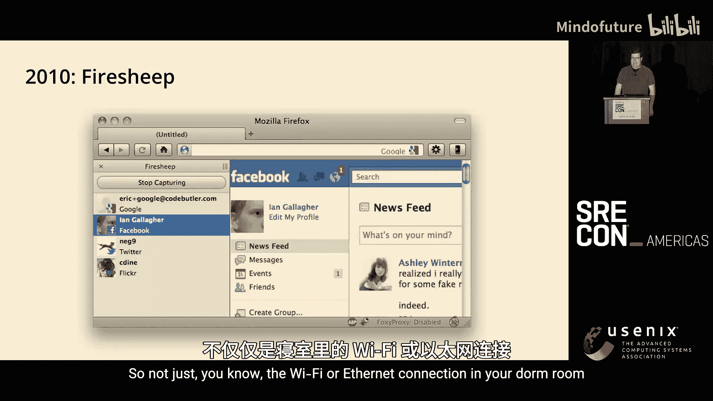

And a lot of websites just didn't support TlS at all， certainly not enough。

To start making it a standard anywhere。 And so a lot of people from the browsers and operating systems were really starting to look at how do we actually fix this。

 How do we get the Web encrypted。Possibly fully encrypted certainly a lot of progress。 And， you know。

 there was a lot of performance problems with T L S at the time。

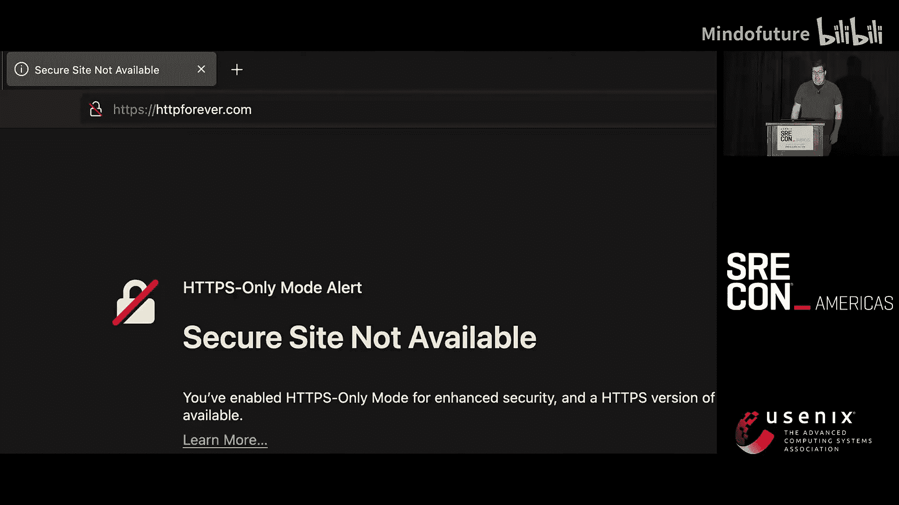

That got worked on newer versions of TLS came out。CPUs got things like accelerated instruction sets。

 newer， more efficient ciphersuits released。 and the browsers and the big sites were working on that performance problem。

 But there was one really big block。 And that was the certificates had a number of reasons that they just weren't reachable for everyone。

The first and simplest one is that they cost money， maybe not a lot of money。

 And so if you had one website， you needed assert for Google do co and you're a billion dollar organization。

 you can just go pay the 10 bucks and get it。Maybe if you're a small business， Yeah， you can。

 you can spend a couple bucks on it。 It's know the same price as a domain name。

 But if you want to start doing more interesting things。 that still becomes a problem。 You know。

 at that time，2010。 I was in in my computer science clubs systems administration group。

 And we wanted to offer things like web hosting for all of the members。

 and that was just like not a practical thing for us to do because we couldn't give Cers to everyone。

 Yeah， eventually we went and got a wildcard cert， but that took weeks of effort and figuring out funding and the actual process to then take that cert and like go stick it into our systems was a manual one。

 It involved sending emails to actually provision it and know do the validation that we really were supposed to get it。

 And then we had to go configure web servers and copy files around and make sure they're the right format。

😊，So the automation around the certificates was also a big problem of getting it everywhere。I mean。

 today I can go spin up a new website on， I don't know， any number of hosted platforms。

 and it just provisions that automatically that really couldn't happen。

You could look at alternatives to the， the Web P K I。 You know， people have looked at like。

 can we use DN S S to like secure the Web， But all of those solutions just really seemed too slow to roll out and weren't making progress。

 so。Looking at， you， how do we solve this problem of getting the web fully encrypted。

 it really looked like there was really only one solution that could actually fix this。

 And that was to make。A new certificate authority。And that's where the path to lets and encrypts started。

The goal was to create a CA that was free。It was open， available to everybody。

 and it was completely 100% automated so you could really deeply integrate it into all of the systems that needed it。

So 2013 is when planning really started。And then in 2014。

 a nonprofit was incorporated and development began on the software。

 the infrastructure and all of the systems there to issue those first certificates in 2015。

The nonprofit organization that was founded to run Letsenrypt is the Internet security research group。

嗯。And， you know， while you can think about the technical issues of like running a service。

 issuing certificates， like having servers， really the organizational problems of being a trusted C A and having that support and infrastructure to keep running are really some of the most interesting parts。

There was an initial group of sponsors， names on screen who really saw the vision and contributed to getting this project off the ground。

And get off the ground， It did。 So starting at the end of 2015 through today。

 who went from issuing just a couple sers at first。

 now to issuing millions of certificates every single day。

With lots of weird little patterns in this graph that I spend more time than I'd like thinking about。

So。We can set up infrastructure and we can run a CA and we can issue Certs。

 but how do we actually become trusted because that's what a CA is for。

 it's to exist as this trusted third party that we can know to issue Certs reliably。

So the first step was that initial setup， building the infrastructure， racking some servers。

 setting up some HSMs， plugging in the networks together， writing a bunch of code。That part。

 you know， it's not easy。 I do it all day， but that's the same as any other infrastructure project。

 really。The second step is to become audited。 There's a set of requirements called the baseline requirements written by a。

The C， A browser forum， which is an industry group basically deciding what sort of the that baseline requirements are that every C needs to meet。

 Once you've decided you're ready to become audited with those。

 you can get what's called a Web trust audit。 once you've passed that， you know， you've got。李。

Accountants really decided that you're trustworthy， your procedures are in place。

 That's when you start becoming this。Process of becoming trusted。Up to this point。

 it's really the same as like a corporate PK or something。 know， you've done it。

 you've done the paperwork。But now you need to really start convincing the actual software vendors who distribute software to all of your computers that your route needs to be included in their software。

 There's four really big root programs that sort of， you know， actually decide who is trusted。

Apple for their devices， Chrome is the newest one for， for roots shipped with Chrome， Microsoft。

 again， for for Windows。 and Mozilla， who ships a root program with Firefox。

 And really is the O G1 because Nescape， you know， before they were handed down into Mozilla started the T L S infrastructure。

 Mozilla is also an interesting case because they run their program fully in the open。

 you can go on their bugzilla and look at who's applying what the status is。😊，And as a result。

 Mozilla's root program sort of gets used the basis for lots of other systems。

 all of your Linux systems， lots of random embedded devices， that kind of。

Get copied down into all of these other things。 So once you're in these four programs。

 you're sort of basically accepted。But。Actually， having， you know。

 Mozilla and Apple and Chrome and Microsoft decide that yes。

 they're gonna accept you is just the first step because now you need every single device on the planet。

 which might access a website to do a software update。

 And I'm sure everyone in this room does software updates every day。

 You're very reliable about getting that done。 But the rest of the world doesn't necessarily。

 I think Android， for example， only really got to that 90 something percent of devices trusting Letsson encrypt kind of in the last year or two。

 And that's again，10 years after Letsson encrypt started。

 So just like sitting and waiting isn't a feasible solution。

 So there's sort of a way we can bootstrap that。 Once you're trusted。

 you can actually get another C to cross sign you。😊。

The cross line itself is not really a technically interesting thing。

 All TL Sers are really a chain of signatures from multiple Cas。 They're always used for like。

 you know， your online intermediates that are issuing sorts continually to an offline route。

 which is like hidden in a safe somewhere。 So you kind of just add an extra link in there to this crossline from another CA A。

The business and risk relationships there are much more interesting because that other Cs can across N you takes on significant risk if you start misbehaving for some reason。

Um。In Trust as a C， A was one of those initial sponsors for Leenrypt and provided that initial cross sign to。

 to become bootstrapped and trusted。And so with that。

 with the programs accepting lots and Cripts root across and providing trust。

 Let andrypt was off and ready to issue searchers for everyone。Of course。

Other people have tried to do this before and， you know。

 getting that trust and transparency right so that you can actually get into the trusted position was a really interesting problem。

 So I wantna talk about a couple of the ways that let's encryptpt work to become this trusted and hopefully transparent organization。

The first of which is open source， Let's encryptrypt was。

 I believe one of the first major open source certificate authority pieces of software that was fully visible by what everyone who wants to know what we're doing can do。

You can go to Letsynrypts Github and find the code called Boulder。And see， you know。

 every line of code， every change we make。 And I think that's been really helpful for collaborating with the industry。

I also think that Boulder is an interesting open source project。 A lot of projects， you know。

 they want to get adopted， be widely deployed。 For us。

 it's really more about showing what we're doing。 We don't really think anyone else should run Boulder。

 It's really intended to be a web scale public web PK C and not something youre wantna gonna to run your corporate PKI or your test environments on。

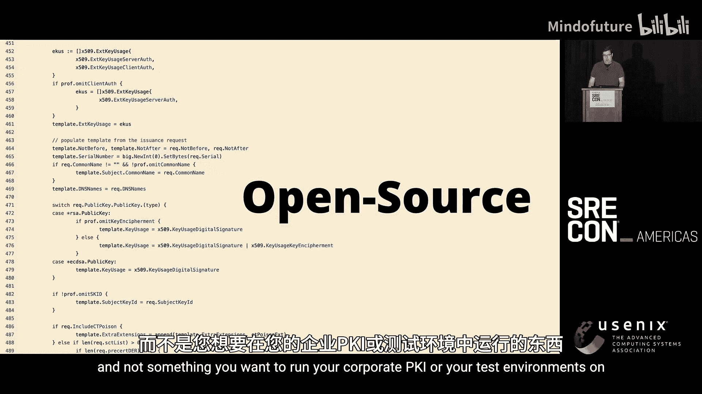

Another of the interesting requirements from Mozilla's root program is that they do fully open incident reporting。

If you're not a CAA， this might not be fully visible。

 but when I file an incident report with most other root programs。

 I just send them an email and tell them， hey， we messed up。With Mozilla。

 we file a bugzilla that's public。 You can go read， you know。

 go on bugzilla thatmozilla org search for Letsenre。 You'll find all of the mistakes。

 We've got two open incidents right now。And we try to be really transparent in these。

 I think over the last decade， Fls and encryptpt has really led the field in how CAs work and file these in reports the status quo has improved greatly since we started and there's a lot more information。

 a lot more transparency tying into what I just said about open source。

 we can often show exactly when oh， we made this bug。

 we got a sign backwards in an offset and suddenly our searcherts are removed from CRLs 48 hours early instead of 48 hours late like that's a mess up。

 but we can show here's the PR where we introduced the bug， here's the PR where we fixed it。

 this is the time period， this is the impact。It's been helpful outside of the CA ecosystem too。

 I think one of Letsenryip's biggest bugs involved taking a pointer to a loop variable in Golang and Go ended up citing our incident reports when they changed the language to make that less of a foot gun。

 which is definitely something that feels pretty good when you make a mistake that's so bad that they end up changing the programming language you used to fix it。

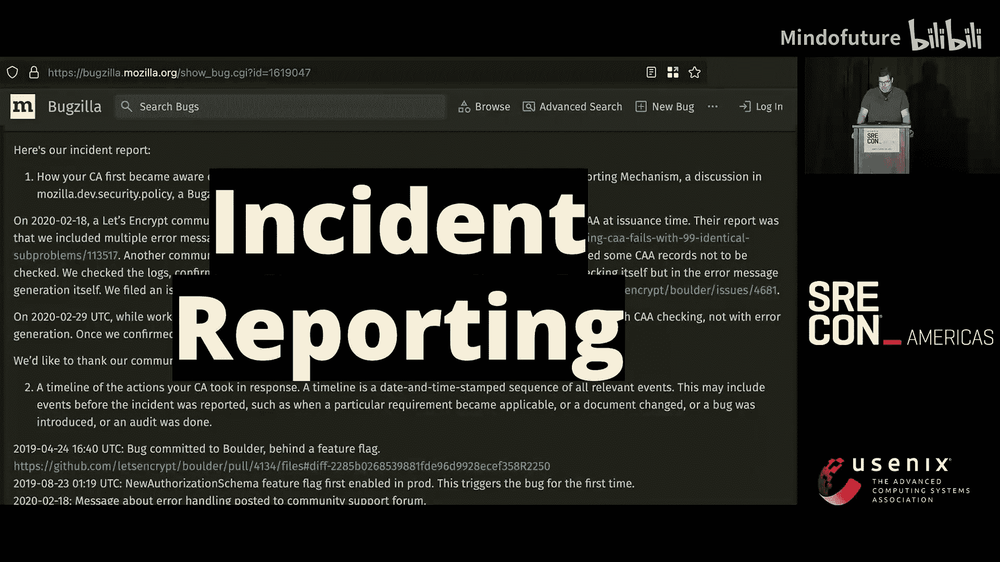

One of the other things that Les encryptrypt decided to do was， you know。

 we have an API and we could have just made an API and told people to use it。

 but Letsenrypt really engaged with the community and went through an IETF process to build a standardized protocol called ACme。

 the automatic certificate management environment， I think。

 the E is clearly there just to make it sound good。

 but that led us really focus on building the CA side and not the clients and all the other integrations that might want to go into it。

 It also allowed for a lot of independent analysis of the protocol to really get a lot of external input into it。

And that protocol is now very widely used。 We started with just Ctbot a Python script to issue certificates。

 but now it's embedded in everything from you know， the firewalls I buy to web servers I I use。

 And indeed， many other CAs have adopted this protocol， too， so。

It may have been not the easiest process to get done。 You know。

 it's definitely a lot of work to rather really high quality standard， but it paid off for sure。

There was another decision related to that that Letsen quit made。

 which was we are just supporting ame。 It is the only way we issue certificates。

 When I need to issue a testert and prod。 I don't have some special backdo command line。

 I go in through the front door through the API and issue the cs the same as everyone else。

 from our compliance and our correctness perspective。Having that single path is really helpful。

 it means that there's no sort of side things to worry about。With no exceptions there。That's the C。

 A side。 There's sort of this other thing we do。Which is that Lets encryptrypt logs all of our certificates to public certificate transparency logs。

 C T wasn't around them when Leenrypt started。 So this is sort of one of the big evolutions of the Web BkiI as a whole。

These logs are run by multiple operators， they're required by Safari。

 Firefox and Chrome to be logged， to be trusted by those browsers。And let's encryptpt was。

 I think the first C A to fully log every single Cert into C T。 We also operate logs。

 the C T logs are operated by a number of different operators。 So my team， you know。

 one of the things we do， in addition to running the C A is running these C T logs。😊，As SRs。

 you know， in this audience， these are a really valuable resource。

 If you're trying to understand what your own infrastructure is doing。

 you should be monitoring C T logs or using a product which monitors C T logs to know what Certs exist and what status they're in for all of the domain names that you control for your infrastructure。

So we've talked a lot about code and how we got there and what we've built， but as I said。

 the really interesting part is the people behind the scenes and what we do。

 so I want to take a little bit of time to talk about the Lets and encryptpt team。So ISRG。

 the nonprofit who runs less cry， has 25 people that includes engineers。

 fundraising and communication staff， finance and management。ISSRG has three projects now。

 Let's encryptncrypt was the original one that was founded as well。

 divvyU is a privacy preserving metrics project， and Prosimmo is building memory safety for critical infrastructure。

So of those 25， there's four software developers working on Boulder RCA software full time。

 and nine people on the SRE team， which is where I am。I think that's a pretty you。

 slim team considering the scale of impact that we have and the volume of certificates we issue。

 So for us， one of the biggest concerns really is efficiency。

 the staff is the primary cost of running the organization and we need to scale up the org without scaling up the staff and in particular。

 you know for us in this room， We're talking about S efficiency。

 How do we build services that need minimal human intervention， How do we keep things working。

 And how do we decide what is really critical to ship。

 That's the biggest thing that we can always do is like it's easiest to run a service that has less features because that's just less complexity and overhead so。

Every year we're always looking to find ways to grow faster and bigger without growing the team as much as we can。

And that means from places like Ser Recon， the team has attended many SR Res in the past。

 We've learned a lot from the rest of you。 So， you know， first of all。

 I'd love to thank everyone who's presented in the past and shared their knowledge because we've learned a lot and figured out how to get to where we are today。

 Thanks to S Recon， S book， lots of resources like that。😊，And really focusing on that goal of。

Remembering what we're here to do， which is to encrypt the web to ship certificates to every website to get them online in a secure way。

And that means what I said， we have to cut feature sometimes。

 We don't support other certificate types like Sm or extended validation。

 We don't have customer support。 I'm not filling out the vendor security requirement that you insist is required for your annual edit audit。

 then sorry。 But we have to say no， sometimes we have to cut things we don't need to do。

And focus on that thing of breaking down the barrier to entry。

 One kind of nice thing for us is that there are multiple Cs available。

 So I'm not too worried if I have to tell you that， like， sorry。

 I can't do something because there are other Cs， and I can refer you to another one。You know。

 we're not a profit seeking enterprise trying to take over the whole world's PKI。

 We're trying to lower a barrier entry so we can happily shed customers if we need to。😊。

So with all of that， let's encrypt costs about $4。5 million to run this year。

That's up from a budget of about a million dollars a year at the start。

 So I think thats that's doing pretty well， you know， a4 x increase in budget and a much。

 much more than4X increase in traffic。A lot of the people in this audience are Sres You're running infrastructure。

 And I think you'd be interested in hearing about some of the technical details about how Lets encryptpt actually operates。

 So maybe I'll take a peek behind the curtain and talk about how， how we operate。

The way the regulations in reality of running a C A is。

Is that we need strong physical controls around。The actual P KI material。 So that's sort of。

Precludes us from doing anything like cloud or host providers。

 So everything is run in physical D C space。 We have two data center locations for red。

 for redundancy reasons。😊，Split across those two， it's about three racks of infrastructure with 24 servers。

 along with affiliated things like networking， HSMs， tape drive， storage devices。

We do have some cloud resources for things like the CDNs that serve our CRLs。

 DdoOS prevention services and logging and metrics kind of stuff that is from host of providers。

And then we have this extra little special thing， totally air gapped for our offline route PKI。

 that's things with like safes and laptops that willll never see the internet ever again。

 because that route that really is fundamentally lets encrypt is very important to defend。

We've learned a lot of lessons running our own physical infrastructure。

 one of which is that hardware is cheap， I mean， not like cheap， cheap， but compared to staff cheap。

So I can think of lots of examples。 but one of those is that we've been running Let's encrypt encrypt off of a single database host。

 or at least a single database primary， which has， you know。

 couple terabytes of data in it does thousands of reads and writes a second with like。You know。

 which would be big for a laptop of two big MD CPUs。

 a couple terabytes of RA and a bunch of big NVME flash drives， but like NVME is really fast。

 I can run a lot of database on this so we have one big primary host。

 we have four replicas of it and we can you know swap those around for DR and maintenance reasons but。

That vertical scaling has been really easy for us as an SOE team to run。Someday。

 maybe in the near future， we're going to have to start horizontally scaling。

 maybe we'll run something like Vites to start running multiple replicas， multiple primaries。

 but that's a ton of work we've been able to just completely avoid up until this point。

 which is really important for maintaining that scale without adding a bunch of another whole team to run databases or something like that。

 the application itself using those databases is entirely stateless。

We run what I say is a pretty normal software stack， we have a bunch of Linux systems。

 we use NoMd as an orchestration platform to push jobs out， they all run on Proxmox as a hypervisor。

 powered by Maria Db for storage。We have a bunch of， you know。

 systems to control that salt stack for configuring systems， ansible， for provisioning hardware。

Permetheus， for all of those lovely metrics and alertings that love to wake me up in the middle of the night and Red us for some cashing over clothes。

😊，One kind of interesting thing about our stack is that we have this sibling project at ISG called Prosmo working on memory safety。

 So we've been deploying NP D RRS as a memory safe rust implementation of NTP。

 because of who we are as a C A， time is very important。 Those timests。

 not before and not after dates and certificates are one of the very critical things。

 And so we're very sensitive to time。 We're also sensitive to these services that are talking in and out of the Internet。

 So we're continually working on getting memory safety at the barrier of our of our organization。

 Hickory DNS is the next thing we're going to deploy for our DNS services。😊。

You might not think of a C A as a really big DNS user。

 but it is one of the fundamental things we do when we're validating。

 does this user who's requesting Asert have control over the domain names in it。

 that fundamentally boils down to a bunch of DNS lockups， whether it's challenged tokens in DNS。

 finding a host name to do an H T TP challenge or checking what are called CA records at DNS record that allows you to control what C can issue certificates for your domain。

 We're doing a ton of DNS。 It's one of the fundamental things we do。

 So we're really investing in hiickory as our memory safe next generation DNS resolver。😊。

We're looking at Russells as a TLS implementation for our NGX front and load balancers。

 and in the future， looking at river as a reverse proxy purely in rust。

All four of these projects are funded by Prosimmo to make them production quality。

 memory safe infrastructure for everyone。

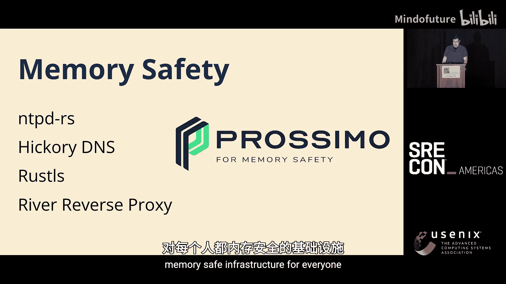

Of course we're not just taking off the shelf tools and deploying those。

 we are doing a lot of our own software development， as I said。

 to take that SE mindset and really automate and scale up without a lot of human work。

Most of our own tooling is written in go， including the open source CA Boulder。

 as well as lots of other internal tools。 We've been pretty happy with that。

 It's got a good mix of productivity， performance， memory use and all the good S stuff like metrics and observability tooling that we can use easily with it。

😊。

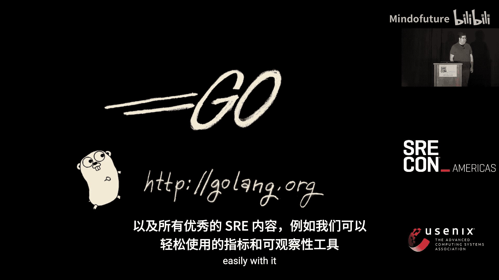

So we're always continuing to work on scaling up our service。

 offering things that we want to offer and figure out how to make the Internet more secure。

 So I want to talk about a couple things that are coming up next that we're working on now。

The first of these is revocation changes。 Since the early 200s， O CP。

 the online certificate status protocol， has been one of the main ways that。

Programs find out if a certificate is revoked。But it's been a real source of problems。

 It has some privacy issues that are sort of very challenging to。

 to resolve because you're fundamentally as every browser connects to a website connecting to the city and saying。

 hey， is this certificate revoked That's enough of a privacy problem that some browsers like Chrome don't check OCSP at all。

Others still might， in some cases， but also because it's an online dependency on the C， A。

 these browsers have to fail open。 What this really boils down to is that the OP protocol is。

 is ineffective at its purpose。OCSP was designed to replace a previous simpler solution called C Revocation lists。

 We used have a list of revoke Certs at an HTP URL that the browsers can fetch。

But in the intervening years， as we sort of realized that OSP wasn't working out。

 browsers have done a lot of work to make C，ls better。So。

Those basically boil down to the browser vendors fetching the Cls from every C。

 condensing them into some compact form with various neat tricks they can do and pushing those out via a mechanism that doesn't necessarily involve the C to all of the users of the browsers。

 So so most of the major browser vendors have something like this。

 So as a result of the kind of insurmountable privacy problems as well as the performance issues that we get from OSP and the fact that there are now better alternatives existing。

 Let's encrypt has previously announced and has begun the process of ending OSP support this year。

As an SE， this makes me really happy because I don't like running OCSP services， they're annoying。

 they have high uptime requirements， I have to have special CDN configuration because their post requests that have cashable responses and they're just not fun to run so if you are relying on OCSP and you're using lots and cryp you should be paying attention to this。

One of the other challenges with revocation is that clients。

 when you revoke their c need to know that they need to renew it。

We can work on getting certificates to everyone。 But one of the things we also want is to make sure that there's no certificate errors for anyone。

 So one of the things we've identified in the last couple years is that telling people when to renew the certificates as a problem。

 the traditional way that this was done was by email。

 know if you have a mass certificationification event。

 you learn one of these bugs or incidents that we've had results in invalid certificates being issued that we don't have proper validation data for。

 they need to be revoked。 then yeah， we can send a mass emails。

 but like if we're on a 24 hour timer is required by our regulation and itll we send you an email on Saturday night。

 then you probably unless your paging on every email， which seems like a bad idea。

 you're not gonna to replace it， which means that for Sunday。

 you know your users might get revoked certificate errors。

 And you know maybe you can monitor certificate status to notice， oh。

 all these secrets are being revoked， I need to go replace them。 But that's sort of almost too late。

So we've been adding a new feature to Acme， our protocol called the Acme Renewal Info Endpoint。

That's currently going through the IETF to be standardized。

 It's in the sort of final draft stages and should be a full RFC shortly。

 Lets encryptrypt and other Cs have already implemented the the draft specification。

 So if you're maintaining an acme client or otherwise issuing a lot of certificates this is something you're going to want to integrate with to get advanced notice of impending revocation。

As well for us as a C A， way the way Ari， as we call it。

 was designed is that it actually doesn't just tell you a bully and hey。

 you need to renew your search now， but it tells you when to renew your search。

 So it returns a start an end window of you should renew your search。Soon， and for us。

Handling mass raifications is a big performance issue because， you know， we issue 7 million cs a day。

 They're 90 days long。 If you have to issue， you know， all of those cs in one 24 hour period。

 that's a huge load volume。 So this gives us a really interesting lever as S res to sort of start cranking up or down the load on like people are polling this endpoint to say。

 hey， do I need to new my certain。 like we can give more and more yes responses to get。

 especially large integrators who have lots and lots of cs to。😊。

Back off their load a little bit and have a happy， you know。

Performance profile for us where we're not melting down our services。

 trying to get all these revocations through。🤧。One more service that Les arypt has done。Speaking of。

 you know， when you need to renew your certificates is we've sent out expiration emails to everyone of。

 hey， your certificate is within 30 days of expiry and we don't see a renewal that corresponds to it。

Lots of people find these handy。 And that's true， but。They actually have it worked super great。

 We send a lot of emails to， I don't know， Someone who set up a， you， I don't know。

 a Squarespace site and then shut it down。 And， you know， they don't need that c anymore。

 We also don't need to send them emails， letting them know。

There's also a lot of PI tied with this of like this account has this email just for expirere emails。

 which is just one more thing that has legal requirements around us to deal with。

 so looking to cut down how much PI we retain。And fundamentally。

 they're not a reliable way of knowing what a website is doing。

 We have a bunch of heuristics for like， hey， this cert looks like I probably should replace this Ct。

 but ultimately that's not the right place to monitor websites or other services need to be doing their own expiry monitoring that's sort of more tied into their system。

 I think one classic example of where this goes wrong is a website issues in Cert。

 but you haven't restarted your web server。And so you're still using your old Ct and you end up getting it expired and things break。

 so both from our side of making our infrastructure more efficient by not sending out a lot of emails and all of the affiliated program problems that happen with sending a lot of emails。

We also get a better end experience for people because there's other services that can do monitoring better than us。

One of the other things we do， other than the C， A， as I mentioned。

 is run certificate transparency logs。As our issuance volume and everyone else's issuance volume scales up。

 we're starting to look at how we can make that more efficient。

One of the current pieces of infrastructure in our CT logs， which I haven't really talked about。

 they all run on AWS they're currently backed by RDS databases and then a bunch of cache is in front of them。

 there's a lot of complexity here for us as SEs with multiple services in this hot read path whichs gets a ton of traffic as every single one of your threat detection services scans that big log of Certs to ingest it all。

So last year we started building a new API for certificate transparency called the Sta CT API。

 and we really took an Sre focus on designing this。

 It's designed to be hosted out of a static object storage like S3 or any other static web host。

 you know if you have a big storage network and you have an Engine X on it or whatever you can host these out of a bunch of files。

It involves。No custom code running in that read path。 And it's very cashable from a CN perspective。

 So that means we can scale this much higher without incurring a lot of CPU and and instance costs with it。

We're building a new implementation of CTE that implements this API called sunlightlight。

There's also a team at Google  building an implementation of it and a couple others。

So we're currently working with partners in the CT ecosystem like Apple and Google who sort of choose what CT logs are trusted to go live with us later this year。

 So this is something where if you're using CT as a data source for whatever products you might be shipping。

 you should be looking at this to make sure you're not going to miss out un searchs when we switch over to this new API。

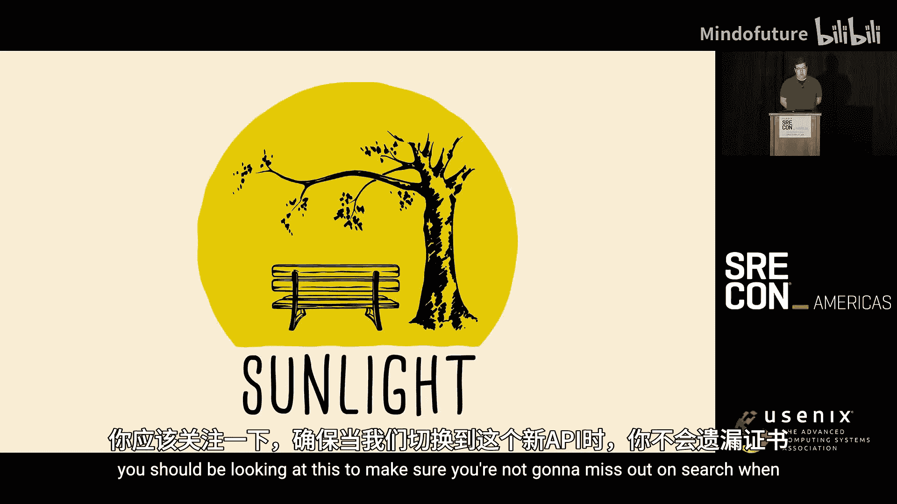

The last thing that we're working on， which may be a little less popular in some circles。

 is working on further reducing certificate lifetimes。 I've mentioned revocation a couple times now。

 It's one of the big problems of making it more effective and making it more reliable and making it less。

Burden some for us to operate。As certificate lifetimes gets shorter。

 the window for which your evo certificate is live gets smaller。

 which reduces a lot of pressure and reliance on that ecosystem。Later this year。

 we're offering an opt in six day certificate option。

Not everyones gonna want to do six day certs because you really need to have your automation and your monitoring on point to do that or at S Recon。

 I'm sure this is the crowd that has their automation to monitoring most on point。

 but the reality is not everyone's going to， but that'll also allow us to offer some new features。

 I think the biggest one that I'm excited about is allowing I address certificates。

 some other CAs have offered these in the past and currently。

 but let's encryptpt has into this point because of some concerns about like you know how ephemeral or IP addresses andre not necessarily as tied to an organization or a person as a domain name are。

 So that's why we're only going to allow these on these really shortli certs to sort of minimize some of that impact。

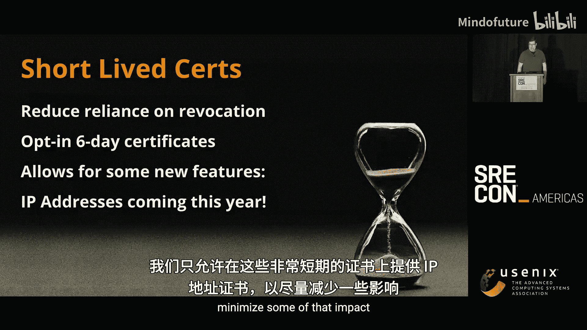

🤧。So in conclusion， I'd like to talk about a couple ways that you can help support us as a nonprofit。

 first of all， to achieve our goal of encrypting the full web。

 if there are non HTPS websites that you can help make that switch to HTPS， that'd be great。

As we're really just an API service provider， we need everyone to contribute to the acme client ecosystem。

There's lots of popular options。 Many of them are open source。

 and many of you are building products that need certificates。

 So it would be great to see your products have built in support for Ame to obtain those certificates automatically。

 not just with Latinzencr but with other Cs， too。😊，Of course， financially as an nonprofit。

 you can always donate to us or get your company to sponsor us if you're interested in sponsorships。

 definitely find me or one of my coworkers later， and we can have some great discussions over that。

And of course， I'd like to thank you。 Many of the people in this room have donated it already。

 They are corporate sponsors， and we wouldn't be here without you both from that financial perspective。

 as well as， as I said， SA Recon has been instrumental in getting less encrypt to where we are today that scale has been something we've had to learn from。

 from all of you。😊，All right， I think that's it， we have time for Q&A。

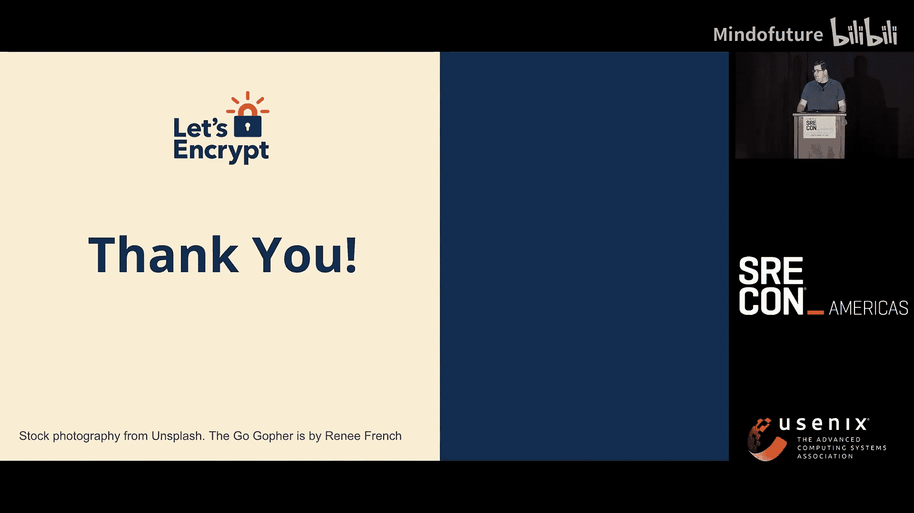

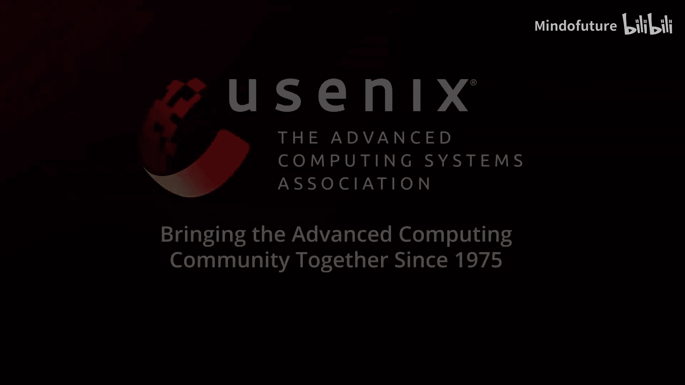

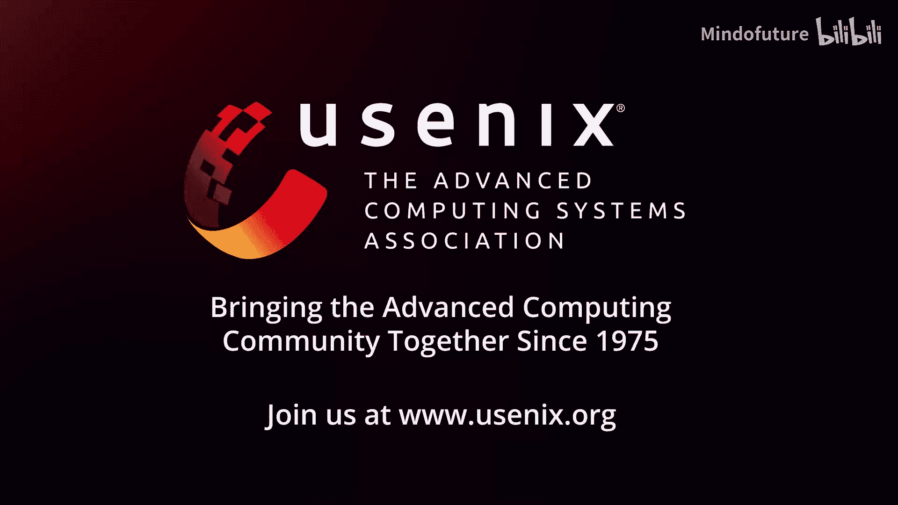