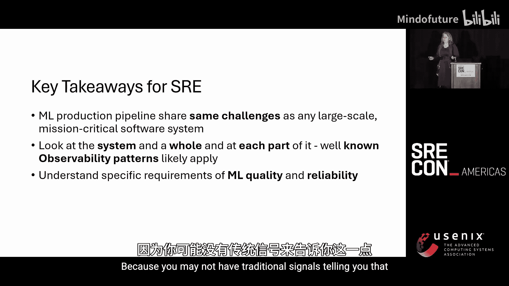
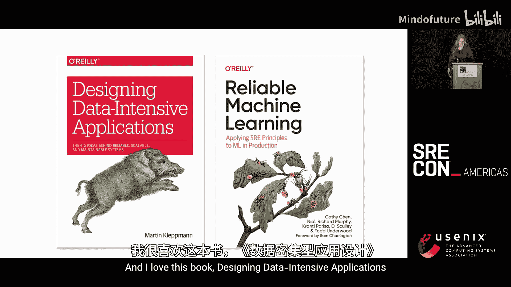
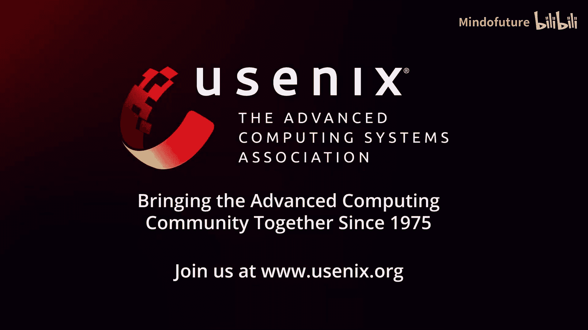

# SRE大会-2025-美洲-｜-srecon-｜-分布式-｜-缓存-｜-OpenTelemetry-｜-安全-｜-AIOps-p02-P02-An-SRE-Approach-to-Monitoring-ML-in-Production--BV1TmLDz7EZZ_p2-

。

O， we will be talking about the necessaryee approach to monitoring machine learning workloads and the heavy data of workloads in production。

A quick intro about myself， I have a collection of degrees， appliedlied mathematics。

 Maine learning and AI and music。 I'm an opera singer。

And I'm principalip SE and Microsoft Azure in an Observability team。Let's have a quick survey。

Have you ever built machine learning model， Please raise your hand。Okay， have you hand your code？

More than three tus， even then else。Yeah。You have a decision tree there。ok。Now， next question。

 even if you didn't build， I'm sure you have some impression about machine learning。

 and I have difficulty to see you all， but I will try to。Can machine learning model be 100% accurate。

 Raise your hand if you think it can。This is great。 I can't see anything。

 but I'm sure that there were no hands。Because machine learning model can be 100% accurate。

 Otherwise， it's overfitted。 And as George Ep box said， all models are wrong， but some are useful。

 achievingieving 100% accuracy is not feasible。 do it to the complexity and variability of real world data。

 you may build perfect model tomorrow， the world changed already。

 and you are not really accurate anymore。 So think about even the models that may look like something perfectly accurate。

 You built it tomorrow。Something happens to the world。 Let's say we are back in 2020。

 You have the face recognition software in your phone， and suddenly。

 Covid starts and you're wearing a mask and you need to adapt。 So the world changes。

 and the models need to adapt to that。This leads to a question， are machine learning models durable。

 Please raise your hand if you think they are。Great。We are on the same page here。

 There is a study that was published in Nature magazine that concludes the 91% of machine learning models will degrade over time。

 So all models do not remain static。Even if they achieve high accuracy and initially deployed。

 even when their data comes from very stable processes， they may degrade over time。

 So do not assume that once you build a model and it's performing pretty well and you put it in production。

 do not assume that it will just keep performing well in production， you need to monitor it。Now。

 the last question。 No， it's not the last。 Can complex system be deterministic。

 Please raise your hand if you think they can。And based on my previous questions。

 you already understand that I'm asking questions that you shouldn't be raising hands on。

Because complex systems run in the permanent， degraded mode。

And we are dealing with the small failures all over the place。

 And what systems have is the defense in depth。 So we are protecting our system from the。

 the big failure by defending in the small parts of it。Now， let's summarize。

100% accuracy in the male doesn't exist。91% of female male models will degrade。

 and no complex system is 100% resilient。 Great， right？ So what do we need。We need an necessary MLl。

And here's the picture of the cart for you， as I promised。Its the for M L。

This leads to the last question I promise。If you are running machine learning and production。

 even if you haven't built it， but you're running， and machine learning is not necessarily you have very complex system like compile it。

 It could be a time series clustering。 It could be some decision tree that they suggested open this troubleshooting guide or that troubleshooting guide。

 So how are you monitoring it。 Raise your hand if you are monitoring your machine learning and production。

Okay， so there is no ocean of hands there。Which aligns with the study published by the Institute of Ethical AI and Maine Learning。

That says that 50% of survey participants had no machine learning， monitoring and production。

Which is the problem， because， as we've seen from the keynote today。

It's not just about components being wrong or not working。

 It's about your model giving wrong answers。 And this can have very dramatic effect in your business。

 because if you're suggesting something to your users that is incorrect。

 You can't monitor it by seeing my component is up or down。

 It's about the correctness of the answer that your machine learning is giving them。

 So we need to make sure that we are monitoring it。

And as we can see from the forwarde of the reliable machine learning book。

 let me see if the author of the book is here。 Do we have Todd Underwood here。Okay， he's not here。

 You can find him in the corridors afterwards。 But the forward written by San Sharington says that the application of methodologies from software engineering to machine learning is not a simple lift and shift。

 and the concerns， challenges and solutions can differ quite significantly in practice。

Let's explore this。 I keep trying my pen， and it's not working。

 Let's explore that specific statement there。 Concerns。

 challenges and solutions can differ quite significantly in practice。

Let's look at the SreE and machine learning practitioners。 And what do they do in their day to day。

So S A E would be having deep understanding of the large scale distributed system。 They。

 that system should be running reliably in production。S we are building scalable， observable。

 secure and compliance systems， resilient to traffic fluctuations and changes。

They run in permanent failure mode， as we've seen from the previous slide。

And we are dealing with incidents， obviously， because we are trying to prevent bigger issues。

And then we're looking at AI and machine learning。 deep understanding of mathematics。

 statistics and probabilities。They develop， evaluate， optimize complex algorithms and models。

And those models can learn from data to make accurate or less accurate precision。

 predictions and decisions。 And those are integrated in the product or process in the context of learning loop。

 And both of them need to work in collaboration with different teams。

But there is something here that is underlying that。

 So this infinite sign that some of you may recollect from the Devops diagrams means that the S impact is spread over time。

 meaning that we are frequently evaluated based on the lack of bad things happening。

 which requires con effort over time。 when be things don't happen。

 while the AI and the male practitioners are evaluated on the delivery of specific thing。

 It's a point in time thing。 So I'm finding the problem I'm building a model。

 I will iterate and here it is the model run it。 So the evaluation of both is slightly different。

 And this is another area where we need to bring those two practices together or better pull the machine learning practitioners closer to the S because if their models are running in production。

 this continuity of the quality need to exist as well as part of the machine learning profession。う。

Now， let's look at the vocabulary between the S practitioners and machine learning practitioners。

 So I won't be going into specific terms here because I'm sure all of you are familiar with them。

 When we look at the machine learning。We are looking at modeling， precision， regression， training。

 testing， noise and fairness and properties and decisions。

There are some boards which are common between us。Things like performance， for example。

 But it's maybe a very different thing if you are talking with the S colleagues or if you are talking with the M practitionerers。

 So some words we use on a day to day may differ So how can we reconcile this language。

 So both of us can speak the same language can understand each other and can prioritize same things because this disconnect can be costly long term。

We also have some common challenges。 And here I'm using well known quotes。 The scale。

 everything is growing。 And here's the Moore's law。

 The number of transistors in an integrated circuit doubles every two years。

The performance software is getting slower more rapidly than hardware is becoming faster。

Shortage of resources。 every growing， very fast growing business is looking for more and more resources fast。

 And here's it always takes longer than you expect。

 even when you take an account and the Hftutter's law reaches the Hoftutters law。

 the recursive interpretation of it。Everyone is dealing with some sort of incident and failure modes。

 but they are different between the S3 practitioners and machine learning practitioners。

 So incident may look very different。 And once you bring those two disciplines together。

 we need to reconcile that as well。There is a lack of formal education that supports this cross domain expertise。

 there is not that I'm aware of the university that have the SE curriculum， pure SE。

 and there is no university that is teaching machine learning to run in production unless something appeared in the last week that I'm not aware of there is a lack of education in this area。

System understandability， the systems we build now are so complex and so vast。

 They can't fit in one person's head。 This applies to both to the large distributed system or to the machine learning models that are complex。

 which is goes beyond the five Idenel situations。 So we we are dealing with this challenge here。

 And here's the Russell Aov， system is never the sum of it parts。

 It's the product of their interaction。And communication。 That's my favorite quote。

 I think I put it in every presentation I have。 The single biggest problem in communication as the illusionists have taken place。

 And you've seen from the previous slide。😊，The vocabularies may differ in practice。

 So how can we expect the effective communication if we are don't speak each other language。

 So we need to make sure that we bring those two disciplines together。

Now I will give like 30 seconds an overview of machine learning。

 of course this is not exhaustive and this is just a high level。

 so the machine learning talks about supervised and unsupervised methodologies。

 supervised use label dataset as an input and they feed data into specific model。

 and then the model will do predictions based on those classifications that were in the data。

Examples of those neural networks， linear regressions， decision trees。 Now， unsupervised。

 you don't have labels there。 You have a bunch of data。

 And first thing you do is to find patterns in this data， which will become your categories。

 Then you will be。Making predictions， the new data need to fit into one of the categories that you classified before。

An example of those would be cames， principal component analysis。

 hierarchical and neural networks are also here because you can have them either way。Now。

Bace we can rely on people just shouting if you're brave enough。

 Which models do you think are the most popular， the most popular and used in 2024。Unsupervised。

 okay， I had one answer there。Time series forecasting。It wasn't LLM。 LLM comes second。

So then this is from the same study from the Es AI Institute about what people are doing with the AIN MLL。

 and so time series and forecasting was the top one then LLM recommender systems， text。

 nature language processing， etc。So。And when you are building a machine learning model。

 you're just starting because once you build it， it's built to solve specific problem。

 And then you will need to integrate it in the context where this problem exists。

 And then the people will be consuming that model。 So just building a model。 It runs on your machine。

 It's perfect。 You are just starting to enter the door。

This machine learning model will be part of the complex workload in the complex distributed system。

And your failures won't be just the male failures。 You will have the same failures as distributed systems have。

And your customers won't care that your model is very high accuracy。

 They will care that the end to end system works， and they are actually getting something out of it。

 So you need to make sure that you're monitoring for that。

And all the complex system failure modes apply in this context as well。

So we need reliability practices and standards。 We've seen this previously that we're dealing with a lot of uncertainty and non deterministic nature systems。

Let's look at the Zigererson hierarchy of Sri needs。

As the re talklks should always have the pyramid of Mike Dickson。 but let's change it now。

 Let's add few layers to it。 Now， we need a flavor of M。

 We need monitoring for M and all the previous one。

 We need the incident response that is ready to answer the machine learning challenges。

 We need to have the proper learning feedback loops to make sure our teams are ready for the progress。

😊，Testing， release procedures， capacity planning。 And finally。

 we need to do something that not many may be monitoring already your data collection。

 your data quality and your data management， because for M data is what feeds the machine learning model。

 So if you are not monitoring your data distribution and your data statistical characteristics。

 you are missing out on let's say on half of the monitoring for the machine learning workloads。

Then you will be monitoring machine learning modeling。

 the training processes and finally you will be deploying it in production。

 you will be monitoring that as well， and you will be monitoring how model is running in production as part of the larger system。

So how machine learning project lifecycle looks like you define a task。Then， you will be。

Finding data that will help you to solve that task。 you will explore this data。

 You will deal with the noise。 You will see if you have enough data。

 So there's a lot of exploration and preparation of the data happening。 Then you will train model。

 you will do at rate of training， speaking what model works well for this data shape。

 You will validate date what model is the best。 Maybe you will end up with multiple models。

 and you will run multiple models to address the problem。You will deploy it in production。

 and we will see in more detail how this deployment part works。Then you will have this。

 I struggle to call it ML Oppher。 It's like operating called this machine learning system。

 but it's also the regular distributed system。 So it's really an NSR of the system that also have machine learning components in it。

So what will you be monitoring？You will be monitoring business Kpis because if your model is good or bad you won't get this from the regular telemetry just because one of your components is not working doesn't mean that your model is not giving good or bad results。

 Of course， if the data is not getting to your customers。

 the answers are not getting to your customers， you have this reliability problem。

 but if it is getting， but the answers are incorrect。

 the traditional monitoring methodology won't give you that answer。

 So you need to make sure that youre monitoring your data distribution in multiple places。

 data that comes into your model， data that your model generates as an output and if you have the possibility depending on depending on the system you're running。

 you will need to monitor the data that is coming from the customer instructionss with the answers which is called actuals and will validate your true positives。

And then you will need to monitor the deployment processes as well。

 is your model went into production， will are liking right now a lot of tooling across the industry in how to effectively implement CICD for machine learning。

 So that's a challenge that many of you will need to deal with once you're starting working with M。

 if you're using already mature inference services， then you probably have this built in。

 but if youre not， if you just build specific model and you put it as the slice of code into your production system。

 you need to make sure that you are implementing CICD for your process。

So before I go into how do we deploy all that， how do we build architecture that integrates M。

 Let me just touch base on the monitoring complex data processing pipelines。

 because this is what we are dealing with with now。 There is the ingress， there is egress。

 And in the middle of some transformation is happening。

 It can be compression or it can be machine learning。

 It processing data and giving some other data as an outcome。 And then you have a data store。

 So all the monitoring。 If you obstruct yourself。 step back and look at this。

 this is the complex data processing pipeline you are dealing with with。And you need to be。

 you may be tempted to look at the all the process unprocesed data or the data processing grades。

 But this way， you will lose visibility from the entry end processes。

 So make sure that youre looking at long termm trends and you're looking at absolute and relative performance because the slice of point in time of your data processing pipeline may not tell you that the system is slowly degrading。

You obviously will be looking at the oldest and new data that is being processed through your pipeline。

But at the same time， you may have different data types。

 and some of them may be more expensive than other to process。

 and some very heavy data bit may be stuck in your system。

 So just looking at the oldest and new data and the processing rate may be misleading。

 So you need to look at all of it in。All of it at once。

Make sure that you look at the end to end pipeline processing latency。

And make sure that you instrument your telemetry for understandability and explainability， because。

 as it keeps growing。 remember， a system is so big， it won't fit in one's head。

 You make sure that you help your future self by putting instrumentation that is easy to understand and interpret。

And system tradeoffs。 So is your system and to end system is built for latency or for completeness。

 Because sometimes you need to do tradeoffs。 Let's say that your system is predicting or suggesting the user what is the road traffic situation。

 you if you have some kind of blockage in the pipeline and you have the buildup of the records be getting processed。

 You probably don't care about completeness of the processing。

 You can drop all the records in exchange to giving the freshest data to the user as possible。 Now。

 imagine that you're processing financial transactions。

 You rather wait a little bit but have everything， everything there。

 because you need to have very complete system。 So make sure that you understand what the data processing pipeline is serving。

 So you are instrumenting it to measure the right things for that system。Now。

 remember that I mentioned that the first thing you will be training your machine learning model。

And the first step， you probably will be exploring data and doing small models。

 but then you will need to put that training process in production。 so it runs at scale。

How does it work， So you will have data ingestion into some data store， raw data store。

 and there will be processes to extract features from this data。

 and you will have the modeling part where you will be training model and validating the model。

 This runs in the permanent loop because your data is getting ingested continuously you are cleaning it。

 you're analyzing it， analyzing distributions of the data。

 seeing if there is no distribution drifts between the data that you use as a baseline to train the model and the data which is coming to the system now。

 because that may trigger you betrain the model， and then you are training until you meet specific quality criteria that you define for a new model。

 usually accuracy precision recall， etc。All this will be running as inside an orchestrator。

And you will make sure that you are having some model metadata saved， who trained it。

 when trained it， maybe a snapshot of the predictions or the schema that you are generating out of the model。

 Anything that will help you in the future to rationalize around。

 Shall I roll back to the previous model， Let me see what was what were statistics about the previous model accuracy So all this will help you in the future。

 this metadata。And then once you are happy with your outcomes， you will be deploying it。

 So let's see what you will be monitoring here。 and it's not an exhaustive list。

 but it's ended up being very text heavy， and that's still not complete。In the data store。

 likely data freshness， availability capacity of your store， the data drops， data corruption。

 the schema mismat in the ingestion phase， you likely will be looking at the injectiongestion rates and to end latencies。

 theuration of your pipeline drop rates。The orchestrator will be looking at jobs execution。

 and the failures of the jobs and reries， the execution time， etc。

Then you have the machine learning dataset quality。

 which is on top of your traditional data store monitoring。

You will be looking if your data is complete， if it's correct。

 if it's fresh enough and if it have any bias。 So imagine that you are building predictor of。

Spific food recommendations， for example， And you are completely missing out one country from your prediction data set。

 and your and some a tourist is in that country。 They are trying to use your service to see what would be the best food predictions in the area。

 but you didn't train the model that uses that specific country inputs。

 So your model is biased against that specific situation。

 So you need to make sure that your data is well distributed。

And then you will be monitoring the training process itself。

 How long does it take to train the model， I it failing。

 What's the success rate of the training phase， you will be looking at training errors and validation errors。

 your compute capacity， how that long does it take to train it。

And how much compute it takes and the size of the model generated。

 Because depending on how you will be deploying model in the end。

 you may be looking at the smaller or larger sizes generated in the model。 And finally。

 machine learning model performance。 This is statistical measure。

 And I recommend each one of you to prepare for the future and refresh statistics concepts in your head。

 if you haven't already precision recall， accuracy， computational performance of the model。

 For example， if you trained the model is perfect。 But then it takes five minutes to generate the recommendations。

 and you're running it in the real time system， then this model is not good。😊。

Now before we start building our architecture and monitor it。

 make sure that you design your system and you know what is the expected latency expected from your system and the traffic load as I give example previously your system may need to be optimized around latency or completeness or any other things that are specific to your system make sure you know privacy security compliance and governance requirements don't start anything without getting yourself informed into that and Es and bias review the responsibility guard drills like I think every project should start with that and then start thinking about building the model and then the hosting requirements will your system run locally on the client and the cloud using managed inference service like for example AzureM decide what you are running it on I have this little formula that I use so if you need to run it on the edge。

 then host it on the client if latency is critical you may want to host it offline or in memory。

But it's you need to make sure that your models are small and otherwise run model is a service。

 That's not prescriptive。 It's just my own formula。 Now。

 let's start building our production pipeline。 So traditional things like you have a client。

 you have application service。You have a database， production database。

 Then you have a data lake where the data that you use to train the model will leave。

You will have that model training orchestration that I I'm not detailing here。

 but we had an entire slide about that specific training component because it will run as a loop。

And then one thing you may decide to do is you are predicting subset of data。

 You will just put it in the production database。 You don't have too much data。

 Let's say you don't have。Gzillions of records。 and you can just generate predictions。

 put them in the table in the database。 And as your application is getting used。

 those predictions will be pulled out of the database。 And that's okay。

 There are trade offs here because if you are in the very fast pace changing environment where the。

 let's say that you have， a shopping app and the new products are released every hour。

And you may need to have your model accounting for those new trends。

 then you probably need to retrain it faster and storing it in the database may be challenging。

 but it's possible。So as your customers are interacting with your applications。

 you will be storing new data into your data lake and use that data to train the model for the new predictions。

other way is to store it in memory， if you need something really fast and your prediction is not super complex to process and you have enough memory in the application server。

 you may want to just compile it and put it in memory and do very， very fast predictions there。

Or something very familiar to S。 do it as model as a service。 So you it's called Ma。

 You will have a service where you will be deploying models here you can have experimentation。

 for example， or test and production when you're deploying multiple models in parallel and youre routing part of the traffic to one of the models freshest models。

 You're validating as it's running。 and you need to have an ability to route traffic to the best performing model。

 And this way you can have the versioning of the models running and production。

 So it's it's something quite more common for the S to deal with。

 So it's easy to understand architecture。And finally， if you are running on client， for example。

 you have that temperature devices that some people have at home and you need to have this predictive model to say。

 turn on， turn off， then you may be running it on the client itself。 And obviously。

 the updates of those models won't be very frequent。

 but for the situation in hand it's maybe okay to have model there that is not updated too frequently。

Now when you are doing the production monitoring here， think about four blocks infrastructure。

 well if you own the infrastructure on which your service runs。

 you need to monitor your infrastructure and you likely will be looking at the CPU memory utilization。

 disk usage， network capacity and traffic， etc。Then you have a service。

 traditional monitoring here as well， transaction rates， response times and errors。

Amplication errors。 but then something which is not really common。

 You will need to monitor data itself。And while the like data freshness and volume are common to monitor。

 the noise and the data variability and distribution drifts is maybe a new concept for many of3。

 So we need to make sure that we monitor those as well。

And we will be monitoring model for its accuracy precision。

 We'll be monitoring it in the training phase and also while running in production phase and prediction and the concept drifts。

 uncertainties estimations。And。Remember that I mentioned that deployments。

 the CICD for the machine learning models is not yet mature enough。

 so you will need to make sure that you build the CICD for the machine learning depending on the architecture you choose to run it in production。

 so make sure that you have support for experiments。And the test and production。

 something like was mentioned in the keynote that you train more than one model。

 they both perform very well in the training phase。

 you put them in production in parallel and you routeute， for example。

1% of traffic to one of them just to see how it's behaving and then you have mechanism to reroute traffic to the best model。

I want to talk about distribution drifts because that's extremely。

 extremely important in the MLl lifecycle and and the distribution drifts， for example。

 you can't speak about model accuracy without mentioning its distribution。

 So you may say my model is 98% accurate。 The next question is over which distribution data because once the distribution changes。

 your model loses accuracy。 So monitoring distribution drifts。

 you must do it together with the model accuracy。So what is the drift， It's a change in the behavior。

Of the data that is coming to your data store， which causes the change in the input data。

 for example， you have more data from specific country。

 you have let's say that you are store that is selling products for Halloween and you have more data about orange products but then Christmas is coming and you have more let's say golden and red products so the distribution of data against specific critical characteristics that are critical for your specific case is very important。

So how this works。Let's say that you started training your model and you had a lot of data。

 you rendered the distribution， you trained the model， you looking good， you put it in production。

 you keep collecting the data and you're slicing it and you're seeing if the distribution over the same components that you use to train the model when overlapped if it's looking the same。

Or if it's looking very different。And when it looks different， it's called drift。

And can you have mechanism to measure it。 So for example， here。

 I generated distribution drift and use callmoography smyrov statistics and callback label divergence to measure the drift。

 So the drift will be numeric value that you will need to run over the plenty of libraries that you can apply to your data distribution to see how big is your drift and if drift is too big。

 So you will need to define what too big means for your specific area。

 you need to trigger retraining the model So distribution drifts are extremely critical in this Now what data you will need to monitor here for the drift So remember that you will have what's actually for data So data that you use to train the model that the data that is going into your model in when it's running in production data that is getting out of your model in production。

 your predictions， they also have distribution So once those predictions start distributing differently meaning。

That your model is predicting something that wasn't really accounted during training phase。

And if you have a possibility to collect actuals， actuals is the true positives is if you're running the system when customers can click on your predictions and you collect their clicks for example。

 you can say like， okay， I know if my model is being used and run time so I can evaluate what customers are using。

 But in some cases， you may not have actuals。 For example。

 if your model is predicting the growth of bacteria in the space of 20 years and the river bank to decide if you can build a bridge there。

 you may not know about the your model quality until 20 years pass and the bacteria actually have grown。

 So you may not have actuals。 in this case， you need to monitor these drifts。

 and the drifts will tell you if the data， the world around you have evolved So the data is distributing differently。

 So your model need to be retrained。Now， there is also human entropy in the thing because humans are part of every complex system。

 Human are running it and humans are building those systems。

 So what we have here some observability antipats， we always think that collecting more telemetries better。

 and we are hoarding it。 we never remove anything， which doesn't make systems more observable。

 it's actually reduces system understandability。Our S。

May not be aligned with business objectives or customer experience。

 We are monitoring the CPU utilization， but we may not be monitoring the entry end experience。

 We need to make sure that we are doing that as well。

 We never turn off any monitoring because every monitoring is precious。

 we keep it there and we never turn it off。 Thats is wrong because I may need this one day again。

 it reduces your system understand。 So doing frequent assessment of the entry and monitoring and what alerts do you have in switching things off is very important。

 And then we have 500000try dashboards， and no human is capable to look at all those dashboards。

 make sure that you are very again， you are doing regular assessment of what you are monitoring and is it critical。

 if someone is actually looking at that。We may not have shared understanding of different system failure modes because over time。

 that， that one engineer and the team knows it all。

 And we just keep referring to them as knowing things。

And sometimes we see reactive culture because new monitors are only added as a response of an incident。

 And again， doing this proactive assessment of your end to end monitoring is very important。

 and reward misalignment。 observability work is seen as tax。

 So people are not super excited about doing it。 and it may not be rewarded enough。

 it's not celebrated enough。 So we need to change that and actually make that work visible。😊。

Obsservability hero， when monitoring becomes one person job。We don't want that。

 We want everyone to share that knowledge。And we have sometimes mistake We individual we monitor individual components and forget the end to end。

Some key takeaways for SE， and there will be key takeaways for malpractitions because we need to bring them together because once a machine learning start running and production is as a part of the continuous loop。

 machine learning folks need to be part of that loop。

 So machine learning production pipelines share same challenges as any large scale distributed system。

So we need to make sure that we approach and monitor it the same way。

 But and we need to look at system as a whole instead of each part of it。

 but also look at each part of it because wellknow observability patterns likely to apply to that system。

And we also need to understand specific requirements for machine learning quality。

 What does it mean your model is bad or good， Because you may not have traditional signals telling you that。

Os。

Something happen。 Oh， you need to increase your competence in statistics and probabilities。

 If you haven't yet， there are plenty of introductory courses out there or books。

 So really recommend doing that。 And design easy to understand systems because reducing complexity when you are designing them will help you for the future。

Now， key takeaways for male practitioners。 Does anyone here in the audience is a male practitioner。

Okay， see one hand， great。 But everyone else can bring it home and share it with your colleagues。

 system complexity。 You need to design modelular system because this will help us as a re to monitor those systems。

 They need to be easy to understand， easy to monitor and easy to troubleshoot。 Well。

 it's easier said than done， because machine learning can be extremely complex。

And machine learning practitioners really each understand the reliability。

 security and compliance requirements and the governance of the data and all things that SE are deeply caring about and don't show your ML model over the wall。

 We tried it with the DevOs。 It doesn't work。 You need to be part of that system。And think forward。

 design system that will scale and what won't get obsolete too fast。 Yes。

 M L models won't be durable， but you may build defenses in depth for M L as well。

 And you can build system that will reachtrain and have this multimod approach that will help you to increase its durability。

And understand principles of large scale distribution system design。

I have two books here to recommend， so this talk was very inspired on this reliable machine learning book by Tod Underwood that is somewhere there in the audience。

 and I love this book designing data intensive applications。 So I really recommend those two。

 and I will end with this quote from Bernard Sch again。

 both optimists and pessimists contribute to society。 the optimists and when the airplane。

 the pessimist， the parachute。 Thank you。

