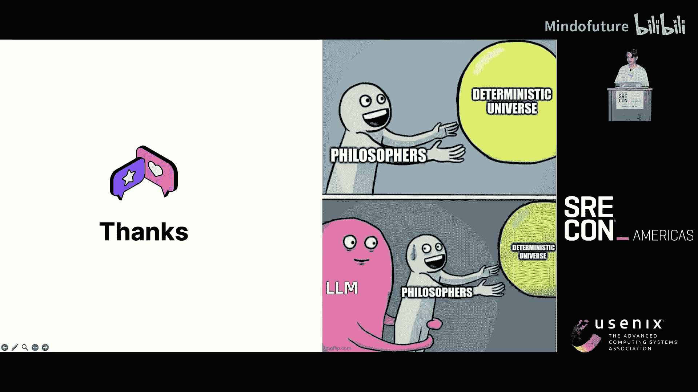
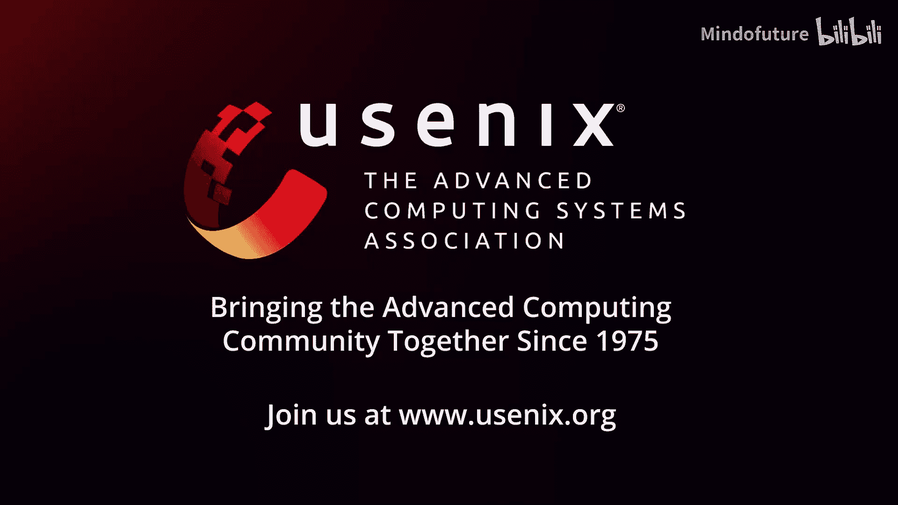

# SRE大会-2025-美洲-｜-srecon-｜-分布式-｜-缓存-｜-OpenTelemetry-｜-安全-｜-AIOps-p03-P03-Transformers-in-SRE-Land---Evolving-to-Manage-AI-Infrastructure--BV1TmLDz7EZZ_p3-

。

I'm very excited to be here because I literally get my visa four hours before my flight。 Yeah。

 so pretty excited。 And the last talk is a very decent talk for a highlevel introduction on the best practices on Sre and machine learning。

 right， So now let's dive into some details specifically on the AI infrastructure layer。 And today。

 I'm gonna share like how we involve to manage them and what we are facing these days。😊。

A little introduction about me， I started my career at Google right here about 10 years ago at an SRE。

 where I learned the foundation of how we manage distributed systems。

And then I moved back to China to study my career on end group。

 where I started building my Kubernetes S IE team and to advocate for S IEs best practices。

And as we all know， like when Chad GBT got released in 2023 and everyone's focus now gradually shift to like model trainings and large language models。

 well， that's the thing， right。And so， so do we， we， every big high tech company。

 try to like train their own language models。 And so we are facing challenges for the A infrastructures。

So like the transformers， right， the optimus prime comes from cyberberron to the earth。

 They need to adapt， right， So do we enter Sres。So today I'm going to share like how the SI principles can be applied to the AI infrastructure in a different way。

So the agenda for today's talk is quite straightforward。 So to make sure everyone's on the same page。

 Ill first do some background introduction and。To motivate you why we are doing。

 this talk and why we are， what are we facing， right？

So the definition of AI infrastructure is kind of interesting。 Like。

 let's make this a little bit more specific。 Let's say we are only tackling this issue from the model training perspective。

 especially for large language model training。 Okay， so on the left hand side is oversimplified。

 distributed training。 architecture。 You can see there's a bunch of node Each node is responsible for computing。

Part of the model's weights， right， And they need to exchange parameters weights across different nodes through the high speed network and to forward and backward propagation and to convertverge to the loss function。

 right， So it's oversimplified model。 And I don't think I need to go any deeper here because this is not like AI1 on one talk。

 So on the right hand side is the， is what I think the stack for the AI infrastructure。

We everything below the model framework， I believe it's in the scope for what we are going to manage here today。

 we have data center， we have storage layer where you store your data training data。

 you store your model data， you have GPUs， you have networks。

 and all the essential management services that you run all these infrastructures。And of course。

 Kubernetes， right， where everything is going to be orchestrated on。

So to give you a little more detailed example， like what are we facing today when we first started our model training。

 I think one of the biggest issues is to handle the training interruptions。

Because as you can see from the bottom diagram， that was a chart back in 2023， I think。

 as you can see， like。We've encountered multiple like model interruptions during the training every day。

 like every several hours。 that includes overnight， right。

 we have to get up like 3 AM in the morning and to resume the training and try to see what's happening。

 And is there anything we can do to kick off some bad notes so that we can continue process because otherwise。

 we've invest so much on the GPU assets and they are sitting there idling。

 That's a waste of time and also money， real money。到。Another thing that I didn't quite catch is that。

From engineering perspective， is that nowadays when we are debugging such interruptions on the training job。

 it requires different kind of different level of knowledges。And as you can see， like。

 if we zoom in the diagram a little bit on the top diagram， that's。That's a GP P utilization。

 utilization ratio on a training job， like with 1 thousand0 plus GPUus。 As you can see。

 the curve bounced all the all of but over the place and。

Everyone knows like there is something wrong with it。

 and we would like to we would like to see a very smooth curve right where you start a job and the utilization ratio will be on like a steady pace。

But it turns out that if you just exam the training jobs log， the system logs。

 you expect a few a few like node level metrics， that's not enough to tackle the issue， right。

So we pull a whole team as we call it the AI task force to actually go deeper。 And we finally。

 we find out that， okay。There is only one single GPU that's causing this problem。

And the reason is that there is a bad optical module on the GPU chip。

And why it's bad Because according to the guy on the data in the data center， they said， okay。

 there maybe some dust on the when installing these GPUs。 So， yeah。

 this caused all the GPSU to perform unstably。And that's the thing we are facing these days that we never imagined before。

So that was just a very quick example on how to describe what we are facing compared to the old microservice line。

 right， So in the microservice land I know pretty much every day everyone is now running their jobs on the cloud whether or not you manage you manage your own Kubernetes or you use manage the service。

 that doesn't matter。 we all know that single point of failure on the microservice land is not that important right。

 you never lost your sleep because one single node field。

 because we have all kind of tools to tackle the issue。

 which can just kick off the note or you do some GSLB to shift the traffic a little bit and you have pretty much very mature tools for that。

And in microserv La， it just requires low。Ne， network bandwidth。Most of most of the time， right。

However， in contrast， on the GPU training land， we all see that there is a high impact on a single node node failure。

 right， So it has a very large blast radius。 It can cause like1000 GPUs to just hand there and doing nothing。

And it's hard to go。 theres very high cost to do the recovery or to do the like initialization and maybe 10 to 15 minutes to load a very big lot model。

And as you can see， this graph is a typical GPU architecture。

 You don't need to understand understand any details there。

 but you just need to know that it requires very high bandwidth for network communication to exchange all the parameters and everything happens in like millisecond unit。

 so that's the thing we are facing right now。 So as SR is。

 we all know that in a classical like S methodologies。

 we have five pillars to tackle our a job right， the reliability measurement， the automation。

 the observability， the incidence response and the capacity management。

So what do they mean in the GPU training land？ That's what I'm going to share with you today。Okay。

So let's first talk about metrics right in a plenary talk。

 we all know that there are new metrics so in this talk， let's be a little more specific。

 What are the new metrics for the training jobs， right how you can measure the reliability or what's the reliability measurement for a training job。

So back then， like my boss asked me this question in a room say， hey， you came from Google， right。

 Everyone， everyone talks about SLO there。 So tell me how you can apply S L philosophy to what GPU training。

Right。We actually like debate for a while， and we conclude that the classical SLO methodologies may not that need some kind of transformation。

 right， So think about it。 right？ How do you measure the service availability for a training job。

 which may be across like 100 nodes， right， does 99% of success really mean anything。

 because if 99% of the node are successful， but just one node failed， your entire job is failed。

 right， So that' give you nothing。And。So， of course。

 you don't have any like RRPC chains in your GPU architecture， right， So there is no success。

 racial S Ls， no latency S Os。 So what should we do。Okay。

 so now I prefer using the term like reliability measurement for the GPU clusters。

 So let's think about it， right， So here is a simplified diagram for。

Representing different stages for a GPU training job， right。

 you submit a job and you enter the scheduling phase。 And once you get your allocated GPU resources。

 then you study your job initialization to and then。In。

 and then you start iterating your training data， right， to get a model trained。

 and maybe you put put several checkpoints there like for every like 100 steps。And then until， like。

 model。Got interrupted because some kind of failures。

 So V S I is jumped in and fix the issue and restart started model training again and again。就。

We believe that， as you can see from this diagram， So we come up with actually two North star metrics that we think are very useful to guide our engineering effort。

 The first one is called training time efficiency， which is described as the ratio of effective training times compared to the total eap time in a training job。

 right， This is the measurement of the utilization ratio for your actual resource consumption， right。

And another one is from the supply chain perspective， right。

 to measure the availability of your resource supply。

 like the portion of the total amount of like total available GP time。Related to， let's say。

 a theoretically maximum GPU time in a given time window。 that how many GPU time is available。

To use that as a target， now we are， we can do our SI practices to。To improve these numbers， right？

So since our time is limited， so I just pick two topics。

 one is from observability and one is from GPU management to show you some detailed examples and how we do things to manage the infrastructure。

So everyone loves talking about observability， right。

But today I'm not going to talk about like whether or not we should use Promeus or use open teleementary for this。

 let's save that for the prom call and I'm not going to talk about like what kind of monitoring product should we use because。

Yeah， so instead， let's just like back to the basics and take a step back and let's tackle a very specific problem and issue using data and mathematics so。

You've already seen this graph， right？ So how can we use all these of monitoring data to identify these degraded GPUs quickly。

 right？ So that's the thing we actually want to do， right that can ease our day to day life。

So the key challenge is like， so you have so many kind kind so many data， right， we have。

We come up with these three like challenges。 I think let me explain one by one。

 Like the first is called the high cardality。 Imagine you have like thousands of GPUus。

 and each GPU may explore like hundreds of metrics。 and you have like hundreds of jobs。

 maybe across several clusters。 and all the labels combinations is huge， right？ And the resolution。

The resolution means the frequency of scraping your data points， right。

 So traditionally in the microservice land， probably you scrap your data like every 30 second or every minute。

 That's probably enough like for you to tackle your data to day issue。But in the GPU lens。

 if you want to actually see or find some subtle issue。

 like a sudden burst in your GPU communication or the transmission ratio。

 you need millisecond resolution。And that amplifies the number of data or the data total。

Storage you need to actually store your monitoring data， right。

And finally is the granularity problem。 We need to preserve all the details before doing some sort of aggregation because you never know what at what level you actually need to drill down right from the example。

 I just illustrated， we need to drill down to the hardware level。

 And so that point of data we need to keep that。So the high cardinality and high resolution brings a problem that the metrics here are unreadable to human。

 right？ Well， I'll show you two graph。 If you think this graph is a little is still readable。

 then how about this one。Don't， don't worry about it details on all the。actual meanings of the graph。

 I'll explain that later。 But just get a few， right， You， you don't actually want to read that data。

 especially。At 3 AM in the morning， right you wake up from the interrupt。

 you don't certainly want that。So let's make friends with math and statistics， right。

 We need some statistics tools to help us to do these automated and analysis on this on this data。

 right So we have two hypothesisses here。 So the first one is we row based uniformity， right。

 that means with each training steps， right， So。😊，If several nodes they are performing the identical roles in the training。

 right， they should explore similar metrics。 right， That's the first exam we want to test。

And the second one， if we call temporal consistency， is that across the training step。

 whether or not you had a first step or you had10。A0 step。

 the all the node should actually demonstrate similar behavior， right？ It's just。

 you are loading different data into the your training training model， right。

So I'll introduce two weapons here， just like Otnos prime need to upgrade his weapon to。

 to tackle the new enemy， right， So the first weapon will is called the the J divergence。

 which is statistical distinct method， which you can quantify the similarity between different probability distributions。

But I'm not going to get into the details there because I'm not a good teacher。

 I think G can do better than me in this topic。 just get a a demonstration here。

 So on the left side is a graph like。There are eight graphs here， right， The eight graphs。

 each one represent one single GPU， and maybe it's the GPU utilization ratio for that specific GPU。

 That time series， we convert them to a probability distribution diagram。

 That's the histogram you are seeing in the middle。

And then you apply the calculation based on the JS diveence。 Then you can get a heat map。

 and the heat map will show you if they behave similarly or they behave if there is any normal behavior。

Green means everything looks similar。 And if anything is red or or yellow。

 that means there probably be something wrong。So like what the previous graph I showed here right so if you convert that left graph into into this heat map or into this heat mapap。

 you can clearly see that theres one single GPU that's performing abnormally。

 right the actual meaning of the left hand side is the computational power of each GPUus across the time。

 So we find that that GPU may be degrade。 So we kicked off that GPU and restart the training to help us to regain the iteration speed。

Okay， so the second example is even more powerful。 the Fourier transform。

 which is a powerful technique that can convert like the data from the time domain to the frequency domain。

 right。So on the left side， let me explain what's the meaning of the left left hand side graph。

It's the RMA transmission rate for several GPU cards at 10 millisecond resolution。 So as you can see。

 it's kind of like unreadable。 you may probably see some， see some pattern there。

 but it's hard to quantify， right。But the magic happens when you transform to the frequency domain。

 As you can see it from the frequency spectrum， you can actually see there is one single peak there。

😊，And if you see the frequency peak and convert it back to the time period。

 you can actually gain a very useful insight。That means。So， well。

 the character there maybe too small for the backend audience。 I explained here。 So that means。

If we filter out the low frequency noise and find the the dominant frequency domain at the peak。

 this represent a regular cycle time for our training， for each training step said。And then。

 we can use that。To know that once we know that the what's the normal rhythm should be。

 we can easily detect when a node fail out of sync， right， If your training is getting slower。

 then this frequency domain graph will change。 And you'll get a longer period of time。

 And then you know， something bad may be happening。 right。Alright。

 I know it maybe a little confused to you because I think I'm done for the mass toruring here。Yeah。

 so let's move， move back to the。Next topic about granularity， right， So sometimes we。

With things like how metrics can help us， right， to detect these type of problems。

 But sometimes we need more like granularity。For example， here are the diagrams。

 We are visualizing the execution timeline for different operations across multiple nodes。

 So in the model trainings， there are two main operations you need to be care of。

 The first one is called matrix multiplication， right？

 That's what GPUs are good at to perform these multiplication quickly， right。

 The second one is called networks synchization that you need to broadcast your GPU weights and calculated data across different GPU nodes That's two basic operations you need to be aware of。

So the left hand， the left hand graph is a demonstration of a。So on the left hand side。

 there is operation number two， where， where you can see that it lasts longer time than other operations。

 That means there may be some computational bottlenecks there。

 So you may need to like optimize for your GP for your GPU training。And on the right hand side。

 you can see actually the last line， the node 4 is delaying its operation on each operator， right。

 So that means probably this kind of node， this node may be bad， so。

We need such visualization or such granularity to actually to figure out what's actually happening。

 right， Otherwise， we may be optimizing from a wrong direction。So how can we get there？

Right you are probably thinking that that sounds like distributed tracing， right。

 Youre absolutely right。So we have a proof of concept implementation to like to use could programming to actually try to instrument these type of operations and get the trace data back and perform it converted to a。

To the trace data that Chrome browser can actually read and visualize on the left hand side。

And what you are seeing on the left is the visualization for these traces。

Give us a timeline view of exactly what's sampling on each across multiple GPUus simultaneously。

 So now we can clearly see which operations are running and how long they take and most importantly。

 like how they align across time。Okay， so I'm not going to get into the details of the implementation of K event because that can take for like about an hour。

 which certainly we we don't have that time， okay。So， but just to get your a sense， right in the。

In the new land， right， where we need to manage GPUs。

 Certainly we need see some new weapons and new tools for us to tackle this problem， right。

But I'm not saying that the traditional observability method doesn't work。 It still works。

 like in many situations and。For that， let's move to the the next topic about GPU management。

So now we've explored how we like detect these and abnormally notes on our GPU clusters。And。

The next question is， how can we actually manage these expensive resources， right。

Once we identify them。So remember， we talked from what we talked about GPU availability。

 like from the measurement part， right， and it turns out it's not the only metrics we need to like pursue。

 especially when you are reporting to your high levelvel management like your CFOs who are asking。

 okay， so we've invest millions of dollars and where is our GPUs and how are they going。

So what we are seeing here on the left is a San diagram or a waterfall diagram that tracks the flow of GPU resources。

Through various states， right， So this breakdown is crucial because GPUs are incredible are incredibly expensive asset。

 and we say deserve babysitting， right， We need to know right。Its。So starting at the top， let's say。

 we have our total GPU inventories in the house， right。

 And some of them are broken and waiting to be replaced or being repaired。

So the rest of them made their life into our Kubernetes clusters right， where。

 but they are not immediately get to be sable because some of them may be cordoned off for like drivers update or for like some like low test or other issues。

 right。And then among all those sable GPUus， we can actually allocate these training jobs on。

 on top of them， right。But there are still some bacon ones because of fragmentation。 right。

 That's the amount we are we need to optimize。And among all those allocated GPUs on a training job。

Some of them are actually being actively used right by doing GPU computations。

 but some of them are sitting idled because of maybe your models framework is not optimizing the computational computation well。

 That's the thing we also want to like optimize。Okay。

 so I think this work if you are reporting to your CFOs。 you may use this type of diagram。Okay。

 so now let's get back to the fundamentals， right， remember， like， let me ask you a single question。

 like simple question。 So what is a good strategy to update the GPU drivers across， like， say。

100 nodes or 10000 nodes。In Kubernetes cluster。But traditionally， like， you may think of it like。嗯。

In the Microsoft land。Maybe like's say， we need to upgrade coubt or we maybe we need to like upgrade some demon set。

 right， So we'd like to use progressive ro。 right We first roll out like 1%。

5% and gradually ramped up to 100%。 And during each stage， we need to。We are going to like say。

 do a bunch of tests between them to make sure everything is fine， right？But on the GP PU land。

 remember， like some driver updates may interrupt your job， your training job， right。

 So that means if you use this progressive robot method。

 you may encounter multiple interruptions during your model trainings。 This is。

Quite that inefficient。So it turns out that if you can coordinate with your model training team or your AI parts and tell them。

 okay， so let's just schedule a time for the maintenance and you just stop the training and we can perform the driver up driver's update once for once for。

 right。And that turned out to be more efficient。And that's the thing like， I think traditionally。

 we SR is think what's best for for the production may not be the best for the in this type of situation。

 right。就。Other than that， we've discussed like how we can。

My previous topic is all about like detecting degraded node and how to manage them， how to fix them。

 So is there anything else we can do like any precautions we can do。To like。To proactively。

 to make things better。So we actually proposed for a proactive node benchmark。Protocol。

 so we have to run these type of benchmarks across different stages during our like infrastructure management。

 So let's first see like what type of what level of like benchmark test do we run these days。

 So the first level， we focus on the basic infrastructure tests where we check if the part can be actually scheduled on a single node。

 And if the node is fundamentally are working correctly。

 right And the second level exam the GP' basics， right we test there like E errors or the X I errors from the hardware some hardware metrics exporters will expose these metrics they can be very useful。

And then we do performance testing to like， say， computation of。

F compute to maybe we use some low test to see， okay， if the。KU is working at a full。

Is working fully walking， right。And then next level at level four。

 we do multinode testing where we need to like say select a bunch of node tests if they can communicate efficiently with each other so so that they can perform they can perform well in a distributed training strategy。

 and finally we run several like actual models like small models trainings。

 run a few steps and to see if node all these node are getting prepared for the next training。

So after we like classify the level of benchmarks， we need to like say， okay。

 so when do we run these benchmark， right， Of course， we need to run them when a job。

 when a node is idle and nothing is on， nothing is on it， right So there are five different stages。

 we want to like these benchmarks to be performed。 So the first one is during the preproduct validation。

 right before you actually accept this note in your Kubernetes clusters， right。

 you need to perform this type this type of benchmark。And before a very large model training。

 let's say the model training is predict to be to last for like two months。

 you actually want to like perform this type of training this type of test before that。

 So to guarantee that everything is working correctly。And of course。

 during the poster repair stage and during the full diagnosed stage。

 we need to run this type of benchmark so that we can quickly diagnose。

 make sure everything is working as we expected， right。

And the actual architecture for such benchmark like process is not that is's not that sexy。

 It's basically a cloud approach whether where you run a few operators and you design your own CRDs to to make things happen。

 right， You use your intended driven design。 You write a few benchmark CRDs for different GPUs and you coordinate with your node level operators so that they can select the correct node for you to perform the test and you just recycle all those benchmark port once you finish them。

So to wrap up everything， so。Traditionally， like for the cloud instance。

 you can see like they are inal and they are cheap and they slow impact on the single point of failure。

 right， So we don't actually pay that much attention on the testing。 and we just replace them。

But on the GPO assets， they are kind of expensive and they are persistent。

 They have large blast radius。 So we need to do this type of extensive qualification and to。

To babysit them to do the di and repair。Okay， so finally。

 let's wrap up everything so before so we so that we can all go to lunch。 So the key takeaway is。

 if you would like to take a picture， this is a good slide。 Yeah， we first， today。

 we first briefly talk about the characteristics of AI workload。 right， see that can。😊。

And then we start rethinking about how we can do the reliability measurement。

 is SO still like useful in this scenario。 And then we pick two topics。

 one from observability and try to make friends with math and statistics。

 And then we do some GP PU management methodology talk， right。Okay。

 so when we talk about the skill set， right， I think in the trend， like previously。

 we are all container centric S Rs， right， So we put container as the first hand， right。

 But I think sooner or later， like everything is gonna shift to like model centric。

 we are going to manage models。😊，I think the five pillars for the S IE from the S I book still works here。

 and it's not just。About。Well， in the traditional land， right， we have Kubernetes， we have Docker。

 we have Promeus Braa and some CICD tools。And we just need to make new friends with。With AI， right。

 we need to learn Tensorflow。 We need to learn pythage。 And the thing is。

 the most valuable skill for S series is， I think。It's not about the specific， specific tools。

 It's just our availability to transform ourselves。

To alongside with the new infrastructure we manage， right？So before I wrap up to my final meme slide。

 I'd like to yeah to send a cl to acknowledge this work。 Well。

 this presentation is a collective wisdom of my whole team and its thanks to my team for their pioneering work on the GPU observability and management。

 And with that， that's my last life， right， if you notice that I never talked about anything like a AI can help us in this land。

 because to me， I think we kind of， we are pursuing deterministic universe。

 even though that may not be 100% possible， but right now。

 AI just make things more like nondeterministic。 So。But I think in the future， that may change。

 right， because by the time I submit my， I submit made this talk， deep sea wasn't get any attention。

 And I think everything is evolving very fast。 And for us。

 I think we just need to keep our mind open and try to learn everything new。 And let's see。

We hope like we can all get something new to talk about in the future right I'm happy to see if anyone can like say I'm wrong from this graph right I'm happy to see any agent that can help me solve my problem because everyone wants to make their life easier right？

😊，Okay， so with that， I think I've finished my topic here。 and now I'm ready for the questions。😊。

