# SRE大会-2025-美洲-｜-srecon-｜-分布式-｜-缓存-｜-OpenTelemetry-｜-安全-｜-AIOps-p04-P04-Tackling-Slow-Queries---A-Practical-Approach-to-Prevention-and-Correction--BV1TmLDz7EZZ_p4-

。

Hello， everyone。 Thanks for coming to our talk on tackling Squeries。 As introde earlier， I'm Kearney。

 originally from Indonesia， currently living in Singapore。 This is Brad， based in Melbourne。

 Australia。😊，We're part of a globally distributed team in Shopify called Plaform S R。

 We work alongside other engineering teams to improve our intra， to keep it real diligentient。

 as well。

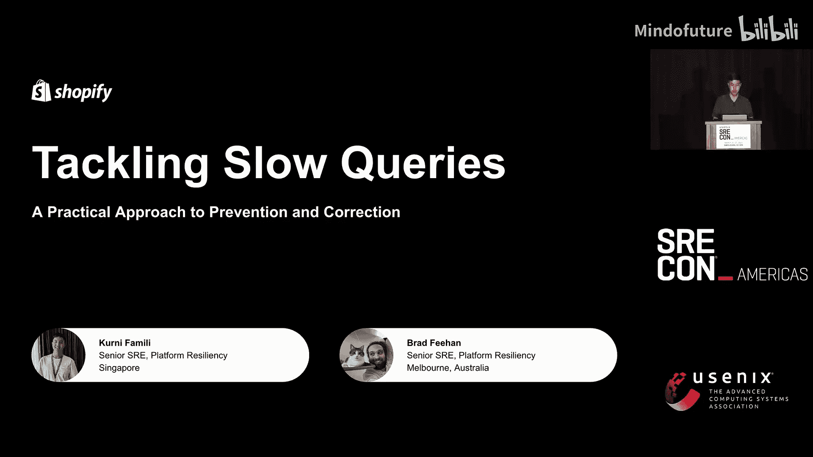

So to start off， we're going to give a quick glimpse into Shopify and how it relates to SR。

 We'll recap the basics of database resiliency at planetary scale。

 You'll also hear about the opportunities we discovered and the solutions we built to correct and even prevent slowqueries inside a large company with a high development velocity like Shopify。

And then we'll close with a list of actionables that we'd like to leave you with。

 followed by 10 minutes for Q&A。

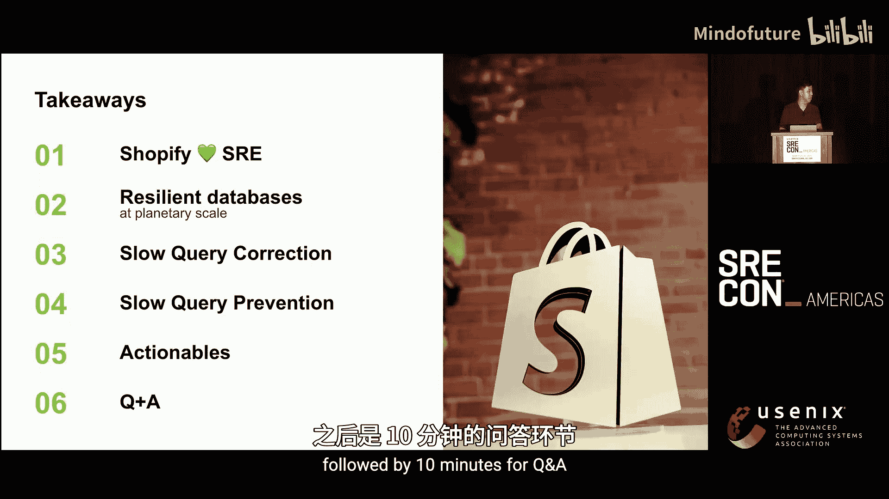

Stroify's mission is to make commerce better for everyone。 Since 2006。

 millions of entrepreneurs all around the world trust us to run their business。

 and for this business。

The biggest weekend of the year is Black Friday Cyber Monday weekend。

All that activity is visualized in this cool globe that is built in house， by the way。

 rendered in real time for the public to see。Last year， our merchants total sales peaked at $4。

6 million per minute。I'm going to brag about some of our stats from last year。

So our merchants saw $11。5 billion worth of sales， a 24% increase from the year before。

We handle 57 petaby of data across our infr。 Our request request rate peaked at 280 million RP PMM at the edge layer。

Our databases serve a total of 10 and a half trillion queries。

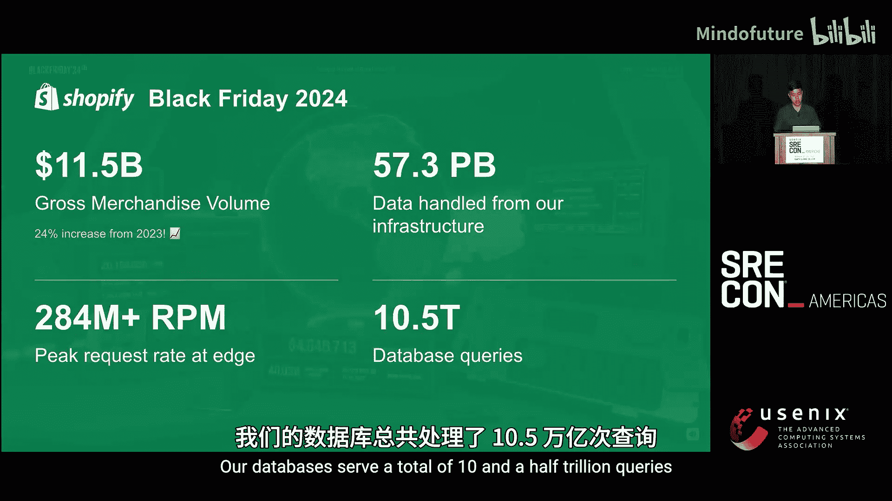

So within Shopify， there's a group called In， and within that group。

 there's an organization called Resiliency， which we are a part of。

Resiliency is focused on checkouts， store fronts and the merchantchan admin portal。

The whole mission of the organization is to make resiliency easy for developers and make it a critical part of our culture。

As I said， this is the home of our team platformform Asri。

 we built tools and processes to improve reliability， but most importantly。

 we hold a pager 247 on follow the sun basis where we command incidents。

 which is all about remaining calm and collected during fires or in other words， incidents。

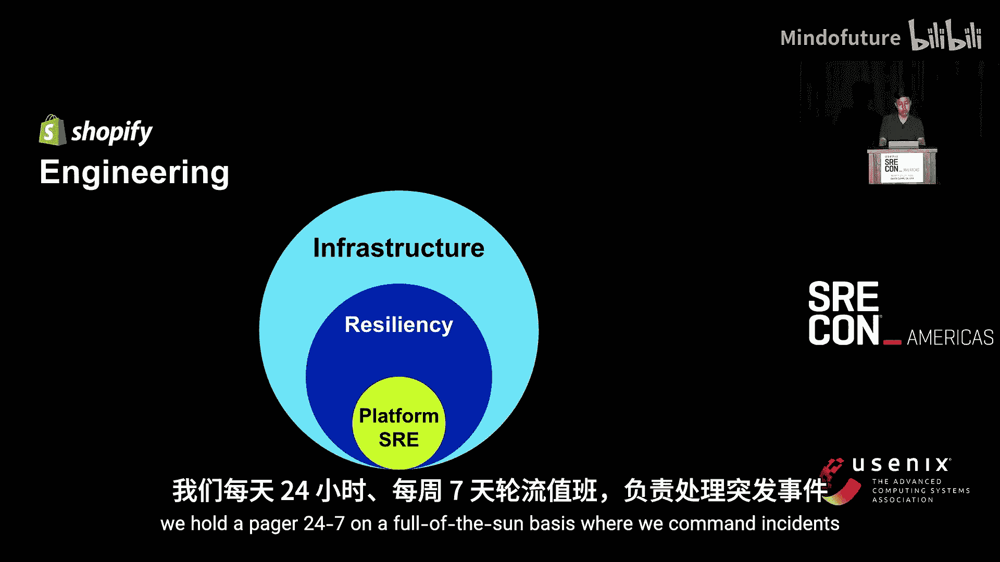

As we are the first in line to be notified when something goes wrong on the platform。

We make sure we bring in everybody we need to mitigate the incident， guide the conversation。

 gathering in relevant context。 And after the incident has been mitigated， we follow up。

 address the root cause and conduct a proper postmodem。

 I'm sure you're all familiar with all of this process。The reality is。

 we have so much support and recognition within the company we're definitely set up for success。

 So it is actually fine。😊，If that sounds like an interesting position to be in。

 please come talk to us。 You can scan this QR code later。 We're regularly hiring for SRs。😊。

So with all that out of the picture， I'm going to talk about one of our mantra in the Shopify。

Which is do things Help people。 We believe in sharing our experiences。

 our work and our ideas with each other and even documenting outcomes of our projects。

 both positive and negative。And this is echoed by the original S book。

 which strongly emphasizes storytelling and learning。

 That's exactly the reason why were here standing in front of you to share the project that weve worked on For both of us。

 It's our first first time speaking at a conference。

 We're extremely grateful and humble to be given the opportunity to do so。😊。

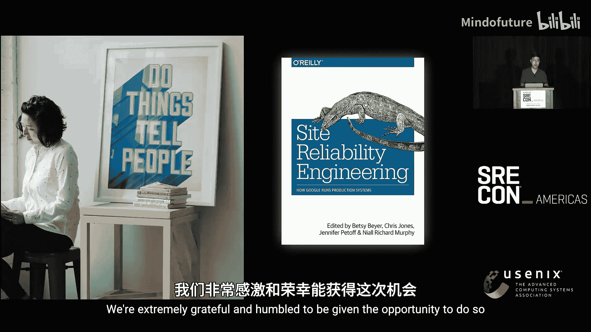

So going back to our project， it came about because when we follow up incidents。

 we empower teams to make the platform more resilient。

 And this has resulted in our database being very resilient， as Bradret will cover in a bit。😊。

Yet we observe as many as sorry， we observe。As much as one in， let's say 5。

 merchant impacting incidents escalated to S R。That can be attributed in some manner to slow crries。

I'm going to hand over to Brad to talk about how we make our database resilient。Cool。Thanks so much。

 queryney。So yeah， this is another visualization of what happens to your database。

 If you send too many queries， obviously， falls over and gets sad and catches fire。

 So if slow queries are exhausting your database capacity。

 Their first thought is to buy more capacity。 if you're losing more money。

 then it would cost to fix a problem， pay someone else to fix it。

 then that's your logical conclusion。

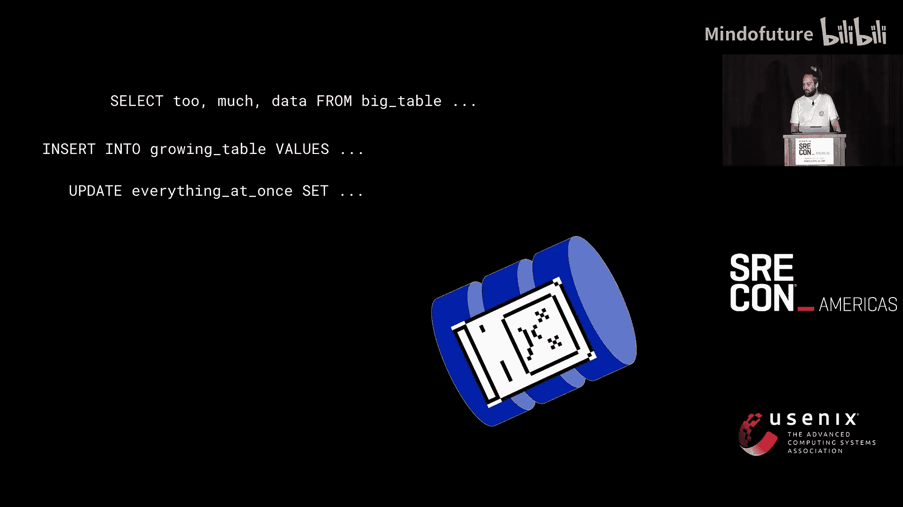

These are the main ways you can scale your database up in the short term。 You can go vertically。

 bigger instances， upgrading storage and things like that。Horizontally is adding more instances。

 So if you've got read replicas， you can add more to shadow load。 And， of course。

 you'll only see improvement if you've tuned your configuration to actually use the resources that you've provided。

So， there's just。

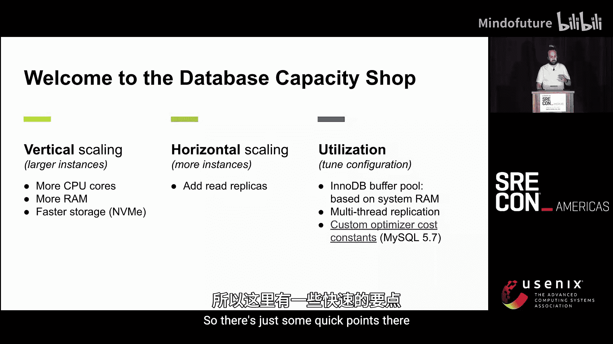

Quick points there。That's short term scaling。Beyond that。

 you need to really make long term investments in resiliency to keep scaling beyond a certain point。

 because one database can only scale so far。So we show the speed run through this section。

To give some background context on the project。 And I won't necessarily go into too much detail or teach much about these topics。

 But I'll point you towards other talks and blog posts and things that will cover them in more detail。

This talk is more focused about the gaps in this system and then what makes it through so。Yeah。

 pretty much everything can do to my S Q， L to make it more resilient。 We've。

 we've already done over the past， sort of。10 or 15 years at Shopify。And， you know， more or less。

 we've done a great job。 But everyone involved has done a great job。 But things still get through。

 And so， I'll cover what I think the most6， most important historical investments we've made。

The first one is horizontal sharding， where you part your tenants into separate instances。

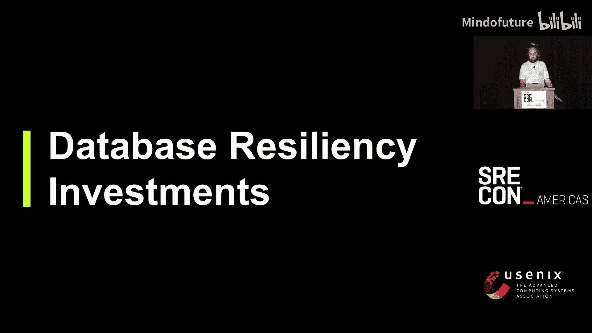

Again， one database only has so so many resources。 And if you've reached that limit。

 you shard your tenants into separate instances。 you can keep scaling up。

Some of the other bonuses you get from that is bulkheads separating your failures from one shard to the other。

 you can isolate tenants if they're particularly heavy users of the platform。And the downsides。

 I was going to say。That it's way more complex on the app layer。

 And you also probably need to balance the shs， so。If you've got too many tens in one not， you know。

 So if you've got more instances as well， you may have problems with automating that。

This talk is from 2014 about how we had to do this for the 2013 holiday season。

 So it's it's been there for a long time this way。嗯。It's been a big part of our architecture。

Some of the。Approaches to fixing the problems that would come with that。Balancing shards。

 This is a automation that we have shop mover。For moving shops between shs and then automating some of the toil that comes along with a bigger fleet of databases。

You can extract a service from your main core。 that not all workloads are equal。

 So if you have a self contained system that you can extract。

 you can improve reliability for the rest of the system。And the downside there is。

 are you sure you can handle running a second service， but。There's some good examples at Shopify。

 We've extracted the read only portion of storefront rendering into a separate service to take load off of the core system。

嗯。When it comes to like connecting to the database。

 we have some techniques to fail fast timeouts and circuit breakers， which detect errors， conditions。

That are persisting。 And then。So of stops talking to the database。

 It's failing fast and putting pressure back to the Apple layer。We use proxy SQl。

 It's sort of not very resilient to just connect to the database directly and hope for the best。

 We use proxy SQl to multiplex those connections and also to replace the back end if we need。

 So you can swap out the server that the database that this app is talking to。

And it will also give you some metrics about aggregate metrics about queries。

This is some examples of the advanced usage we have on a blog post and Shopifys engineering blog。

Then when it comes to schema migrations， if you don't apply them with extreme care。

 it can block throughput on the database completely。We used a thing called Lage Hadron Migrator。

 which was originally from Soundcloud and it's a more complex developer workflow， it。

It makes it more scalable。 So0 downtime。Schema changes。When you're deploying changes。

 you need to be able to roll that quickly and we use features to get big feature releases and changes to queries and things like that。

 So we also test synthetic traffic against canary clusters to catch cleararing stake。 So yeah。

 rolling back really quickly is another res resiliency thing。

 And then the last thing I would say is empowering developers to。

G them documentation for how to write good queries in the first place。 So these are some topics。

Caing is also important for fast queries， because。You know， they can add up its scale。

This is great starting point。 If you like to look at Gitla's open documentation about they use Postgres。

 So if you， these are some great great starting points about queryery performance。😊。

Using explain to understand what the database is doing internally。

And they've also got some developer tools that let you play around with production data sets and experiment with new queries and indexes and see how that changes performance。

 We have something similar for myq internally， a Shopify。

So that's like the main six things I would say that we've done。

 This is our sort of starting point for our project。 And we came in with this really solid setup。

 but。

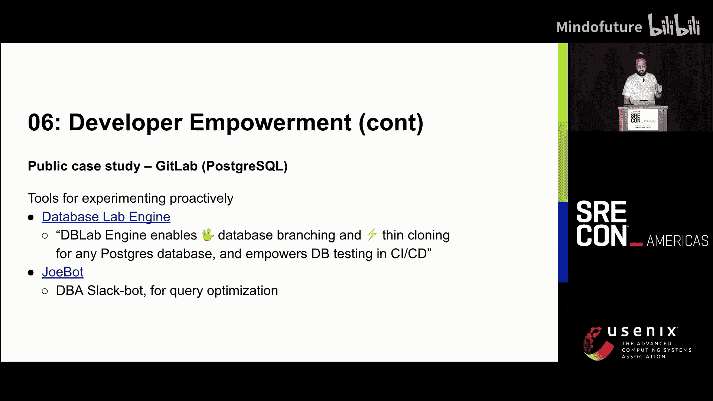

It's not magic， and things still get through， but。Yeah。

 this is kind of like the table stakes for deployment， for databases at Assscale now。

But like Kearney said， we still saw a significant number of slow query incidents。

 So we have this goal at the start of the project to reduce frequency and severity of incidents caused by slow queries。

 And the plan to do that was basically go through our resiliency set up and identify any gaps in our platform and processes。

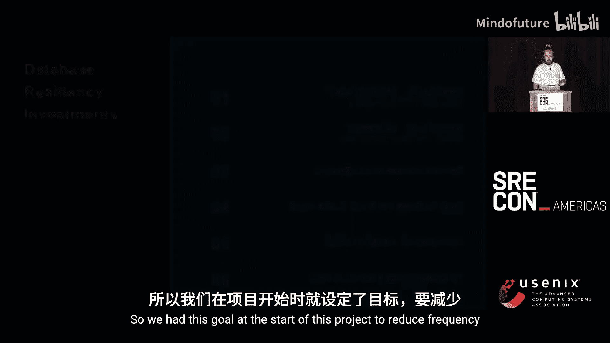

So we' focused our priorities on two main areas。Prevention。

 which is about stopping smokequeries being deployed and causing an issue in the first place。

And correction is about。Preventing it， causing an incident， so。Timely detection。

 mitigation and remediation of the sries that have been found in production and ideally， yeah。

 detecting them earlier than when they cause an incident， so。We'll start talking about correction。

 and I'll hand back to Conney to go over that。

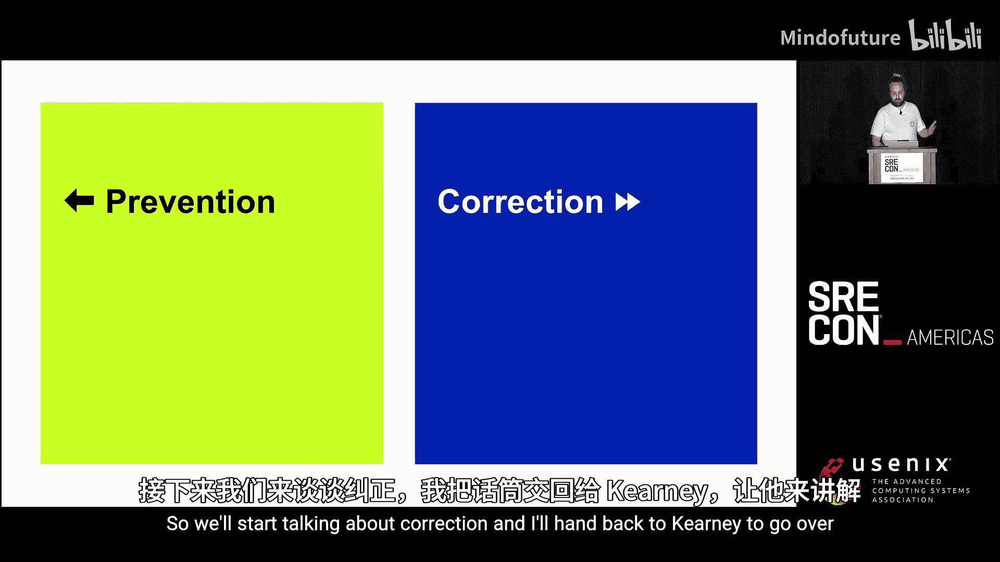

Thank you， Brad。 So now you have a sry。 Now what。 What can you do to address it。

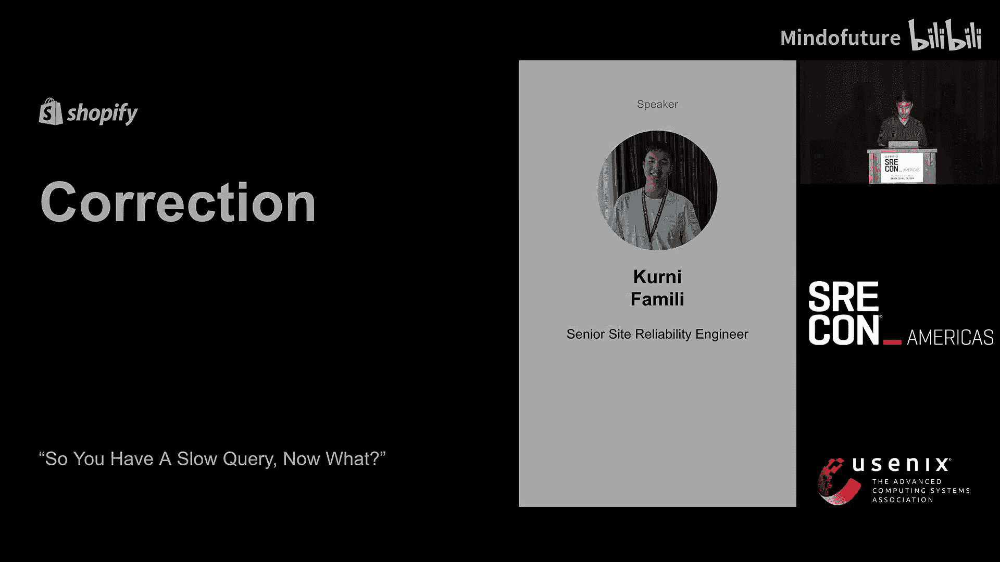

Before we jump to business， this is a snippet of a typical DF cycle that we are familiar with， code。

 build， test， deploy。 Then we sort of go into this internal phase of monitoring。In the worst case。

 a degraded state was observed， and then we go to the in phase。

Looking deeper into the incident phase lifecycl， it would look something like this for a slow cur incident。

at a start， database capacity is exhausted， investigation begins to identify the source of load。

 then we move to mitigation where load usually must be reduced。

 units of work is reduced by applying let's say， firewall rules， sometimes API throttling and so on。

For mediation， we work alongside depths to understand the intent of the database query and find a more perform technique。

 This is our catch all process or how we follow up incidents that fall through the cracks of all of our defenses。

 Everybody probably has their own version of this。This whole cycle takes a long time。

 It's an intentionally rigorous process。As the whole point is to learn as much as possible from the unique failures and ensure we never fail twice for the same reason。

 But it'd be less useful when it's the same pattern repeatedly。

And if we go back to our diagram earlier， this incidental remediation process falls under this part。

Our goal going into this project is to find opportunities to shorten the feedback loop。

 essentially shifting left on this diagram。To summarize the gaps that we saw on our previous system or the things that suck are these dependency on incidents。

 lack of ownership and accountability and fragmented developer resources for debugging。

 we're going to go through each of them and how our solution addressed them in a bit。Before that。

 I'd like to give a high level overview of what we built。Starting from the database layer。

 our database servers emitid slow query logs Whenqueries exceed a certain threshold in execution time for Mysql which is what we're using。

 This is built in and configurable。These logs are then read by our vector pipeline。

 vector is an open source observability pipeline solution。 In this case， we use it to read the logs。

 preprocess them， then sync the logs to our inhouse observability service called aptly name Ob。

Observe is our unified observability system built in house based on Grfana and Prometheus。

 we actually have a public talk on observe going deep into what it offers on our YouTube channel called Shopify Devs if you're interested to know more。

 definitely check that out。But anyway， observe contains our logs。

 then we also configured an alert rule or a monitor for slow query logs that aggregates the par log data on fields such as P 99 execution time。

 the size of the fetch data， which indicates the heaviness of the query。

 And if a query exceeds that threshold， say one second for P 99 then then the monitor will be triggered。

In which case， a slight alert will be sent to our alerts channel。But more importantly。

 a web will be sent to our slow query audit service。

Which would automatically create an action item with our action item tracker and auto assigns them to the relevant team。

It will also store some query metadata， for example。

 to prevent multiple open action items for the same slow query。 So its not。

 it's not anything complex or new。Now， let's see how the system we built addressed the gaps。

 The first gap that we saw just now was dependency on incidents。In our incident remediation model。

 we only discover badqueries after they have had an impact。

 At best it will cost a case of slow response time At worst， it might bring the whole database down。

 not to say that this model is wrong， as we cannot catch every beque， but certain queries。

 there are certain patterns that we've seen before。 we can certainly attempt to catch them early。

The system that we built， as we went through earlier。

 included an automated alert that we ought to create action items， this removes。

The manual effort that was done by our team previously。And also， since we are argregating， oh， sorry。

 it also catches slow crase before they manifest into a full blown incidence。

 as we saw in the life cycle earlier。And since we are aggregating and parsing and aggregating the data for each query。

 we could prioritize the fix for the worst offenders or the ones hogging the CPU the the most。

The second gap that we observe is lack of ownership and accountability。 We see in some cases。

 an issue or an action item can be open indefinitely with or without an assigning。

 It might be because the death has 999 other things to worry about， as we can relate， I hope。

 then it might also just be because they simply forgot that it existed。 right， So yeah。

 not to blame it on the depths。 We attempt to address all of these issues and the system we build。

Autommateates the assignment process as we went through earlier。

 which is possible because ownership of tables and queries have been properly defined and easily retrievable。

 This leaves no room for issues such as being mistake assigning the the queries to the wrong owner or team。

We also have buys from our engineering leadership。 It has been a company focused to prioritize sries as they are a major source of problems。

 as we went through earlier， the leaders have regular check ins to assess open sery action items for their teams。

Deaths would then have an easier time deciding which task to prioritize。

After sending reminders to devs， if the action items still stay unaddressed until it's overdue as a less resort mechanism。

 PRs of the team or component would then start to get blocked until they are addressed。Of course。

 this is not fun。 The that's why we mentioned that this is a last resort mechanism。

 This is a way to encourage and accountability from these issues， from from being overdue。

For the last gap， developer resources are fragmented across systems。

 leading to deaths needing to jump between them during debugging。

 like we have different systems for logs， metrics， traces， and so on， the systems have different UI。

 UX and possibly with their own query language， making them hard to work with in tandem。

The deaf also had few contextual insights。 They needed to analyze the observability data on their own。

To address this， we built a unified Grfaa dashboard with important information such as stats， source。

 links to logs， traces on top of observe。This is only possible because all observability data source is in observe。

 and it allows us to build a custom dashboard using multiple data sources。

 As you can see in this view， they are able to see， first of all， the badque。😊。

Then the stats of the query itself， in terms of the P 99。

 the average amount of data that it it fetch and so on。

 we also have links to samples of the query runs in each sample。

 Theyre able to see what exactly went wrong during that query run。

 how much time was spent in the database。In the application layer and other things so that they're able to make a better judgment on how to resolve that。

Lastly， we also provide relevant charts at the bottom there that provide data over time。

 such as how many queries time out the query source where we saw the query coming from。like。

 for example， like from a particular job or a controller and so on。

All of this contextual data and helpful links are in one place。Next。

 we also give contextual insights outright in the action item description like the query source。

 the controller name and so on。 the dev has a better idea going through the action item before even opening the dashboard on what data they really need to look at to address the issue。

We also provide advice on common bad patterns that are that we see across the organization and ways to address them。

All around， the goal is to make the developer experience better。

To summarize the gaps that we just discussed and how we addressed them for dependency on instanceense。

 we proactively detect slowries and scale the correction process via the automation。

For lack of ownership and accountability， we open action items automatically and assign them to the relevant owner and block shipping if they are overdue for some time。

For fragmented developer resources， we have a unified system to show important contextual information。

Going back to our chart earlier， these corrective measures would be in the monitoring phase。

 We have shifted life successfully， but can we shift life further and do something earlier in the deaf life cycle。

For that， I passed off the time back to Brad to talk more about the prevention side。Cool。

 thanks very much。So that's once your query is already causing problems。

 but how do you prevent the problems associated with smokers， you know？

The core of our work of prevention was about developer workflows before we start deploying。

We want to keep highlighting issues earlier and shifting left， reducing feedback loops。

We want to the other thing about this is is this will distribute work back to developers and preserve the context during development that gets lost。

By the time an incident or monitoring detects an issue。

So we built a system to catch sries in C I before they even get deployed。

It detects queries encountered during testing。 we use an active record subscriber to detect new queries。

It saves them。To a list， basically then。Automatically runs explain against that query。

 If it's a new one to detect conditions that at the moment， we detect a full table scan。

 which we know is not really。Scalable sustainable at our scale。And yeah。

 we get a little warning comment with。advicevice and and evidence。

 And then we link to the tools that they need to check， so。As an example， a few weeks ago。

 a developer was working on this new maintenance task。

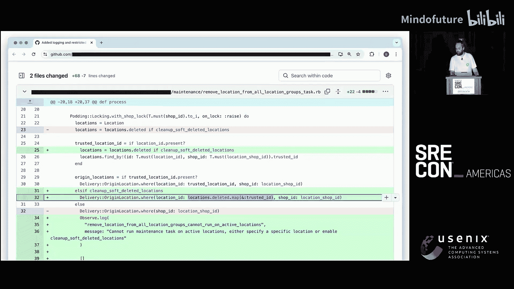

And I want to draw your attention to this highlighted line。Xia。

So they're calling like location as a model。 They're finding all the deleted ones and then converting it to like this attribute trusted I。

 And it generates this query， which requires a full table scan。

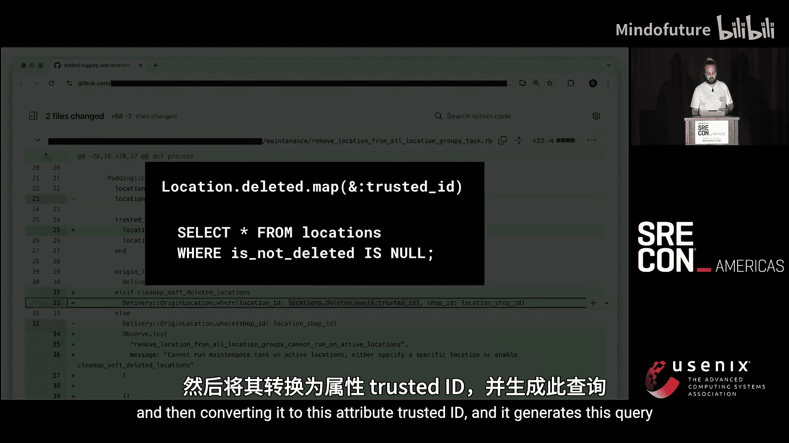

So how can we alert that dev to that situation before they merge it？

So we use Gitthub to host our code。 and when。A branch gets merged to Maine。

 we run our full test suite。We submit all of the queries that we caught during that run over to this system。

 We're calling the query tracker。And then next time a PR is opened。

 We're going test all the changes in that PR。 And before we do that。

 we fetch all of the queries that are currently in the main branch。

 and those are saved and kind of ignored because we know thatre already in the main branch。

 It's not going to be。So it could be。Helpful to notify the developer about something that's already merge to Maine。

We set up that subscriber to catch all this SQL crews and then at the end of the test suite。

 we run explain against the ones that we haven't seen before。If any of them are full table scans。

 we send that over to the query tracker just to check one last time if it's still new。And if it is。

It will confirm。You' good to go and it will post a comment onto the pull request。

So that is what it looks like。You know， this is a C I run。 And then it says at the end。

 setting one slow query off and it。Will look like this in the tracking system。 It'll have the。

Example query at the bottom。 And then the anonymized or normalized version at the top。嗯。

It'll post this comment onto the PR， and it sort of gives us an explanation of a situation。

It also includes a stack trace that we captured during the query collection。

So they can find out what test it was in， whereabouts in the code base it was called。

 and all the layers in between。Our team also gets notified on Slack so that we can keep an eye on the performance of the system and how well it's doing。

And keep an eye on false positives， that kind of thing。

So what did the developer do with the notification， This is the final version， and。

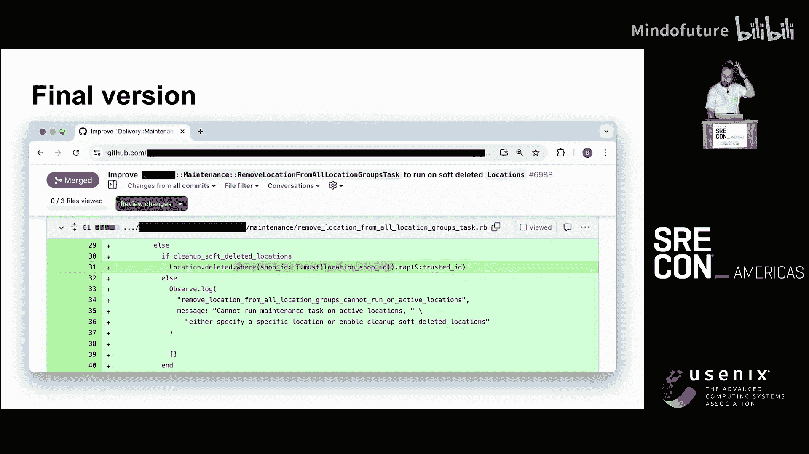

The change that they added was this where line。 and it's got a shop I D clause。

All of our tables that are sharded at Shopify have this Shop ID D tag。Attribute。

 And so most queries should really have that clause on there。So， yeah。

 you should see adding the where condition means that we can use an index to pick out particular rows and not have to scan the whole table。

But there is another issue with the query because it's selecting Star。 that's because。They。

 they use map， which is like a part of Ruby， and that converts it all to an array and then throws away all that data。

 So if you use the rails method p， it will just convert the query to only effect what it needs。 So。

 you know， there's all kinds of things。 It's not。I suppose we can add things like this to detect。

That's more O R M usage。 and like。R about copper rules and stuff like that。

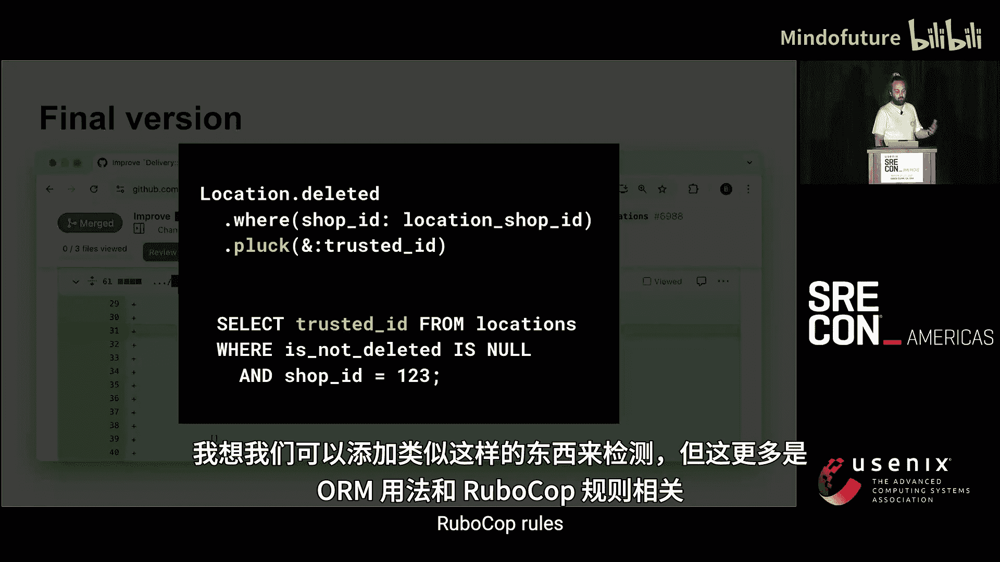

So that's how we integrated our slow queryry prevention into the test phase of the development process。

嗯。And， I mean， we're thinking of shifting further left again。So we were wondering， you know。

 can we detect queries while the developer is working on the code。

We'd love to surface visibility of query metrics。Out into the development environment。

 we've got a prototype of like a visual studio code extension。Yeah， to keep shifting left。

And inspect in quiries before they get committed。 So， yeah。

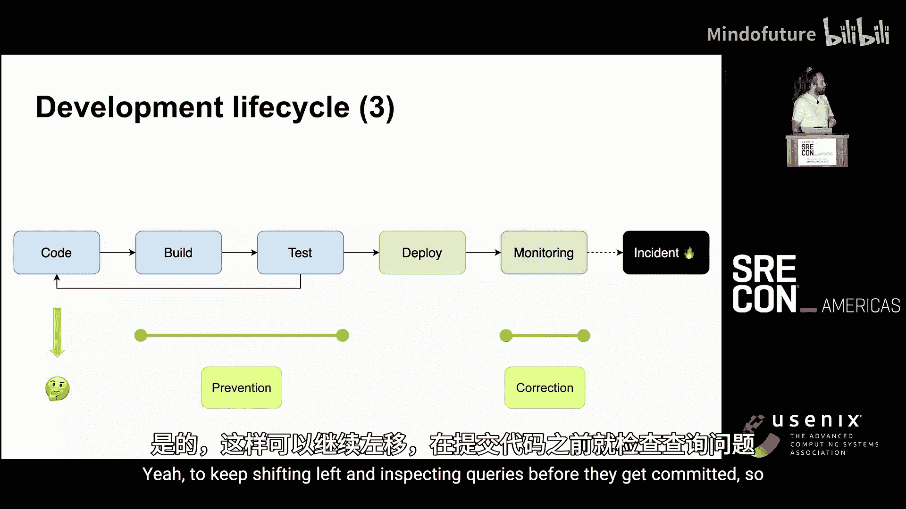

Just some takeaways and homework you could take back to the team。 hopefully after the talk。

 maybe some of these are not so specific， but more of a philosophical takeaway and things to keep in mind。

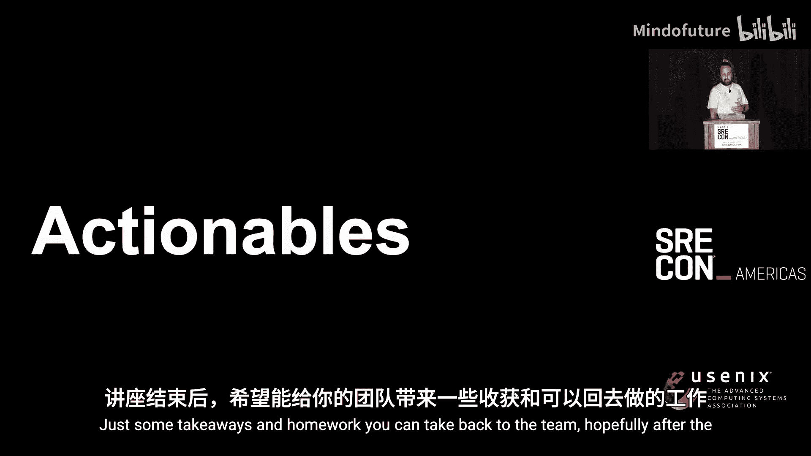

So first， I would say， you know， the theme is reducing feedback loops and shifting left。

Consider how that works best for your organization。It's reducing wasted effort。 So obviously。

 we don't want to have the downtime with an incident and the time spent investigating an incident。

We have to regather all this lost context。 And， you know。

 maybe the S R are learning about this new feature for the first time， the dev needs to， you know。

Implement the fix， test it， release the fix。 So， yeah， if we catch it in development as well。

 we can also reduce time spent in C I and that kind of thing so。

I would say assess your resiliency of your platform and processes at every stage。

Throughout the development life so cool。Try and build like lightweight tools and automations to just surface that visibility。

 what's going on under the hood。It could be even based on metrics you're already collecting。

 like a lot of the。Slow query logs were already being tracked by our observer。

 but not being acted upon， so。You might be surprised what you find looking underneath。The surface。

I'd say you get creative with your automations， the warnings and enforcement。 So， you know。

 what can you do to make it easier for developers to get things right in the first place。

Make it easy to do the right thing， harder to do the wrong thing。Because human error is inevitable。

say highlighting visibility of inefficient resource usage。

And that's what we've done with blocking deploys。 You know。

 there's obviously the necessity of having buy in and。A sort of healthy organization structure。

 I suppose， where you can push problems back up and then have it decided by， you know。

 someone with decision making authority of what is more important with the reliability or the feature work。

And reduce the toil via automation。Keep stay pragmatic with this stuff， I suppose。

Prioritize what is going give you quick wins。 Add add timeouts。 for example。

 if you don't have timeouts for your database queries， set sensible， you know， things like that。

Start with queries using the most capacity， and you can use data to。Drive that decision。 So we。

 we actually calculate based on how many rows are red。诶。What， how much I O that would require。

 And then if that's over a threshold， then we know that the database will， from first principles。

 the database would have a problem serving that load。So yeah， base it on the data。

And focus your efforts on unsalable solutions and sustainable。

 It's because our team was having to triage these issues。

 So having ownership of tables and queries is a big。

It makes it available to the automation action to make these decisions。As， as I said。

 like automation， delegating and distributing effort to the developers who've still got the context of what they're working on will reduce that feedback loop。

 so。PPserving that context and keep automating。 So that's my main takeaway， I would say。

You had to delegate work and distribute the effort back to where。

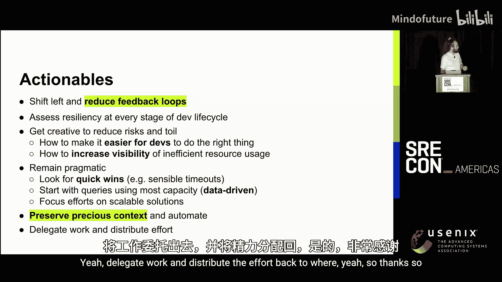

Yeah， so thanks so much。 That's， let's that's all。 Thank you。

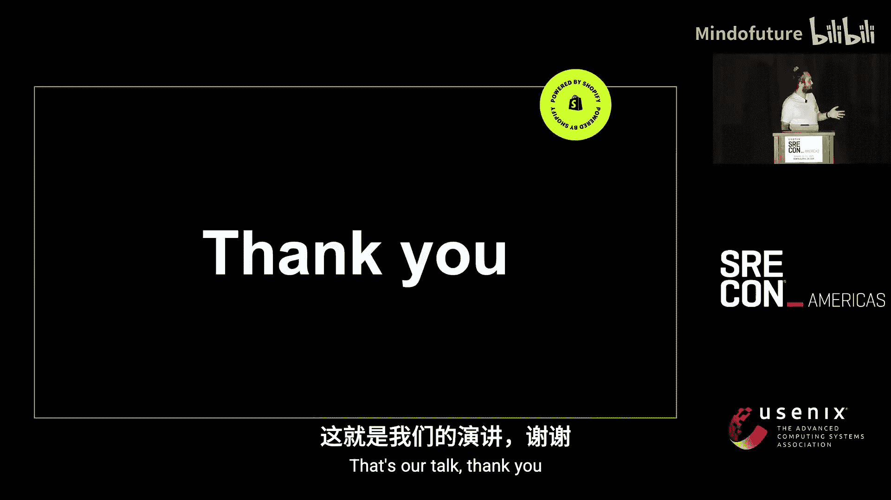

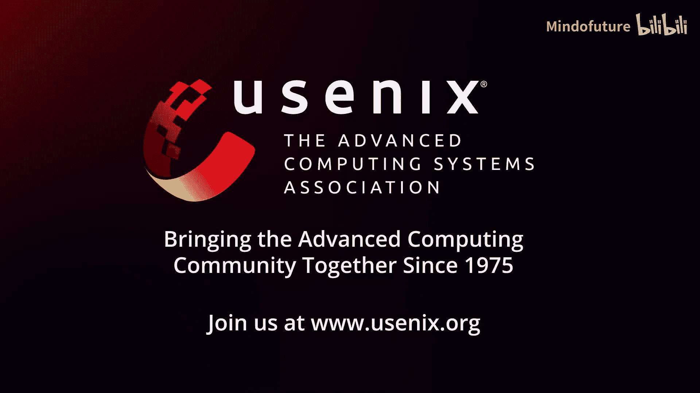