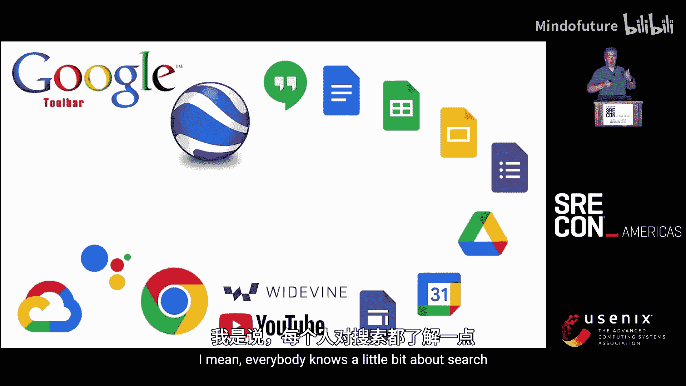
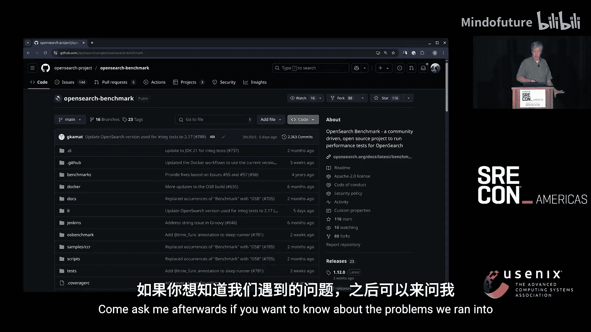

# SRE大会-2025-美洲-｜-srecon-｜-分布式-｜-缓存-｜-OpenTelemetry-｜-安全-｜-AIOps-p05-P05-The-Search-for-Speed--BV1TmLDz7EZZ_p5-

。

I've got a bit of a story to tell here。 First， a bit of background。 you said， I'm Scott Lair。

 This is based on a bunch of work done at Figma during 2024。 If you're not familiar with Figma。

 they make tools for designers。 A bunch of products that use were probably first sketched out with Figma apps。

 websites。 I think my car's dashboard was designed with Figma。And just like in Google Docs。

 users rapidly end up with folders full of drafts， one off projects， sketches。

 and funding the document you're looking for gets tricky。

 So document search is important to Figma users。I started working with Figma's internal document search team in 2024 to help fix latency。

 scaling and reliability issues。And they were really excited when I joined because prior to Fig。

 I'd spent 17 years at Google as an S。 R E。 Surely I knew all about search。😊。

Yeah， so I， I have this long arc of all sorts of different projects over the years， and。

I know nothing about search。 I'd never touch search。 I mean， I mean。

 everybody knows a little bit about search。 I mean， latency is critical。 Relev is is nice。 You know。

 we should probably shouldn't give users errors。

。Yeah， no clue。 So Figma surge， people were all excited。ooooh，ooh， do you know all about。No。

 how about And yeah， know， not that either。 ended up being such a sad discussion。

 so much hope dashed the poor people。 Anyway， you think I had an elastic search backed search feature since really early in the company's existence。

 but it received kind of a lack of love for a few years。

 It was running a three year old version of elastic search on AWS。

 And it had a reputation internally for being kind of flaky in a bunch of ways。

 And general didn't give customers or aura on calls the experience that we really wanted to give them。

 So the company had started adding a bunch of people to search recently。

 It had big plans for making it better。 So， I mean， what was wrong。 I mean， the usual things。

It was frequently really slow。 Sometimes customers would see multi secondlyency for searches。

Not real happy。 Sometimes the whole service would grind to a halt based on surprisingly small changes in traffic。

We were spending a ton of money on search， and it didn't really feel like we were getting our value out of this whole thing。

But worst of all， we didn't really understand why it was slow or flakier expensive。

 Almost everyone involved was new to search。 The whole team was still learning。On the plus side。

 we had an amazing team， especially the search relevance side， which is really unusual。

 We had data scientists going through all of our stuff。 And， I mean。

 we understood how our search results served our users once they finally showed up。😊，So， fortunately。

 there was already a bunch of work going on to fix things。

 They'd started replacing our ancient version of Elastic search with a managed open searcharch instance on AW S using what had been the newest version of open searcharch。

 If you're not familiar， Open search is a fork of Elasticse that mostly Amazon created when Elastic changer license。

 Pre much everything in the talk applies to both of them。😊，Anyway。

 Fing was bringing in to people to help。 And I was supposed to be one of the experts。

Except I knew less about Elasticse than they did about Google search。

 I'd fired up at home a couple times to look at some logs and watch it descend into madness over a few weeks。

I had no idea what I was doing。the team understood that I was far from an expert on search。

 Yeah after the initial introduction， whatever， we've got a job to do。

 Let's get to work and fix this， which gets to the heart what this talk is really about。 I mean。

 how do you approach a problem as an S R， when you barely know where to start。

And I decided to do something that felt kind of weird because it's the sort of thing that disasteries we always think we should be doing。

 but almost never seemed to do much of it。 I ended up using science and not that much glassware and more coffee cups。

 But， you know， the first step of this whole process was to try to figure out what we knew and what we didn't know。

 I mean， where were we even starting。We had tons of dashboards， literally hundreds of graphs。

 Some of the graphs had hundreds of lines because more is better。 We had alerting。

 We had customers sending us politely worded well designed hate mail。

 We had suspicions about what was wrong。 but we didn't really know anything for sure。 I mean。

 sure we could have just thrown more CPU and Ram and servers at the problem。

 And maybe that would have helped。 But we wouldn't even have known if it did。

 It might have even made the problem worse。So we're Ss。 We start with monitoring。

 We tried to answer the most basic， most critical questions。for now。

 I didn't care about document ingestion latency or JVM GC stats or rollout delays。

 I just wanted to know three things。How many customer searches do we do per second。

 How long do they take and how many years we serve， You know。

 the most basic non complicatedlic questions for any service。

 We had answers all these in our monitoring spread across two different dashboards。

 None of them were in the top screen full of either dashboard。

 None of them were even close to each other on the dashboard。 But worst， all of them were wrong。

And they had to be wrong because we had multiple graphs that answered each question。

 and they all disagreed with each other， sometimes by a factor of 100 or more。Science， right。

So the first step was to figure out， you know， what are the， the right values for these metrics。

 We can look at all the different sources of truth， kind of agree with what differs。

 We can check out our measurements， See what we actually know。

 Then we can fer out which bits are most accurate， which are most likely to be true and work from there。

 At this point， I just wanted to gather some data to figure out how broken things really were。

 I mean， search had of a bit of a reputation internally， but it mostly worked for me。

 I just wanted to understand what was happening。 Not why not the causes。

 just how heavily used it was， how slow it was。And when did we serve errors。

So we welcome to middle school science class in the scientific method。

 we're going to gather some data， form some hypotheses， test them， publish some results， and iterate。

So first， we're going to gather some data。 Let's start with our search rate， I mean。

It seems easy enough。 how many searches do we do per second。

We had data from open search that said how many searches it was performing for us。 I mean。

 you'd expect that to be accurate。 I mean， are we performing searches without it knowing about them。

 We had data of more front end saying how many queries hit our search API。

 We control the code should be fairly accurate。 We should be to understand it。

 The two numbers were a factor of 500 apart。Open search thought it was doing way more searches than our front end。

Okay， fine。Qury rate is hard。 Maybe we'll start somewhere else。 Let's try latency。

Open searcharch said its mean latency was 8 milliseconds。Mean。

 what a fascinating way to look at latency。 We had many terabytes of data split up into hundreds of shards。

 That seems impressively and improbably fast to get an answer back in 8 milliseconds。 But fine。

 our front end was claiming a P 99 latency of one second。

 But I did a bunch of extra work besides calling open search。😊，Bun of message checking。

 How much time we spent on that。 We didn't have a metric。

 We didn't even know how much of that time was spent processing versus calling open search。

All we knew is we had 8 milliseconds on one side and 1000 milliseconds on the other。Science， right。

 So when in doubt， had more instrumentation。 We added a bunch of extra trace spans and metrics。

 We wrapped a bunch of calls to open searches API and histograms。 We traced everything we could。

 We ran down all the existing metrics to make sure they actually measured the thing they were supposed to。

😊，Most of them did。 We also dug into the fund as A W Ss Cloudwach。 After 30 minutes。

 we determined that while our mean query time was 8 milliseconds。

 A W S did actually know the P 99 for queries。 It was 9 milliseconds， sometimes 10。

So this isn't helping us。 the same time our new code。

 we finally knew that our outgoing latency to open search was 2 to 400 milliseconds。

 depending on the time of day and load and so forth。And looking at our traces。

 we saw an absolute minimum of 40 milliseconds。So open search worst case is maybe 10 milliseconds。

 Our best case is 40 milliseconds。 Are we accidentally calling open search on the wrong side of the continent or something。

 So we kept adding more instrumentation or our code。 and a few patterns started to appear。

 We were fast on nights and weekends， slow at peak times。

 But when we looked at the data from open search， it really had no correlation。

 It was like we weren't even measuring the same thing。Right。

 so you need to know what you're measuring。 And I'm sure there's a bunch of people in the crowd shaking their heads at this point and saying。

 he's right。 He really doesn't know how elastic surge works。 But for the rest of you。

 let me walk you through a quick query。I'll note that I was hired to do S R E things。

 not graphic designer things。 So the app here is our code。 The rest of it is open search。嗯。

So we have， in this case， a coordinator node thats sort of the front end for the API。

 We we're going to send it something， and it's going to talk to a bunch of worker nodes。

 Each of the worker nodes have some number of shards of our data on local ish disk。

So our absence and API request， let's search for food to the coordinator node。

 It does some checking and query optimization。And then since subqueries off to each of the worker nodes。

 And to be clear， the outbound queries go to each data shard， not just each node。

 If we have 200 back end nodes and 200 shards， there are 200 outbound queries， not 20。

And the shards were distributed in some pattern over the nodes with some amount of redundancy。

Each worker node will do a search， respond with an answer like the top 70 results from my shard R that goes back to the coordinator。

 The coordinator takes all of those， sorts them， merges them。

 and then goes back and asks for more information about the documents I got the highest score。

 It's like， yeah， you give me the document I D。 Now， can you actually give me a snippet。

 I can return to the user so forth。😊，Those come back， the coordinator bundles up the answer。

 sends a response back to your app。So the reason I'm explaining all this is we discovered。

Open elasticastic searches metrics are all per， all of them。

Every single metric that we had from open searches side measured the per shard latency。

 per shard errors， per shard query rate。 It's not per API request。 It's not per node。 It's per shard。

How much time does the coordinateinan nodes spend merging partial results。

 How much does long tail latency impact things， Are they queuing delays。D know。

 it doesn't measure that。Surely we're doing this wrong。 I mean。

 this seems surprising for a mature product。 So we went off to read the open search docs。

 They're terrible， completely unhelpful。 So we read the elastic search dos way better。

 So completely unhelpful。Open some support tickets with our AW S support folks。

 Let's just say they weren't monitoring experts。 Then we talked to a bunch of open search devs at AW S who all kind of shifty and guilty and said that it's fixing it on their roadmap。

Okay， so since we can't really trust open searches metrics。

 we decided we just have to concentrate on， on front end metrics。 what do we see from our site。

 So we wrote some probes to talk to open search， We added some extra tracing data。

 We aggressively wrapped every single API call in our monitoring。😊，And slowly。

 we started to make sense of things。 We started getting self consistent data。

 We had reasons to believe it was true。 I， maybe things weren't that bad。 I mean， O。

 we still have one second latency。 Inquiries still slow to a crawl sometimes。

 and we're still paying through the nose。But， and this is the critical bit。

 We could finally make changes and if they helped。So， I mean， now we can fix things。So I mean。

 time to start asking questions。 We， we've made it to the past the gathering data point of things。

 We start kind of heading towards hypotheses。 And you know。

 could we optimize our queries to run faster。 Are we doing the open search equivalent of full table scans all the time or are they relatively efficient。

 if our P 99 latencies，400 milliseconds and search front end API latency was one second。

 Where's the rest of the time going， Are there open searcharch config flags and changes we can make that would help。

 Could we throw hardware at it profitably， Would changing AW S open search instance types help。

 Would upgrading the newer version to open search help。

And youll notice a lot of these questions were if we changed X， what would happen。

And this was kind of tricky because we didn't have a good way to。testest this。 Yeah， so anyway。

 the question is， how do we benchmark a bunch of test queries against open search， I mean。

 surely there's got to be a tool for this。 I wonder what it's called。

Oh， look， open search benchmark， part of the open search project took a wild guess and said。

 maybe this is what we're looking for right here on Github。

 part of their project been around forever， forked off an Elastic search tool that did the same thing。

 but with a less obvious name。 I think I spent about two weeks trying to get good results out of it。

 unfortunately， it's really a tool for regression testing， new open search builds。

 It's of limited use for what I really wanted to use it for。

 come ask me afterwards if you want to know what about the problems we ran into。😊。

So after halfheartedly fighting with this for a couple weeks， I finally got so frustrated。

 I spent an afternoon and wrote a replacement and go。 It really wasn't that hard。

 It worked beautifully scaled higher。 I gave better results。 was able to do more testing。

 It's almost certainly terrible for doing like release regression tests。

 It worked great for what we wanted it for。So now we had a tool。

 We could send a flood of very queries at open search instance and measure how well it performed under different conditions。

 What's the latency at low query rates， How does it behave as the load climbs， Where does it break。

So now it's time to run a few benchmark ramps。So we measured our staging instance。

 start with the easiest place。 We learned a few things， Use that to build a new staging instance。

And a third staging instance。And then very carefully。

 off hours ran a bunch of low tests against Prague to get a baseline for how bad things really were。

And then we built a clone of prod and ran hundreds of tests， varying different parameters。

 seeing what happened。 We built up a working model of how the system actually behaved and used that to drive more testing。

 And then the important part is we actually write up the results internally。 We tested this。

 We thought this would help。 We did these tests。 Here the results。 We'd share this around the team。

 We'd argue about it over Slack。 and then do it again the next day over and over again。

And we said we changed config flags。 We changed number shards。 We changed AW S instance types。

 We tried different versions of open search。 And none of the things we expected actually made the difference that we expected them to。

Almost none of the thingsTo go faster， we discovered we needed fewer shards of data。

 We had too many and reducing that number actually really helped us。 initially。

 we charted our data 450 ways that lots of shards gives you good throughput。 In this case。

 but terrible latency。 We only car about latency。 And benchmarks。

 anything over about 200 shards substantially increased the latency。 It just kept curving up。

 We guess it was fan out costs， extra coordinator load。

 long tail of waiting for shard number 450 to respond We shrank 180 shards for the first round of changes。

 and it made a nice boost。 Pick the rate number of shards for all of this is sort of a dark art。

 again， feel free to ask me after。But。Adding new nodes additional nodes didn't help。

 We were really only using what 10% of our CPU。 addinging more nodes just move the idle threads around。

Most of the config options that particularly A AW S suggested we turn on。

 actually either had no particular benefit to us or hurt。 For example。

 they'd suggested turning on concurrent segment search。

 which was supposed to help with search parallelism。 We had tons of free CPU。

 surely parallellyzing some of the searches would help。In tests。

 it cost a few percent right up front。 And as the load increased， it just fell off。

 it never helped us。 We didn't find a single workload that was positive for。

 We had tons of settings like this。 We had to test them all。嗯。Somehow。

 our queries were actually really good and which just shocked me。 I。

 I actually originally suspected this was our problem as we were， again。

 kind of the equivalent of full tablekins。Its query open search query optimizer was kind of magic and loved our queries。

😊，Each shard usually only touched 100 or so documents on disk。

 It was able to use a bunch of cheap filters that we built to filter down what it should be looking through。

 did the right thing。 It was kind of amazing。 It was not at all the result I was expecting。😊。

The A support people kept claiming theirre huge wins in every release。 We never saw them。

 We gained a few percent here and there。 nothing major。

 We rolled through to the most recent release at the time because it didn't have any regressions。

 And they we were gonna have to do it eventually。Now。

 some later testing we did with vector searches had some huge wins after one upgrade。

 Buts sorry for a different day or possibly a different room， anyway。

So swapping for nodes with less CPU and more Ram was probably actually the biggest win。

 And this is kind of the one that we sort of saw， Or least I sort of saw coming。

This is the big issue for us。 at the time， A W S had something like 1 hundred 39 choices for different。

 for different instance types for open searcharch。 After throwing out all the legacy options。

 we're still left with this huge pile of of choices。 You know， what ratio of CPU to Ram do we want。

 We want more， fewer larger nodes， more smaller nodes。 Well， we could test that。

 We were able to change with instance type that gave us three times as much Ram。

 but a third of the CPU for about half the price per node。😊，It actually was substantially faster。

 And one of the things that we discovered along the way is that even tiny numbers of disk reads had a huge impact on our search latency。

 I mean， this historically shouldn't have been surprising， but。

Pretty much our entire search index had to live in the Lanxs disk cash because we were running open search as is the default with our storage on E B S。

 and E B， S has terrible latency， even with SDs。 It's not unique to Amazon or E， B， S。 I mean。

 I work on Google's equivalent。 It's a fundamental problem to complicated storage layers。

 But so it turns out that throwing Ramm at the problem is really the only big obvious win that we would have seen coming。

And after looking back， a lot of the outages we'd seen were released least partially caused by cash missed problems。

 Things got loaded。 The cash hit ratio fell。 The total I O skyrocketedqueries started taking long enough that they finished before。

 They didn't finish before timing out。 You know， everyone knows the story。

So we rolled all of that out。 fewer shards， different instant types， newer open search release。

 a couple minor flag tweaks that we knew were safe。 I mean。

 we wouldn't have gonna to do any of this safely if we hadn't put together a good testing framework。

 and we wouldn't have known if it worked without all the monitoring work that we at the beginning。

It's a good start。 We chopped our budget in half。 roughly。 our latency went down， errorsors fell。

 timeouts fell。You know， but we're just getting started here。

 So one of the things we learned was about a third of our user visible search latency。

 actually came from open search。 And， I mean， Amel's law is we keep speeding that up。

There's a limit to how much of a benefit we can get。Another third was spent building the queries。

 and the last third was spent verifying permissions on each result。

 The last thing we want to do is have your competitors documents show up in your search， so。Well。

 a couple members of the team went through all of the data that we had from this。

 And one of the big performance problems we had was actually kind of this gnarly platform problem with active record that no one had noticed in over a year。

 When we fixed that The entire company got 20 to 50 milliseconds faster and it unblocked a bunch of multithreading work that we'd implemented。

 but it had never been a latency win for some reason， Well， now it was。 So that was fun。

 we got a bunch of extra performance out of out of some code changes this unblocked。😊，嗯。

Going into this， we suspected one of our problems was that we had too much useless data in our search indexes。

 We knew we had data in there that was never really being used for searching or was only in corner cases being used。

 And we were carrying around a ton of additional data。We knew that。

 but we didn't really know what it cost us， and nobody wanted to make complicated changes blindly。

 I mean， we had no way to know any change we made to our search data took at the time。

 months to really get to know how well that was impacting user search。So。Now。

 we're at a point where we actually test some of this。

 We were able to remove kind of the least contentious bit of data from our search indexes。

 reduce their size by 50% that gave us another big speed up。😊，Everything was faster。 and even better。

 the latency variance between peak and off peak started to close up。 We weren't doing。

 We were doing effectively no disk reads once things were loaded。 Everything set in memory。

And we went back to the drawing board and， and， you know。

 went through and crossed out everything that we didn't need and ran inch more tests and hopped another 90% off the size of our search indexes。

 There was some stuff in there that was almost never useful。

 We were able to reshard down even fewer shards。 Everything was beautiful。

 We lopppped the number of search nodes down pretty substantially It had this tiny little latency bump。

 And we went from like 60 nodes to 15 or 20 at the end。 Things were trying to look good。😊。

And I don't just mean for searches。 I mean， anyone who's ever talked to anyone from Google C latency is almost this religious topic。

 In this case， you know， iteration speed was really kind of what I mean。 We first started。

 it took forever to run experiments。 It took weeks to turn up test clusters。

 It took months to run a different indexing tests。 And over time。

 we were able to speed all of that up dramatically。 So we could really test things。

 get an answer and decide what to do， sometimes in hours， sometimes in days， never weeks or months。

 And without that， we wouldn't be able to move forward。

 you really need to be able to understand the risk and reward from changes。

 And once you understand that。😊，You know， you can sell this to management。

 You can convince everyone of this。 It's moving forward is easy。So， I mean， not everything was rosy。

 Some things didn't work out quite like wed expected。 and I don't mean failed experiments。

 that's par for the course。There are some things we'd expected to be helpful that weren't weirdly asking for help。

Was almost never useful。 We spent a lot of time talking to， you know。

 our frontline itdo support people who talked to the people。 You know。

 then we SAT in meetings with some of the experts who pulled in a bunch of the developers。

 and we got a ton of suggestions out of them。 But when we tested them。

 very few of them actually worked for our situation。

So the problem is that open search is used for a ton of different uses。

We were using it for document search。 We have a bunch of documents。

 Please find the ones that are the best fit for what this user is looking for。

It gets a ton of use log like uses。 People pour their logs into it and then have search on top of it to try to find a needle in a haystack。

It gets a lot of used as I'm sure of you know， trace metric observability platform。

 and a lot of the AI and vector search stuff is also popping up really big over there。

 And they're all different with different needs。 Most of the older docs we found were really focused on logging and log like search。

 And for that， I mean， add more shards， Add more disc bandwidth， It gets faster。 Latency。

 Why do you care about latency searching are logs。You know， so a lot of the things we were getting。

 you know， finding stuff online， searching for， you know， talking to their developers。

 We were getting suggestions on， you know， add more shards， do this。

They were the exact opposite of what we actually end up having to do once we had dead at tobacco。

A lot of the newer docs are AI based， totally different tuning。 I mean， for us。

 the single biggest thing was get rid of shards。 We had too many get rid of data after that and throw as much ram as we possibly can at it。

A few kind of generic pain points of obligatory Sre rant。

 possibly my biggest source of pain was other people's dashboards。 I mean， people build dashboards。

 for the wrong problems。 or at least not my problems。 I mean。

 and I could like most people here probably rant about makes a good dashboard for hours。

 but fundamentally monitoring dashboard as a communication tool。

 It's there to tell a story about your service。 It's really nice if it tells a true story about your service。

 the story shouldn't be。 there are 300 different things going on scroll around for a while。

 The story shouldn't be， we pick 35 different units of measure for the same thing。

 And you can make a lot of progress really just by focusing on S Ls。

 which is sort of the first thing we did here。 even if theres informal。

 what matters to the users start there。Make sure you have graphs of those。

 What secondary things impact those。 some graphs for those。

 Are there some things that impact those that fit in， You know， focus is the key。

 And the other thing that every time I do this it surprises me is how terrible monitoring tools。

 use our actual data analysis。 try plotting like query latency versus disk iops rates over all of your instances for a week sometime。

 You， get a scatter plot or heat map。Sometimes you just have to export your data and use different tools。

 I mean， Google's Borgmon and Monarch and Google were terrible for that。 Datadog was terrible for it。

 Graffaana mostly can pull it off。 And then the black box。 software is a service is。呃。

Really painful at times。 but it's what it is。 So kind of wrap up with a few concrete recommendations。

 If you're running open an El search and you came here because you want some recommendations from people。

 how to make it go faster。 keep a close eye on on eye ops and how much disk。

 how much it's reading from disk。 Keep your indexes as small as possible， if latency matters。

 keep your shard count small and make sure your shards are evenly distributed across all the nodes。

 that is where the dark art of shard sizing kind of comes in。 Unfortunately。 for everything。 I mean。

 run experiments， measure things， write up and share your results and SOs are basically magic。

 They make you write down what you care about and discuss it with your whole team and thats that's it。

 That's the whole magic。 lets you focus on what's important。

 just because it's simple doesn't mean it's not magic。😊，Thanks。

Cl。

