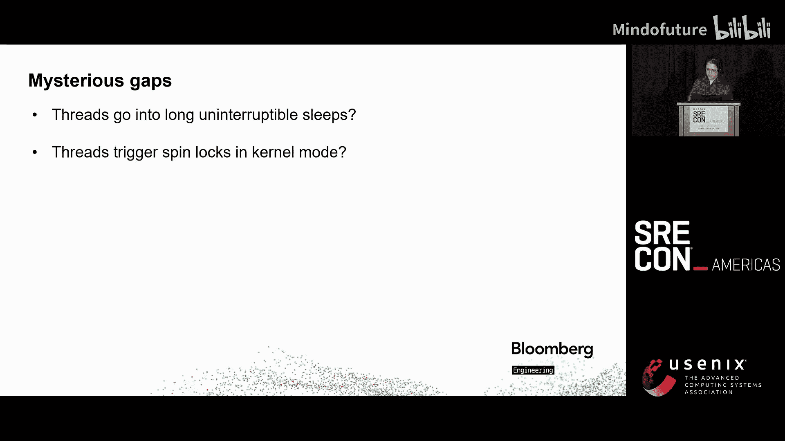

# SRE大会-2025-美洲-｜-srecon-｜-分布式-｜-缓存-｜-OpenTelemetry-｜-安全-｜-AIOps-p06-P06-Case-Study---A-Thundering-Herd-in-the-Wild--BV1TmLDz7EZZ_p6-

。

Hello everybody， good afternoon， thank you very much for attending this presentation。

 My name is Nicholas Aroji and I'm very happy to be here。😊。

I'm a Se work architectit at Bloomberg in the Order and Trade capture team。

And for the most part of the last few years， my work is being related to performance and scalability。

I do optimizations for existing systems， troubleshoot performance problems。

 and develop and promote profiling tools。Today I would like to tell you about a font story。

 about a problem that really gave me a lot of trouble。It even has a reveal towards the end。

 and I think you'll find it interesting。Let's begin let's start by talking about what the thundering her problem is。

The thunder in her problem is a performance issue that happens when multiple threads wait on the same event and are all woke up at the same time。

If only one thread can handle the event， the others waste resources with empty and unnecessary contact switches。

That's about it right， you have an event that multiple threats are waiting for。

Typically in operation on a file descriptor。The event fires， all threats waiting become runable。

 but only the first threat to wake up will handle the event。

The rest take up a CPU core only to find out some of the thread beat them through the event and then go right back to sleep。

Now， this could be a problem if the number of threads waiting for the event is large。

Nowadays is not much of a problem， you don't really hear about thundering hurts anymore。

In the old days， what typically happened is that you would have multiple threads or tasks running except on the same socket。

When a new connection arrived， every thread would wake up。

 even though only one of them would handle a connection。The rest would go back to sleep。

This became a calability problem when services started handling large volumes of activity。

But kernel changes like the task exclusive wakeups sold this by allowing W queues to have tasks flagged to exclusively handle an event。

With this change， only one thread would be woke up and that particular problem was solved。

Then when EL was introduced， multiple threads waiting on the same E filescriptor will all be woke。

 went on an event in a target happened， edge triggered event。

 solve this problem by waking up only one。Slightly different case before Colonel 2。6。

 when conditioned variabless were notified with broadcast， all waiting threads would wake up。

 even though most of them would go right back to waiting on the accompanying muts。

Rak Q and functionality was added to futex that allowed to wake up only one thread and move the rest to the Muts cu while still asleep。

And they're aware and still are other ways of triggering the thundering herd problem。

But I think the main reason you don't hear about it anymore， at least at the system level。

 is that most of us don't write networking code anymore。

This privilege is reserved to low level library writers who are more knowledgeable about this quirks。

 so all of these thread waking minefield is safely abstracted away from us。By the way。

 all of these examples are applicable to Linux， but there are similar scenarios in NOS you can think of。

Now I'm here to tell you about a situation that has an alternative way to cause simultaneous threat wakeups in modern kernels。

And by observing system API best practices。And it has the potential to affect thousands of threats in completely unrelated applications。

Now let's go to the story。I I mentioned before， part of my work is troubleshooting performance issues。

So a friend bangs me。And tells me that he has a performance problem on his service skull。

We have service unicorn， and while servicing request it， it fetches data from data to raininbow。

The service calls log their duration， so it's quite easy to browse and process them with a log arigator。

He tells me that the miniuration is close to 80 microseconds， and that sounds very reasonable， right？

But my friend is very thorough， so besides looking at the mean。

 he looks at this lowest instances as well， and we should all do the same。

And he finds some outrageous outliers that happen quite often。

With late he's as bad as 20 milliseconds。This is a P95 histogram of the durations in a period of just a few hours。

It has the 5% lowestest and fastest instances trimmed out。

It looks the way you would expect it to look like log normal distribution， right？

This is the histogram with all the data and as you can see， the worst instance are slow as 17。

5 milliseconds。This is 250 times the mean value。This doesn't make sense。

 and even if it is a very small minority of fetches。Its not something that can go un understoodstood。

That's a real word。We need to figure out the impact of the problem。Back to the conversation。

My first guess here in probably years two is that these outliers happen during periods of extreme activity when the data store rainbow is saturated。

So I ask about CP usage， queue sizes， operations for second， et cetera。But it wasn't that。

The problem happened all the time。Even in periods of low activity in every tier in every environment。

My second guess was， and maybe yours too， was that the records fetch from the rainbow data store were too numerous or too large when these outliers happened。

It wasn't that either。Theseliers were happening with single fetches of average size records。

My third guess was that maybe some background jobs in the data store were happening when these outliers were observed。

Something that blocked all queries。But no， there was only one background job running。

 and it only ran once a day。So I got started tackling niche。

 I managed to reproduce the problem simply by launching an existing stress test in a nice development environment and usually that is have the battle right。

 reliably reproducing the problem with the push of a bottom so great。

The first thing I tried is sampling profiling。Now let's first think up in sampling profiling。

 even though most of you know what it is。Sampling profiling involves taking a snapshot of a thread state。

 including its call stack with a given frequency， for example， every 10 milliseconds。

Typically is done in one of two ways， time based， which is done with aOAA timer， an event bit based。

 which is more accurate， but depends on hardware support than requires higher permissions。

At the end of the profile， the callss are aggregated。

 and this gives you a statistical model of where in the code， the task is spending most of its time。

This gives you clues as to where to improve performance， right？I know what you may be thinking。

 this particular problem involves outlier execution times and like I just said。

 sampling profiling usually implies segregation which destroys any information about the outlier instances。

So all I will see is the average of or the functions involved， right？That's true。

 but simply will show me the functions and callt involved when I run this particular use case。

 so it will give me a good idea where to start looking。Also， if the problem is related to scaling。

 trying different types of loads may reveal code paths that grow or shrink in duration。

 although we already know that the problem here has probably nothing to do with high traffic。Besides。

 I wrote a little sampling profiler I'm quite fond of， and when your favorite tool is a hammer。

 every problem looks like a nail， right？Now， let me tell you a little bit about this particular profiler and why I didn't just use PEf。

This profiler is both on and off CPU， meaning that it takes snapshots of the call stacks of both running and sleeping threads。

This problem is probably I related since it happens while querying a data store。

 and for Aiobound problems like this one， an exclusive on CPUU profiler is not going to show long weights and events。

Which are possibly the problem here。Profiling IO bound problems is quite different from profiling CPU or memory bound problems。

I could do off CPU profiling in the classic way by proving the scheduler。

 but it is very disruptive and would hide on CPU information， which is also valuable。

Not to mention root is not an option for me in this environment。🤧う。

This sampler is user mode or time based， meaning that it uses always timer instead of hardware events。

 so it requires the same permissions as the running task colon only。

So I run the profile or a UniCon service if you're wondering why I did a profile rainbow instead。

 it's because it is a common data store and does it very solid。

 it didn't make sense to profile it at least not at first。Despite it being the query task。

And I see this output。The profiler produces trace Even format。

 which can be viewed with a Chrome browser。And it is very similar to flame graphs， as you can see。

 except this upside down， the functions on top called the functions on the bottom。

Just like flame drives， the thicker the Col stackak flame， the more samples or capture on it。

So for example， here we can see that the program spends more time on function fetch from rainbow than on function。

 nothing interesting。Unlike flame graphs， however， it separates the information by thread。

 as you can see， every lane is a thread。And it also colors on CPU and off CPU calls text differently。

As you can see our CPU is color blue and on CPU is colored gold。

This allows me to tele apart CPU heavy from IO heavy coatpas。If we zoom into it。

We'll see here where the request is reserved， E request is served。And as we would expect。

 this is where most of the time is being spent。Down to stack， we see fetch from Rainbow。

 which is the function we're trying to optimize。We add it to our suspect list。

If you go down this stack further， you'll see many functions being called by fetch from rainbow。And。

That we can add to our to the list of suspects。Functions play with like and color main are the ones that take the longest amount of time。

 so I looked at their source code trying to find some obvious issues。

 but nothing stood out in fact I looked at source code of all the functions in the specific list。

And I saw nothing noteworthy。But like I said before。

 the aggregating nature of sampling doesn't tell me anything about unusual execution times or outliers in this functions。

So it's time to switch gears and try something else。As you'll know。

 there are two main types of performance profiling。

 while there are a few other types are arguably the two most common methods are sampling and code instrumentnstruation。

 like I said before， sampling， the snapshots of the threads， call stack。

 it aggregates them and it gives you a statistical model of where time is being spent on。

On the other hand， instrumentation is about inserting code at the entry and exit of every function or code block of interest。

Taking tabts at both places and then emitting this informationformation spans。

The timestamps can then be processed to calculate latency of function in vocations。By the way。

 I'm talking about code instrumentnstruation in the context of performance profiling only。

 there are many other types of instrumentations for different purposes。

This can be done in a number of ways by manually inserting colon code， logging code。

 by using telemetry libraries， statically modifying the binary ahead of execution。

 or dynamically modifying the running task， which is what we will do。As you can imagine。

 using it on every function in the program， regardless of the method。

 can be very disruptive to the point of being unusable。

 especially with large binaries with millions of functions。

There's also no barrier useful in functions with various short durations because the bias it adds may be longer than the actual duration of the functions。

But if you selectively choose a list of suspicious functions， like the one we have。

 it can reveal information that sampling profiling hides。

Let's see an example of how information provided by both profiling methods。Is different。On the top。

 we have a sampling trace。And on the bottom， we have an instrumentation trace of the same program。

I also use trace events format for visualization of instrumentation traces。

 but this time displaying different information， this time it only shows me blocks。

 for instances of function function executions， no call stacks。

 just the time where each function execution starts and where it ends。

Here you can see that this instance of function long function started at this time and ended at that time。

Sampling doesn't tell you how many times a function was called， for example。

 on the sampling trace on top， you see the quick function and long function both get a lot of samples。

 but we don't know if it is because they were called in a loop。

 a civilianion times or because they ran only once for a very long time。Or something in between。

Instrumentation will tell you information about every execution of a function。

Instrumentation also gives you information about what runs concurrently to what and what happens before what。

This can help in certain types of problems， like identifying missed opportunities for concurrency。

For example， on the top， you have a sampling trace this time done with coal grind and the visualization you see here is from Q cache Gr。

If we look at these trays， we can see that most of the time is spent on a function conveniently called very long call。

If we only looked at these trace， we would be very tempted to just optimize very long call and expect pair performance。

However， in the instrument trace in the bottom， we'll see that reducing the deliberation of very long call would not change the durationeration of the service request at all。

Why， because the service request doesn't finish until short call3 finishes。

instrumentnstruation shows us that in this case， the problem is that even though some functions are running concurrently。

Maybe some of them are not starting immediately。After all， the dependencies are met， for example。

 assuming the short calls have no dependencies on the results of other functions。

They can be hoisted up and executed right when the service request starts。

 and then the trust will look like this。See that all the functions are nicely packed to the left。Now。

 it would make sense to optimize a very long call if it is still needed。With sampling alone。

 we wouldn't have figured this out， and this is something that happens in practice often。

Specifically for the case we're solving since it gives information about individual executions of functions。

😊，It will allow us to locate outlier instances， which is exactly what we need。

At the time I was looking into this， I was also working on a different tool that would allow me to instrument the giving list of functions in a running task and emit their start and end times。

 so it came very handy。I fired up the instrumentation tool taking the list of suspicious functions that I had identified with the sampler on the previous step。

This is how our Uniorn program looks using code instrumentation。

You can see the same functions we saw when we did sampling， but now we see every call instance。

 we see the order in which they were called and concurrently to what。

Note that instrumentation traces don't have thread ID information at this level concurrency is independent of always threads。

 a call function could be a core routineine for example， or it could be running on a fiber。

If we zoom out and start scrolling to the right。We see a few outliers and some functions that took unusually large amounts of time。

 as expected。But there were not the same functions every time like I had expected。For example。

 you can see here how function color main takes a much larger amount of time in the instance I lighted with red than in the ones side lighted with green。

You see the same thing for function peak treasure。See how much more it takes on the instance I lighted with red。

The same thing happened for all other functions that were instrumented， if we kept scrolling。

 we would see outliers for all of them。This is not what I expected。

 because my assumption was that the problem I was trying to solve。

Would have been in a specific part of the code？It didn't make sense to me that every single instrumented function seemed to have this extreme outlier problem。

These are the duration histograms for some of the instrumented functions， as you can see。

There are extreme outliers in every one of them。Even though their mean durations are different。

 they all resemble the histogram of the fetchco we saw earlier。So instrumentation is great。

 but like sampling， it also hide this information， it only tells you when a function starts executing and when it ends。

It doesn't tell you what happened in between， maybe the executing thread gets preempted a thousand times。

 maybe there are a bunch of page folkss or who knows what other kernels ors are happening。

So once more， we have to change our approach。We have to backtrack。We're going back to sampling。

 but we will process the information in a granular way。 will not。

 We will look at every sample taking individually and we will not aggregate them。

Why do we want to do this because we want to be able to see exactly what's happening on every thread at the times these outlier executions happen？

So I wrote a patch for my sampler tool。To emit granular information and to display it sample by sample at the time each sample happened。

This is what the grain traces of Uniicorn task looked like， and yes。

 I'm also using traces events format for this and also yes。

 the information displayed is different from the other trace types。

Every sample is shown with its co stack with a constant width at the exact time it was taking。

And every sample is in its own thread lane。In this region。

 the samples are distributed in a very uniform way like we would expect。

 because the frequency of the sampling should be stable。

But it was cruel to a time when one of the outliers execution happened， we see a gap in the samples。

That is， between two consecutive samples， there is an unusual amount of time in all threads。

I didn't want to believe that the sampler had a bias。

 So my first assumption was that whatever was causing these outliers was preventing my sampler from stopping the threads。

 Maybe the threads were getting stock for a while in uninterruptible sleeps。

 where maybe they were hitting spin locks in kernel mode。

Oh great。

Sorry。Maybe the query was causing major page faults。

Maybe something was causing lots of context switches。

I thought one of these was delaying the processing of the signal from my sampler to the observed task。

I wrote a script to count context switches and nothing out of the ordinary came out。

 I looked at the reported pagefuls in resist monitoring and there were no peaks。

 at least not matching the gaps。As I seem to have in an impasse。

 I took a step back and decided to commit the granl mode patch I had made to the sampler so that I could use it in similar problems in the future。

I was doing a smoke test to make sure I hadn't broken anything。

 and I attached the sampler to plain old cat the task had。As you can see the st of cat。

 the samples are evenly distributed。But if you scroll to the right， guess what？

The same gaps we saw in Uniicorn Te show up。That was heartbroken。

It seemed that the sampler had a bias and I was irregularly sampling every task I ever tried it on all this time。

 and I had no idea。Now I had two problems to fix instead of just one。

I looked at the sampler source code， looking for some obvious cause for this bias， nothing popped up。

Eventually， by looking at the traces over and over again from this angle and that angle。

 I finally noticed something weird。If we zoom out on the granular sample， trace for cat。

We can see how these gaps are spaced exactly by five seconds each。This gave me some joy。

 It was very unlikely that whatever bias the sampler could have would happen every five seconds。

 So at least I was back to having only one problem。After CAAT。

 I tested multiple tasks and sew the gaps on every one of them。

So I assume something was interrupting every single task every five seconds。To prove this。

 I wrote a small and simple Python script。All it does is this inside a loop。

 it takes a timestamp and subtract it from the one in the previous iteration。

 it prints a line if the difference is higher than a millisecond， which I think is reasonable。

 you wouldn't expect consecutive operations to be spaced by more than a millisecond。

 even in an interpreted language。So basically， it constantly tests for long execution interruptions or lags。

I ran it， and this is what I saw。Each one of these is a lag。

And if you look at the seconds in the timestamps， you'll notice that they are all multiples of five。

So not only were the gaps spaced by five seconds， they were aligned with the system clock。

This means that the problem had nothing to do with either the unornote。

 all they started with or with the sampler。It was these lags that were inflating the latency of any task that happened to be running during a five second mark。

The problem was in this system。My initial guess was that there was some evil task。Sorry。

 my initial guess was that there was some evil task that every five seconds was spawning with lots of short lived children tasks and that these were evicting every running task。

But I didn't know what to do next。 I'm an application developer。

 so I spent most of my time in the land of privileged users。

But fate had to be run into a powerful friend who has Ruth permissions and I told him everything I had discovered so far and he said。

 just write any PF script and I'll run it for you。For anyone who's not familiar with the APF allows you to run sandbox programs inside the kernel and allows you to query a lot of his internal state。

Amazing， now I have the power to ask the colonel questions。

So I wrote a little EVPF script that samples every core with a frequency。Sampling again。

 if there is something running on it， it takes the thread ID and the thread name。

 it also gets the process ID。And the process idea of the parent desk。

 you remember that my first guest， who was the some task， was creating lots of children tasks。

So I wanted to know the parents。Finally， it takes all of these and emits it with a timest。

I take the output and turn it into a trace events trace once again displaying different information。

 this is the fourth time I've done this， I just love the trace events format for visualization。

This is what the result of the VPF script looks like。As you can see， every lane represents a core。

And every block is a constant width sample that had a thread running on it at the time。

Every thread is assigned a call to make it easier to reason about them。

So far we see what you'd expect。Most threads run for short periods of time and then they go back to sleep。

 a minority of them spend a little bit more time in a core， but most of the cores are idle。

 most of the time。But let's crawl right to one of these five second marks where the lags happen and see what's going on。

If you look at this highlighted area， you'll see a multitude of threads executing on every single core and of course。

 kicking out any thread that is trying to do when you work on them for double digit milliseconds。

These threads are our culprits， we're close to figuring this out。So what are these nty threats？

Are they short lived tasks created by an uncivilized application， like I thought at first？No。

After they're looking at the thread names and searching for them in source code。

These though that were created by some libraries that happened to be linked in by many running applications。

So I run the profile there with a granular patch on one of the tasks linking this library。

I figured that if I looked at the samples before the las on these threads。

 I would find out what they were doing to cause them。This is the trace of one of the culprit threads。

In the middle， you can see one of the legss。And if you look at the last cold stack before the lag。

 you can see there's a call toty jobs scheduler dispatcher。I looked at other lags in the same trace。

 and then I looked at lags in other tasks， linking these libraries。

 and they all seem to be sleeping on similar code during the lags。

So why is this call causing the lags？Because it runs recurring jobs。Starting at the times。

Before we keep going， let's quickly define what a time job scheduler is because it can go by different names like timer and scheduler。

 event manager， and maybe others， and they have different sets of features。

A time Jo scheduler is a component or utility that allows you to schedule jobs to run in the future。

The functionality is vary， but it typically allows you to schedule a job to run after a given amount of time from now。

And some support starting at a specific start time。Some of them allow you to schedule recurring jobs。

 that is jobs that run once every period of time with a given and delay。

Others will force you to reschedule jobs to the recurnce。Also。

 some event loops and thread pools give you a similar functionality。But why the legs？

Significant number of threads that are running on most back in host use some form of scheduling。

 polling， alarms， operation timeouts， arm beatats， batching。

 etc obviously this depends on what your systems do。

If use time job schedulers for these or other form of scheduling that run recurringt jobs。

 which will probably have delays that are multiple of five because we all love numbers that are multiple of five。

And kick them off with the same time alignment at the start of the hour， for example。

You have a multitude of threats that will wake up at the same points in time throughout the day。

So after all this preamble， the problem is just this。

 Ting her can be cast in unrelated applications and without having any events in common。

They can synchronize to wake up simply by using recurrent jobs that are aligned and have delays with a common device。

They're not looking at the same event， they're looking at the same clock。Now。

 some of you may be thinking， this doesn't affect me， I don't recall seeing recurrent jobs。

 starting at absolute times on my system， and pretty sure they all start at relative times。

You have a good point。 if the recurrent jobs are not kicked off with the L star times。

 then they don't sink and there's no thundering herd。

It's great if you don't have any or many of those。But it can still happen。

Unrelated recurringt jobs with matching delays can become synced during the day。

 This is less likely and less problematic， but I have both observed this in the while。

 and I have been able to reproduce it as well。😊，Let's say that you have recurringrent job A and B。

 like we see here。They are not synced。But they have the same delay。

After some time they both run again， still not synced。But then a period of high activity happens。

 maybe with higher priority threats。Then the wakeups in these threads will be delayed together。

And they will wake up together at the end of the period of high activity。

They leap again for the same delay， and then they are synced and remain synced。

 possibly until their tasks are bounced。Something interesting is that this period of high activity can be an existing time thunder and hurt。

 and this thinkinging just recruits even more threads into it creating a snowball effect。

All of these back these questions。Do you really need allowing timers on your recurring jobs。

 my guess is that the majority of jobs which are usually paing out of some sort can use relative start timers。

If you need a line timers， can you use your regular start times to prevent them from aligning with other jobs and thus synchronizing？

If you're calling for something， can you use some form of subscription instead？

If you're acting on accumulating work， can you raise their job only if there is work to do？

Can you use prime numbers as job delays or add random jter， and this is how we solve the problem。

 by the way。If you have a costume scheduler， can you calculate all the wake up times based on a single start time instead of the previous wake time？

How can you monitor for this problem？ Well， we have this script that detects a problem that I showed you before。

 You can use something like that to see if you have this problem。

The problem with this cry is that it runs without sleep on a loop。

 so it will take 100% of the CPU core during the entire time it runs。

You could set up to run with lowest priority， but this would still be a problem from the power efficiency point of view。

So if you have this problem and we want to make sure you have fixed it， I propose this approach。

Lunch the same script a few times a day， changes to launch times every day。

Run for a period of five minutes， obviously these can vary， report any lag。

This comes with a few assumptions if there is a time thundering her problem with a period greater than five minutes。

Then its not really a problem and I mean having a small lag every five minutes is not really disruptive enough。

 but again the five minutes is adjustable。If there is a time thundering herd that happens with a frequency lower than five minutes。

 but periodoradically and not for a significant amount of the day。

 then it must be caused by system activity， conditions and is not something that can be avoided。

It is just part of normals functioning。Anytime third hair that has a period lower than five minutes and occurs a significant amount of time every day will eventually be caught。

If you encounter this problem， I'm very interested to hear about your experience。

 please send me an email if you can， I'll be happy to keep the report anonymous if you'd like。

And that's my presentation， thanks again for listening， I hope you enjoyed it。

And now I can try to answer any questions you may have。

