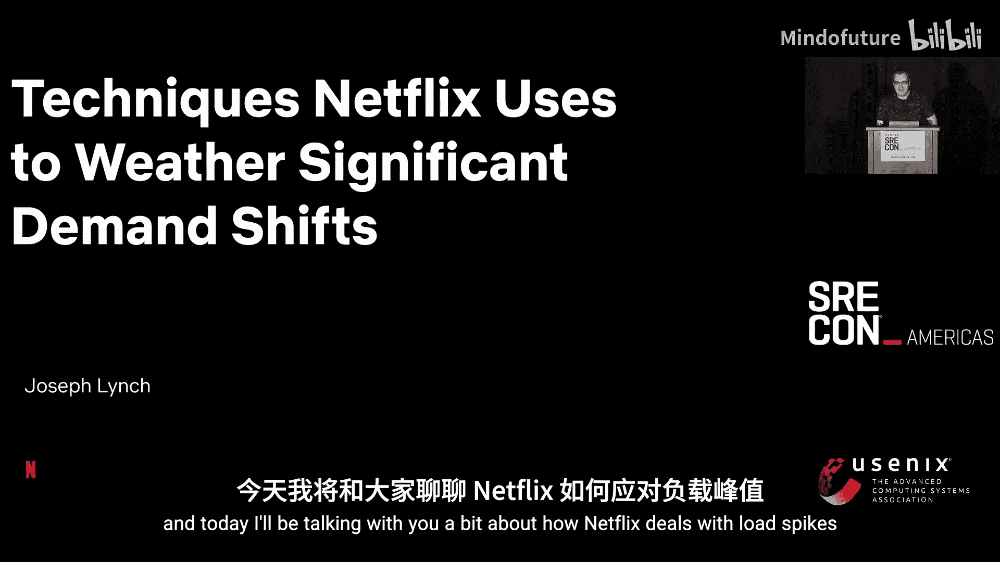
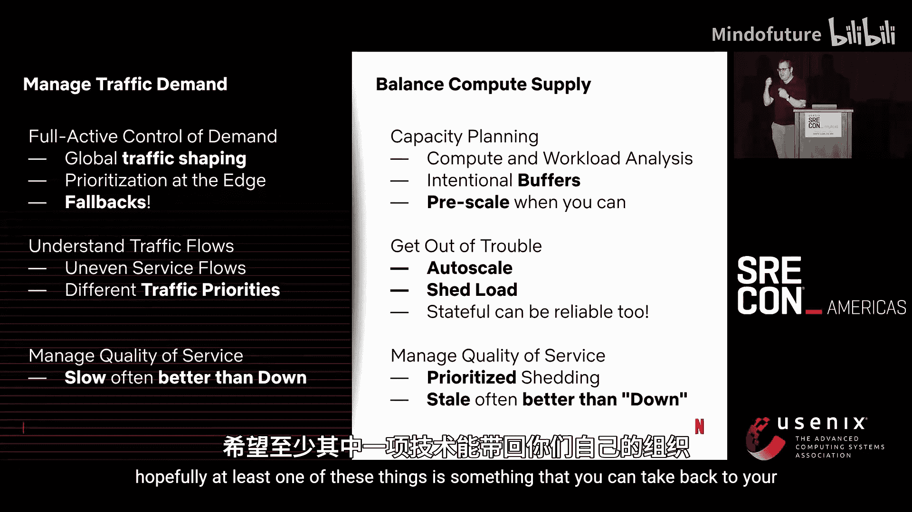

# SRE大会-2025-美洲-｜-srecon-｜-分布式-｜-缓存-｜-OpenTelemetry-｜-安全-｜-AIOps-p07-P07-Techniques-Netflix-Uses-to-Weather-Significant-Demand-Shifts--BV1TmLDz7EZZ_p7-

。

I'm Joey or Joseph， and today I'll be talking with you a bit about how Netflix deals with load spikes。

A little bit about me， should you trust me， I don't know。

 but I'm an engineer at Netflix and I work on our platform team and I work across the entire platform on stateless stateful compute optimization and just generally I'm kind of a destroyed systems nerd I heard that icon clouds were cool so I added some of the projects that I work on。

And Netflix's problem is really one of global scale。

 so we have a product that's used at all times all over the world。

By absolutely millions and millions of users， and we have thousands of different device types that connect constantly with diverse capabilities。

 some have stronger networks， some have weaker networks， some are higher resolution。

 lower resolution。And we tackle this global problem with a global technical installation。

 so we have a what we call our control plane， which runs out of four Amazon regions。

 these four Amazon regions。And this is responsible for things like logging people in。

 getting them to that play URL， just generally everything related to actually using the product personalization。

 for example。But then we actually streamed the video data from a global data plane called OpenConnect。

 which is essentially a really fancy CDN。And believe me， Open Connect is everywhere。

 it's an ISPs all over the place， I got tired of drawing dots。

 but there's thousands and thousands of points of presence all over the planet。

And this global product leads to a highly variable， what we call start per second。

 which is stream starts per second， it's our main load metric。

 highly variable over time and by region， so for example we can see that there's up to an order of magnitude peak to peak difference in traffic between when a region is in trough and when it's at peak。

And there's roughly a 24 hour period of the city， except for US West2。

 which has an interesting behavior where we get Asia coming online right as America is going to be。

So that kind of has like two assignmentoids。But the key insight that I want you to take from this graph is that when these large amounts of traffic move around。

 that can lead to significant load shifts on our services。

 and in particular I want to zoom in on this little oddity on the graph， what is that let's zoom in。

Well that is our weekly failover drill so every week we practice that we can evacuate an Amazon region and take all of the traffic in the course of a few minutes and move it to our other regions and it turns out that practicing failover is actually two load spikes so first you have a load spike that's relatively small in your savior regions and then when you restore from that roughly zero level of traffic to the full traffic you have a large load spike on the region that you failed out of。

But there are other sources of load spikes for Netflix as well。

 one of them that I think might be fairly intuitive are things like title launches。

 something like Str Things launches or certain events that may drive correlated viewing。

 which you may or may not be familiar with Netflix。

 and these trigger all of our users to show up all the same time trying to watch that title。

And often it is a global effect， so it's not limited to one geographical area。

 many titles have global reach on Netflix。😊，The final thing that I want to talk about is device drivenri demand and I like to explain this with two I think easy to understand concepts。

 generally speaking， Netflix devices and humans using Netflix expect Netflix to work so whenever there's an error they all sit there mashing the retry button being like well Netflix isn't down maybe I just need to retry harder and that's true of both our device protocols which are quite not used to seeing errors and also the humans watching Netflix so actually some of the largest load spikes in Netflix can happen due to these human induced retrystorms。

And what makes it complicated is that behind the scenes it's not just like one server that has to handle these requests right we have a complex architecture layered architecture。

 hopefully this is like familiar to many of them in the room， we have API gateways at the edge。

 they federate out to services， microservices which talk to data source pretty standard layered architecture。

 except for when you get into the call path it looks a little bit more like this。

Anybody else out there with a call graph that's kind of messy， Yeah， definitely us。

 right Call graphs kind of messy。 And the reason why this is tricky is because you have to actually understand how that load spike will affect this distributed call graph。

So this might have us looking like the middle guy there kind of like， well。

 that's a lot of load to control up anywhere， but with the techniques that we go through today。

 hopefully you can come away with like one or two ideas that might be leverageable in your own circumstance。

So this story is made up of three parts， we're going to talk about traffic demand。

 how we balance compute supply， and then finally when those two are out of balance。

 what resilience techniques we use to mitigate the impact to our users。All right。

 so let's start with global traffic demand， and this really starts with our global architecture and how we balance load between those regions。

And to understand that the slide's a little busy， but it's basically our four regions running those microservices in their data stores。

 and I just want to call out the key components that allow us to place traffic around the world。

The ones at the top are our CDN and our E proxy called Zul that's the API gateway。

 and you can think of it like they work together to place users in the appropriate region and then the edge proxy。

Fixes it if they're in the wrong place。But the thing that allows them to place users anywhere in the world is our full active database and cache replication layer powered by Apache Casandra and basically a MCash a replicate a MCash store called EVCache。

So these four technologies are kind of the key that allow us to place users anywhere in the world。

And when we're making that placement decision， we're really making a tradeoff decision between latency and availability。

 we could bias users to go to the closest region or P。

 or we can try to bias them towards the least loaded region or P and it turns out that this is in constant conflict。

 we have to make a decision about which of these we're going to prioritize。

And as you'll see throughout this talk， as we prepare for load spikes。

 we're probably going to generally bias away from latency。

 which is your typical bias and we're going to bias towards availability， what does that look like？

Well let's work through an example of control plane steering， so here we have our four regions。

 we have those users trying to watch Sid game， and we've got our CDN pops in between。

Points of presence。Now， a colleague Sergey gave a great talk a couple of years ago on how our devices actually observe the network topology between whether it's faster to go to the cloud directly or faster to go through the CDN。

 so sometimes it can actually be faster to proxy requests through our CDN Ps。

And we actually can use that data。To direct users away from loaded regions because they're slower。

But we can actually take it a step further and we can a follow- up talk that Sergey and Neossha gave。

 we can go further and actually use this capability to steer users away from regions。

 so in this example we tried to get people away from USs2 but how does that actually work well as with many things the answer is DNS。

So Netflix runs our own authoritative DNS servers on our OpenCon CDN。

 and we steer each of those authoritative DNS servers。

To try to place blocks of traffic so you can think of it like recursive resolvers reach out through their ISPs to those authoritative DNS servers and this gives us about 100 points of control。

 so think of it like we can take bits of Netflixfl trafficic in increments of 100 and then we can kind of move it around to different regions quite simply this is taking api。

netflix。com and resolving it to useat1。appi。neflix。com。And again， if you want more details。

 I encourage you to check out the talk by Sergey and Yosha at the bottom。

And this ability to route users is really key to being able to survive load spikes because it allows us to couple predictions and shape traffic and anticipation of a load spikeke。

 but also to react when we're wrong。So let's work an example where we explore a couple of different possible traffic shapes。

 so at the top of this we have our typical normal Tuesday。

 this is what load would look like if we didn't do anything to change users if we were just optimizing for latency。

We could assume a more balanced shape where we try to even the traffic across regions。

 we might do this if for example we're not sure where that load spike is going to show up。

 or we might take an unbalanced shape if we have reason to believe that a particular event or reason for users to for example。

 go to USS to more than others， we might try to preemptively push traffic out of that region。

Over time it looks something like this right so the regions have their normal load distribution and then at some delta prior to the load spike。

 we're going to shape traffic to try to minimize the delta between regions。

Of course the load spike doesn't go exactly according to plan right like we can't exactly predict how users will show up so we might want to reshape after the load event and if you go to that previous talk that I linked you'll see that there's kind of like an optimization problem running and I like to joke like we just need to do the linear programming faster one of the key things for us is to drive down that delta of how quickly we can reshape traffic after a load spike because that allows us to react rather than being stuck with whatever shape we we picked going into the event。

But that's not enough because there's still that delta， like no matter what we do。

 it's going to take a couple minutes for us to move global traffic around right like DNS TTls have to tick off and you have to get through a number of routing。

Problems so in the meantime， we rely on fallback behaviors in our routing layer。

And this builds on something that we've talked about on our tech blog about how our edge。

 our Zule router uses prioritized load shetting， and essentially the idea here is that every client in Netflix when it makes a request to our cloud control plane。

 it attaches a priority， low priorities are important。

 things like I want to play this title right now and high priorities are unimportant。

 things like here's a JSON blob of all the logs that I've created over the past 30 seconds。

And Zul can selectively shed priority， low priority work to preserve high priority work。

But what happens if a service is down because it got hit by a load spikeike。

 typically when a cloud region an Netflix gets overwhelmed， it's not like the whole region。

 it's typically one or two services in that complex call graph gets an unexpected load spike relative to that spike。

So in this case， all those Netflix users are sad because they're being shed by Zools Zols saying go away。

 and what we realized was， hey， we've got three other cloud regions。

 why don't we just downgrade the priority of the request and send it somewhere else？Now。

 a quick question for the room， why did we have to downgrade the priority？What were we avoiding？

What kind of failure were we avoiding？A cascading failure that's right。

 If we didn't downgrade the priority and we didn't have prioritized load sheing。

 then by sending all the traffic from one sick region to another。

 we could actually cause a global outage。 So this is you know really key to this ability to fail over is the ability to prioritize our work。

And now those users are happy because they're able to stream stranger things。All right。

 so it's not enough though， just to manage the supply of excuse me the demand of traffic。

 we also have to manage the supply of computers， and this has three main components。

 First we're going to be able to couple cloud realities and then we'll talk about how do we do predictive and reactive scaling。

And I like to joke that this is essentially making computers do hard stuff because humans are not the best at managing scaling policies。

 computers are much better at it， and we'll see how。And to begin with。

 let's start with how we talk about service headment Netflix because historically we used to talk about things like CPU percentages and like how much CPU percentage do you have。

 and it turns out for lots of reasons that's actually a bad way to think about it instead what we prefer。

Is to talk about things in terms of success and failure buffer。

 so a system is under some load and there's some amount of additional load that that system can handle successfully without violating latent CSLOs or throwing errors and then anything above that we're going to shed that load and those are errors right those are failures。

And we'll see in a second why we want to shed that load really badly。

And buffer is of course linked to your business outcomes。

 and I think this is really key because you can recover buffer， for example。

 if you enter that success buffer， you can use things like autos scaling or predictive scaling to restore the buffer。

 but that takes time in particular recovery constant and this depends on the service， for example。

 stateful services tend to have a longer recovery time than stateless ones。But more so。

 buffer is also a function of how important that service is and to which aspect of your business。

So for example， services which are critical to the live streaming path or to the playback path。

 those need relatively more buffer than those that are noncritical to personalization。

Loadization is a tradeoff in a business decision and this is I think a key insight for us。

 which is that a lot of services at Netflix were running cold。

 but they weren't running cold by accident， it wasn't like people were leaving dollars on the table。

 instead we were building buffers into our system so that we could handle these load spikes without causing impact。

But a key insight here is that fast recovering services need less buffer。

 so if you can have services that scale faster， recover their buffers faster。

 then that allows you to run more efficiently。All right。

 and this leads us to cloud reality win number one， which is that the cloud is not actually infinite。

 and you still have the capacity plan。And Netflix， we think of it in two main buckets。

 we think of it in our slow scaling stateless services。

 which we pretty much entirely reserve and run on all the time。

 and then there're the fastcal stateless services which move with that variable load。

Now you're going to reserve some proportion of that and as part of reserving it。

 you're going to have a trough， a trough means that you are paying for those computers。

 so you might as well be running them at Netflix we use our trough for things like running andcoding and then when there is demand from those microservices we release that capacity and give it back to the microservices。

But even with this， you're not going to reserve the whole thing that's extremely expensive So instead。

 based on some function of how long you're running the compute for and what your pricing is。

 you will be using on demand or spot markets and this is important because it reveals cloud reality number two。

Which is that computers have variable supply。So if you're reliant on your cloud provider to provide computers。

 but you're not prepaying for that and pre-running on it。

 then you need to think about which types of computers have what we call deep supply and this is like completely non-scientific graph。

 but I think it illustrates the point， which is that shiny new computers or you maybe don't want to run all your workloads on because they tend to be compared to older computers。

 they tend to have less depth in their pools， so we have to be very careful when we adopt new shapes it's very easy to get off the old shapes because they're old bad and nobody wants to use them but the new shapes we have to be very careful when we're adopting those new computers in Netflix。

But it also is annoying because it's variable supply with what other customers are doing。

So for example， at various times of day or at times of the year， for example， around Black Friday。

 it's relatively more difficult to secure capacity。

So your options are you can reserve it and pay for it。

 you can make on- demandman reservations instead of handling a load spike by scaling up。

 you can handle a load spike by leveraging those buffers that we established earlier。

 or you can preferentially allocate servers to the most important workloads so earlier I alert alluded to some things being tier zero and something being tier 2 or tier1 essentially that just means take your limited resource computers and distribute them to the services that are most important to your business。

It's further complex because the computers have variable supply by shape every essentially every hour right so this is not real data but just to illustrate a point if you can be flexible about what your workloads run on if you can access more pools of compute。

 then you can access more of your cloud provider's capacity so for example。

 if you're assigning workloads to like this must run on an I4I2x large and nothing else。

 and you don't have a fallback plan to being able to run it on other instances。

 then if there is a capacity crunch in that one shape of computer during a load spike you could get in trouble。

And just to illustrate that that changes over time。

And this leads us to cloud reality number three which is when you're trying to be flexible between computers。

 unfortunately different servers are meaningfully different and they affect your performance in different ways。

 so at Netflix we have this capacity planning library service capacity modeling library which allows us to understand kind of at a very concrete level the differences between these servers。

 for example here we can see that the M7A4x large has 16 physical cores compared to the M6 ID4x large which only has eight physical cores and as we'll see in a moment this meaningfulanly affects your buffer calculations。

All right， so let's see how that is。 This is a really simple use of that library that I just did for this presentation where we look at different computer sizes across the M7A and M7I family and we can see that failure buffer starts at dramatically different CPU realizations and that's because servers with more cores you can run hotter before you start entering the non nonlinearar curve of their performance curve。

 So like performance is linear until it's not and then kind of elbows who's had a server go up the elbow it's not yeah it's it's not a fun time。

 you want to stay away from that So we refer to that as headroom and then the tier 1 and tier 0 target are cases where we've essentially taken that failure buffer and then backed off from a linear buffer So a tier 0 might have a 2x buffer a tier1 would have a 1。

5x buffer This is obviously a quite naive analysis we don't take into account things like how many computers we're talking about because a 2x buffer when you're talking about two servers is like yeah just do it but if you're talking about1000 servers that's a very expensive choice。

 But the reason that I wanted to put this up is just。

that if the developer asks for a 2x buffer and you're moving them around to different kinds of computers as a platform。

 you have to take on the complexity of different computers provide buffer at different places and just to make that really concrete。

 this is the same service， but if we deploy it to M7 Xlars versus M788xlars。

 the CPUU utilization that we run that service at varies dramatically。

Butffer also differs by workload， so for example， a stateless Java app doesn't have background tasks like data compaction or repair or backup like a database does。

So you could be looking at two workloads and see one thing running a 10% CPU and one thing running a 30% CPU on the same kind of server。

 and without understanding the buffers that led to those。

 you can't make a representative claim of whether they're cold or hot。

 it might be exactly as hot as it needs to be to leave that buffer for those background activities。

All right， now that we understand buffers， we can use that to predict and prescale our services as well as react and set up our auto scaling policies。

Pre-scale is pretty straightforward if you know a load spike is coming before it because you know that you're keeping those services in their linear region。

 you can linearly extrapolate and pin the mens up on those server groups before the load so in this case step one。

 we pin the mens up， then the load happens a little bit of auto scaling happens at the top and then finally after the load we scale back down。

And the main complexity of this， as NOSsha explored in evolving regional evacuation。

 is that this load spike is actually different for every service。

 a 4xSPS loadbi and Netflix's front door might reveal a 2x or a 3x or a 1。

5x loads spike on individual services。So your calligraph is not uniform in traffic or criticality。

And this is particularly important because when we're trying to divvy up the rare commodity that is servers。

 we want to make sure that we establish the buffers for the tier zeros to important business domains like streaming Playback。

 and we withhold computers from tier3s or tier fours critical that are relevant to less important lines of business。

Excuse me， I should say they're all important， less availability， critical lines of business。Right。

 but of course we have to ask what if we were wrong as far as I mean， unless you guys know。

 I'm not aware of like a crystal ball that allows me to perfectly match， supply with demand。

 we're going to be wrong and we're going to have capacity shortfalls， so when we're wrong。

 we have to react with auto scaling。Netflix is a huge user of EC2 auto scaling we have absolutely tens of thousands of server groups that autoscale constantly with SPS traffic and now that we understand buffers。

 it's pretty straightforward to translate that into an auto scaling policy so we target track at the beginning of the success buffer and then what we do what we we call it hammers because we like fund names we hammer at the beginning of the failure buffer and what hammering means is it' a stepcal policy which injects more capacity than you would based just on that utilization number and a good way to get intuitive understanding of this is that CPU utilization is kind of an inherently constrained metric a 10 Xs like a 100 xs like a 1000 x loads spike they all lead to 100% CPU。

So as we'll see in further in the talk as well， there are other ways that we can find other metrics that help us scale out of those kinds of multiorder of magnitude load challenges in this case though a CPU hammer just means that it's very rare for a service to be running at that end of the success buffer。

 so we just want to add more computers than we would normally do。

But auto scaling can be slow and auto scaling has various sources of latency。

 we've kind of broken it down here into five main components。

 there is the time to detect that there is a problem。

 there is the time for the control plan to launch hardware。

 so it would be like easy to spotwning BMs， there's the time for your kernel or your system units to start up the application itself and then traffic convergence。

And if you're curious to learn more， my colleague Ryan gave a great deep dive。

 he's our auto scaling guru， I highly recommend you watch this talk by Ryan on auto scaling。

In this talk， I'm just going to do a quick overview。But actually， before I go to the next slide。

 I want everyone to think， what do you think is the component that is the highest contributor to auto scalinging delay？

All right， you have it in your head？Most people at Netflix thought that it was control plane。

 we thought it was OVMs starting VMs are slow it turns out VMs are very fast， Amazon's amazing。

 that's the control plane all the way on the left there。

 not at problem at all what is a problem Well detection is a big problem it turns out that knowing that you have a load spike took multiple minutes with our configuration and we had to scale multiple times if we were relying primarily on that target tracking policy。

The other big outlier was we call them long tail application startups。

 these are like your tier Ze app， one of 100， which takes 15 minutes to start up for no good reason。

Sometimes good reasons。And finally， we had some pretty concerning issues with system startup time taking on a minute and our discovery discovery system getting traffic there。

 So for us this was a great opportunity to take a step back and a lesson learned for us here was that almost everybody involved in this project did not predict this。

We only realized where the actual bottlenecks were in auto scaling once we actually started measuring the components of latency。

Once we've done that we could solve it right it's easy to fix the problem if you understand it so for example to solve that detection。

 we're looking at we use things like EC2 high resolution metrics we were able to autotune the actual start latency to the ASG cool down and what that means is that the stepcal policy will take more actions more rapidly and then finally we started observing R CPU ratios for every service and then we added R request per second hammers and the reason why the third one is so important is because it gives you full granularity on the loads spike so for example you can tell the difference between a 1000 R like so let's say it normally takes 100 R and then we go to 1000ps 10。

000ps 20，000ps you can actually differentiate those loads spikes as opposed to scaling only on CPU they're all 100%。

So this was the largest solve and we were able to optimize most of the other ones as well。

 we were able to bring down the long tail by diving into those specific services。

 some great engineers on our performance engineering team。

 also things like starting up units in parallel to remove critical blocking paths in our system D startup and then we never actually solved discovery。

 because we do a polling 302nd service discovery， we got a fast enough， how fast did we get it。Well。

 before we did any of this tuning， our tier Ze services， if we expose them to 10 xode bike。

 it would take between 8 and 15 minutes to recover full availability。As a business。

 this was pretty unacceptable for， I think， reasons that should hopefully be obvious。

After our improvements， we were able to get it down to single digit minutes， three to four minutes。

So these small changes， things like just changing what you're auto scaling on。

 optimizing your cool down times， these actually can have a meaningfully large impact and our business is much more willing to accept a three to four minute outage than it is willing to accept a 15 minute outage。

So yes， it really works。All right， but three to four minutes is still not good enough right yeah we were able to bring it from 15 to3 but during that period of time what's happening to our users。

 we want to make sure that we have resilience techniques to provide the best experience we can during that period of time。

So I want to dive into load shedding and work prioritization。All right。

 it's going to get a little technical， but bear with me， it's going to be a lot of fun。All right。

 what do we do while we're wrong Well we can use load shetting and load shetting is fairly straightforward you look at your target tracking policy and you say okay at the beginning of the success buffer if I have low priority work I'll start dropping that there and then when I'm deep in the failure buffer like close to 90% 95% CPU。

 I'm just going to start dropping everything I possibly can。

And let's work through an example to understand why this is a good idea。So here we have a highway。

 we've got some cars on the highway， and this represents a system running a nominal utilization。

 10 minute transit time。 I know it's rare in California to have。No traffic， but bear with me。

 we'll get to California in a moment。All right， so we can see now that the service is starting to get loaded。

 more cars are getting on the highway， or transit time is going up。

 but we're still letting everybody on the highway。And then we get to my favorite part。

 the part where we start overloading the highway， we're getting longer and longer transit times。

All right， who who here is familiar with this is， this is California， right， Yeah， yeah。

 the little stoplight that doesn't let you on the highway。

 The main difference with the highway versus services is that in the service。

 we're just going to drop the request we're not going， you know delay them。

And the reason that we're doing this is because we're trying to avoid this。

 we're trying to avoid our transit time going to infinity because there are all these car accidents in your way。

 and when you hit 100% utilization on a service， you do enter what we call congestive failure。

 and congestive failure is bad， also known as coing without bound。

 falling over total system failure or my personal favorite， it's a real bad time。

And why do you want to avoid this， well， because your successful requests dropped to zero during congestive failure。

 and the problem with that is that you need a lot more compute supply in order to get that service back handling the load than if it were able to sustain at its nominal amount of QPS。

All right， so we can see how load shedding helps us try to stay away from that。

 but what about the rest of the buffer because it turns out that we can shed load earlier by segmenting that success buffer into different traffic priorities。

 and then we can essentially get load off of our service earlier that's less important to us。

this is prioritized load shedding， this is an example shedding curve。

 the target tracking for the service would be at 40% and in Netflix we let people to prioritize traffic with a number between0 and 100 low numbers are important just like that z example。

 to make it easy to understand for metrics purposes we classify those into four main buckets。

 so there's best effort traffic degraded and critical very little traffic in Netflix's bulk。

We wrote a great blog post on this Enruod and Kevin Docha at the park on how we do this at a service level。

 prioritized load shedding level。All right， so and I think you can see looking at this on the X axis we have how low the system is and on the Y axis is what percentage of that traffic class are we going to shed off the service this naturally allows us to survive longer because we can shed more unimportant work earlier preserving our CPUU cycles for that really truly critical work。

How does a service owner prioritize their work， one way is that they can tell us explicitly。

 typically at Netflix service owners have a lot of context about which URLs。

 which paths are extremely important to the product and which ones are not。

 but we also always have that fallback at the bottom which is just take the priority that the device said so if the service owner doesn't want to express an opinion about how important traffic is the device expressed an opinion and we can use that as a pretty decent fallback。

All right， so going back to our highway analogy now that we have prioritization it essentially creates more buffer by allowing us to prioritize who gets on the highway and who doesn't the analogy I like to use here is that I want to make sure that the ambulance gets on the highway and the person who's out for a joy ride with their sports car they can go home right we want the ambulance on the highway。

 we want people to be able to click play。Does this work， yes it does， works phenomenally well。

 can anyone see the difference between this graph and the earlier one？

This graph has order of magnitude traffic spikes going on。

 and the service continues surveying all that blue line throughout。

 which means that we don't enter congestive failure。So great success。But what about IO workloads？

Because as the previous speaker alluded to CPUbound workloads and IObound workloads are pretty different。

 and the best analogy I have for this is imagine the cars get on the highway and they disappear for some amount of time and they come back on the highway and the thing you're trying to avoid is all of them reappearing all at the same time leading to that explosion that we talked about earlier。

 I know it's kind a weak analogy I did my best。All right。

 but let's look at these two pictures and try to tell the difference what's different between these two highways on the right。

 it's a heavily loaded IO workload on the left it less。Well it's that transit time， right。

 heavily loaded IO systems are slower。So we can actually use our service level objective utilization as a proxy for what we call latency utilization。

 in this example the service has a 50 millisecond latency target and then we just count how many of requests are slower than that and if 100% of requests are slower than our target。

 then that service is highly loaded and if it's a small percentage then it's low loaded。

And we actually use this for our data layer， those data gateways that I talked about。

 they allow developers to shed services to shed load based on backend database load。

 so if the backend database is getting slow， the service that's in front of that database will actually shed load early。

Just to kind of give an example， if that service slows down because we're congested now 88%。

 and we're even at 5% of our max alone。Does this work。 Yes， it does。

 This is a test we ran with a service that serves files， very important files。

 which I'll let you figure out which important files might be served to our edge and we were able to push that past this is a couple servers we're able to push them past 50 gigits per second we know at that levels the NICs are going to start dropping packets which introduce latency and key the key thing that we wanted to see here was that once we started dropping packets。

 having latency， we want to see on the right their low priority files are shed by the limiter。

That's indeed what we saw。Ha that？All right so we've talked about load shedding。

 butdo retryries so you know a lot of people will be like oh retriries are bad。

 we actually think retryries are okay as long as you're retrying on shedding right because the server that you sent the initial request to did very minimal work it basically just shed the request and we do find this helps us kind of retry from those highly loaded servers down to that average it's even better if you have a load balancing policy that does that explicitly at the bottom there's some math but essentially it's full jitter exponential back off the main difference is that because we're retrying on load shedding we can be a little bit more aggressive on those early retries。

Other than that， it's a pretty standard exponential back algorithm。All right。

 so we have a good idea now for stateless resilience and the rest of this I want to talk about how we make stateful services。

 how we kind of modify them to fit in this world， and we're going to talk about capacity planning because we need to give them more buffer and we're going to talk about data gateways which we use to turn their otherwise unbounded amounts of work into well easy to reason about pieces of work that we can then do things like loadg。

All right， so this is going to refer to the right hand side of the diagram and a key decision that Netflix made a long time ago is that every microservice gets its own data store。

 we don't share storage resources between microservices。

 this has the effect of having more frequent outages as opposed to a multitenent system but those outages have smaller blast rating says this is the right business tradeoff for us it might not be for you。

But because we adopted that single tenant model， we have to be very careful about capacity planning。

 so I gave a talk a couple years ago on how we use essentially queuing theory to optimally pick computers that give us the buffer that we need for as little money as possible。

And this is essentially a statistical model that tries to model things like how many reads do we need to handle。

 how many rights， how big are those。Clearly once a workload is actually running。

 you can just observe these things， but often we're provisioning data stores before the application has actually launched。

So this allows us to set up those buffers that I talked about earlier in kind of a rigorous way。

 and for example， we can give more buffer to critical data stores and we can restrict buffer from less critical data stores。

So how do the data gateway tier help us here Well so we've capacity plan the data store。

 but even with capacity planning sometimes that data store might not have enough capacity for a load spike so what the gateways do is they turn let's call them。

Challenging APIs into something that fits really nicely into those resilience techniques that I talked about and the first thing that the gateways do is they turn all read&Wite operations into either chunked operations on the right side or pageaginated operations on the read side think of this like if your database API can return unbounded number of rows。

 then you can't really establish a latency SLO on how long that should take because you might ask the database to return its entire data store。

On the other hand， if you can make each operation return to fixed amount of data。

 like a couple megabytes， same thing for the right side， then you can establish that latency SLO。

 and then you can measure the utilization of that latency SLO。If you don't do this。

 then if you try those latency- based speculation and hedging approaches that I talked about earlier that we talked about for stateless。

 if you try that， then you're just going to retry your most expensive work all the time。

It's really not very effective， but if you have gateways which allow you to turn these operations into chunk or paginated operations。

 then you can leverage that same toolkit of a resilience techniques that we talked about earlier so this gateways first turn your data stores into incremental APIs。

Then they can also help you make them item potent， and this is really critical because things like rets and hedges rely pretty heavily on being able to repeat an operation safely。

I I don't know about you， but a lot of databases I use are not inherently item potentent。

 so for example， if you did this operation on just like Postgres and you just like wrote a value to a column and then after some amount time re trieded that right concurrent with other rights。

 you might essentially corrupt your data that hedge could overwrite the data that you wrote before。

So what the gateways do is they assign a uniform layer of item potency with what we call item potency tokens。

 and then the implementations of those abstraction layers for every data store that backs them implements that item potency。

So for example， a Casandra， last rate wins is the technique for a transactional data store you might use like a version stamp and transactionally advance it。

Now， when you put together incremental and item potent， you get retriable。

And that is really key for handling load spikes because part of。

Handling load spikes is knowing when the system has gotten slow Earl we talked about latency basedase shedding these things combine to let us have this kind of time before hedge curve and the key thing I want you to to take away from that graph you can pick whatever hedging strategy you want for your business but the key thing that I want you to take away is that when the client observed latency gets very high。

 we stop all hedges and that's a resilience technique that we use to try to essentially rescue the system when there is a large load spike we don't want to make it worse by retrying all of our expensive work。

But in normal operation， these hedges help us keep our SLOs as tightly as possible。All right。

 so let's put it together， this is a real world load spike。

 a 2x load spike on a key value abstraction of Netflix， and we see a2x load of load doubling。

Immediately， our servers start shedding load with those built in concurrency limiters and CPUU limiters。

Then client hedges and exponentialial retries mitigate the user impact。

 so the graph at the top is mostly green， which is good。And finally。

 auto scaling self hes the system all within the span of a couple minutes and not waking up a single human。

The computers did it for us that's kind of our goal right like we want these resilience techniques to work together in a way that I don't have to get woken up and neither do our on call engineers。

All right， if you're interested about these abstractions。

 we've written a large series on how we abstract storage at Netflix。

 things like our key value service and our time series service。

 and one thing that's a thread throughout all of them is that these resilience techniques that I've talked about are built into all of them like you can't use a data layer at Netflix that doesn't have small incremental work that can be re trieded individually and we can make constant incremental progress。

All right， the final thing I want to touch on here is that contrary to some other industry players we actually really like caches for availability and I want to use two examples the first one is that we heavily use IPC service caching and the takeaway here is often you hear things like well I want to cache my database and at Netflix the database isn't doing most of the heavy lifting the services the service talking to various data sources。

 it's combining them it's rather expensive so if we put a cache in front of the service that gets invalidated when the service has mut endpoint calls and then we host most read operations out of the cache we essentially are able to replace those Java services。

 for the vast majority of calls with MeCash who's used MeCash before。Yeah。

 it can handle a lot more of a load spike than a Java service can。So we leverage this capability。

To handle order of magnitude load spikes on services by simply preventing those load spikes from ever hitting the service。

 instead they hit these caching layers that can handle that high load for low cost。

There is a problem though， which is that you have to start treating that cash as essentially like tier zero right like it's essentially your service and Netflix we spent a lot of time making it so that our caches can be globally replicated。

 can be filled from replicas so so that our hit rates always stay extremely high if you're curious check out the talk by my colleagues Privy and Triam on global caching。

Also services have to be willing to accept eventual consistency right obviously operations that need a strong kind of transactional boundary don't work very well with this modelLuckily most people don't know if the row of movies is the correct row of movies for them。

Right finally， we total cache what we can。 This uses a system called Hollow。

 which is an open source project。 I've linked a couple of posts here at the bottom and the idea here is what if the loads spike never hit the database at all。

So instead what we do is we take snapshots of the data store。

 for example we use this heavily in our in our media data store。

 so things like which content can be viewed and which country is on what kind of TV that gets snapshotted up to S3 and then pulled into memory on our video metadata service our video metadata service is a stateless service。

Whi pulls snapshots of state out of S3， but it's okay and it autoscales just like any other service。

 so the nice thing about this is that you only have to handle the load spike on that VMS service。

 you don't have to handle the loads spike on its database as well。😊。

And Netflix we use this heavily for what we call kind of like small to medium data sets。

 things under 10 gigabytes of data， which it turns out is a lot of the data。

Of course I just want to close here with a lot of these techniques may not work in your environment。

 I highly encourage you to test constantly if you think one of these techniques would help。

 I encourage you to run a test and Netflix we use a pyramid of testing ranging from things like the standard unit property and fuzz and load tests at the bottom all the way up to cases where we actually direct all of the traffic of Netflix to one region and kind of see what buffers start getting exhausted that we didn't know about。

嗯。We also do things like auto scalinging squeeze tests where we take a single service。

 and we hit it with a 10x loads bike and we assert properties like does auto scalinging recover the servicess success buffer within four or five minutes？

So these techniques that I talked about， they really do need to be tested and continuously retested。

Just an example here is a load test， we do this very commonly where we have like some kind of workload in this case。

 zero to 10，000 operations per second， one to 4 kilobytes data size， we take a benchmarking tool。

 plant it as a system test and then we basically measure where it breaks right and every single one of the techniques that I talked about today was verified with the style of load testing。

That's how we knew that it was safe to begin rolling out to production。All right。

 so in conclusion if you carefully manage your traffic demand and balance it with supply with some of the techniques that we've talked about today。

 things like traffic shaping， fallbacks， prioritization。

 making hard business tradeoffs like sometimes slow is better than down。

 sometimes stale is better than down hopefully at least one of these things is something that you can take back to your own organization and apply to your business and with that thank you and I'll happily take any questions。

