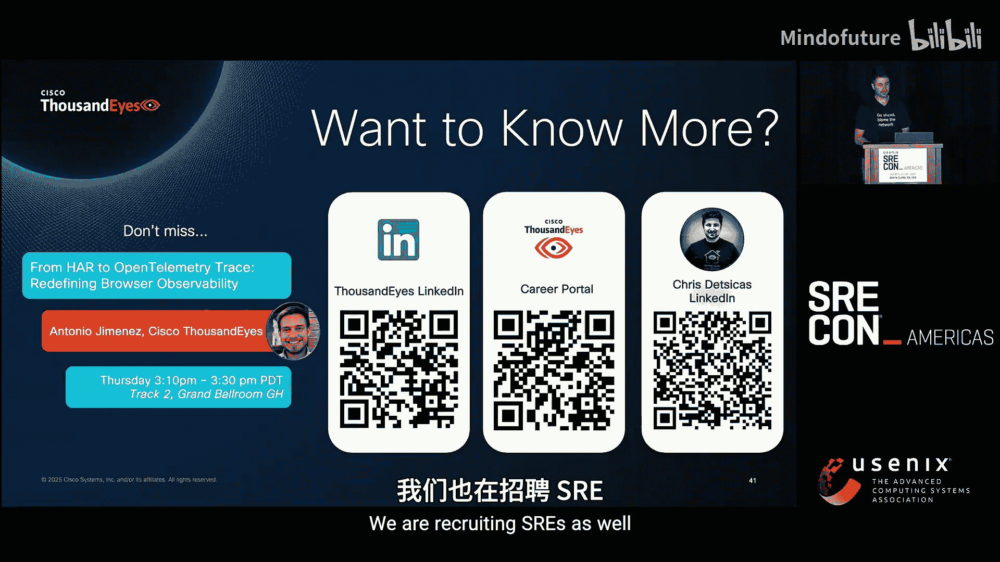
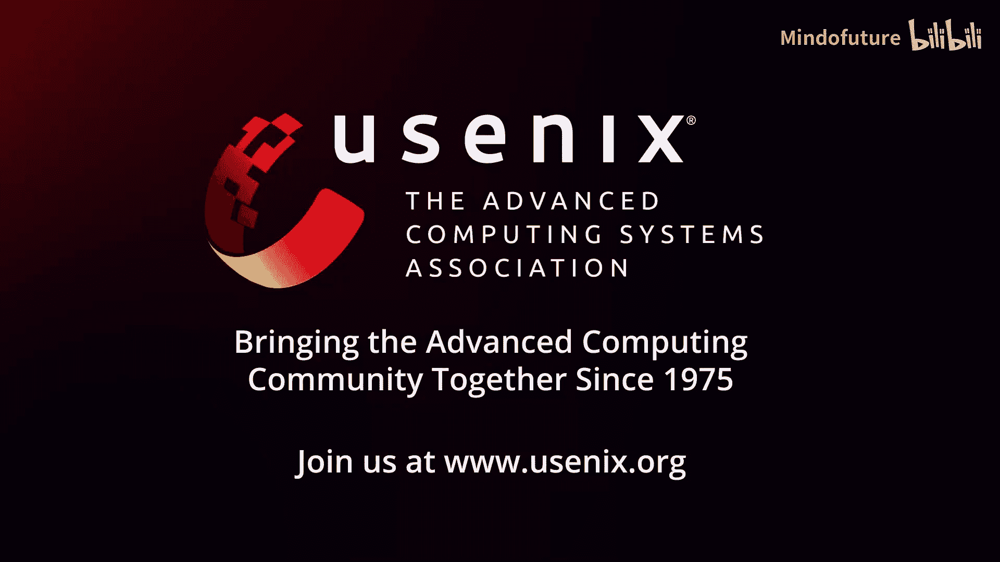

# SRE大会-2025-美洲-｜-srecon-｜-分布式-｜-缓存-｜-OpenTelemetry-｜-安全-｜-AIOps-p09-P09-Distributed-Tracing-in-Action---Our-Journey-with-OpenTelemetry--BV1TmLDz7EZZ_p9-

。

Today I'd like to share a little bit about our journey into distribute tracing and how we've leveraged open telemetry。

 My name is Christtsus and I'm an SRE in the internal Observability SRE team at To Eye。

 we build and maintain the internal Observability platform to empower our hundreds of engineers with insights about service health and performance。

So we all know it。 We all know it。 Today， our applications， are people。

 our infrastructure are all distributed。 gone are the days of that single server monolith。

 Our request will take path through many different technologies。

 Saas platforms and even different cloud providers at0andize。

 we build a network assurance platform to help customers visualize， understand and detect problems。

In their own networks and the Internet。And this provides customers with deep and actionable visibility across any network。

So， of course， it's imperative that we can understand what's happening beneath our platform。

 If we have a problem， customers may not lose， may not know that they have a problem。And over time。

 we grew， the company expanded， We delivered more and more services to our customers。

 and requests would take many different paths throughout our infrastructure。We internally。

 we were keen on obili， but we wanted to go a bit further with distributed tracing。

So let's take a quick peek of the agenda。 First off。

 I'll give you an overview of our platform and perspective of our services that we have involved。

Then we'll look at troubleshooting without distributed tracing for one of our flows and the challenges that this presented。

 Then we'll pick at the difference the distributed tracing can make there。

Before we touch on the topic of context propagation and provide an overview of our solution with open telemetry。

And then finally， I'll cover the challenges of adoption for distributed tracing。Okay。

 so what kind of services are we talking about here？So at a high level。

0houand eyes collects networks to teletry data from agents all around the world。

 Some of these agents are run by ourselves， what we call our cloud agents and some by our customers。

They're constantly running tests against customer targets。

 And this is collecting things like B GP Routing data， network performance metrics， DN S。

 H TP performance data and more specialist data from tests such as web transaction and voice。

Data is submitted to our ingress services， and then our pipelines transform and enrich this data and store it for longer term consumption。

And then we have a pra business and data services。 This is where we got tons of services。

 And this will provide insights and data to our customers。

 Some customers even send data further through our streaming services。

 So it's actually possible to export our network metrics as open telemetry data as well。

Many customers will consume data via our detailed Web U I and our API。

 or they receive alerts when we detect problems beneath the many services。

 a hundreds of engineers and many teams has a a complexity to deal with here。

So in terms of technologies， what do we have， We've got a bunch of Java and lot of Java。 In fact。

 with some codling， some go， some C plus plus， Python and even some rust。

 Were predominantly deployed upon AW S using Kubernetes。

Over three core regions and some disaster recovery regions， we're big users of Kafka for moving data。

 and we store our data in a number of data stores， including MysqL， Clickhouse。

 Elasticsearch and Mongo Db。These services communicate with each other in the outside world with Istio。

I'll service mesh。And shout outs to our wider SOE team who performed a major migration across clusters using Istio。

It gave us benefits， including the GRPC load balancing， the general service discovery abilities。

 We can also do some network network traffic modification， network policies。

 but it also gave us a ton more additional observability。 In fact。

 we kind of killed Promeus at first。 We had so many metrics。 we had to tone down the labels。

But this did give us aggregated metrics on service health and usage and cluster wide access looks。

 So we started to gain a better understanding of which services interact with each other。So， in fact。

 here's a little graph that shows the interconnections between services from the namespace H or Web application。

 This is generated by Kialli。A U I that provides used to visualize I T O service message meshes。

 as you can see， it looks somewhat chaotic， right， There's lots of moving parts and services interconnected。

 Imagine what it's like when trying to debug problems。 There's two services interconnected。

 But can we really tell under which circumstances or for which requests or user operations。😊。

So we were conscious of the distributed tracing features and S， but hadn't yet explored it。

 And that was just one motivation to start a journey and to distribute tracing features。So next。

 I want to take a look at our troublegeing flows before distributed tracing with one scenario。

So imagine it's early morning， Par goes off，'re real familiar with that one， right？

So customer requests are receiving elevated numbers of 5 X X errors。

 and we load up our computer to inspect the metrics。Let's figure out what's going on。Okay， great。

 We see the drop。 We know something is wrong serving these web requests。

And we can see it' trending down。 However， we don't really have much context。

 metricsrics are great for identifying trends and alerting us towards a problem。

 but lack that deep context。 So next， the responder following a run book may start looking at logs。

Okay， there is an excerpt of some access lookss。 This is quite useful in the case of an availability issue。

Great， we know which endpoints are failing。But which services are downstream of this。

 Is there a single agent view service。Is there a scheduled test service that has a problem。

Is there a timeline service？ And why is this really a 500。At this point。

 the responder is going to go check further dashboards。

 logs and try to build out those mental pictures。 They' are going to consume a lot of information that isn't directly related to the requests involved。

They may try to determine ownership of the services and the request flow and can contact additional responders。

This is quite difficult and it's going to be quite frustrating。

So to summarize the challenges involved。First off， we got the manual correlation。

 controlling through many dashboards， got 300 graphs on one dashboard， looking for that anomaly。

 looking for the spikes and the dips， trying to build up those mental hypothesises for failure and the request path of problem requests。

Tricky time consuming and might be going down the wrong path with lots of red herrings。

And then there's lack of context， our logs are really high volume。

And you get that needle in the haystack issue。Unless they're particularly verbose。

 they tend to lack the context on request flu。And metrics are really aggregated。

 There's no granular detail on the specifics of the problem。 If there is。

 maybe you have those high column energy issues。And the responders will struggle to identify really what services are involved behind a request。

And then you've got tribal knowledge。 We all know that one guy who's always available。

 He wrote the service， He knows it inside out。 And what happens when he's not around。

As we grew our teams and reorganized， this was only going to become more of a challenge。

 we can't rely upon luck here。And in people fatigue。

 responders going through the same kind of alerts， same kind of flow， often struggling to resolve it。

 They're only gonna get tired of this。 And another side effect of this is we can pull the wrong people into incidents under suspicion of their services involved without being able to confirm it。

And this we will distract them from building new features for our customers。And overall。

 all of these factors contribute to slower resolution of problems and incidents。So now。

 what does troubleshooting look like once we have distributed tracing in the mix。

 We look at the same scenario。So we've got their same access logs。

 But now we have trace I added as well。 And this is actually something we've done。

 We made sure that the signals are mixed， and it really helps people find the traces。

So let's take a look under the hood of these exact requests。 Okay， great。

 There's a lot of information right there。 We can see first off。

 that request started our Englishgress controller。Great， we kind of knew that from our los， right？

But we can also see it passed through our API gateway。

 variousious SDO proxies intercepted the request and eventually landed up at the Asian View Service。

Now， we even see that we're cooling the data access scheduled test service。

And this seems to be where the problem lies。 So let's dig in a little further to that span。

 get timeline data for metrics method。Okay， taking a little look further。

 we can see that we've got an exception there。 we can even open that up。

We've even got the full stack trace， but it kind of got hidden。 Thanks to for a sec。

 So now the team had a ton more information than the initial access looks。

 They could pinpoint the issue occurs when test data is not found。 In this case。

 they were able to determine the U I was still making erroneous state erranous calls for test data。

 even when a test is disabled。They were able to mitigate this with a pull request to update the U I and then later update the back end to ensure the test return results in a 404 at the API as well。

We did have exceptions through other means of error reporting tools， but with the trace。

 we're able to go straight from the log all the way through to the En to Endflow。

 which services are involved and see the exception in context。

So now I want to touch on the concept of context propagation。

 because this is pretty key to distributed tracing in general。

So let's give some context on context propagation。So first service in a request flow has to start a span context object。

 it will determine a trace ID and then it will determine a span I for its own operations。

 There won't be any parent span I for the route service There also tend to be a sampling decision here as well。

And when the service A makes a request to service B is's going to inject the headers in the case of H GDP as H GP headers。

 Service B will extract and start its own span context object。

And that will identify the parent span I D from service A。

 And then it will create new span I Ds and new span context objects for its own operations and so on。

 same for service C。As we can see， the trace I D was maintained throughout the pair and span I D maintained the link between spans throughout this trace。

This is super important to maintain order and composition of traces。

 Sps will come far and wide throughout our infrastructure。And the sampling decision is also there。

 That's typically passed along with the context。 First service makes a decision in most cases with head sampling。

 There's more elaborate sampling strategies out there， but we keep it simple for now。

So what were our typical request flows like and how would we go about maintaining this context。

 would we have to update code across all of our applications？

Let's first take a look at typical request flow among our services。

So it's a similar scenario to what we showed before。User is requesting test data for an agent。First。

 the request is going to arrive our engineng X ingress controller via an Istio proxy。

 We've got Istio our service mesh intercepting all requests inbound and outbound。

And then that's going to call our agent view service before arriving at our data access service。

 That's going to call some other services and databases to service the request。

 We we keep the diagram simple。So EO is ining your request， right？And first， we naively wondered。

Could we get traces out of our applications and understand these request flows by just enabling tracing in Istio without changing our application code to a propagate context。

 And we often get this question when we're encouraging tracing， Can't Istio just do this for us。

Unfortunately， not， so。You could do something like this。

 A request arrives at our engine X Ingress controller。 Itio starts a trace。

 spanm context object is created with trace I D。 Unfortunately。

 Enng X is going to pass on those headers to the next service。

So the S O proxy and the agent view service will receive the request。

 extract the trace context from the Ingress controller。

The agent View application will then make a request to data access service。

But unless it includes the trace context headers， Istio is gonna start a new trace。Unfortunately。

 issue is not psychic。 Without changing our code， we'd end up with disconnected traces。

So that would look something like this。We have one trace for the first part of the request flow。

 the Ingress controller and the Asian view。And when an agent view makes a request out to a data access service。

 this trace unfortunately gets broken unless it passes on headers to propagate context。Not ideal。

 right。 I said the problem was manual correlation。So it need to keep traces connected。

We'd have to figure out how to keep context propagated throughout both our applications and our infrastructure components like Istio and En X。

This is where open cemetry came to the forefront。How could we build a tracing pipeline and instrument our applications to maintain that all important context。

So let's start looking into open telemetry。 Before we go into our pipeline in detail。

 I'll first introduce open telemetry for those who don't know。Here's a very relevant X， K CD comic。

 It's known in tech throughout very prevalent， right。

 So disreit tracing was relatively proprietary end to end before open telemetry arrived on the scene。

😊，There was no consistent trace format or protocol shared among vendors。 vendor X。

 if you wanted to move from vendor X to vendor Y， you'd have to strip out instrumentation in your code and replace it with new instrumentation。

That's pretty time and sense work when you could be spending that building new features。

So open telemetry arrived， and we' got this framework for vendor neutral instrumentation。

 collection and export of telemetry。 It provides a set of APIs， SDKs and tools to instrument。

 generate， collect， and export logs， traces and metrics。

 And there's also some exciting new work on events and profiles， which we're following closely。😊。

And there's a standardized format， open tometry line protocol or O T L P for short。

 But ingestion and export of many formats is supported。

 And that was the fact that particularly piqued our interests。

 How are we going to collect all the data， though。We interstep the Swiss Army knife of the open Open cemetry world。

 the open cemetry collector， and provides a vendor agnostic solution for collection。

 processing and export of hotel signals。😊，So this we could receive telemetry in different formats。

For this， for us， that meant O T L T， O T LP and Zipkin。

 we had assessed our infrastructure and the time IstA did not support the open cemetry format。

 although this has since grown and it's recently even gained HGP support。

 and we have to see about moving there。So we configured our collector with both O T LP and Zipkin。

 And this allowed us to collect O T LP signal O T LP spans from our Oto agents in our code and zipipkin for our infrastructure components such as I T O and Enng X。

😊，And then we could export to multiple backends as well。 So when we first starting。

 we were just trying out many different backends with the Oto collector。

 we could make sure that same traces actually ended up in this in various different backends。

 and we could pair literally the same trace side by side。 So we。

 we assess them on factors such as user interface， search and query language flexibility and API integrations。

😊，And then in terms of our deployment method for the hotel collector。

 one method you can use is agent mode where you sidecar it against your application。

The other method is to， to put it centralized in your cluster in gateway mode。

 We decided to put it centrally because that meant that we wouldn't have to restart or reconfigure all applications when we change config variables such as changing the tracing backend or parameters on the tracing back end。

 But it also meant we could centrally filter spans。

 We could add resource attributes to such an environment level details via resource processor as well。

 And if we were to move towards tail sampling in the future。

 We'd already be deployed centrally so we could filter everything out。

So how do we deploy this collector。Well there here's an next bright idea。

 especially if you're operating in Kubernetes， this can be particularly useful。

 It's the open telemetry Kubernetes operator。 So we use this to number one。

 manage our hotel collectors。 There's an openmetry collector， custom resource。😊。

We define our receiver， our processor and our exporter confit here。

Then this deploys multiple replicas of the hotel collector behind a Kubernetes service and even deals things such as managing auto scaling via HA。

This is a really quick way to get hotel collectors up and running。

But the real magic really came in with the injected auto instrumentation。

So to propagate that all important context and get rich telemetry out of our applications。

 we were going to need instrumentation。And with this， we define an instrumentation resource。

 and that injects auto variables into pods and allows us to define agent config in the custom resource per service。

So upon service startup。An in container is injected into the pod。 Miss Pauls， the hotel Java agent。

And also injects it into the service at startup。AndThis meant teams could get a really decent level of instrumentation without even adding the library to their code directly。

So what does our instrumentation resource look like， Well it's a little like this， so。

Those are keen eyes will notice that our propagators are actually both trace contexts and B3 multi。

So our zipipkin based infrastructure， Istio and Engine X was going to need that B3 multi format to be able to propagate the headers throughout。

 So while we'd send traces in both formats， we need to configure the OO agents to not only propagate trace context for future。

 but also zipkin's B3 multi format to support Istio and engine X in this case。

And then we also use the Kubernetes object metadata to build some of the Oto environment variables。

 In particular， the service name to match it to Istio's service name and keep things consistent of ways we'd end up with。

Variations of each service name， and essentially duplicates。

The instrumentation will also add a ton of environment variables with Kubernetes related metadata to the pod start。

 This includes things like pod name， name，space， node name。

 And this is particularly useful for troubleshooting and correlating with logs and metrics or to look at things like specific pods and their traces coming from that pod。

So what did the overall architecture look like？So we've got that same request flow and requests are arriving at our Ingress controller。

 Istio starts a trace context， send a request to the agent View service。

 and the context is included as B3 multi headers。 The agent View service makes a request a data access service。

 also sending a trace context as B3 multi。The trace spans from Engine X and the Istio proxies are in Zkin format。

The auto agent in the applications， the instrumentation added with that injected instrumentation is OTLP。

 but because we're using B3 multiti throughout to keep trace context and trace ID the same。

 the propagation isn't broken and our traces remain connected。

So everything gets transformed at the O collector into O T LP。

 And then it's exported to our backend Grraanana tempo currently。If you're diving into tracing。

 what you may find is you've got older software and infrastructure that doesn't support these latest O T LP and W3 C standards。

 But the good thing is the Oto collector likely supports the standard that you that you need and will convert it to O T LP。

 There support from many different vendors and formats out there。So the next challenge。

 once we got our pipeline up and running， was going to be adoption。

 And how do we encourage usage of this。But when I think about adoption。

 there's sort of two sides of the story。 services need to be instrumented。

 So we get that all important context propagation。And service and detail on service operations。

And that needs to be as easy as possible。 But then there's also people's side of things。

They need to start using the system once we got their data in place。

So we are conscious of the two main types of instrumentation。Automatic manual instrumentation。

With the automatic instrumentation agents from open telemetry。

 they would provide instrumentation agents for a whole range of languages。

 this or natively instrument applications with common functions such as HGTP。

 RPC database and messaging calls when common libraries are used。

This will also ensure context propagation when these operations transit multiple services。

Most of our services are Java， and they could quickly benefit from the auto instrumentation。

And then there's manual instrumentation。With manual instrumentation。

 engineers will add the Oto APIs or SDKs to their code， and then they would need to manually。

Extract and inject the tracing headers using those SDKs and create spans for their code operations。

 This provide us more flexibility and a bit more detail。

 perhaps that had those development time hurdles。Ultimately， some of our services using C plus+。

 go Ru had to use this。 But we wanted to focus on the auto instrumentation to start with。😊。

And then I'd mentioned that injected auto instrumentation。 But this is really where we lent in。

 We could add that O Java agent to a service in a matter of minutes。

And get value really quickly from tracing。This is probably the main method used for instrumentation and currently like 100 plus services instrumented in this way。

So how are we going to encourage instrumentation once we've got those options， Well， first off。

 we focused on a core service， our main web application。

We added the injected or instrumentation to our application。

 our Web app and our API with our Web platform team。

 And this gave us that core example that was recognized across the organization。

 Many people have used that everyone's used the main0ized web UI。

 and many have actually contributed to it as well。 and this would help us to encourage tracing in other applications。

One team had actually 50 plus services， all in Java in a mono repo。

 and with some clever customized patching， we were able to instrument all of their services relatively quickly。

😊，And then as rich documentation， we have a pretty global organization at Hsand I。

 And it's important that engineers could instrument their code and get up to grips with distributor tracing asynchronously。

So this documentation explained our pipeline architecture。

 gave us detailed instructions on instrumentation with references out to the open cemetry docks。

 and it had the copy paste and self service examples to instrument services with the operator。

And I injected also intoation。And then tech Talks at0and eyes。

 weve got a pretty good tech talk culture。 This allows engineers to share just interesting tech they found new product features and how they built it。

 and also platform changes like this one。 Once we had their core example like the web application。

 We had some demos available。 We could we could show this to the rest of the org。

 and we had the documentation to refer to so people could get started。

 So we wrote a tech talk and we delivered a tech talk， covering distributor tracing generally。

 How does the pipeline work and how to instrument your services。

 we were focused on that injected auto instrumentation。 We provoked a lot of questions。

 Some really enthusiastic teams got to instrument in their services right away。😊。

And then there's production readiness checklists。 It was always going to be harder to get old code changed and instrumented。

 we， but we didn't want to increase technical debt further。

 So we added a mandate for instrumentation to our production readiness checklists。Okay， so。

Once we get all that data in。People need to start using the system to really get insights from it。So。

One of the things we did here in there's multiple areas。

 once we have that core example updated the web application。

 we updated the run books for our web web application。

 this really gave responders that reminder that traces exists。

Especially in the heat of the moment in an incident， they may forget。

 but it also had the tailored queries。 So they， if they didn't know the query language yet。

 it helps them understand it and find things like the 5 hundreds or the high latency。

 And they just click in the link。 and then it's front and centre of them。 and theyll remember it。

And then there's mixing signals。 So old habits die hard。

 respondsers that are used to checking their logs， probably gonna still focus on their logs so。

We added trace I Ds into Istio and Engine X access logs from day1。

 and the hotel Java agent also generally adds to trace Is into logs。

 And many users we found will jump straight from logs to traces。 They see a trace I D in the log。

 and they think， okay， let me see what's going on underneath that。

And then there was a generic trace Explorer dashboard。

So we were conscious that people may take some time to learn the query language。

 We wanted people to be able to quickly explore traces involving their application as soon as they've instrumented it。

 So with the dashboard， they could go and they could click on their service。

And it would run through some queries such as find the high latency traces， find those with errors。

 and then find some with lots of spans because they tend to be more interesting。

 that allow people to immediately explore the tooling onces instrumented。

 and they could use the queries as examples to build their own。😊，And then there's incident game days。

 so。One of the things we do at Han I is to train new incident responders is we run simulated incidents。

 And some of these scenarios we use tracing and the run bookss are the same ones with the web application。

 and that help people get used to the observability tooling。 It's actually not used in a response。

 We can go to it afterwards in the debrief and help people get familiar。

It's easier to mold fresh faces。 And if they see the value from minute。

 hopefully hopefully use it more often。And then just generally evangelizing for tracing， thinking。

 can we solve this with tracing or helping out people in incidents？

 So my team and myself will keep an eye on live problems sometimes if we see problem that we think maybe can help with tracing or maybe it's something with the Web application。

 we'll go and help and help people build queries。And just give those little reminders。

 We've even added auto instrumentation into an into a service， mid instant before。

Another weird use case we actually had was Jenkins。 One team had particularly slow builds。

 and they couldn't quite work out wires running lots of parallel branches and lots and lots of steps。

 though we added tracing to Jenkins。 They could visualize a whole build as a trace and immediately see what was taken most long。

 And it turned out as reading the external file to take about one to two minutes extra。

 They embedded the file in the Jenkins job， and they immediately got that one to two minutes back per build。

So。Next off。That's stream usage and our adoption， but our journey isn't really over yet。Of course。

 with many things in tech。 you've got to keep it maintained， and we've got more to do。 So。

 here's just some ideas for the future。😊，We're still relatively new to dispute tracing。

 So we still need to instrument more services。 Adoption is growing。

But there's still lurkers out there。 And one of the benefits that we got with Istio incepting all requests。

Is that we can track which services are not instrumented。 We'll need to put some focus on those。

And next， exemplars， I mentioned traceades in the logs。

 and one of the key avenues that our users use is the jump from logs out to the traces。However。

 it would be even better if we could use exemplars with exemplars。

 we'll be able to have data points on our graphs。 So say that availability， drop graph。

 have a data point there。 click on that。 and then you could see exact context an example scenario。😊。

An example trace of why that availability drop is happening in that 500。

So imagine looking at that and how quickly you could jump from your alert to full context。And then。

 there's more。Open telemetry in the front end。 our digital experiences are more and more in the browser now。

 more and more going on with the user interactions of jascript。

 And we've been exploring adding tracing capabilities to elements of our front end to really understand the user experience all the way from the browser out to the back end course。

😊，And then there's some advanced sampling strategies。So right now。

 we sample 100% in our staging environments。Which is great for debugging pre releasele and even reproducing issues。

But we're mostly at 1% in production， and it's keeping the volume low。Most of the time is this。

 this is O， but sometimes we don't get enough data or we miss requests。

And we're still keeping a lot of data that isn't interesting。 For example。

 lots and lots of successful interactions。 So what we want to explore is ha sampling。

And sample 100% on the client end and then collect all traces in our collector and then make decisions such as sample traces that contain errors。

 100% or a little bit lower。 sample those at high latency or even sample those some with specific operations at a higher percentage。

Okay， so quick recap。So what we need to recognize， really。

 is that system and organizational complexity will continue to grow。

 Our observability tooling can help overcome this。We can keep out。

Keep evolving evolving the tooling to break down hurdles in troubleshooting。

And distribute tracing is one way that's proving effective for us to help resolve problems faster。

But we couldn't have done it without open telemetry。

Or at least the journey would have been a lot tougher and less futureproof。

 The standard out features were for us were really the ability to integrate multiple standards。

 Test our multiple backends and ultimately switch in the future with relatively of ease。

And in terms of adoption， is， of course， always going be a hurdle。

 But what we found helps is to make it as easy as possible。

 Low that barrier through adoption with detailed docs so people can do it asynchronously。

 And the tech talks help to do it a bit live sometimes and encourage the adoption and get people excited about it。

The injected auto instrumentation was really the lifesaver there， Though。

 It really helped us get teams up and running quickly and get that instrumentation into their code。

And of course， in terms of getting people to use the system。

Just try and put the tra in front of people through run books。

 give them little reminders and running。And mixing signals like adding trace I Ds in their logs。

 So make sure they come across it when they're looking through other signals so they can jump straight from those logs out to the traces。

Okay， we got the。 Alright， If anyone wants to find out more about Thouandize itself。

 please visit our LinkedIn or feel free to ping me directly。😊。

If anyone is just interested in joining Ps and I， please check out our career portal to find out about careers。

 We are recruiting Sres as well。 We've got a booth out in the sponsor showcase。

 So please come and say hello And finally， our journey we open telemetry isn't just internal。

 We also produce it by incorporating open telemetry into our product。 On Thursday at 3，10。

 My colleague Antonio from the streaming team will be exploring how HP archive files can be transformed into hoteltel traces and used to understand the user experience in the browser。

 Thanks for listeninging， everyone。😊。

