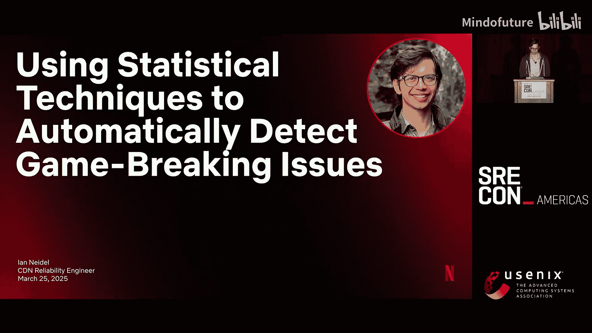
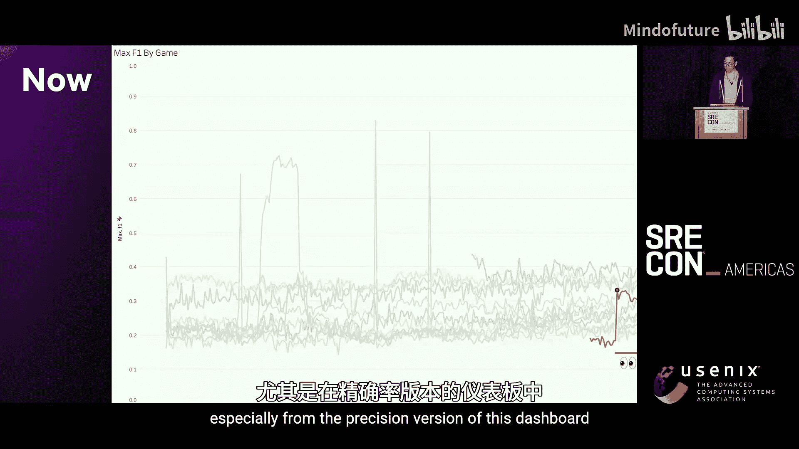

# SRE大会-2025-美洲-｜-srecon-｜-分布式-｜-缓存-｜-OpenTelemetry-｜-安全-｜-AIOps-p10-P10-Using-Statistical-Techniques-to-Automatically-Detect-Game-Breaking-Issues--BV1TmLDz7EZZ_p10-

。

So hi everyone， I'm Ian Nill once again from OpenConect。来军。

Netflix's inhouse content delivery network。And I'm here today to talk to you all about my team's move into supporting cloud games and our need to use statistical techniques to detect issues as content being delivered goes from static to dynamic。

More specifically， my team is C DN reliabilityability， where we're responsible for the reliability。

 scalability and quality of experience across delivery of video on demand。

 live streaming and cloud games。To give a little look into things we look at。

 we're used to monitoring things like latency， bit rate and drop packets where the map on the screen is showing latency to Netflix operated devices at Internet exchange points。

At some of our sites， we run our normal servers for video on demand and live streaming。But now， also。

 servers for cloud games， where cloud games have made ensuring good quality of experience much more complex。

😊，So to give you a sense of what cloud gamess is， I'll play a demo reel of one of our games。

 Oen free as I talk through it。Here we go to end users。

 Cloud gamess is a way to play games on most TVs and computers without needing to download the game。

 nor have powerful hardware to run it。And generally。

 it also has less complicated setup and device integration。On our side。

 it's underlain by our gaming servers， which run the game。

Users then connect their phone to our server as a controller， and their TV accesss as the display。

This means a user's input travels from their controller to the server。 The server renders the game。

 and the server sends the frames back to the TV， which is essentially live streaming it。However。

 there's many unique challenges with cloud games。 One is that we can deliver the content well。

 So the metrics we're used to measuring like latency， bit rate and drop packets all look great。

 but the user may still be having a terrible time。😊，This is because the game itself can be broken。

 We may be delivering a black screen an error pane or looping content with a great bit in framing。

So to ensure users have a good quality of experience。

 we must ensure the content we deliver is fine as well。

And this issue has bitten us soon after our most popular games launch。

 it was broken for a subset of users in countries in a specific case， for three weeks straight。

And that was all due to an issue indicated by the following logline。

NGP profile response T name unknown。And now you might be wondering why did it take so long to detect。

 and there were two parts to it。1， there wasn't a strong signal of brokenness。

 We noticed it due to reading through user feedback and noticing an uptick in complaints on game loading。

And the log causing it was a needle in the haystack。

Where this is a graph of all of the logs from that period and the log of interest。

 I that little orange one down at the bottom。It's not like I shifted the graph。 the bottom is at 0。

One other thing I want to note here is total log volume also isn't associated with the issue occurring。

 So it's not like we could even alert on that。So how can we do this better despite the millions of error logs a day。

 and no strong indicator， A session is broken。Our answer is to intersect user behavior that we see in broken sessions with their session having。

A potentially breaking log so we can gain confidence in both that their session was broken and that the log was associated with some sort of issue。

Now there are a bunch。Of indicators of a broken session， including gameplay time， survey scores。

 Re feedback， bit rates and click rates。 But all of these are pretty weak。

So to enumerate through them， gameplay time， if a game is broken for a user。

 they probably won't play for long， but it's hard to say because they might just not like the game so quit early。

 or they might be extrair patient and wait a while despite it not working。Similarly。

 we have a very nice survey score， we show on Gametop， which provides us two things。

 a survey score and freeform feedback where the first is useful since users probably rate the game of one if if it's broken。

 but it could also be that they don't like the game or some update and freeform feedback is also cool。

 but as it's more descriptive， but it's harder to wrangle even with our bucketization of that feedback。

There are two other things that we could look at， which are like bit rates。

 which can drop if we're delivering， for instance， a blank screen。

Though some games also show errors with like loops that don't result in much lower bid rates。Finally。

 click rates even may be usable as there are fewer clicks per second when things are broken。

 as you can see in the graph up there with the countries with the depressed click rates being broken。

However， for this project， really we want one good。One good indicator， even if it's noisy。

 So we chose gameplay time less than two minutes。This is no means perfect。

 but is a good signal of user dissatisfaction， whether or not there's an issue。

Or if they hate the game instead。And well， we also want an indicator of some sort of associated issue。

 So we turn to having a log。We turn to having a log as being an indicator。

There are a huge number of logs with 20 million some distinct。

100 million in total in the last 30 days。 And so we need to collapse distinct ones into each other to reduce the cardinality and improve the signal we get from the presence of log lines。

And we do so with the following process。 So selection and filtering， preprocess。

 factorizing and generating clusters。On the selection and filtering front。

 we're just choosing program outputs that contain exception， error and warning。

 and we're excluding several high volume logs we know aren't associated with anything。Next。

 we pre process。 So we don't really need the full stack trace on many of these error logs so we can split and take the first line。

Next up， random numbers， I Ps， URLs， they generally don't differentiate the logs。Functionally。

 so we replace the numbers， I Ps and URLs with Regx replace。And in the example I have on the screen。

 there is a unique task I D。That can be any of a huge range and by replacing it with bracket。

 numb bracket， we go from that huge number of distinct logs into one。This pre processingces step。

 honestly， is probably sufficient since you go from millions of lines of distinct logs to several hundred。

But we can take it a little bit further with vectorization and clustering。So what we do here。

Is we convert the text of the logs into vectors or embeddings。

 which are as of numbers that capture the text's meaning。

This is a product of transformers attack underlying LOMs。And the T in Chat P T， for instance。

 which need that the text that they take be made into vectors to run further processing on。

Using the easily Pip installable sentence transformers in a freely available model。

 we can then encode the following lines on the left。

Into the array of numbers that capture their meaning in as few as a couple lines of code。

Now that all of our logs are vectorized， it becomes easy to cluster them together。

 such that similar logs can be treated as one。One way to do this is with D B scan or density based spatial clustering of applications with noise。

 which groups together points by choosing a core point and expanding outwards to create a dense neighborhood of points。

And with our embeddings that we have before our vectors， we can easily apply that。

This allows us to collapse logs that no amount of preprocess could combine into one。

So if you look at the orange cluster that I've picked out， there is an error locale with code。

 and then country code not found。 and there are dozens of these。And really。

 we can't pre process this out if we're， if we see Indonesia as the country code， that's boarded in。

 And we probably don't want to get rid of that。And so。By using this method。

 we can cluster all these unpreprocessable together logs into a single improving the。

Signal we can get in reducing the cardinality further。So the results of these clusterings。

For that we go from 20 million plus unique logs to 1 hundred and35 with 26 log clusters that further combine some of the distinct logs together。

Now that we have a reduced cardinality process set of logs。

 we can judge how closely associated they are with users not playing for long。And to do so。

 we take three concepts out of analyzing the performance of classification models。Precision， recall。

 an F1。So what we do is we take a session having a particular log as a predicted label and playing less than two minutes as the real label。

 our noisy signal of a potential breakage and see how well they correspond。

So there is a definition on the side of precision being true positives divided by true positives and false positives。

In this case， though， you can think of it as what percent of sessions with a given log seem broken。

Recall， then is true positives over true positives and false negatives。

But we can instead think of it as what percent of broken seeming sessions have a log。And finally。

 F1 is the harmonic meaning of precision and recall。

 which balances how widespread the breakage has to be for us to notice it。

And how predictive it should be of users not reaching our play time。And what you'll see is。

Before for our logs to seem associated， there must be a bunch of logs that seem broken。

With few that are broken without the log and few with the log where users play more than two minutes。

If we look at some real simplified data or a log associated with an issue。

 we see true positives being relatively high。False positives and negatives being low。

 which drive precision and recall high along with F1。That is。

 83% of sessions with the log seem broken。67% of sessions with low play time have the log。

 and our final F1 score is 0。74。For a log that is not associated with an issue， however。

 we see low true positives compared to false positives and negatives， leading to 10% precision。

 20% recall in a low F1 score of 0。13。Now that we've taken a look at the techniques and theory。

 let's go back to the incident that kicked us all off。Way down there in green。The log。

 there is the count of sessions with the log associated with the issue when we graph by session incidents。

And it's。Completely lost amongst high volume， unimportant error logs。However， when we rera by F1。

 the log jumps to the top， indicating it's closely related to breakage and it's widespread。Finally。

 we can dive into things to look at them by precision， and precision is above 80%。

That is 80% of users with this log exit before two minutes。But note， this isn't a perfect indicator。

 as some users will wait patiently， get distracted， go do something else in the meantime。

And it's actually partially this noisiness why we've had to set up this whole procedure。

One other thing I want to note about precision is it's a lot noisier and we'll pick up on very small scale potential issues。

Which can be interesting as well。As it stands， we have this procedure now running hourly across all of our games and platforms。

With it detecting real issues with those war being incidents that we had to spin up。

And was it inviting investigation of smaller scale issues， especially。

From the precision version of this dashboard。

We have a bunch of stuff still to come， like speeding up our alerting process。

Using time to abort metrics。To detect breaking issues that happen not at the start， but mid game。

 such as after a specific level or interaction。And more broadly。

 working with our partners to improve testing。Get cleaner signals， so on and so forth。So for my talk。

 there are three takeaways I hope stick with you all。First。New areas can bring new challenges。

 some of which are burdensome and seem somewhat intractable to deal with。

But statistical methods can make hard high volume problems doable。

And what's more statistical tools and concepts are readily available for integration into our workflows。

Everything I showed on the slides was genuinely a couple lines of code and use freely available models and libraries。

 though， of course， things like tuning and choosing them all can be much harder。

So thank you all for listening， thanks to everyone at Netflix and happy to take any questions after this。

