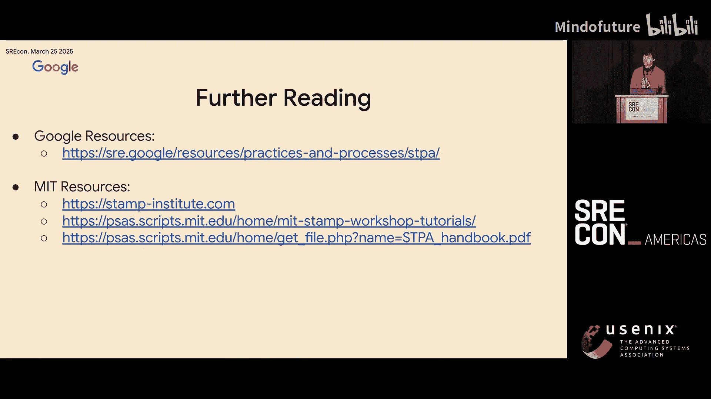

# SRE大会-2025-美洲-｜-srecon-｜-分布式-｜-缓存-｜-OpenTelemetry-｜-安全-｜-AIOps-p11-P11-Mapping-a-Better-Future-with-STPA--BV1TmLDz7EZZ_p11-

。

Hi， folks。 My name is Teo。 Thank you so much for the introduction。

 I am a site reliability engineer for Google Maps based outside of New York City。😊，Now， as SRs。

 we always want to be in a position to anticipate and even prevent as many possible outages。

 but we have real constraints as SRs。 You know， we're only a small percentage of the overall engineering headcount。

 So how the heck can we anticipate and even prevent all possible outages。Well， in Google Maps S RE。

 we've adopted a rather new methodology called System Theoretic Pro Ana。

 which was pioneered by two professors at MI T， Nancy Levisson and Dr。 John Thomas。😊。

In Google Maps S， R E， we strongly believe that S TPA fills the necessary gap in the way that we manage systems。

 So quick show of hands in this room。 How many of you have heard of S TPA。Okay， wow。

 I'm really happy about that。 That's more than I expected。 So of those who raised your hands。

 how many of you actually done STPA on a system。😊，Many fewer。 okay， hopefully。

 hopefully soon that'll be a larger number of people。

 So my goal in this talk is to show you how the application of STPA will save you time and money and。

 of course， help your users because it shows you how your software systems will be broken before those software systems are even built。

😊，Okay， so let me present to you with an outage。 I'm on call for the system that processes and publishes road closures on Google Maps。

 Now， this system has a lot of moving parts， Ingestion， processing， validation。

 uploading to the database， more propagation and then serving。 It's the middle of the morning。

 and I have been manually paged because a bunch of our users are being routed across the street that has a parade。

 This should have never happened。 I look at the dashboards， and I see no S Os were violated。

 All services are green。 Every service worked as expected。😊，How could this happen。

After extensive investigation， I discover that in spite of everything working as designed。

 the interactions between the services were misconfigured。😊。

Key services made incorrect assumptions about how other parts of the system behaved。Now。

 in order to fix this， the developers and I now need to spend two months redesigning and rejigging this system。

 How could this happen， How is it possible that we had an outage。

 even though everything worked as expected。Traditional S R practices focus on losses that stem from component failures。

 How is my customer impacted when my service fails。

 What happens when my back end returns a 500 error。

 But the outage that I described does not fall into that case because no service failed， per se。

You see traditional reliability solutions。Like redundancy or component level quality improvements cannot prevent all types of losses。

 There's a whole other class of losses that arises from component interactions wherein no component fails。

SREs and software engineers are ill equipped to handle system level losses。Okay。

 let me use a motivating example here that I stole from Dr。 John Thomas， the butternife。

The butter knifefe is reliable。 And rarely have I seen the butter knifefe snap in2。

 I don't know if you've ever tried to snap a butter knifefe in half， but it's impossible。 Okay。

 it's very reliable。 And in the context of cutting butter。

 the butterknife fills its functionality and performs it safely。😊。

But the safety of the butternife depends on the context。 What about this case。

A child who pushes a butter knife into an electrical outlet， is not safe。But what failed here？

You see， the system loss is not solely a result of the knife。 The knife is very reliable。 It's metal。

 It conducts electricity。 The outlet provides electricity， so it's also reliable。😊。

But you know what else is reliable， that child's， if you give a child a butter knifefe。

 they invariably will put it into the outlet。So the key thing here is that the loss arises from the interactions between the knife。

 the child and the outlet。All right， let's turn back to the road disruption system。

So the goal of this system is to process road disruptions from third party providers and then serve those disruptions to end users。

When the third party provider tells us a road is closed。

 we should ensure that that road is closed on Google Maps。 and likewise， for when a road is reopened。

 which is when the road closure disappears from the third party server。Okay。

 this is super straightforward， synchronized two databases。Now， it would be bad if for some reason。

 the sinking failed and we didn't display a road closure when a provider told us about it。

Is this possible。 And if so， how come。 Well， let's look a little bit further under the hood。 Now。

 the way that the road disruption system works is by receiving snapshots of the closures held by third party providers。

 A snapshot is essentially a state of the database at some time T。 And every five minutes。

 we get a new snapshot from that provider。At time T2 right when we get this second snapshot。

 we need to figure out what needs to be updated in our databases and the way that we do that is by dipffing them。

 So in this case， the difference between the two snapshots is 2525th street closed so we should create that road closure。

Okay， now that I sufficiently explained how the system works。

 are there any glaring issues in this system。What do you guys think， raise of hands， glaring issues？

System design flaws。 Okay， we see two people。 Nothing jumps out to me at this point。 Maybe I'm naive。

 Now， I'll tell you that the system was designed， reviewed and approved by the tech leads of each system。

 So obviously， the system is safe， right。Well， did they use STPA to design and review the system？ No。

 so let's use STPA。All right， fair warning， STPA is very hard to do properly。

 and this talk will not explain to you how to do it。

 So my goal here is to motivate you to learn STPA after this talk。

 but I will tell you what the steps are。There are four steps。 First。

 define the purpose of your analysis。 You define the boundaries of the system versus the environment。

 as well as the goals， losses and hazards。 Then you model the control structure。 This is very key。

 control structures are completely different from data flow diagrams。

 Data flow diagrams model a linear flow of data， whereas the control structure models the control and feedback loops。

 Okay， These are loops， And this includes nonlinear relationships between different parts of your system。

3， analyze those control structure to identify unsafe control actions。 And then 4。

 identify loss scenarios。 which is essentially figuring out concrete examples of how your system might have an outage。

😊，Okay。Let's dive into it。 Step 1， purpose of the analysis。 As we saw earlier。

 the goal is to sync the state between Google Maps and third party closures。The losses。

 losses are essentially unacceptable outcomes。 We have three here。Hazards。

 hazardazard is a system state or set of conditions。

 together with a set of worst case environmental conditions will lead to one of our losses。

 Our hazard state is Google Maps is out of sync with third party road closures。😊，And finally。

 constraints。 We define our system constraints， which are essentially system conditions or behaviors that need to be satisfied to prevent the hazard state and ultimately to prevent the losses。

😊，Our primary constraint， therefore， is the inversion of the hazard。 We must always be in sync。

 And the secondary constraint is if we are in the hazard state， we need to have a way to mitigate。

 or rather first detect and then mitigate it quickly。

This secondary constraint is where we as SRE spend most of our time。 Think about it， observability。

 disaster recovery， all of that is secondary constraint。All right， we're moving quickly。 step 2。

 design the control structure。 Okay， As we recall， the overarching goal of the road disruption system is to ensure that Google Maps contains the latest state of third party closures。

 So at the very bottom， we have our controlled process， the state of Google Maps。😊，Above that。

 we have the road disruption processor who is responsible for synchronizing the state of Google Maps。

 and it does so by sending， create or delete actions to Google Maps。

 But how does it know how to change the state？ Well。

 let's add another controller who has that precise responsibility。

 It will take as input the snapshots and tell the processor exactly which closures to add and remove。

😊，And finally， the human in the loop， humans are always part of our systems。

 The engineering team owns the logic of the processor and the snapshot differ。

 And they're the ones who get paged when Google Maps is out of sync。

 They must always be part of your system。😊，Okay， let's look at some unsafe control actions。

 It would be unsafe if the snapshot differer did not create a road closure when that road closure doesn't exist on Google Maps。

 In other words， we get a new road closure。 It would be unsafe for the differ to not create that closure。

😊，So how can this happen？Well， let's start by looking at the feedback。

 What feedback does this controller receive。Well， it receives the third party snapshots。

 but this U CA refers to the state of Google Maps。And the state of Google Mapss is not provided as feedback。

 So how on earth does this snapshot differ No when Google Maps is out of sync。Now。

 as we can recall earlier， when I was describing the underlying system。

 the Differs mental model assumes that the previous snapshot is equivalent to the state of Google Maps。

But is that assumption always true？Can it be the case that the previous snapshot is not equal to the state of Google Maps？

Well， let's look back to our system here。We want to see whether or not this mental model can be wrong。

 Okay， and we generate dis by comparing two previous snapshots。 In this case。

 we are creating a road closure。 But what if that create action doesn't work。

 maybe the database commit failed or we never sent the create message or there's some race condition between the snapshots。

Or there is some problem that exists in the road destruction system in Google Maps。

Any of these could result in a 20th Street closure not being applied。

And now we're in the hazard state。 What happens next， Can this system recover。Well。

 let's roll forward with a third snapshot。 In this case。

 we compare snapshot 3 against snapshot 2 and see no diff for 25th Street closed。

This means that the system will never reattempt to publish that closure。Aha。

 now we see how this assumption is incorrect。This assumption can break。

And our system will happily chug along and update other closures without ever retrying the 25th Street closure。

 And the end result is that we're completely out of sync with the world。😊，Now， days or weeks later。

 that missingenclosure on 25th Street is resulted in all of our users being upset and me getting paged。

The system is in a lost state now。That road closure could have gone missing days or weeks prior to users navigating on this closed road。

 The key problem here is not any of the potential component failures， if there were any。

 but rather the system design having the wrong beliefs。

What component reliability tools would you use to fix this， redundancy， component quality， testing。

 finer grain monitoring， limiting damage with failure isolation。

 It is unclear to me that any of those component strategies would work well to account for this design flaw。

Again， no component fails， every component operated as designed。

The problem is that the system has a key design flaw。Wow， that was a lot of information。

 So let me take a quick recap of what I shared with you。

 This design presented here as a serious design flaw that resulted in missing road closures。😊。

And let me tell you what would happen if I released this to production。

This launches and road closures go missing from Google Maps。 hourss， days or weeks later。

 users are inconvenienced， and I am paged。😊，We spend a week trying to figure out which closures are missing。

 and we still have no idea what is causing these closures to disappear。

 So we spent another two weeks trying to find this design flaw and then another six weeks to launch a new system。

 which reads directly from Google Maps， obvious in hindsight。Now。

 let me tell you what actually happened。We actually discovered this design using this design flaw using STPA。

And everything I told you about this outage was a lie。

The outage I presented earlier never actually happened because we used S TPA to analyze the system before we built it。

 This problem was fixed by rearranging or rearwriting paragraphs in my design doc。Illustrated here。

 the new design added feedback about the state of Google Maps directly back to the snapshot differ。

Now， not only do we find this design flaw， we actually found six others。

 including invalid ordering of operations， feed processing race conditions。

 insufficient feedback about sync state， error prone feed onboarding。

 inadequate change management support， limited observability into the processing of road disruptions。

 and those were the big ones， okay。😊，I'm a little winded。

 That's a pretty long list of design gaps for a design that was approved by tech leads。

 So why were those design flaws missed during traditional review methods。Think about it。

Software is built primarily on the happy path。And by definition， on the happy path。

 you assume that the state of the system is safe。And when you do think about the unhappy path。

We actually don't have the tools to methodically interrogate the safety of the system， okay。

Our intuitive methods are so time consuming， and they're not methodical。

They usually rely on some sort of random walk through the entire system state space。

And in systems like these， that state space is so large。 Think about it。 Okay。

 imagine you have 100 bos。 The state space of 100 bos is2 to the power 100。

It's like actually impossible for a human to go through every single configuration。

And as a result of that， we choose to ignore the unhappy path。

But because we used that CPPA in the design stage， the cost of identifying and fixing these seven flaws was insanely cheap。

It cost us 26 hours total。To find seven flaws。The cost per fix was under four hours per flaw。

Everyone wants to be a 10 X engineer。 This is how you become a 1000 X engineer。

The cost of fixing a design problem increases exponentially as your product becomes more mature。

And so engaging with Su teams early on in a new service and system is most effective。Now。

 it's not like we're doing it wrong before S TPA。 We just don't have the tools to identify this whole other class of methods。

When we applied STPA to mature systems at Google's。If we found safety gaps。

 we would find that we would get resistance from the engineering organization because it was a mature system。

 so they say， hey， hey hey， don't unlaunch my future。 However。

 when we apply STPA to the designs of our systems， our engineering partners were so interested in partnering with us and with STPA。

So much so now that。They come to us。And ask us for STPA。

This is because we're helping them fix their system before they build it。

That is so much less costly for them。Okay。Key takeaways。

 We were blind to design flaws that could not be solved with any of our normal reliability methods。

 Normally， we end up waiting for the system to break and then fix it reactively。Think about it。

 right， You have an outage， and then you have 20 postmortem AIs。

 and that's going to completely derail your roadmap。But that is so insanely costly。

When you apply STPA before you implement your systems。

 you have the opportunity to fix your problems at a fraction of the cost。

So some of you may be asking how the heck do I learn about STPA and here are some links。

 I would highly recommend you check it out， Google has started releasing resources about how to apply STPA。

 but the OG folks are from MIT and they have an incredible source of materials。

Thank you， and I'll take some questions now。

