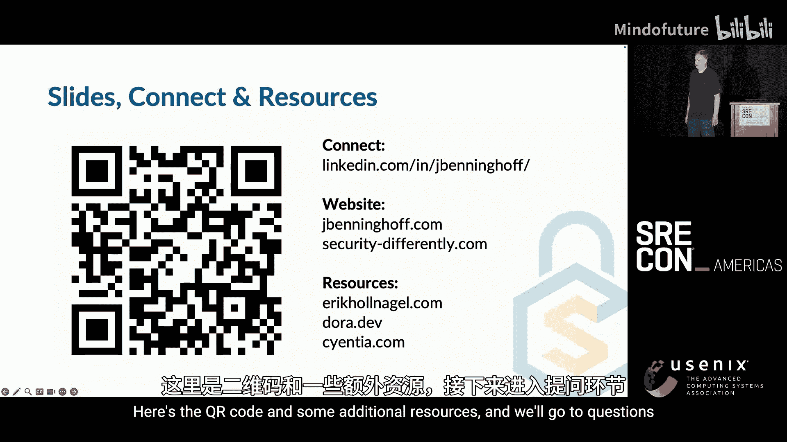
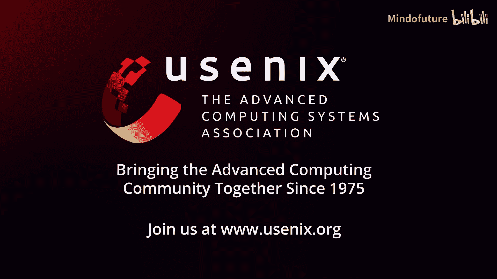

# SRE大会-2025-美洲-｜-srecon-｜-分布式-｜-缓存-｜-OpenTelemetry-｜-安全-｜-AIOps-p12-P12-Is-the-S-in-SRE-for-“Security”--BV1TmLDz7EZZ_p12-

。

So how many people here primarily do security as their job？Okay， thank you。 All， this is for you。

 How many people do Sre as their primary job。 Okay， thank you。 This is also for you。

 How many people do both。Oh wow， cool， very cool。 Glad to see that so。😊，As I said， I am Johnninghoff。

 I think the simple way of what I started my company to do was to make security less scary。

And also to fulfill a goal of making security as much a part of technology engineering as safety is for structural or mechanical engineering。

And this is a story about how security and S3 overlap， you're welcome to take photos。

 slides will be shared after the end and also there's a QR code at the end if you want early access to that。

 the slides will be printed with full speaker's notes which includes links to all the references and everything that you're about to see so。

All right so the picture on the left looks kind of like me but that's not that's my grandfather I taken about 1940 so my grandfather was a pilot both commercially and privately for over 60 years and when I was a kid go visit him in Texas he'd take us up in his little Csna and as an adult I remembered that whenever we went up he always used the checklist。

 he's walking around the plane doing all the checks always using the checklist and I said wait a minute。

 why has he always doing this， he's done this thousands of times。

 maybe it's important right so this led me to a book， the checklist manifesto。

 a great book if you've read it， somebody see has read it and in the book attoula goande who's a surgeon talks about his journey to adapt the checklist from aviation to surgery he started this in you know the late 90s and interestingly enough I had surgery。

Not long ago， and yes， they actually use the checklist。

 so it's an idea that's made its way into medicine。And so I asked， well。

 can we use this for cybersecurity？And this led me to the first venue on the top there， MIT。

 I actually attended the Stamp STPA workshop back in 2016。

 so I really enjoyed the previous talk from there I actually kept looking on my safety journey and that led me to Trinity College Dublin where I actually pursued my master's degree。

And this is this is a summary of what I learned along the way， so。

Eric Hallnagel is a scientist who coined the term safety too he was part of a group of safety scientists about 2025 years ago that started looking at safety through a different lens now I like his argument in particular because what he argued is that in safety and I think this is true for security we tend to focus on when things go wrong so the normal range of performances there on the bell curve on the right and red is when things go wrong。

 that's what we focus on。And in fact， we define success as the absence of failure right so we're secure when we don't have incidents we're doing well when we don't have outages so but he argued you can't have science based on the nonoccurrence of events that is you can't define sex success as nothing happens so instead you have to look at the whole range of outcomes including the positive outcomes on the right and the normal outcomes in between right the full range。

And you have to redefine safety or security， not as the absence of failure。

 but rather working safely or working securely， right？So。

I've observed that there's a couple of different ways to actually change the outcomes here。

 One is to constrain performance。 So we actually say， like， okay。

 so we're going to constrained performance。 We're going to narrow。

The bell curve Now we've actually definitely reduced the negative outcomes。

 but we've actually reduced the positive surprises as well and you can see that in the overlay right so we're actually reducing both positive and negative outcomes when we actually constrain performance So a better way to approach this is to just shift performance to the right to improve performance overall So now you get not just a decrease in negative outcomes。

 you get an increase in positive outcomes as well right So the normal is still there。

 but we get a lot more unexpectedly positive outcomes。

So focusing on improvement is really a shift in thinking and it actually means that you know SE or security is less of a cost in more of an investment and actually doing better。

 right you get better at the same time as that you reduce a failure and you can see from here。

The difference in the strategies， you know for me， this this was a way of visualizing and showing how focusing on positive outcomes。

 focusing on improving performance is a better strategy and part of this is really also about really a mindset change So if I told you that。

 you know， for example， I have the most secure network in the world at home because I've never been breached by the Russian or Chinese governments。

 how would you feel。Yeah， I think I heard some chuckles， Yeah， that's about right。

 But if I told you I worked for an organization that successfully withstood an internal red team attack。

 you might actually feel a little bit differently。 So security performance。

 SE performance is really about how do you perform when you're exposed to the threats when you're exposed to the dangers when you're exposed to the hazards when things go wrong。

So。One of the things that I'm going to assert today and I'm actually going to show you this with studies from data is that cybersecurity performance is highly correlated with software delivery and reliability performance so these are all very tightly correlated now I'm going to show three studies that all happen to be from 2019 but three different perspectives on how that works。

So first of all， how many people have heard of the DevOs， the DoA report？

Most everyone right so in 2 this is the 2019 accelerate state of DevOs report what the DoRA research which was started by in Nicole Forsgin showed is that measures of reliability performance security all tend to move together right this is in contrast to the thinking you know prior to then which was all you can have reliable or high perform。

 which you can't have both well that's not true with DevOs。

 we actually saw that you know like as teams improve in terms of deployment frequency they actually the reduced their change failure rate and the time to restore service like how quickly can they recover from disaster goes down as well right so also in 2019 a report that you might not have heard about came out this is the Veracode state of software security report。

From that time， it was work done in a partnership with an organization called the Sanienta Institute。

 they've done a lot of data science applied to security data and in that report there were a number of findings but this one especially stood out to me and you know I was flipping through the report this interesting kind of knew that kind of knew that when I saw this I said wow。

Because what you're seeing here is so on the lefthand side you see the number of scans per year for a particular organization。

 so you can see ranges from 1 to three times per year to 300 times or more the code is scanned per year and then across the X axis which you see is a log scale plot of how long it takes to close 25。

 50 and 75% of those vulnerabilities identified， so for that organization that's only scanning between one and three times per year half the findings are closed in just under a year and you don't get to 75% until several years after whereas you can see some improvement as you increase the number of scans。

 the frequency of scans until you get to 300 so for teams that are scanning essentially daily。

 you they're fixing those vulnerabilities in days。Not weeks， months or years。

 it's orders of magnitude faster and so you know this isn't just because they're testing faster。

 but I think it relates to that previous slide that teams doing DevOs are moving at a faster pace and they're able to fix things faster。

 including security issues。So third set of research。使。Okay， third set of research。

 the 2019 state of the software supply chain， this is research conducted by Gene Kim and Stephen McGill。

 they looked at the Java maven repository they looked at libraries in that and they said okay let's look at this from a security perspective know what are these repositories doing and how are they doing well the two key findings from that study most projects stay secure by staying up to dateate that is to say they did not focus on updating security。

 they didn't focus on security updates， they just update all the dependencies right so you do better by not narrowly focusing on just security issues but just generally updating because the way to remove those security issues is by updating software other key finding projects that dependencies more frequently。

And only stay more secure。Shouldn't be a surprise right So if you're updating frequently you're going to be pulling in those security fixes faster。

 you're going to be more secure。 So I actually personally have taken this to heart。

 I encourage teams to do this as well， they don't always have the ability to do so。

 but you know I start my development which these days is mostly writing code and R but I do start my development by updating my dependencies so before I start work on a feature or whatever it is that I have to do I'll just update all the dependencies and fix whatever breakage that happens know because I do this regularly。

 the breakage is usually small， but I also don't worry about security because I'm constantly constantly updating。

All right。So this is something that I've created， kind of reflecting on all what I've learned both in safety and from the data。

 what I came to realize， and I truly believe is that there is essentially a lot of overlap between security performance and let's call general technology performance and there's three modes of that。

 one is that security performance is entirely contained within general performance。

Mo2 is that they're overlapping， right， So there's some that's within and some that's outside。

And mode 3， which is basically so you're dealing with something that's so new or so novel that。

 you know， the general technology performance isn't there yet。

 So supply chain attacks at one time would fall into this category right。

 it was a new attack that general， like we didn't have any general practices in technology to deal with。

 Now I'm not going to talk about mode 3， but I am going to talk about mode one and 2 and how that applies to Sre。

All right。So a little bit of a detour。One of the things that has happened recently in the security space is that we really are starting to get data on what really works。

We're getting it from both industry studies， academic studies as well as studies based on insurance claims。

 the rise of cyber insurance has meant that we're getting more data about security failures and this paper which is published in 2024 basically did a meta review meta analysis of those papers and saw what like what works the top two security controls were managing your attack service right like which is essentially you're talking about configuration and inventory and patching cadence like how quickly do you update your stuff the other factors that they found that were meaningful。

Using cloud-based email as opposed to on-preise， interestingly avoiding specific brands of VPN specific one specific VPN vendor was associated with like a 300% increase in the likelihood of a breach paper will tell you which one。

 but also using multifactor authentication， interestingly they also found that MFA was most successful and applied at an individual level when organizations adopted。

 it was less clear I think frankly that's because that probably wasn't widely enough deployed。

All right。So。Going back to mode1， right， So we're looking at these top security controls。

Attack surface management， really， that's just inventory and configuration management。

 that's a core SOE activity。You're talking about patch cages， patching caves。 you're talking about。

Software updates and dependency management， another core activity。

 So two of the most effective ways to improve your security are essentially maintenance。

And in the past， I've actually made the argument that we shouldn't have a security vulnerability management team because that's not a security function。

 The only useful measure they have is maybe just an additional independent check just to see how well we're maintaining our systems。

 The challenge isn't knowing what to do the challenge is actually getting the time and space to do the maintenance instead of working on the features。

Right。So what are the overlapping capabilities this is really the interesting part of the talk there's really four key areas that I want to talk about today there's probably more than that。

 but these are really kind of represent some of the core overlapping capabilities of the SsE and the security teams first is observability。

Second， incident response and post post incident investigations and the very broad category of testing。

So。I will make the assertion that observability is observability。

One of my first projects when I started in security many years ago was building an open source network intrusion network intrusion detection system right so security monitoring system using some open source software called shadow now shadow people may or may not know of it。

 it was basically TCP dump and some pearl scripts that created web pages and this was very early on in the network security days it was capable of you detecting you know detecting things at the protocol level。

 it couldn't get any deeper than that。 but know that's what we had at the time。

 and one of the interesting things that happened to me after building the system was that I'd you know start looking at what's going on and my network security detectors and every once in a while I'd call up the regular network people and say hey。

 is there something going on and every once in a while the answer was yes and you know the flip side of that was every once in a while they'd call me up and say。

Hey is something going on and you know usually the answer was no。

 but you know I do also remember being called early one morning when there was a new worm circulating called SQL slammer Does anybody old enough trip yes。

 a couple people remember SQL slammer。 Yeah， there was no mistaking that that was something was really wrong。

 but I think it was interesting because we were both looking at the network through slightly different lenses。

You know。the thing is that both teams really benefit from being able to get some insight to what's happening below the line beneath。

 you know like inside those software based systems and' both we both have a need to know what's happening to infer what's going on。

We're just looking at it through slightly different lenses。

 whereas SE is more concerned with performance availability。

 the security team is more concerned about anomalies。All right， think。

The market the market for observability tools actually backs this up so。

 which is I always forget the outcome it security information and event management。

 it's essentially a way of creating a dashboard for your security team to roll up all the interesting security and sentence events that's going on historically that was a separate tool from your other you know traditional logging and observability tools。

 but。I went out and looked at a vendor's quadrant。You might even call it a magic quadrant。

And you know this is， you know if you look I skipped the one quadrant。

 but you know looking at these tools， I looked at the tools in each of the quadrants and said okay so which of these actually were created as a security specific tool and how many of them are actually general observability tools that were extended into this space and what you can see here is about about half of them a little less than half were actually originally general purpose tools where they added on security features and in fact。

 the top two are both general purpose tools that where security was an additional component was added I've personally seen this in action where organizations have moved away from from a S tool to a general tool this makes sense from a cost savings perspective because you're using one platform instead of two and quite frankly especially at large organizations I found that the security tools don't actually scale as well right they're designed for security needs they're not designed for。

Pure observability。 So I think， you know， I think that I like to see more vendors get get involved in this space and add security extensions to their tools。

Right。So let's talk about incident response and investigation。

 so what you're seeing here is a graph of some Monte Carlo simulations that I ran as let's say as a thought experiment so。

I think so this， I think shows kind of like what's similar and different about security security incidents as well as kind of typical outage incidents Now security incidents are very much larger。

 but much less frequent security kind of publicly reported security incidents happen at a rate of about once every three to 10 years。

Depending on the size of the organization， I'd ask。

 does anybody have outages only about once every three to 10 years？I mean， that'd be great。 But no。

 it happens a much more often。 So the pattern that I've seen is that。

The the impact of those events does tend to be does tend to be the same a log normal distribution。

 So very long tail。 The frequency， again， is very， very different。 What you see here。

 this is on a log scale。 They look pretty much the same except and you probably can't see this because the writing is very small。

 The order of magnitude is substantially different。

 So the range of events of the cybersecurity ranges from about $100 to $10 billion。10 billion。

Whereas kind of typical outages range more from about 100 to about 10 million and the median range you a typical incident in this particular situation。

 which is for a very large company， was that about $100，000 was a typical loss from an outage event。

 whereas it would be about 10 times at a million dollar loss for a cybersecurity event。

So this kind of difference in know dealing with small but very impactful versus more frequent and less impactful events。

 I think really drives the key differences between those types of incident response and investigation。

So。You know， there's overlap here， but there's definitely differences right so on the security team they're used to incidents that are lasting for days or possibly weeks。

So much longer they have planning horizon for instant response that's much longer on the S3 team。

 incidents typically only last hours if they'll last longer than that， it's a really bad day。

On the SRE side， you're having incidents often enough that you know you're on call and you're expecting to get a call because an incident occurred on the security team。

 teams actually aren't waiting around for the security breach。

 they do things like threat hunting where they're actively out looking in the systems trying to spot malicious attackers inside the system before those breaches occur。

嗯。Similarly， the forensics investigation on a security team can be much more in depth and take much longer after a security incident。

 whereas although we'd like to spend more time on that。

 the post-in review on the S for each side is often kept shorter because there's a demand by management to turn those incident reviews around quickly and move on to the next thing。

Interestingly enough， both themes have experts in packing analysis and memory dumps。Right。

 and unfortunately， a key difference here is that is how we actually treat information。

 So all too often， and I think this is to our detriment on the security side。

 information and security incident is kept secret even when it probably doesn't need to be。

 whereas on the S3 side， information is shared。 Now， the nice thing about this is。

What what can happen， which doesn't happen， I think often enough is you have teams working together on an incident you may not know if it's a security incident or not。

 you have different perspectives and have complementary skill sets for identifying what's wrong right the security team is going to be able better is going to be is more inclined to look for the needles in the haystack。

They're going to have more experience finding anomalies。

 whereas the SRE team has you know more practice around coordination and getting people on the call right so when you need help。

 you know they're more practice at bringing in the help and calling in the extra team。

So that I think that it's different and complementary。All right， so let's talk about testing。

I'm going have a complete and comprehensive view of all testing's that's out there no i'm not because we'd never be done right so testing is a big topic I don't even want to list the kinds of tests because people would argue with me for me testing really comes down to one thing though right so the question we want answered by testing is does the system behave the way we expect right？

Now in the Sssary and security space， there's a little caveat to that when things aren't going well。

 right， So like we saw in the previous talk。Is human nature to focus on the happy path。

But the S3s and the security people both look at， what about the unhappy path？

Maybe slightly different kinds of unhappiness， right。

 The S3 team is thinking about what things can go wrong when mistakes happen， when you know。

Ths thingsings don't work the way we expect them to。

 and the security teams looking at what if somebody is actually deliberately trying to break us。嗯。

So there's many things that we can do to kind of answer that question。

 some of these things include like things like static code analysis， chaos engineering。

 formal methods could be STPA could be language constraints so things like memory safefe languages and using parameterized SQL queries。

 but it also includes things even like just documentation and writing down our assumptions about how the system works and how the world works right so if you know we have to make assumptions about how the external how the world outside of our system works。

 if those assumptions are violated in the future， that's a signal to us that there may be design weaknesses in our system。

So you know and con testing with automation is key to all of this right so one of the teams that I worked with an internal team that was of software engineers that was very good at what they do I was talking to him like well you know what about your security bugs he said we don't have bugs and yeah what he really meant was we don't have any bugs in our backlog if they came across the bug they triaged it and resolved it quickly？

And so I think that's the thing。 A bug is a bug， whether we find。

 whether it's a security bug or a reliability or a bug。Haamppers our resilience in some way。

 if we find and fix a bug， we're going to actually have a better system that's going to be more likely to perform better and be more likely to be secure。

Right。So this is a proposal。That I'm introducing in this talk， security level objectives。

So we've all heard of service level objectives as a core concept in SRE。

What what I look at them as as a commitment device right so what we're saying is we're going to make a decision upfront about the level of availability that's acceptable and if we fall below that availability level。

 we're committing to deferreder resources away from features to reliability right I think the idea behind a security level objectives is very much the same。

 we're going to decide on an acceptable level of security risk。If we fall below that level。

 we're deciding in advance that's when we start diverting resources away from future to security。

Now the challenge is with security， you probably can't say like we're going to allow one breach per year。

Because that's too much damage。 We want to actually avoid that。

 So we actually have to change this a little bit and look at more forward looking measures， right。

 so we look at kind of， you know， like things that are correlated with success。

 but we already know what some of those things are。 that could be like what's the attack surface。

Right。How many endpoints do we have exposed on the internet？It's what's the patch cadence。

 How are we doing it， keeping up on maintenance？So。When I was putting this together。

 I realized that this is something that we had again early in my career when we were working on vulnerabilities。

 so we did do vulnerability management back in the early 2000s I scanned the network with NeSSis before it was tenable。

 it was free tool at that time， a generator report sent that out to all the engineers and said these are the missing patches that you need to go fix。

What was interesting was our head of infrastructure would get that report。 And if it got too long。

 he would say， you know what， I think we have， we need we need to spend some more time fixing these vulnerabilities。

 So for him， it was a bit of a gut check， but it really was a SLO， a security level objective。

when we got to the level of like we're not comfortable with the level of risk this represents。

 we're actually going to divert resources away from other things to fixing this and it worked we actually very well it helped helped the success of our program so。

What would an ESL look like today， right？You know， like SLO setting on 10% target is probably the wrong target。

 except in some cases， maybe it is right so if you have you know a vulnerability that you know is being actively exploited across the internet all the time。

 maybe you want to make sure that there aren't any at all on your network。

Something to think about so things that that might actually be good SLOs are as I mentioned。

 the vulnerability rate like the number of vulnerabilities per endpoint。

 something that needs to scale with the number of systems that you have open parts per public service so how many open TCP port do you have。

Number percentage of ams not using multifactor authentication。It's a pretty good indicator。's。

 that's your attack surface。 something you might not think about percent of orphan accounts。

 How many， how many logins or user Is do you have out there that aren't owned by anybody。

Login failure rate， obviously if it's too high， you may be under you know like something you may be under attack。

 but also login success rate so if your login success rate is 100% that's probably also a good indicator of a problem as well。

So。It'll go to practical takeaways and I think we'll have plenty of time for questions。Really， so。

Three practical takeaways， number one， SRE work supports core security performance。

 and doing that maintenance is really important。Number two。

 think about extending your SRE capabilities to support security and vice versa right like both teams have a unique perspective that they can bring to incidents and to risk management。

And really security and SRE will go further together than separately right these are two complementary overlapping but complementary skill sets。

 So that's what I have。Here's the QR code and some additional resources， and we'll go to questions。

