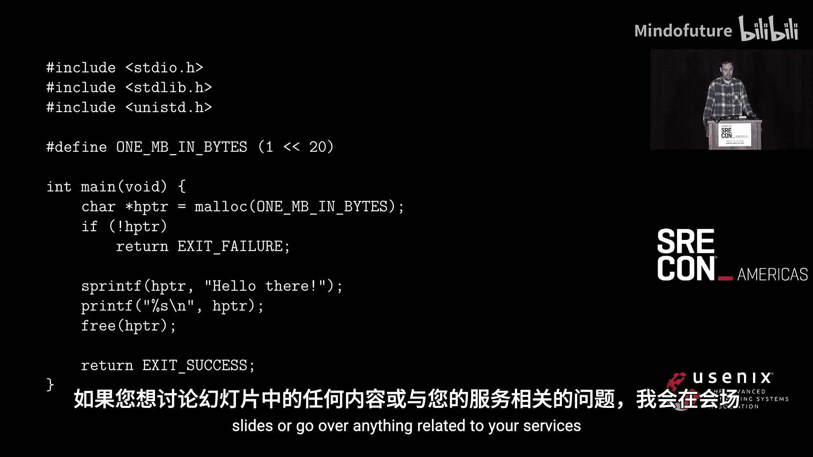
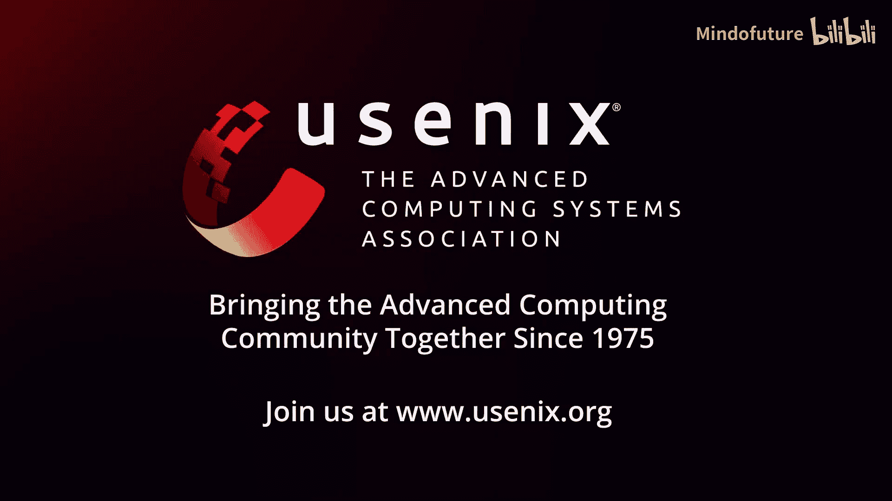

# SRE大会-2025-美洲-｜-srecon-｜-分布式-｜-缓存-｜-OpenTelemetry-｜-安全-｜-AIOps-p13-P13-Lies-Programmers-Believe-about-Memory--BV1TmLDz7EZZ_p13-

。

My name is Christown。 I work as a engineer on the Linux kernel Me。

 I will work mostly on the kernelel's memory management subsysem， especially on resource control。

 isolation， that kind of stuff。 I'm also a maintainer of the system D project。 So already。

 I've given you two things you can hate me for。 And mostly。

 I work on C groups and other resource control management stuff。

 Most of the time my job is essentially thinking about how we can make Linux more reliable and scalable。

😊，So today， I want to talk to you a bit about misconceptions I often see from programmers and system administrators around memory。

 Memory is a topic which I think many of us believe is table stakes for our job， right。

 It it can be a very emotive conversation to discuss things like swap， for example。

 mostly because we already believe that we know the answers in my 15 years now working with Ses and software engineers。

 I've seen a lot of misconceptions about how things actually work and also why they work in the way they do。

 So hopefully， you're come away from this talk with some updated concepts And maybe some new ideas to help your services and systems in production。

😊，So let's start off with something basic。 Don't worry if I've just given you a shit to of seeds to look at。

 C is not the point。 I'm not going to trick you with any compiler or CPU reordering nonsense。

 but let's just go through this line by line， right， So in this example， we malluk 1 MB memory。

 We put the string hello there inside it。 and then we eventually free the memory after printing it。

So now have a little thing for yourself。At what point do we actually allocate the megabyte of memory here。

 What， What actually happens to the Ram during the life cycle of this application。

And what does mallck here actually do， What's the contract it's enforcing。What if I told you。

 for example， that Malik， despite the name， has absolutely nothing at all to do with memory allocation。

So how does this whole sequence of events actually unfold them。First。

 in order for us to be on the same page， I think it's a good idea to go through like the high level goals and non goals we often think as I think of as memory management developers。

 So if I were to make just a few high levelve goals for Linux memory management。

 it will be something like this。 First， we want to make the most possible use out of all available system resources。

 In our case， that's memory。 This is not only a question of making sure the memory is accessible。

 Obviously， that's important。 but we also need to make sure that applications have these cis calls and operating system support in order to use it effectively。

 This usually means things like we want all of the system memory to be used all of the time。

 if possible。 typicallyyp， the slack space there is going be filled with things like disk buffers。

 Fast system caches， things like that。😊，We also need to make sure that memory accesses are safe。 So。

 for example， if if a program should try and intrude on another process's memory and it doesn't have the rights to do so。

 then we shouldn't allow that。 Most of that happens inside the CPU itself。

 There's kind of a limited amount of kernel interaction。

 But we do need the operating system support to perform actions based on the complaints that the CPU raises。

 We also use some of these complaints that the CPU gives in order to improve efficiency。

 which we'll come back to you later。We also need to ourselves use mineral resources while doing this。

 It's no good having this kind of perfect memory tracking that tracks everything absolutely accurately。

 if it makes the system slow to acc crawlal， right。

 That means that if you look at Linux memory management code。

 you might wonder why something is done in kind of a not correct way。

 And the answer is almost always that the trade off is that it has to be done very， very quickly。

 So we do a lot of approximations and things like that。

 performanceance is pretty critical in this part of the code。😊。

We also need to not involve the application involvement in the vast majority of memory management activities。

 Realistically， this means that a lot of this efficiency work needs to happen transparently without the application。

 even knowing about it。 So especially for our efficiency work。

 that often requires rethinking how applications even see memory in the first place。

 And we'll go over some of the concepts which help with this in a couple of slides。

So one of the strategies that Linux employs to extract the most out of available memory is something called overcommit。

 Overcommit is like having a credit card where every time you ask for memory。

 we're gonna give you it。 In fact， we'll even happily give you more memory than the entire system has available。

 So why on earth would some sad allow such a thing。 Well。

 this kind of ties in with two other concepts which Linux has one is called demand paging。

 and one is called swapping in demand paging， we don't allocate physical memory upfront。

 we only reserve physical memory for use when the application actually makes use of that memory。

 And in swap， we permit offloading some already loaded memory to a slower storage like to the disk or something like that。

 This is all based on the fact that allocating some memory is a very poor proxy for trying to work out whether it's actually going be used or not。

 In fact， a huge amount of memory that programs allocate is either never used or very scarcely used。

😊，To keep those pages resonant in physical memory， then would be pretty wasteful because then you can't use that memory for anything else on the system。

 So our goal here is to increase the memory utilization system wide by decoupling the act of requesting memory from actually physically allocating it。

A typical argument you will see on places like hack newss or other places where people discuss the important matters of the day is that it should be the responsibility of the application developer to do memory management and the kernels should do nothing about it。

 I think over the years with all the security vulnerabilities that we've had we've proven that humans are pretty crap at managing memory。

 not even like doing buffer over and stuff we can't even work out what size the buffer should be in the first place As such。

 a lot of projects are moving to languages where users attempt to have this very abstracted access over memory like rust or even to some extent modern C+ Of course。

 there are also interpreted languages where you have absolutely no control over memory whatsoever。

 And even if you do have control over it， it's very hard to say what size do I need this buffer to be。

 for example， I think if you've seen any sufficiently complex system。

 it's probably pretty clear why expecting the programmer to do all the memory management and do it correctly is kind of a losing game。

It is true that over commitmit does have its downsides。 For example。

 if everyone actually does turn up and once all their memory， then you are shit out of luck。

 It's not going end well for you。 However， these kind of issues can somewhat be mitigated both in kernel and your space。

 and we'll come back to some of the approaches for that later。

So the way that Linux does this under the hood is by using something called virtual memory。

 Virual memory is kind of shared parts from the kernel and from the CPU where you have this kind of a or multiple level of abstract over memory。

 For example， some memory might have been virtually given to an application。

 but it's never physically reserved Each process is given its own virtual address space on Linux we call this VM Well。

 inside virtual address， you can have one or more VMs which is a virtual memory area。

 and this virtual address space just looks like normal memory to the program。

 It doesn't really have any inkling of what that is。

 but it doesn't actually have any memory contained。

 It's just a mapping a virtual memory address doesn't even have to be backed by Ram It could equally be backed by something like swap。

 for example， and then when it access， we have to promote that main memory to be accessed。

 It could also not be mapped at all like in the case of the demand page in case where you gradually page something in In that case。

 we need to as the kernel work， is this not mapped because the access is。😊。

Or is it not mapped because it's valid。 but I have to do something to。

 to get the page to be in the state to be readable。This， of course。

 doesn't present you from accessing a valid but wrong part of your program where you have direct memory control。

 Really， we can only stop you messing with other programs or like things related to， you know。

 having the wrong permissions for what you， for the action you want to do on the memory。

 But the rest is kind of a little bit up to you。So we kind of mixed two different concepts that over commitmit and demand p。

 So demand paging is what we were discussing previously where you don't actually allocate physical memory until it's demanded。

 And this demand typically comes in the form of what's called a page fault。

 A page fault with a very scary name is a message from the CPU that somebody just tried to access a memory and I have no clue what on earth they are talking about It basically says I don't have any mapping from this virtual page which someone's trying to access to any physical realm。

 And as such we either need to allocate a new page frame， which is a physical page frame and memory。

 and set up the mappings for it， or we're gonna access an invalid address。

 and we look at the permissions to work out， which is which So let's take a look at how this typically works。

 So from user space an application typically request memory through their Li mal map or something like that。

 This is true。 even if you use someone like Python right when when you create some object it has to instant a memory and it goes through the APIpi whatever if you use like some weird Python Then it's probably something else。

 But you have to do some kind of memory allocation。Importantly。

 these functions you're calling are in user space libraries。 They are not system calls yet。

 what this might internally use is something like S break or break or M map or some kind of system call。

 which is designed to increase the virtual memory space in。

 and these functions only increase the virtual memory space。 Importantly。

 they don't do anything at all with physical Ram whatsoever。😊，It's also possible that we just。

 you know， use some previously freed pages instead of allocating new ones。

 How exactly Malik goes about this procedure depends on your allocator and your operating system。

 But for now， the point is like， you've asked for some memory。

 We're gonna give you some memory and the light keeps on going。😊，So sometime later。

 the process then comes to actually go and use the memory。

 And what it does it de referenceences the virtual memory address in the process。

 Since the CPU has absolutely no idea what on earth you were talking about， it produces a page fault。

 And Linux now realizes that this memory simply hasn't been put in main memory yet。

 So what it's going do is allocate a new page frame。

 which is a physical page memory and set up the appropriate mappings for it。

If it then needs some data from a backing device， for example。

 if you now need to swap in some pages to satisfy that。

 it's going to copy those to memory before resuming execution of the program。 Importantly。

 this is what I was talking about earlier， which is like we need to not involve the program in this process。

 From the processor's perspective， it has no idea that any of this happened。

 It just gets a page eventually。 and that's that。The important bit to remember here is how disconnected a function like mallik is from actually allocating memory。

 Programs don't allocate real memory when they call Malik。 They just get the option to do so。

 And there are so many interactionsdirects here that someone the one has to be very。

 very careful trying to reason about what the application， memory semantics and lifecycle should be。

 This is true in any language I use see in my examples because it happens to be what I'm familiar with。

 and it's quite illustrative of this problem。 But this applies to， you know， use rust， Python， ba。

 whatever。 They all internally use Malic infrastructure and have the same kind of situation。😊，Okay。

 so。Chris， you've told me that when I call Malik， it lies。

 and it says I have some memory that he actually didn't give me yet。 But at least when I call free。

 it's gonna， it's going to get rid of the memory。 right。 They wouldn't lie to me twice。

 The barstar said， would they。Of course， they would。 It's Linux term developer， Of course they would。

 So if you this simple program allocates1 MB， touches each page。 it frees it and then waits。

 if if it looks like a lot of code， you don't have to look at it， you can just listen to me。

 So if you run this and check the R S the resident set size of memory after free。

 you would expect it to drop to 0， right， Well， it probably didn't。 In fact。

 more likely one of three things could happen。 All of them confusing and some of them even more confusing than others。

 First possibility is that absolutely nothing happens。 It stays at1 MBby。

 What happened is the allocator just put your memory on a free list somewhere。

 And nothing was returned to the US， Nothing was reclaimed to whatsoever， right。

 This is what happens typically with allocators like Google's T C Malick。

 which very aggressively avoid ciscos because otherwise。

 you know like doing a lot of these things involves ciscos， which are quite expensive。😊。

But it does mean we have this very weird disconnect with where your program says， he， no。

 I've freed memory。 The colonel thinks no you didn't。 And the allocator says， well， I don't know。

 So nobody's really lying with bad intent。 But the abstractions are hiding the。

 the reality of what's going on here。The second possibility is that the R S S drops partially。

 So it's not one meby anymore， but it's some other value。 The allocator was feeling generous。 And。

 you know， it returns some of the pages to the O S。 But it kept some because， hey， you know。

 maybe I'll need that later or maybe you're gonna use that later。

 So maybe I can just return that instead of trying to get it from the operating system。

 That's more common with something like Giepy or Jamalic。

And the third possibility and my favorite possibility is that when you free memory。

 the R S S actually increases an incredible outcome。

 I know it turns out that inventing computers was a grave error。

 This can happen because the free operation itself has to do things right。

 It might allocate internal metadata or the allocator might reorganize its memory pool and end up touching more pages or page tables。

 So in this simple example， it's somewhat less likely。

 but in a production workload that can really happen in some perverse circumstances。

 One example is when you have to combat things like memory fragmentation or align towards other goals of the allocator。

 So you can end up with these perverse situations where you kind of temporarily increase memory after doing a free。

😊，Importantly， free is a signal to your memory allocator。 It is not a signal to the operating system。

 It says， I don't need this anymore。 Not。 Please give this back immediately。

 The allocator is decide what to do。 It's very much like saying， you know。

 I'm going to leave this party now and then waving goodbye to everybody。 Maybe you did leave。

 or maybe you' found three hours later in the back， doing some bookca shots。

 But all of these are possible at the end of the day。

 And it was your declaration made absolutely no difference to the outcome。

 And this is why monitoring memory leaks in production is so tricky and cumbersome， right。

 because a process that probably frees everything。 still might not actually free the memory。

 And modern allocators make a lot of different trade offs for this。

 This is one example of why measuring R S S is pretty tricky on modern systems and will come back to that a little bit later。

😊，Who do I I see in the audience that I don't like， I see a conference organizer， Dan。

 why don't you step up to the plate。Dan， can you do me a favor， Can you read this slide for me。

 please， Yes。Yes。O。We're gonna get very close and you're gonna use this microphone， young fellow。

 We're all friends here done。 Okay， Yes， random access memory is a form of electronic computer memory that can be read and changed in any order。

 typically to store working data and machine code。 Wellow。

 a random access memory device allows data items to be read or written in almost the same amount of time。

 irrespective of the physical location of data inside the memory。

 I can't believe you would lie to the ladies and gentlemen。

 I can't believe you would say such falsehoods in a place of this。

 You should really be ashamed yourself done。 So let's look at two kinds of thanks by the。

 So let's look at two kinds of traversal for some large two dimensional array。

 The first loop uses columnwise traversal。 Well the second uses this rowwise traveral。

 So you might think I have to access everything in this two dimensional array。 right， by the end。

 So why on earth。😊，The second version 50 times faster。

 because despite what our esteemed colleague and Wikipedia say。

 random access memory is actually very bad at randomly accessing memory。

 One of the reasons for this is because Dr is organized into rows。

 And its operation is governed by what's called the Cas precycle。

 I know they didn't have a marketing team。 Ras is row address， essentially。

 let's tell the Ram which row we should go and get and activate that row。

 Cas is column address essentially now， okay， you have a row。

 now select which column in the row to select And at that point。

 you get the data from the D cells and you put it on like a data pre is precharging a row。

 which is basically setting like the bank bit line to an own voltage or something like that。

 Dr cells are basically simple capacitors。 So this is all required to This doesn't really matter basically to avoid interference with when you access a different row。

 You can really just think of precharge。 You don't have to think about electronic engineering。

 Think of precharge。😊，like， I'm done with this row。 Like I can now move on to another row。

The key insight here is you can perform multiple column operations on a single active row before you need to do another precharge。

 So in this columnwise traveral。 In the first case。

 I need to first precharge the previous row of Ramm。 I need to activate a new row Ramm， which is ras。

 And I need to select a column every single time。 in the row rise traersal， which is the second one。

 we stay on the same row for many consecutive accesses。 And one ras。

 then you do a whole bunch of Cas operations。 and then minimal。

 I can a man is writing down what I'm saying， that must mean it makes at least some kind of sense。

 That's good。 Or it means it makes no sense。 And he's like please fuck another get this over with the difference here is enormous。

 So ras and pre operationss are extremely expensive compared to Cas operations。

 So rowwise access can be a huge amount faster from just the D access pattern alone。

 I think a lot of us as programmers have this idea of like streaming data somehow fast or like contiguous data as fast。

 but don't have any real reason to understand it。 And this is one of the big reasons why。

Reading sequentially is also a very much better use of caches。

 So a cache line is the smallest unit of data transfer between memory usage and a CPU's cache。

 typicallyy on X 86 an X86，84， It's 64 by。 And we read that as one contiguous aligned block。

 So if we read randomly， as in the first example， we're gonna have to read a whole cache line and then throw it away every single time。

 right， But if we read in this sequential and contiguous manner， then we don't have to do that。

 And we can continue using the same cache line。Another reason that reading it sequentially is much faster is that virtual memory is divided into these fixed sized pages。

4 kB pages on X 86， usually。 And the translation look aside buffer or T L B is a cache of virtual to physical addresses。

 And it's usually pretty limited in size。 So when you do some virtual memory operation。

 This is the thing that eventually cachees like what what physical page should I be talking to。

 If we dart around the address base looking for pages as we do in the first example。

 we are going have to keep thing pages in and out of this cache。 But if we do it sequentially。

 we don't have to do that。 we always have the cache entry that we actually care about available。😊。

Most modern compilers will also automatically do what's called vectorization of the second version using Simmed instruction。

 Simmed mean single instruction， multiple data。 and it lets the CPU process。

 a bunch of different array elements with a single instruction。

 For those of you who know about Simmed， I think you may grossly overestimate how much it improves the performance here。

 The vast majority of the improvement here is none of these， except for Razca and pre。

 The things that we don't talk about。 We spend a lot of time this program talking about caches， know。

 Simmed， all kinds of stuff like that。 But the most fundamental one is the way in which data is architected on a erara。

You might notice I didn't mention prefetch。 Pre-fech is where the CPU automatically detects this kind of sequential access and loads a bunch of stuff in advance。

 In this particular example， it doesn't really help。 It can help in some cases。 But in general， the。

 the purpose of this slide is to think when you're writing code。

 try to remember that despite the name， neither random access memory nor the CPU are very good at actually doing random access。

One thing that's critical to understanding Linux memory management as well is that Linux has these different types of memory from the CPU's perspective。

 there's really no difference of some very basic things。

 but Linux treats different page types as being semantically different。 For example。

 anonymous memory is， as the name would imply， not backed by any backing store。

 So that's the memory which you tend to allocate by mal that kind of during the program lifecycle。

 Most people also know about caches and buffers two of the same coin nowadays they're all unified with called the unified page cache。

 But if you ask most Linux admins， they will say page cache is buffers。're reclaimable right。

 I can just free them any。 if somebody wants the memory like Angus Free。

 the problem is that's not what reclaimable means Reclaimable means if you ask really nicely and the pages are aligned with the order of planets。

 then maybe some reclaiming will be allowed to happen at 3 o'clock on Tuesday。 It does not mean， oh。

God something bad has happened。 and I got allow you to do it right now。 No， it doesn't care。

 It doesn't care about your needs。 Your emergency is not its priority， and it will get back to you。

So， for example， if some application is hammering on some file， it's very。

 very unlikely we're gonna just drop that far from cash right。

 So while it can be freed trivially in some circumstances， it doesn't have to be the case。

 which can cause some confusion when people inevitably come and say。

 why is my application Uoming when， you know， I have tons of buffers and caches。 Well。

 probably they were essential。The fact that caches can be essential is also an example of why R SS。

 the resident set size， a metric that people love to measure and is absolutely everywhere in every tool possible is bullshit。

 And the reason for that is that R SS skews a huge amount of attention towards a very few select types of memory In this case。

 anonymous memory and mapped file memory。 And we forget， though。

 that a lot of workloads simply cannot operate without a huge array of buffers and caches。😊。

We measure R S S because it's really easy to measure， not because it's a good measurement。

And so when somebody asks you， how much memory does your application actually use unless you've done some tests where you've compressed it until the point where performance drops。

 it's very hard to actually give an answer to that。In one case inside Facebook， a team that had。

 for years believed their memory footprint was like 100 to 1050 MB on every single machine across the fleet。

 found out with the metrics we're going go over in this talk that actually was about 2 GB on each machine。

 which is a humongous thing to not know。This is one reason why in modern resource control。

 we typically limit all types of memory together instead of trying to just， for example。

 limit anonymous memory。 because if you do that and ignore the page， for example。

 you're still going to trivially allow applications to break out。

Another key building block of modern memory management is the thing called C groups。

 So C groups are a kernel mechanism。 We've built to balance and control things like memory， CPU I O。

 things which you share across a machine。 Theyre essentially a user definedfin group of processes which get some kind of set of resource limits。

 Usually you have like one C group for something that's involved in effectuating a service。

 So like a demon or something like that。😊，I'm sure if you've operated containers before。

 you may have come across them。 every single modern container runtime， Docker， Cor West， Kubernetes。

 system D， Bens spa， this kind of stuff。 It uses C groups under the hood。

 And the reason for that is because C groups solve a huge amount of the longstand problems and limitations we've had with traditional Unix memory management。

 like Ulim and the like。Sigres have existed for 14 years now。 They've changed a lot in that time。

 most notably， a bit scarily， almost 10 years ago in 4。5， kind of 4。5， we release cigarette2。

 And now I feel very old。 I， I give a whole talk around that time on why we were moving to this interface and not just making kind of incremental improvements to the old one。

 I don't have time of this talk to go over it。 But if you're interested in a very in depth discussion of like what the limitations are this talk is a good resource and there's a link on the bottom。

But the most important thing to know about Sgroup that's important for this talk is in Si 2。

 we limit all of the memory together， right， So we have this memory dot max file。

 which limits not just based on R S， but really everything lasts like caches buffers， Sockets。

 kernelnal memory allocated for your application， all kinds of stuff together。

 And this is a step change from the old days of per process limits or S1 limits where you only limit like a subset of memory types。

So on the surface， this looks like it should work pretty well。 and it does。

 It does exactly what it says on the tin。 It sets a maximum amount of memory allowed to be consumed for the C group。

 But the problem is， how on earth do you use this to compose a reliable system。

 So let's say you have a couple of slices。 The names in here are system deminology。

 C groups doesn't care what the names are。 But in system de terminology。

 a slice is basically a sub part of the hierarchy for some class of application。

 So in best effort dot slice， you'd put best effort services and in workload slice you'd put。

 like whatever you actually want to run on the machine。

 So a best effort application would be something like configuration management or metric collection。

 Things that are really nice to have， And I really want them。

 But if they don't run because the machine is completely oversaturated， then that's fine。

 Like I can deal with that。😊，The workload， on the other hand。

 is containing the applications that you really need to run on this machine。 For example。

 H H VM or N X on a Web server or Mysql on database server。

 The thing by which if you do not run this， the whole point of this machine is completely moot。

So the typical system administrator S or you trying to be very responsible might have a way of thinking that goes like this。

 You are scared that some best effort application might have a memory leak and what might happen。

 It is。 It might own the entire machine。 Oh that would be really bad when that be quite bad。

 So I better set a memory limit on best effortdot slice。

 And I'd better put it in best effort dot slice。 Oh but now you've put it in best effortodt slice。

 And there's a whole bunch of you know， some of that stuff is actually quite important。

 I better make sure he doesn't doesn't do anything to to cause any problems with the other。

 So now I'm going to actually put a memory dot max on that thing as well。

 and make sure it can't burst outside of its own limits。Oh。

 but now I'm particularly worried that my main application might actually， you know。

 do a globaloom on the machine if， if it were to cause aoo， I would like to， you know。

 like only have a very controlled one that doesn't take down a machine and so on and so on and so on and so on until you have an outcome by which nobody can tell you how the machine is supposed to work anymore。

Inevitably， what's going happen is one of these is going to grow a little bit in how much memory it uses。

 And then you're going to have to reason about how on earth am I supposed to do resource distribution on this machine。

 This is even infinitely worse if you work somewhere like Facebook or Google or in some company where you have。

 know thousands of services and you have a bunch of teams developing them。

 And there's a disconnect between I want to deploy this feature。 And oh my God。

 much should the memory limit be like those two things never never occurred in the program's mind。

 So our ultimate goal here is to just keep whatever is in workdo or slice running right？

 What if we could just encode that。 What if we could just write something like this。

So memory dot low is a fundamental change to the way that we've gone about controlling memory on Unix for the past 50 years。

 The idea is that instead of trying to control memory by putting every application into a very tight coffin。

 the idea is to instead have say how much memory our primary workload needs to operate and then let the system sort it out。

 But how does that actually work。So all of this works based on reclaim。

 Reclaim is a fancy term for this process of trying to free some pages。

 either reclaim other happens based on global memory shortages or it can happen if you like brush up against the limit within your C group or stuff like that。

 So memoryt low hooks into the kernel's reclaim infrastructure and does what's called protection。

 For example， if you have memory dot low set to 20 G。

 Then as long as you're using below 20 gig of memory。

 we are going to generally exempt you from having memory taken away from you。😊。

This means that we tend to reclaim instead from everybody else。

 And the only time we dip into your reserves is if there's an immediate and kind of global critical shortage。

This might sound kind of simple， but in reality， it's been pretty nontrivi to implement。 For example。

 if multiple protections on the system are competing against each other。

 we have to decide how to handle that。 We also have to decide how to handle distributing protections from a parent to a child。

 especially when children compete with each other。 and we also need to handle the case where you know。

 you're slightly over of your memory protection。 So in that case。

 we usually reduce the amount of scanning we do for pages from you proportional to how far over your protection you are。

A really nice effect of using this instead set of memory limits is that this is work conserving。

 or at least more work conserving， because it's not a reservation， right。

 We don't take 20 GB of memory away from everybody else。 As long as you don't affect others。

 you can use as much memory as you like， You can go and use that part of what would be like that 20 GB if it was a reservation。

 The only time we actually make it happen， is if that application， which is protected。

 demands to use it。This is much more tolerant of temporary spikes and changes in memory composition。

 And we now primarily rely on this to do protection and memory protection within matter。

 There are still some kind of cases where limits do make sense， but they。

 they are generally somewhat more limited。 We've generally transitioned towards using memory dot low and memory dot min。

This brings us somewhat neatly onto swap as well。 A couple of years ago。

 I wrote this blog post called Indef swap。 I wrote this note because we just had a newsfeed outage。

 which I'd investigated。 And in that newsfeed outage， I had looked at the machines。

 And my conclusion was basically， if you had been running with swap， probably wouldnt haven't。

 which was not not pleasing news，If you haven't read this blog post and perceive it is not useful。

 I strongly recommend reading it。 I will give like a brief go over of it here。

 but it is kind of a long topic。 In general， a lot of people think swap is mostly irrelevant nowadays because we've got tons and tons of memory。

 This is kind of strange， though， because swap and memory are not too interchangeable ideas and for the things that swap is good at。

 You really can't get them any other way。 And the things is bad at， you usually can mitigate those。

 Usually， these discussions hinge on misunderstandings about what swap is for and good at。😊。

And swap has almost absolutely nothing at all to do with this concept of being emergency memory or like backup up round or like slower around。

 as some people believe。You also will see people online saying stuff like。

 I don't use swap because then， you know， memory can turn into diso。

 but this obviously makes no sense， right， memory turns into diso， whether you use swap or not。

 because if we can't evict anonymous pages， which are what are allowed to be evicted with swap。

 What we're gonna do is we're just gonna thrash the file cache right。

 We're gonna just evict stuff from the file cache。 And now you have to go get the file cache stuff from this It's even worse because we have a smaller number of smaller pool of pages from which to pull from。

So these kind of misunderstandings of really hobbled swap reputation and LED to these misconceptions that it's not useful if you have a lot of memory available。

 So if it isn't a mechanism to kind of expand your Ramm， what is it。

 So swap allows reclaim on types of memory， which would otherwise be emlocked。 That is。

 it provides this backing store for memory， which is otherwise essentially locked in Ram。

 It also allows to more gradually ramp up memory contention。

 which would otherwise which would otherwise ramp up in a binary way， right。

 Because if you don't have swap it's very， very you could go from making optimal use of the system to going oops one page over and now we' completely deadlocked。

 This is because running out of memory becomes extremely fast and extremely binary。

Another thing is that if you've compiled things， you've probably seen this kind of like make J cos plus one stuff。

 Why do we do that， Why do we do cos plus one， wouldn't we want just the number of cores， Well。

 we do that so that we fill any slack remaining from increases or decreases in demand as they happen。

 And we want to do the same thing with memory， right。

 We want to always be pushing just a little bit of positive pressure so that we can make sure we're using everything that we have。

 And this comes back to what I mentioned earlier about us wanting to。

 as the operating system promote the most efficient use of memory possible。

 And we want to do that without affecting the system latency too much so it should only be a little bit of positive pressure。

That is pretty much impossible to do if you you don't have swap。

 because memory contention increases become extremely fast and extremely difficult to judge what to do about。

 And that is when we go over the edge， we start spinning on recycled pages so quickly that we can't make real forward progress anymore。

Swapt does come with some trade offs， which I go into in the post。 But in general。

 it is a very positive thing to have in your system。

 And if you're a generalr of the opinion and that's not useful， strongly recommend reading the post。

 and， and yeah。So you thought we already trapped Dan with reading the run Wikipedia page。

 I'm not gonna trap you all。 Who wants to tell me how you can view memory usage for a process in Linux。

Wow， I've really scared the room down。Okay， somebody said top， I love you， Whoever is the back。

 I love you。 So top and the like tend to really only measure one type of memory。 Okay， so they。

 they have different columns to different things。 But fundamentally。

 the big one that you get presented to at the front is R S S or P， S S or something like that， right。

😊，Importantly， they have no idea about any caches you might be using。 And you might be thinking， hey。

 you know， like， that's fine。 Those caches are just optional， right。

 The problem is that the answer is almost always no for any sufficiently complex application。

So let's take Chrome just as a fossil example。 The Chrome's binary code segment is over 130 MBbys's a chunky lad。

 He's a big boy。 We load this code into memory。 We're not maniacs。 We do it gradually。

 and we do it just like everything else as part of the page cache。😊。

But if we want to execute some part of that code， that piece of cash is not just something I can reclaim anytime I like。

 I need it in memory， or the programmes not happening。

The same goes for cachees for the files that you're explicitly loading during program execution。

 right。 Eventually， those pages have to go to main memory for you to access it。So in Cgroup 2。

 we have this file called memory dot current that measures the current memory usage for the C group。

 including everything like catches， buffers and so on。 So job done， right。Well。

 one of the more common things that happens when I come to some places like this and say。

 don't measure R S S is people say， okay， I'm gonna set a instead。

 I'm gonna measure memory dot current。Memoryt current is a father that， as you might guess。

 shows all of the memory currently used by the C group。

 but it's quite important to know what that means and what the differences are。

 the very fact that we're not just talking about RsS anymore。

 but kind of every single kind of memory that's being used by that application like caches， buffers。

 socket memory， whatever。 all of that is in memory current。 and that's how it should be。

 because if you didn't do that， then we wouldn't be able to prevent abusive system of resources。

 But at the same time， it does present a very different paradigm to reason about。

So understanding why it is more complicated to reason about memorycur than it seems comes down to why we。

 as an industry gravitated towards R S S assymmetric。

The reason people chose Rs S as a metric is because it's pretty stable。

 It's generally relatively static。It doesn't move around a lot。

 It's easy enough to settle a limit on it。 And it makes you feel good at night having that little metric that would pay you if it went over something。

 even though it does absolutely nothing。😊，For example。

 like memory current suffers from exactly the opposite problem， which is it tells you the truth。

 and people have no idea how to handle the truth at all。For example。

 if you set an 8 GB memory limit and your application runs overnight。

And there's no system why memory pressure。 What's the value of memory dot current going to be。

 It's going to also be 8 GB。 Why is it gonna be 8 GB。

 Because we've just filled up with all kinds of nice stuff to have， right。

 We've filled it with buffers， caches， all kinds of nice things。 It's not that you need 8 GB。

 It's that we've given you 8 GB， because nobody else asked for anything。 So why not give it to you。

So if there was no pressure for it to shrink， then how can we tell what the real needed amount of memory should be at any given time。

Let's take an example kernel build。 So this kernelnal build with no limits has a peak memory current of over 800 M just about 800 MB。

 In C 2， we have this tunable called memory dot high。

 which reclaims memory from a C group until it goes back under some threshold。 So right now。

 with no limits， it takes about 4 minutes to do the build。 and it takes about 800 MB。

 When you apply a 600 MB limit， though， it actually takes pretty much exactly the same amount of time with 25% less available memory。

 The same even happens when we set it to 400。 Now we use half the memory and you have like 3 more seconds of all time。

 pretty good trade off。 But if I dial it down to 300 M， then things never even complete。

 now you're 9 minutes in， and it's not done。 You have to control See it。

 So we know this process needs somewhere between 300 to 400 M of memory to operate with reasonable performance。

 But finding this exact cut off is a very tedious trial error process。

 And this trial error process also only works for highly uniform jobs like this example。

 but not for something like a web server。 So to get an accurate number， we need a different way。

So SempI is this selfcon tool that uses secret2's pressure stool information or PI system to find out how much memory your application naturally needs。

 So PI is one of the new technologies we've been developing for Se2 to determine whether a particular resource is oversubscribed。

 Now， we've never really had a metric like this in the kernel before。

 we do have very many related metrics like memory usage。

 as shown about like free or top or something， page caches buffer usage， page scan rate。

 stuff like that。 But even with those metrics， is very。

 very different to a very difficult to tell efficient use of the system from oversubscription。In Sai。

 we use these metrics， which measures the amount of time that threads on the system were stuck doing memory work。

 So for example， this pressure equals 0。16 thing means， you know， 0。

16% of the time within some time window， I was doing some work。

 which I don't think I would have had to do if I had more memory。

This could be things like waiting for kind memory locks。 It could be things like being throttled。

 It could be things like waiting for reclaim to finish。 Even more than that。

 it can be things like I'm waiting for some memory related I O like I'm revoling page content into the page cache。

 I'm swapping in stuff like that。 It's essentially saying， you know。

 if I had more of this resource here， I could have run 0。16% faster。😊。

So using P S I and memory dot high， Spi applies just enough memory pressure on a C group to evict cold memory pages。

 which are not necessary for workload performance。 It's basically an integral controller。

 which dynamically adapts to these peaks and troughs。 like a web server。

 you have more requests coming in， that we expand。 If you have fewer requests coming in。

 then we shrink。So what it does is provides a memory working set profile of an application over time。

 So it can be used to answer the question， how much memory does this thing actually need to run。

In this case， we find the answer is like about 340 MBby。 And to get there。

 we just keep on pushing the application's memory limits down until we start to see problems or we start to see this pressure。

 And then we back off just enough。So why would anyone want to do this。

 Why don't we just let the applications kind of run free， right？ So as I mentioned before。

 in terms of observability， we had a team which for years believed they used， you know，100 to 150 MB。

 And this was the method by which they realized， actually。

 my application needs2 GB on every machine to run。 And we use this to kind of find these regressions and leaks in a way that R S measurement can't really do。

Another thing we use it to do is to amortize memory shortages and kind of get ahead of things。

 So when a machine is already very， very heavily contended。

 it can be quite hard to free memory quickly because resources are already quite， quite scarce。

 right， So we can avoid these situations in the first place by doing it when things are kind of going okay。

The combination of these things means that S is an essential part of how we do workload stacking a matter because it not only gives us an accurate read on what the workloads needs out right now。

 but it also allows us to monitor over time and adjust like the stacking limits as necessary。

So this example we saw at the beginning probably seemed pretty simple， right， allocate a megabyte。

 put a string in it and print it out。 My goal in this talk was to help you kind of learn how much more complicated。

 even just like a file example like this is behind the scenes， Even just this program exercises。

 you know， page faults， caches and buffers filling library slabs。

 All kinds of stuff that's really important。 And if this example is hard to reason about。

 How much more complicated is your service gonna be in production， right。

 How much harder is it gonna be to reason about and tobu。

I really hope this talk has given you some of the tools and techniques needed to understand the reason about some of that complexity in your own services and applications when designing and debuing them。

 And I'll be around in the conference if you want to discuss anything from these slides or go over anything related to your services。

 But until then， I've been Kris down。 And thank you very much。

