# SRE大会-2025-美洲-｜-srecon-｜-分布式-｜-缓存-｜-OpenTelemetry-｜-安全-｜-AIOps-p14-P14-“On-Call-Is-Ruining-My-Life”-and-Other-Tales-about-Holding-the-Pager-as-an-S--BV1TmLDz7EZZ_p14-

。

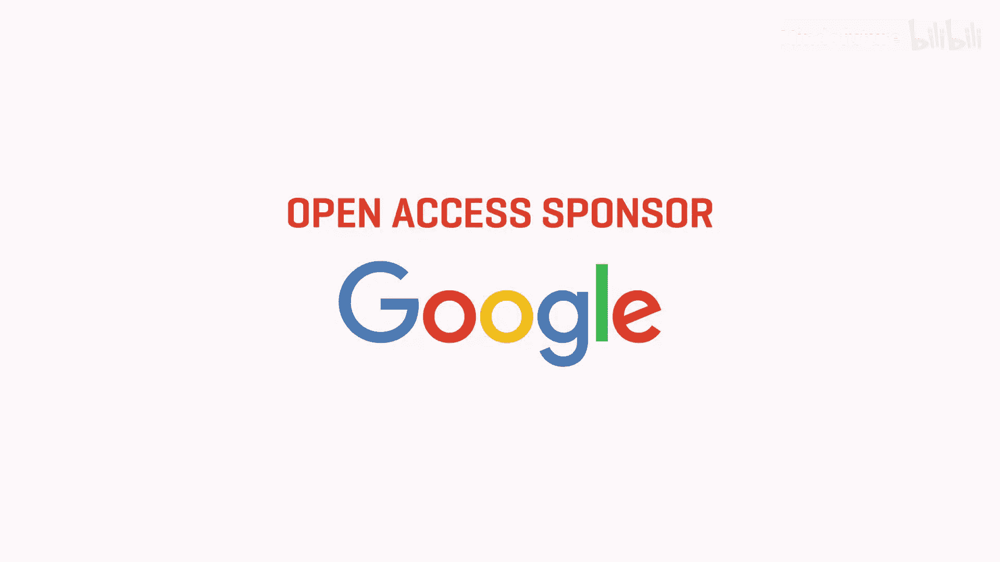

How many of you are on call today？seeOkay， how many of you have been on call in the last few weeks or will be on call Co on calls ruining my life。

It's probably ruining yours， too， right There were some claps and some other tales about holding the pager。

 I just had an intro。 I guess I don't need to say much because that intro was really nice。

 I'm the cofounder and CEO of a company called Hpot that happens to be building a tool in this space。

 I'm a little biased。 But I have been doing I've been on call for a long time。

 I got started in technical support。 cissad stuff back before we had Sre， that kind of thing。

 And I've built a bunch of tools in this space。 I've owned a lot of tools in this space。 And today。

 I'm going to talk about on call。😊，But first I'm going to tell you a story。

 a story about me and Kafka and being on call。 about 10 years ago， I was working at a small startup。

 and we ingested a lot of data over Kafka， wrote it into a database， queried it back out again。

 And one day through an ill fatd UI me pressing a button I didn't understand。

And a bunch of other mistakes。I managed to make Kafka stop working right in the middle of the day。

 froze it completely up。 I can go into details。 I don't really remember that much。

 But what I do remember is the core memory that I created that day of on call never feeling the same to me。

 I had been on call for probably 15 plus years at this time and on call never really bothered me that much。

 I was mostly okay with it。 It didn't wreck my life or anything。

 I do have some weird stories from being on call at Twitter that one involves one direction and another involves Charlie Sheen。

 like pretty neat stuff happen， but it didn't upset me。 but after this event with Kafka frozen。

 all the customers not gonna be able to get any data it was was the middle of the day。

 but I still felt really alone。 I felt really hopeless。 I'm gonna stop my memory here。

 just so that you have it frozen in your head。 and you remember poor Cory sitting as computer being upset。

 I'm sure many of you have felt similar feelings。This is the big Harryy slide for my talk。

 Most organizations are not set up to support engineering engineers handling the workload。

 interruptions and stress of on call， but teams。Are doing it anyway。

 I like that there are pictures being taken。I'm gonna to have a lot of pull quotes today because this talk is supported by a lot of people who filled out a survey。

 As far as leadership is concerned， heroics are a viable， longterm strategy。

 I am not here to pick on Vps of engineering and CTOs today。

 you shouldn't be concerned if you're in that role with what an individual person is feeling in terms of them getting woken up on a given knife。

 There's a weird mismatch between the people who experience these problems and sort of the leadership side of the equation。

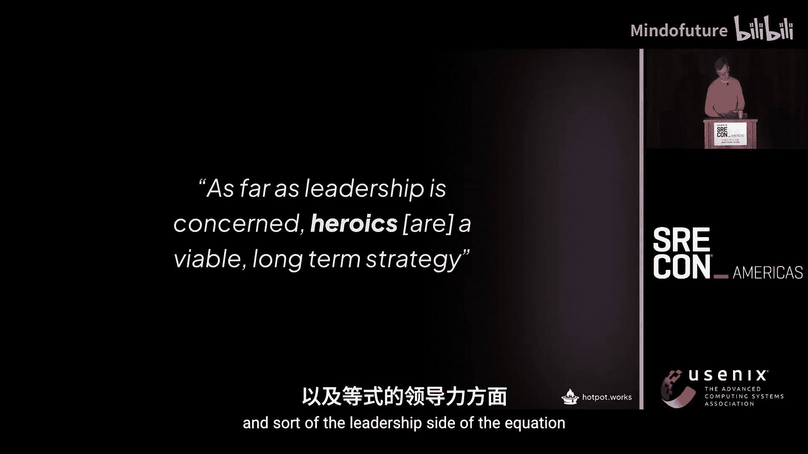

Here is the shape of this talk today。 I'm going to talk about the research that we did to support this talk。

 I'm going to talk about the findings。 Aka， the no good9， because we are clever。

I'm going to talk about recommendations for how you can get yourself out of some of these messes。

 and I'm going to talk about next steps because the work is definitely not over。First off。

 let's talk about the research I have， as was stated in my intro。

 been doing this for many decades now。 I'm largely self-taught。 I didn't go to school for this。

 I managed to land a job in some cool places。 And then one day I started reading papers by whole Nale and woods and Deer and cook。

 And I was like， wow， there's so much neat stuff going on in the world。

 And then I started to apply it to my job and started to talk about it a bit and give a few talks。

 but in this particular case， I'm now the founder of a company。

 and I have a lot more resources at my disposal。 I'm not just an Sre giving a talk。

 so I reached out and said， hey， we need to do research here。

 I want to back this talk with a lot of data。 I don't want to stand up here and tell you about my context at my individual company。

 but instead let's talk about the industry。 and let's talk about your companies。To support this。

 we reviewed a whole bunch of papers， both academic papers， industry articles。

 We also did a survey that had 65 questions。 If you happen to be in the audience and filled out the survey。

 Thank you。 I really appreciate that。 But from all this， weve got。😊，Some demographics。

 I'm not gonna to go through this whole slide。 I just want you to kind of have some context for what we're gonna be talking about today。

 The average role SRE meantime of experience， how much time you've been in the industry 18 years。

 four years at a company size of your own call rotation， probably on the high side of five。

 somewhere  five to 10 range and then lastly， size of your engineering or lot of reasonably sized organizations。

500 plus people。 So this is the context。 I want you to sort of understand the shape of people that interviewed or that answered the questions that we sent out。

Now， one of the things we asked them was， are you happy with the status quo of on call。

 Are you happy with status quo on call， raise your hand if you're happy with the status quo。

No one turned around and looked， no one raised their hand， okay。That's the way that is。

 So then we asked。How do you feel about your organization， Is your organization status quo。

57% of people said they were status quo or a little bit worse。Right， nobody's happy。

30% of people said that they were their organization was either trending toward or was already a dinosaur。

So，87% of people completely unhappy。Great。So then we asked about a bunch of different dimensions。

 I'm going to go through every one of these。 It's going be basically the summary of this talk because I'm not going go through everything。

 But there are a lot of detail here。 If you just like sort of squint at this， It's just orange。

There's very little green。Right， people are just unhappy。

 We're going talk about a bunch of this stuff。 in turn。 You don't have to squint to the slide。

So that's the high level context。 We， we did all this research。 We looked at all this academic work。

 We looked at what the industry was talking about。 And now we're going to bring you a bunch of findings。

 And the aforementioned cleverly titled No Good9。 Anybody familiar with the FAAA's dirty Dozen embracing that before。

Couple nods and headshakes in here， similar gives you a nice mnemonic to remember these things。

 Take pictures。 It's gonna come back。 There's gonna be a lot of pretty colorful slides here。

 We're not gonna have time to talk about every single one of these today。

 I could spend hours probably talking about them。 We're gonna talk think about seven of them。

 If we have questions。 we can go over the rest。 If you catch me in the hallway。 I'll dodge you。

 And then if you eventually pin me。 I'll be like， okay fine， I'll tell you about one。

The first one I want to talk about is onboarding and training。 I'm going to talk about it first。

 because it's the worst。More people were unhappy with onboarding and training than any other topic we asked about an on call。

2。35 out of four stars was the average。She shut the door。 That's really loud。

34% of people said that their training or onboarding was worse than standard。

 only 13% of people felt that this was better。 And this is bad。

 like I also don't tend to see in a hiring description for a job like a JD。

 a job description you don't tend to see a lot of people describing on call in my many years of interviewing people。

 Ive very rarely had everyone ask about on call。 Yet the training process for on call seems really bad and we're not doing a very good job。

So another poll quote， one of my favorites of this talk， we never get new team members。

 We just lose them。

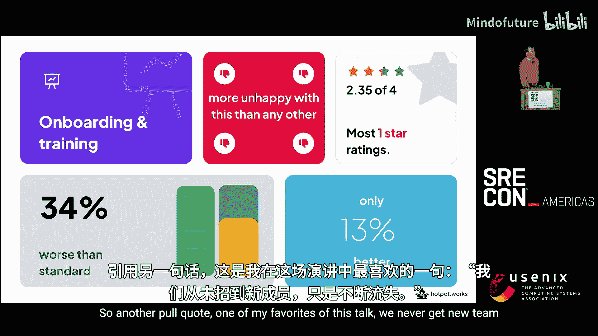

At least you don't have to train buddy。

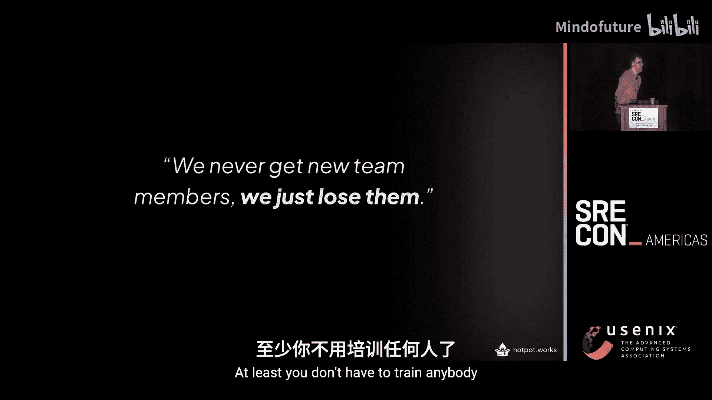

The upside。Unsurprisingly， on call is heavily based on reactive improvement。

 On call is about sort of the junk drawer of ops is what I like to call just where stuff goes when you don't know what else to do。

 And so what do you do， You fix what breaks。A lot of these are summaries。

 there is not literally no strategy， but consistently across the people that we spoke to。

 they said there was no real strategy in the organization for how they approached reactive improvements or how to be more proactive。

 no measurement across very many of these things we create tons of alerts， tons of process。

 tons of what have you and there's no real measurement if any of its successful。

 and very rarely is there any investment in the space。And one positive note in the top left corner。

 we did find that some people who did say they had a good experience tended to have regular meetings about this topic so they would meet weekly。

 monthly to have conversations about all call and what they could do about it。

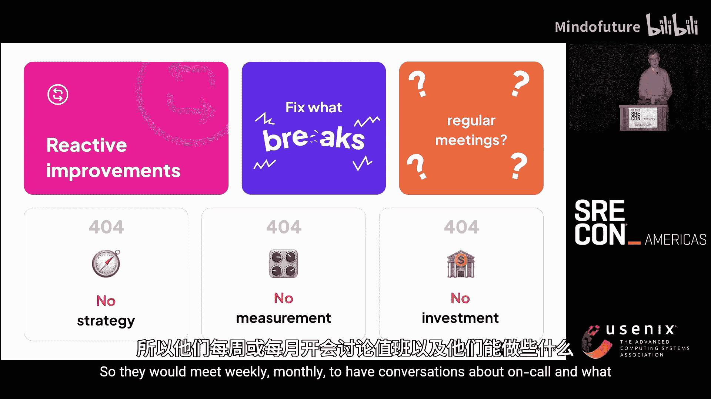

A quote from Re Daniels here， this is in I can't really read that the contrast Cory。

 how to create sustainable on call rotations， this was a lead dev article。

 but there was also a striptripe increment article。

 on call is a dynamic living thing because computer suck and entropy and whatever on call is just going to get worse over time if you don't take proactive steps。

 that's why this lack of this only reactive stuff isn't going to help you longter because you have to have enough slack in the system to properly deal with the work that's going to come from on call。

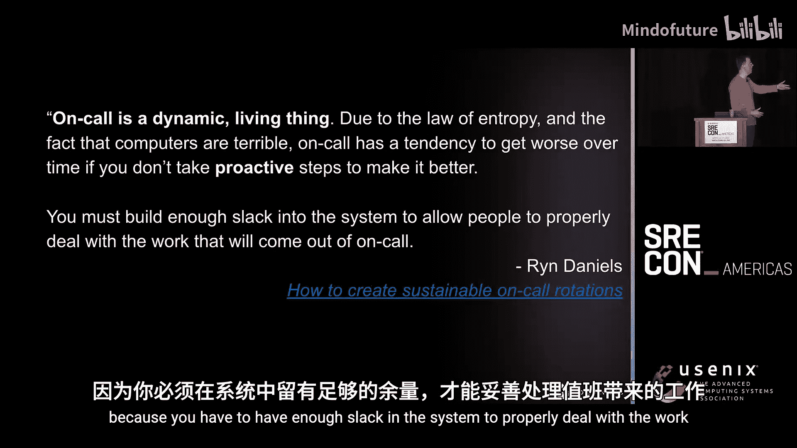

So you don't have time to do the things that you're doing on call。 Why don't you， Well。

 many times people cited that they didn't have agency。

20% of people said they couldn't or wouldn't update alerts。That sucks。 Why couldn't you update alert。

 Sometimes you can't， because there are no permissions。

 You're not allowed to be you're on call for something that you don't even have the ability to control。

 Some teams ci that they couldn't fix these problems。 They could only escalate them to somebody else。

 They sort of had to pass the burden along。 Sometimes there were stakeholders blocking these things。

 And these are with the best of intentions， right， You've got customers who have something that they pay attention to。

 you have an executive who's got a pet metric often because it's representative of something that a customer needs。

 and they don't want to be surprised by that。 This last slides were a little funny。

 I'll try to deliver it right， but only 30% of people sometimes felt that they were supported when attempting to deal with overload their way。

So they didn't have the agency to deal with the fact that they were overwhelmed by being on call。

 They tried to do something but the organization they didn't feel was very supportive。

 So there's not a lot of agency。 I'm sure many of you have been in situations where you just didn't feel like you could do anything about the thing that was overloading or about the things。

So。What do we have if we don't have any agency， Well， we also can I change this， I don't know。

 Maybe there's no process to change it， or maybe it's so convoluted。

 I don't know how to change it at all。 Seven people said that there were no prioritization of improvements in their organization for On coal。

It was commonly cited that they didn't know how to deal with escalation paths， how to use them。

 where they should go， when they should use them when they're allowed to use them， etc ceter。

 that they didn't know what to alert on。 If you were here for the last talk。

 someone asked a question about alerting on memory and his answer was don't But that that in my process Like how do I know that does my organization help us with this。

 34% of people said that their team doesn't monitor how they're onca practices tools are working。

 Does this mean they don't check for the metrics of the alerts to see if they're ever working。

 page people are not， are they successful。 I don't know。 But it's definitely bad。

 there's two bullets or two blocks up on the right， I want to talk a little bit about Slos like。

First off， can I take a shower when I'm on call because I only have five minutes to answer the phone or this is gonna get skipped。

 And if it could skipped， am I in trouble for this， who does it go to， Why does it go to them。

 Why does it take this time， This was a point of frustration and the deployment tracking is sort of a class of issues。

 Like I know when I get paged， It's really bad when later I'm like， when did that get deployed？

 What do you mean we turned this feature flag on， This customer started。

 I didn't think this was going out until next week， This idea of what's happening when I'm on call。

 I sort mental model， how accurate that is， what the systems doing and how it's doing appointment tracking was sort of a common theme here to understand when the stuff that I'm doing on call is affected。

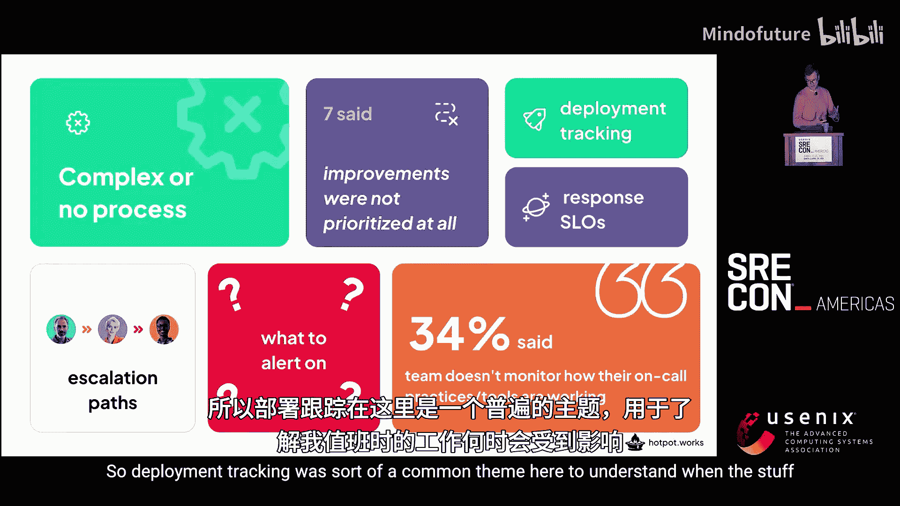

It is atrocious。 It's too complex。 On call is hampered by too much process and too few permissions。

 and customers shoot themselves in the foot。 But it's the cloud。 So it's our foot。

These are actual quotes， by the way， thank you so much to the people who did this。

 you've made everybody laugh and made me look funny， and I appreciate that。

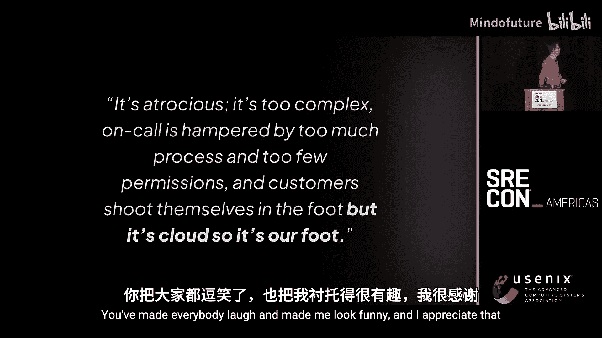

Handoffs being completely unsupported， 28% of people said they never expected to get an on call handoff。

11% said they sometimes get a handoff。 So if you roll that up， 39。

 40% of people can't rely on getting a handoff， one person I didn't do this in a po code。

 but one person's idea of an on call handoff was they said， well， someone tells me here you go。

 have a good night。Now， handoffs are kind of important。 we don't tend to do a lot with them。

 They're very sort of underutilized， I think in the space， not a lot of tooling around them。

 but we know they're valuable。 they're really great。

 this is actually a big inspiration for me this particular paper by Chad Todd handover communications and software operations。

 The complexity and uncertainty of information provided during a handoff can affect an engineer's confidence in understanding the current state of the system。

 The opportunity to take a few minutes to talk to the person who's just coming off call so they can give you a little information。

 We often think that the people who are coming off as I'm coming off call， I just assume they know。

 I my God， I know about all that stuff。 They were watching the trash Slack channel where we spray all our alert or they read the last three incidents or whatever they're paying attention。

 People probably are' paying attention。 We'll talk more about that a bit。 little foreshadowing。😊。

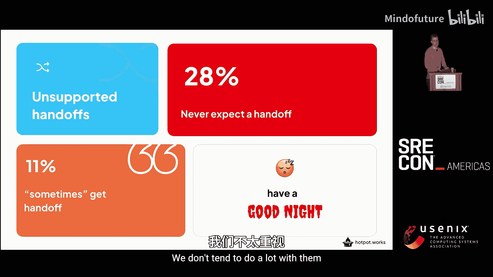

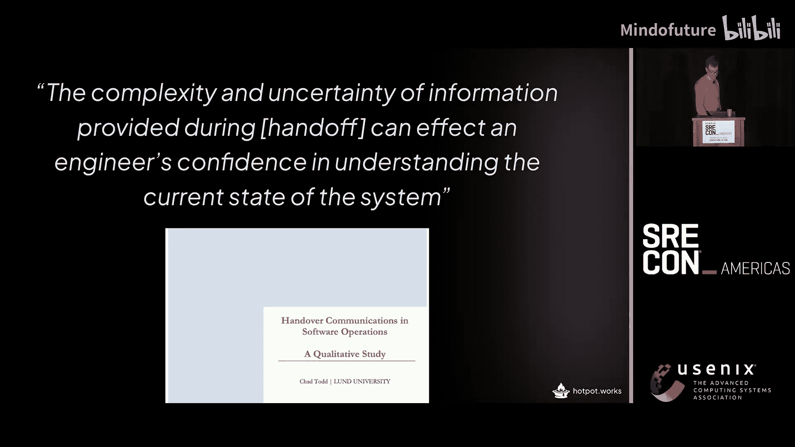

Scheduling， obviously a hot topic of being on call 2。85 stars out of four for shift frequency。

 It's not horrible。 schedule management， the ability to sort of control the schedule and how you're on call 2。

83 out of four。 but 53% of people sometimes are always feel anxious about being on call in your heart。

 raise your hand if you don't have to raise your hand I don want to call。

 I don't be anxious about it in your heart raise your hand if on call makes you anxious。

 sure makes me anxious anyway， a lot of people feel anxiety about being on call。

 And if we look back at some of these slides。 if I wasn't trained。 And if I have no agency。

 I'm not being whiny， it's because it sucks。 and nothings set up to support me Now we were also seeing common conversations about the difficulty in changing a schedule。

 The sort of like reciprocity of being able to move things around change who's on call。

 make adjustments for life。 that kind of stuff。 One thing we did find is interesting。

 we did a lot of these surveys also product reasons。 we found that hey，247 rotations for one week。

 that seems is pretty fair。 So that。It good finding to learn that that's a pretty industry standard thing in something that I will say is largely a folk model。

 there's very little definition for how on call should work。

 We just sort of copy it around between teams。Too many responsibilities。

We'm going to spend a lot of time on this slide。 Well， not this slide。

 but a whole bunch of other slides that are all about too many responsibilities。

 So I couldn't get to some of the other9。 SLA is not being sustainable。

 If you don't know what a service level agreement is， it's an agreement with a third party。

 probably a customer that says， we're going to be up this much time。 And if we're not。

 you can get money from us。It's really common for engineers to not even know what they are or who they apply to because that's usually the domain of sales legal so the organization knows about it。

 but the people don't And this isn't the only reason。

 but there are many other reasons that artificial not actual urgency can be introduced into the on call process if you're listening to the last talk I'm just going to use it as repeated examples。

 the idea that an alert could fire in the middle of the night and there's not enough memory on a system。

 okay what do you want me to do about that I that urgent or is it not urgent if I' going to be dinged See somebody's measuring the process anyway。

 so maybe not， but you only know that because of this talk don't misuse that information。

When we have too many responsibilities， we can't get ahead of the workload and we end up getting into an efficiency and thoroughness trade off ETTO。

 if you know about that。So we have to figure out how to deal with all of this。

And honestly what we mostly do is we sort of just run the bases。

 we go out there and we mark the alert is resolved and we move on with our life where we mute it for a day。

 I know that's a power move I've used many times in my life。

 shout out to the tool vendors who implement mute because that's really great just like I don't know tell me tomorrow but we're just sort of kicking the can right we're not really dealing with the problem we're just running the basiss。

So we asked people if you're overwhelmed， we knew this was gonna come up。

 So we asked if you're gonna be overwhelmed， what are you doing in addition to on call。

 the average engineer is saying I do four other things。 one of them is dealing with incidents。

 that doesn't have to be like sort of colocated with being on call but it commonly is because if you get page you're gonna escalate maybe up into being an incident。

 not every page is an incident by the way， we tend to think about it that way， but it isn't。

 it's just a convenient piece of machinery that we sometimes use whenever pages come up。

 But what else are we doing how many of you are attending meetings at the same time you on call。

 about 75% of you would raise your hand if I wanted to slow down and make you do it I don't have to anymore because it's all here on the screen。

 you're also dealing with internal and external support requests that's really common， by the way。

 we found a lot of people who are on call and also dealing with incident helping team members。

 customer teams， sometimes even outside customers like people who are using your product that are paying money or what have you And in addition to this we're maintaining alerts updating run books of course is just reading the slides fixing。

Bug tickets， feature development， et cetera。 so many things that you probably already know and you've probably already read。

 so there's no reason for me reading them to you。Now you're probably sitting in the crowd now。

 here you are at a site reliability engineer conference， you're bettering yourself。

 you're sitting listening to all these awesome people other than me， talk about all this rad stuff。

 and you're probably thinking， if I just worked a little harder。

If I was as smart as this other person or whatever。

 this cool performer who gets promoted at my company。

 I would probably be better at dealing with overload。 Well， guess what， It's not you。

It's all of us dealing with being overwhelmed like this。 It's actually pretty well studied。

 We know what happens when overload comes up。 These are the things on the left。

 this is what the literature says。 You're gonna to shed load， reduce thoroughness。

 shift work in time or you're gonna recruit resources。 That's what you're gonna do。

 What does that mean in practice。 Well， on the right， we're going cut lower priority activities。

 That's a biggie。 we could work on everything but spend less time， we could give up quality。

 push back some deadlines， that's always comfortable， we could work ahead and save some time later。

 work more hours， or we could ask the people around us for help if we know that the literature says we're going to do this。

 well let's just ask as part of the survey where are people spending their time。 Well。

 whenever they get overwhelmed， they stop doing low urgency tasks。

I think low urgeency tasks are cool like you know， everybody loves hackwe why because you get to do all the low urgency stuff。

 but we're cutting out so many of the fun things or so many of the things that were probably proactive。

 We're also overwhelmingly asking our manager for support and we're asking our team for support。

 It is a myth that only， only one person is on call all week。

 We are smearing it around to the rest of the team。😊，We're also sometimes pushing back deadlines。

 hey， I have not told you a lot of positive things。 look， we're very rarely giving up on quality。

That's cool。 We're site reliability engineers， right， We're reliable。 That's cool， though。 we。

 we're not giving up on the things that are important to keeping the site operating， etc cea。

 But we are smearing the workload across the team。😊。

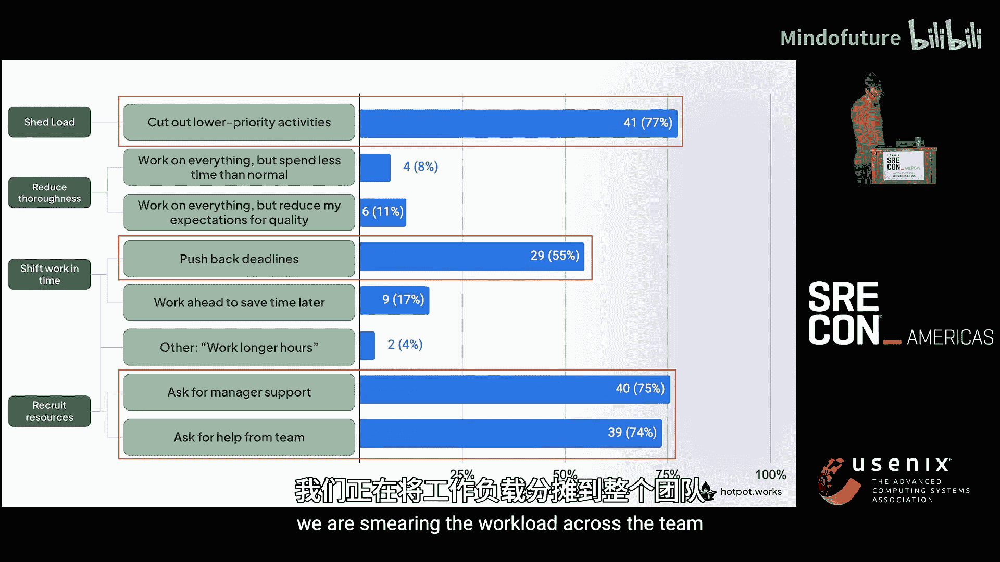

My biggest complaint about all call is that it's high risk， low reward。

You have to work very tactically to avoid making your management chain or customers upset。

 It doesn't help your performance review， and it won't get you promoted。

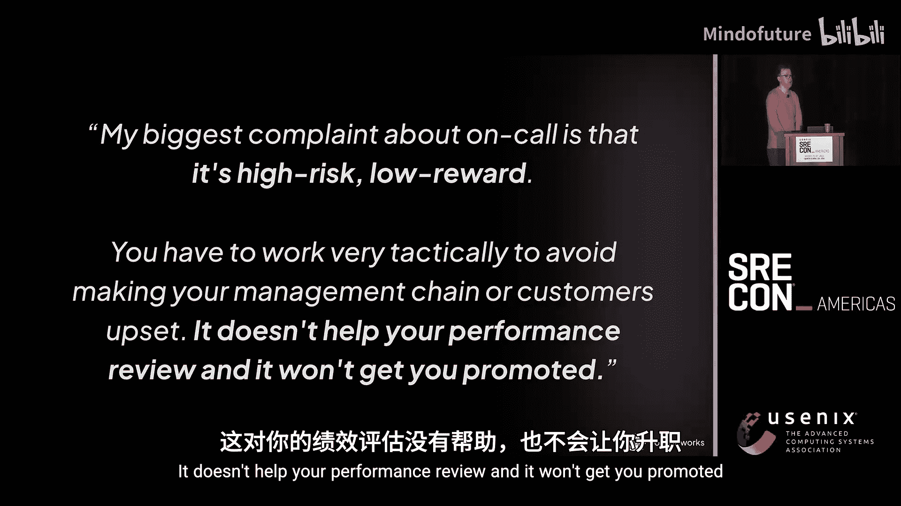

This is the no good9。Again， in pretty colors。 we skipped a few。 that's okay。

 We're not going to go through those， but we're just going to spend a few minutes talking more about what this means to organizations on call engineers and line managers。

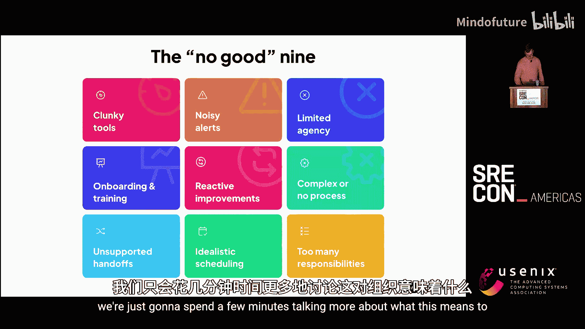

Are carrying the costs of poorly structured on call programs and tooling。

 What the organization is lacking， we are making up for with the individuals inside the teams。

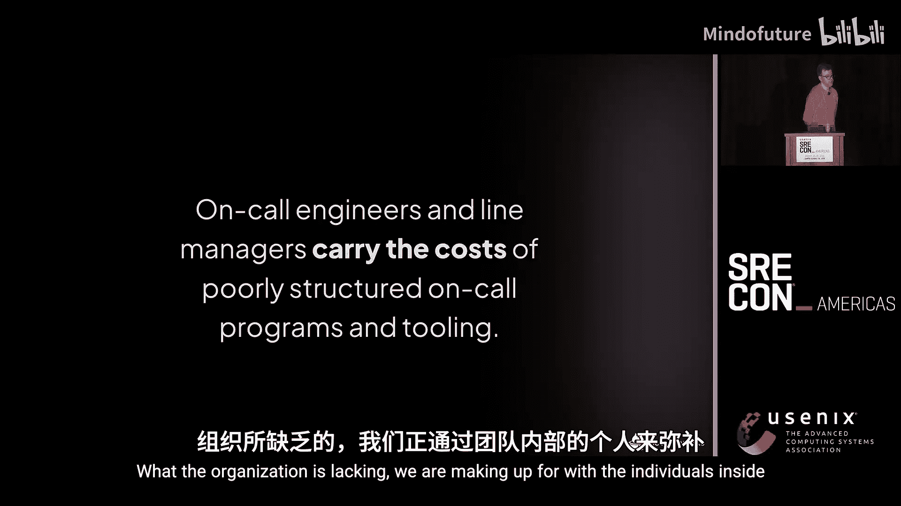

74% of the engineers we survey reported experiencing overload。

 burnout or both in part due to on call responsibility， three quarters of this room。

 if you're representative， have felt this or are feeling this out。

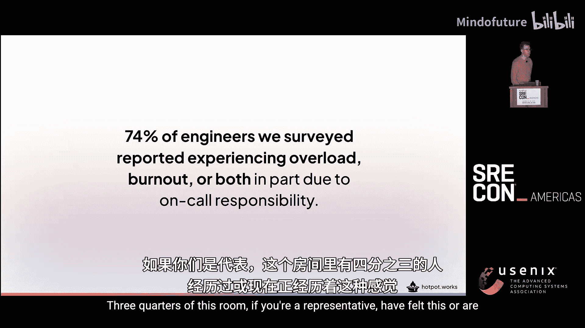

So Kafka。Here I am sitting at my desk。No idea what to do ever since that day。

 This is probably not really true。 But in my sort of brain，'s ever since that day， onca has hurt。

 Like I feel it in my gut。 This was before let's see， this was in between me working on Twitter。

 I took strike down a few times。 And every time I did it。

 I felt it Like it was like a punch in the stomach。 I felt that drop in my stomach。 Oh， no， to me。

 it all felt like it started here。 I didn't know what to do。 I was overwhelmed。

 And this is hard to say out loud。 Like I'm a big cool sorry I worked all these great places。

 But I was， I was just out， I didn't have any more energy for it。

 And what happened was my teammate who is now my cofounder was like， hey。

 I think you need to have a lie down。And he took over。And the team took over for me。

 They saw what happened。 They saw how I felt， they saw my reaction， and they said。

 you go somewhere else。Let us take over， we got it from here and that's what they did and even though this story is hard and it's hard for me to tell and it impacted。

 I mean even to this day， my partner asks me about onca accompanies when I start at them because she remembers this。

 she remembers how that felt and what that did to me but it wasn't just that story it was the entire time I worked at the job。

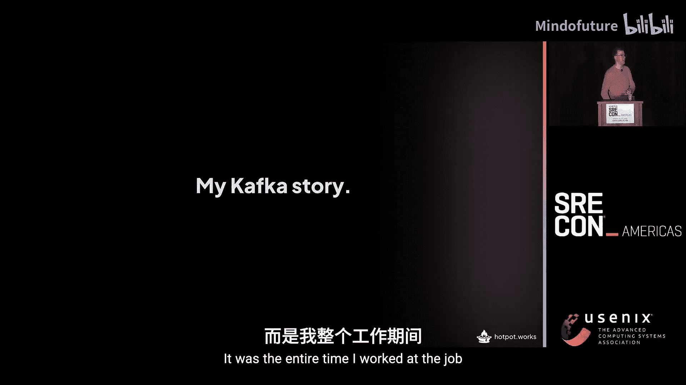

People， your team is working together to overcome the organization's shortcomings in this space。Now。

 let's be positive for a little while，3。33 out of four stars for teammate support。

 So what people said about their teammate， 3。15 for managers。

50% of people rated their teammates for stars。You guys are awesome。 You're all awesome together。

83% of people so they can confident and consistently count on teammates to help troubleshoot respond to incidents and cover them。

 And 87% reported their manager will help them if they've got these sorts of problems。

 That is really， really， great。 We're doing the work locally， which is very cool。

 even though the organization isn't really supporting it， We're doing the work locally。😊。

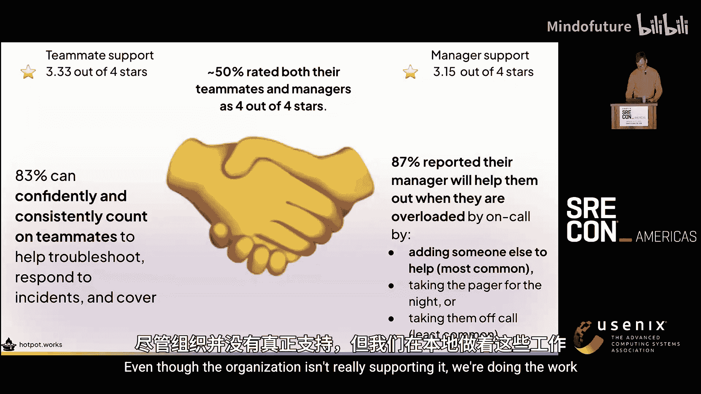

okay， this isn't an individual engineer problem。 This is not a manager problem。

 This is an industry problem。 We're sort of copying and pasting these practices across different organizations。

 We don't have the tooling。 We don't have the awareness。 We're not doing the measurement。

 It's an industry wide problem。In our survey， being responsible for real work。

Was the most common reason。 There's a very sarcastic set of quotes in that slide was the most common reason for being overloaded and overwhelmed。

 So what do we mean by real work。

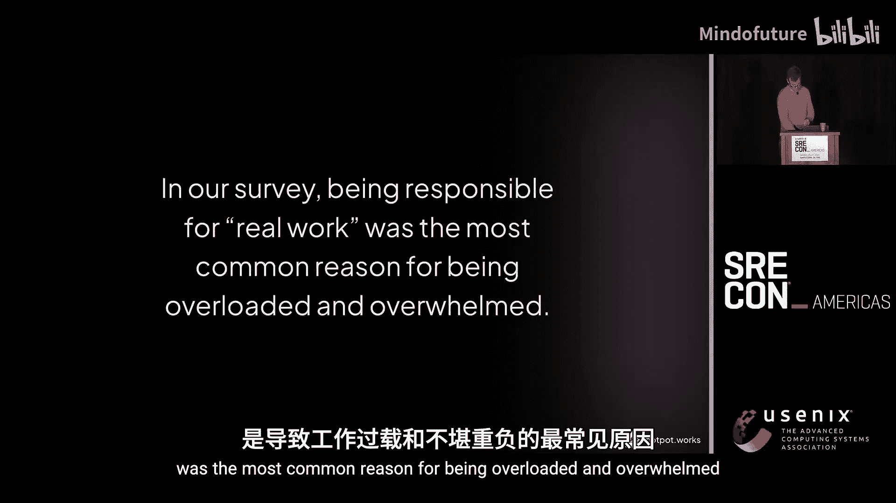

How many of you have ever said， heard， et cetera， the idea that， hey， when you're on call。

 you just focus on on call， I've said it。there's some hesitant hands。 We've said it。

 but 34% of people said they were responsible for regular feature development work when they're on call。

 so you're dealing with these problems and you're expected to take on the additional burden of on call 66% of people were redirected toward on call work like no no。

 no， just go work on that hoie like make on call better for everybody this week。

 but it is not considered in performance reviews。But you're burning 6 to 8 weeks of your life of your job of your year on this。

 So if you were onca rock star and you spent super extra time doing all this stuff， hey'。

 nobody' gonna give you anything for it at the end。 We all want。 We aspire。

 We want to get that cool project。 We want to get that promotion。

 We want to be a level 12 senior staff， principal Uber engineer。 We want all that stuff。

 And there's nothing wrong with that， but we're not gonna get there。 Nobody cares about the onwork。

We call this the onca doom cycle production pressure。

 the upper left is going to outweigh any sort of concern for onca health。

 then that's going to cause overload and we're going to get burnt burned out from sort of juggling all these tasks which means we're gonna to get fatigue。

 we're gonna to make mistakes we're not going to be able to sort of keep everything in our working memory anymore because it impacts our ability to function and then despite this the deadlines remain and puts more pressure on us to ship and then it comes back around to the top of the circle again and we think well I guess I'm going to move to another team。

I'm going to move to a new gig， and they're not going to do it this way。 Well， we're just trading。

Right it might feel a little better because you get that excellent training experience from your new on call set right but what we're really doing is sort of trading burntown engineers across organizations。

 There is some respite from making the change and maybe you will find something different。

 but generally speaking we're just sort of trading burnout， I'm burned out。

 I don't know that I'll ever come back from it。 I'm definitely not the same as I was 20 years ago。

 but。

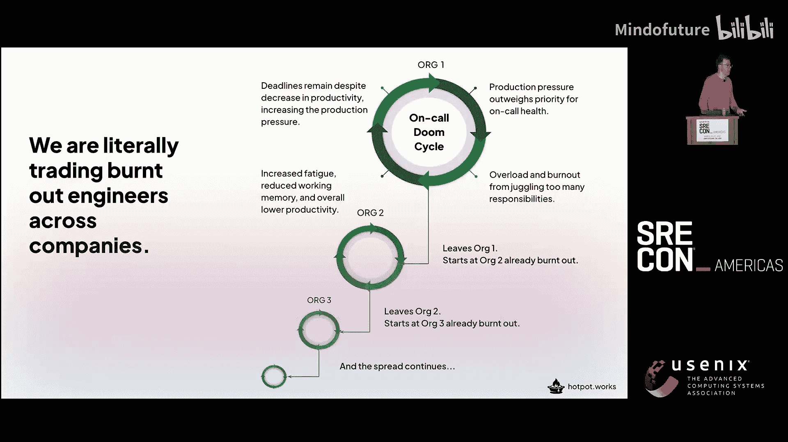

Yeah。If there is a rotation and it's well organized， it's fun。

 It's good to make a difference in such a direct way。 I still like it。 I mean。

 I'm glooming and dooming up here pretty hard， but I still like fixing stuff whenever， you know。

 your on call， making that alert， get tuned or you know finding that bug or making that change。

 whatever。 all it all feels good。😊。

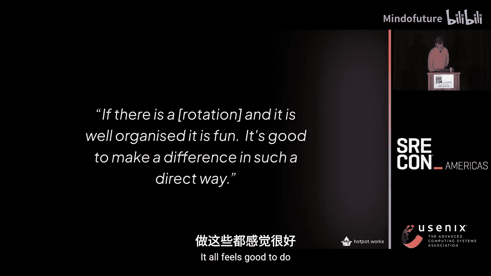

To do so recommendations。I've， I've stood up here wagging my finger at you。

 telling you that on call is bad。 Let's talk about how we can make on call much better。

And this is what we think you can do today。First off， let's not talk about best practices。 Sure。

 there are aspirational， wonderful things you can do to try to make on call really great。

 But what I'm more concerned with is sort of like what's appropriate for you in your organization。

 And it's different for everybody。 big organization， small organization， new ones， old ones。

 those with that are S sorry those that are AI， those are not AI。

 whatever it is there are things you can probably do and we should focus on habits more than on wholesale change。

 We don't want to say like you know rip a thing out and put a whole new one in。

 if you're in a leadership position and you're seeing this talk first off， things are doing it。

 But secondly， this doesn't mean you should go out and make some edict in the organization that we're gonna start doing this right now。

 you should be super happy that your teams are doing all of this。

 You should be asking them what you can do to support them that we'll talk about that a little bit more later。

 But habits are better than wholesale change。😊。

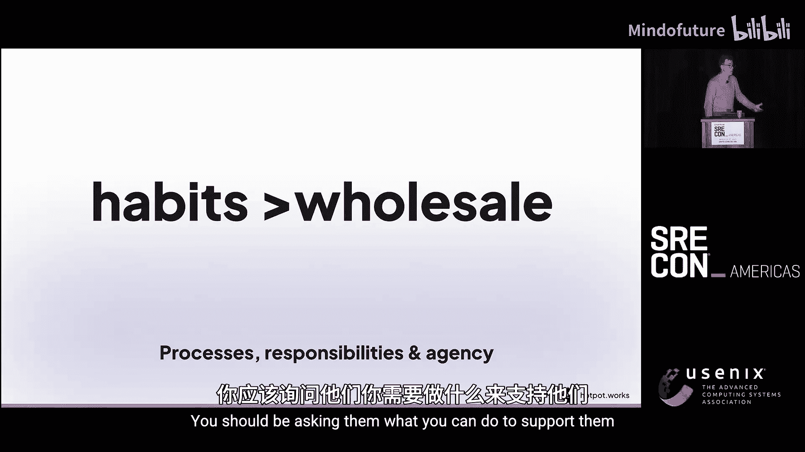

Remember this is back in Daniels again remember bandais are not real solutions。

 what you do to fix a problem at 3 o'clock in the morning， you really don't want to be load bearing。

happensappens anyway。But you don't want it to be on calls going to generate unplanned interrupt driven work by its very nature。

 because， again， it's sort of the junknc drawer of ops。 It's all the stuff that just happens。

 We need time to fix these hacks later。

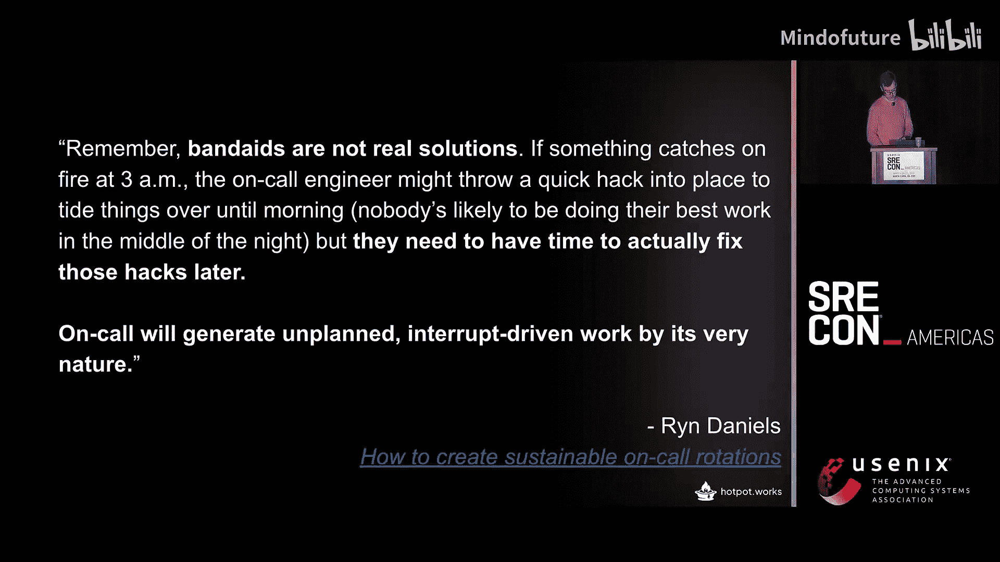

So we're gonna talk about sort of a bunch of the nine in I don't know。

 stream of consciousness order kind of here， complex or non-existent processes there's a bunch of stuff you can do。

 I'm not telling you most of these are things that you could probably think of on your own playbooks。

 metricss would be really great in almost any capacity here。

 sort of thinking about how you wake people up， when they wake up。

 how much time people are spending on call， keeping track of what they're doing when they're on call。

 what their support load is， all that kind of stuff release engineering practices。

 It's a big joke like， don't deploy on Fridays and then being mad at people for saying don't deploy on Fridays。

 What that really means is don't deploy when there's no one around to help you。

if there's people around at5 o'clock Friday， I don't care and deploy your butt off。

 but if there's nobody around， you probably don't want to thinking about that。

 your software deployment。Tools like if I'm doing it deployed， does it notify anybody， is it visible。

 Can I see， am I aware how we handle escalation policies was cited here。

 Do we know where those escalation policies are they mapped out。

 Do we understand how to navigate them。 obviously， observability and monitoring can help。

 Sometimes there actually there're mostly the problem quite often。

 establishing risk management practices can help you with that Friday deployed decision。

 And then building learning and refinement in your process of postmortems。

 We talk a lot about incident postmortems， but we don't talk about like the onca week postmortem。

 just having that discussion you postmortem anything。 And in fact。

 my favorite postmortems were at a job had many years ago doesn't really matter where it was。

 But the Is organized just like a Wednesday afternoon。

 let's all get together and talk about stuff that happened this week。

 and usually a few incidents were picked or some other interesting things。 And there was no ego。

 and there was no title。 Ju engineers， Seni engineers。

 but it was interrupt driven A lot of questions， a lot of information sharing。

I was talking earlier about if you're in a leadership position and you read about this and you think。

 I'm gonna to make some edicts that nobody can get interrupted this often or we're gonna have these sides of rotation。

In high reliability organizations， aircraft carriers， cool stuff that I don't know anything about。

 this is what they do deference to the most relevant expertise。

 Who are the people who really understand the systems。

 Let's talk to them because they know And then we've got distributed decision making。

 We've learned here the team is doing the work together。 They're already doing the work。

 What do we need to do to support them how do we just give them the resources so that the organization is supporting this instead of the team carrying the load all along。

Being proactive about processes and alerts， I'm a longtime observability ner。

 Just allocate an hour every week and keep a log of what you change。 Just adjust alerts as you go。

 assuming you have the permissions。U。I am a firm believer that if an audit or sorry if an alert pages people。

 it should have to justify its existence。Why？Thanks for the clap。 big strong believer in that。

 If you've got clunky tools， I think especially in the Sre space I was talking to somebody today about the Sre space。

 and I said， you know a lot of people in this space I don't feel like really quite understand that they can be buyers too you can pilot things you can adjust things in your organization There's lots of tools in the space and you have the power to do that。

 You're supporting this anyway so you should flex that muscle from time to time。

 get those organizational resources to use the software that you think would be helpful to your team。

For training and onboarding。Bring it into the light。 We need to do it。

 We need to have lots of opportunities for formal and informal stuff。

 The idea of shadowing as someone who builds an oncall tool。

 I can't even define that word really well is the shadow of the person who's responsible or the person who's monitoring them。

 I don't know。 It's weird， but we we also need to provide a mix of formal and informal stuff。

 You're like， let them have opportunities to learn on their own sort of unstructured。

 asking questions。 My sort of favorite point on this slide， though。

 is remember that it's not just technical stuff。 It's also coordinated stuff。 How do I escalate。😊。

Is it okay to escalate？Should I be really polite when I do it like what's the process for escalation。

 How do I do it， if I get into an incident， What how should I behave， Should I talk a lot。

 Should I shut up， Should I share screenshots， are memes okay。

 All the stuff we need to teach people for scheduling， try to be flexible in your schedules。

 I encourage people to look ahead， look at times when either you're going to be doing something interesting as an organization or the calendar is doing something interesting。

 And please proactively just monitor for how often people get woken up in the middle of the night。

 We know that waking people up from sleeping causes them to just be cognitively not as effective the next day。

 Just monitor for that。 That's pretty easy to do and decide your schedules to account for life happening。

😊，For handoff stuff， which I think there's a lot of opportunity for。

 most people don't do a lot to prepare for being on call。

 There's usually I made a joke earlier about the trash Sck channel where you just send all your warnings and stuff。

 People skim those verbal handoffs are the most effective way to do this work。

 But the person who's incoming needs to do a little work first。And then overall。

 it's better to allow the person who's incoming to sort of drive the conversation What questions do they have because that's really what you need to know。

 how do I prepare them， will they need to ask and then more importantly。

 make sure that there are more interjections instead of readbs。

 I'm sure many of you if you have handoffs， it's probably like a Google slide template that you write and then your handoff is you read it to a bunch of people who aren't paying attention to you that is not a good handoff a good handoff has questions。

 Interjections， all these sorts of things。So I've told you a bunch of stuff today。

 and I can see that my clock has about two minutes left。What are we going to do about this now， This。

 This set of findings is not good enough for me that that experience was too trauma。

 And I care too much about on call to just stop here。 So I want to do more。Today I， oh， yeah， sorry。

 That's the next slide。 The first thing I want to do is I'd really love to trace the development of more on-ca programs。

 If you work for an organization who's also interested in some of this stuff or if you happen to be an organization that wants to flex their internal muscle and say。

 like， we'd like to work on this stuff organization， please support us。😊，Let's be friends。

 I want to measure the impact of onca over time。 How is this impacting you the positives and the negatives。

 There's case studies a galore here。 I'd also love to facilitate ways for us to discuss this as an industry and to share some of these appropriate practices。

 I think I put that and I talk as a joke to me because of the appropriate slide earlier and I don't want to say best practices again。

 So these appropriate practices。 So to facilitate this the way that I'd like for everybody to work on this is we we're unhappy with the status quo。

 So I would like us to have a status wa。 Let's get way better at this。

 we went and bought the vanity domain status w com and hastily through a web page up a few days ago then learned that apparently people spell wa differently sometimes and then we had this big discussion will do we need to get w another spelling。

 Should we get status quo to status quo。 It was a whole thing。 But we ended up with this。

 which is at the moment a little like because it tries to address a lot of the things we've shown here。

 I think there's already a link to my slides that have been posted here even before。😊。

I gave them to the folks at Unix we will put the recording of this talk here and we'll put more information about what we have found from these surveys。

 There's a newsletter sign up at the bottom where if you'd like to participate in future surveys we'd love for you to jump in share your email addresses We're not gonna product bomb you with anything This is about the research We would love to have opportunities to sort of share this information。

 get more research etc into the work that we're doing I want to thank everybody for coming to this talk today I especially want to take some extra time to thank the people who filled out the surveys it so kind of you to take the time to do the biggest piece of feedback I got directly was wow this is long so I appreciate you taking the time to get through it。

 I also appreciate the signal boosters and the reposters。

 people who took the time to share what we were doing with the world I want to especially thank Dr。

 Laura McGire and Morgan Reynolds for doing so much of the survey design for putting the data together。

For putting together a lot of these findings and I also would love， I mean， you know。

 my company did a lot of this， so I'd love for you to check out hotpot do workss。

 which is the tool that we're building to do a bunch of this work。 But again。

 thank you so much to the survey responders。 Thank all of you for caring about on call and for listening to me talk about this today。

😊。

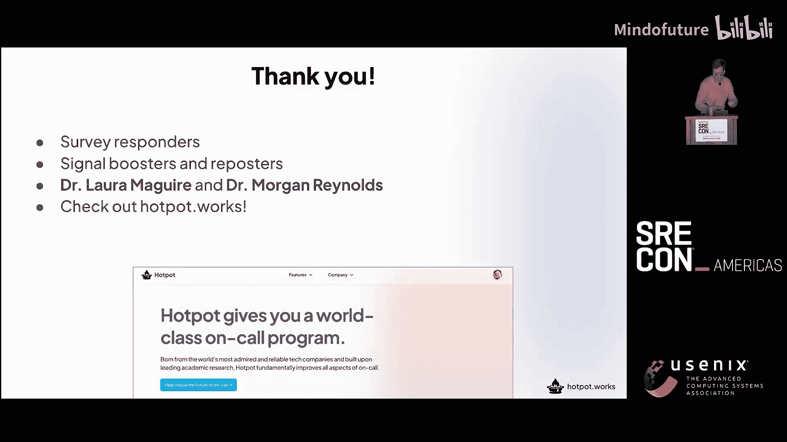

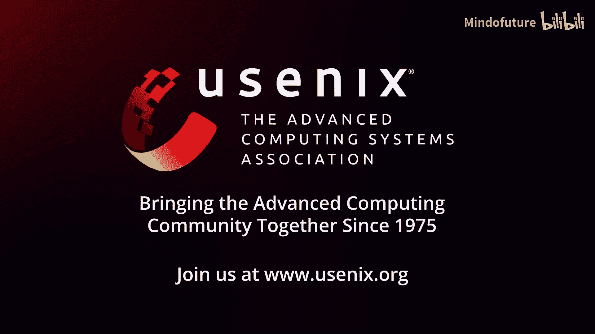