# SRE大会-2025-美洲-｜-srecon-｜-分布式-｜-缓存-｜-OpenTelemetry-｜-安全-｜-AIOps-p16-P16-The-Perverse-Incentives-of-Reliability--BV1TmLDz7EZZ_p16-

。

I have never been so excited for a conference talk。 I had the best time putting this together。

 Quick show of hands。😊，Whoever you believed that broadly at the end of the day。

 the job of Sssari is to somehow avoid downtime。Like， you know， it's a trap。

 like I know you think this but you all know it's a trap。 Okay， you're too smart for me， right。

So I am Katie Wilde。诶。And I'm the kind of person who just cannot stop myself from running towards a fire。

 I sometimes feel like we' become S Rs because it pays better than arson， so。嗯。😊。

And there's a little disclaimer any similarities to persons living or dead or any actual events are purely coincidental。

So I'm a verb person。 My verb is running into the fire。 And in fact。

 I actually studied macroeconomics。 and now I'm very excited about how everything is so complex and messy。

😊。

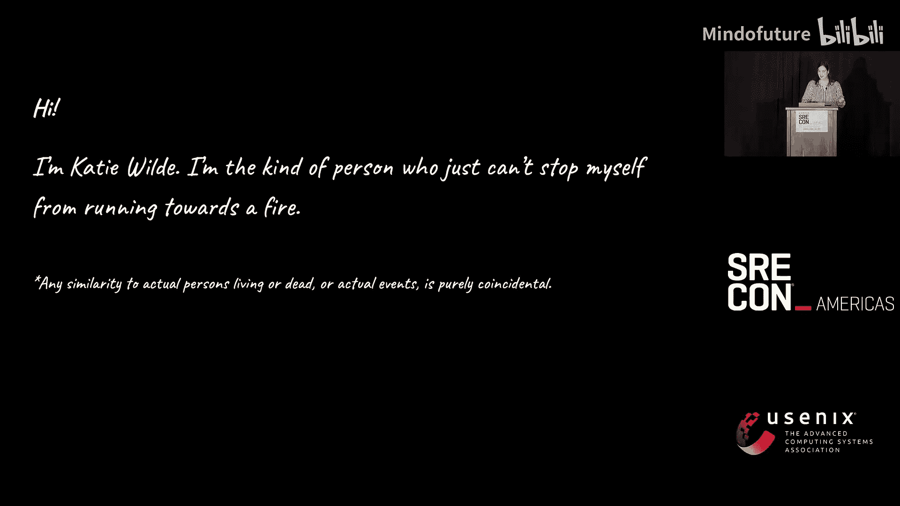

嗯。There we go。Right， so you probably all recognize the intro to our favorite video。

 the positive affirmations for S R。 If you don't， there is a link。

 But the macroeconomic context right now is that the world is more complex than ever。

 There's this AI hardness。 It's causing chaos。 No one gives a shit about S R。😊，We're undeunded。

 as usual， We're overworked， which we do to ourselves， but we can't stop。

 we're trying to do more with less。It's really hard to maintain the reliability gains that we have made。

 We're really worried that it's about to get a lot worse。 And we're probably right。

 because we usually are。Low accountability， higher blame vibes are becoming more common。

 This is what you tell me。 and I see it too。And there's the sense of apathy。 There's this feeling。

That maybe it's just not possible to do better。And that's hard because we're a cost center in a world of scarcity。

 in a world of do more with less。And in a world that's also obsessed with adding AI as fast as generatively intelligently possible。

It's hard to be a cost center。So what are we to do？嗯。

So the title of my talk before I came up with Leonard Bne， which I stand by。

 it talks about the incentives that we have the incentives that govern the organizations we work in and how they are not good。

 technical term being perverse。😊，And why is that， I mean， the problem is that。

Nobody cares about uptime until it's not there。 Nobody's like， good job。 Ss up。 Well done。 I sorry。

 Oh， maybe your teams do， but。Are you hiring？So they only notice they only care about up time when they don't have it。

 and then they're mad and it's your fault because you suck。

The consequences of work that you are doing are very much delayed。

 You are working on things that will improve baseline reliability over time into the future。

 The future is not here because that's how time works。 and that's， that's difficult。

 That's difficult for you。 The application Des are highly incentivized to avoid this whole drama。

Okay， we'll talk about why。 And then the other thing is like SRAs。

 like we're mostly visible when shit's really going down。Is that。A coincidence。U。So I mean。

 if you know how to explain correlation， spurious correlations to managers。

 then please come come talk to me。 I don't know how。 yeah。

 so you only ever see us when things are very bad。 So yeah it's not great。😊，嗯。

SoSo like it isn't just Elon， like we seeing， we are seeing this slide deck。😊。

In boardrooms and Zoom rooms， you know， across the industry。

 And I think the most alarming part about this is that。

The consensus of whether this is a good idea is somehow still mixed。嗯。Like a lot of people。

I'm not putting these things together。And I don't know why， but it is a fact of the world we live in。

 so there we go， this is our situation。😊，And this is how long run works， you know。

 Keynes famously said in the long run we're all dead and he absolutely could have been talking about SRE。

😊，And the fact that we will be dead in the long run， he just doesn't care。 He's like。

 but I'll be dead。 So I won't care anyway。And then the other thing is like the application devs。😊。

Like why， why don't you do better， like why don't you help me come on？Like production is down。

 your widget is not working and they're just like， lah， la la。Somebody else， oh。

 I see my text when it should say somebody else will act， somebody else will， we're just going to。

Pretend I don't stand。And I mean。we know that nursearies will get paged if it's really bad， right。

 which is true， that's how things work usually。And so most rational people will try very。

 very hard not to be near any kind of incident， anything right。

 and this is technically known as the bystander effect。

 and this is a fundamental discovery of human nature。

 It applies whenever you have more than like three people， you know。

 it's like are you going to help him like maybe someone should help him So this is just how humans work？

嗯。And so these application does who are not helping you。

They're rational humans responding to their incentive， their incentive is to run away from the fire。

And they're just doing that。

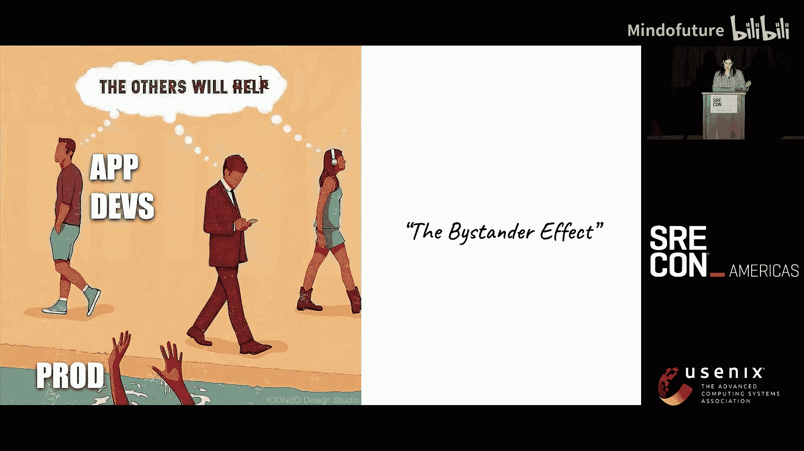

Except for you。Who broke you？😀Yeah。Because you are not a bystander。I mean， you're here。

 you're in this room。And you're listening to me and you're listening to Dr。

 Woods because you just cannot just watch it all burn。 You're like， we must do something。You know。

 and I mean， maybe， maybe you end up doing it yourself a lot， you know it's toxic。

 you just can't help it saving the day because， after all， we know the apps。w。

So what are we going to do？

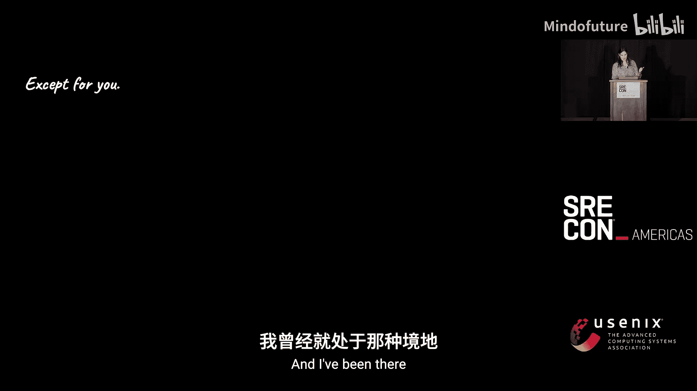

And I've been there， I have got the T shirt。Very literally。

They sent me a Tshirt to commemorate my failure to create a scalable operations team， like。

 well done， you're still handling incidents yourself and I'm like fuck。I am failing so hard。

I need to do something。 Alrighty， so how to not be me as an alternative title to carere。

 And I'll tell you a couple stories about things that I've done that were a massive waste of time and energy mainly my own。

😊。

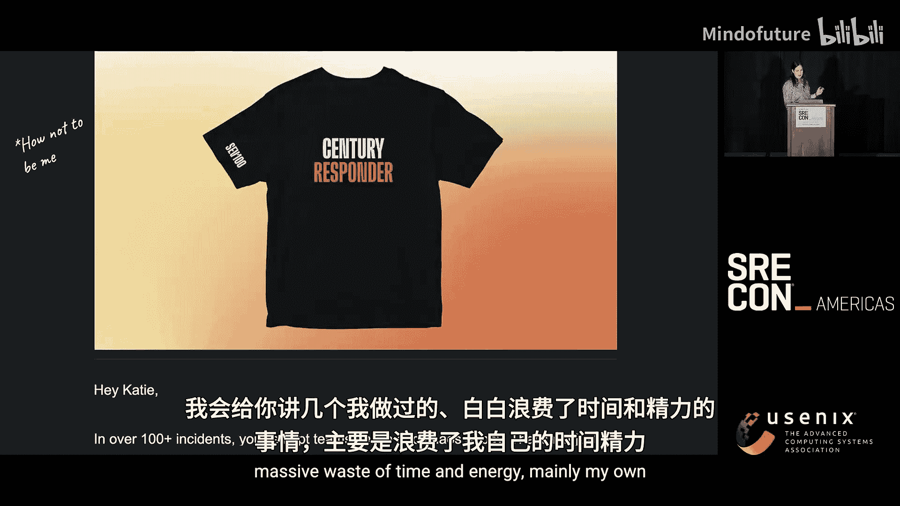

So firstly， we should do something。And systematically， we should just not answer every page。 Katie。

 we should build a system that builds the system， et cetera， et cetera。 Of course。

 where do we start well。We measure change Ana， right。

 we need to understand the ROI of our various initiatives。

And so we need to know what all of our metrics are。

 and we need some kind of very robust measuring tool because we want this to be accurate。

And then we're going to do that。 and then we're going to be able to prioritize like what to do。 Okay。

 and the rabbit's like， are you okay down there？Because here's the thing。

You don't need to know exactly what your mean to whatever is to know that it's nobuno。

Like we can take that pot as red。And we should， like typically， you know， roughly。What's bad？Okay。

This is also you being a noun person， by the way， which we know is bad。

 We're gonna read the papers later， but we're like， we take it on faith。 It's bad。 Okay， okay。

 so I'm like got it， gott it， gott it。 I am in analysis paralysis。 Like let me， let me step up。

 Let me actually do something。 There's a lot of outages。 and most of them are caused by change。

 We know this。 This is like trivially true of everything。 So excellent。

 I will prevent the outages from reaching production。嗯。I mean， that's like， okay。

 the rabbit's got a hard hat on。 like， that's great。 It's not that it's a bad thing to do。

 Preventing outages from reaching production is a good thing to do。 And that's the problem。😊。

You are all very intelligent people who do not do clearly stupid things。

You do things that are good things to do。That you just shouldn't do。That is your problem。

Because you can spend a lot of time and energy making your giant safety net， you know。

 while the application dens are like， la la like on my tightrobe。

 which they don't know they're walking， by the way。 and you're like making the safety net。

 like you've got like push on green。 you've got all the automation。 like you are running you know。

 synthetic traffic in like that preprods。 You've got evil staging。 like you are doing a great job。

 And that's lovely。😊，U。But like you do not have this staffing， I mean， the problem。

 the problem with this kind of like nounny type approach to SR is that you are going to need an SR team that is at least three times asBG。

U。And I know that you've tried that because I am you and I have tried this， you have told leadership。

 leadership and everyone else is that they should care。

Like we should do this and you should care because I care。Okay。

Great they probably don't Also you've made a lot of slides about how SE is so important and if we have the safety net to catch our tightrop week walking application devs。

😊，Then they follow more matter， it'll be okay and it's very important。

 and so we need 10 times more SEs and more budget， a lot more。

And you've like written manifestos about how the app devs should also care and should be better and also if you could just write not shit software and maybe test things sometimes like would be great Gucci and yeah I tried all these things too and that's how I ended up with the Tshirt。

U。And like， here's what I've come to realize。Downtime is not the problem。

You probably are very excited about preventing downtime as an I， because it's interesting。

 But downtime is not the problem。 As Dr。 Wood said。

 the Snafu is inevitable and know the dragons are not getting any tamer hair， right？ Also。

 downtime is a noun。 I don't make the rules。😊，嗯。Downtime is not our problem。

Extended downtime is our problem。Now you're probably going to say those are the same thing。

 like you are you end up picking， these are what is the difference。And here's the difference。

There exists a window of opportunity。A grace period。What downtime is okay？Is it my Internet， Oh。

 my signal is not so good here。 Let me rerun that job， that window。 We know this window。

 The is it me。The is X down Google window， right？

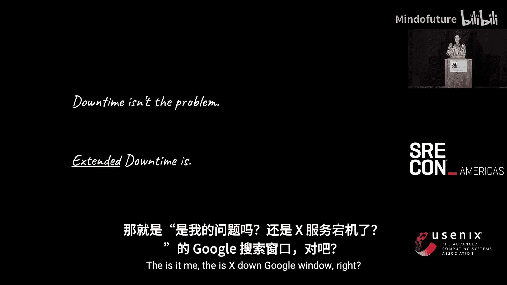

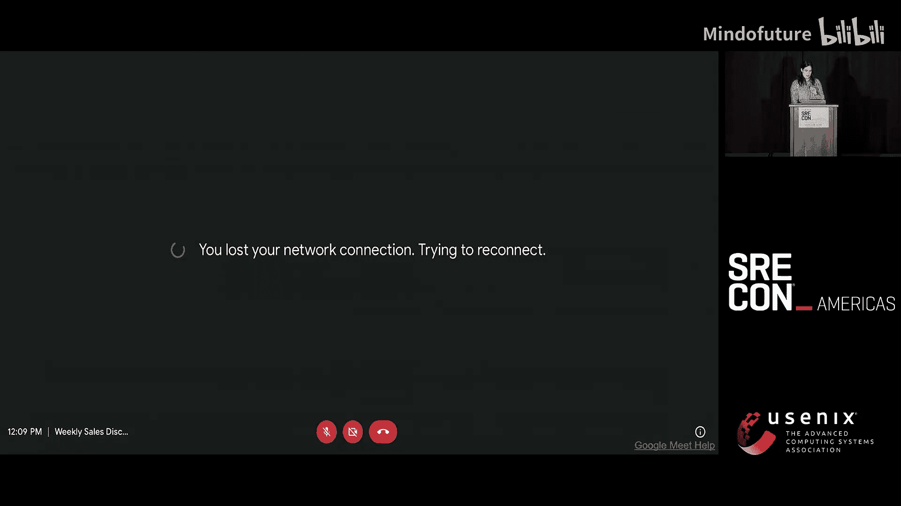

You probably didn't mind that slide。I have a downtime window for this exact talk， right？Okay。okay。

 so here's the thing， like if they don't notice。😊，It doesn't matter。

There is some duration of downtime for your system。 That is okay。

That is a time period where no one gives a fuck because they're trying to figure out if they're the problem or if you're the problem and you're in that whose problem is it quasi space。

 Okay， this is what we must exploit。 This is the answer。😡。

You have some kind of downtime tolerance window。 and so you must find this number。 Okay。

 if you do high frequency trading， I can't help you。

 This talk is not for you and hopefully they're funding S， right for everybody。For everybody else。

 like there is a window， maybe it's a few seconds， maybe it's hours， maybe it's days。

 maybe it's some kind of like reporting thing that runs once a week。

 and as long as it runs within the week like it's okay， right but everybody has got that window。😊。

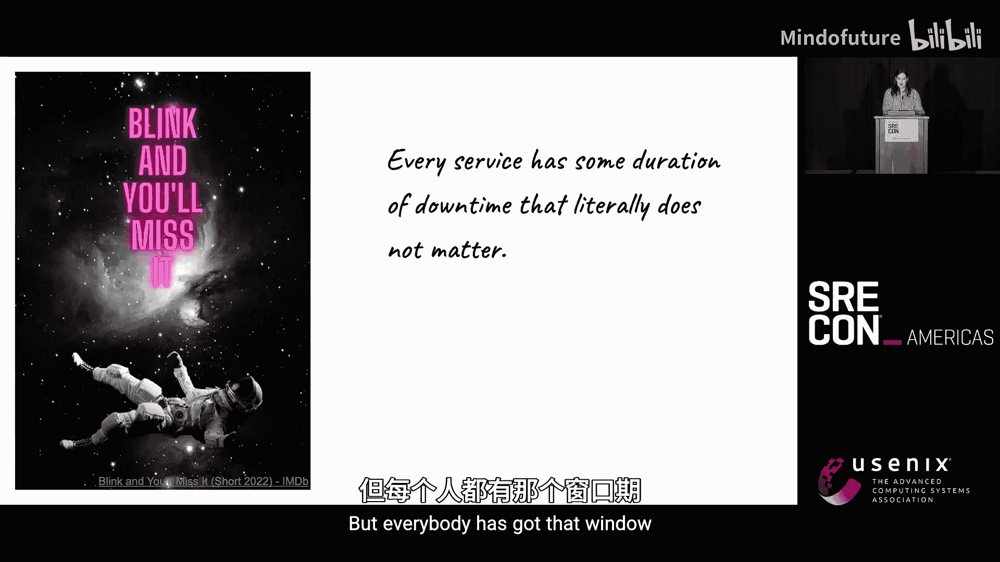

And you need to know what it is。 And now this is not your error budget。 This is very important。

 right？ So an error budget is basically saying， you know，1，44 minute outage and 44，1 minute outage。

Are all 99。9。 and that's the same because math， because it is the same because math， right， Yes。

 that is true。 This is also a mistake。 This is where we fall down。

 The downtime tolerance window is the way to get infinity up time， right。

 Because say your people don't notice one minute of downtime。

That means that one is the same as zero to them， because if they didn't notice， it didn't happen。

So you have0 divided by 44， which is mathematically infinity。

And now that is my one secret hack to infinite uptime。

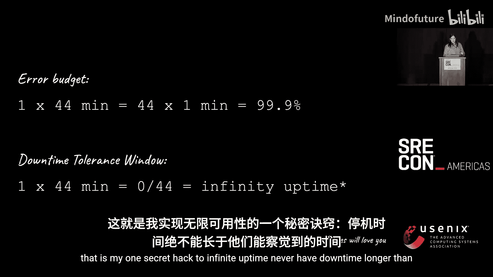

Never have downtime longer than they'll notice。And basically， it's like， yeah。

 if the site went down and no one noticed。We're good。

 And I have discovered that when salespeople talk about 100% up time， it used to drive me nuts。

 And I was like， what do you want in interplanetary fail over。 like， you know not of what you speak。

う。And now I'm like， oh！You just want the downtime short enough that the customers don't scream at you。

We can probably do that。 It is also a lot cheaper than the interplanetary failover。 So hey， winning。

😊，Al righty。And so your mission here is。To make sure that your time to mitigate your time to restore service is within your downtime tolerance window。

 and I want to notice that this is not a static value。

 this is an equation that you have to keep balancing。 This is a very verbi thing to do。

 like you've got to keep doing this。That downtime tolerance window， that is an evolving situation。

 You know， back in the days of dial， it was pretty long because you were like。

 did my phone get unplugged， did my cat like， oh， like， you know， Judy is probably on the line like。

It used to be longer， it's getting shorter， this is an evolving situation。

But you have to be in the a business of constantly balancing this equation right。

 this is what you're striving for。 There is no static end state that will tell you congratulations。

 you've got a trophy。嗯。And you just got to keep going。Winning at this game is a process。

 not an outcome， because this is a game that does not end。😡，You chose to play。

But that is good news though， because we actually we have lots of techniques。😊，系。😊，Luke。

 there roll back。We can try again。So I'm not going to go into all of the generic mitigations that you could be investing in。

 My point here is。You should prioritize the generic mitigations。

 not all of the other stuff I waste my life doing。 you should be better。 you should not be me。

 So rollback。 And again， you need to keep making sure this actually works right you have got to be regularly rolling back like if you don't do that off and you don't have rollback。

 So fun fact， you know， you don't want to discover that。It doesn't work when you need it。嗯。

The second thing you probably hear from my accent that I am not from around here。

Everyone asked me that even when I go home， I'm from South Africa， and we're really。

 really good at degrading surface when we cannot meet demand。😊。

And so we have this like nationalized practice of load shedding where the grid cannot act。

 or we cannot provide enough electricity to the grid。

 So what we will do is we will just like shed load。😊，And it's great。😊。

And what's amazing about it is like we choose who we choose when we try to make it fair。

 we try to not do it to hospitals。And I mean， if the South African government can figure it out。

 like you can figure it out。You should shed large。And I live in Canada now。

 so like I'm legally required to make references to Tim Hortons whenever I do a public presentation。

😊，Or I might lose my citizenship。So yeah， like just， just scale up， like just make it bigger。

 just throw money at it。 like it is not free， like it is expensive and probably worth it。But again。

 like this is like a live working practice。 Like if you're not like regularly scaling it up and scaling it down。

 like this is you're gonna run into all sorts of problems， as you will know。

 It's like water going through the pipes。 You can't just make one pipe bigger and expect not chaos。

 like you have to be practicing this。 But yeah， just make it bigger。

 Just throw money at it until you can figure out what's going on。

 Like this is something that you should be doing regularly。😊，And then lastly。

You should have this in your toolbox， you know， you should be able to block a user or a query。

 you should be able to quarantine， you should be able to drain traffic。

 you should be able to do all of these things again so that you can quickly mitigate a situation。

And again， you know， make sure you are doing this。 Use it or lose it is kind of the idea here。

 you know， you can't just put it in place one time and then be like， I've done it。

 There's my beautiful noun。Okay， because it will not be there for you when you need us。

You have to keep poking at it， make sure it works。Okay， and you're like， yeah。

 we could do these projects。 Co， whatever。 But Katie， we still have problems。 Like we still。

 we still need money。 And honestly， like we， we also need love， like。

There's actually an Irish band called Love and Money。 like。You need these guys。

 their music's not great。😊，But I mean yeah， you need to remain gainfully employed and not lose your minds like I understand this。

 this is true， of course you can do a lot of great work but if you get laid off like it's not going to happen so yes。

 you still need money， you still need love and you deserve it， how do we get it？😊，All right。

 there is a way。The way the human behavior is greed and fear。 These are our two primary writers。

 I would like to go away from the bad stuff toward the good stuff， right？

 And when we have these two things working， we move， we move away from bad to word good。

 This is what we do。 This is evolution。Okay， so greed and fear。

 how do we exploit this to get ourselves love and money well。Slightly depends if you're。

If you're in an enterprise B2 B world versus like a consumer B2B Saas world。

 like yourll greed and fear targets a bit different。 But if you're in an enterprise world。

 you want to make friends with your enterprise sales team and legal because enterprise sales is like how we can close and renew these enterprise deals that pay us so much money and without getting sued now。

 the lawyers are worried， Are we getting sued， Did someone say sued， We should okay hang on。

 Let's lock this down。 Okay， so you want to make sure that you are making friends with your sales team。

 They understand being enterprise ready， En excellence， like all of these things we can sell。

 people will pay back for it， right now they're like， oh， this is exciting。

 We like these S people and legal， it's like， well， how much are we gonna save on service credits。

 What is an MSA and what does it say。😊，And what happens if we get sued for not doing it。 Oh。

 now they're very worried。 Like now they're like， oh my God。 And you're like。

 we totally get sued because Esri is me and my friend in like a tragic court。 anyway。

 now they're like running to the CEO， like， oh， help， okay。😊，And then in a consumer B to C Saas。

 like you typically you don't have like a big sales team and a big legal team and like oh this machinery。

 But you have a product manager。 and your product manager like really wants to make sure that there's like engagement on the feature widget and that they're not losing money when checkout is broken。

 And these are actually all reliability metrics。 We just got to do some translation。😊。

And you also have support who is like， please all these tickets when everything is broken is terrible。

 So you make friends with them。 And then here's the thing like you don't need to ask for money。

 Your slightly greedy， slightly anxious friends will get it for you。嗯。Okay。

 and if you're anything like me， you're like but about those application devs？

Because it's all pointless if they just keep wreaking havoc and not caring。This is also true。

 You can do a lot。 You can have a lot of allies， but you are not enough。

 You still need that broader culture of reliability， learning from incidents。

 and you need the people writing the code to care， but they are incentivized to run。 remember。

 because it's like a fire and they don't want to be near it because they're rational。 We're broken。

 They're running away。 How do we get them to run towards。😊，Well， I have， in fact。

 found two techniques I'm very excited about。 The first one is the  Nd swipe。😊，They are engineers。

They are very curious people。 when things break， it's like a tech who' done it。

Like what happened to the Wasm proxy plugin， we use Wasum。I want to be there。 Okay， it。

 this does work。 It's very exciting。 Also， did someone say resume development。

 Because if you can make the point that。😊，You know， understanding how a system breaks is a great way。

To understand system design in general， which is a component in your career ladder。

 like if you can join those dots for them。Suddenly， they're a lot more interested。 Okay。

 And then the second one is。You got to earn people's attention。

 You can force them to give you their time。But you cannot force someone to give you their attention。

Like respect， gotta earn it。So you got to be like， we're S R。

 Everyone wants to be with me to be like me to be me。 Like you've got to embody this vibe。

 So how do we do that。 The first thing is be kind， right， even when you did actually tell them so。

 And even when they paid you with three in the morning to have you read the manual to them。

 like it's a bedtime story。And even when they are not kind， you're kind。And then the second thing is。

 have fun。 I really enjoy playing music in my incident review meetings。

 and I try to like pair the song to the incident。 and people try to guess what happened in the incident and like。

 how is this Beyonce related to like。😊，And it's fun and I found that I enjoy myself in this burning situation and that joy is contagious and that somehow more people then run into the fire。

😊。

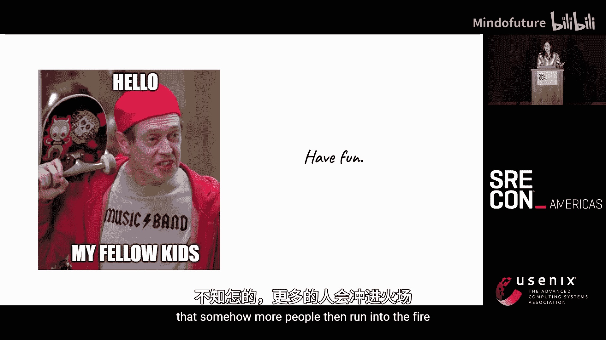

So thank you。 and you are a lot of fun。

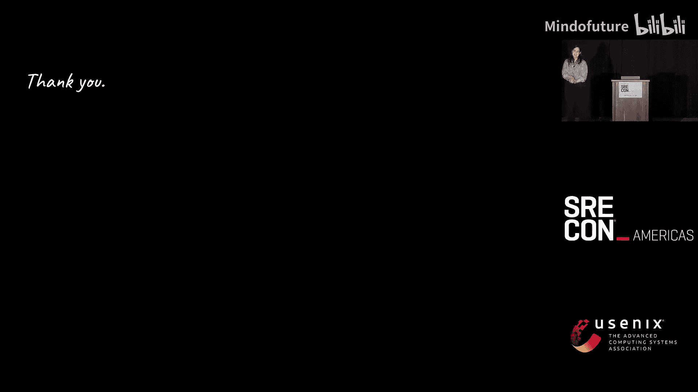

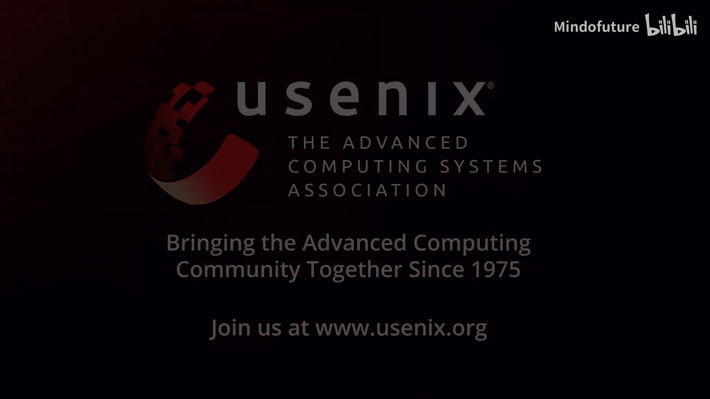