# SRE大会-2025-美洲-｜-srecon-｜-分布式-｜-缓存-｜-OpenTelemetry-｜-安全-｜-AIOps-p17-P17-Maturing-Your-Data-Architecture-in-a-Week---How-Bluesky-Survived--BV1TmLDz7EZZ_p17-

Hi， my name is Jazz， I use theym I'm on the Blues Sky team。

 Blues sky currently is a team of around 21 people in the company in total。

 when I joined the company we had around 100000 users a little under two years ago today we have over 33 million users and things have got a little bit exciting in a pretty short period of time Co so who am I well I am a member of the team seen here with two of my coworks kind of photo bombing I like to travel。

 I have some friends I like to go around and see the world with I like hardware I'm a very big hardware in a home laber so I have know a rack I keep in my apartment I run some community services for blue sky and app proto out of my own apartment and this actually translated super well to running bare metal onprem for work which is very exciting。

I have a really cool sister， she works at NASA for now。

 hopefully she will continue to be working at NASA， but things are a little tough right now。

And what else am I yeah， I lived in the Bay Area for the past five years。

 I actually just moved out of the Bay Area， but Esser Ricon right or this year at least is kind of in my backyard。

 so I decided it would be a great idea to come and tell you all about you what we did at Blue Sky。

So what happened this is a graph you're going see a lot of these this first graph shows overall request throughput through our backends on the left side of this graph this is around midoc you see us doing a daily peak of around 5000 requests fully hydrated API requests a second that our daily peak because we're social network usually lasted around 9 hours and typically our peak is in US time zone so from around 8。

30am Pacific time to around 4 pm Pacific time is our peak traffic you can see we had some pretty crazy activity going on in less of the month we went from a daily peak of 5000 requests a second to a daily peak of over 50。

000 requests a second that's a lot of scale in a very short period of time So what happened well。

I was at the bar one night and I was watching the afteraction report from a Golden State Warriors game and I saw a blue Sky post on TV and I saidhu that's strange why is there a blue sky post on the TV then a few days later we saw a blue sky Rock to the front or the top of the free apps in every app store in the US Canada。

 the UK you know lots of major markets we were at the top of the app store and a few weeks after that our CEO Jay Graber was interviewed on CNN Live on primetime news at night so clearly there was a lot of excitement for Blue sky。

 mostly at the end of the US election in November。We are a kind of open source and open network that has a microblogging app on it kind of like Twitter so some of our dedicated our dedicated users decided to make a fail well for us that was more in the realm of blue sky our network is made of distributed nodes called PDSs and we named them after mushrooms so we have kind of the mycial network of servers and our users kind of have this fun mentality where they like to they like to champion the mushroom that they're on so we have our own failwell which thankfully we didn't really need too much also I am our primary onca at this time during during this incident usually the shock caller on infrastructure decisions and on scaling decisions and so I had to prepare for the worst I collected a large amount of monster cans from my local Walgreens and was ready to。

Get into the action。 So this is a user growth graph。 You might notice it looks pretty crazy。

 In mid Octobertober， Twitter changed their terms of service。

 This T change made changes to how blocks work and it also changed their AI policy saying that they could use images uploaded by artists and by users to train AI。

 This was pretty wildly unpopular with users and we saw it on our end as a couple million users moving to our network in the course of a week。

 then at the end of November， we saw not a big spike and a falloff。

 but a kind of weird hockey stick shape。 if you work in Sre。

 which I'm sure lots of you are familiar with graphs that are hopefully are unfamiliar with graphs that look like hockey sticks because they're very scary。

 because from day to day， you see continued user growth and the rate of growth increases as time goes on and you have no idea when it's going to stop and you have no idea what to expect。

 So mapping this。😊。

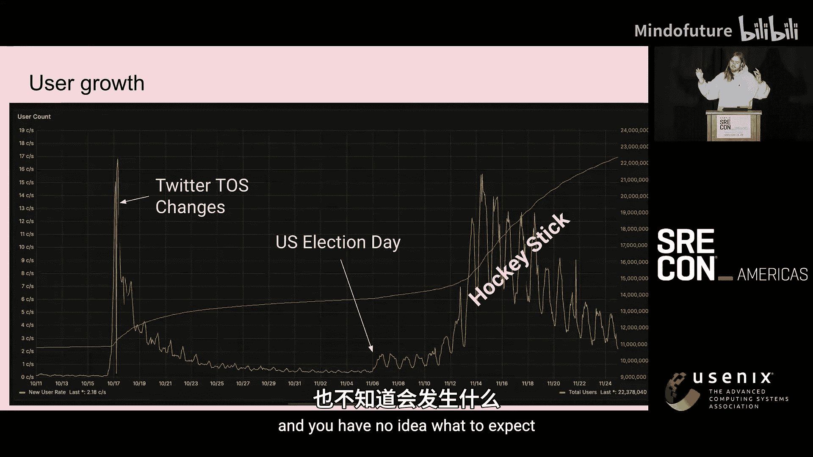

Back onto the graph we saw before of overall request throughput。

 we can see when Twitter changed their TOOS， we have this big spike to around 35。

000 requests per second daily peak， then things calm down a bit and then U Ection Day happens and instead of it spiking and calming down。

 we have this big kind of hockey stick swell。Now why is this a problem for us Well。

 we run on bare metal this is some of our fleet that runs in one of our two point of presence data centers。

 we have a fixed kind of capacity when it comes to things like this。

 so how do you deal with 10x growth on fixed capacity。

Let's let's get a little bit more into what happened that week。

 We saw four different modes of failure during this hyperscale event。

 The first mode of failure is you know software you control goes wrong。

 that's really easy to fix because you just ship some write better code。

 ship better software hopefully you can roll stuff out quickly enough and you can mitigate the issue。

 What happens next is software you don't control goes wrong。

 That's a lot harder you have to talk to a vendor you have to go dig into stack overflow or wherever you can go find more information about other people seeing a similar issue and try and mitigate it yourself。

 and that's pretty hard。 then you have hardware that you control fails like a disk failing or a node going down or a NI failing Those are annoying but at least you can do something about it。

 those stink because I have to go down to the data center and go swap out a component or something like that。

 but at least it's within our power to solve the problem and then finally hardware you don't control failing。

That's probably my least favorite mode of failure because you just kind of sit back and say，huh。

There's nothing you can do at point at that point if you're relying on external hardware and that external hardware has a failure and you don't have any kind of backup system in place。

 you just kind of have to wait it out， call your vendors and pray。

So these each have their own flavors， their own symptoms and their own remedies let's look a little bit closer at that graph from earlier showing requests per second we see at our peak here we're up 10 x for mid- Octoberto so 50。

000 requests a second and then you can see at the daily troughs which are usually when we have a breather we're doing 25。

000 requests a second which is higher than our daily peaks from pretty much historically so we're both doing way more traffic than we expect and it is a 24 hour problem because there is no longer a safe time to do anything。

So speaking of failures， heres a really dangerous looking graph。

 you can see there's some really odd shapes in there spikes dipping way down into the 32K request a second range down from around 50K so what happened here well。

 there was some pain。And then it ended after about eight hours and then there was a little bit of extra pain in there somewhere so viewing this from the perspective of our East Coast data center you can see hey there's huge traffic drops on our East Coast data center you know it doesn't look like there are many errors that are spiking it mostly just looks like there's not traffic coming in so what the heck happened there was an external hardware failure。

We had a fiber cut at one of our facilities this fiber cut sucked because at the time we were singlehomed in this facility and so we had no easy way to reconverge ourBGP configuration or anything like that and shift traffic to our other ISP so this was pretty painful The result was about 50% of our users couldn't talk to us and we had tons and tons of new users joining every day at one point we were adding a million users a day for three days in a row and lots of them wanted to use a platform and new users are very excited and want to like things and follow people and post and say hey。

 I'm here it's awesome and they couldn't do that so what do we do we have two data centers。

 let's fail over to the other data center that's's a pretty easy thing to do right you know the whole point of having this redundancy is so you can do a failover so we did a failover it didn't go great the failover happened。

 we failed over all of our traffic and about five minutes our database cache got thrashed inossibly。

Really really hard hot shards are now twice as hot so any popular data。

 any hot shards you have in your data center when you suddenly double the traffic it usually has a similar shape to the traffic that's already there and so all of our hot data got twice as hot and we didn't have the right caching infrastructure in place to deal with that so now all of our users were in integrated state and we kind of made things worse by failing our traffic over so we revert and you run everything back so what do we learn from that well it's best to roll with the punches oftentimes during an incident if you make no decision it can be worse than making the wrong decision decisiveness is very important and you must weigh the costs of doing nothing versus the cost of trying the thing that you can try for us we were a small team we had tried this failover before at smaller scales it worked fine we had never tried at this scale before but there's the first time for everything so we learned the hard way that that probably wasn't the best way to do it。

So what else do you do with this external hardware failure you call your vendors and you say hey。

 why is there no fiber， why is the internet down， they will tell you oh we have a team there and they'll be done in six hours and then you'll say oh all right。

 can't really do anything about that you apologize to your users and you update your status page and you say hey we're super sorry。

 we know you all want to be here but we can't keep the website online right now because of stuff that's outside of our control。

 you don't want to normalize the fact that these kinds of errors happen on your product。

 you don't want your users to get used to things being buggy and flaky and bad。

So also prioritize dualhoing your BGP configuration。

 prioritize getting all of those redundant systems or all those potentially redundant systems to be actually redundant so you don't have an issue like this again。

 and then in the meantime pray that your vendors get things resolved as soon as possible so looking back at here you know we had about an eight hour window where we were in very dubious straits of internet activity in our second data center but we got on the other side of it。

 things were okay then we ran into some more issues later so I'm talking you through the timeline of an 11 day window in November where we were in a situation room 16 hours a day for 11 straight days sleep was maybe four hours a night because I would wake up you know as soon as I was cognizant enough to wake up I'd wake up and check graphs and make sure we weren't going to die today and so everybody as the week went on as the 11 day period went on。

 things got worse and worse and worse because we were performing worse and worse。

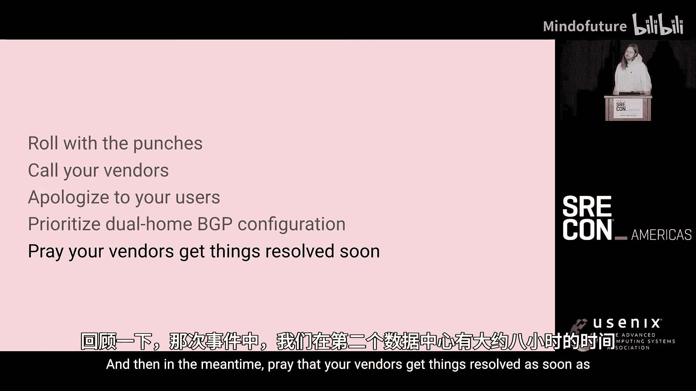

And there were more miscommunications and more fat fingers and more problems so on the read path you can see there's a little bite taken out of this graph around what is a 7 pm Pacific time。

 this is what that looks like as you can see in this graph there's a big red spike in there which means we're serving some errors so what exactly happened to get us to serve these errors well there was a database node crash but we're running a horizontally scalable fully redundant database why would that cause errors we'd expect to see a little spike there but whats with this whole you 30 minute period of pain after the database crash the node rejoins the cluster and once the node rejoins the cluster everything goes to shit and we're wondering what happened here why is a node rejoining the cluster causing pain it took us about 30 minutes until things got back to normal so we saw this first on November 17 we saw it again on November 20 several times in that same day and we saw it again on November 25 the whole time where。

Trying to dig into figure out what the heck is going on here。

 We don't have the visibility into how the database works to know why these problems are occurring。

 So this is， of course， it's the external software failure we use an open source database So we're not the ones writing the database code So what do we do。

 we get logs， we get cord dumps， we get back traces and we try to figure out what the heck is going on we dig through Github issues and see hey is anybody else having this issue。

 this is all like done in panic trying to figure out why our databases and like not working properly。

 consult your vendor if you can， if you're paying them for enterprise contract， use that contract。

 talk to your vendors， get the support that you want but if you're not doing that well you best of luck。

 pray and keep digging。

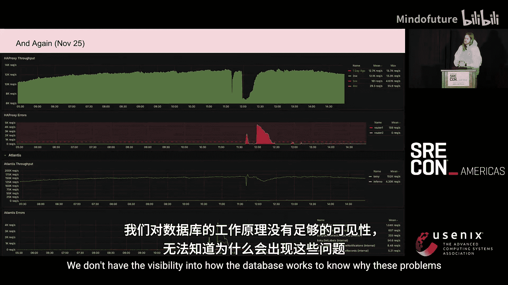

So so we were in the pre and keep digging mindset during these outages so what actually happened here。

 we have the database node crashing which we recover from very quickly because other nodes in the cluster get gossiped and say hey that node is down don't talk to it but during this rejoin stage there was a 700 gigabyte or Giabyte core dump that tried to dump itself into appport which if you've ever tried to dump a very large core into appport doesn't go very well so that failed。

 it took about 10 minutes of trying to dump the core into appport before it crashed then when it crashed it would restart and we had overea disrotling because we had misconfigud our database so as it restarted it has to catch up on tens of millions of write that it missed while the database was down and so we have tons of NVM drives。

 we should be totally fine catching up on this data but the database thought it had a lot fewer i-Os than it really did and this caused it to throttle itself which made it time out on all sorts of operations which instead of。

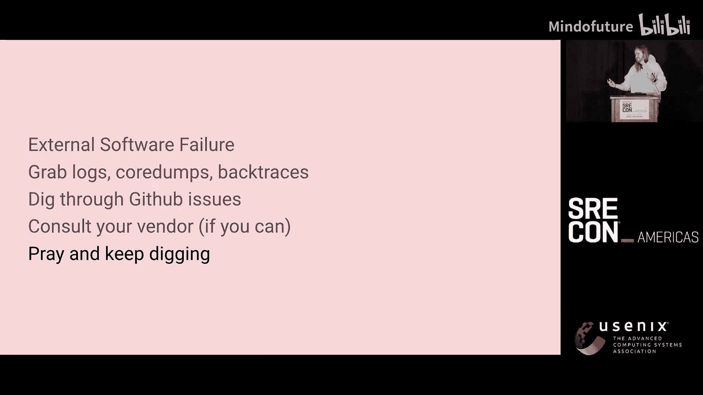

That timeout meaning that node has problems， it ended up meaning the whole cluster has problems and all of the users trying to make queries to that cluster were having problems。

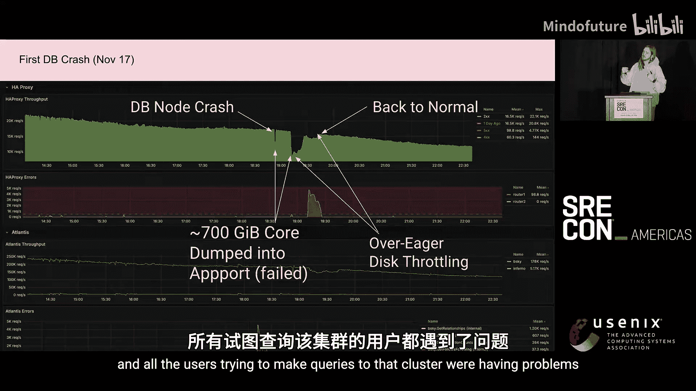

So the Db installation was misconfigured， there were noisy neighbor workloads。

 we had one big database cluster that we were using for pretty much everything at the time。

 one of those workloads was you know incredibly right heavy that's now shifted to its own database cluster but it was causing these huge walls to have to get caught up on there was aggressive self- throtling because we had misconfigured things there was no surface visibility of any of these issues so during normal operations and in any of our dashboards。

 we couldn't see why this was happening there is know if you dig deeply enough in one of the most detailed dashboards that the database has you can see where it's self-throtling so eventually that's what we found that led us to the conclusion that oh we need to tell it has a lot more eyeOs until it has a lot more bytes per second of read and write throughput。

Cool， now we can talk a little bit about the right path。 So that was the read path that was readcal。

 This is the right path and right scaling。 You'll notice there's a little bit of a crazy thing there and we'll get a little crazy spike in there we'll get to that but blue sky has a public fire hose so anybody can go and subscribe to a web socket that will every event that happens on the network to them you know you can you can play back a buffer of I think right now。

 36 hours of events can you can go and see hey， who's liking what。

 who's posted what who's following whom all of this data is publicly available。

 we have hundreds of subscribers to the protocol level fire hose and thousands of subscribers to a lighter weight version of the fire hose So when our write throughput goes up。

 we have scaling issues both from a hey， can we keep up with rights and then also can we keep up with broadcasting these rights to everybody who wants to consume them So we went from a daily fire hose peak of around 150 events a second to 1500 or 1500 events a second。

So this is 10x on reads and 10 X on writes in less than a month。As you can see in this graph。

 there are some bites and trunks taken out of this fire hose graph。

 normally what you'd like to see here is kind of like a smooth arch and instead there's a lot of you know missing pieces。

 particularly this was a really rough day where our fire hose host died so。

Our Fireho process is something called the relay。 It aggregates event streams from thousands of different servers that are in this distributed open network。

 and then it merges them into one gigantic event stream and that one gigantic event stream then get broadcast to hundreds or thousands of subscribers So it's really it's a lot of work for one process to do。

 This was running as a single go binary on a single machine at the time。

 it was way more like the hardware that was on was way more than we needed for the scale we were operating at。

 We would scale it up as we needed to unfortunately the world had other plans and we did not get the chance to scale it up in a smooth way。

 So what we ended up with where constant crashes all day long of this relay process。

 we were falling behind online right traffic which meant that there were delayed rights for the network。

 So you'd post something and it wouldn't show up for8 to 10 seconds and you'd be like。

 hey what the heck is going on or you'd like something and you wouldn't be able to see that your like went through for8 to10 seconds。

 We propped it up just enough to minimize。Useer impact to where people weren't like going off the site because stuff wasn't working right but it was definitely a challenge here are some node exporter metrics that show what we were looking at you can see the growing CPU utilization you could see the growing network utilization I think the bottom of that graph is 10 to 12 gigabit of just fire hose traffic and then the disk space graph here you can see we're running on these NVmeE disks and we suddenly take off yeah so that was not going according to plan the relay has a compaction routine that helps it keep its disk space under control but that compaction routine fell behind under the insane load that we were dealing with so the whole disk filled up and it didn't even hit 100% and that's what killed us what actually happened was we ran into limitations of NVME so there was an internal hardware failure there was both kind of this disk capacity exhaustion。

And there was also disc latency spikes which was causing the big problem for us which was rights were getting delayed and we couldn't keep up with the throughput。

 so SSDs are overprovisioned， which means there are extra cells in them that are saved save for really highr spikes and it allows you to keep up with right spikes and keep performance through those times but the problem is that that right spike lasts for 11 days。

 your over provisionvisioning runs out and SSD can't really keep up with that so the way that SS if people are here are familiar with NVme at all the way NVME rightss work is you can only write kind of a large chunk of each flash cell at a time。

 you can't just write like a single single tiny piece of your NVme at a time and so the way it works is it'll mark cells that it'll take this big chunk this big block that has some good data and some dirty data in it and then in its free time it will garbage collect it will rewrite the block to a new area on the disk and it will get rid of all the dirty data then。

You'll have a bunch of free blocks to write new data to in that section if you are writing way too fast to your SSD and you are deleting lots of things and you're making so many dirty blocks。

 the SSD garbage collector can't keep up and you end up with huge spikes in disc latency and so what we were seeing was。

You know， you know， usually something somewhere around 300 to 500 microcond latency under our normal load for our disk access and then our disc access latency shot up to in the like dozens of milliseconds and that really caused the whole system that kind of grind to a halt on top of that。

 we ended up with XFF file system corruption at one point once we were getting towards the very the very far end of the life of that machine。

 the process crashed a few too many times and then we also saw file system corruption。

 which is insane I've never actually seen XFS file system corruption before this。

 So that that was pretty crazy So our system load on this machine。

 you'll see everything was fine until about the 16th and then things started getting crazy and that system load jumping from basically  zero to 4000 is not what you want to see。

 That's the sign of a computer having a very bad time。

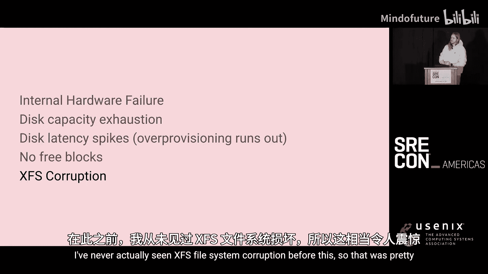

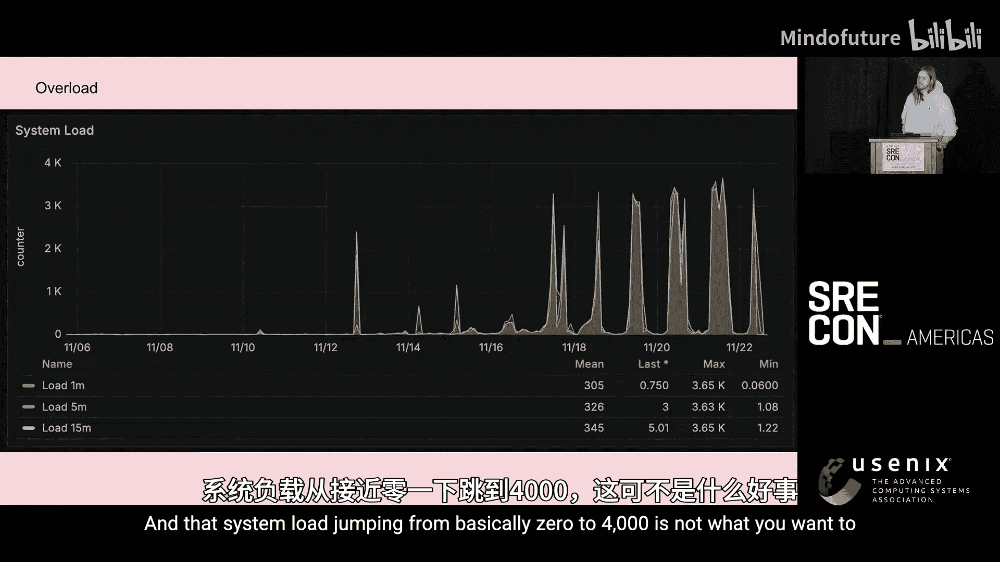

So how did we deal with this we shifted to a lower load architecture which we were very lucky to have in our back pocket Well the former architecture required tons of disk space and tons of diskr per user the new architecture that we had which we call like the nonarchival relay allowed us to throw away a lot of the storage on disk and get rid of a lot of the iOs that were required to process this it was in our back pocket had been written in a PR8 months ago and was still under review and we were like we might get to that some point in the future suddenly we had to immediately spin that up。

 throw it into production completely untested and hope that it would solve the problem because otherwise this node was down and the network was down so we also offloaded subcomponents of the service so we're serving hundreds of subscribers we're doing 12 gigabit of fire hose traffic at this point what if we moved that to another machine and we kind of like have that machine just subscribe to the big fire hose and then all it does is kind of mirrors everything and broadcast it out so that at least gets the load of sending all that data。

O of our primary relay machine， which we need to ensure rights are coming through the network。Also。

 rotating in hot spare hardware。 So if we had a disk that ate it or something like that。

 we always have。A couple hot spare machines of each of the skuws that we care about in our bare metal environment。

 and so thankfully we were able to spin up one of those subcomponents on one of our hot spare machines so that we could。

 you know this was the time to throw all the levers and to put every coping mechanism into place to make sure that we stayed alive。

And most importantly， divide labor among the team at this point we had about five or six people in the Si room at all times and so we had four you know three or four major tasks we needed to do to solve this problem。

 we solved it in about I want to say two to three hours and we solved it in two to three hours because we took all of these different strategies and handed them to a different member of the team and basically sent everybody to go get their part done and then got back together and shipped each of these strategies one by one。

All right， one more fun fire hose thing to talk about is the aura Boris situation if you're familiar with an aura Bo and aura Bois is a snake that's eating its own tail。

 we ended up in a similar situation where we created a loop in our routing that caused events emitted from the fire hose to be fed back into the fire hose which turned into very high throughput of traffic and very large event spike。

 there weren't actually new events coming through there。

 we ended up accidentally looping for a couple of hours to our public subscribers。

So there was an internal software failure we had a misconfigured proxy deploy that was kind of shunting the traffic of public traffic for people subscribing to the fire hose to our new internal service we just threw together an hour ago that would offload all of the outgoing fire hose traffic for us so we misconfigured the proxy deploy and we accidentally connected it to itself and it ended up creating a massive buffer of repeated events that it just kept emitting to our subscribers so this was mostly triggered by exhaustion。

 this was on day 10 of the 11 days of hell and everybody was very low on sleep there were miscommunications flying around。

 we weren't all on the same page we were exhausted of being in the Si room so we moved to DMs and like slack threads in order to have a little be a little bit less online in the situation room for some of these actions and that clearly bit us a little bit and this is also just kind of the effect of band-aid stacking。

You're in a really stressful situation and you're like oh we can solve that let's put a band-aid on it and you go oh we can solve that let's put another bandaid on it and then suddenly all that left is bandais and that's kind of the point that our infrastructure ended up in we usually try to keep us strict infrastructure as code policy we ended up doing a lot of manual fixes to services and production and then those manual fixes were not checked in because we were trying to move fast and make sure that everything stayed alive and so you get these stacking bandaids that lead to misconfigurations and very easy human error caused outages so public consumers saw a bunch of repeated events know it was about two hours before we noticed because we shifted all of our internal traffic to a direct to talk directly to our fire hose producer instead of talking to the public mirror just to kind of give us a different SLA from the public consumers it was about three hours from the incident start to when we resolved this problem there were thousands of external feeds and tools that had broken as a result of this。

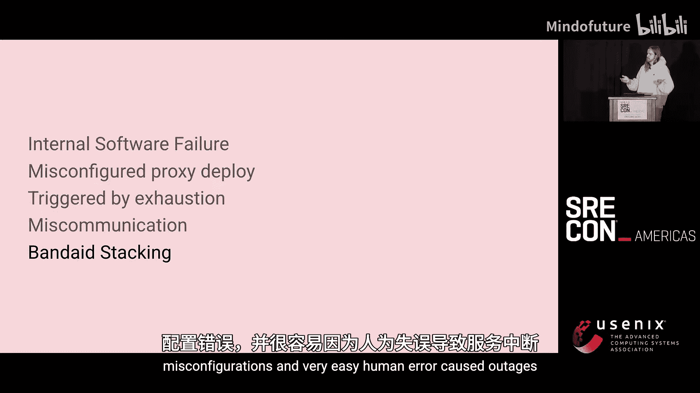

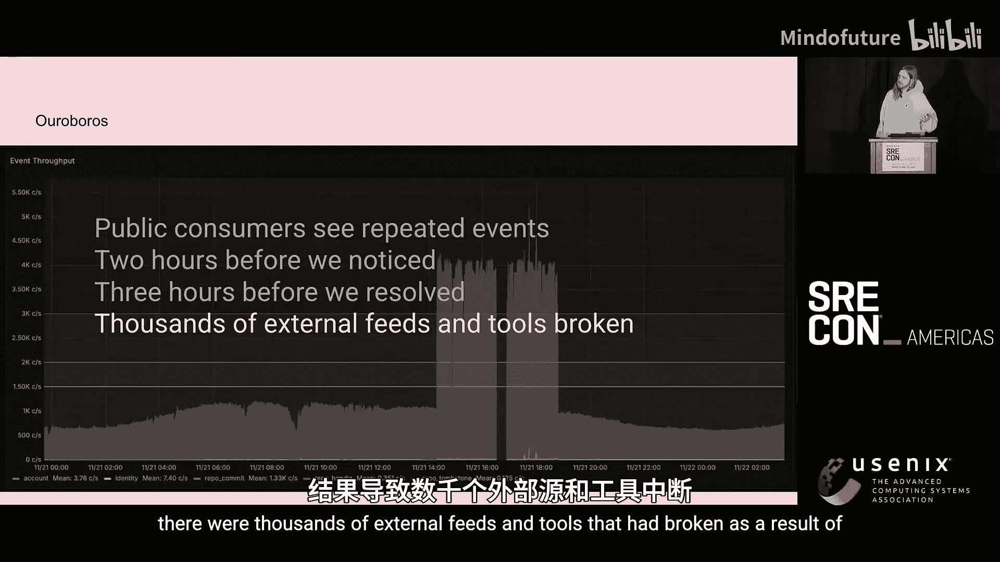

So we repaired the broken proxy configuration， we replayed missed events for consumers because there were you hundreds of consumers that had all these events。

 they not only saw the same events over and over and over again but they missed about three hours of what was actually going on on the network so we had to replay all that traffic back for them we have to apologize the developers and maintain good relationship with our developers and our developer community that's probably you know one of the harder parts。

 well I wouldn't say it's hard but it feels bad when you have to tell them hey we screwed up I know you're doing all this stuff free and for fun and because you like our protocol。

 but like I'm going give you more work to do now because we messed up that sucks and then yeah from that automate all future proxy deploy with human approval make sure that's automated and make sure at least two people take a look at it make sure that goes out smoothly I'm sure we're gonna break this rule at some point in the future when something crazy happens again。

 but we can at least try to practice it so that it's easy to do under pressure and then finally you self-inflicted problem。

Get more frequent when the team is exhausted you know when the team is tired， if you can't rest。

 double triple check everything for us， we're such a small team that you know every hand was needed for the entire basically 16 hours a day to handle peak and anything we wanted to ship at night to solve tomorrow's peak that we we were all dragging。

 we were all getting pretty， pretty tired and that leads to a higher frequency of issues。

 So let's talk about an incident that was a little bit more positive。

 which is celebrity cashching problem So if you are've been a Twitter user in the past。

 you might have heard of this as like the Justin Bieber problem or something like that。

 which is there's a very small number of users who get you the vast majority of the traffic that comes through your network people are trying to go look at Justin Bbers post people are trying to load or go like Justin Bieber's post people are trying to load a thread that Justin Bieber started or whatever it might be and that gets pretty complicated。

 So for us we have a。

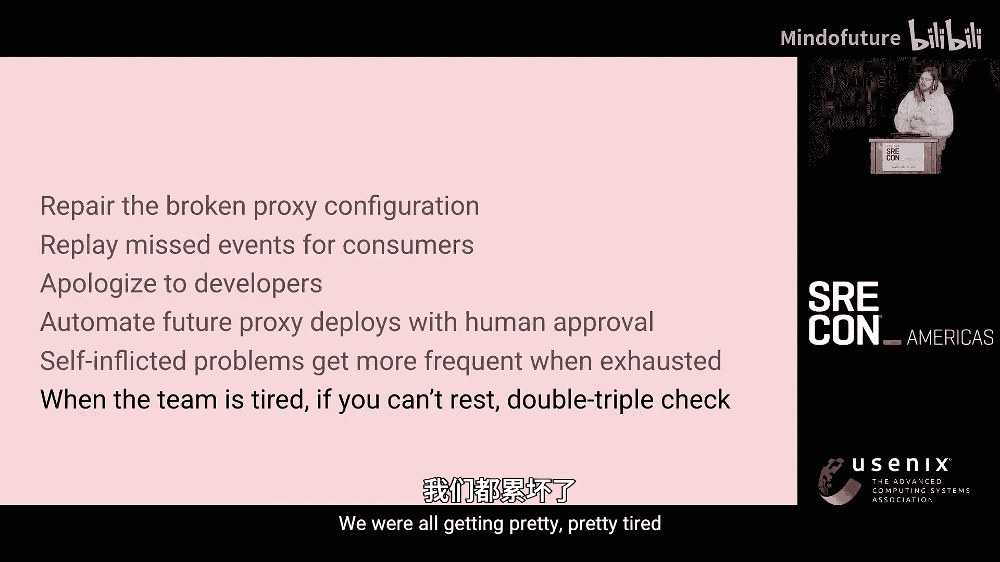

Horizonly scalable sharded database， which usually works great as long as traffic is evenly distributed。

 but when it's not evenly distributed among shards。

 we get really bad P99s and so we had P99 database queries spiking to 100 milliseconds when they're normally two to four milliseconds and this was an internal software failure。

 our sharded database meant that each data partition is only served by three cores so even if you have 2000 cores in your cluster only three of them can be used to serve one specific piece of data and so if that one specific piece of data this is Justin Bieber's profile and everybody's trying to load Justin Bieber's profile then you've only got three cores doing that work they get overwhelmed。

Those celebrity accounts， those popular accounts have hot data on the read path and DBT latencies for everything spike when a core gets hot because data is randomly distributed and that those shards own more than just the celebrities data they also own thousands of other partitions of random users and so when you go and you make a query we have a fan out into hundreds so every API requests that you're getting is turning into hundreds of database queries under the hood。

 so P99s get hit multiple times for every database query。

 so all API requests we're feeling the pain of these hot shards。So how did we solve it？

Well in the brief window of time between daily peaks。

 we managed to get a cache going for popular actor data this is a dynamically configured hot set so basically each data process has an inmemory cache they talk to Redis and Redis gives them a set every 30 seconds they refresh the from Redis and they say hey who are the popular actors who are the popular actors and then that basically decides the cacheching policy that that node will use so sync the config not the data so you have these big data processes you want to sync you don't want to sync the caches between those nodes because that's a lot of data to move and you're going to crush Redis to death if you try to move all that data through Redis at the throughput that we deal with so instead you sync the cache configuration and then each of your data processes themselves can manage their own internal caches。

 they'll get hot quick enough it's not a huge problem。

 give the database break cool so after we deploy this caching。Strategy。

 you can see that the database query P99s the following day were down to 10 milliseconds instead of 100 milliseconds。

 so it was a 90% reduction in query P99s， additionally there's 50% lower peak query throughput because literally half of our database queries for profiles were for the list of celebrities that we ended up putting together to solve this problem so I guess kind of a lesson here is the shape of your data and the shape of your querying heavily impacts what strategies are going to be really impactful I had no idea at the time that I was writing this caching strategy that celebrities were making up a full 50% of the query throughput I had a guess it was a high number and then when shipping this seeing that throughput drop basically in half was incredible that was very validating was like yes。

 this was the right decision。Cool， I have time for a few quick more short stories from this week is remember this all happens in an 11 day period this is kind of insane so in handles。

 if you've used blue sky， you know that your handle which you know people use that at mention you is actually a domain name so you can bring your own domain name or you can use one that we provide for you。

 those domain names are really cool because they're validated using public DNS infrastructure and or they're validated over HPS that's really cool it does require doing a lot of DNS lookups to make sure that handles are valid。

😊，So it turns out public DNS has limits。I learned this for the first time during this incident so if you're talking to you know Google's public DNS or you're talking to Cloudflareers Public DNS Rer。

 they're probably going to rate limit you at around 5000queries a second。

 keep that in mind it's a good number to know we learned about the hard way so it's about 5000queries per second for both I think 1。

1。1 to1 and 8888 so if you use public DNS don't try to query more than 5000 times a second。

 they will ban you for  five minutes and then let you back and then ban you for five minutes and let you back for five minutes and this causes a bunch of people's handles to go invalid on blue sky so during a massive influx of new users millions of new users had invalid handles this was really really bad。

 it made it hard to search for people it made it hard to mention people it made the site like somehow people kept using the site despite this which was awesome but this was a a pretty pretty bad optics on this incident so how do you deal with that and you run a local DNS resolver and you talk to your public。

S providers and you ask them for limit bumps and say， hey， we're a big internet company well。

 we're a small internet company doing big internet things like can we get our limits raised and then eventually they might say yes and give you limit raises but running a local DNS resolver in your data center that you can point everything at or a couple of them that you can point everything at allows it to do internal caching allows it to do all sorts of stuff that makes this less of a problem for you one fun quirk in here is that the DNS resolver that we use or sorry the way that DNS handles work is you can either verify via DNS or via HtPS and so if you're using a wellknown HtPS verification for your handle you can't reuse TCP connections because every handle is a different subdomain and your HtP client will not allow you to reuse a TCP connection that's to a different domain name so there were lots of cool strategies that you usually use to solve making tons of requests to the same hosts。

But in this case we couldn't reuse a lot we couldn't use a lot of those strategies so this got you know this was a hard problem to solve on top of all of the other stuff that we were dealing with it was a lower priority problem because it wasn't the services unavailable it was users are confused and this is kind of bad but this made it like you know a less less of a critical issue but we still fought through it and got rid of it What else did we do during this time these are just some short。

Short little graphs here。 This is the network throughput coming to。

 I believe this is data received by one of our infrastructure nodes and this was when we decided to drop sending hotel traffic to our infrastructure node because it was consuming so much of our internal network bandwidth and it was also eating lots of CPU on that host which was running a couple other services on it as well So the things that you can do is drop some ballast when you're underload in this case。

 you don't really need perfect fidelity tracing of the insane 10x event that you're going through What else do we do Oh。

 so this is our search service， our search service。

 the green there is the searches like somebody typing in username and hitting enter and then the orange there is searches for a typehead search for an actor。

 So if you are typing actively typing into the search bar you'll send a couple of those orange queries or if you're mentioning somebody you'll send a couple of those orange queries when you hit enter is when the green query goes through but you'll notice there's a。

pon more green querries and orange queries， which is a weird shape。

 It turns out there was a Chrome extension that people were using that was。

Scraing your Twitter follows and then trying hitting our APIs to try and search for those users on blues sky so that you could migrate and this presented itself as a massive Ddos to us because there were thousands of different web browsers that were all running this Chrome extension from different I addresses that were literally just slamming our search APIs nonstop trying to find people that they were going to follow we managed to get in touch with the developer of this Chrome extension and get them the ship a patch that was very scary because I was afraid this is going to cause some serious problems forever because people just leave Chrome extensions on and it was doing it in the background and it's just this is our life now is we're just going to get tons of garbage search queries coming through all the time thankfully we saw an inversion of this trend where the typehead search which should be getting called a lot more frequently ended up becoming the dominant query throughput at the end there but we were doing just in one data center almost 2500 searches a second so across both data centers was closer to 5000 searches a second。

For actors and then after that things definitely calmed down to a more reasonable rate and then more one more thing I've got is discover which is the kind of the main algorithmic feed that we have had some very significant growing pains it p99 latencies went to the moon this sucked the discover at the time was deployed onto one machine。

 it had its Postgres instance running next to it and then it had its go binary running next to that what happens when you start caing lots of data in your go service is you start eating into the pagec that's available for Postgres and so when both processes on the machine want to make use of the memory and Postgres's usage of memory as passive and that it doesn't claim the memory and your go service usage is active which means it does claim the memory。

 the go service will just eat lots of RAM that Postgres was depending on and then Postgres will start to perform worse and worse and worse until your latencies get really bad so this is another another big reason to isolate your workloads。

Split them when you can， we were running on a pretty small hardware footprint at the time。

 and so we were trying to consolidate as much as we could， and so this was motivation to say okay。

 we probably need to allocate the machines specifically just for the database for this one service。

Cool， how did I recover I went to data center and I racked a bunch of new servers。

 I ran a lot more fiber， so we made it through on the original hardware that we had so that was a blessing。

 but we were like all right how are we going to be ready for the next event？😊，Run more fiber。

 rack our metal。Some tequila was involved， there's got a nice bottle from a coworker for keeping things online so that was appreciated and then yeah。

 spending some quality time with like pets and friends and family or whoever you have to spend quality time with so I got to go see the family dog and pet a dog to kind of calm down。

There''s still a lot of trauma there from those 11 days and from load bearing the weight of the website must not go down on your shoulders nonstop for 11 days was it's a lot。

 I feel like it aged me like five years in a very short period of time but you I feel like I came out the other side of it with a bit more resilience to those kinds of situations and with a bit more of a things will go down and that is nature and we will roll with the punches and figure out how to make things come back up and we'll deal with it rather than something going down as the end of the world so that's my talk we are hiring an SRE role right now so if you are interested in these kinds of problems and you happen to be plugged into at Proto or interested in building distributed social there's a QR code and there's a link there I think we have a go roll open as well right now as well as。

SRE role for that's probably the most relevant to people that are here， and that being said。

 do we have any questions？

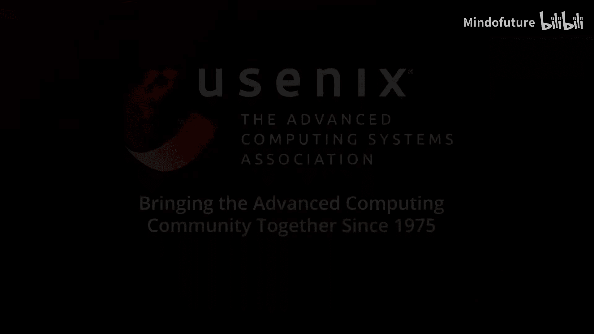

