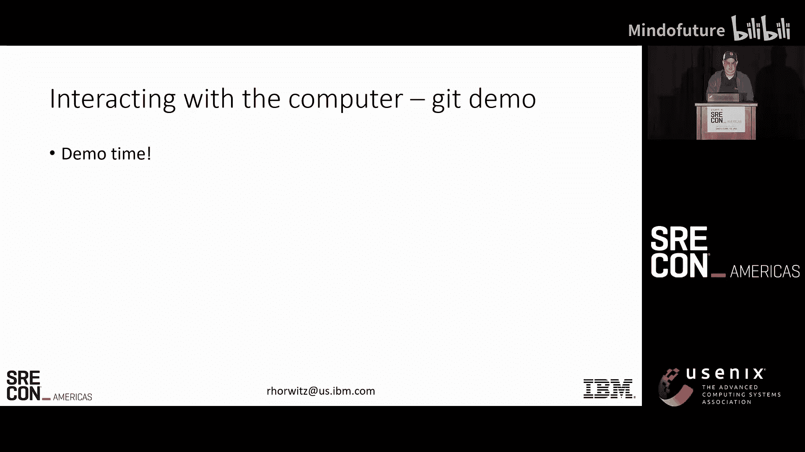
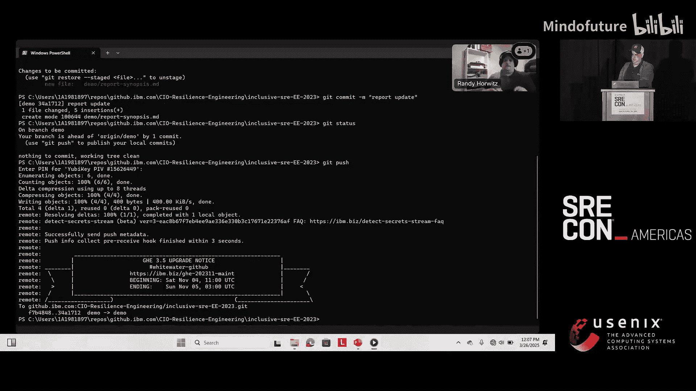
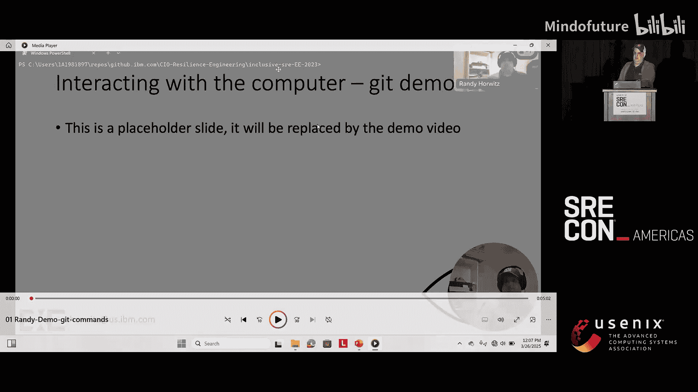
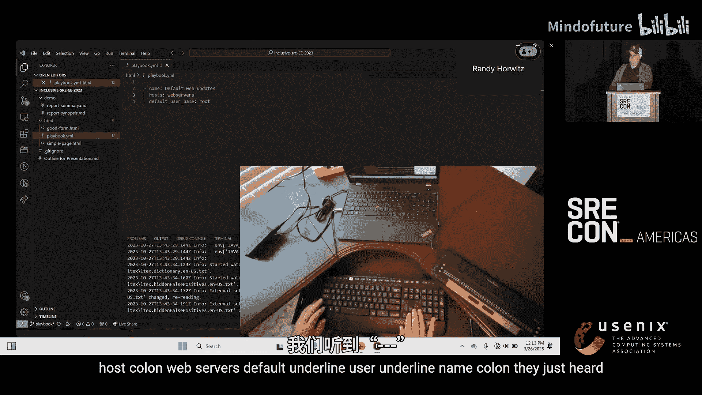
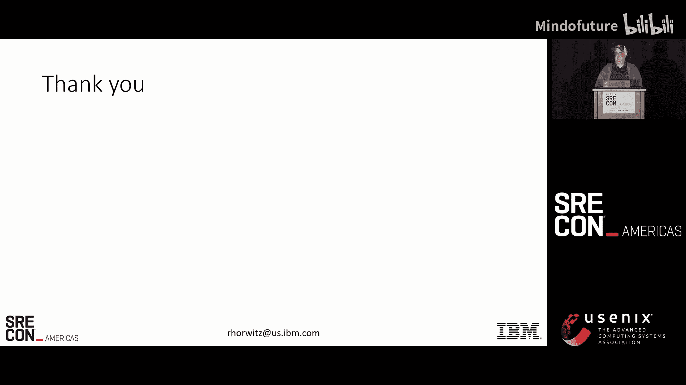
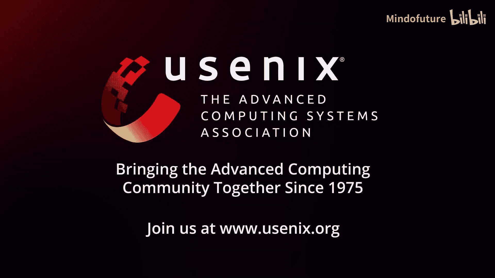
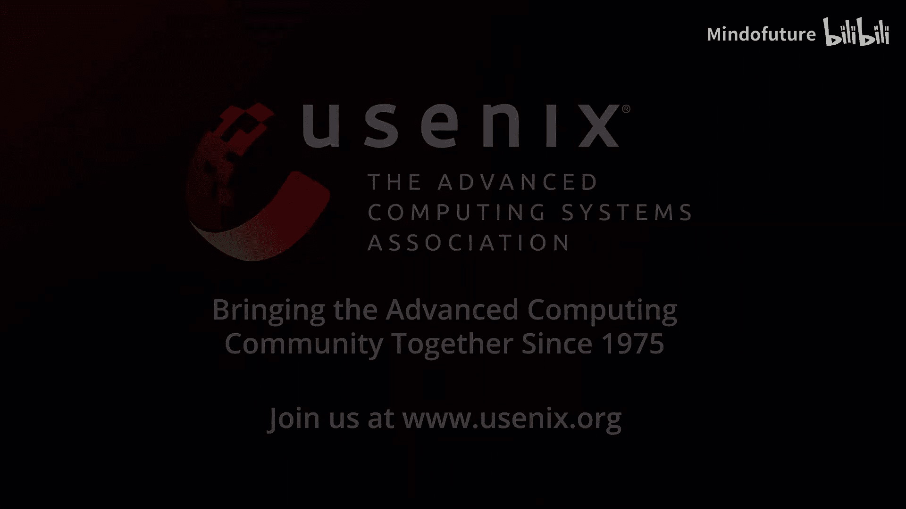

# SRE大会-2025-美洲-｜-srecon-｜-分布式-｜-缓存-｜-OpenTelemetry-｜-安全-｜-AIOps-p18-P18-Inclusive-SRE---Best-Practices-for-Working-with-a-Visually-Impaired-Incident--BV1TmLDz7EZZ_p18-

。

I'm Randy Hooritz， like Alex said and a senior technical staff member at IBM。

 I did want to point out a little bit of IBM's history here on this slide on purpose I was going through our archives the slacklack ones。

 not the real ones and found this electric typewriter which is actually producing Braille。

 I don't know back in the 60s so inclusivity and things like that have long been important to IBM and we hired our first disabled person in 1914 so well over 100 years ago before。

Well， before the A DA and things along those lines like dash back。

 So I guess I will still give a little bit of info about my background here。 So yep。

 I've been at IBM for 25 years。Sometimes that feels like a really long time and sometimes that feels like a really short time I've worked in many areas HR research and now in CIO where as Alex said。

 I'm working on our learning from In program I actually worked with David Lee and now I've taken that over some of you know David and。

One of the things we've done is extend our learning from In program in 2024 to look across all of our quarter ends。

 so quarter end is a big time at IBM in a lot of places because quarter end is when we announce what we made to Wall Street。

Which is sort of a big deal。If money is an important article to you and we still need to pay the mortgage。

 So quarter end is kind of a big deal。 And so kind of extended things to look across quarter end and see what themes and patterns and things like that。

 that we could we could work through。 So in fact， I think it has got ahead of myself。

 So we'll go ahead to the next slide And this is what okay， so that's fine。

 So let's talk about different perspectives for a little bit。So as visually impaired folks， we。

 we adapt。 We're just talking about adaptation all the time， right。

 And you get different perspectives for free from us and on diverse teams because。

This just in itss a ci world， folks。I don't say that to be difficult。 It's just a fact。

 So when you grow up as a visually impaireder or blind person， you grow up adapting。

You get white canes， You get guide dogs。 You do all that sort of thing。

 So because we do well in audio， multitasking and stuff like that。

 It's really cool to have us on incident teams because we can read all kinds of different voice cues。

 things like that。 We just quote， see things differently。😊。

So that's that's one of the things that you kind of get for free。

 having us be part of a diverse team。 But so like that's what well talk about。 Okay。

 so what are we going to talk about today， we're going to talk about interacting with the computer。

 the thing in front of me from an input and an output perspective。

 then we're going to talk about improving communications。

 And this is not just between human being to human being。 That's important。

 but also between the technologies and human beings in this case， incident responders。

 So if you don't take anything else away today from what we're going to talk about。

 you know keep this idea in mind of altering our communications。

 So that's what we're going to be talking about today， I have some demos for you。

 I have other things like that that will' kind of go through where you can see how all of these things work together。

Slights that interacted with Okay， so interacting with the computer input why。 so touch typing。

 I certainly do a lot of touch typing sometimes more accurately than others。

 way back in the 1980s on a typewriter。 It wasn't an IBM at the time。 Sorry， IBM。

 My Braille teacher made me learn touch typing on cassette。 I'm reading some my age way。

 What didn't type on the cassettes， but I was learning from the cassettes。

 I can still quote some of the things I had to type over and over and over。

 and I hated the woman for it， you can ask me afterwards。

 what some of the phrases were I hated the woman for it。

 but it's one of the best gifts she actually gave me was learning to touch type at an early age。

 Certainly I use voice input typically in slacks from my mobile device and a touch typing is kind of a big key。

 But So guess what it's also about keyboard alternative folks。

 Not a big surprise we're more efficient when we keep our hands on the keyboard A。

 and I've had some interesting。Theories brought to me over the years。

 I should do a blog post on this。 I've had one person ask me one time。

 Do you just guess where to put the mouse on the screen。Interesting， but no， it's。

 it's all about keyboard and the keyboard equivalence。 And that'll be happening in some of our。

 some of our demonstrations。Here in a little bit。 So let's advance our slide。Okay。

So let's talk about output。 Let's talk about screen readers。 So screen readers。

 this is probably not a political de tri term， but I'm going to use it。Essential。

 it's an application that spies on the other applications。

Be they desktops or web pages or stuff like that。 typicallyy that's through APIs or the Dom。

 But for screen readers to work well for end users。

 there must be communication between said applications and said screen reader。

 I used to show a chart that had these puzzle pieces。 And if the puzzle pieces were connected。

 then things were talking。 If they weren't connected then nothing was talking。

 And if a screen reader can't figure out what's going on on the screen。

 it either says nothing or it guesses what's going on。

And guessing what's going on can be interesting interesting things， but it's probably not ideal。

 is it。So that's that's kind of how screen readers work。 and they have voice output。

 you're hearing some of that and then Braille output， which we'll get to here momentarily。

directed with like。 Okay， we have a demo had a little bit of computer weirdness here。

 so hopefully I can switch to find that or I can get some or I can get some help from somebody to get me there。

😊。

Internly audio， perhaps using a screen reader to give me the output for this particular demo will be using the terminal。

 I'm a Windows user。 So for this particular demo， I will be using。This task switching。

 Cisco weex Windows power sharing with Windows Powerhe。

Wow' Power show works a little bit better than Git bash does with screen readers。

 which is why I use it。 Again， that gets back to providing the proper information。

And the proper information is provided by the screen reader。 As for the input。

 I will be touch typing。 I do not have every single character of my input echoed back to me because I find that tiresome。

I can check the input if I need to with a Braille display。

I'll be getting to a Braille display demo here in a little bit， bye。

Figured the terminal was a good demo thing， since this is for all of us。 S Rs。

 So what I've done what I do in my day job is I have to write a lot of incident reports。

 So on the current branch I'm on， I've gone ahead and created a new file。 At least I think I have。

 Let's see what Git status tells us。All right。😊，Fit hole in the term fit is not recognized as the name of a complete function。

 script file or operaable program。 Check the spelling of it。 So I purposely did that。 Well。

 on purpose， I take fit， it turns out， so。You know that was a mistake so I wanted to show you that that's also something that happens so let's go aheadarrow up PC call it back and I can go ahead and move to the beginning of the line you'll hear me arrow left S U T A T S space T I K F so now we'll type get status。

On branch demo， your branch is up the date with origin slash demo Untracted files Col left parent use quote。

 good add less file greater do do dot quote to include in what will be committed。

 right parent demo slash report has syn no do M D。 Nothing added to commit but on tracked。 Okay。

 so now I will have to do a get add。And I'll be a little bit lazy here and just do demo slash star says as we know。

 it remembers where I am。 Let's see how that worked out for us。 P backlash Okay。

 getting the prompt again。 I'm silencing the prompts because it's a very long。

 and that's something I typically do I silence with the control key every screen reader has a silencer key I get status on branch demo your branch is up the date with origin demo changes to be committed left parent get restore stage less file grade do do do stage right parent demolash record dash backlash backlash1 to1 million Okay。

 that's fabulous so we have added it successfully now we'll go in and do a commit。😊。

I'm touch typing here， as I mentioned， so get commit dash M and then we'll go ahead and have。

Report updates。Let'll see how that turned out。 Leftft bracket demo 34 or 1712 right bracket record update。

1 file change，5 insertions， left parent plus right parent， create mode 1，0，0，6，4。

4 demo slash report dash syn do M D PC call back slash。 Great， Now I a little paranoid。

 one word get status。On branch demo， your branch ahead of origin s demo by one commit left parent use quote get push quote to publisher local commits right parent nothing to commit working three clean PSC and I know I'm on my demo branch so I'm not pushing to me or master if your old school so let's go ahead and do a gi。

Enthrop pin for UBK P number156264。 No I have a hardware security key， So we hear I'm being prompted。

I will type that in。Enumerating objects colon 6， none counting objects colon 100% left parent 6 S6 right parent。

 none Dlta compression using up to8 threads， compressing objects colon 100% left parent 4 slash 4 right parent。

 none right objects colon 100% left parent4 s4 right parent，400 types vertical bar 400。

00 I B slash S， none total 4 left parent， Dta 1， right parent reuse0 left parent， Dlta 0。

 right parent packlash re 0。I've heard enough of that to know that my push was successful。

So that's great， and that concludes our first screen reader demo。Okay。

 let me chat without showing you on。 I can show the slide in a little bit。 And Alex。

 maybe you can work your way back up here and we can play the second demo。

 So another way of doing output， and I'll be showing here is a Braille display。

 I'm using one here in front of me that allows me to see the screen in Braille。

 So media open file left there right there。 our next demo we opening our next demo will take us to a Braille display not selected0 Braille4 not play but all followed by P。

So a Braille display， as you'll see， is another way of the screen reader handle output。In fact。

 maybe I'll just pick the Braille display up and wave it at you。

 hopefully without throwing it across the room。Here it is。It shows 40 cells。

 there's also a picture of it that you'll see。 It does 40 characters at a time。

 It is super useful for techie kind of stuff like coding and stuff like that。

 I wouldn't have made it through a list， of course。

 in college without being able to do it in Braille， just imagine listening to all those parentheses。

If you're old enough to remember Lisp， if you don't remember Lisp， you're probably Lisp。

 you're probably more lucky。And in all honesty， let's go ahead and watch this next demo。

 to get a little bit more technical。So you'll be seeing a lot of my hands for this video both on my keyboard here。

 just a standard4ie keyboard and on my Braille display over here。

 The Braille display actually outputs the same thing。

 this screen reader is outputt in speech as Braille that's important when we're doing t kind of work or for a lot of things。

 but mostly for technical kind of work like coding。 So let's see where we are。

 We'll go with the audible features first。 So I'll do a command untitled1 inclusive32023 visual studio code application。

 Okay so we hear that I'm in visual studio code And before that you heard untitled， etc ceter。

 So I'm in an untitled window。 that's cool。 I don't want to be in an untitled window。

 I want to save my playbook' gonna to be doing an playbook here or at least part of one So we talked about shortcut keys。

 Let's do a control S for save。Ne was dialogue， file name colonta combo， Un title dash1 dot T X T。

 title1。 That's not what I want。 I want play book do。Dot YM L。 Now， let me check that en Brail。

 Is that really what I typed。 Yep， looks like it。 from plainbook dot YM L。 Let's tab。

 save with type Co and combo box。 plain text left pair。 I don't want to save it as plain text。

 certainly， So I'll type Y。To get us down toward the wise and then hit it down arrow。

 why A M L left parent star do M semi and star do semi star do。

 I can switch back to Brale to check it myself。 Yep， that looks right。 let's again。

 pull part hide folders button。 save button out plus S。 So that we over Ex me。 Playbook do M confirm。

 save us dialg。 No button out plus。 So what happened。 Playbook do M already exists。

 Do you want to replace it。 So it already exists。 I asked the screen reader button And yes。

t that one dash because I want to start with a blank slate here。

 So it was another excuse to show you as screen reader。😊，Ting so now we're here。

We are where are we Let's double check that again Playbook inclusive dash Play YMl， et cetera。

 So let's start typing。Dash， dash， dash at the beginning。Then I'll start typing。A name Col。

Also case so far， Braille wise， often back can do a complete check here in Braille a little bit。

 so we'll call it default web updates。And on the next line， I'll do a host。Web servers。Check that。

 host web servers， and then we'll do a default。Innerstore user underscore name of root。

Does that look okay， And Brat seems to。 So let's go back to the top。

With another shortcut key control plus home。 can't remember what it is on Mac。

 but there is one dash dash dash。 So I hear dash dash dash。 I'm at the top。

 So now I'll go ahead and review what I've got using my Braille display and read me line by line。

 And I see name call and default web updates。 That looks okay。 then oh， shes。I forgot to indent this。

 didn't I， And that's really important in Yamel， or certainly in this particular playbook case。

 to be more clear。 So I'll add to spaces here。Okay。

 I can see now that I'm two spaces further in up same issue on the next line。

 so I'll go to the beginning of the line， add two more spaces and here we are I'll start at the top dash。

And I can hear dash， dash， does。Then I've got name Col default web updates， yep。

 and then indented this time host Col web servers and default username route and don't need to show you more than that Oh。

 and of course。I should make sure that I saved this guy again。 I just did a control asked。

And it just did that in case you want to hear what that this little bit of this sounds like dash dash dash。

 we hear dash dash dash that name call and default web updates。Post colon web servers。

 default underlyingline user underline name Col。 you just heard all of that， which is good。

 So I left out the the end of the default username line here。 But yeah， that's how everything works。

 that's how just Braille display works。 and I've also been able to show you the importance of visual studio code。

 actually being able to communicate properly with the screen reader。

 like when you heard it read the same dial。 So that's great。 play button I followed by P。

 apparently we made it back to the play button。 that's useful。 All right。

 now me if I can get a demo slide， it's all about adaptation， right， folks， slide6 that。😊。

Slight。Sled。Slight night， this is more fun。Slide 1 improving communication Okay so let's talk about improving let's talk about improving communications a little bit。

 shall we That is why we're here after all even if I couldn't manage an issue communicate with the screen reader there for a little bit So for communication we' blind and visually impaired Sres。

 it's all about altering your communication style not a huge amount but enough so even if the screen reader has the information it needs。

 or at least if it's being sent the information， does it really provide useful output。

 that's really the important question So in fact， let me tell you a story。In the days of yo。

 known as about 10 years ago or maybe 15 years ago， there used to be this tool called Bobby。

And it was a test tool that made sure that you were communicating at least from your web page at the time or application to a screen reader。

Which is good。 I'm not saying test tools are not good。

 but it also created some fascinating web pages because there wasn't user involvement and screen internet involvement。

 If you， if you're familiar with providing alternative text， a lot of people just put alt text。

So every damn image on the page said alt text。Didn't say I'm not kidding。 It didn't say。

 It didn't say， you know， picture of Robert Barron or something like that。 It said alt text。

 And everybody went around。 Our pages are Bobby approved。 They're awesome。😊，Yes。

 but you can't read a goddamn thing on them。 but yeah， they're they're awesome。

 It just underscores the importance of making sure to do screen reader and end user testing。

 So there's my little Bobby approved。 as I said， I'm not opposed to testing tools like that。

 but it is an important point to make。😊，Allright， so let's talk about screen shares。

 Let's talk about crawling together。 So if you're on a screen share with somebody， slide still okay。

Al right， if you're at a screen share with somebody， here's a good thing to say。

It looks like the database is having an issue。 Let me paste what's going on into the chat of the air。

 That's the good example。 The bad example is。It looks like database is having an error。

 I have it here on the screen。Okay， that's cool。 Scre readers don't work well with， you know。

 screenre shares。 It's on the screen。 What the hell's there。

So a lot of people prefer this as I understand in Slack anyway。

 because then you can go Google the error， you can just grab it directly。As for screenshots。

 screenshots easy for me to say make sure to describe what's in your screenshot so that's important to describe kind of what's in your screenshot or better yet to pace text in you can' do OCR on screenshots nowadays but OCR is still OCR so better to just explain it and then don't forget about the reverse accessibility problem as we've turned it on some of our teams another true story I've got a lot of them I once delivered some accessibility techniques to my my lead for review and the color of the background in the foreground or is exactly the same。

Work't great with the screen reader。 And we got into this five minute argument。

 There's nothing on the page。 Finally， she looked at the source and figured it out。

 But I don't just get to sit up here and make demands about how we all need to alter our communication styles。

 If I'm as something up。 Tell me。 And for the love of God， if the camera is pointed up my nose。

 please tell me that， too。😊，Another true story。Slide 13，13， slide 13， national not use color alone。

 Okay， do not use color alone。 You just heard that announced。 So is using color bad。 Well， no。

 of course not。 But using color alone， you convey information is bad because。

If you make use of color alone， then not everybody can tell there's errors on your dashboards。

We'll have a live example here in the middle and a little bit。

 But using an alternative or something like that makes things workable。

 That's more like we're walking together。 And by the way， I forget the exact stats。

 But 10% of dudes across the world are red， green color blind。

 So if you do stuff red green is's not just for our a screen reader folks up here。

It has a large effect and there's all a bunch of other blind colorblind stats that I can't remember at the moment。

Slide 14 that server list list。 Okay， here is a bad server list example。

I'm going to do a bit of a live demo here。2 columns at4s。 Okay。

 so what are the columns in our table here。 Is the audio not enough。

 do we need to raise the audio a little bit。 Let's see Ser status， column 2。 So we have server name。

 column 1。 Thank you for raising the auto server name and server status。 So let's go down here。

 note1 dot F1 dot M dot co Bro2 node1 do something do whatever。

 I can also read it on the rail display。 Ser status， blank column 2。😊，Server status is blank。

 That's cool。 I'm not sure what the hell I'm supposed to do with it， but server name it's cool。

 Now we'll get down to the next one。 No2 dot1 do M dot com Ser status， blank column 2。

 I think you get the point。😊，Fortunately， this isn't really a hard fix folks like if we want to walk together。

 So here's the better example。 I'll move down to the table column at40， table 9， column 1。

 I don't know why this is labeled table 9， but it's really not important for this demo。

 So just ignore that。 I'm sure table 9 is a wonderful number， so。😊，And we've stopped reading for me。

's three PowerPos like。 Okay， let's try that again。 Ser names note1 F1。 do co Okay， server status。

 exclaimed column2 See the difference。Server name， note 1。f 1。m。com column1， server status。

 exclaimed。So server， node 1 do whatever。 that's the one that's broke。 Of course。

 you'd have to talk to your user and say， we're going to use the exclamation point。

 But it's an example I've used for years。 So now if I'm an Sre。

 I can go look at node 1 and figure out what's going on with it。Pretty cool stuff。

And this one ain't that hard。' don't worry， we'll get to some of this stuff that's a little bit harder。

The slide 6 match school initially examples。 Okay， speaking of one's harder。

 like let's talk about graph。We like graphs， right， we like graphs on our dashboards。However。

 to a screen reader user a graph， well， if you're trying to explain a graph to a screen reader。

Please describe a bunch of lines and some points on the lines， go。No context。

 no nothing just to drawing。Well， what's your problem， You can't describe that。Right， that's it。

 So I'm not saying not to use graphs， but graphs like this one that we have on the screen here that's showing a series。

 right， And we have some spikes every once in a while。 Well， I wouldn't be able to see that at all。

 Here its see it。See it as the better。 We kind of prefer to use the vernacular。

 I think it's kind of funny when somebody kind of stumbles of themselves。

 did you see the game last night。 Oh， I mean， here the game， The normal vernacular is fine。

 So like7 of a。 Here is another one。 Here's another friendly graph example。 So in this one。

 we can see that there's a high spike。😊，So there's some spikes。

 but then we have a high spike going on。But。W they thating issue example So what are we going to do about all this。

 Randy， you're just giving me problems， You're telling me that graphs are an issue， you know。

 what's the deal here。Fortunateally， there are some solutions。

 So what we could do is make sure that all the information is available available。

 easy for me to say available in a tabular format or downloadable， right。

 Go gotta make sure you can get at the data somewhere。

 I kind of like downloadable because then I can do some manipulation with it。

 But it's still a pretty heavy cognitive load， isn't it， If you're listening for spikes。

 You'll listen across the line。 You know， is it 10101020。 Okay， well。

 that was 2010 keeping track of all that can provide a heavier cognitive load。

 It's certainly better than nothing， but it can certainly provide a heavier cognitive load。

 So what would be cooler is to send a notification like a notification that says， hey， Randy。

 there's an issue。 Can you go have a look。😊，Yeah， that was a bug I ended up finding here。

Can you say slideide eight slide？Tining。Slide， much slide。Find out。Yeah， I got it。Slide 8， slide。

 good。Here's what works better。Just tell me where the issue is， hey， Randy， go have a look at this。

Robert helped me create the slide。 So thanks for the hope。 Robert。 Okay， so that's。

 that's a better than。 And that's less cognitive load than digging and digging and digging and digging and digging and digging slide and digging。

 So some more， some more graph examples that we some more graphic examples that we have here。

 something that's a bit more advanced。 we have an anomaly of a high and a wide spike。

 So when you're going through all that data and trying to listen to it。

 you're not only trying to figure out， you know， when things started in ended。

 But also how is it in relation to all the other spikes， and it's just， again。

 a super heavy cognitive load。Sllight 20 dash tool I another one here。 So in this one。

 we have some gaps， So or at least one gap。 So that's a gap issue。

 So something else that's kind of a heavy cognitive load to kind of keep track of。Right。

It's like when do you want that tooling Okay， so let's talk about solutions。

A decent tool should be able to go ahead and prioritize the information， package it up。

 and be able to produce a notification。And this is not just useful for us， blindlind people。

 You know， the blind guy of the dog standing up here。

 but useful for all of us because it lessens all of our cognitive load。

 And this is the really benefit of of a diverse team， right？

 So while an engineer might think it's okay to just go glance at the dashboard and advance at the dashboard 20 times。

 somebody on the team who wants a little bit better， somebodybody like me could say， yeah。

 but wouldn't it be great if we could figure out how to package things up。

 This is us running together from an accessibility perspective， This is。😊。

You that communication thing I talked about？This is kind of talking about these communication sort of issues。

 So this is an example of how we can learn together， and it lessens everybody's cognitive load。

 So're， we're doing this for the whole team。 We're not doing things for those people。

 You can imagine what a big fan I am of those people。 And it doesn't make sense to work that way。

It's what is a good way to all work together。But。Slide 22 if so what if you're not sure？

What if you're not sure what to do， Do you just throw something together and hope it works。

Of course not。 You ask， we have conversations。As I said， this is two way。 I， you know， you ask。

 I tell， I ask， you tell we converse。 we have conversations。 If you're not sure what to do。

 I wish I could find the video。 Well， it was an oldt movie thing。

 It was somebody wondering how to help a blind person across the street。

 And they see the blind person on the corner with their white cane。

 And there's like this vision that goes through this person's head。

 Should I pick the person up and firemens carry them across the street。😊。

Should I throw them across the street， All these kind of cool。You just asked。我来。

Itslight 23 summary summing up。 And then I certainly hope you have I certainly hope you have some kind of questions。

 But from a crawl perspective， we bridge the gap using additional communication， Bridge the gap。

 I think I said that。 We verbalize screen shares。 we explain screenshots。 but that's that's crawl。

 I mean， that's similar to stuff。 And me asking my social studies teacher back in high school to verbalize what's on the board。

😊，Interesting， but make data available。 So do not use color alone。 It's okay to use color。

 Just don't use it alone and then provide a way to download or tabularize graph material。

 run is optimizing the data for all of us， not just visually impairedaries like I have on here。

 analyze， summarize prioritize otherizes I can't think of on their。 Yeah， do all these things。 And。

 of course， make sure it's available in a readable format。 And if you're not sure what to do。

Don't be shy， ask。A few resources I wanted to share with you。

The IBM co accessibility page has a lot of neat resources on it。

 It also has an accessibility checker that you would use before the screen reader。

 So we have something like that。 And then I have the latest web content Accessibility guidelines the web content accessible accessibility guidelines provide a standard way of that communication between web pages and screen readers And if you want to kick around a solution。

 if you have something you're not sure about， you know， I'm on I'm in the Rsf slackla。

 I'm in the conference slack。 I still look at my emails。 I guess I'm old enough to still do that。

 So I still look at my emails。 you want to kick something around。

 hit me up as you can tell I hate talking about this subject。

 So feel free to feel free to hit me up and will'll kind of kick it around。

 So but like Thank you so much for your time。 Thank you。

 Alex for helping me recover from I know I shouldn't I should have left the laptop close when we brought things up。

 Thank you for。😊，ing from PowerPoint， thanks for the help putting the slides together。

 thanks to my wife Tina， who's in the audience who dealt with me stressing about this for the past week or two。

 and thanks to all of you for listening through， watching， listening to my chat。

 I hope you enjoyed it。😊。

