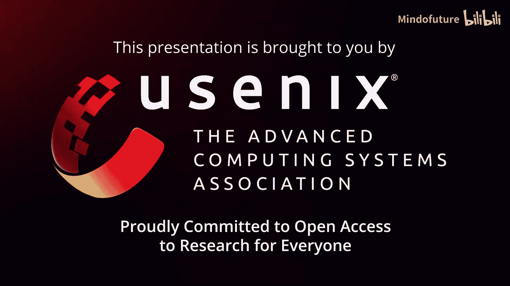
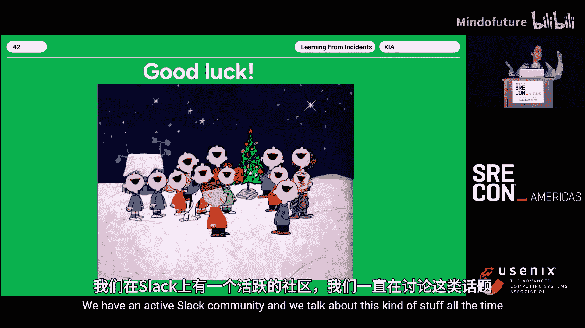
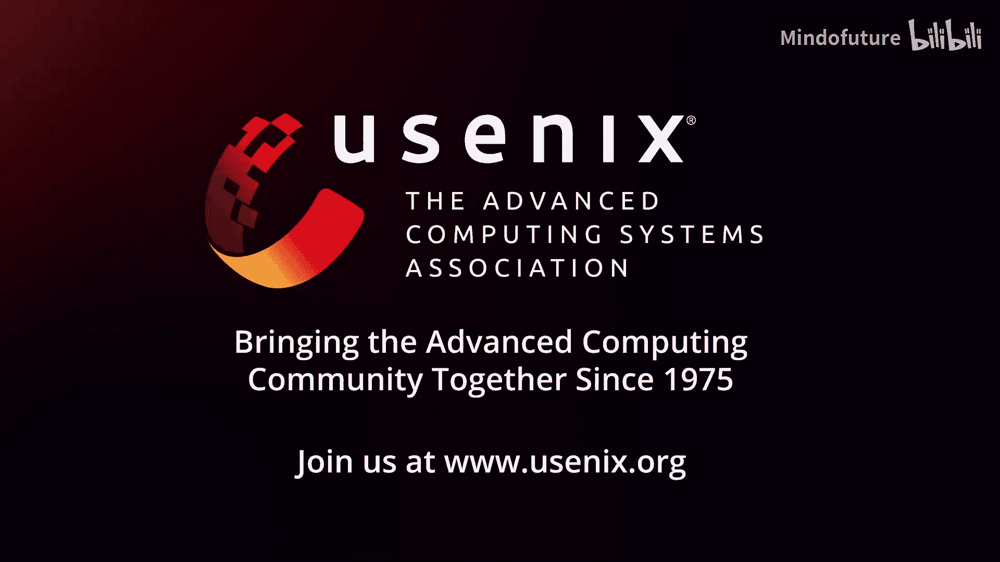

# SRE大会-2025-美洲-｜-srecon-｜-分布式-｜-缓存-｜-OpenTelemetry-｜-安全-｜-AIOps-p19-P19-Learning-from-Incidents-at-Scale-Actually-Doing-Cross-Incident-Analysis--BV1TmLDz7EZZ_p19-

。

How do you mu a year in incidences。嗯。I， I maybe submitted this so I could just reference rent。

 And if you've seen in rent， you know that there's many ways to measure a year。

 you can measure them in minutes or in cups of coffee。 and I won't sing。

 but there's also more than one way to measure a year in incidences。 I'm like blinded here。

 So I cannot make eye contact。 I apologize。 You can measure them in the total number of incidents。

 So the total number that you walked into a room and you said big mistake， huge。

You can measure them in the total number of action items， after all， if you had a postmortem。

 you better have assigned action items， a bunch of action items。

You can even measure them and how long your incidents lasted， right， Like， you know。

 maybe you had 10 minute long action10 minute long incidents。But do these numbers tell you anything。

 I think that the answer is no， and they are not helpful because they lack context。Instead。

 what we want to do is we want insights that are built on the universe of learnings from individual incident reviews。

 we want to identify patterns from this universe that with the context can help us highlight insights and areas of opportunity。

I believe that a focus on cross incidentcident analysis is the natural evolution from learning from incidents。

 from learning from individual incidents， and it can be incredibly beneficial to our organizations that can help identify larger initiatives that will allow our engineers to thrive and it can help our teams and our companies achieve their goals。

And that is what we're going to be talking about today。 So hi everyone， my name is Vanessa。

 I like to talk about incidents like Sarah mentioned， I'm a technology manager at Inova。

 I manage the resiliency team， I'm also on the board for the resiliency and Soware Foundation where we talk about this kind of stuff a lot。

😊，I've spent the last decade working in technology。I've worked in site reliability engineering。

 I focus on incident。 And when I say incidents， I mean the entire life cycle of it。

 So I mean responding to incidents。 I mean learning from incidents。 I mean。

 learning about the entire work of incidents for an entire year from an entire quarter， all of that。

 I've been the only incident and incident commander on call for years。

 I've owned the escalation process。 and I've scaled the program。😊。

I've also worked with different organizations on a coaching role。

 so I've seen how other organizations， how their programs work。I also have twin toddlers。

 so I spend a lot of time on incidents at home as well as at work。

And so something that I have seen in the past five to eight years is both in engineers。

 as well as in leadership， is a growing appetite， not only learning from individual incidents。

 but also in gathering these macro insights that can help us make larger scale decisions。

 and that's the journey that we' be going on today。But first。

 I think that we need to talk about this idea of learning from incidents。

 And there's all kinds of learnings。 We've been learning from incidents and software in different ways for a while。

 When I first started my career in technology， it was much more of an itil focused problem management way of learning。

We did five Ys， root cost analysis， public facing mecous， we call them postmortems， short。

 long medium sized templates， and they all helped us。

 I'm not here to say that like all of that sucks。 I've done all of them。

 but while they were helpful in the past today， I think that they're just not as helpful and I think that sometimes they can harm us。

I think they can harm us because they can give us this false sense of security that we're doing something。

 And if you can think about it。 right， we have a root cause analysis session。

 and we say that the root cause is human error。 and let's just never do it again。 Right。

 That's the action item don't do it again。 And maybe， you know， if we're being kind， we say， like。

 let's put in an alert。 And let's just say that were gonna alert every time that that specific thing happens again。

And then we move on with our lives。 Instead， if you focus on learning from incidents and you have a blame aware learning focus review。

 what you can actually do is you can highlight a number of learnings you can highlight maybe that your onca engineer didn't have access to some dashboards to understand what was going on and that led to the incident lasting maybe longer than it probably could have maybe you learned that the QA process didn't account for some new requirements。

 maybe you can highlight that engineering and marketing werent on the same page about capacity and when there was gonna to be a big campaign scheduled for so there's a lot of learnings that can come from like taking that learning from incidents approach rather than saying like hey。

 human error don't do it again。So that's what learning from incidents is。

 It simply focuses on an in- depthepth understanding of how the incident came to be from different points of views。

 where the focus is not on the action items or an artifact that needs to be filled out for contractual reasons。

 It doesn't mean that we shouldn't do that。 I'm not going to be here to tell you to not do your job to not fill。

 you know， not do your contracts， not do action items， just that that's not the main goal here。

So how do we do this？And this is going to be a long one。 So after you have an incident。

 you want to learn from it。I think that the best way to learn from it is through a narrative based approach where you highlight what happened。

 how folks experienced the incident from different points of view。

And there's usually a few different steps for it。 Right， First。

 you want to identify the data that you have， who was involved in the incident where it take took place。

 maybe zoom， maybe Slack。 Do you have any pool requests support tickets， etca， et cea。Based on this。

 maybe you want to interview people， maybe you want to have a review meeting。

 you want to prepare for it， you want to use that data that you have， invite the right folks。

 create a narrative timeline， something like this， jot down any questions that you have and then you meet with them and you want that to be a collaborative conversation right if you have if I'm leading a review meeting I should not be the Vanessa show and I like to talk a lot but I should not be the one that's talking the most in this meeting I want other people to share their experiences。

And then you finalize your findings in a format that others can understand the learnings from。

 So if I'm sharing something with leadership， maybe you share the takeaways。

 If I'm sharing something with technology， then I'm sharing more of the tech details。

And so that's doing individual incident analysis and doing this kind of like narrative approach can take weeks or it can take you know a few hours。

 And so doing this helps us that instead of saying， you know this incident was we found a bug。

 we reverted it and now we're back to normal， we can say that you know， hey， we found this bug。

 but really what we learn was that years ago， we acquire this company and the people who are part of the legacy organization。

 they really don't have the right permissions and the right information and this is something that they deal with every single day。

 not just with this incident and and this is delaying projects and this is leading to burnout。

 and when we're learning these kinds of things， the actions that we take are hopefully going to help all of us and lead to more seamless experiences for engineers and product owners。

And doing this work while it takes time， is going to pay dividends。

So all of this is work that many of you do today。 But when we talk about doing it at scale。

 I realize that people have a hard time conceptualizing it。

Do incident analysis at scale can look differently depending on your organization。

 but a few things that I notice across orgs are these things。

It can mean doing incident reviews for every single incident or maybe every single P0 or P1。

 and then teaching the other teams to do it at a high quality level。

 The idea here is that we have some data to work with。

It means developing a structure so that you can compare incidents across different groupings。

 as well as adding context。And it means doing enough of these exercises so you can find some commonalities so you're able to pull some themes and some learnings and some insights。

 and I know sometimes people don't understand what I mean when I say themes are learnings or insights。

 and you know by that I mean we took a look at these incidents throughout the past year and when we're looking at X product。

 we realize that a lot of the time we depend on the knowledge of senior engineers who are no longer on this theme。

 you know let's do something about it。 or for many of our capacity related incident。

 there seems to be a miscommunication between product and marketing and operations。

 let's do something about it。 So there are very like specific insight that others can relate to。

And here's the point of my talk that this is difficult to scale。

And I have seen organizations get good at doing individual incident analysis。

 but what I find is that often they don't have the right environment or the right tools to keep a self-sustaining program at scale。

 and all of those words， I wish I put them on this slide actually。

 but self-sustaining program at scale。 like all of those words is what people find difficult to do。

Why， because it's difficult， creating a narrative timeline takes a lot of work。

 It takes a lot of time。 right， you're like copying and pasting and going from Slack to Jra to all of these things going from one monitor to the next。

 That takes hours to do， right， And then， you know。

 you're going to Google Cal and you're scheduling your incident review。

 and you're making sure that all these people can attend like。😊，If you're working for an AI vendor。

 please do that， please work on that。嗯。And then you have to take that timeline and you prep your agenda and you run your meeting and you assign your action items and you complete your artifact and that artifact can be like a narrative or it can be a video。

 whatever you want it to be， and that's a lot of work for just one incident。

And for how many of you is that your full time job？Good for you， Fisher。嗯。You should work for Fisher。

 but yeah， not for many right， you're probably all engineers， you're working。

 you're doing observability work and capacity work and incident response。

 and you don't have time to do like all of this stuff for every single incident unless you're fishser。

😊，And on top of that， you know， we all think that being engineers mean they're like super duper smart。

 which we are。 but we're not analysts。 We're not。 we don't have analyst skills right out of the box。

 There's some skills that we just don't have sometimes。 So some of them are talking to others。

 gathering qualitative data。 This means involving people outside of technology。

 asking them for their personal insights。 What matters to you， What doesn't matter to you。

Data skills， maybe brushing up on your Excel skills。 I know some people don't like a spreadsheets。

 I like them， but mainly it's understanding what your data is telling you and just understanding it enough to just gather some insights。

😊，But most importantly， I think is being able to present information and findings and recommendations in a way that others are going to be able to understand。

 so when you're doing this work， you're going to be sharing these findings not just with your peers。

 but with people outside of your immediate org， they're going to be having different levels of technical knowledge and they're going to have different priorities。

 so you need to know how to present your case in a way that makes that makes sense to them。

And lastly， we just don't have the perfect data， right I talked a lot about the narrative reviews。

 I think those make for amazing narrative incident reports。 you can read them。

 They read like you know an amazing novel but you know you can't really query them right It's also hard to know what data to actually look at which questions to ask which threats to pull out and you know most importantly。

 we can't compare incidents to each other right you have one blip and then you have another incident that's like maybe you had one service that was a dependency for something else。

 and we like broke it the day before the biggest volume day of the year。

 like these are very different incident and it's very hard to compare them。😊，So。

That is a lot of reasons why it can be difficult for organizations to have a sustainable incident analysis program and to get to doing cross incidentci analysis。

 and I promise I'm done being a Debbie Downer here because now that we know what we are going against。

 we can start fighting it and I can share my success story。So。

I don't claim to be the only person who's gotten it right。

 I actually don't claim to be a complete success story。

 This is simply the story of the hard work that we've done at Inova that we've put into our learning from incidents program into our crossincident analysis program and I'm very proud of it。

 I have some of my friends here from work here and I think we're all very proud of it。

 So I've been at Enova International for 10 years about 10 years。

 I did have a two and a halfy rum Spring at jelly。 That's what I remember with the Howeygu。

 and you know we lead a team of engineers。 We've been able to leverage our incident review program to learn from incidents at scale。

 We analyze our universe of incidents。 We break them out into quarters and years and and products and technologies。

 And so we meet with all of these folks and we share insights and we make recommendations to improve our socitechnical systems。

 And the most important thing to me is that people take it seriously in a way that they didn't years ago。

😊，What does it look like like I mentioned we have a dedicated team。

 we currently have four people on our team， sometimes we have some special guest stars that help us。

 we lead blame aware learning reviews for every major and sensitive incident。

 sensitive incidents are those with high legal or security impact。

That's something that I'm seeing more and more different organizations that they have there。

 including those in their process。We focus on the learning， but we don't do a 12 step program。

 We do discuss action items at the end of our review。

We do macroanalysis at different intervals where we get to make recommendations at Inova。

 we do quarterly planning， so we actually take advantage of that。

 So whenever we do quarterly planning， very strategically we have our quarterly review so that our recommendations are fitting right into the quarterly planning。

And most importantly， we have tons and tons of teams bought into the process， engineering。

 but also operations and marketing and legal and compliance。

 and they all know the importance of learning from our outages and the findings that we discussed they're sharing in meetings。

 not just with my team but with their own teams and they're not meetings where they're like you know big mistake huge。

 but they're like， hey， you know this happened and this is important and this is why we need these resources So this is like really exciting stuff。

😊，So how do we get here， It's hard to dedicate time to do this。 When I first started。

 I was hired to do this， plus a bunch of other work as part of the problem management function。

Eventually， me and my boss， we were able to prove how valuable this team could be。

 and we were able to get headcount around it。 This was because we inserted ourselves into a lot of conversations。

 We were vocal about the work that we were doing。 We were vocal about the improvements that were happening and how they were a direct result of our work。

 We always focus on the idea of continuous improvement。

 We always review what works and what doesn't work。

 So the program today doesn't look like what it looked like a year ago， three years ago。

 five years ago， and it really shouldn't look like what it looks like today， three years from now。😊。

And that's because the organization and the technology that we work with is always changing。

 so the constraints are always changing， and we have to get creative。And in talking about creativity。

 So my husband likes to say that I'm a habitual line pusher。

And he says that my daughter is just like me。My favorite mentor， because I do rank them。

 likes to say that constraint breeds creativity。 And so I'm going to tell the success of our story。

 the story of our success。 And I think that there's a little bit of both。 So there's creativity。

 and then there's boundary pushing。😊，And the next few slides are going to have a lot of words。

 but you get to download the slides。 So just bear with me。

 So when we're getting creative and we're getting to push some boundaries。

 the first thing that you can do is you can get creative with the review that you do。😊。

No one is saying that you have to follow one specific guideline。

 You can get creative with a lot of things。 You can decide which incidents you review， who runs them。

 how long they prep for them。 There's a lot of things that you can get creative with。

 These are just the things that we got creative with。 So in our case。

 we decided that we were going to be reviewing all of our incidents with major production impact。

 Later on， we decided that we were going to let other teams very kindly asked us to review other incidents that they found interesting。

 Later on， we also introduce this idea of like the security incidents we realized that there was a need for that。

 We also decided on a centralized rotation of engineers。When we decided on this we had tried many。

 many different things， for example we had tried it being part of everyone's engineering work to do retrospectives。

 but at the end of the day we decided that for the biggest issues。

 we wanted the quality to remain high and so we wanted to be in a small group of people that could just report to to one person we also knew that if a product team also had to be reviewing the P zeros or P1s that at some point things were going to pile up and if you have to choose between reviewing incidents or doing product work guess which one's going to win。

Reviews are going to get deprioritized。So we decided to have all of the analysts just be in one team。

We also decided to only focus on one meeting where we go through the timeline。

 the contributing factors and the next steps， I know that other organizations they have interviews and they actually separate the next steps into one meeting separate from the review meeting。

 we didn't have the time for that， we decided that it was okay for us to leave the action I part to the end of the meeting after we had discussed everything that had happened because at that point we had naturally kind of decided what made sense to do afterwards。

And finally， the most important decision that we made was including responders and stakeholders from different departments to attend these meetings When baby Vanessa first started running postmortems and they were called postmortems。

 there were two things that were true。Number one is that they felt like postmortems because we did not discuss what happened。

 We discussed the root cost。 So it was very， very， like you caused this。 It was very finger pointing。

And then number two is that it was just engineering attending mostly。

 So it kind of felt like things weren't happening。 It was hard to prioritize things。

 and we realized that there was a lack of understanding of the impact of these incidents。

 So we started inviting different folks from different parts of the organization so they could share their points of views。

 And this really helped us not only understand the impact of the incidents。

 but also helped us gain a sense of all of just being on the same team。😊。

So if you make one change through your program， this is the one that I recommend。

 just invite more people。Next up is getting creative with the artifact。

 and the artifact is just the word for like your incident report。 It's just a fancy term。

Ours lives in Jra。 that's currently how it works。 And we have an incident response spot that feeds into it。

Dira is not perfect。 I don't think even Atlasium claims that， but we make do。

What I like about our report is that we have a mix of quantitative and qualitative fields so we can query the things that we want to query and then we can read the more like narrative driven parts we also focus on yearly reviews for our fields again。

 we're all about continuous improvement。And then I talk about quantitative and qualitative data。

The idea here is that we have some fields that are like numbers in multiple choice that are easy to query。

 and then we have some fields that are just like the narrative。 So， for example。

 we keep track of the different timings of the incident。 So like when were we alerted， when we it。

 when we confirm functionality， but we also write out like the narrative time we write we type it out。

 when it comes to impact， we think about like， hey， what was the customer journey that was impacted。

 But we also describe in words， Why was this important。 Who could not get tailored Swif tickets， me。

嗯。We track what triggered the incident。 Was it a change。 Was it I know I still， I'm still upset。

 I didn't get to see Taylor Swift。Was it a change， was it a volume。

 but we also include what led up to the incident？😊，We include the tools and the teams involved。

 but we're also explaining how they knew to do what they did。 That's a really important one。

 How do people know what to do what they did。And then， of course， you know， we have our action items。

 We have our owners， our sponsors， but we also include， why are we choosing that action item。

 What do we think this is going to be doing。I'm not saying this is perfect。

 but this really allows us to query our data for that initial analysis while giving us the context that we need for a deeper dive。

 So this is the foundation for the metrics with context idea that I love。😊，And then finally。

 we get creative with the analysis。 So the first time that we did a data analysis of incidents。

 it was a year end analysis。😊，And we were the first ones to ever present the sort of data in our organization。

 Honestly， we just wanted people to take us seriously。 So we focused a lot on the numbers。😊。

And throughout the years， they've become more of conversations， right， today。

 I hold monthly meetings with product leadership， as well as quarterly and yearly reviews with different levels。

 On a monthly basis， I discuss specific learnings from specific incidents。

 I highlight some items that I think should be prioritized。And。

 and they're very likely conversations。 Theyre， they're actually some of my favorite things that I get to do。

😊，And then on a quarterly and yearly basis， we have theyre more like here are my slides and my numbers。

 but they're also here are my my recommendations。 So they're the top findings of the year。

 And we get to talk about projects and initiatives that we recommend。

And I think it's important to include folks at different levels。 I never。

 ever want these presentations to be a surprise。 I always review them with engineering managers and principals to make sure that my insights and recommendations makes sense。

 Like again， I am not the expert at these details。 somebody else probably is。

 I also think it's important that if I am I'm presenting a large request that I have the buy in of you know。

 executive sponsors or principal engineers， staff engineers。Just like with the artifact。

 I always focus on the quantitative and qualitative findings。

 I've called this the the veggies and the meat sauce approach。 So you give metrics。

 but you also give the context。 You can tell that I have toddlers。So， for example。

 you look up what the top customer journeys impacted by incidents are。

 but then you dig deeper into what leads to that。 So maybe the incidents that impact that subset are related to an unstable vendor or rearchitecture or something like that for an analysis that we did。

 it led to a recommendation of rearchitecting the flow of one of our most critical journeys。

 That's something that we actually did and we actually got to see impact。

If we break up the contributing factors， what commonalities do we see。

 Do we see more capacity issues around the holidays because more people use our product then。

What about commonly used tools or people or team， Can other teams learn from this Here we had an analysis where it can help us recommend the engineering leadership that we choose a feature flag vendor or or。

 you know， different kinds of vendors。And then when it comes to like recurring themes with action items。

 are there larger initiatives that should be adopted for an analysis that we did actually for year end analysis。

 we realized that there were a ton of action items around SOOs and alerting。

 So what we did is we establish a quarterly initiative that instead of playing Waamolele we we were working with a quarterly initiative to establish SOOs。

And I also have to add the disclaimer that while I am an engineer by training。

 I started my career as an analyst， but I think that others can learn to be one。

So here's my little cheat sheet for how you too can pretend to be an analyst。

 the first one is from either Walt Disney or Ted Laso or my bestie M Ro who I think is in the audience if she is shout out to her。

 but be curious not judgmental。Ask people how things work instead of judging why someone would choose a terrible architecture。

 think of the constraints that they were working with。

 they were probably working within some constraints， focus on the sociotenical system。

 so don't just think about why AWS went down， but think about the processes that we follow the tools that we use。

 the teams and the people and how the communicate with each other， how folks are trained。

 think about how a reorg changes how it impacts knowledge transfer。

 how compliance requirement would impact the process。

 all of those things are incredible learnings that go farther than just thinking about like AWS broke。

Pull its thread that goes hand in hand with what I said above。

 but also think about your data as directional。And just data is nothing without context。

 So if you gain one thing from this presentation is that。Context is everything， right。

 So you may not be able to tell your C TO that like M T T R is silly。

 and I'm not gonna give it to you。 But instead， what you can do is you can give them whatever M T TR is and give them the context。

 And that way you can help them start seeing incidents differently。And lastly， talk to people。

 understand what they're experiencing from their point of view。

 I was at a analysis where I was looking at the data。

 and I realized that this team had a lot of past do action items。

 and I could have assumed that they just didn't take this seriously and they sucked。

 But instead I talked to them。 and I realized that， you know。

 they had so many like unforeseen requirements。 and they were just like swamped with work。

 And so we were able to work together and figure out a solution。

I also want to share with you some personal successes and failures that we experienced。So number one。

 when I talk about this work， I want to make sure that we're staying away from the anti patternn of being an action items factory and the Act It factory。

 I probably stole this word from one of you actually。

 The idea that we have an incident and we have a postmortem。 and all we do is like play wackammle。

 and we just create alerts for that issue or you know， we have action items for the fix。

 but then that fix like never actually gets prioritized。

 and it just like lives in a Google Doc and forever。And that's not good。

 right It erodes trust in the process。 If the goal of your incident program is to come up with a fix and I am not saying that it shouldn't be。

 I'm not your boss， but if that is the goal and the fixes never get done。

 then people are not going to trust your program。That's all I'm say。

 So instead what we did is we focus on giving folks ownership of their action items。

 We made sure the time box the conversation towards the end of the meeting like I mentioned after we had discussed。

 you know， what had happened。 And so people had naturally better ideas about what they wanted to do next。

 It also became our policy that whoever was assigned the action item was okay with owning that action item and was okay with that idea。

 And at any point， they could cancel it， They could say like hey， this no longer make sense。

 Were canceling this。We've continued making changes to this process。

 we recently introduced the idea of recommendations versus commitments so we can keep track of recommendations that are just going to be harder to prioritize after a single incident。

 but that may be more important to get done if we see them come up over and over again。

And this all LED to a culture where folks felt ownership of the outcome of their incident reviews。

 and it led to recommendations that actually move the needle that get done。

So when it comes to action items， I really like this chart。har。

 I think we do ourselves at disservice by lumping everything together。

 I really think that we should think about the first two columns as the items that can get prioritized after an incident or during an incident。

 And then the second two columns as recommendations that can happen following cross incident analysis。

 right， because I can't have， I can't go to my CT and say like， hey。

 let's dump your buddy's vendor because we had one incident where like they mess up， right。

 But if they mess up 10 times， then maybe we can dump them。I don't know， that's just my opinion。

Success number two is around transparency， so all of this work， you know， quarterly。

 yearly presentations， monthly conversations， this all leads to different teams seeing what else is happening in other parts of the organization and learning from each other。

For example， I mentioned that we had a tooling decision around feature flags later on we realized that we also needed to have a process around future flags and teams were actually able to learn from each other around what worked and what didn't work and that was a direct result of incident reviews and then lastly this didn't just impact engineers I think we should again include all parts of the organization。

 you know our customer success manager knows more about the customer experience than I do。

Our call center representative knows more about how their phone system should work than I do。

 It's okay to ask them for their expertise。 We don't need to know everything。

Not everything was perfect。 I it Sa Recon if we don't have MTTX。Early on in the process。

 we were like， let's tell people how long incidents last。And people cared a lot about that。

 People cared a lot because that number was really big。 I think I think I know for sure。

 and Vash can keep me honest， actually， what we did was we took the total number of how long incidents lasted and we multiplied it by the number of people and then we showed this number of like a million minutes spent on incidents in 2015 when people were like really impressed。

啊。But anyways， we realized that it like didn't mean anything。So。

And and this is where if you haven't gotten the the why MTT metrics are not important。

 Courtney has written a lot about this。 she can explain to you why they don't mean anything。

 but I can tell you that saying mean time to resolution。

 like it doesn't mean anything because you can have an incident last 10 minutes and you can have an incident in the last 40 hours and you can compare them。

 that's the short end of it。 So I'm happy to say that today when I have my you know。

 my quarterly analyses my yearly analyses。😊，I very rarely mention mean to detection。

 I very rarely mention like mean to resolution to like getting up from bed and like， you know。

 all of that fun stuff。And， and we did this slowly by giving people more insights。

So we can still take a look at。The incidences that took longer。

 And we can do that again with getting the context。

 So when we first started having those security related incidents where we include different parts of the organization。

 we started saying， like， okay， why are they taking longer。

 We realized that these people were not used to the process。 They didn't understand that。

 They meant to drop what are you doing and focus on the incident。

 We realized that they weren't on pager duty。 So that helped us understand what was happening。

I don't think that MTTR is evil。 It just doesn't tell you much on it， though。

The second failure is similar to MTTX， it just a some stop there。

 it includes things like total number of incidents， the slightly more educated cousin。

 total number of internally cost incidents， I have been the one who came up with all of these metrics by the way。

Like I mentioned， my team was the first one to give these metrics。

 and they quickly turned into goals from leadership。 And I don't blame them。 At first。

 we liked the attention It meant that people were paying attention to incident。But， of course。

 it meant that people started gaming the numbers。 It's easy to have a low empty T R when you have a bunch of really quick blips。

Luckily， we were able to add context to them。I should have just named this talk。

 give context to your numbers。And this helps us actually see that there's a wealth of learnings from other kinds of incidents。

 So this is when we started introducing the idea of near misses。 we call them saves atnova。

 This is when we realized that there was a need for a separate process for the security and risk related incidents because those just naturally take longer to resolve。

 They involve different stakeholders。 They have different communication needs。

 So we were learning more and more things。😊，And that's how we turn lemons into lemonade。

 So I'm happy to say that while not everything is perfect， we've been able to turn a program where。😊。

And I'm saying this in 2015。 folkss just didn't enjoy attending postmtems。

 There wasn't a good understanding of the impact of incidents。

 obstacles felt inundated with the outages to an environment that's collaborative where we prioritize learning and ownership。

 So we are able to scale learning from incidents and actually move the needle。 And again。

 I'm not saying that I'm the only one who's done this。 This is just our story。 I'm proud of it。😊。

You may say， Vanessa， you work for a very kind employer， I can't do this， but you can， how？

Start small。 like I mentioned， when I started， I wasn't a whole team。

 I was one person doing this like like a third of my job。

I recommend that the first step that you do is maybe choose a small team， choose one quarter。

 improve the quality of your reviews at the end of the quarter， do your analysis。

 give recommendations。Get others involved right before your first incident review run your agenda by the people that you're going to be asking questions to that way they're prepared and everyone who attends your meeting they're like man。

 this meeting is so well run like this is a great RI over time。

Also run your analysis by some principal， some managers。

 get their opinions and their recommendations， get their buy in ahead of time。

 getting some wins is going to attract more wins。And then don't try to be a hero。

Don't start a fight with your CTO on NPTR before you actually have some good insights。

And then when a new director comes in， also don't get into a fight with them。

Even when you're giving the recommendations， don't throw people under the bus。 This is a marathon。

 It's not a sprint。 And having people on your side makes a huge difference。So go ahead。

 try it out and let me know how it goes。 If you want to learn more。

 you should join us at the Resilience and Software Foundation。 It's a new nonprofit。

 we have an active Slack community and we talk about this kind of stuff all the time。 Thank you。😊。

