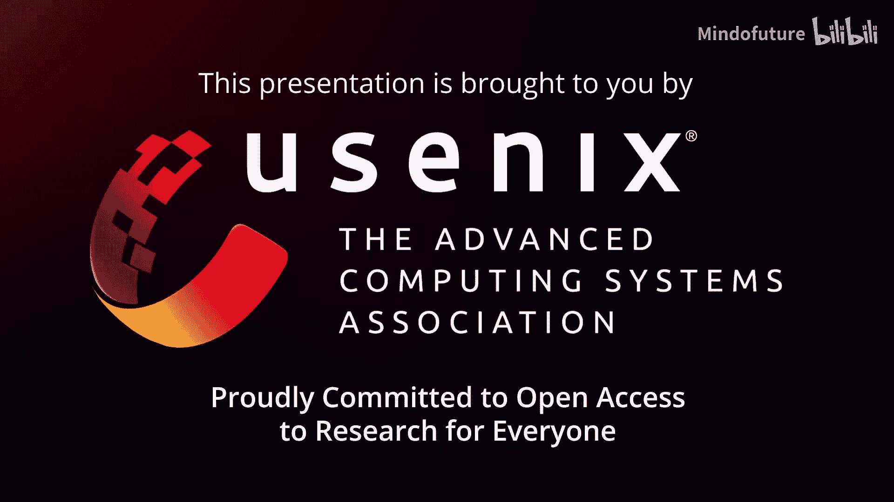
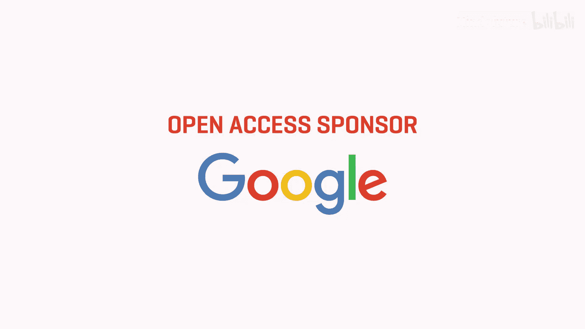
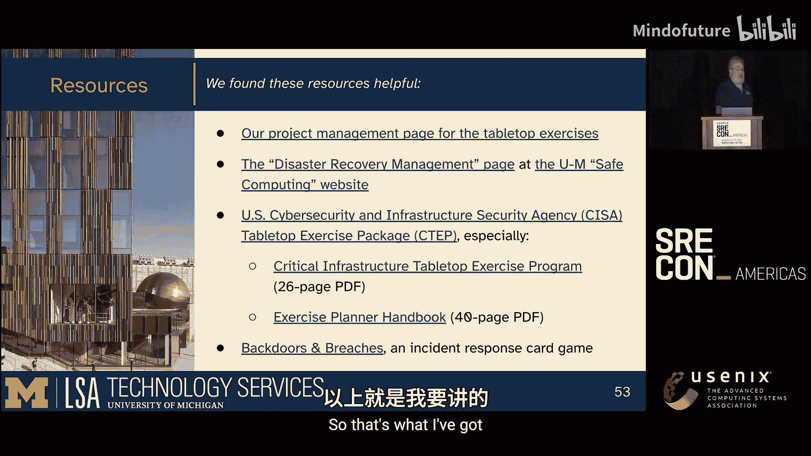
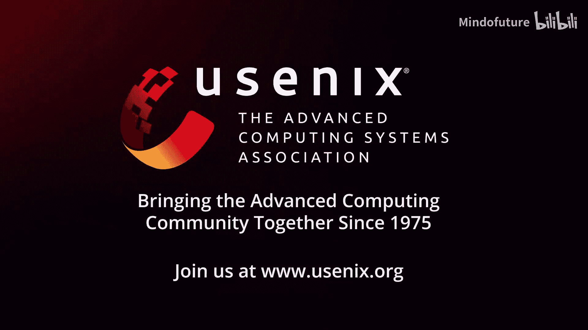
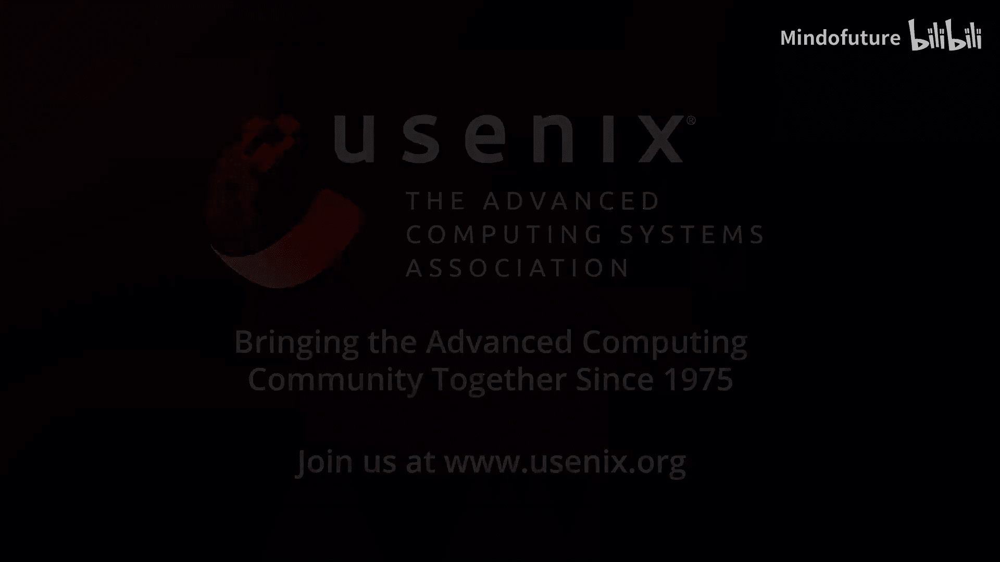

# SRE大会-2025-美洲-｜-srecon-｜-分布式-｜-缓存-｜-OpenTelemetry-｜-安全-｜-AIOps-p20-P20-Running-DRP-Tabletop-Exercises--BV1TmLDz7EZZ_p20-

。

My name is Josh Simon。 I use he him pronouns。 For those of you who are visually impaired。

 I may I'll be kind to myself， middle aged。Beirarded white gentlemen。

I work for the University of Michigan's College of Literature， Science and the Arts。

In the spirit of telling you what I'm going to tell you before I tell you。

 here is what we're going to talk about。 going to give you a quick overview of our scope。

 Tell you the problems we saw， what goes into a DRP or disaster recovery plan。

The tabletop exercises we ran。How we measured whether or not we were successful。And what we did next。

 And finally， some takeaways， additional considerations for when you write or test your plans。

So a quick overview， I will note for the timer， it is not counting down。

The University of Michigan is the oldest institution of higher education in the state。Found in 1817。

 we have almost 53000 enrolled students。9200 faculty， almost 48000 staff。

Our main campus is Ann Arbor， Michigan， we have 19 schools and colleges。

We have two regional campuses in Dearborn in Flint。And we include a hospital system with men。

 need many statewide general and specialty clinics。 Incidentally。

 that's part of the reason that staff number is so large because it includes all of our doctors and nurses and techs。

Lab everybody goes into the hospital。Collegege of Literature Science and the Arts。

 My college is the largest of the 19 Indian Arbor。Just ourselves。

 we have about 22000 students and 3600 faculty and staff。

That makes us larger than some other universities。 where one college among 19。

My unit is LSA Technology Services。At the time， we had about 180 full time staff。

We manage all of the administrative and classroom technology in about 30 buildings on the Ann Arbor campus。

As well as several remote facilities。Not just lease spaces in Ann Arbor。

But a research museum complex where researchers have a whole bunch of specimens。

Our biological station in the north of Michigan。And the Department of Earth and Environmental Studies has a research facility in Camp Davis。

 Wyoming。My individual team， infrastructure and security。At the time。

 we had 13 staff and two managers。 The 15 of us provide or coordinate over 70 foundational services for the college and the university。

 because some stuff， Central I T didn't want to take over， and we got stuck with it。

My team holds what we call innovation Day。Once a month。

 we get to completely ignore email and chat and tickets and just focus on a specific something。

In February and March of 2024。That something was disaster recovery plan tabletop exercises。

It's also true for this year。But the March exercises were just last week。

 I don't have any of the data from。Whether or not it was considered successful yet。

 So I'm going to be focusing today on 2024。So that's where we started from。

Why go through all of this？We identified problems with our existing。Plans。

We've had plans since at least 2008。 I can say that with confidence because that's when I get back to the university。

For most of our services， the ones that we're customer facing。But。😡。

Most of them only soon natural disasters， such as earthquake or tornado， takes out the data center。

It is a disaster， but it is not the only type of disaster。Some of them， not all of them。

Considered service or component level failure。Your database server blows up。

Could be considered a disaster， depending on your scope。Very few of them had recovery steps beyond。

Buy new hardware。Reinstall the O S。 Re from backups。 Good luck。

Most of them did not have a current build guide to help if you had to rebuild from 0。

Some did not have a build guide at all。 And it was all in somebody's head。Not all of our plans。Exly。

 not all of our services had plans。So some of those needed to get written。

When someone spun up a new service， they would take an existing plan and use that as their baseline。

Not in and of itself， a problem， but what if your previous author had said， oh。

 I don't need this section and took it out。There was no true consistency across all of the plans。

So in 2022， we standardized our template with embedded guidance that says。

 here's why you use this section。 Here's when you can throw away this section。We tested every plan。

 every year。Usually during one of our mid semester maintenance weekends。

 because that was time when we could shut everything off if we had to。

I should note that there should be an asterisk thereon we tested because it means we were supposed to test。

 And I was told that we tested。 but I trust my coworkers。 If they tell me they tested their plan。

 I have to believe them。 I am not going to micromanagement and say， well， how did you test。

 That's not my responsibility。But what does that testing mean？

Somebody could just do a thought experiment by themselves。I think that if I do this， then I'm back。

 Hooray， I'm good。Others would go through the whole process of standing up a new virtual machine。

Using the build guide。Restore data from backups and compare the new thing they just built with the existing production service。

 And are these。Quote unquote， close enough， because if you're strung from backup。

 you're not going to have today's data， fine。But the authors often work in isolation。

And didn't necessarily carry the same assumptions。And also。

 the original author of the plan was probably the person who owned the service when the plan was written。

 But staff turnover changes those assignments。So for example， I'll pick on our web hosting service。

It was written by one person。I want to use some names here。 So I'll say Ellie wrote it。

And Ellie moved to a different school at the university， so and took a gover。

And a couple years go by， and Anne moves on to become director somewhere else。

 And so Casey takes over。嗯。Casey and Anne and Ellie all had different assumptions， as to。

What people knew or what was already documented， maybe they didn't go and check， so。

You wind up losings some institutional data as time goes by。

Gold star to anybody who knows why I picked those names。So we wanted to level set。

We wanted everybody to operate with a common set of assumptions。

Identify all the dependencies up and down the stack。

 Both what does this service depend on and what depends on us。

Because maybe we are a foundational service that other people assume we're there。

We want people to write and test their plans the same way。So what goes into a plan？In our case。

 I will note that we do have a template available linked to in the resources at the end of the deck。

It starts with a description， high level overview of what this thing really is。Bear in mind。

 the person implementing your disaster recovery plan may not be your subject matter expert。

If one of mine were to go belly up today， kind of busy at the moment。

 I'm not gonna be able to get back to Michigan to lay hands on something to fix it myself。

 My colleagues are going to have to run with it。List of the dependencies。Hardware。

 This one's a little controversial。 Some people think this belongs in your build guide。

We didn't have reliable build guides。 So we stuck in the D R plan because we know at least that's looked at every year。

Oh， Prad 3 was replaced by Prod 5。 Will fine update the D R plan you're good。

In terms of the hardware， we keep things like。The host named the I P address。 If you're physical。

 model and serial， if you're virtual， what hypervisor environment are you in。

 because the university has one。 The college has one。

 A couple of departments have their own for test beds。CPU memory and disk。Where is it？

More important for the physical than the virtual。 We don't care that it's running on node 4 of the cluster today and node 2 of the cluster tomorrow。

That doesn't matter。But we'd like to know what data center it's in。

If you have an asset management solution， include your asset I D。Any customer software。

You don't have to say， I'm running Red Hat 8。3 in this version of every single library， no。

You can say， I'm running Red Ha 8。But this application requires a specific version of Lib foo。

Runs version 13， but it won't run on 14。 So don't upgrade it。

It's usually what the vendor specifies if you're running that kind of software。

Any specific configuration information。Service account names， database user account names。

 Your password should be in your password management solution。Security and facilities。

 What's your physical security， What's your electronic security。Who can get access to this thing。

Appliance database server。 who can get into it。Where are your backups？

Especially if you're in an environment that has multiple backup solutions， which one holds yours？

Operational information。 I come from an ops background。 So a lot of this is where。I spend my time。

Planants should say how often， and when it's tested。What's considered minimal operational standard。

 for example。It's up and running， and I can answer requests， but the databases read only。

 and only one server in the cluster is up。As opposed to fully operational。

All the nodes in the cluster are up， and it's readrite。Where is your documentation。

I'll say that again。 Where is your documentation。You do not need to include the documentation in the plan。

 but include the pointer。 Again， you， as the subject matter expert writing， it may know where it is。

 The person filling in for at for in the morning because you're on vacation may not。

Scheduled tasks or crime jobs。 What runs when as whom。If you have to replace the server。

Did you remember to back up your crime jobs。Contact information。

Who's responsible for the service in Iil speakak。 That's your service owner。

 service manager and technical lead。Are there customer specific email addresses that you should notify in the event of an outage。

Are there partner organizations that you should notify in the event an outage or who may be required to help you bring things back up。

Such as your facilities， folks。Are there any vendors？Your hardware vendor is X， Y， Z Corporation。

 because I don't want to name any names。Who do you contact there if you have a。

 I need to get this hardware replaced in three hours。Service level and impact。

If you are an organization that is mature enough to have a service level agreement。

 service level expectations or operating level agreement， congratulations， you're ahead of the curve。

Most do not， in my experience。If you have them link to them， If you don't。

 you may have to have a statement of impact。A severity matrix we can afford to be down for so long before bad things。

What's your maximum， acceptable downtime。How long can you be down before the customer starts having his he fits？

So， that's a plan。So we ran in some tabletop exercises。Ask the five questions。

 who our entire team of 15 in different roles。What guided tabletop exercises of a few of our plans？

In a big conference room in February and March of 2024。Why。

We wanted to improve our understanding of how we would actually implement our plans。

If God forbid there was a disaster that caused that we needed to do that for。

Consider what we might need to add in， change in。Remove from our environment。

Not just within the college， but across the university。Identifying and filllony gaps。

And identify any blind spots that we need to remediate before the next disaster。

 And anybody whose's work in operations role will tell you there is always a next disaster。え？

Informal tabletop exercises， there are generally four roles。I am not going to read the bullets。

 The slides will be available after the talk。But to oversimplify， facilitators facilitate。

They can be your dungeon master if you're D And D type person。

Players are the participants who are acting in their technical roles。Usually your service owner。

 manager and tech leads。Observers watch。Can act as secondary subject matter experts。

 but they don't actively participate as players。Data collectors also watch。

 but they're the ones who take the notes。And in the event of Un true。Disaster。

 the' the ones who will help you out with your data analysis。

 assist with drafting your after action reports。This process is way too formal for what we needed。So。

 informally。We were going to walk through three services。

First one was our VM hypervisor infrastructure。Second， our web hosting environment。

And third are on campus data center。 So we have a foundational service， a less foundational service。

 and a physical location。In each case， the service manager and tech leads got to play as themselves。

Others got to play as different parties。Central IT Dean's office network。

We did consider a fourth cent。But at this point in time。

 we had thought about doing our build our build environments。

 but Linux and windows are completely separate， and I can't have two meetings going on at the same time with only one facilitator。

 So we said， we'll do that in the future。We tried to get everybody to act as a participant at least once。

We had multiple people acting as a combined observer and data collector。

It was very much a collaborative effort， as we went。So that's what we did。What didn't we do。

We didn't hide the facilitator， I。e。 me， behind a scrim。

Thought that would be a little too adversarial。We also didn't roll dice to determine whether an action was successful or not。

In case， this case， you know， it doesn't matter if youre roll that nap 1。

 you still have to get to success at the end of the day。

We didn't write any formal after action report because there was no action to be after。

We didn't post any of our notification channels。Social media status pages， customer email。

 because from their standpoint， nothing happened， it was an exercise。If you want。

To do it D And D style。You are certainly welcome to do that。

I think it's a lot more work than you think it will， it will be。

 and it is probably not worth the overhead。But you can certainly try。So let's talk some specifics。

In our first exercise。was the VM hypervisor environment。

 We said somebody got into one of the nodes in the cluster。Okay， for the sake of the exercise。

 we don't care how we just know that。Somebody got in。Well， what does that grant them access to？

Apparently， among other things， it gets access to all the other nodes in the cluster。 Okay。

 that's not good。Also， gives them access to the underlying storage。 That's really not good。

Especially when you realize that that same storage array is where we store the VM disk images， and。

Backups of those images。That could be a problem。If our attacker had waited long enough to let central I T's backups expire。

We would have no usable backups， which means。That at the end of the day， if this were real。

We would have to scrap it all。Build an entire new VM infrastructure from scratch。

Rebuil every server in service that used it from scratch， all with no backups。

Our second exercise was web hosting。He said， okay。The biggest。

Most populated web server in our web hosting environment had about 136 sites。

So let's use that as our example， and a tanker got in。 they got in。

They probably have access to the machine。 They've got access to all the sites。

 So these are all theoretically corrupt at this point。But we don't allow S to H root。Have limited。

You know， host unique root passwords。 So if they do know the root password on this box。

 they don't have it to other boxes。So they were pretty much constrained to the one server。

So if this one were real。Yes， we'd have to rebuild the web server and recover all the websites from。

Hopefully still good backups。And change all of your passwords and keys and certificates and so on and so forth。

Not quite as disastrous， but still a lot of work。Third exercise was the physical data center。

Somebody got physical access， great。This is now less of a disaster today than it would have been 10 or 15 years ago。

We have a lot fewer machines in this data center。Which predates the existence of virtualization as a concept。

A lot of our physical stuff has moved to A。More secure。呃。

Multiple generator backed to data centered that's south of campus。

So there's a lot less that's affected。We had the times we talked about several different possibilities。

Did they steal something？Did they damage something？Did they damage something to cover up a theft。

Did they try and remove the U batteries to sell the metals。

We did identify some interesting constraints as part of this discussion that not everybody was aware of。

For example， one researcher has equipment in one of our racks。

 the terms of the grant said it must be in that rack。Well。

 the disaster takes out that data center and we have to recover them somewhere else。Well。

ve got to get legal involved in that one。While going through all of this。

 we realize a couple of other takeaways that I'll mention。When we build our workstations and laptops。

 the data is encrypted。 disk is encrypted， So data address rest is encrypted， Great。

What about our servers。Especially our older servers， like， say。

 that researcher I was alluding to earlier。So somebody got the takeaway。

 make sure everybody's encrypted at rest。The other one that came up is。

Most data centers have a hopefully protected。Big button on the wall。

 You push the emergency power off or EPO switch， and it cuts power to the room。

But what does that mean？When you cut power to the room。Do the air conditioners keep running？

Is it just the racks of equipment， what if you have something that's not racked？

Maybe you have a KVM on wheels。I know what I think would happen。

Service owner knows what he thinks might happen。I don't know that we agree。

 I don't know that either of those match reality。So he gets to test that someday。If this were real。

 regardless of whether it was a theft or simple destruction。

We know and have documented who to contact where across the university。Facilities。

 legal planned operations。Risk management。So we jumped through all these hoops。

 We did all this stuff。 How do we know if we were successful。

Let's go back to those original criteria we talked about。

Do we have an improved understanding about how we'd implement them。Yes。Did we consider？The college。

 the university in the service， what we might add change and remove。Yes。Did we identify more gaps。

 oh yeah？Did we have or make plans to fill them。Yes。Did we identify more blind spots？Yes。

But that's my standpoint。 So let's ask the participants， what did they think we sent out a survey。

Four questions。Skill 1 to 5，1 is lousy 5 is great。 Howd today they go。

What did you like most or find most helpful？Like least or find least helpful。

 And what could we have done better。For the second event in March， we also asked。

 was the first session better， the second session better or were they about the same。

Because I wanted to know whether I backs as facilitator。So in February。How well did it go？4。

3 on a scale of 5。A couple of threes， mostly fours and fives。In terms of what went well。

 it was engaging。People learned a lot about the plans and people's thought processes。

Roundtable discussion was helpful。Brainstorming was useful。

 even if the virtualization environment wasn't your own service。

And from identifying what was going on with this plan。

 people identified holes in their own other plans。Had new things to think about。

No perspectives to consider and general an overall better understanding of the service。

In terms of what could have gone better。We got lost in the weeds a bit in the discussion。

And to it that I say truee。One of the troubles as a facilitator。Is。

My job is to help them find the answer， not to give them the answer and to be blunt。

 I didn't necessarily have the answer to give them if I wanted to。

But if you're fighting this in a real disaster scenario， implementing your disaster recovery plan。

 you don't know the answer。You may wind up going down the wrong avenue。No dead end。Back up。

 try another path。So that has happened in reality。Some thought the problem wasn't as clearly defined as they would have liked。

 also true。But when you start a disaster recovery plan， when you're told。

 this bad thing has happened， go。That's not necessarily， clearly defined。The first time through。

 we tried to include our major incident process， which is mostly a communication and coordination。

Process， that's a management problem。 We wanted to focus on the technical problem。

Including it was in retrospect， a mistake。 we took it out for the future。So。

We have some things that we could improve the next time through。嗯。It's of my favorite text responses。

The format was engaging， evaluating next steps， Given limited information helped contextualize the plans。

 and it was cool to have everyone's expertise in the room for additional details。😊，Great。

It's easy to go down some pretty deep rabbit holes。

 There's a balance here because those rabbit holes sometimes dig up value， but sometimes they don't。

My favorite comment。This exercise was terrifying。That is a direct quote。The survey is anonymous。

 so I don't know which of my colleagues said it。But good， that was my intent。In March。

 second time through。Went up from a 4，3 to a 4，7，1。No more threes。

Second session was either as good as or better than the first。 So at least I didn't backslide。

Managers like graphs。 Here's a graph。We went from a 4，3 to a 4，7，1。

And a little over half thought they were about the same， some thought the second session was better。

What went well， The more focused topics were easier。Discussion was still helpful。

Focusing on technical actions， not communications actions。Great。Improvement。

 we still spent too much time going down rabbit holes。And go back to my previous statement， yep。

 you're going to do that。 You're going to go down the wrong avenue sometime。

The other comment was some people thought this scope here was too narrow。can't please everybody。

 This one's too big。 This one's too narrow。We do have some more。Areas to improve for next time。

So what was next。Participants were asked to go back to their plans。

Since they have a better understanding， we've considered all this stuff。

 We've identified our dependencies。Identified frustration time。So go back and revise your plans。

 And while you're at it， update your build guide。Your architecture diagrams， your design docs。

If they don't exist， create them because if you had to rebuild your surface from 0 tomorrow。

You need all the help you can get。Speaking of dependencies， we wanted a common set。

Some people thought some of these were too obvious to list。But we decided as a team。

 we wanted to include them anyway。Power and cooling。Got us assume your data center is functioning。

Networking services， DN S， firewalls， load balancers。University provides a core network。

It may be too obvious to list。Because after all， no university would ever disconnect from the Internet 18 hours before the start of fall semester。

August of 2023。So。6ix months prior of that， it happened。

Central I T provides a number of services like backup database servers and storage。

College provides some of those as well。 If the service depends on them， we should mention that。

Authentation。Centrally provided university wide authentication can be things like。AD Kbers， LDAP。

Your two factor provider。We use shvaleth for our federated off， but there are others。

Your password management solution。It's all well and good， if you can。Have the password memorized。

 but tell me you know the admin password memorized to all of your services。

Your notification channels， whatever they may be。Your documentation storage。

It's great if it's the vendor or a knowledge base or a Wiiki you。

 like a Google Drive or a box or whatever。 fantastic。😊。

What if that's not available at restore or recovery time。Look at what your minimum downtime。

 Min acceptable downtime is versus restore time。 If it's going to take you four days to restore。

 the business can't say you must be back up in2。Those don't match。

Means you get to have a negotiation。They can either agreed of the four days or they can give you enough money to make your service redundant and resilient enough to handle。

 too。That's a business decision。Implement the remaining takeaways。

Make sure the discs are encrypted at rest。 Add any missing software licenses to the inventory management。

Look at implementing VM affinity groups。Affinity rules， anti affinity rules， machine groups。

Affinity rule says these tune virtuals must be on the same physical。 Maybe there's a latency issue。

Antifinity is the opposite。These two cannot be on the same physical because they're both resource hogs。

 and they overload it。Update what we're monitoring。

And there is a university wide disaster recovery and business continuity community of practice。

 If they were interested， they were asked to join that。Facilitators， iEB。

Analyze the survey results and feedback， discuss them at a subsequent team meeting。

Decide on a cadence for repeating the exercises。 It happens to be February and March every year。

And develop a training module and documentation templates to train additional facilitators so that。

I can step back。And they can run the exercises。cros the rest of the university。

 I reached out to the community practice Le so that I could present this talk or a version of it to the university。

That took place in April。And for the broader community。

 I wanted to submit this to SRcon to give a talk and， oh， look， here we are。

Some additional considerations for when you write and test your own。It's annoying。

 but you really do have to assume worst case。 What if rebuild from 0 with no backups is where you end up。

Do you have a build guideer architecture diagram？Do you keep it up to date？

When things change and or do you have a change log so that you can say I followed the build guide to build it as written。

 And then I applied all these changes in the change log。

 And here it is the way it would have been in production。The day it went bad。I'd like to say we do。

 We don't for all our services， just a couple of them。Again， if you link to an external resource。

If that's not available at recovery time， you may need to attach a P D F of it to your DR plan。

 just in case。How do you know whether your backups are successful。

 Are you backing up the right stuff。How in depth are you going to test？

Is your thought exercise sufficient？Do you need to do a tabletop exercise with some or all of your team。

Are you doing a quote， unquote，"Re restore and comparing it？To a devpro environment。

If you build something new， you're going to destroy it。

Do you already have a test environment you can play with， Not everybody does。

And you may want to mix and match。 Maybe you do a thought experiment every year。

But every 3 to five years， you rebuild the service。

I do have some resources available in the slide deck， which， again， will be available shortly after。

We have a project management page for all of this。 It links to most of the rest of these。

 So if you only click one link， it make it be the top one here。

There's a disaster recovery management page on the university's safe computing website。

The United States federal government's Cybersecur and Infrastructure Security Agency。

 or SaISsA has a tabletop exercise package or CTP。ACo of P Dfs in that suite is their critical infrastructure tabletop exercise program。

 which is a 26 page P D F。And the exercise planner handbook， which is a 40 page P D F。

And when we looked at that， we said， this is way too formal for us。

But it might not be too formal for you。 So feel free to take a look。And hashtag not sponsored。

 We did find something called backdoors and breaches， which is an instant response card game。

It might be worth looking at that yourselves。So that's what I've got。

Do we have any questions。

