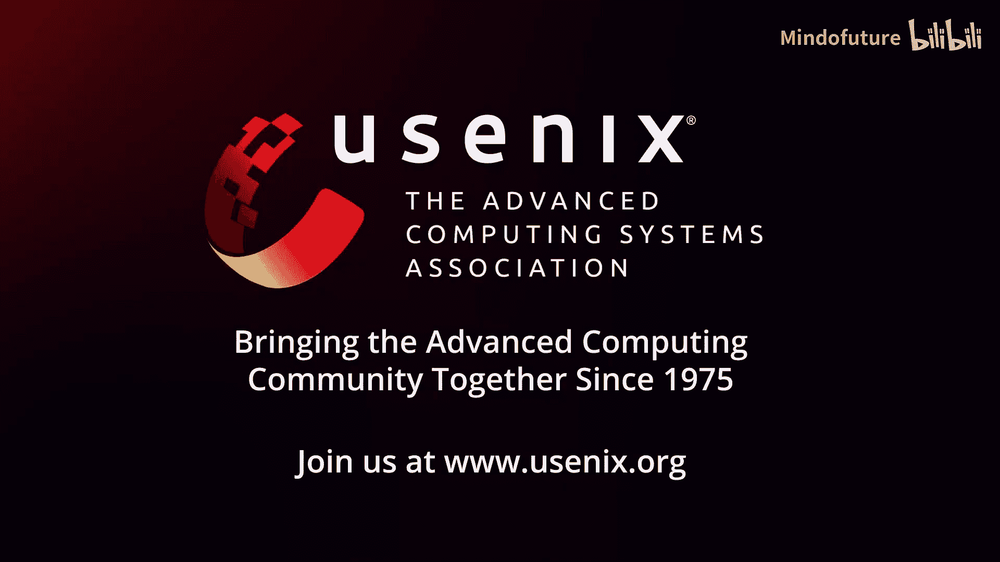

# SRE大会-2025-美洲-｜-srecon-｜-分布式-｜-缓存-｜-OpenTelemetry-｜-安全-｜-AIOps-p21-P21-Optimizing-Machine-Learning-Training-Infrastructure---A-Governance-Approach--BV1TmLDz7EZZ_p21-

。

Hi everyone。 I'm Brian Hansson。 Thanks for the introduction。 So yeah。

 we're gonna be talking today about how we optimize Ml training to really make that link to Ri and how as production engineers in our case in meta or Sres for those in the audience。

 how you can help and hopefully some lessons that you can take back to your companies。

 So we'll start with going through in model development。

 some of the capacity management confounders that are out there。

 there's a lot of different things that go into how to deal with capacity when doing Ml training。

 how you can use this observability towards this capacity use。

 Automize going to share with us a case study of what we've done at meta to be successful in this area around workload governance。

 then we' have some conclusions and then time for questions if there are any。😊。

So Ml training hardware。 I think everyone here is probably aware that these are really expensive。

 right It's a really expensive infrastructure and it's scarce。

 You don't have as much of it as you want， you definitely don't have as much of it as your customers want or your internal customers in this case for us。

 And so you have to be really kind of thoughtful about how you get this hardware， how you enable it。

 It requires significantly time to get the hardware。 to build and deploy data centers， know。

 these things take years to do。 You're kind of dependent on the latest GP as you get them to have a supporting infrastructure that matches it。

 support infrastructure has to evolve as the GPUs evolve as well。 timing that all out。

 making how that understands and works together。 You've got to get this right choice in the mixes。

 And then these things because they're so expensive。

 You really want to make sure that you're getting the maximum amount of lifespan out of them and utility This is so that you can get really high Ri for these。

This very large Capex investment that you have。Another confounder here is the model development process itself。

 It's not like services right you know a lot of us are very used to request response services。

 Ml development is much more experimental and iterative with a really long feedback loop and because the feedback loop is so long you want to get your reliability concerns you're thinking through how this capacity is used as early in the process is possible right because the capacity scales not really with just the users。

 but these M scientists and their ideas and they can have a lot of ideas you would be amazed how many ideas they have and they're willing to use every single bit of hardware that you're able to give them The results also contributing to this long feedback loop。

 the results themselves have limited debugability and so you want to make sure that as these things are launching you get as much right upfront as possible because otherwise you're waiting days or weeks to find out if something went wrong these M scientists they want these compute resources because they want to。

On a lot of experiments。Then you have when you get into being in a large environment。

 the kind of challenges that we face and some of them you can see across even smaller players too。

 but you end up with this heterogeneous hardware environment right you can have a mix of CPU and GPU training within each of those you have different generations in your fleet。

 you have different vendors in your fleet， how do you enable all of those how do you deal with the fact that like everyone wants to be on the latest and greatest。

 but that's not always possible especially when you have a large fleet and a large deployment。

Then you start to get into regional constraints， right， your data might be in one place。

 your inference machines might be in another and your training machines and yet another or your AIs。

 and so you have to deal with these different constraints around where you are regionally in the US or around the world。

And at least in our case， you have competing products too right we have a bunch of different products at metaA they all want access to these resources。

 I'm sure you all have competing groups within your different organizations that they all want access to these。

 How do you fairly hand these out， How do you ensure that they're using them and getting the right business results right。

And then finally， what are they being used for right there's the idea phase。

 there's the testing phase and then the production phase。

 I think we're all very concerned with the production phase as PEs and as SREs。

 but what we would suggest strongly is actually working your way left in that and getting more and more concerned at the testing and idea phase because then you can drive better outcomes for the business if you do。

And then this full observability across all of these is what you really need to get the most out of the fleet。

So to do that， you really need great attribution and metrics， All right， without this attribution。

 without these metrics， it's really difficult to be able to get the right outcomes for the business。

 and the attributions can have scope various scopes you know。

 from companywide the product group ride and subgroup。

 but you really have to start getting these attributes to be as fine grainined as possible to enable。

😊，Governance first， some of it human led， but then eventually I think the goal is to move towards automated governance right and some of these attributes just to give you an example。

 concrete examples， you know an infrastructure， your hardware type， what your region is。

 the training stack that you use， what team some of it's very contextual and will change over time right What is the model。

 what is the project， what is the model type or the purpose of that training we have a concept called model type it meta。

 This is where it is the business purpose of the model。

 how you're using that model to achieve something where a given model serves that model type purpose at any given time。

So you need a solid you need a lot of these different attributes。

 but not so many of them so that you can start to group things together and understand their lineage。

 You also then need metrics right These are the things that you can measure along the way to see how you're doing and examples here include money GPU hours。

 network bandwidth storage things that give you efficiency information such as like your samples per second or your GPU utilization or even getting down is finegrained as some of the registers on the actual GPUs like Sm utilization to understand where your real bottlenecks are when you're doing this training all of this is really necessary to get to where you can provide a link to Roi And I think this is really important and sometimes we could do more of a focus as a group on this is ultimately we care about production but we care about production because of the results that it drives for the business and we want production engineers and Sres to be driving more value to the business And so by getting these attributes。

 these metrics measurable and being able to then take a governance approach to them we can get better outcomes for the business。

Capacity is a key to determining the cost of how much training these models take， and using it。

 you can start to understand where your efficiency gaps are， where your reliability challenges are。

 start to prioritize your workloads， and then start governing that efficient use。And so with that。

 I'm going to hand it over to Ana to walk through our case study。

So let's look at different kind of governance we can do in ML training space one kind of governance is to get right optimal set of AI models as the number of models scale so does your cost also over a period of time you will be collecting models and models need to be deprecated。

 having the right portfolio of models is really important to get the best ROI for a business。

Another dimension of governance is control over access to resources。

 these resources are allocated based on some purpose， some principles during the planning cycles。

 you want to make sure the use of the resources is in line with the purpose they were allocated。

A location itself is a governance area， you need fear metrics and you need to stack rank your projects based on ROI to fund the right projects you need to balance the long term versus short termm ROI and there are many more areas of governance in today's talk will go deep diver deep a little bit into one of those areas which is training workload governance and this is about governing the ML training jobs that are launched。

And use the ML training capacity。So if you look at the layers of training workload governance。

 the foundational layer is attribution governance， this is the layer that provides the purpose of the job what was the project this job was associated with what model type was this training what is the development stage is this a production stage or is it an early idea stage。

 these attributes are very key to observability not only do they provide dimension on which you can do analysis of your ROI but they are also foundational layer with which you build the other governance tools。

The next is capacity governance and we are all familiar with quota checks at metaA we have different capacity pools there are high priority capacity pools where the jobs have low latency guarantees and their are capacity pools where the latencies may be higher and we use the attributes like purpose of the training to make sure the right capacity is used by these jobs because individuals have access to it's a very multi-dimensional space and individuals have access to multiple capacity pools。

Next is reliability governance we want to make sure our jobs don't fail in many cases there are combinations of features deprecated features or combination of features if they are present in a job the job will fail or a certain model is targeting a hardware where we expect it to mostly be out of memory。

 so these failures not only hurt the capacity efficiency， they also hurt the developer productivity。

And finally we have efficiency governance， we want to make sure that when the capacity is limited when we are running low capacity we can do very fine grain and very contextual job prioritization we need to know what these jobs are about what models they are training is it a project that needs to land very soon to enable some revenue or some critical product feature and we need to prioritize those over the rest of the jobs there are special techniques we use like strength models that make it possible to true an idea with lot less resources we want to make sure certain teams use those models in their exploration process and and there are governance rules around that。

So to achieve all this governance objectives is when we set out to build a governance framework we had some top line goals for the framework Firstly we wanted to wanted it to be a very general purpose framework so we build it for training workload governance and we can utilize it over other governance areas secondly we wanted it to be distributed and hierarchical solution and meta is a big organization and there are layers of hierarchy and and each at each scope there are certain rules to be followed and each scope has contextual knowledge has its own goals so we want to enable these folks to independently move towards their governance needs also there are multiple domains of governance so the solution needs to be able to handle governance in a distributed way another dimension of being distributed is the MLl training stack。

For training jobs there are multiple ways to launch jobs and they go through multiple components and there may be multiple governance points and this is not only true for training jobs for any governance you may have multiple governance points and you want to have the capability to be able to apply same set of consistent they may not be exactly same but they need to be very consistent rules across these governance points。

We wanted to have a very capable system to express the governance rules we didn't want static rules。

There is a lot of domain specific knowledge with teams。

 they have their own source of truth source of rules and in state and these sources of truth capture the state of that universe and we want the teams to be able to use all that information to make rich nimble governance rules and that throws in reliable challenges as well。

 so we wanted the framework to be reliable and have a low support overhead。

So let's dive in a little bit into this hierarchy of rules so at the highest level is the company level at the met level we have certain metadata。

 certain vocabulary， certain nomenclature and certain sources of truth along with it and those with those we want to follow certain rules for each of the job so as Brian was explaining about the model type model type is a business purpose we have inference pipeline that may have multiple model type there may be multiple models of different types in that pipeline and we want to make sure we know the RoOi of each of those components so we need to know how much was a cost for development in different stages for these model types and there is these model types need to be registered in a proper way so there is a source of truth for these model types and we need to make sure it is one of those model type and not a fo bar。

And so these are the first level of checks we do when a workload comes to use the capacity。

The next is the product groups， they may have their own sources of truth， their own context。

 their own rules。And these rules may will use the context at the company level as well as the product level to then further decide whether the job proceeds or not。

And this can go on at the sub subgroup level as well and here I'm simplifying the diagram this is a binary yes no kind of a graph。

 but actually we also have other more rich outputs like what is the priority which pool needs to be accessed in these rules。

Let's dive into the distributed nature of the training MLl training stack itself there are many ways that matter to launch these jobs。

 some are built by central teams， certain built by groups。

 some folks are launching jobs from Python notebooks there are all different ways and this is actually a simplified diagram it goes through orchestrator and then goes to a central scheduler that sits in front of MLl training capacity so first and foremost what we need is a full coverage in governance if you don't have full coverage if you have a loophole that loophole because we are not dealing with machines we are dealing with humans the loophole always grows so full coverage is essential for governance。

On top of coverage then you need some early detection because late detection is usually expensive。

 we want to stop the jobs early on so that the if a job is going to fail develop personnel know instantly。

So the solution we came up was basically having separating out the business logic。

 the governance logic out of these framework and placing it centrally。

 and then putting clients in all over the place all over the important channels and most importantly importantly in the central scheduler to have a consistent framework of governance which is isolated from the framework so now you can deploy your policies without dependence on different frameworks as in when new frameworks come in you still have full coverage but you can get increase your early coverage as well。

So as a ML training job originates and it goes through these pieces of stack。

 you have multiple places governance happens and these rules are consistent with each other。

A little bit more about solution details。 what how did we envision our teams to use this solution Firstly。

 we wanted them to be independent。 We wanted them to be able to roll out their policies their own way and own it。

Secondly， we wanted them to be able to use all the state information in their tools。

 so we went with all our policies are structured like trees which are responsibility structures and each node is responsible for providing the functionality its a very flexible UDF based way to code your policies and it is responsible for selecting what next policy node is going to be。

And this provides the isolation and hierarchical governance structure we needed。

But then this also needs the responsibility to go along with it if a group is rolling out a policy they are responsible for any addressing any policy failures telling folks how to respond to those policy failures maintaining metrics alerting reliability metrics so what the framework provides is a template based approach where you can build all this easily for your governance policies and also what framework provides is authoring control safe policy execution so we basically isolate the context in execution in authoring and at the run time so that the error is isolated and is routed to the right team in essence we want independence we want ownership and most importantly we want isolation if a policy is failing and it is stopping a lot of jobs。

We don't want the whole town to be woke up folks who are responsible for those policy are the only ones which are on call for that policy。

嗯嗯。This kind of open and very flexible framework leads to reliability challenges so firstly。

 what happens if the service is down we set it up as fail open。

 we strive for a very high up time but there are cases when service fails we want to keep it fail open we realize nobody anyway times their training job for a service to go down and sneak in so this is not that big an issue。

We have standardized how we write the policies， how we standard APIs。

 so that kind of puts swim lanes in terms of implementation to have high reliability。

We have very strong deployment set up for these policies。 we have we go into this shadow， which is。

Looking at what would be if this policy was in place and this there is a process for which can be multiple days where we observe what would happen if this policy goes。

Into action。 And if there is a problem， we basically make the changes。

 so we know upfront what is going to be effect of the policy。

 And then if you are not able to detect something we have framework provided kill switches that are in our run books and we can selectively bring the policies down。

Finally， we have a very strong set of rollout guidelines。

 one thing about governance is communication。There can be a lot of jobs with that are violating a certain rule。

 and it is okay to stop those jobs。It's absolutely not okay to stop those jobs without giving fair warning without telling folks how how to fix the issues because if you throw surprises there is a lot of friction and governance gets a bad name so we have to this is a very humancentric process a lot of it is in the R&D face so we are dealing with humans who are trying to access most of the capacity where in some case making mistakes by just copying some flow and copying parameters which are wrong so we need very strong communication of what's going to happen what's coming who did we get by in from and what is the objective so that we bring the community along when we roll out these policies。

Some of the key results for model type， as I explained， which is very important for meta。

 we have 100% coverage across Me within monetization group we know full usage of our cost for each of the projects there are many more attributes like that and this provides us the business insights we need to make good investment decisions。

Then we had wins in efficient prioritization of workload in cases we were running low on capacity and finally on the Dev productivity side we have a lot of wins on stopping jobs that would have failed in production。

What are the key learnings governanceover is hard I talked about communication there is a human in the loop and communication is critical this is its not it's a slow process the framework we build is not for velocity。

It is for being moving in a very structured way forward and causing the least damage and yet achieving the goals so velocity is not the prime candidate we roll out our policies slowly。

Governance is a tool for limited use。 We， we don't want to。

Overuse governance automation is the best way and governance that goes along with automation is a good governance。

 So wherever we can automate certain things， we don't use governance。 if you can。

 if we can give value ads so that what we want to achieve through governance is we automatically get through automation。

 that's a better way。呃。Next thing is governance need to be aligned with the incentive structure。

 There are cases we we found that superficially， we have an alignment， but。

There are things people can do where they break rules and get more to the business and there is a lack of alignment in in the business objectives and the governance rules whenever that happens there is a lot of frictions and those governance ideas are mostly doomed to fail。

And finally， the different governance domains we have should work coly now stepping back into bigger governance picture。

 you can see your business like like a big story where you are developing models that are going into inference pipelines which is making money。

 you have some governance over how your model moves from stage to stage。

 you have some governance over how you are developing your future。

 you have some governance over how training workloads are and how AB testing is done。

And these things should be cohesively， the governance story has to match the bigger picture story。

 if it is out of line， then you again are inefficient and lose you will have loopholes in governance。

I'll hand it back to Briant。listening to this again I hope if any of our ML friends are listening to us。

 please don't take down this service because it opens up a loophole for you to get your projects through I realized we gave that away here so I hope that I want to talk about why can you benefit from you know how can you benefit from governance right I think that。

What works best is when it's a light touch and it works more towards getting these observability that makes governance possible so you get this observability benefit that you can start to see more around your investments what they're doing how they're doing and that will give you levers to achieve your goals the business goals。

 your goals as PEs as SRs right and ultimately then that should translate to RoOi for you for your group for your business the governance is a means to an end。

 I think we want to get to where this process is more automated but this field is moving really fast and so it has to have this human touch involved。

 and we need to get these fine grain metrics， these fine grain attributes in place to start to nudge how they're developing these M artifacts into a more rigorous way so that we can then build the automation that takes over for it so that we can start to get more humans more out of the loop in the process so it becomes。

More reliableliable， more efficient。 And so that they can focus on what they do best。

 which is the M technology that they're creating。 They don't really care about how their jobs get scheduled at all what they care is like their job is scheduled。

 My idea works or my idea doesn't。 And the more we have to give them the pieces to deal with things that aren't in the M technology。

 The more frustrated they're going get。 So it's actually a way that you can help your customers out quite a bit while helping the business out and showing the value that you can provide as people that care about how these things work reliably。

I think， sorry。 I think the other thing is that， you know。

 we talked about this governance and getting these attributes into place can also then start to pivot into other areas。

 how your resources are allocated。 I mean， Ana I talked on it briefly。 But just some of the。

 I can't go into specifics on the numbers。 But like just being able to understand where your priorities lie can reap very large benefits for the business and how you schedule these jobs。

 right， they different sizes， they how they bin pack can be different And having this these finegra attributes allows you to binpack them better and make the most out of these resources。

 And we've seen huge wins in this area。😊，So I think the things to kind of consider as you're doing this。

 you know how do your ML teams work right are they within different orgs。

 are they on different projects， Think about that as you're putting this together because you want to get buy in on this。

 you want to understand how these resources are shared across do people have their silos do they not you know when we see the resources very siloed between areas。

 you lose a lot of ability to get some of these efficiencies and so where you can have a abstraction layer between the capacity and then the groups that are using them and how they're using them different and then these rules around them。

 you can get better results overall。Do you have capacity that has different SLAs for different purposes。

 think here the R&D phase versus the production phase， making sure that you have carve outs for that。

In in a world where you might be spread over multiple regions， if you were to lose one of those。

 do you have the observability to be able to redirect resources rapidly between R and D and production so that you can continue to serve when you need to。

 I think what kind of controls do you need when things go into AB testing right These are when you start to see these M models can have effect on your outside customers know we're kind of focused on the inside ones that are developing them。

 but they will roll out eventually in effect your wider user base most likely。

 And so what do you need to be ready， What features does your governance framework we need what attributes or metrics do you need to put into place now to be able to understand that and build more automation around it right and then you want to build generic products that' kind of scale。

So why are Ps S already talking about this， why are we up here as PEs talking about this I think？

Going broad is one of PE's core strengths right Like looking at the holistic picture of how this development happens and getting it to be in a more repeatable。

 reliable， efficient state is something that really we're suited at doing when looking at these distributed systems because the M development process is very distributed。

 And so I think it's taking these skills that we already have in implying them to this new domain。

 and I think it's a great area where we can bring our knowledge and understanding of distributed systems into the space right I think governance is reliability centric right this is something that we care about a lot as a group。

 I think I hope and so taking this approach of how we can do this governance in a way that drives increased reliability is something that's well suited for this set of folks there's also the fundamental need for observability。

 which is sometimes difficult for product teams to drive for。

 right you know they're very focused on what output they're getting from their thing where we'。😊。

tryrying to take a step back and look kind of at the fleet level or the company level of what's going on and what's necessary to do that and have that observability across all of it and so I think that that bringing in that different lens of how we approach observability and not just on a specific slice but on the broader across the broader ecosystem is something that PEs are really set to do and we're incentivized to build solutions and so this is a challenging area that we've been in now for a couple of years and we really want to keep building on these solutions that take us to this world where things are more automated and we have more debugability and understandability of how things flow through our system and get out to customers and ultimately produce value for the business and for everyone。

So I do want to acknowledge our team， this is not just the work of there's a large number of people that went into all of this I'd like to thank them all they couldn't all be here there's our team the ads MLPE team we have our monetization partners Suse product folks out there that are helping us to do all of this too we have core info teams。

 data science product teams， data engineering it's a lot of effort to do this right across the company the size of Me but that doesn't mean it should be something that you can't take on in your at a smaller scale too right start thinking about how you can put in these things start to track them and then use them for the better of your business and with that we've got a little bit of time we can take few questions if there are any from the audience。

