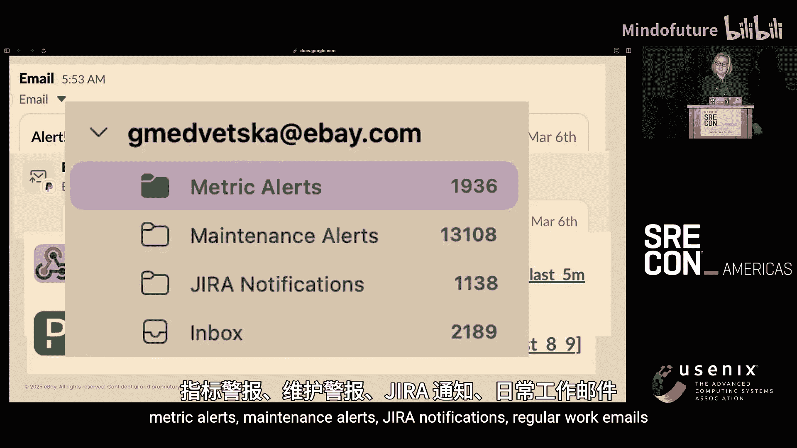
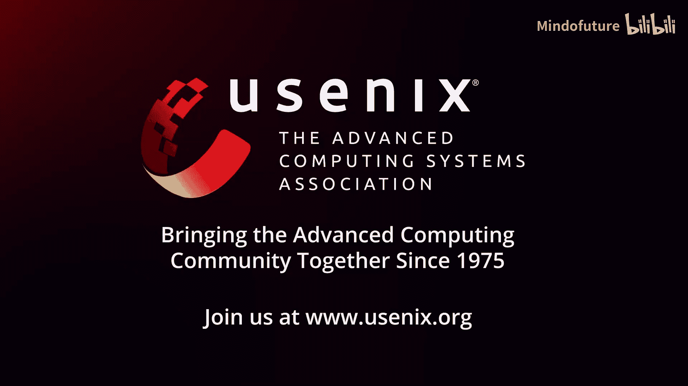

# SRE大会-2025-美洲-｜-srecon-｜-分布式-｜-缓存-｜-OpenTelemetry-｜-安全-｜-AIOps-p22-P22-Beyond-Sequential---A-Recipe-for-Async-Pipeline-Observability-and-Alerting--BV1TmLDz7EZZ_p22-

。

Good afternoon everyone I'm Josh Myster joined here by Gabrielra Madtzska we are fulltime software engineers and the site reliability engineering team at Ebay and parttime amateur chefs I'm sure a lot of the people in this room are also amateur chefs you know constantly trying to perfect how do you serve up consistent experiences to your customers through while interacting to your applications making sure these experiences are available reliable fast and most importantly delicious。

😊，So。And most of us here will also be working with very similar common ingredients in observity you know your metrics and your dashboards and are also well known and well documented across our industry that service level objectives are SLOs are the secret sauce which really brings observity and monitoring together。

😊，So today we are going to share a recipe with you which will help you with defining SLs to ensure asynchronous applications are well monitored and like the experiences that we are providing through asynchronous applications are consistent。

😊，So the title of our presentation is going to beBeyond sequential a recipe for Acync pipeline observity and alerting。

😊，So here's a quick overview of our recipe so there are three main sections to it the first one is preparing our ingredients gather your application。

 your metrics and then once you have that boil and mashroom ser minus create SLs and meaningful dashboards out of those metrics and finally garnish itself once you have your SLs how do you maintain coverage and compliance when over all these SLs and the things that you' have developed out out of the previous steps。

😊，So let's talk a a bit more about the first step in the recipe， which is preparing ingredients。😊。

So the main ingredient here of course is the asynchronous application it's also important to note that asynchron asynchronous applications are not rare in our organizations right all organizations will have some use cases where you really do not need to like respond immediately to to a request like you can just have a case where all the request are collected requests are collected you do a far and forget and move on with the rest of the rest of the experience and。

😊，Only worry about the results once they are ready。

 right like it's a very common use case that we will have across our infrastructure。

 so they're not rare。😊，There'll be other use cases too which are not time sensitive either。

 So like you'll have multiple la applications throughout your infrastructure yeah once you have that the next essential for making a observed recipes。

 of course， the metrics you you cannot have any any authority without the metrics。

 so like you need that and on top of that you need to create a dashboard and your visualizations which inherently also means that you need query capabilities on top of that And finally once you have a good visualization。

😊，A good visualization of what metrics you want to monitor and look at for your asynchronous application you need to define your good and valid events and here if anyone who has worked with SOs or like went through the Google SI book which initially introduced SLs you would know what valid events and good events are so you need those definitions before we go into defining SLs and yeah finally once you have that you have SOs on top of the good and valid events。

😊，So yeah first what what like I've used the word asynchronous multiple times so I'm just going to spend some more time on you know making sure that what I mean by asynchronous application I'm sure you all of you will have a general idea but like I just want to spend some time give you an example at so that like we have a clear understanding of what I really mean when I say asynchronous。

😊，So before I go into the example I will give you some background to how the item recommendation system at eBay works so that is the example I am using to explain what an asynous application is。

😊，Item recommendation as the name suggests is just giving you recommendations of items after you finish a checkout and before before we introduced a ML based item recommendation system years ago this is that we didn't have a ML based item recommendation but after a user went through the checkout process bought an item or added an item to a wish list we just showed a list of items which were trending in the categories of similar items and we if you compare like the monitoring impact of showing just top items from a top trending items from the same category versus showing an ML based recommendation of the items that the user can buy after after。

😊，Going through the checkout process we saw that the revenue difference was at least 2。

1% like after we introduced the ML based recommendation algorithm over the old system and I wanted to emphasize this specifically because when we generally say asynchronous applications and you know processing things offline we don't really always consider them to be like you know top priority or being very business impacting but as the number 2。

1 suggests that's a significant amount of revenue and thats why it is important that we have a good solution in place for monitoring asynchronous applications。

😊，So yeah let's go into the example of how the item recognition system works。

 I'll be very brief and vague about how this works because not that' is not the crux of our presentation like what the ML algorithm is but it is just to illustrate like what asynchronous application is and how can we create our monitoring solution on top of this。

😊，So first these we have the producers here， I say producers because essentially they are just regular sequential synchronous services or APIs where users interact with on a UI further APIs for buying an item or adding an item to a watch list they are just request response systems they have no asynchronous nature in their use cases。

 but what they do is when a user。😊，By an item they produce a message or the nomenclature we also use is drop an event into a queue this event is called the seed item queue and what each event or each message will have in its payload is the ID of the user who bought an item or added an item to a watch list and and the item ID of the item which was birth。

😊，Finally from the queue of the from this queue we have the ASInc ranking service application。

 this is the application that we we are going to like we are developing a solution to monitor so this is the main consumer which is going to consume these events or messages being dropped into the queue by the producers。

😊，嗯。And this consumer can be computer computer driven or it can also be I driven like it it can totally just be a pass through which just calls external APIs other or just databases and so on。

 So here in this example the consumer calls the ML recommendation API。

And as with any AP network call there is also a chance that due to a transient issue that the call did not go through。

 so the the platform on which asynchronous applications are developed at ebay also inherently supports a retryq so let's say。

😊，Let's say if the consumer is trying to consume an event and the API needed to consume that event successfully did not go through。

 it is automatically added to a reTI queue and the consumer has the capability to read from either the reTtriI queue or main the main queue per se。

And finally， after the processing is done， it is written into a ranked items database or we can also call it the consumerd D database that that means that the consumer has done its processing and has written its final result into this ranked items database。

 an example the in our item recommendation recommendation system how this would look like would be that for a user ID。

 this is a list of all the items that that the system game written with like a list of item ID for example that could be how what would be written into the consumerd D database。

😊，Wwhich is eventually ready to be consumed by some other service like the recommended items page like so like the next time the user go comes to eBay or goes to check out this is where that service will look into the database where the service will look into to populate a list of items recommended items for that user。

😊，So yeah， now that we have a general understanding of like how yeah of how our asynchronous application works and like what are we trying to monitor the next step is how do we define service level indicators for all of these things which are working to get our item recognition system in progress？

😊，So these are some examples of SLs it's not an exhaustive list so I'll go over them and explain them in the context of like how we are monitoringing the item recommendation system so the first couple are validity and latency this very straightforward like if you have to give you a quick analogy of quick analogy with synchronous application is just the rate of you know56 responses or the rate or the duration of a request the definition of the validityity and latency SLs will slightly vary for our asynchronous obligation compared to like synchronous applications and we are will go over。

😊，What these variations are and how do we actually define for in our use case later in this presentation。

 But before that， there are also some other SLs you can have for your eing applications。

 The one is freshness freshness is basically。😊，Let's say that the recommended recommended items like the relevance of the recommended items are only are about like you know the recommended item is relevant which was relevant 30 days ago but not relevant anymore because the user has gone away from that category so basically the recommendations are not fresh anymore like that is one way of looking at it。

😊，The next year's quality it can be that the recommended items list could have been way like way larger and like it could have like more accurate items in the list but for whatever reason the application was not able to provide that accurate list and it just gave like one or two items so that will can be measured through the quality SLA finally throughput is just nothing but the number of items which are processed within a given amount of time。

😊，For our presentation and like what we have developed at ebay we only focus at the first couple Ss our Lady and latency there are two main reasons why we went ahead with our lady and latency first is criticality so。

😊，If you think about it， if you can effectively measure availability and latency。

 you can kind of derive the other three SI out effects， for example。

 quality you can define your L in a way that a bad quality is considered to be a failed like a failed response from the application right and similarly freshness and throughput can be derived from latency like for example。

 if if the consumer took really long to like successfully consume an event that actually also means that the output from the consumer is not really relevant or not fresh anymore similarly with throughput like the longer it takes the lesser the throughput of the application will be so。

😊，Yeah， so that's why we went ahead with LD and latency。

So first let us talk about the availability metric like the how do we define the metric on top of which we are going to define our Sli？

😊，So every event that comes into the Asnc application has three possible states。

 success abandoned and retry and this is common across our entire platform so like any developer who is developing an asynchronous applications get these out of the box success abandon and retry out of this retry is a transient state so basically if let's say if there is a transient network failure while calling an external API from the asInc application right so that event is added into a retry queue and we also have configurations where you can。

😊，Define the length of the retry queue and like the number of times a event can be retried before it is eventually marked as abandoned。

 but yeah that' is important because retry is not a final state like eventually every event will be either success or abandoned because there is a maximum nerve of retry event can go through but eventually it has to be converted into a success or a abandoned state。

So yeah， so and what does success and abandoned state means it's very straightforward like you define what is a successful successful consume successful way of processing an application app event by the application or like what is a failed or an abandoned definition of。

😊，What an event is defined as in the ayn application？

So now that we have a good understanding of what the early states are how do we define a metric and an SI on top of it so we just use a Prometheus counter to to pretty much mark whether our events are marked as success or abandon so here if you look at the query。

😊，The consumed item count is the name of the counter and you have other attributes in the labels which helps us to sense like these are also metrics which are available out of the box in our platform we have labels to query these metrics specific to a consumer name and the event name and the label which is more relevant and important in our for in the context of the presentation is the status label you can see status is equal to success so essentially what the top query really means that is that is the number of successful events which are consumed by the ranking consumer and the event is rank C item in in a given unit of time that is per second。

😊，Similarly， if you look at the bottom query it is for the most part the same but the state as you can see like we have success are abandoned and as I mentioned earlier the all events eventually can only have two final shade success and abandoned so this query gives us the total number of events which are consumed per second and yeah as I mentioned earlier if you are familiar with SLs and SLs and have worked on defining them this is the basic definition that we use the。

😊，The ratio of good events over valid events consumed in a in a given amount of time。

 and here the definition of good and valid event valid events changes from case by case。

 in this case， it is whether the。Final state of the event was success or abandoned。

So that was how we define the availability SLI so now let's talk about the latency SI and before that how do we define calculate the latency metric so we use prom histograms to make our calculations on the latency and how we eventually calculate it so for example let's say our producer which was the service which goes through the checkout or the adding an item to a watch list service it writes the event into event queue the C item events the asynchronous ranking service application then read this event reads this event from the item queue and let's say the event spend some time in the queue right it does not go into the application immediately it spends some time in the queue so we also add that let's say it spend 10 milliseconds so we also add that to our calculation。

😊，Finally for whatever reason let's say it did not succeed in the first first attempt so it went to a Re IQ it spent some time in the Re IQ and eventually the a ranking service picked it up from the Re IQ consumed it successfully and it was finally written with a success state into the final consumed events data store so at each stage we calculate the timestamp and we add that duration into our promeesis histogram measurement so so for example in like here every stage 10 plus 10 plus 10 plus 30 we make the total calculation as 60 millisecond and that's what we store in our histogram。

😊，So yeah that's how we define the latency metric now let's talk about how we define the SLI on top of the latency metric so if you look at the queries you'll see they are very similar to the queries that we had for the validity SLI the only difference here is the L label so back there it was status is equal to success here it L is equal to 10000 so what essentially changed here is the definition of a successful event there the definition was an event which ends with a status as successes status as success but here the definition is an event which was consumed within 10000 milliseconds or 10 secondsd。

😊，So that what that' is a label which comes with the pro histogram and we use that to define the good events for SLI similarly the bottom query here is the total number of events consumed per second so the difference here is L equal to plus Nf so plus NF basically means plus infinity like so in the histogram it gives you the total number of events or the calculations which were made within the entire latency histogram range that we are configured so thats how we get the latency SI。

😊，Now that you have gathered metrics and Ss do essential ingredients。What's that Mike。

okay now that we have gathered metrics and SLs to essential ingredients needed for a recipe。

 it's time to spice things up with custom dashboards so on the screen you see examples of the panels we use to monitor our sync pipelines so even without SLs we look at event status。

 consumer backlog and retry backlog which are basically availability metrics and then the producer to consumer as the name says 99% 99 percentile latency would be our latency metric。

😊，So these can be used on their own as like in regular day to day SreE flow。

 but it is definitely more efficient to onboard SLs and have alerting systems on top of these to make the most use of it。

And as SEs， we take risks all the time， it is whether it's monitoring a new feature in production or implementing a major infrastructure change。

 we are at the forefront of sites reliability and it is our responsibility to make sure that we have the safety nets in place to allow for limitations such as new features with changes or and protecting sites reliability at the same time so one way to achieve that is to define SLs and let them handle the heavy whisking so we kind of brushed over the SLIs and availability metrics and all of those things but here are the actual definitions so SLO stands for service level objective it the internal promise to meet customer expectations it sets the target of an SLI over a period of time and SLI you've heard that so many times at this point is the service level indicator so that's a metric that we're keeping track of。

Here is an example of an SLO definition， such as 99% of events over 30 days should be processed within 10 seconds。

 99% is the SLO go， 30 days is this SLO period and 10 seconds is the SLI metric， in this case。

 latency。So。What happens when we receive dozens of emails， lack messages， false positive alerts。

 metric alerts， maintenance alerts， ge notifications， regular work emails。

 all requiring our attention， we burn out。

Fornately or not， we as humans don't have chips embedded bed down our brains to help us process more information。

 So as such， we need to balance our flavors and prevent alert fatigue。😊。

Using foolproof error budget and porn rate alerts we can make sure we're able to handle alert heat so some more definitions in this part of the presentation will be a little heavy on a lot of text but error budget is the number of errors accumulated over a certain period of time before your services go out of compliance so it's defined as budget of unreailability equals 100% minus the availability target or latency target or whatever SLI you defined target that means that if you have a availability target as 99% your budget of an unreilability is 1% that basically only 1% of requests are allowed to be unreliable or out of the bounds of the defined thresholds for that compliance period so usually 30 days so if we defined it as like 99% of events over 30 days within 10 millise。

Should be processed， that means only 1% of requests are allowed to be longer than 10 milliseconds。

And burn rate stands for how fast relative to your SLOU service consumes the error budget。

 so these definitions help us understand how to set up the alerting because all of these are defined in a Google SE book and you can read a bunch of stuff about this there。

 we are here just mostly providing an overview how we have implemented it and how we have used these a particular concept for defining a sync SLOs。

 so burn rate here on the chart would mean that if NSLO has a burn rate of one。

 then it would just gracefully ran out of the error budget within 30 days while the rate of two would mean it runs out of budget within 15 days and burn rate of 10 in about four days。

hy the burn rate is important is because it's used in the formula to set the alerting。

The concept introduced by Google is multiwindow multiborn rate alerts。

 which help you prevent false positives and still have sufficient visibility into services performance so it's basically timeboxing the alert within the specific window to help it resolve faster and not keep alerting once it's already fixed so make sure to season your alerts tota but remember that overdone notifications are just as bad as undercook monitoring so you really want to find a good balance between false positives and still be able to get an alert when something is going on so for instance。

 if we combined six hour window with a 30 minute window then when the six window is threatened we would get an alert but it would resolve quickly after the fix when the0 minute 30 minute window is already in the green。

So。This all depends on the burn rate。 So here burn rate。

 the formula for burn rate would be budget consumed times compliance period divided by alerting window。

 So if you want to get an alert when the 2% of error budget is consumed。

 So within the previous slide that would be like。Before5， obviously， so you would want to。

That's when you want to get alerted。 you would want the burn rate of 14。4。

 and you would get there by。Taking the error budget consumed。

 multiplied by so 720 hours and then divided by one hour because it's your alert window you would reach 14。

4 for purposes of our， I think pipeline SO observability we chose the last two。

Slections in this like the multiwind alert systems and we chose the two hour and one day for critical notification and then the six hour and three day for warnings。

 so the burn aiddes there are one in three respectively。And to show you how that looks like。

 So this is basically the alerts we have defined。 So this is an availability alert。 It the 0 point。

144 is the burn rate of 14。4 times a 0。1% error rate and so these are basically the hours of the times the windows for our alerts and we have also added the consumer down and data loss alerts to make sure that the metrics are flowing and present because we don't want to get a bunch of no data on our dashboards and so we have alerts set up with that。

All right now that we have SOs defined and we know what they stand for and how alerting their works。

 it's time to harness the SLO metrics unfortunately this was all references to dunes and sandworms and you know metrics flow with spice flow and this was harnessing and we were supposed to have the Po traies on the sandworm here but to avoid any sort of issues we decided to keep it simple and it does not have the and I'm really sad about it I just had to communicate that but。

Anyway， so we are harnessing our SLOs metrics and once here are some examples of basically what we would have。

 so in addition to just having the regular latency percentiles and error rates and status。

 we would have the last seven day performance， so basically taking our Prometheus metrics。😊。

Counting checking which how the service is performing over the last seven days。

 Then we have the SI success rate。 So basically the SLI availability metric or latency metric as a success rate and then monthly error budget burn rate。

 So that's basically。The same burn rate charge over 30 days。

 but in this case plotted on the actual how the service is performing and then the daily SLL performance based on error budget which shows how there is a daily error budget allocated and how each day the service is doing compared to it and this way we could directly see that there's clearly there was something going on between February 24th and February 28th or something and then some other days it might have just been out of might have been having greater latency but it was still okay and it was not multiple days in a row that the service is violated but even then you might have received an alert then but overall the service is still in compliance and has enough error budget to not be out of compliance so these metrics really helped to visualize for you is like to keep track of what's。

Going on with this SLO and how changes service or site incidents impact the service overall。

So to take youryn observability from basic ingredients to a gourmet experience。

 we suggest the following suggestions so you can garnish your SLOs and SLO triage assistant as you've seen there are a lot of companies here at the presentation booth that have provided various solutions for that so that's one way to then take SLOs further so you can let AI handle the first taste of alerts preheating the kitchen and providing necessary context to your chefs。

Another one would be folding your SLOs into CICD pipeline。

 you could automatically block rollouts when SLOs ran out of compliance or latency availability issues for investigations are not being addressed within a month or so or you can define three months just like the previous presenters for Me we're saying for governance。

 they had specific policies that they make services adhere to。

 you could do the same things with SLOs， and for that you would define coverage and compliance so you would ensure that your entire service menu meets the organization availability goals and you could define specific standards like this is how much traffic coverage we want for SLOs to have this is how much compliance there should be across all of the SLOs for the whole org。

Now that we've covered that， we can talk a little bit more about how we have found SLs to be helpful for our systems。

This is one example where we got a Slack alert and then we right after we just directly look at availability SI for consumer dashboard and we see that there was a deployment in downstream dependency right before SLO started firing。

And then we go look at the change and depending on how soon it was rolled out or。

the impact it has on the customers like there， We either just roll it out automatically。

 or we page the product owners and let them know that the。Change they're making is impacting and。

Help them address it and whether they need to just roll it back as well。 or if it's a。

Critical feature that needs to be rolled out then we can look further into optimizing it maybe as a long term solution。

 And then similarly we got another alert this one was page duty and we saw the deployment in down stream dependency which actually affected this SLO so in this case is not directly the product owners who are rolling out the feature。

 but it's from the dependencies。In the flow and it would probably it would follow a similar process where we check the impact and address it accordingly。

But these are just two examples and we have a lot more wins and usually when we present them。

 you would include specific service and specific flow and specific number of FIs and such which unfortunately can show you here。

 but you can imagine that just like Josh was saying some of the 2% revenue impact or number of customers impacted it really helps us quantify and show the impact。

 that specific changes or specific features have on users and help us become more resilient and how to prevent these things in the future。

Then it's arup， then remember that great observability is like a well balancedd meal。

 it takes the right ingredients， proper technique and a dash of creativity by implementing SOOs for your as synchronous pipelines that represent customer experience directly。

 you have actionable insights and exactly the impact that you can quantify to enhance your site's reliability and customer satisfaction。

😊，And we've shared our recipe today from selecting the freshest metrics to plating beautiful dashboards。

 But the best dishes come from constant experimentation and adaptation to your unique environment。

 So take these techniques back to your kitchen。 adjustjust the seasoning to taste and serve up reliability that keeps your customers coming back for seconds。

 Onenaite to bed observability。😊。

