# SRE大会-2025-美洲-｜-srecon-｜-分布式-｜-缓存-｜-OpenTelemetry-｜-安全-｜-AIOps-p23-P23-Handling-the-Largest-Domains-Migration,-Ever!--BV1TmLDz7EZZ_p23-

。

Good afternoon everyone， I hope everyone had a good lunch and is joy to get into talking about domains I'm Vivia。

 I'm a senior engineering manager on the domains or Get Squarespace and joining me is Franklin who is the VP of Engineer in domains as well。

And we're here today to talk about the thing that has been one of my biggest projects or biggest achievements。

 I would say so far in my career at Squarespace， the Google Domains acquisition。

Now for the past seven years I've been eating sleeping， breathing domains。

 but I'm assuming most of you haven't， and so before we dive into more about this presentation。

 I want to do just a quick run through of some of the terms that we use a lot for domains。

So when you look at a domain name， really there's two parts right the thing that is to the right of the dot and thing that's to the left of the dot Now what to the right of the dot is a top levelvel domain or what we call a tLDs you'll hear us use that acronym a bunch of times in this presentation and those are some predefined set of words I guess that you can use to buy a domain theres the most popular one which is dot co but there's a bunch of different ones。

 there's some country specific ones like Au UK and then there's a bunch of fun ones like doshop or do blog everything to the left of the domain is a second levelvel domain This is the part that you as a customer get to choose when you go and purchase a domain name and this is the part that makes things fun you can combine your SLD with your TLD to make your domain name。

Next I'll quickly talk about the four Rs of domains。

 which is the registrant reseller registrar and registry Now like I mentioned every registry sells a particular set of TLDs a good example of one is Verign which sells dot com and donet Now all the worldls do co domains are sold by this one company Verign。

Similarly， there is a bunch of other registries that sell different T LDs。

 but registries cannot sell directly to consumers。 This is where registrars come in。

 Reggistrars work and partner with multiple different registries to sell their T LD。

 And so when you go to a company to buy a domain， you're really going to a registrar。

A registrar falls under the compliance of ICAN which is the governing body of domains and there's a bunch of things that come with it。

 some of it you might be aware of， like every registrar needs to run a whois server。

 you need to stay compliant to make sure that there are no trademark violations that people are not abusing domains to do things like phishing and spoofing and so on and so forth。

Now let's say you're a company that wants to sell domains。

 but you don't really want the headache that comes with being a registrar in that case you could become a reseller so you could work with a registrar to use their API to sell domains through your platform but in that case the registrar is still the one that you're working with and you don't really need to worry about all of that as a consumer or a registrant you can go either to a reseller or a registrar to buy your domain。

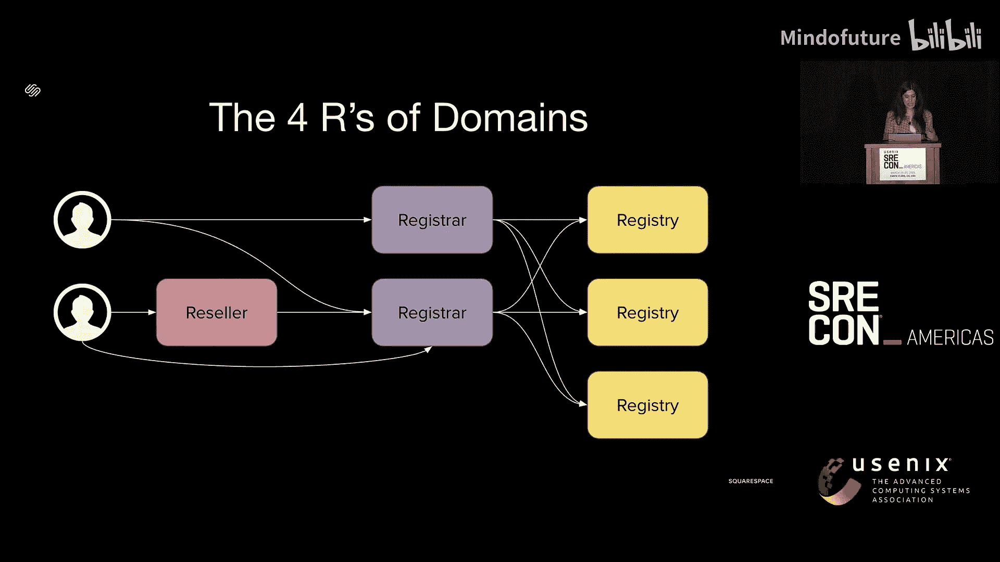

Now that we have that out of the way， let's start the story back in 2023 back then if you looked at Squarespace as a domains provider。

 this is what we kind of looked like， we were a website provider that provided domains to website customers。

So what that meant was within Squarespace， we used to think of domains as sort of a child product of websites。

 so much so that if you wanted to manage your domain。

 you actually had to go within the settings of your website。

 we were still in a very early years as a registrar we only had two TLDs docomm andnet that we were selling all the other TLDs we were a reseller for and our customers were also fairly new and novice users。

 they just wanted their domain to work with their website at most they were buying an email but they were not trying to do anything more advanced than that they weren't trying to have any features like domain forwarding email forwarding with their domains。

 they were just trying to get their domain work with their website。

Small team， small product， so we were a very small team。

 we had about eight engineers one manager and one product manager。

 even though we were managing a fairly large product we we had a decent number of domains in our system but we were really just trying to offer a product that catered to our website audience and we weren't trying to grow our domains business per se and that's sort of where this started。

So it was April of 2023 when I went into a  one on one with the now CTO of Squarespace。

 and he proceeded to inform me of this potential acquisition of a thing called Google Domains。

And he also proceeded to inform me that the company needed me to lead the acquisition。

The first meeting I had after that meeting was with Dvia， the manager of this domains team back then。

 and after overcoming the initial shock of understanding that we needed to migrate this humbaous thingin。

 we started to think about what needed to change that square space to make this a success。

 to make this。Cabilities available for the acquisition and we had some time because the deal had not been announced。

 so we started working with the principal engineers and staff engineers across the entirety of the organization because we knew that depending on the different things that were coming in we were either going to double triple quadruple or sometimes5x the volume of data or the throughput coming through our services。

 so we were started running low tests， we started fixing bottlenecks in our code。

 we started augmenting our database clusters in some areas so that we could actually make this real。

And in June 2023 the announcement came out and it came out in even Tech Cruunch in a bunch of other places。

 I'm sure that you guys were as shocked as we were in April of 2023。

 and as we started to work with the Google Domains team。

 we started to learn about the things that actually entailed the acquisition。

The first component was the domains， we were going to transition upwards of 9 million domains which was going to quadruple the number of domains under management for us and those domains came with Google workspace seats attached to them so upwards of a million workspace seats were coming our way as well and that was going to triple the number of workspace seats under management as well。

The second component was that Google Doin was in the reseller business as well。

 so Google Workspace and Google Cloud would offer to their customers domains that they would fulfill through Google Doins's APIs。

And the third component was that the front site for Google Domains was going to be adjusted once people weren't going to be able to register domains through them and that traffic was going to be diverted or redirected to Squarespace。

 so we needed to think about how to expose ourselves to this new customer base and how we wanted to present ourselves to them。

And this was June， so we didn't really know when the closing of the business was going to happen。

 but we knew lawyers needed to work for a couple of months。

 but we did know that as soon as the deal closed， we had an unmovable timeline of 10 months to complete the entirety of the work streams as part of this deal。

So。Aper from the three things I mentioned before， this led us to think about what other things we needed to change internally at Squarespace。

 in our product， in our systems and other areas。To actually make this a success。

 because it wasn't about only moving the domains。 We wanted the customers that were coming in with those domains to stick around at Squarespace。

 So David is going to walk us through some of those changes。

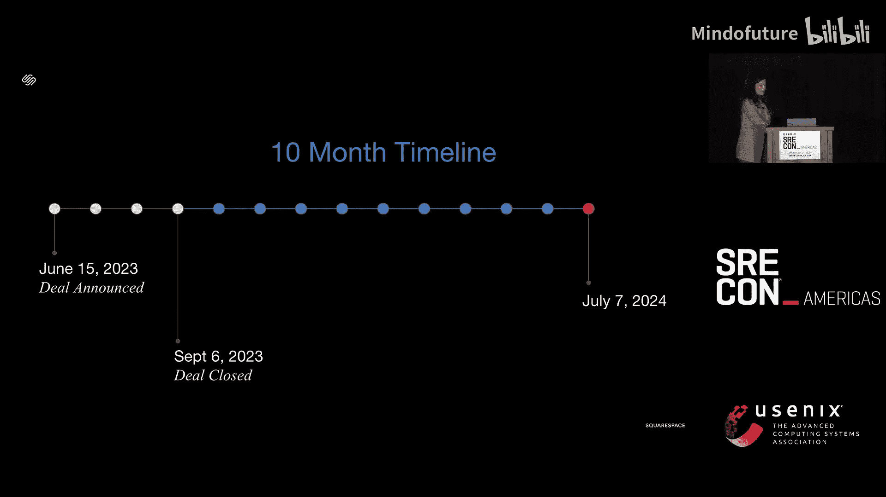

So we spoke about what Squarespace looked like in terms of its domains business let's take a look at what Google Doins was customers were going to Google Doins because they were a domain provider that provided robust tools for all types of domains customers。

 the Novice and the advanced which meant that which meant that Google actually supported a bunch of features that Squarespace didn't have at the time。

 things like domain and email forwarding， DNSS glue records and more such things。

 they were also a far more mature register， they supported more than 304 TTLDs through their register whereas we were supporting to and because it was Google。

 they had five times the number of domains than we did in our system at the time。

This meant three things， Squarespace needed to become a domain provider that supported all types of customers。

 and we also needed to build an API that would resell domains。

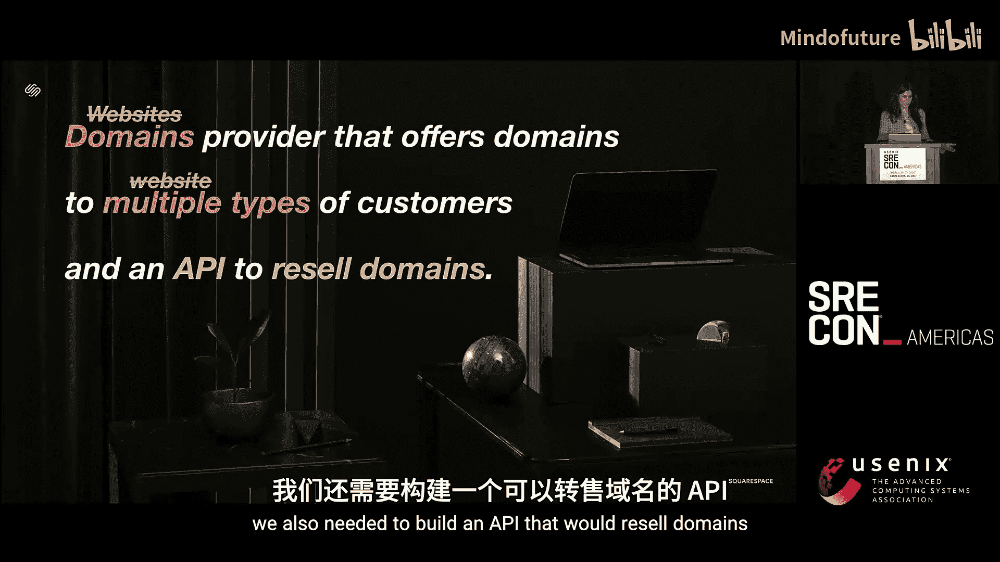

This meant that we had to go from two T Ls to over 360 in our regiar。

 We needed to support all of the features that Google Dos did。

 because the last thing we want is for customers to lose functionality that they depended on and Google。

 So we needed to build all the features that Google did。And third。

 we actually needed to build a domain centered product。 We were， like I said。

 tucked in within website settings。 and obviously for the customers coming in from Google。

 they weren't coming to us as their website provider。

 They were coming to us as their new domain provider and we needed to build a product that meant that they were able to manage and。

We are buy even more new domains through our platform。So even though it sounded like a migration。

 there were really six things that were happening as part of this acquisition。

 we were building a migration engine to migrate domains from Google to us。

 we were building a reseller API to support some of the largest providers out there。

 Google Workspace and cloud， we were building a brand new frontite because we needed to establish Squarespace domains as a brand so that people knew that we meant business when it came to domains。

 we needed to build parity in our register， we needed to build parity in our features on the product。

 and we needed to actually define the domains product within Squarespace and establish a brand。

So that brings us。To June sorry September of 2023， so at this point the deal has closed。

 the lawyers have said， okay， everybody agreed and we're going to sell Google Doins to squarespace。

And at this point， we started enacting the plans that we had set forth as part of all the conversations in the preceding weeks and the first thing that changed was that the Google Doins front site now redirected traffic to Squarespace and this was the new front site for Google for Squarespace domains it was domains that Squarespacecom it continues to be that and here is where customers would now land and they could search for domains and buy them and what we can see in the graph on the right is the amount of traffic before before the little arrow and yellow and the amount of traffic after and that is the change immediately after the redirect coming into the domains front site and this was just registrations the actual people buying domains and we5x the amount of registrations every single day and as you can imagine up funneled from that the amount of like the volume of traffic coming just in visitors to our front site was way more than 5x。

And continues to be。And the deal closed。 So at this point the timer starts so that was the countdown of 10 months or roughly 300 days to complete everything。

 So the pressure was on。 And as you can see， this is a snapshot here of the delivery timeline at the time of close。

 there were things that were happening weeks before there were things that needed to happen weeks after and you can see some of them were already green。

 we were launching things pretty much every single week and there were things in black of things that were launches in the future and then sometimes there were things in red of things that would get delayed and this was the picture every single week for months and months and months where every single week。

 literally there were things launching to either our registrar or product or underlying services。

 So as a very active project that was ongoing but。

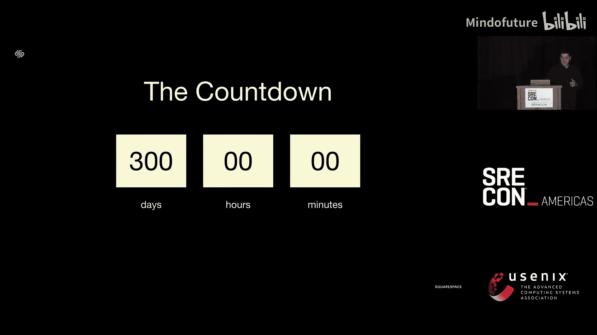

All these things were happening， but the actual elephant in the room was the migration。

 So Davia is going to walk us through what actually happened to develop the migration engine。

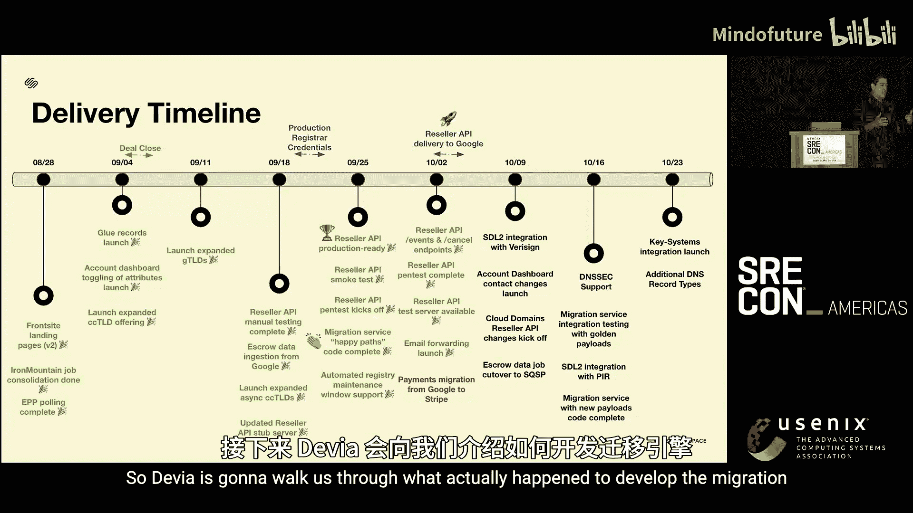

Cool， so let's talk about the migration engine。It was clear that Google and Squarespace needed to work very closely because our systems were going to start talking to each other。

 They knew their systems well。 We knew our systems well。

 We need to figure out how those systems will talk to each other。

Where we landed up was to basically build sort of like a streaming API where Squarespace had a bunch of RE APIs that would take in a domain that Google had told us was ready to be migrated。

 we would set everything up on our sides once we were looking good， we would tell Google that okay。

 we're set up now and then they would finally tell us like okay， we've cleaned up things on our side。

 we're good to go this domain is now yours。The way Google would do it was that they would determine when a domain was ready。

 I would speak a little bit about how we knew a domain was ready， but when a domain was ready。

 they would hit our APIs and I would trigger the migration process。On the Squarespace side。

 we decided to build an event drivenn architecture because a lot of systems needed to needed to get set up in parallel。

 So our migration service was essentially like an orchestrator。

 it was orchestratrating across multiple services at Squarespace there was the accounts because we needed to set up accounts for these customers that were coming in。

 most of them were not Squarespace customers from before。 obviously the domain services。

 we had multiple we had the registrar， the product our DNS service。

 everything needed to have the right information。 we had our websites。

 we had our billing it's obvious。 and all of this was sort of happening in parallel as much as it could。

 there were some precursors that were needed， but as long as the steps were being made we were doing it in an event drivenven fashion a big piece of this was our audit logging though when you're migrating systems you kind of needed to have a very high level of confidence that you've done it right we needed to have a way to be able to checking whether the information that Google had sent us was matching what。

was eventually landing up in our systems we need to make sure that the necessary features were being set up in our side that they had the right information that we hadn't just like dropped features on our customers。

 making them lose some critical functionality and mainly even in the future we knew that there would be some questions or concerns from our customers and we needed to have a way to verify that did we do this right did we actually get it tried or did we screw this customer up and so we needed to build an efficient audit logging system which was sort of taking data dumps from the migration as it was moving through these processes。

A big part of this， like I mentioned from the beginning。

 was that we wanted to minimize the impact on customers。

 we did not want them to lose access to their domains for anything more than was necessary。

What that meant was that we were doing things in background and Google would tell us that a domain is ready。

 We would start setting things up。 We would take the longrunning parts of the process like setting up your account。

 setting up the billing information， setting up the basics in the domain system and once that was done if nothing had changed in the domain we would proceed to finalize the migration at which point the domain would be locked on Google site and a customer wouldn't be able to go in and change anything。

 if during this time that we were provisioning on our end， the customer went in and changed anything。

 we would sort of start at the top。 Google would tell us that this domain has been migrated。

 here's what it looks like now we would go in and make the necessary changes and then again go back to the point to say like okay are there any more changes if not we proceed to finalize The finalized step we were able to bring it down to a narrow window of 10 seconds So only for 10 seconds was a customer actually being locked out of their domain and during those 10 seconds they were really being transition from Google。

Doomains to Squarespace。 Well that meant was that before the 10 seconds。

 their domain provider was Google。 They would go to Google to manage their domain。

 After those 10 seconds， they had to come to Squarespace to come and manage their domain。

 And the 10 seconds is sounds long enough。 But if you happened to come to your domain in 10 seconds。

 if that was any longer， you would notice and you would not like it。

 We did not want people to not be able to manage their domains。For much longer than 10 seconds。Now。

 the migration was really not just a migration of your domain provider。

 your domain has multiple pieces to it。 So really， if you think about it。

 there were three migrations that were happening。 you were migrating your domain provider from Google to Squarespace for a majority of customers。

 they were actually using cloud DNS as their DNS provider。

 which meant that we were also migrating their DNS provider from Google to Squarespace and the third was that you were changing your billing provider。

 you were paying Google payments and now you were going to start paying Squarespace。

 which meant that under the hood there were three migrations that were happening and all of this data is precious and especially when it comes to billing。

 we need to make sure it was secure。 we didn't want to accidentally。Expose people's information。

 Everything needed to be encrypted， and we also needed to make sure that even engineers at Squarespace or Google's end would not be able to see people's billing information。

Now let's talk about the DNS provider first， we knew that majority of the customers used Cloud DNS and so Squarespace and Google domainins worked with Cloud DNS teamam to say like what's the best way that we can migrate this because really DNS is fundamental to your domain working and if something was wrong here the domain is want to go down which is exactly the opposite of what we wanted and so what we came up with was to work with cloud DNS and they essentially just move the DNS provider account from Google to Squarespace and all of this was sort of like a prere before we could begin the migration so there was a period of time where both Google Doins and Squarespace had access to the zone after which we would sever the connection for Google to be able to handle the zone and it would just move over to Squarespace。

Similarly on the billing site， Squarespace actually doesn't store billing information and we use Stripe as our provider for billing we could have gone that route where Google Squarespace something Squarespace sent it to Spe。

 but that just felt like a lot of handsexchanging information it also meant that we would now have that information flowing through our systems so Squarespace and Google again worked with Stripe to say like what if you guys just passed that billing information within your site ifing if Google's billing system just sent it to Spe and then Stripe would just send us a token to say like here's the token you can use to now access and charge these customers that would be the most secure way of doing it and again that was sort of like a pre-d So once the DNS provider was migrated and the billing provider was migrated then we could begin the actual domain migrate from Google to Squarespace。

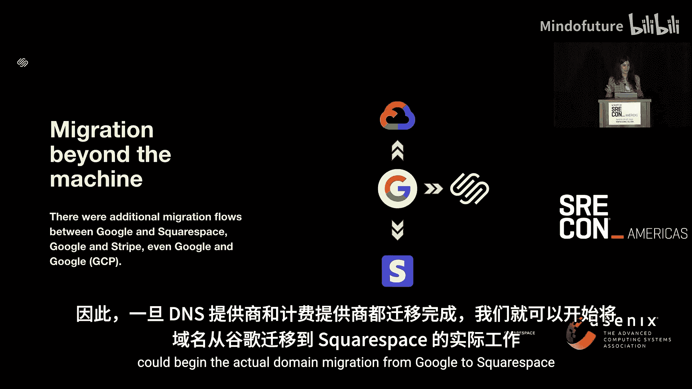

Now at the beginning I mentioned that when a domain was ready。

 so how would we know when a domain was ready think of this almost like what we refer to it as it was cohorts。

 and cohort is basically like a set of features that are now ready to be enabled and think of them as switches or gates and every time a feature was ready we would open a gate and then anything that met a criteria would sort of trickle in from there。

 only when a domain had all of its features met， then it could pass through all of the gates and then flow into the migration engine and eventually get migrated into squarespace。

Now this was a little bit more nuanced because to make a domain ready or a feature enable two things needed to happen。

 one， we needed to build that feature in our product。

 so our services needed to actually be able to support it but two our migration engine also needed to know how to set this up because if we set it up wrong。

 it wouldn't matter if we supported it it wouldn't work and so they were sort of like for every new feature we were doing both those steps needed to happen before we could enable it。

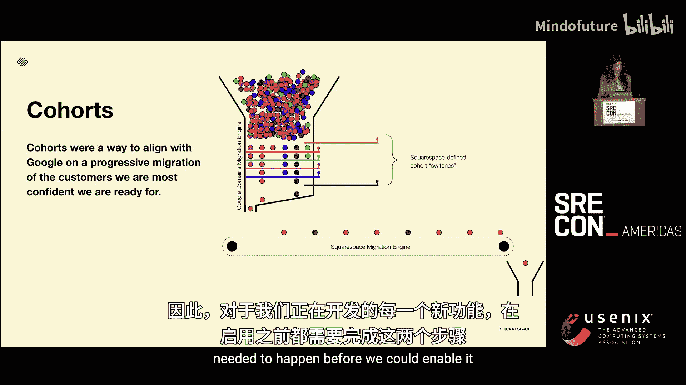

This is like a version or like a small piece of all the features that happen because the domain isn't just a domain。

 If you ever bought one， there's multiple things that are sort of like features of your domain there were the obvious ones that we needed to support the DlD in our regiar if we couldn't support UK we obviously couldn't migrate a do UK domain in there were other attributes also like we were trying to build our product experience。

 so we hadn't figured out how we would build an experience for a customer who has multiple domains but doesn't have a website and we needed to figure that out。

 and then there were the features like DNSec domain forwarding email forwarding maybe you had an attached workspace。

 we needed to be able to support all of those in our service before we could migrate you in and once all of these features were done then we could open a gate and you can see there was a construction sign。

 These were all the things that were in progress pretty much all the time there were multiple teams working across the board to make these features and enabled。

So all this was happening all of it in parallel and roughly around seven months in。

 we did a checkpoint， which was April of 2024 and it turned out to be a very stressful endpoint for many checkpoint for many of us at that point the countdown read 90 days left。

And if we look at the migration tracker， you can look at the two lines， one was the blue line。

 so how effective had we been to make domains eligible at that point we had 1。

2 million domains eligible to be migrated to squarespace。

 which is very far away from the 9 plus million that we needed to migrate and then we had the yellow line which was the one that reflected the number of domains that were actually migrated and it was less than half a million。

The yellow yellow line very far away from the blue line and the blue line very far away from 9 million。

So we had two issues that we needed to address the first issue was that we needed to make more domains eligible for migration as soon as possible and the second one is that if those domains were eligible we needed to be able to go much faster in terms of the throughput to migrate those domains and we decided at this point that we were going to follow a twostep strategy the first strategy was to shield our migration team。

We knew we were not at the throughput rate that we needed。

 but the team needed time to focus on fixing the bottlenecks and anything that would allow them to go faster。

 so we would give them a couple of weeks and it didn't mean we were going stop migrating。

 we could migrate it at a given throughput rate， we were not going stop we were not going to pressure our team to go faster and at the same time we would have all the feature teams in the product area。

 go as fast as they could and we would build a plan to figure out how we could make more domains eligible and sort of put them in order of how if a feature was going give you 500000 domains。

 we were going to do that first as opposed to the one that was going give me 550 domains or something like that。

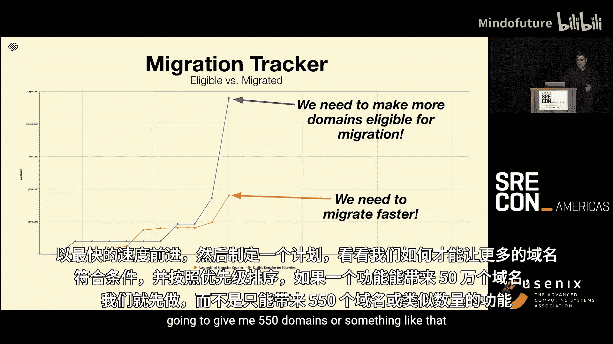

This is a slide which is a more detailed version of the one that Dvia showed that actually shows the long tail of the features and in working with Google Doins and stressing about what combination of features was going give us more domains。

 We figured out that there was no shortcut。 We needed to build all the features including the long tail features to actually enable us to get the vast majority of the domains in the door So we built a up to 7 million domains which included building the features in the list in the left column and then the path to 9 million plus was everything in the right column。

 so we needed to build plans to do everything at the same time。

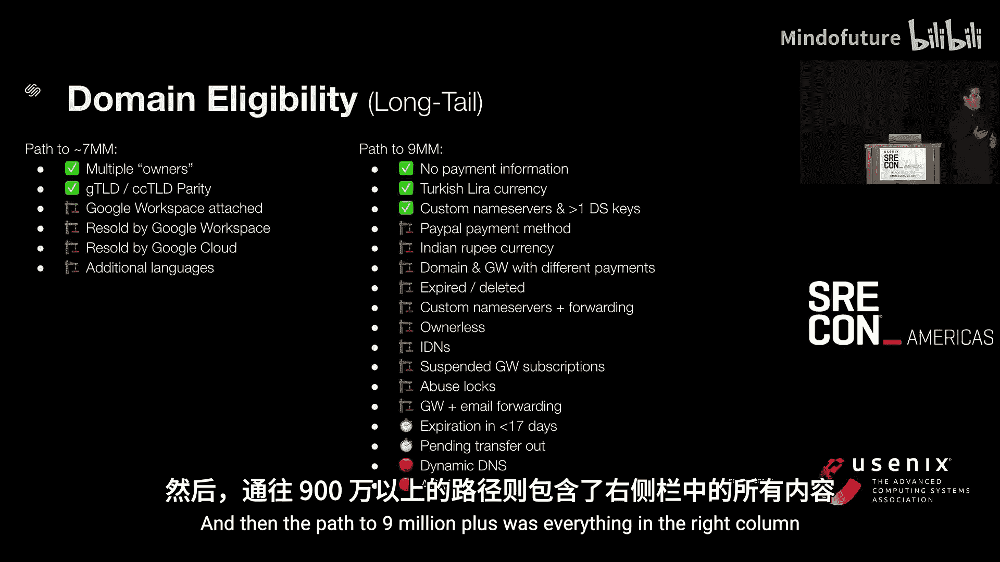

And if we built this in a gun chart。This is the real thing we use during the migration you can see the columns at the top are weeks and the lines at the left are actual items or features that needed to be implemented and what we noticed is that to be able to get to 9 plus million。

It was going to be at the end and it was going to be around the end of May beginning of June。

 which is very close to the red bar there， which is July。

 but we were comfortable with this strategy because if all the domains were eligible。

 say at the beginning of June， it gave us a full month to migrate all of them into Squarespace and assuming that we were fast enough。

 it was ample time。So looking at a throughput in April of 2024， we were roughly 3。

2 domains per second。

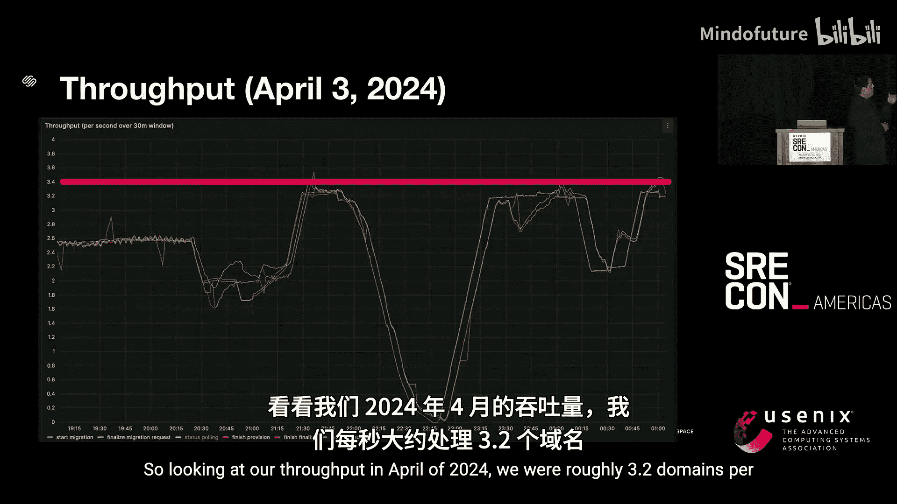

And if we look at that in a table， which shows you how fast we would go every week。

 so we would progressively go a little bit faster at 3。

2 domains per second that was 11500 an hour roughly and we were。

Like we wanted to push ourselves to be the best， right， so we are comparing ourselves to like， okay。

 how much does it take us to migrate 1 million domains？So to migrate 1 million domains at 3。

2 domains per second， we would have to run the machine 18 hours a day for five straight working days。

To get to 1 million。 So if we had 9 million domains to go。

 that meant that we would have to run the machine 9 weeks straight。Most of us are here。

 So if you run a thing for nine weeks straight， roughly for an entire day for five working days at a time。

 it's going to fail at some point and if we were going to finish at the beginning of June。

 it didn't really give us a lot of wiggle room to fix the things that were going go wrong so we knew we had to go faster and get there sooner So David is going walk us through how we actually got the migration engine to go faster。

😊。

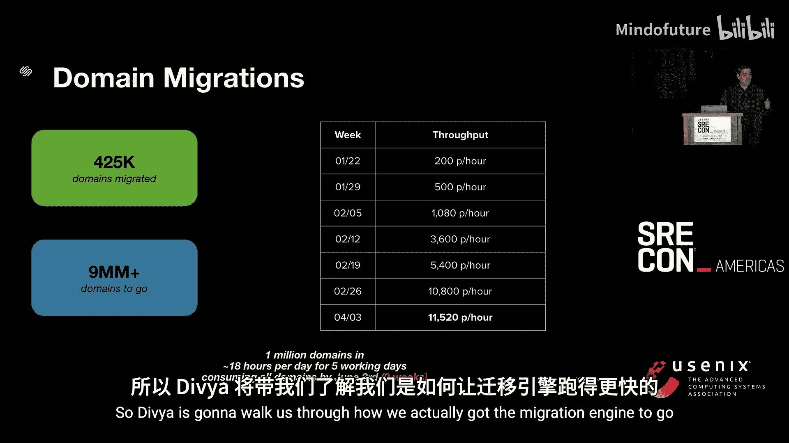

Like Frank said， we have to go much， much， much faster like he said， to a bunch of S。

 I don't need to say like we needed to buy our team time because inevitably things were going to go wrong。

 we were building so many new things， we were learning so much about these customers that there was a lot we don't know。

 which means which meant that there was a lot of room for things to go wrong。On top of that。

 as we looked at it previously we didn't have enough domains。

 so even if we wanted to run 18 hours a day， five days a week。

 we just didn't have enough domains to be migrating at the point so when if you're building domains and features out until the end of May that meant that we need to be able to basically migrate all of these domains in one month and not nine weeks we just didn't have the nine weeks。

So we needed the migration engine to go much， much faster than it was。

The good news was that we didn't have to do really anything special。

 we just need to go back to our basics。 We had built an event driven architecture so the first thing we looked at was let's take a look at what our Kafka configuration looks like do we have the right number of partitions are we leveraging all of what we can do or are we trying to be stingy with the number of partitions if we have the right sort of partitions do we have enough consumers for them because what we noticed was there were times where we were shoving a lot of things in the partition but then the consumers were just not able to pick it up fast enough and so that meant that we could scale it up and try that out。

In some cases， I'll take one example of domain forwarding。

 all of our test cases or test domains that we had bought had like maybe five or10 forwarding rules and there was a lot that we didn't know about customers。

 So when we started migrating them there were some customers who had hundreds and some thousands of forwarding rules and the way migration engine was doing things was actually that it was calling making one API call poor forwarding rules to set it up in the system。

 So if we have thousand forwarding rules， you were making thousand API calls。

 which meant thousand times the number of latency you needed。

 So we started doing things like batching requests。

 we started batching it to send it to our APIs we took it a step further and started seeing if there were ways we could batch our reads and write to the database as well and we did the obvious thing looked at all the indices we had on our databases to see if we were missing any and because there were so many different services。

 This was a project that was happening across the org this meant that we had to work with a lot of different teams to sort。

Go with a fine tooth comb to see like where are all the places we can optimize this and just by doing these things。

 which I know sound very obvious， but they didn't seem like at the time we were able to bring our throughput to nine domains per second in just three weeks and if you look back at the table that meant that in those three weeks we had gone from less than 500000 domains to upwards of  three million domains we only had  six million to go and if you look at that number that Frank was talking about now to migrate 1 million domains we just needed to run the engine for 10 hours a day for three business days and we would migrate everything in just three and a half weeks this made us feel good because now we knew that even if all the features landed in the beginning of June and we did not migrate a single domain until then we would still have more than enough time to complete this migration before the deadline of July。

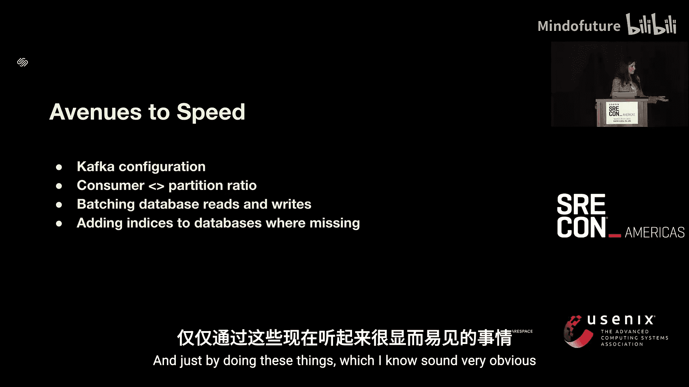

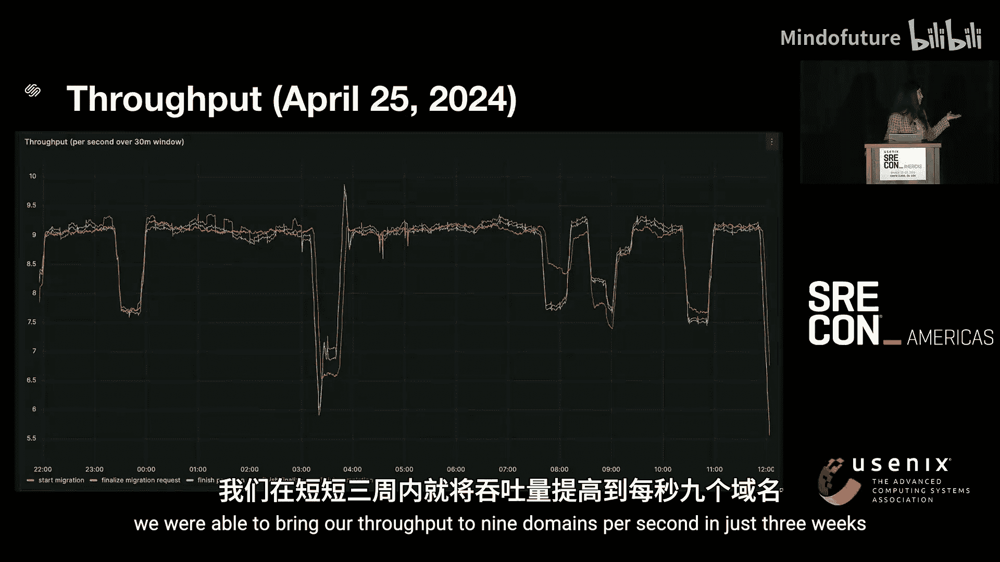

Dvia didn't mention one thing that was a huge celebration for us internally and also at Google because we were capable of moving past nine。

 we went up to 12 domains per second， which means that we were capable of migrating 1 million domains in a single day。

 which was fantastic and everybody was very happy with that， but the migration was happening。

 but there was this big other thing that was happening at the same time， which was the reseller API。

And we launched that reseller API at the beginning of April and progressively started getting more traffic from Google Workspace and Google Cloud。

And it was very exciting because we were in the middle of the checkoutflow for every single customer going through Google Workspace specifically。

 and if you were prompted to like what domain you want to use。

 you could either buy one or you can use the one you already had and if you searched for one。

 all those searches and all the registrations coming through were going hit Squarespace。

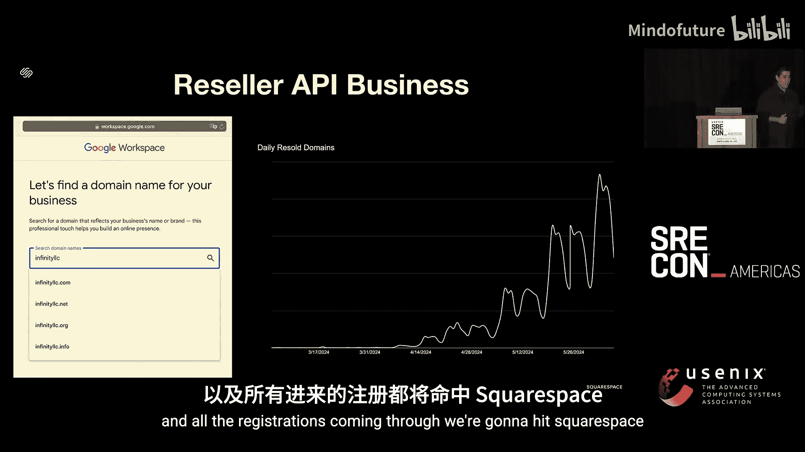

And in this graph you can see how we progressively rolled out in a staggered fashion by TLD or by different feature sets。

 the traffic that was going from Google workspace， from Google workspace to Google Doins over to squarespace until June at the beginning of June。

 you can see the yellow light， this is where 100% of the traffic that was coming from Google Workspace was reaching the Squarespace APIs。

And one big component of this agreement was that there was an actual SLA that we needed to abide by between Google Workspace and Squarespace。

 and it was three9s。 which was pretty big for us were pretty hard to get to and you can notice that because the first three months we did not meet the target。

 And this was because of a couple of reasons。 First。

 it was an API that was built from scratch we you could argue that we didn't know what we were getting ourselves into and we had to learn a lot。

 But separately， the domains business and specifically a registrar service is a very distributed system。

 and internally， we can depend on services like building or any other internal Squarespace service。

 But the fact of the matter is that to fulfill a domain we depend on external parties。

 registries specifically that have maintenance windows that have unplanned outages。 and all that。

Affects our SLA， so we had to build a more resilient architecture to allow us to meet the SLAs that Google demanded from us and starting in September knock and wood。

 we have met with those targets really well doesn't mean we haven't had failures。

 but those failures haven't had an effect our a sable effect where we are unable to meet that target。

And the10 months were up， so July came and what we can see here and going back to the two step strategy that I mentioned。

Let's look at the blue line， We were very effective at enabling domains to be eligible so the rolling out feature so a domain could be brought in where we can see that every single week the line would go up all the way until the end of May where the totality of the domains were eligible to be brought into Squarespace。

 so were pretty effective at that side of the strategy。And if you remember。

 the second step of the strategy is that if we made the domains eligibleegible。

 we would be able to bring them in really quickly， and you can see in the little blue area。

That there was a lot of activity at the beginning of June。 and in fact， in the second week of June。

 we migrated in a single week， two and a half million domains。

 which is something of note because before the acquisition we had only two million domains under management at Squarespace。

 So in a single week， we were able to bring in even more than we had before and that did not affect any of our systems。

 there was no outages， there was no effect to our customers and this was also a huge celebration for us at Squarespace。

😊。

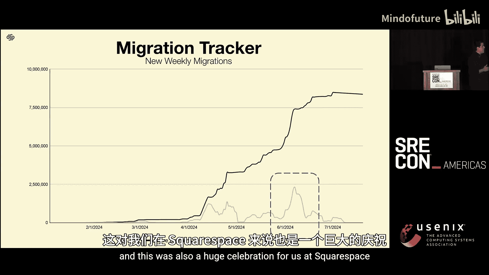

She didn't come as a surprise since Frank and I are both at Squarespace still and we're here talking to you about this。

 that we successfully migrated 100% of our domains。

 I say the asterisks because there were some customers that we couldn't really migrate without loss of functionality and those were basically our ame and dynamic DNS customers and that was because we simply ran out of time they were very complicated features for us to build we didn't have enough time they were aspirational things that both Frank and I wanted to do if we had the time and hopefully we will still be able to offer those someday to our customers to stay tuned but we still migrated almost all of our customers and we migrated them without any loss of functionality and data which was the bigger success of this at the end of the day we migrated more than 9 million domains we were able to hit at  three-9s SLA for our reseller API and we now supported 360 plus。

LDs in platform。I want to end by saying a big thank you not just to our Squarespace team。

 but really the teams at Google。 this would not have been possible if it were not for the dedication that Squarespace engineers showed。

 but also Google Doins and workspace and cloud short everyone was committed to one goal which was that we wanted to make this as painless as possible for our customers we did not want them to feel the brunt of fact that they were moving providers。

 which in itself is a little bit annoying。 And if we made it smooth enough。

 maybe we would actually be doing something where they didn't even notice that this happened and only when something went wrong would they remember oh。

 I'm no longer going to Google Doins I need to go to Squarespace。

 All of this happened because every single person on the on both the teams was dedicated to make sure that the customers did not feel the pain and at the end of the day this was successful because of all of them So I will not miss this appportity to also say if this sounded great。

 were no longer a team of it。We have grown from 8 to 40 plus engineers now， which was needed。

 we grew our team five times because our business grew are five times。

 but if this sounded interesting， if you want to be part of the domain's journey or if even if just working at Squarespace sounded like something that you want to be a part of。

 we are hiring across all our offices in Dublin， Portugal and New York if you find something on our careers page please feel free to reach out。

 I'm also happy if anyone wants to talk to me about any particular role。

 but I will end here and say we're ready for questions。

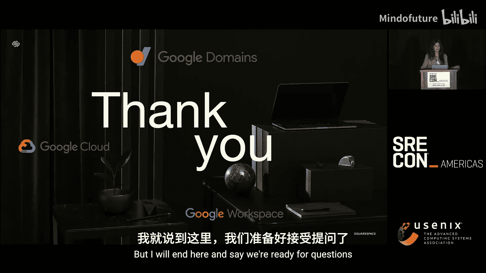

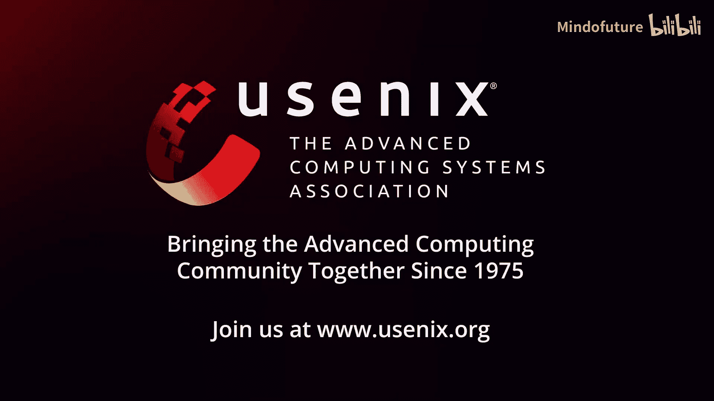