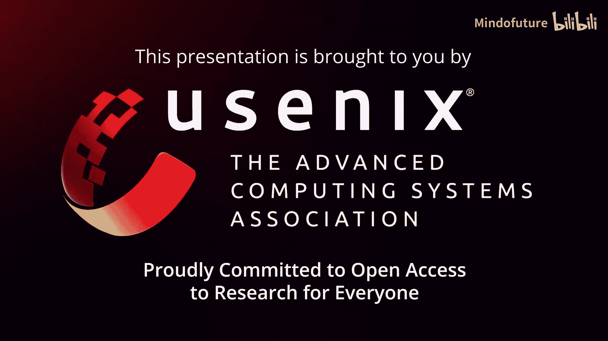
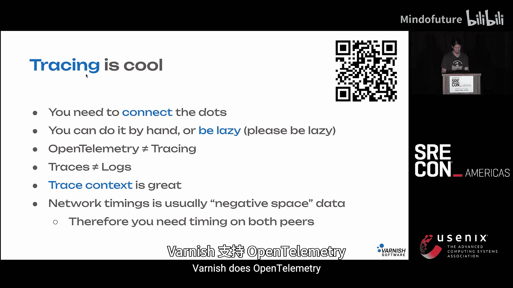
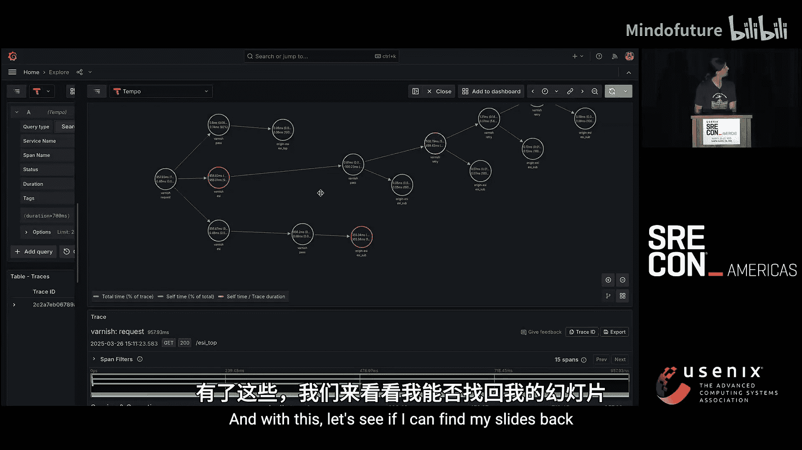
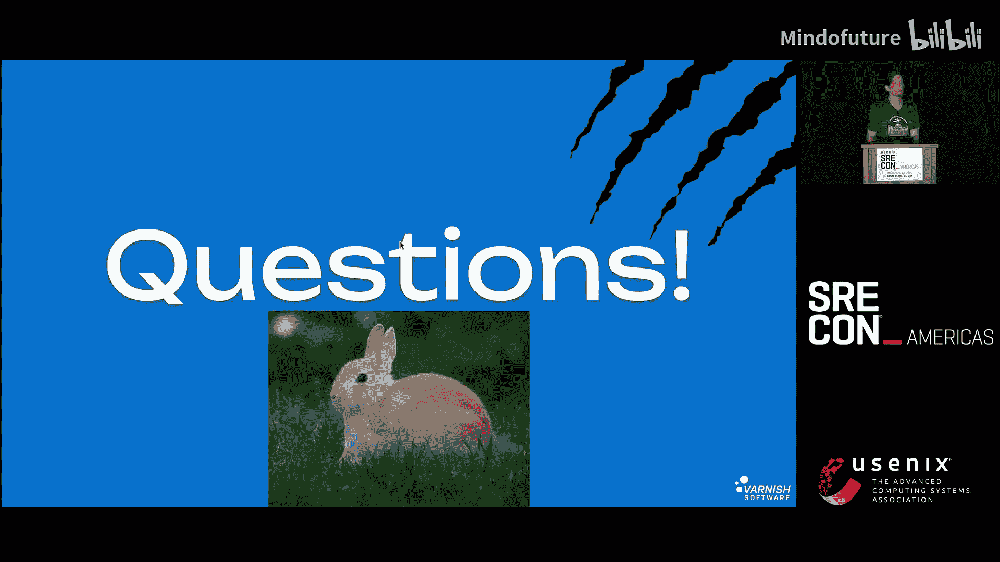
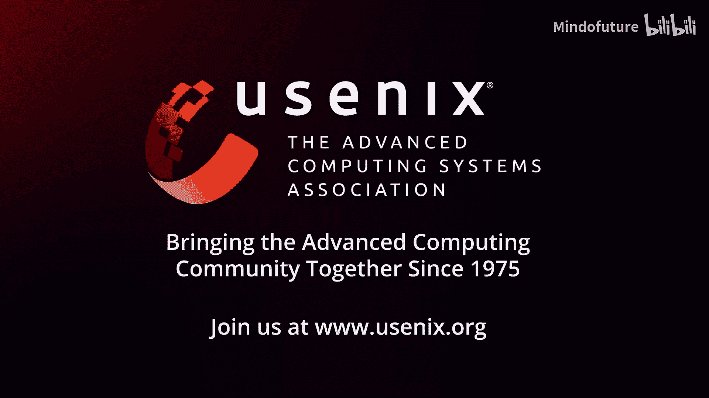

# SRE大会-2025-美洲-｜-srecon-｜-分布式-｜-缓存-｜-OpenTelemetry-｜-安全-｜-AIOps-p24-P24-Taming-the-Beast---Understanding-and-Harnessing-the-Power-of-HTTP-Proxies--BV1TmLDz7EZZ_p24-

Hello， everybody。 Thank you for having me。 We are going to have the。😊。

Presentation with the most cliche title， Taing the Beat。 I'm sorry marketing put me up to that， so。

But apart from just prinkling random pictures of。While animals， I do have a plan。

 I am going to talk a tiny bit about varnish， a tiny bit about me， this is an ego thing。

 I'm French so it cannot be avoided， we will be explaining what we mean with HP reos proxy。

 why they are cool， why they are bad and how we can get the cool without the bad and hopefully we will have questions and maybe even answers。

嗯。So tiny bit about me。 I am not an S。 I know。 sorry for the lies deception。 I'm a developer。

 I have been for。About 1520 years now， I'm a solution engineer， pre sales support engineer。

 so I help SRE solve their problems。 I'm a C developer and I use arch so that tells you that I like the pain。

 I do not use Gen2 or C plus plus so I'm not a maniac。 so there's that。Okay。

 a tiny bit about Varnish。 So this is an Know school open source project to tell you how old school it started in 2006。

 Our chief architect is a freeBSD kernel developer and the developer Me weekly on IRC。

Doesn't get more old school than that。 Vannished software builds an open core enterprise product on top of this。

 We started as a caching engine to replace squd。Did a great job at that。

 but apparently squid is still around。 so maybe not that great of a job。嗯。But yeah。

 we've grown in terms of features。 We will explore some of them。

 I mean not going to focus too much on caching here。

 We are going to have the question of what do you think， What do you do differently from N G X。

 plenty of things。I do not really have any love for N X， but they are fine。

 but we do things differently in the sense that the configuration gives you total control by basically giving you a programming language rather than just some k nubs and switches that you can flick。

 And I know I'm a corporate shield， but I honestly think that we have the best logging system。E。Also。

 because I do not want to see you on IRC， there's a QR code to Disc code。Join us。

 I will personally greet you with an animated emoji as is customary on Disc code。

So what do we mean when we say HTTPriosprooxies？This is going to be broad strokes H TTP，0。9。

 if you're still using that， please stop up to quick Aka HTTP。3。

When we hear about level7 load balancer， that's probably HTTP， reverse proxy， Kubernetes， ingresses。

 gateways or whatever the name is this week， that's going to be us。Riveverse proxy。

 I'm going to consider the systems as。General entity。 so that can be one server。

 that can be one container that can be a cluster or a massive service like a C DN。

 And I'm also counting your micro services that you hastily written in node GS go doesn't really matter。

 What matters is。Those services， those systems are going to grab an HTP request when sent by a client。

 and to provide a response， they are going to turn to the origin or the backends。

 Semantics are not that important。And send zero or more HPR request。

 grab the responses that can be for content composition that can be for retrying because you didn't like the initial response。

 ettera et everything is going to count。 I'm going to be extremely generic here。

I do not necessarily like the OS S I model or the TCP IP model。

 So I rolled out my own with black Jack and whiskey。

We do not really care about the lower levels ethernet Aloa cables。

 what we care about is the stuff that we can see when we log onto a machine。

 so at the bottom in red the stuff that we cannot touch TCPI at the top。

 the green stuff is the good thing all those protocols are going to be built on a random wild animal。

I'm doing my job。The green stuff is APIs， video， storage， DNS， I don't really care。

 usually they are going to be a tiny layer on top of HTTP， and HTTP is pretty cool。

Inrus is absolutely terrible， but it's a simple request response protocol。 It's mainly text based。

 even though yeah， I know H TP2 H TP 3， yada， yada。

 but it's easy to reason about people have been familiar with it for like now three decades。

 and pretty much every language under the sun apart from C。 but。Yeah。

 leave C alone is going to allow you to build a H TP reverse proxy in， in a matter of minutes。

Notably go and node are going to make that super， super easy。They count。

 you do not necessarily need HA proxy or varnish or NGX， you can roll out your own。You don't have to。

 but you can。U。Because we are going to see that halfway of DTCPIP layer and yeah。

Up to halfway the green layer， we can do a bunch of stuff。Basically， wrap your really old APIs。

 for example， and put T， L S on top of it or rate limiting or compression。

 You can do connection pooling。 You can do request collapsing。

 If you want to do open telemetry on top of legacy system that doesn't support it。

Put an HTTP reverse proxy on top of it。 it will do the job。

I'm going to give you a couple of examples， of course， based on varnish。

 you can do that on pretty much every system， but I didn't spend 12 years hacking on this thing to just shut up about it so。

A few examples， you have some storage。😊，For some reason。

 the people who put the text stuff didn't compress it。

 varnish can compress it on the fly before putting it in the cache so that you save some memory or disk while caching and also some CPU。

 because most likely the clients are going to support compression。

As I told you Vish S's a programming language called the VCL here。

 basically we are going to act on the backend response as soon as we receive the response headers。

Another example， if you're doing APIs and you want Is to be limited to。10 15 request per 10 seconds。

Pretty easy to do。 You just import a module like you would a library in any language。 And basically。

Ask， hey， is that thing denied， and if it is， then you just generate a 429 response？

And if you want to test something in staging， which would be weird， we usually test in Pro。

 but I don't know， and you need to rewrite some links in HTML。

 you can do that with regular expression substitution。So what is there to dislike？Plenty of things。

 But so that you believe me， I'm going to use support cases or discussions I' had with customers。

 The names have been changed to protect people。 and I'm going to also fast track。

 fast track the investigation because we do not have like five days。 and I'm also going to。

 for your ears， reduce the number of explets I may have used when answering those people。嗯。But first。

 I need to remind you that networking is like an onion。 It has layers。The ability to make you cry。

 correct？U。Mostly。If you want to go to the red stuff and you may think that Giyomi is weird。

 he changed the colors。 the green stuff is the stuff that everybody agrees on and it works。

 the higher up you go， the red it is and the messier it gets。

 but the important part is that if you want to go to the upper layers you need to go through the lower ones。

With that being said， I know this is a lot of code。 I'm sorry， and it's not Yal， but I believe。

I believe in you because you were there for the C slides yesterday and you did great。

 So bear with me。 this is VCL that is going to define an ACL list called local perges。

 the VCL receive subroutine is going to be called whenever we receive HTTP headers for a request。

We check the method if it's purge， then we' check if the client IP matches local purges。If it does。

 we putge otherwise。We tell the client to walk， everybody okay with that？いいこ。Dough okay。

If that seems sensible， yeah， it does problem。If you have an HP reverse proxy in front of it。

It is going to make a request to you using the local。Part of the Nick。And therefore。

 anything that goes through that HTTP reverseos proxy。Is going to be authorized to purge。

 It may be what you want。 but usually that N X is in front or is standing like on the open Internet。

 and it's going to mess you up。 This is one of the cases where I cannot blame N X。 It。

 It did nothing wrong。 So it's fine。It's easy to fix。

 you tell EngineGX to put the actual client IP into a header。

 and then you tell Varnish to convert that header into an IP because we have types in VL。

 we are not animals。Taming the beast， animals。I'm really leaning on that one and then we check against local purchases second one。

 I get that every four， maybe six weeks， can you cash transparently YouTube， Facebook， Netflix。

 so show of hands who think we can。Who think we can't。Who thinks it's a toss up a trick question？

 The Frenchman is out to get you。Well， okay， that's fair。 Yeah， the answer is， no， we cannot。

 We cannot do that transparently。Maybe we can， but remember to get to the HTTP stuff that will allow you to see what is actually happening and so that you can cache。

 you need to go through the lower layers， including TLS。

And can you convince people that you are YouTube。com？If you do not have the certificate chain。

 it's probably going to amount to you going to the PE teacher and my mom said。

 I don't have to go to PE。AndThe teacher is going to， yeah， you sign that to yourself。

 So no we can't。嗯。And this is something that we need to realize because we have layers one way。

 but we have also layered the other way。Tools are going to lie to you。 It's never just an HP request。

 It's always。A series of requests and I'm picking on curl， for example。

 here because the three command that you are seeing here are going to do three different things。

 slightly different but still different this is left as an existence to the audience we can talk about that during the questions but all the tools are going to do that go。

 for example， has that host field which is actually just a header but it's treated tiny bit differently because even though it's a header。

 it's a bit special and we have abstractions open on top of abstractions。They' are all leaky。

 They're all terrible。 And H T TP across， like。40 years now hass been pretty bad at separating data logic。

 and we need to deal with legacy implementation anyway。 So it's super hard。Who has ever debugged？

Rest APIs。Hey， cool， so you've had that discussion， hey， bro。That endpoint is is broken。 Now， man。

 the logs are fine。 My guy， I'm telling you it is broken。 I checked。 I also checked。

 and then you look at this。And you have a HTP 200， and Jason is sayingE， you are both right。

But you haven't defined which level you wanted to play on。 And I am not going to go into that one。

 whether the rest API should use H T TP status code。

 because we could also do V versus Eax or tabs versus spaces just。You know， discuss it， decide。

 but yeah， make the clear distinction context is going to be important。The last one， my favorite。

Is going to be a real use case that we had where the customer was saying， hey。

 we put varish and now we have customers or。Users on the Internet complaining that we have this crap。

 This is not the website。 This is a dramatization， but。Essentially， some users were getting that。

 that weird error message。 And， I mean， I cannot say。It's not vared。

 There's literally varnish cash serverver in there。 So that's， that's us， but。We look at the log。

 and basically， F 5 is not replying to us。 We connect to it。 We send a request。

 and F 5 just leaves us hanging problem。 We have the logs saying that。 But F 5。

 who which has been here for years。Doesn't have any logs。That's。That's annoying。

 We have a look at the vish logs and oh， that red is terrible， I'm sorry。

 and we notice a pattern B rack account is basically telling you how many bytes we sent for headers。

Body， the sum of both， and how many we receive for header， body and the sum of both。

The top three requests。A fine。The bottom are bad。 There seems to be a limit around roughly 4096 B。

 also called 4K B。 We ask the BIP team， are you。By any chance dropping connections。

 if you receive too many headbytes， yeah， we do that。Cool。

If we didn't have the logs that would have been a mystery because F5 didn't tell us anything。

 the funny thing is that they are breaking the lower level， T CPPIP。

Because of what they're receiving on top。So that's always fun。

 Vish Fort was timing out and trying to send an actual response to the browser。

They already had the problem when Vanarnish wasn't there， is just that。

The browser never got the response， so it never created。That tiny square。So。

That was really just vanishared fault towards just pointing out the issue。Though it's always fun。

 it will come back later in the talk。Okay， so how do we deal with the pointy bits。Reminder。

 I am not an Eari。 I help Asari， so I'm just going to make a tiny detour on how we end all the support advantage vanish unless there is something like massively critical。

We usually deals with things asynchronously on Zendesk Slack。 we are going to go into war roomss。

 but we do not have direct access to the machines at most。

 It's a screen share with the with the Ss also， as I'm sure you all know。

 you may not be the ones affected by the issue。 you just have somebody yelling at you that there's a problem and you need to fix it。

 So we are one more step removed from the the problem。 So we need good tooling。And one solution。

 this hasn't anything to do with H T TP reverse proxies。 But I think this is a good callout。

 We use vage gather， which， despite the name is actually fairly generic。

 This is a shell script that you can find on Google Q R code over there。 that is just going to。Run。

ACo of hundreds of commands to tell us or dump the state of the machine。

 tell us everything we can glean。Trying to be conscious of privacy issues， of course。

 possibly send that to a file bin so that the support engineers can have an offline look at the machine without disturbing and without doing many back and forth with DS SRs it's been a great tool that has massively reduced the amount of time we spend dealing with bugs。

Godchas and pitfalls are also automatically detected by a secondary tool that we can use to process this。

Use it。You probably have dashboards， alerts and all that， but。

Do you have everything that is in that gathers？I honestly。

 I doubt it because there's an immense amount of data that you are able to condense on just a few seconds of shell scripts。

So what was the question I get， oh， the sharp bits。 How do we deal with them？ So the first slide。

 I'm sorry to be that guy。 The actual answer is， well， the first answer is Git good。嗯。

And I know I know I'm an ass。 I'm， I'm not the one on the front line。 but at the same time。

 because we are always focused on varish， and we have that singular focus。

We need to be hyper aware of everything that could go wrong going in or going out。And when a。

Customer ticket starts with。My web page doesn't work。That's not really useful。

We always want to try and drill down， okay？What object in the page doesn't work。

 which transfer failed？And trying to drill down really on the specific re that we can build。

You do not have to know all the protocols。 You do not have to be able to。

Spell out the frame structure for all of them。 Just know they exist。 I mean， we have Google。

 We have Chad GPT。Use them。But for each of the protocols， there is a。Tool that will tell you， a。

 that part works。 That part doesn't。 Personal preference。 dealing with H T TP。

 curl D V is going to be an amazing tool。 Whatever people say about curl， it's antiquated。

 It's bad and all that。 Remember， I use C， so。😊，I may be biased。

 but curl D V is going to tell you everything it does， DNS。

 TLS and the dash dash connect to that I realize that not a lot of people know about will allow you to force DNS resolution to a specific IP that means you can。

Send a request to a specific IP without using the dreaded dash K that is going to you know。

 bias your T L S。Analysis。The second one， and I told you， I was in love with the way we do logging。

Varniish logs everything， but doesn't do anything with it。That sounds weird。

 but basically what Vch does， it logs into a circular buffer in memory and lets other tools read from it and extract whatever information they want and format that。

So the maximum amount of information that we can get looks like this。

It's not so much a report of the request and response。 It's more a。An event journal， hey。

 I received this at this timetamp， the method was this， there was those headers。

 but I also entered this specific subroutin in the VCL and that subroutin modified the header this way and the other one this way。

So you have an enormous amount of information。When we have a together， we are going to get。

A few hundred megabytes of the last few messages。And you have client requests。

 You also have backend request， and we are going to tell you all about that。For debugging。

 this is what we want， because this is instant， it has the most amount of data。Varish log is。

 is the tool for us developers when we try to find out an issue。

That's probably way too much information for you if you're trying to aggregate those logs into an observatory platform。

 Good thing， we have Vanishlog Jason that's just going to build a Jason report of the stuff that went out that came in without the intermediate space states steps sorry the dimension I'm French。

 sometimes it's just it gets out tiny bits sorry about that。So yeah， Jason is a horrible format。

 but everybody speaks it， therefore it's a good format。On the bandwagon， we go。

Varniish and CSA is going to grab the exact same information as the two。

 but is' just going to build usually a one liner。Who remember NCSA Apache。Okay， cool。

A lot of young kids then cool but yeah， if you want to build messages or lines that are like super well defined and you know what you want。

 for example， billing， accounting， compliance， cool， that's your tool。And while it's not exactly a。

Log， I am going to argue that metrics。Are going to basically tell the same story in this case we had a client request。

 it was not a 400 or 4 xX response， and it also triggered a backend request but same story told four different times。

 four different ways depending on what you need and that's really the points。

You probably do not need to log everything all the time forever。There is sampling。You may remember。

 you may store data for on disk， for example， for a day or for a week。 And if everything' is fine。

 just。Remove them billing。 You probably want to keep that for a longer time。 The Json stuff。

 maybe a couple of months。 if you need to really go back and and debug， for example， but。

The one thing I really want to point out， it's okay to store stuff multiple times。As engineers， our。

Our instinct is， oh no， I just want to grab everything and keep it forever because that way I will always have the data。

 You just built yourself a huge haystack。And it's going to take ages to go through it。

Be more targeted。 And if there is overlap， this is fine。In time， the overlap is going to decay。

 and you'll be fine。嗯。And the one thing I。I haven't seen a lot of tools， do， is。

Varish is great because it's going to tell you about the stuff that happens in front and in the back。

So every time you have one HTP request from a client， you usually have two HTTP transactions。

You're probably going to tell me， but Gum， I don't really care about the back inside because I can ask the origin。

About eat slulogs， and I can reconstructrate the story。

Were you paying attention when I was talking about F5？Sure， if both sides agree。

 there is redundancy if they don't。Guess who gets blamed？U and in general。

 and you probably see where this is going with the vibe of the of the conference。

 one client request to the service in general is probably going to explode into a myriad of other H T TP transactions。

Which is why。😊，Tracing is cool。If you were there yesterday for Chris Letziika's excellent talk。

He did all the ground， the groundwork。 So I do not need to repeat much of what he said， but。

You have a huge advantage over us at Vanarish， where we have those blinders where we can only look at Vanarish。

And， and we can only infer what is around us。Chances are you have the full view of the ecosystem。

Connect the dots back the layers that we had in the stack。 You can also expandend that。

 and knowing about them is going to is going to save you quite a lot of hassle。

You do not necessarily have to use open telemetry to do tracing。Because those two are difference。

 even if the first server， the first reverse proxy at the edge just。

Slams a U U I D header that gets carried into the rest of the chain that will at least allows you to allow you to look for logs with that U U I D。

 And sure， this is going to be a tiny bit manual。 but at least you will have the full logs。

 So do not wait until you implement open telemetry to get a semblance of tracing。Notably。

 look at the W3 C trace context specification。 It's absolutely great。 Remember that the。

Cables usually do not do tracing。 They are not going to tell you。Oh yeah。

 I received this packet and I send it this way。 So if you want to tell the network story。

 you probably want to have both peers reporting and telling， hey， I send this。 Oh， yes。

 I receive this。Oh， there's a gap。 That's your cable。

 So having more information here is going to be super important。I have like a few minutes。

 I just want to show you something。 Varnish does。Open telemetry。

嗯。This is a new tool called Grafana， I don't know if you know it。And it's using To。

 This is just a docker comp。 It's a silly one。 But the important part， oh， no。I should have known。

 I shouldn't have clicked away。 Give me a second。This is， I should know better。Well， you know。

 it's real now。啊咁问。I swear to God it was working。And I have a few minutes。 So we're good。 Okay。

 search， are we okay。No， we are not okay。It was so pretty。I swear。啊ok。F。

Give me half a second out there we go。It was all planned for drama， believe me。Okay， so dead guy。

This is a very simple this is a very simple setup， our client is going to varnish and varnish is going to use two different origins to do content composition。

 but it's also going to do a bunch of rerries， so even though my infrastructure looks like this。

If I look at。The waterfall chart is's quite messy because Vanarish is going to try some stuff。

 do some backend request， and it's going to tell you everything and it's an overly complicated setup。

 but if you look at all the spans，Yeah， Varniish is able to tell you about everything that happened。

Most of them here are vanished only the leaves are the origins。But， yeah， varish in its。Over verness。

Allows us to get us pretty graphs and yeah that has to count for something。So yeah。

 just wanted to show you it exists。I prefer that to a。A crappy server that's going to say。

 yeah now I got the request， I'm not going to tell you what happened in it。😊。

This trust that you will be able to handle the information。Okay， and with this。

Let's see if I can find my slides back， yes， I can。

Questions。

