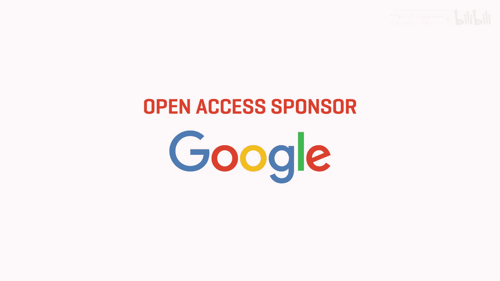
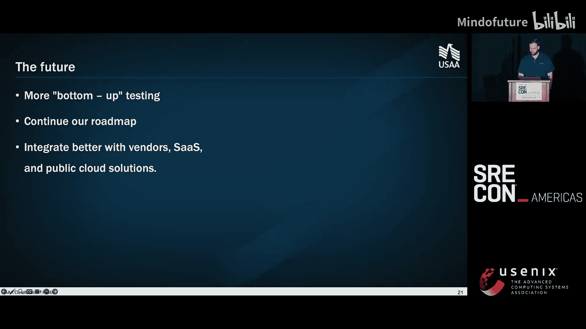
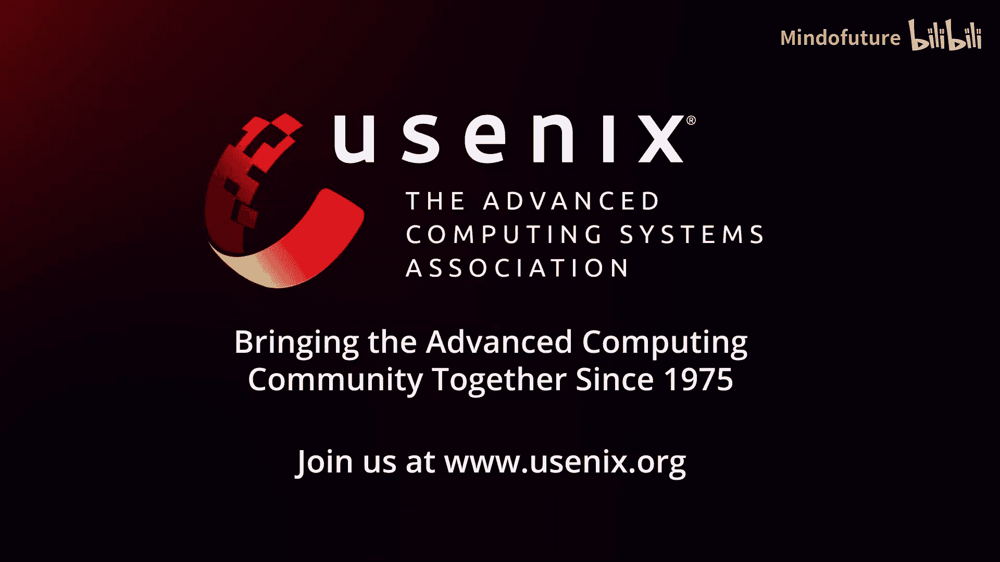

# SRE大会-2025-美洲-｜-srecon-｜-分布式-｜-缓存-｜-OpenTelemetry-｜-安全-｜-AIOps-p25-P25-Chaos-Experiments---Datacenter-Stress-Testing--BV1TmLDz7EZZ_p25-

。

Glad to be here， good afternoon。First， share a little bit more about myself from Texas so you're gonna to hear me say y'all and I'll have a little bit of a draw。

 It's going clearly show I'm from that state。 I'm a huge Longhor football fan。

 I love to play at Xbox I'm a gamer There's days when we have outages that I love I would。

Be a streamer and done that line of work， but I get some satisfaction from dealing with outages as well。

 And again， founding member of Ser team at USA and infrastructure staff engineer titles kind of don't really have a lot of meaning。

 so infrastructure staff engineer， USA is basically I've touched every single type of infrastructure。

 all of our middleware compute， things like that。And of course。

 there's a nice legal note I have to include the following statements are my own personal positions and opinions and not necessarily those of USA。

 some details may have been omitted to protect the innocent and potentially the guilty at last parts of my own。

嗯。So I'm going to be talking about something that I'm very， very passionate about and when I do that。

 I tend to talk a little fast， so if I start to speed up， do me a favor and since I'm a Longm fan。

 just throw up a hook them， I'll see it out in the audience and I'll try to slow back down。Al right。

So as I mentioned， I work for USA， which is a financial services provider for the military community and their families。

 we offer products for banking， auto property and life insurance。

There's also a supporting IT group for all those business capabilities。Our mission， sorry。

 this slide， it's something it。Pretty much shown at every large presentation。

 our mission is the heart of our culture。Mision statements， the first part on the slide。

 and it sorry， it drives every decision that we make at USA。

USA is probably the only employer in the country that has something called zero AP PT where you can experience the joys of a drill sergeant led PT session before the sun comes up in the morning。

So why did I bring this up， well this presentation might be a little bit different from some of the others。

 there's going to be an engineering aspect to the first part。

 but the last part of the session is going to cover more of the cultural hurdles we had to handle when it came to chaos testing at that level we're doing。

As this is where the majority of our time was spent。

I felt that spending the time to cover those problems。

And the non engineering type aspects of chaos testing would help all of you try to implement something similar in your own roles。

All right， so the first section I'm going to cover some of the bullet points here。

 to set some context， I have to give a little historical background about how we got to the point we're at today。

 so in my early days as an engineer at USA we undertook an effort to move from data centers that were on the same property to a model where they were hundreds of miles apart。

more of our applications had to fit the standard active active model that's depicted on the screen。

With the overall effort， we also wanted to prove that we could run out of either of those data centers at any time。

We did this to improve our resiliency as too many companies， including ourselves。

 had a DR or disaster recovery scareabment。I've got a message in the Slack channel。

 if you would like to hear details about that in the Q&A， feel free to avoidvote it。

At the time this did happen， we went and did some research。

 basically what happens when companies do have to execute their DR strategy and found that 80% of them go bankrupt in five years。

The data from that is actually in the link there at the bottom。

 there's quite a bit of other statistics and data around what happens when businesses have to execute their DR plans。

All right， so a long， long time ago in the galaxy， sorry， data center far away。

 we ran this thing called Webpher。 If any of you aren't familiar with that。 It's a Java middleware。

Application server。And。The roots of this overall effort didn't start with wanting to prove we could run on a single data center。

 but instead of prove out that we could pull something like a few J VMs and not have a catastrophic runaway。

So as a takeaway from this， make sure you take whatever chaos testing you can do and push it as far as possible。

 no one at the time thought that when we started doing something just like this。

 it would have evolved off into what we've got today。Simple breakdown here on the screen。

 got a single data center eed four cells consisting of four nodes， each with two JVMs on each。

 those JVMs might have one or multiple applications that are all just kind of mirrors of one another。

 so lots of redundancy across a single data center。First test that we did was just pull one JBM out。

 we started to monitor our indicators of what happened when we did that。

 so things like response time， CPUU， things like that。

'Got nice benefits from this type of testing that helped us with simple capacity planning at the application level and we could at that time we had a very very static compute layer。

 so think back into the days we you had physical servers and you're deploying right on top of them so trying to add some capacity it would take you quite a bit of time。

So moving on as we got more comfortable pulling a handful of JVMs out at a time。

 we had move up to pull on out a full node， so clearly it was to help us prove like if we had a server failure a crash that you can handle the capacity with the same amount of compute at the same time we were in the process of virtualizing a lot of our middleware environment。

This really helped us to fine tune our virtualization strategy as we could stress newer virtual server nodes and see how the performance of things compared against the physical hardware。

嗯。We also did continue to get better data to help us with capacity planning again at the application level and server footprints。

 we got more aggressive and pulled multiple nodes from a cell out at the time。Another takeaway。

 always look for and document other benefits outside of the intended test purpose。

This will help with some of the topics later on in the presentation。

So we continued this model of incremental capacity reduction in until we were to the point where we had half our capacity out at the time。

And now another side benefit of this testing for us。

 at the same time we were transitioning from this kind of static monolithic layout of duplicate cells to something that more matched each one of our line of business models。

 so we have different sell footprints for our bank partners， our property partners， life， etc。

This gave us a lot more flexibility and efficiency when it came to application deployments。

And all of the data basically allowed us to preplan and understand how many of these application deployments we would need for each of these new streamlined environments。

Al right， so very simple diagram。 this is a little bit closer to our visual of how things are today when we run a test。

I still left the Webster cell diagrams up there， but use your imagination。

 take it out and replace it with some more modern text stacks like Kubernetes and you're getting closer to more what our reality is。

We still have some islands of legacy things， things that won't fail over or run active active。

And they have to run out of a single Dana center。However。

 the majority of our most critical apps run in that original active active design that I。

 I started out on the first slide。So to move into this full data center model of testing。

 we actually needed a little bit of engineering to help us accomplish that。

So we created a way of logically moving our members between data centers via pinning as they come through our content delivery network。

When we started this scope of testing， we also did it increments。

 so we started with just a single user group and incrementally increased as we gained confidence and success。

Each group would have just a percentage of our overall membership。

While the pinning worked for our membership on the public。

 we also had things internally that wouldn't shift when we did this type of test。

So we had to also to start and include internal traffic in this failover process。

We can slow all this。 So domains and such internally that would。Have a lower amount of volume。

 we would migrate those and fail them over first and then eventually got to the point where we filled every domain over and all of our internal traffic was running out of a single data center as well。

For the components that aren't active active， but they have clients who are。

 the test proves out that the clients can handle latency when they're potentially calling across geographic distance。

This is valuable because we routinely use this evacuation model when we've got a large outage to mitigate the problem and allow us to investigate。

 take diagnostics， and troubleshoot the problem with a quicker RTS。嗯。Where咩。Alright。

 so for this reason， we don't fail over active passive design systems。

 They have to do their own scheduled failover testing。To prove out their own resiliency。

 but when we're doing these tests now what we're seeing is teams are actually using that time period to do their failover tests so that they can see know worst case scenario of what would happen if we lost a data center and they had to fail over and run out of the opposite data center。

Fun fact。To this point， everything was actually done before we had a legitimate SRE team。

 so everything was done by middleware teams and then kind of handed off to a team that eventually morphed into what is now our SRE team so for those of you looking for ways to get a formal SRE team going at your company。

 start out with some small scale chaos testing， push it to the extreme and see where you can lead it to。

So once we had an actual SRE team， the S3E team owned the process of doing this chaos experiment。

Initially we did it manually， which required a number of us to have elevated privileges and introduce the likelihood that we would drain the wrong data center。

Which we might have done once or twice。So to eliminate the toil and reduce that potential。

 human error， we automated the entire process。The screenshot here is from our CICD pipeline that we use to orchestrate all these tasks。

As part of this， we also incorporated some pre checkcks and rollback checks。

 so I think if you look closely at the beginning， there's the prechecks initially those pre checkcks were for pretty mundane things so looking to see that we had all of our capacity and service for our compute layer middleware layers since then we've moved on to a precheck of SLOs so we want to ensure there's just not any short burn alerts going off before we kick off the test。

And again， if you're paying close attention， I've got this nice little secondary screenshot。

 which is what we call our O shootot button， it's the manual back off in case an alert doesn't fire to back off the test or we need to actually kick it back for any other reason。

And since we're SE， if any of this fails， we've got a nice little playbook that we've got that allows us to engage the right teams for each of these automated steps so that if they've got to go use their permissions to manually do it。

 we've got it all at the touch ofable button。All right。So on that last slide。

 I mentioned that we've got automated or some rollback automation。

What we have done is provide the ability for our users to set a。

Burn rate alert flags so that if that alert fires， the test will back off automatically。

We did this because our team built and maintains a SLO Mansion tool。

 which has the ability for the owners to basically set that flag。

With the setting of the flag the users have to accept or accept some must dos primarily of course。

 is fix the problem I'll get into why that is the case with some examples later on along with addressing it。

 you know there's agreement that the alert gets promoted to an incident。Again。

 that'll come in a little bit more importantly later on。Once the flag is set。

 if the service fires a short burn rate alert， then the test automation will automatically back off the test fully in just a few minutes。

While we could have included things like just SLI or indicator based alerts。

We stuck to only supporting SLO burn rate alerts， and the reason we did that was at the time we were trying to get greater adoption of SLOs across the enterprise and that helped us drive a lot more people to that model of monitoring。

In fact we drew a pretty hard line in the sand on it。

 we don't allow any kind of SLI indicator to back off the test。

This isn't the only automation that we've got around SOs。

 we started to include them in the automation of changed deployments and the evaluation of the quality of services across the enterprise。

 if we've got time at the end， we can talk about it probably over on the side。All right。

 so monitoring。When we were initially doing single JVM application pools。

 we had dashboards to look at things like CPU， heat usage， garbage collection volumes。

 response times based on the node， cell， even down to the JVM level。As our tests evolved。

 our monitoring evolved as well。While we would have liked to punt this to the application teams。

 we never actually could get 100% awareness that we were running the test。

 even though it was on the same day at the same time every week。So as we started out our SRAE team。

 we were pretty immur with HeLOs as well， so we attempted to create this single pane of glass of our most critical services。

 which is depicted on the screen here。This has evolved over the time， it's got a few hundred edits。

And some of the data is actually dropped off or is missing because those pieces of traffic have actually migrated over to a new platform or the service has actually been retired。

If you look closely you can see some red lines as well at some point we decided this was a indicator of death。

 but in some of those charts you can see that we've blown past it long long ago。嗯。

While this type of monitoring wasn't what our new SRE team wanted to do。

 we were taking a lot of the responsibility for ensuring that this test didn't get out of hand and lead to a whole bunch of unnecessary impact。

So we did this to eliminate a lot of fears and give our leadership that all of these high level capabilities were being monitored。

Again， not really what SE promotes， but we needed to calm our leadership's concerns and something definitely we'll discuss a bit later on in the presentation。

So we still have that dashboard I just showed， but in reality today we just look for burn rate alerts。

 so this is a snapshot of that。During normal business hours， we often see maybe one or two alerts。

 they're usually related to things like service in need of tuning。

 maybe it's in like a pilot mode still being tuned。

 or it could be something low volume that needs some synthetic traffic to help offset the alerting triggers。

However， when we do have an issue like they' in the middle， we get the nice Christmas tree effect。

 you'll have a bunch of vessel loads off fire at the same time。

 usually the root and a bunch of clients all。I think this one was a claims issue。But as you can see。

 we got a schle of Vesslo alerts allfire off to indicate a nice problem。Alright。

So we're still continuing to evolve， even on our monitoring。

 We've even rolled up the data from that last page into something that we're calling our internal status page。

I hope one day I can get something like this external so we've got like a status。slack。

com or something like that。I think it's important for our membership to see that when we do have a problem。

 we've acknowledged it and also to give them an update after the fact so they can see， you know。

 how did we address it？Our business partners love this because it gives them kind of a quick view of their portfolio or their line of business。

 you know， are they up or down or having some kind of issue going on。All right。So now the fun part。

 we're going to get more into culture， people and process discussions。

I know that everyone in here probably likes talking about technology and engineering。

 but in all reality， our largest hurdles were less around engineering and more about problems with culture。

 people and process。So first bit of guidance I can give。

If you've got an existing problem management process to deal with findings。

 tie into that as soon as possible。If you don't have one。

 try to start one we didn't do this initially， we did have a problem management team。

 but instead we tried to rely on things like horse trading。

In professional relationships to address problems。This only went so far and eventually led to a backlog of finding so long it became completely unmanageable。

We also only had one person that was dedicated to managing all of those issues。

Let's just say that they really did not like their job。

Most of the things that we were finding were more of kind of tuning opportunities。

 so something like a Java heap setting or a a circuit breaker tuning opportunity。

Eventually we decided to move a lot of these kind of common findings into an automated system that is basically done on every one of our project deploys。

 and they would basically get it documented as part of their deploy and not as part of the test。

In the long run， we couldn't rely on a single person to push these items to the resolution state。

 it took a collaboration of our SRA team and our problem management team。

 along with a bit of automation on the side to handle it the best。嗯。

Another item is use every piece of leverage you can to deal with findings。嗯。In our current culture。

 availability is the number one item that drives action too often this is done as a reaction and not proactive。

 but we use the culture to our advantage to point out how findings that aren't addressed can put us at risk of meeting our availability goals or even potentially a target goal that a specific team or area has。

嗯。Believe the last time we checked， we have somewhere between2 to 3。

000 individual changes that occur to our environment every week， that's 2 to 3。

000 potential changes that could impact our ability to run out of a single data center。

And that starts to stack up over a few weeks and just makes me worry that usually becomes an issue when we haven't done a test in a while and can usually be due to like a single large issue that just keeps us from running a test。

Which leads to my next topic。唔时。You know， large findings that pop up。

They're a hurdle they often can delay tests， delay our tests， or keep them from being run。嗯。

Sometimes these feel like dealing with the picture here。

 basically you're trying to move them mountain by yourself。

 So how do we address these a few different ways again， just like I mentioned previously。

 we tieded our problem management process。Large problems that actually trigger a back off become incidents and have to go fully through that problem management process。

We've also spent the last years aligning。That team， more with S practices。

So an example of this just recently， we've started assigning ownership of incidents to potentially more than one owner。

Before you could have multiple action items that were split out to different owners。

 but there was always one team that ended up holding the overall incident and all the negative metrics associated with it。

These metrics are a stigma and would lead to a lot of blame and deflection。

Instead of collaboration and accountability。This collaboration between our teams。

Has helped us push along known problems from Deee engineers and push it onto the experts of problem management to address。

最好。If a problem becomes so large that we risk not being able to run on a single data center。

 we can also pull in our business continuation folks and utilize their processes to address。

Pretty sure we haven't used that in a couple of years。嗯。

Another item that we like to use to address this is to get the findings and their current state in front of our leadership。

There's a nice weekly update done to all of our leadership where each action item is shown along with the due dates。

 so it's funny how often this can help push things along as you know those due dates start getting close and。

Miraculously， they start being addressed。The SRE team now instead just becomes a source of input into how the problem should be addressed and we're not tasked with actually addressing it little joke that we've had on the SRE team for a while is SRE doesn't stand for should repair everything。

Js aside。We still struggle with this even today， so despite all those actions。

 it's sometimes hard get even problem management to escalate and get the right priority on items to be addressed。

If a service didn't breach， for example， owning teams will push back on us and say that you know they don't have a breach。

 why should they have to spend time addressing an issue。

 but in reality our back off flag is probably what prevented them from being breached in the first place so it little disingenuous when they try to do that as justification。

When we do get into a state where the test isn't being run for a little while。

 we lean on our people and processes again to help solve。

 we like to use the what went wrong in post morems。

For incidents that could have been mitigated by testing， if the test the。

Would have been executed and helped mitigate what you'd like to call that out。

Our team also utilizes our skills to help teams with a blocking item。

 so if it's something that they can't work out on their own or they're a little stuck。

 we'll sit down side by side with them and help work through changes to get them back into a working state。

And lastly， use data over emotions。When you're trying to advocate for large testing like this。

 that comes in super handy。Kind of hit on that earlier when we mapped out change volume compared to our last stress test。

 we'd often find a correlation where increased incidents occurred the more time between us running tests。

And I' can get into more specifics around each of those with an example。So。And。Up until recently。

 USA had something we call the postmtem of the week。

It was a presentation done every week to cover one of our interesting incidents or outages that had occurred recently。

So we've had the key personnel pretty much running that move on。

And our team basically has eliminated a lot of the more interesting outages。

 this has become more of a best practices type meeting and you know show off cool engineering efforts。

 however we still do have postmortems done and every time we need to。

 we can definitely title things like the first bullet point there to push the need for doing CA testing。

One thing we do keep in mind with postmors still is just don't blame。

 calling out a lost opportunity to prevent something was the goal not to blame the fact on the fact that we weren't running a test。

So。The details on this specific postmem I'd love to share as it had a ton of opportunities in it。

In fact， I think we did three weeks of postmortem of the Week just to cover all the details that came out of it。

High level。We made a change to how we encrypt authentication。

 which caused CPU to increase and tip things over on the database as we increase connections to it。

We then。Pulled our standard playbook of let's swing traffic over to the other side and evacuate so we can troubleshoot and figure out what happened。

 and we tipped that side of the database over as well。

It's a perfect example of a large finding that would stop testing until addressed。

Personally worked with the engineers on this component to identify a logic defect。

We also built out a proof of concept that even if the data tier went down。

 90 to 95% of their requests would have still worked。嗯。Out of this。

 we ended up canceling just the single test to give the teams time to implement these changes and get us back into a mitigated state where we'd be safe running the test out of a single data center again。

E on in our journey， if wed had something like this happen。

 it would have been weeks before we would have gotten back into a state where we were comfortable to execute the test。

For this specific outage， another what went wrong？We actually did see smoke the week before。

 So the database did。Pret much fail over， it recovered。

 and it was basically written off as like a blip。After further investigation。

 that's when we found that this connection storm and the authentication overhead is what caused it to go down。

And along those points， we've got a。Another founding member of Ios3 team。

 he likes to say that problems that go away on their own like to come back on their own。So again。

 last bullet point there， data over emotions， so for every chaos test that we do， we run。

 we keep a postmortem， so every single finding is documented and archived since the SRD team took this on。

We can basically search through that archive and get a list of all of our burn rate alerts that have fired or any other kind of triggering event that we see。

 which would help point to smoke for a pin fire。Lastly， something else I like to show now is a。

 what did this cost us type metric， doing presentations on the benefits of this type of cast testing。

 I like to push the idea that not doing it could potentially cost us more。

So I took a very simple calculation of our revenue and what could be lost per minute based on the downtime I got this idea from an article on a Facebook outage back in 2019。

 and this was the original data that I used to create that breakdown。So。

People in knowledge gaps were also an issue with us doing these type of tests and dealing with the findings。

mentionedented a bit earlier that our team was being heavily leaned on to deal with the findings。

We'd have to basically identify and come up with all the action items to remediate things。

In an attempt to deal with getting the knowledge and skills more widespread to do better app level monitoring and resilience。

 our team started a program where during this scheduled test。

 we would have a team sign up and basically sit with us。

 we would show them everything we would look for as far as smoke in their application。

 give them some of our tribal knowledge that they could take back and use themselves。

We knew going into it， it was going to be very tosome。

 but honestly it was one of the best investments of time we had。

 and overall it made our engineering community excited and engaged。

 more engaged for when we were running these tests。

The best example I've got from this activity is something for pretty much one of the simplest stepss we've got。

 we've got basically an internal Bitley type application where you can take a long URL and create a short link for it internally。

The team that managed the app knew that it was about to take off and they were going to have a large amount of growth on it。

And what they wanted to do was figure out where they had a known bottleneck so they had done some testing。

 they could only get traffic up to a certain volume。

 and they didn't know where the bottleneck was at。No matter how much traffic they pushed in their test environment。

 they couldn't get it to the point where the bottleneck was going to get hit。

 but they also couldn't get to what we were seeing in production。

 So they wanted to meet with us and see how we could help them。U。

We had them fill out a template that we provide that essentially allows them to or basically plans out the chaos test themselves。

And we came up with a way to ramp up synthetic loads。

 such that they would generate a more realistic pattern of their usage and go past their attempted performance test volumes。

We found that there was a defect in their logic， such that all the calls that they were making to their back end database weren't using any connection pooling。

As a result， the environment they were on got super close to port saturation。But。

Luckily as part of the test planning， we were looking for some of those indicators and we were able to back off the test。

And make it a saved our bacon instead of a burned our bacon type of it。

If we wouldn't have caught this ahead of time， the environment they were on hosts dozens of very critical applications and if it would have happened during a normal business day。

 would have caused quite a bit of impact。So。We knew that that wasn't going be something that we could continue to scale out infinitely。

 so。That same year， we generated and presented a session where our team created a very easy project that could be downloaded by anyone。

And step through a number of performance test scenarios。

They would do this all in their local workstation， everything was container based。

 they could get all of the monitoring and everything basically in one simple stack， all local。

The visual here is from that monitoring stack that would have been run through one of the performance scenarios。

This gave all of our engineers kind of a starter template to create Lo test and look at performance metrics for the sample app。

 or they can make a few tweaks and utilize their own application。With a few more minor changes。

 they could also incorporate these tests into their own CICD pipeline anytime they merged into master。

This was greatly needed at the time。As we were starting to see， most of our findings。

 we're starting to be things like minor performance or capacity issues or just not able to scale up under load。

So one other thing that we did with this session was we also showed our developers how to take some diagnostics of how to take a Javava heat dump and dig into it so that they could help find and identify where their bottlenecks were to help them troubleshoot and resolve faster。

Back just two weeks ago I had a team with a stress test finding reach out to me。

 they wanted me to follow up with some of their performance test results and take a look at it。

 they were using a fork of this project， they walked me through everything that they had done and they had massive substantial performance improvements and what they had changed so clearly this worked and was time well spent。

All right， so now we're going to come to the last main topic in the fun one。sorry。

 our number one obstacle to doing this type of exercise was and continues to be fu。

 so hopefully this is the only acronym I use today it's notorious at USA with our military focus to use them quite a lot so。

Countering fear， uncertainty and doubt is probably what we spent more time on than any engineering work that comes out of the test。

I will say in the last year， though， this has changed quite a bit。

I'll hit on some of the actions we've done to address that。

And give my own opinions on what ultimately， I think has LED to this culture change。

I've got a few of the most common fuud quotes that I've seen and to go search for some of these。

 My favorite one is actually the last one there。 And depending on who tells it to me。

 I like to have a little fun with it。😊，All right， so when it comes to dealing with FD。

Leadership education is critical。 Our current CIO is the only one that we've briefed directly on this activity and why it is needed。

Having the support， though， at that level， along with every level of management between Essri and her is astronomical in fighting off fear uncertainty and doubt。

Data at every opportunity again utilize data to make the case for continued chaos experiments on the last slide I had a few common floodud comments that I encounter often。

All these can easily be countered by challenging if there's specifics or uncertainty about their claims or their application or infrastructure。

When they can't show definitive data to back their claims， the concerns tend to drop off。

The opposite can also happen for this。 most common example we see is if there's a catdi。

The catastrophe type event so think of something like a hurricane being predicted to hit the East Coast our claim soaks would bring us data basically saying hey。

 you know， starting at this time， we're expecting landfall。

 we expect an increasing in volume for claims of this amount starting around this date and lasting this long。

 you know， maybe we shouldn't take the risk of running the CA event you know during this time。

However， recently we've actually seen the opposite。

 so before an event is predicted like there's a hurricane coming in。

 our claims folks are often asking us to run the test to make sure that they can handle that spike in volume they're anticipating coming。

呃。So I also mentioned earlier that we keep postmorems for every test and also have problem management track all of our problems to resolution this gives us the ability to show you know every single saved our bacon opportunity I could stand up here and probably tell you 100 items that we've found doing this that have prevented major outages。

呃。We also have something that we call our resilience confidence score。

 there's a screenshot of that up on the slide now。This number is calculated based on a number of factors。

 including the last time since we。Completed a successful test。

Whenever this metric starts to drop out of the higher tiers there。

 we tend to see the fear uncertainty and doubt kind of drop off and people actually start to clamor for us to run the test again。

嗯。The SO data or sorry， the SLO automated back off is another way that we've countered F when we rolled that in。

 it took a lot of pressure off of our team as there was confidence that if there was a critical alert fire and that flag was set。

 the test would revert， we'd only have a few minutes of impact。

We jokingly call this now the security blanket on our team as a lot of teams are incorporating it without realizing the risk of backing off the test and potentially keeping other teams from seeing and having the opportunity of seeing how their applications run during a single data center window。

We're also seeing teams now use the。Tests is a checkpoint。

 so as they're maybe rolling out a new feature or slow rolling some new APIs out。

 they will put checkpoints and make sure that they can get through tests before they increment their traffic volumes up。

嗯。We have seen our automatic back off become a crutch。

 so some areas think like if they've set that flag， they can kind of skirt some checkpoints。

 maybe cut some corners， put things in a pro a little bit faster and take a little bit more risk。

Going to currently address that， and if I come up with some great ideas。

 maybe I'll bring back what we found in a future presentation。And lastly。

 we like to use future risky activities to push for more aggressive CA testing。

In the next number of years， we've got quite a few riskier activities that are going to be happening。

And we've got to just do those to stay as resilient as possible for our membership。

Think of things like large life cycle type management activities。If something doesn't go as planned。

 sorry。诶。The leadership that maintains and has to deliver these life cyclee events。

 they're actually on the hook for those activities。

 and they're the ones now clamoring for us to execute the test。

They want to have that confidence of having the lifeboat of， you know。

 if one data center doesn't have their lifecycl event complete。

 they can just run on the lifeboat for quite a amount of time。So ultimately。

 that pulls a lot of the advocacy off our SR team and pushes on our leadership to advocate for running the tests。

All right， it's the future。嗯。So some of you may think this chaos experiment is the wrong order。

The history of how it came about， though， and the risks that helped this mitigate can't be undersold。

We actually did have an instance where we lost the data center for a few days。

It's an interesting story if anyone wants to hear about it on the side。

 I'm not sure if I can answer about it in Q& A， but the fallout that occurred there was more on the infrastructure teams that were responsible for bringing everything back up than on the impact that we had from running out of one data center。

 I think we had maybe like three minor performance issues where we had to add some capacity or quota to a deployment。

嗯。More recently， we had an incident during the test。

That exposed an issue that's been occurring with every production deploy for years。

 It took the situation of running in a stressed way to expose it to the point where it wasn't just written off as a blip。

 as it had been for years。If this were to happen while we were in one of those riskier activities and on a single data center trying to recover。

 it would have been extremely impactful and a lot harder to recover from。With that said。

 we do want to move more into a app level type failover testing。

 so our team actually right now is in the process of implementing an enterprise chaos experiment tool so that teams can coordinate and plan their own type of chaos test and execute them in a siloed isolated way。

I'm going to push for the engineer that's working on that now to come and present here in the future。

嗯。Didn't mention it earlier， but。Five years ago or so we started a roadmap of items we'd like to push the test into just in the last year we've moved from a very static day in time。

 as I mentioned earlier， to a more flexible schedule that can cover multiple days。

For the longest time， we actually avoided things like high volume days， just from a risk perspective。

 but we' stopped excluding those now to make sure that even during a high volume day。

 we can run on a single data center。嗯。As we fought off a lot of the fear uncertainty and doubt。

 the activity now is actually seen as business as usual。

 that aspect of calling it business as usual has been a massive cultural win for us。嗯。In the future。

We'd like to do things like include。Offpre workloads。

 so think of like a SAS provider or public cloud region if we have something deployed there。

 what would happen if one of those failed over from East region to west， could we handle latency？

Not sure， something we want to include in our testing and prove out。诶。And as a final takeaway。

 this is something that's been going on for over 15 years。

 it's taken the passion of a lot of engineers at USA to get us to this point and you know don't think that you can implement something like this overnight。

You're going to run into a lot of hurdles， a lot of challenges that you're going to have to overcome。

 hopefully when you do face those， you can take some of our experiences here and help them overcome yourself。

Then。

