# SRE大会-2025-美洲-｜-srecon-｜-分布式-｜-缓存-｜-OpenTelemetry-｜-安全-｜-AIOps-p26-P26-Measuring-Availability-the-Player-Focused-Way---How-Riot-Games-Changed-Its..--BV1TmLDz7EZZ_p26-

。

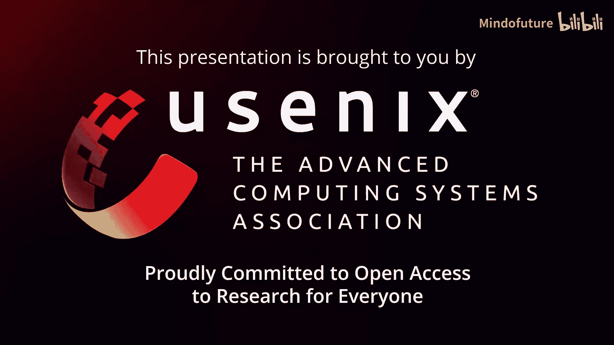

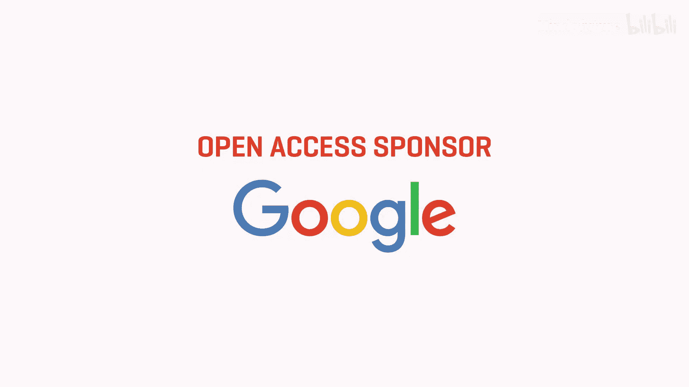

Thank you very much， Thank you for the introduction， thank you for coming to a talk。

 I hope over the next 30， 40 minutes or so you enjoy the story I'm about to tell about how Ri went about thinking about measuring its availability and solving cultural response to availability problems。

Attle bit more about me and how I ended up up here。

 I've been working at Ri Games for the last 12 years。

 I've been working inside the video game and outside the video game industry for over 25 years。

 My work experience mostly focuses on the software development lifecycl。 I've built infrastructure。

 I've built services， done build and release。 I've done performance testing in Q A。

 I've done crisis management。 I think that's why Ri said， I need go work in live operations。

 We need a generalist。😊。

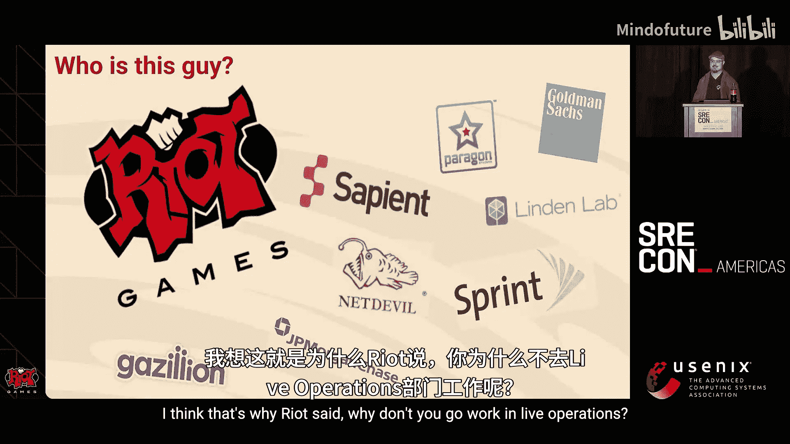

Who is Ri Games， If you haven't heard of us， we'll make some little known video games called League of Legends and Valers。

 Legends of Ventra， Wild Rift 2 X KO was launching this year。

 So we're a multigame studio that focuses on competitive games in a production environment。😊。

What's most relevant to this conversation， though， is some aspects of our culture。

 We aspire to be the most beloved， trusted game company for the world's most passionate players。😊。

It's our vision statement。And one of our core values is to be player first。

 And what's really relevant here is that everything we do is actually in service of the players。

 This is important。🤧。At any given moment， anywhere in the world。

 over 2 million players are likely engaging with a riot video game In this moment。

 it leads to well over 100 million monthly active players。

And it takes an army to serve an audience this large well。

 Well over 2000 riders come together to make this happen。

 of which more than a third to half the company have roles specifically focused on building services。

 features or enhancing the player experience directly。So when you want to have a conversation。

 by the way， about availability within riot Games， it's like bringing your extended family to Christmas dinner and asking what's the best way to cook a turkey。

 you're just going to get opinions。The architecture and infrastructure we're dealing with we're going to have a conversation about availability involves more than 800 individually named live services。

Deployed into a sharded game environment， what I mean by that is we have a deploy of League of Legends for North America。

 We have a couple in Europe。 Valerent solves the same model。 There's shards in Korea。

 We do this because it's best to deploy our infrastructure as close to the player as possible for a lot of reasons for the players。

 what they care about is latency。So we're all over the world。

 but each one's its own independent stack。About three years ago。

 we actually finally became 100% cloud native and got off bare metalal。

 Most of it is running in containers well over 50 to 100。

000 containers in production represent the entire riot ecosystem。

 and there are still a handful of just native VMs running in AWS supporting everything。

 If you're curious about the tech， it's mostly Java and Golang microservices。

 but all of you want to know about game servers， those are running in C++。

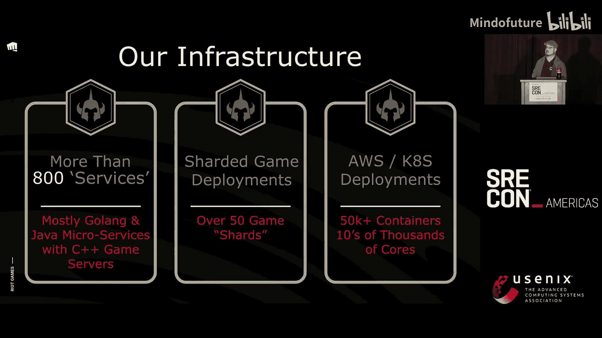

I need to start the story by bringing some of you back。 I'm sorry to the year 2020，2021。

 at the start of the pandemic。 Inside the game industry， something happened in this moment。😔。

People were stuck at home playing video games。 So Ri encountered an unprecedented level of players playing our game。

 and it created a perfect storm In 2018 and 2019。 We went from a single video game company running League of Legends。

 We'd shipped Valert， and we'd shipped legends of Ven terror。 Suddenly。

 the operations team focused on return to service。 were dealing with a multigame environment。

 More players than knew they ever seen before， and they were burning out。

 I'm going to get into that story。 But the answer is they were falling apart。😊。

There was no standard after 10 years of running one of the most successful video games at Ri for how to track availability。

 Believe it or not， we didn't actually have a number。😊，Game leadership as a result。

 in the C suite of Re Game couldn't get a consistent story about what availability was for a given day。

 for a given week， for a given month。 There was no way to have this conversation。

 We could produce incident reports， but we couldn't talk about how well did we do。

That's pretty bad for a company that believes it's player first and player focused。 Ironically。

 that player focused caught sort of culture that we had was one of the death heels of our incident management process。

 I did not have a problem getting 30 people onto a phone call to fix the game。

 I had a problem getting the right 30 people onto the phone call to fix the game And this was this culture comes from this total accountability。

 total ownership model that I'm sure many of you work in at Riot。

 Team were centered around owning their service。 As we got biggerar。

 We drifted away from owning the game to owning some tiny piece of the game or a shared service。

 And this meant as I quoted to leadership， as I was entering live operations。

 What we have as an environment of plausible deniability。

 No individual at Ri actually believes they're accountable for the entire experience of the game without this。

 we can't have a measure of unified game availability。😊，It was leading to a lot of， I don't know。

 It's their fault， right， And they probably weren't wrong。

 or at least they were right in their own mind。As I joined live operations。

 I had the fortune to sit down with Ris CTO， A wonderful man named Derek to Fields。

 I had visions of bringing See to Ri， raising the SE team。 I've been reading the books。

 I've been going to conferences。 We're gonna do this。 And he's like， stop。😊。

I'm sure all of that's great。 But if we can't measure availability。

 what's the point of building the eerin team because you can't。

 You can't prove you made a difference。If you're going do this。

 and I'm going give you money to do this。 And we need a number that gets better。

 improves that you are right。And we had a vision that we wanted to centralize this effort within right。

 We wanted to continue the tradition of centralized live operations and extend it to S， R E。

He wasn't so sure。 The other thing to do is to give it back to every game team。

 Let each game team run like its own company be its own availability source。 Yes。

 it might be different between games， but this was an option， so。

He gave me 12 months to figure out how we're going to measure availability or he was going to take autonomy away from the group and figure it out himself。

 That's CTO code speak for you probably won't exist as a team anymore because this isn't working。

Combine that with one more objective he gave， assuming you come up with an availability measure。

 It's worthless to me if game executive leadership has not bought into this measure。

 If you've all read us a low books， you know that so they have to care and they have to believe they can affect that number and they have to believe you。

 It's not enough that you create one。 They have to believe it is important to their product。

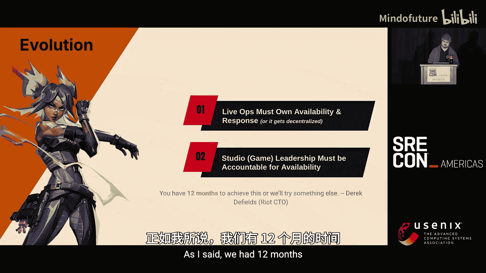

So I said we had 12 months。So now begins the journey of clearly。 We need some sort of unified S O。

 You might want to call it an O K R， but doesn't matter。 I need a number that says。

 how well did we do， And everyone has to believe it。

 And the chaos has to end when you take a company full of technologists。

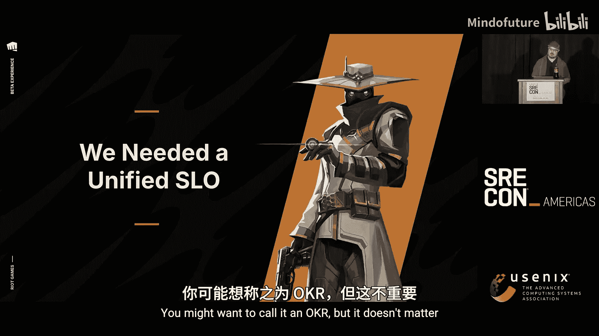

The first thing we all think of is I want a dashboard of red and green availability for every service。

 we had 800 services in production。 Why don't you group them by their dependencies show how they roll up to games I want to be able to drill in and out。

 I had a lot of technical leaders going， we can do this。😊， I'm a skeptic。

 We hadn't done it in 10 years。Part of it is because while we have standard microservices and standard frameworks。

 This total ownership model was biting us in the but。

 Every single service measured its availability differently。

 And that's assuming it measured its availability in a metric you could actually use。😊。

If I wanted to change the technical stack to standardize this so I could build a dashboard that measured availability the same way and roll it all up and down had to change every service at Ri。

We have metrics on how hard this is to do to achieve 80% adoption across all 800 services。

 It takes about two years for a new piece of technology at Ri。 I had 12 months。

 So taking the technical route wasn't going work。Besides that。

 I could stand up in front of everyone and say， our players do not care if an individual services down。

 The whole point of building microservices is to create resiliency and minimize impact。

 odds are a given player might not even know if Joe's service 1000 is offline if we've built it correctly。

What they care about is whether or not they can engage with the game the way they want to and the moment they want to or the way they need to in that moment。

 end of story。So if I can't solve this with technology。We had to go back to basics。 Well。

 what do we have， We have 12 months。 We have to build a measure。

 We better rely on what we actually have。 That's the fastest way to achieve a result。 Well。

 I do have a powerful cultural sense of ownership。 I can leverage that。 I have。😊。

That has LED to alerting。 I could give an entire talk on noisy alerts and alert effectiveness。

 but we definitely had alerts。 And we had excellent reporting。

 an incident management team that while they were burning out。

 we believed was second to none in cataloging and tracking incidents and corralling people into getting data。

😊，We could talk about return to service， but we knew when there was a problem and we were cataloging it。

We have a player support organization that would back us up if we didn't have alerts。

 if I wasn't getting an alert， I guarantee you riot's player support team was right there within four hours telling me show Reddit is exploding right now。

 something is wrong and you need to look at it。And one thing we are good at and have always been good at over the years is I have superb real-time metrics of what's going on inside the environment at any moment。

 I might not be able to turn them into SLOs， but you can bet your bottom dollar。

 I understand how many players are currently connected to every game in every part of the world。

 I even know how many players are in region。 And I have this data in real time。

 And I have this data and riots data warehouse。 So what can I do with this mishmash。

 I have an excellent management process。 and I have pretty good concurrent player data。😊。

We have to solve a few problems。 And so we started thinking about。

 what is the order in which we need to solve these problems to build an S， O。

The first problem was that incidents were kind of chaos。 but we were recording them all。

Priority was a problem。In at player focused company。

 every problem in production is a five alarm fire。 It didn't really matter if pricing was bad in Czecholistslovakia for some players in some content or the entire game was offline in Korea。

 We responded the same way because the players were hurting。 and we can't have that。

 30 people get on a call at 2 o'clock in the morning。

 There was no sense of what order should we tackle these。If we're gonna have this conversation。

 we need to establish a common frame of reference， a common language to talk about impact。

 I can't have an SO measuring availability if we don't all agree on what we're measuring in the first place。

To do this， I have to trust the data。 Whatever I produce has to be reviewed and trusted and credible。

 There's no world in which I can present to the C suite of riot。 Here's your availability score。

 Yet everyone knows it's full of shit。 part in the French。 like the j just won't work。

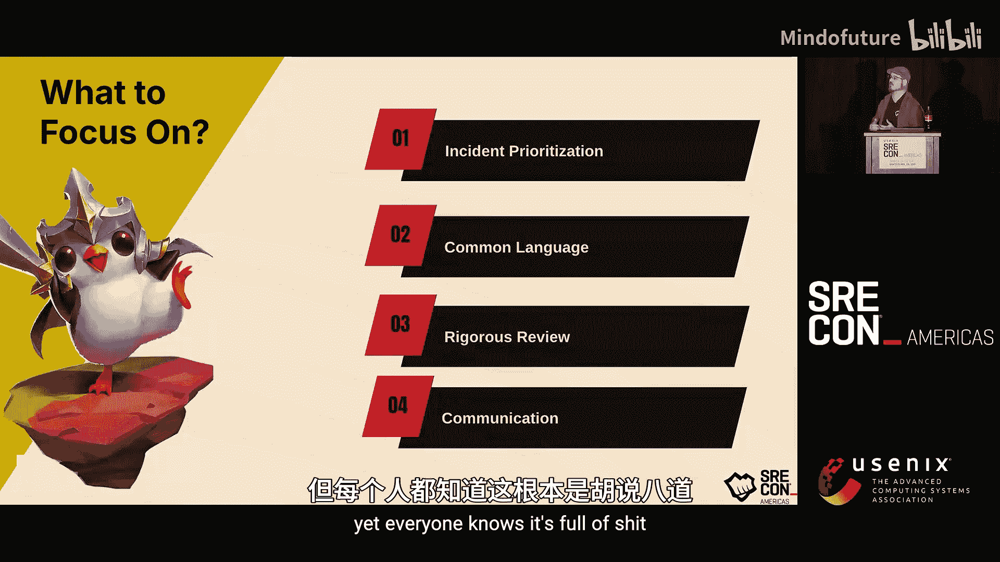

And that requires really good communication。Let's talk about prioritizing the incidents first。

 If you haven't guessed already， I'm positing that perhaps we can build an SL O using the data we captured during an incident。

 because we know we failed in that moment。 And I can reference that for some sort of availability score。

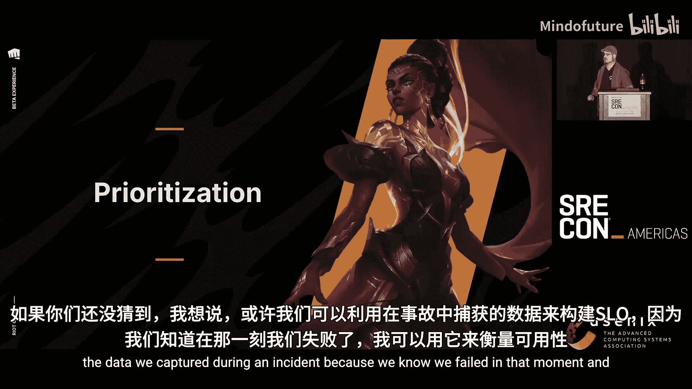

To give you an idea of what the problem is the first thing I want to do is I could give a whole talk on incident management at right。

 I'm going to distill this down to just the priorities。 We had a total ownership culture。

 and that meant every service， every outage that we were recording was from the frame of reference of a service。

 not the game， a service。 And we categorize services into critical and noncritical for everyone in the room that meant playerfa or not player facing。

 Fun fact， the number of noncritical services that showed up in a player facing incident were kind of high。

 and like after after this point of development。 I wed paged people out in the debate would be I'm noncritical。

 Why am I here。 the systems offline into services offline。 we've correlated the two。

 I'm supposed to be noncritical。 yet somebody had implemented a player facing feature against that service without talking to that team。

😊，We spent more time in incident debating whether or not it was categorized correctly than actually returning to service。

So we threw it out。 This was probably the hardest bandaid to rip off。Instead。

 we decided to talk about what is the impact of the incident from the game's perspective。

 translation from the players's perspective。 And that means how many players are experiencing this problem。

 It is rare at Ri that the entire game is offline。 It might be exceedingly more common that I would like that some parts of a game in some part of the world is not working the way we'd like it。

 But that means only a subset of the players are experiencing a problem。😊。

We decided that a priority one incident is not defined as total outage。

 If we are somehow failing 50% of our players or more。

 we have to be failing our mission to be player first。 There's no excuse right。

 Over half red it's done。It was called Twitter at one point。 It's now X， but that's exploding。

 we're in a hole。 Okay， that's T shirt size number one。

We need a few more t-shirt sizes to make this work。 The next one was， well。

 what about not quite half。Let's categorize that as 15% to 50% of the player base。 Well。

 now that leaves sort of 1 to 15% for priority 3。 and conveniently。

 I left less than 1% as priority 4。This brings sanity to the conversation of how important is this problem？

And now， if I mention priority one or priority two at Ri， I am speaking players。That's it。

People can learn this。 Product owners can learn this。 Engines can learn this。

 and I'm off to the races。 I'm beginning the framework of a common language。 If I tell you。

 I had a P1 incident for League of Legends yesterday， you kind of know it's bad already。

 And you have a frame of reference based on the players。

This is important because whatever solution I come up with for measuring availability has got to be something that players would agree with。

It's not just important in case I'm at a conference like this talking about the results and you all。

 I want you all to know your head and goes that makes sense。 I play your games。

 It's also important because there's one thing I can count on at Ri。

 Everyone at Ri has the player as a frame of reference。 Most of us play our games。

 If we don't play our games， we play someone else's。

 I can guarantee you that if I'm talking about things in terms or a frame of reference of the player。

 every engineer at Riot understands this problem。 every product owner does。

 every C suite executive does。 If they don't， there's a different kind of conversation we're having。

 because that means we're way off the marker。 So if I can frame it in terms of the players。

 I now am speaking the same way to everyone at the company。😊，🤧。

So while I can talk about how many players were impacting， I needed a bit more。

 just saying I had a priority one incident with League of Legends doesn't help you know what was going wrong。

 It doesn't help you understand it。 It doesn't frame it correctly。

Working with several of my engineers， we pretty quickly agreed that there's three common buckets that we can talk about problems with our games。

 and they apply to every game at Ri。The first buckets connecting to the game。

 You might consider this logging into the game or patching the game。 If these services are failing。

 you cannot get it。That's a pretty bad problem。Every business leader in business owner room is going to be except of course。

 we have to talk about purchasing things， but even at riot that breaks into two categories。

 there's the actual payment processing， taking your credit card and giving you virtual currency。

 then there's the act of using that virtual currency to acquire content。

Those are actually two very different infrastructural systems at riot。

 and they need to be represented by experience you cannot not be able to take credit card。

 but still spend your virtual currency。And the contentious one。Is the one that really matters。

 Why are the players here， They're here to play the game。However， this is one。

 this is the turkey at the Christmas dinner。 We could endlessly debate how many categories。

 how many ways we could break it down。 So the fight was really over。

 We can't have 1000 categories or the language is too complicated。 We agreed on 6。

Things like matchmaking。 Every single one of our games is a competitive online experience。

 You have to get matched with other players。 That's its own infrastructure。 We have playing the game。

 If players are getting disconnected or games are crashing。 we have a real problem。

 We have end of game rewards， getting getting whatever it is you've earned after playing the game is a critical service with message queuees out the woo chat and voice chat。

 they pretty upset with us if they can't talk to each other forming a party and the weirdest one。

 which is in our kind of ecosystem in order to put you in game。

 We have to be able to retrieve your account information。 We call that inventory at Ri。

 If these things are not working。 I。😊，Can create incidents and frame a language。

Without giving you the details of the incident， But you can have a pretty good clue of what went wrong。

 If I tell you I had a priority one incident with Valert in Korea。

 Oceana and Europe involving matchmaking and retrieving inventory and it lasted 60 minutes。

 I almost don't need to tell you as an executive leader anything else。

 If you understand this frame of reference and you play our games。

 you already kind of can suppose how bad it was。Sure。

 you're gonna to go look up the incident record later， but I。

 I have this baseline of language I need to have a conversation。Most of you in the room are like。

 this guy's been talking for 12 minutes。 And I thought I was here to learn about S Os。

 that I haven't heard a single S O。 What the hell。 You're not wrong。

 but I need to establish the baseline framework we need to even create one in the first place。

And don't worry， if you're like， this guys going build an S L O off incident data。

 He's just going to do incident duration over total minutes in a month。 We've all done that before。

 waste of time。I'm not。Give me a second。 We're going somewhere with this。First。

 let's make sure we're using the same definition of SO I am。 And everyone is crazy about AI。

 So I decided to go on Google and just ask the AI engine， what is an SO。 No surprise。

 It basically quoted the Google S book back at me。 with the definition of SLO。

 But the thing we often talk about at conferences like this engineers is typically something like error rates and latencies to create some sort of measurable success fail method。

 But the definition also just includes something you would consider a measure of availability。

 And that's the direction we're going to go in here。 Remember。

 I didn't have the technology to unify error rates and latencies across all services as riot into a meaningful target。

😊，The other thing that's critically important to the next part of the story is that in S O。

Has to if I'm gonna measure something， it has to feel bad if I miss it。

 Everyone has to believe that that was a bad result。

 And the people who have to believe are the people who make a decision about who should be building features and who should be fixing long running problems。

 typicallyypically， we call that leadership， product owner， C suite。

 Ex whoever makes those decisions。But the people who get assigned to the problem have to understand why they were assigned to the problem。

 So they have to believe the basis that's making these decisions in the first place。

We needed inspiration because we were in a bind。 I couldn't do this with a tech stack。

 So we looked outside the games industry， and we looked outside most of the software industry。

 We actually looked。A little bit for inspiration with how power companies solve this problem。

 And I'll explain why if。Power company thinks about serving you power at your house by the total number of minutes in a day they successfully delivered power to your house。

You might look at it over a month。If you are a homeowner or someone who lives in a home。

120 minutes of not receiving power within your house means they fail to deliver power to you for about 0003% of the time。

 You need 59s or49s to represent the availability。 start to understand why a power company probably doesn't care if you didn't have power for two hours。

When you expand this to a riot use case or an actual power company's use case。

 a small city might be 100000 customers。 One customer not getting power for two hours is not an S O Miss for them。

 It's still a customer service problem， but it's not an S O Miss。It just。

 you would need 109s to even care about one customer missing power。

50000 customers missing power becomes a problem。Take the city of Los Angeles。

27 million people live there， takes a lot of people to not being gain power to achieve an SLO miss。

 but it doesn't take long if 100，00 households are running without power for five hours。

This is very similar to Ri's problem。 I have a lot of players playing the game at any time。

 And the whole point is to serve them the game while they are playing the problem I have。

Is I don't have this concept of serve player minutes。

 I just have total number of players connected to the game at any one time。

If we measure this extensively， though， at Ri， So what if。We get creative。

 And it's one of my engineers。 I think he's in the room in the backpack there。 His name is Adam。

 We can this out。 We have the data in our data warehouse。 We can sum this stuff together。 If I。

 if I just assume that for a given minute， if I have 100 players connected to the game。

 that's 100 served player minutes， if I sum every one of those together for the entire month。😊。

I have the total number of serve player minutes I need in the month。

 The problem is this data is in real time， and it's in the data warehouse。 And I'm looking for how。

 what should I be serving。😊，So we can do something like take the rolling average。

So that I can answer a very simple question now， if it's 2 PM on a Friday and it was 30 minutes long。

 how many players， how many third player minutes should I be serving。In this moment。

 I can figure that out if I just put that data together。

 And now I have exactly what the power company has。 I have an expectation of service。

And I have an approximation of what service I failed to deliver。

 if I think 50% of the player base were having a bad experience in that time window。

So if we measure that availability by a percentage of the serve player minutes that were not impacted and we combine it with our previous common language。

 If we start talking about these misses in these terms。

We might have something everyone at Ri understands。 to be clear。

 what I'm supposing is you just take the total player minutes we were expected to serve in the month。

 That's the sum of the CCU curves for every region， for every game。

Subtract the player minutes we believe are impacted from that。

 and just put it over the total player minutes a month。 I have a nice percentile ratio。

 and I'm off to the races。Could this work？Let's talk about why this is useful and why this is far more valuable than just doing incident time over total incidents in the month。

 These results are weighted。 An incident that occurs off peak for us that's the middle of the night。

 very few players are playing the game in the middle of night。

 There's still some crazy addicts up there playing。

 but is nowhere near as bad as it would be at 5 PM on the East Coast and North America。

 where everyone who wants to play a game is probably playing。

 especially on a Friday or Saturday night。So if I have an incident now at Saturday night， at 5 PM。

 my data is going to tell me a lot more surf player minutes are in that moment because our CCs follow curves than it would if it was off peak。

 It also waits naturally between game shards。 some of our regions are significantly smaller than others。

 So if I have a product owner looking at their entire game。

 an incident on their smallest shard is not going to hit their SLO as an on their largest shard。

 but I can still tell them what the impact to the shard was if they care about how well they serve players in that region。

😊，All these results are relative。 This is going to solve the credibility problem。

 If we just talk about5 hours on a Tuesday， someone's inevitably going to tell me。

 but those were the least important hours of the week。 You're not wrong。

 But if my formula takes that into account， you're now not challenging the number in trying to break down its credibility。

 So all I need now is a target。That we agreed to。Naturally。

 anyone who has ever worked with a C suite or a CTO。It's got to be three nights。

 How about four nights。I want to remind everyone in the room we'd never measured this before。

No one had ever actually thought to do this or put the technology together。

 We had no idea what the number was going to be once we started to look at it。

There is a personal belief I have about something like an S。 O。

 If you pick a target that everyone in the room knows you cannot hit， you've already lost。

No one's going to care because they believe it's an impossible target。

If I already know the entire company is getting a little antsy with me when Im。

 we're going to calculate， they're like， oh， God。I don't know if we're doing so well by that number。

 If they think about the number of incidents they have， I cannot pick a number。 We know we can't hit。

We weren't sure we could hit 99%， and I will reveal what we were actually hitting in a second。

 But this was a very contentious number。 We had to win， saying it's going to be two nights。

That's crazy for a player focused company， given what we're measuring， because 1%。

Given is probably well over 2 billion served player minutes。

 We serve well over 200 billion player minutes in a month by this formula。

So what did the final report look like， I'm gonna skip ahead to the end of the story now， Hopefully。

 that's readable to everyone in the room。 I apologize。 I picked League of Legends。

 which has the most shards。 Acro the top is the Sharards League of Legend Sers。

 This was pulled from December 2023。On the vertical axis is those categories I talked about。

 We talk about what kind of impacts we had in these areas across this grid。

 And it almost tells the story itself， this particular month。

Leaguegue of Legends was having a problem with the store in Korea。 It's right there in orange ink。

And on E US1， which is our largest European shard， something was wrong with end of game。

 And there was a smattering of smaller problems across various systems on most of the shards。

 But two of the shards clearly missed the target。 V N2。 So Vietnam also missed the target。

This seeing this was like a drug。 Suddenly， if I put this data together a for few for a month with this heat map。

 I can tell you what happened。And I can tell you if we had a problem and where we had a problem。

Riot's organization tends to follow Conway's law。 So this information also tends to sort of imply which teams and services were likely accountable for this particular problem without you having to know the architecture。

But if you're a super senior executive， you need things broken down for you any further。

 we can just sum it up across the entire global experience。 And in this case。

 Ri achieved for League of Legends 98。97%。 That is a near miss。

 And we added the idea of 13 of your 16 shards hit the targets。

 They understand that only three shards caused this problem。 In this case。

 several hundred player minutes were missed。Now， if I can get an executive to buy into this number。

 I can get them to be upset that they missed the target。

 And because they know the data is built off the player experience and everyone wants three9s。

 and we're only shooting for two9s， they're inherently already feeling bad because we couldn't even do two9s。

 That is going to spawn action。 If everyone working at ride as as player focused as I hope they are。

How hard was this to put together？Well， for us， hard is defined in terms of number of weeks or how long it took。

 Remember， I was given 12 months to achieve the result。

 And the first part of this was having debates with my team about how we're going to put this together。

 And it took a few weeks to put the design together and come to something we all believed we might be able to do。

To get the engineering in place， which was mostly data analysis and E Tls on the data sources we had。

 it was another four weeks to get to what I would call version 。

5 of a report we would trust and probably an entire quarter to get that to something we were willing to actually use。

 But during this time， we were paralyzing as soon as we had prototype reports。

 We were taking time in sharing them with the CT TO with some senior leads we trusted with engineering teams we lot。

 And it was very， very clear that the data was becoming compelling。

 But it took a lot of time to have those conversations at least a quarter by the middle of 2021。

 however。The reports were running in capableable， but we just didn't have historical data。

 we trusted。 We needed to let that run a little longer by the end of Q3。

3 months of solid data under our belt， We had confidence that this could work。

So within nine of the 12 months， I had a target。And I had a way to produce that target。

Let's talk about what happened because we did that。What are the results？First of all。

 we have to talk about how we sold this to the organization。Nearly 1000 people had to buy into this。

 It started with the C T O。 Remember， he sponsored the entire event。 He set the 12 month target。

 The first person I had to convince was him。 And most of the debate was， why is it not 3，9s。

 But I had to get him bought in to why this was important and valuable。 with his help。

 We then SAT down with every executive team of every game at Ri。

 And we had a conversation with the C T O present。About why we believed in this。

 And as they asked questions， the CTO would say very subtle things like。

 now's your chance to ask some questions。Because your job is going to be held accountable to this。

 This is your one shot to impact how this works。So he started to subtly imply to them that this matters。

So don't ignore it， it's not just another report。The other parts of this。

 probably the far longer part of this is those 800 services at Ri break across 50 to 100 development teams。

Somebody， a sucker， me， had to go to every technical lead of every single one of those teams over several months and explain to them why we were no longer going to produce availability reports based on how they measured availability for their service。

We're going to talk only in terms of the game and which services and which teams and which part of the player experience was involved in these impact regions。

 It's a big change for them。 There was a lot of fear， uncertainty and doubt about what that meant。

 There was a lot of， I can no longer point at someone else and say it's their fault。 I'm accountable。

For this， even if my service isn't supposed to be， I helped return to service。 Therefore， somehow。

 I have an attachment to this problem。And at the end of the year， the CTO essentially said。

 starting in 2022。Every executive team lead has an objective key result。 They must be achieving 99%。

On this target， or we're going have a conversation that incentivizes them to hit that target。

 That's code speak for your bonus， something you care about is's going to be impacted。

 This is going to be part of those quarterly goals you owe me。

I'm not going to get into the technical implementations， but you can ask us afterwards。

 We're happy to talk about this。How does the process work？ Well， it's not a perfect SLO。

 It takes a month to gather this data。 So， and then it takes a couple of days at the end of the month to put the report together。

 Po up， validate all the information。 I am overly simplifying the amount of work that goes in at the end of the month to put this together。

 however， to solve some SO like problems。 You can look at this data every day。

 You can hop into tableau， you can see the current summations。

 So if you squint your eyes a little bit， you have an error budget。 You know。

 if you've missed the target already or if you're approaching the limits。

 You can make daily decisions within the business about whether or not you want to do something about the fact that you're eating your availability budget。

Data analysts maintain and run an E TL to keep this working。 This is not just click a few buttons。

 There's some data processing that occurs。 There's a lot of data processing that occurs。

 It's unfund when it fails when people count on these reports to do their job。

 And I only showed you two slides， the most critical ones。

 the executive summary that everyone understands， But the actual deck is somewhere around 10 to 20 slides。

 depending on how many incidents you had。 because it breaks down every incident that contributed to the miss。

 It talks about every postmtem and RCA and links to it and shows you what the impact was if we've already solved the problem。

 it will tell you that if it'll tell you if it's a recurring problem。

 That's the type of research we do when we put the report together because we're trying to inform the people who make decisions about where they should act。

 it may be where it's okay to ignore the problem for now。Now。

 the fun part for everyone who's wondering what the actual number was。 Well， it ranged。

 I'm not proud to admit it。 League of legends clocked in somewhere around mid to high 97%。😊。

That was lower than we thought we all knew we had a problem。

 but we weren't expecting it to be that low。 The billions of player minutes。

 we were actually failing every month was telling a story， But there was a fun correlation。

 The newer games built on newer technical stacks had higher numbers by default While they weren't hitting 99。

 They were getting real close。😊，And that sort of implied that right's technical decisions to change its technical stack。

 build a more resilient stack， go to microservices。

 We actually sold that as a victory for all of the engineers whove worked on that over the years to ship the new games on a newer tech stack。

 Look， if you ship on the new tech stack， it is inherently more resilient。

Just because it's not archaic。This number and these numbers were so credible and so inspiring that a couple other things happened。

 Almost immediately， the product owners of the game teams。😊。

Wanted us to fight against another aspect of our total ownership culture。

We were doing R C As and postmtems at the service level。 Remember。

 every incident prior to that was at the service level。

 Every service team was accountable for explaining what they were going do about their availability。

Obviously， executive leads wanted to know what comes， O， I hit 90% to 7%。 What do I do， Well。

 I have to start talking about the postmortems and the results。

We got asked to own driving every postmortem at riot。 Now， there's a lot。

 So we centered that on the priority  one and priority two incidents。

 But the live ops organization suddenly became postortem drivers。

 We wanted to aggregate all the action items together。

 find correlations across games and across services。

 We wanted to think about it from the players' perspective， not the infrastructure's perspective。😊。

I got what I wanted because this was working and people were reacting to it。

 We actually funded an SE team。 and we've been building up and trying to build that credibility。

 The CO was like， cool， I'll give you some money to hire some engineers。

 So I consider that a victory。 I'm still here， and I'm still working in live ops。

 So he obviously didn't decentralize live ops。 He decided to keep the investment。😊。

There's a couple more that are near and dear to my heart that I think are very。

 very important to anyone trying to engender culture change。

 I'm also a people manager when I joined live operations in 2021。We had a real problem。

 Riot measures morale of every team at the company and every employee。

 and we are one of those companies that actually takes our morale surveys very seriously。

 That is something leaders are incentivized about。And the Live ops group had the worst scores in the company。

We measure on a scale of 1 to 5， and we were typically averaging somewhere between 1 and 2。

 There was no better place to tell that our people were disenfranchised。

 didn't want to do the job and hated their life than just looking at that survey。

Within six months of producing these reports and getting holding people accountable to the results。

 the score started to move。They started to slowly first， but then they landed around three。

It's pretty exciting。 Within 12 to 18 months， we were landing between 4 and 5。

 and we threw a party when we hit like 4。7。😊，Historically。

 we achieved the largest single point shift in riot morale for any organization in the shortest amount of time。

 And I'm going to argue it's because we produced this report。喂。Thank you。And the， if you're like。

 wow， why we gave people a vision。 We gave people a purpose。

 People within side live ops were coming to work every day。

 saying the same thing they've been saying for years。 we have a problem。 We need to fix it。

 no one's fixing it。 But this time， we have a problem。 we need to fix it。

 and they were watching the organization respond。Because we had achieved the idea that you are accountable to this number。

 and you're going to listen to them about where to invest。Hope the right。 because， boy。

 if they're wrong， we're gonna move a lot of people for no reason。The other one。

 if you're a being counter or finance person in the room and I joined live operations。

 We were 30 to 35 people in 2021。 At the start of this year。

 we are much closer to 80 to 90 individuals。 Some of that was achieved by just being given budget to hire more like an Sre team。

 But a lot of that was achieved via Econway's law。 As we started to care more and more about availability。

 resiliency。 The organization responded by moving engineering teams that spent more of their time worrying about resiliency problems under our umbrella and away from product teams so that they could focus on these problems。

We ended up picking up the database administration team because they spent most of their time responding to database incidents。

 For example， this naturally caused growth within the organization。

If you are the type of personsian that measures success by the number of people working under you。

 this is a clear example of the trust riotot was placing within our group。To solve the problem。

 they were investing more。One other thing happened， which is the product leads of those game teams。

Started to struggle with the idea that they owned all of this。

 A game at Riot is a huge piece of infrastructure。We're talking about 10 distinct categories of problems across their entire ecosystem involving hundreds of teams。

 some of them on shared service teams。Again， Conway's law happened。

 and with conversations with our product leads who owned these reports。

 they started to assign captains over specific areas of their infrastructure。

 like login or like matchmaking。 These individuals were held accountable to understanding why that particular player experience for their particular game had a problem last month so that they could build a plan to address it。

 Not from a technology perspective， from from a player's perspective。

 Why is matchmaking so bad last month。 What are we going to do about it over the next six months。

 I don't care who owns it。 fix it。We are empowering leaders to solve problems。

And I'm gonna end here and go into questions and answers if you have any。

 But I'm gonna answer the single question I get asked all the time when I talk about this was， wait。

 Cool， that's awesome。 Why do you really think this worked。 What did it take。😊。

If I wanted to do this inside my company， what are the key ingredients that tell me I should have before I start or I shouldn't even try to do if I don't have。

I'll scream from the top of my lungs。 and I was screaming when we got asked to do this without a top down mandate from someone in your organization who has the authority to enforce it。

 who can make statements like this is going to matter。

 I'm going to incentivize you to do this with things you care about。

 I don't care if it's goal sheets， bonuses， money。 I might care。

 I don't want to work anywhere where everyone gets fired the instant they miss an S O。

 That's not good。 But， you know， someone who can engender that I must respond without them。

You're done。 Don't do it。 It's probably not you。 You're probably not high enough off the food chain。

 You can't just produce a report and say， you need to hit this number。 You're screaming at the wind。

 You need someone who says， and if you don't。And we have a conversation with you about how good well you're doing your job。

You need， I don't care what you use to measure it。You can use your connected user graphs if you want。

 like we did。 The core piece， isn't that we used our CCU graphs is that we used the single piece of data at riot that everyone trusted。

 No one could challenge us on our CCU data because it was so core to the business。

 And we proved to them we were using it that it was almost unquestionable。

 We built the business off this data over 12 years。 And then we built an SLO on top of it。

 If you don't trust the SLO， then you're saying you don't trust the thing that drives everything we do。

And you have to have capable， smart。People and implementers like I did on my team who could convert that information into plainpe。

 It wasn't me。 I don't know how many conversations I had with the engineers working on this where they were talking to me about their concerns about misinterpreting the data。

 And that if you do this wrong。 You use the wrong data。 You know。

 you don't understand what that data really means。 Let me explain it to you in simple terms。

 you have to know what you're playing with。 you have to have people who can represent that。

You have to be willing to fail。This is not a do or die situation。 This is， we're going try this。

 especially when you're building the report。 and if it doesn't work， we'll try to do it this way。

 and then we'll try to do it this way。 We've got time we figure it out。

 And you know what if it doesn't work。Then we have another plan。

 We're gonna decentralize live ops and go another way。 It's okay。

 The goal is to achieve a measure of availability that we all trust。 And if our idea doesn't work。

 maybe someone else's will。And probably the most important one。Is you cannot do this。By the way。

 so many organizations do where I'm gonna hire someone to do this off the street with a lot of experience outside my company who doesn't know my company。

 I'm gonna sign this problem to them。They will fail because the success here was not so much the actual individuals involved。

 The success was the experience they had working with the organization。

 Every single person working on this problem was like me。 We had 8。

9 years at Ri Game working in the trenches。 We knew where all the bodies were buried。

 We had relationships。 Every single product owner I talked to。

 had probably already worked with me because I worked with them on build and release or launching their game or they worked with me on the service infrastructure。

 When I showed up to have a conversation with them。 I had some amount of established credibility。

 I might have been putting it on the line。 but it was there。

 The engineers I had working with me had been working with this data in this problem for years。

 So they knew where the pitfalls were。 They knew how to talk about the risks we were taking。

 We knew to have conversation about those risks。 If we picked someone who had never worked at Ri to solve this problem。

 They wouldn't even know where to begin。They would have created a formula that they would have pushed for it。

 but I'm not sure anyone at Riot would have trusted them。So if you're going to do this。

 make sure you have someone who is trusted to drive this。

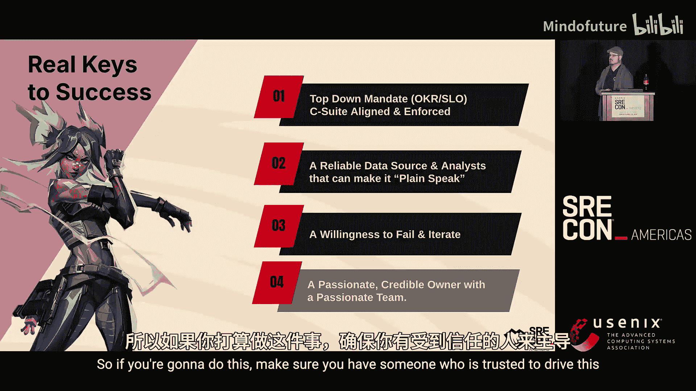

And that's where I'm going to leave you。

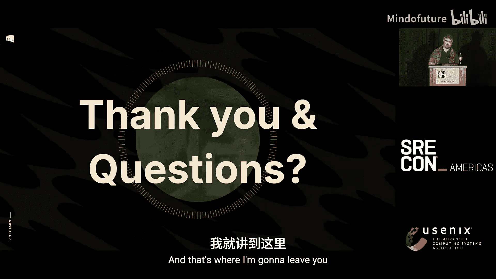

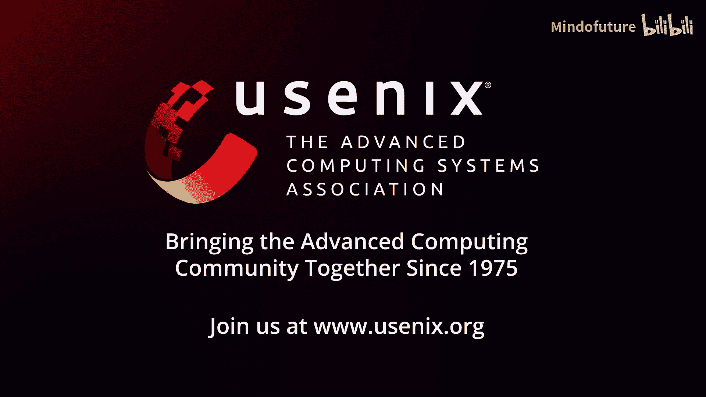