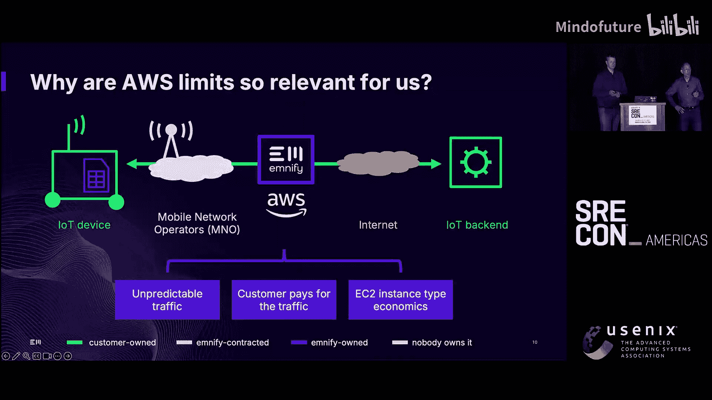
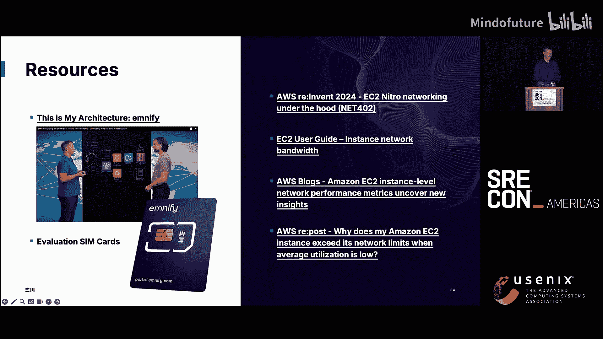

# SRE大会-2025-美洲-｜-srecon-｜-分布式-｜-缓存-｜-OpenTelemetry-｜-安全-｜-AIOps-p27-P27-Please-Give-Me-Back-My-Network-Cables!-On-Networking-Limits-in-AWS--BV1TmLDz7EZZ_p27-

。

He Stepan， what are we looking at？That's a direct attached copper cable with QSFP 28 connectors。

 help me understand， please see what that means。Now maybe a pretty short 100 gig network cable。

H100 gig。 That's what。 Yeah， actually， that's 148809524 packets per second at the minimum size in both directions。

Cool， and that's what we have in the cloud， right。It depends。

 I would say let's look a bit at Amazon's general purpose M instance family the seventhth generation with their custom graviton processor。

 and at one column gives you for the smaller instance types up to 12 and a half gigs。

 and for the biggest full server size，30 gigabits per second。

If you need more networking throughput as I assume you need， you could use the compute optimize。

 which are in general， a bit more higher limits， but especially the network enhanced one with the letter N in the end。

 they give you way more and even like 200 GB per second on an instant。

 So you get two of those beautiful cables。😊，Just for your orientation。

 100 gig you get for around 1500 bucks per month， whereas the 15 gigabit instance of the general purpose is around 000 packs per month。

Okay， this 15 is more interesting for wes for these up to。 Let us talk about that later。 Yeah， okay。

So do we get these 15s， Really， You mean， if you really get 15 GB when there's a 15 GB in the spec。

 Okay， let let me explain。 So A W S limits the network bandwidth based on。

 the gig per second in this case，15。 And no matter how big your packets are。

 the default M T U is 9100 B with those jumbo frames。 Yes。

 you will be always kept at15 GB in this example。😊，But there's actually a second limit。

 which is the packet per second rate， and this rate is not documented but calculated to be just enough that with 1500 byte packets。

 you can get those 15 gigabits。 so for this instance， as an example it's 1。

25 million packets per second。Logical consequence， as you see in the diagram。

 if your packets are smaller， your throughput in in gigabbit per second is lower like 500 byte packets。

 You just get5 gigab instead of 15 and so。Where are we actually on this picture。

 right remember we do have smaller packets thatfi right， Yeah with our IoT use case。

 we have a rather small average packet size of 150 to 200 by。 and then well。

 we might get only  one1th of the specified throughput actually and actually as we're running network functions。

 So meaning every packet enters an instance。 and we forward it again， we have to touch it twice。

 So usually we would have like two network interface cards and good old setup ups。 but yeah。

 in AWS effectively we can think of we get only 750 mebit through such a 50 gigabbit instance bidirectional。

😊，Have you already explained this to finance？ Luckily， I didn't have to explain this yet。Alright。

 So let me tell you already upfront that we do like AW S。

 We use a bunch of managed services at A W S， we leverage from the。

Infrastructure that can be scaled horizontally， as well as vertically。

 But we went through quite some challenges during the last years that helped us understand also of our limits hit us。

 why they hit us and how to overcome them。 Therefore， we are here today to。

Give you this knowledge as well and help you take it home。

 And thanks a lot for our colleagues who helped us throughout this journey and then a that for the AW S accounting。

 as well as the network specialists whom we work closely together whenever necessary。😊。

And why are these limits important， So limits are there to protect us from the neighbors。

 but the neighbors are protected from us as well。 So we have to understand where these limits are and when they can potentially hit us。

To give you some context what amnified us and why those limits are important to us。

 Mified provides cellular IoT connectivity for IoT devices so our customers escooters or EV charging stations or whatever they have as their business they are equipped with an amified Sim card and then can get to the internet and so on using our global IoT Sim card。

 those devices can then get online pretty much across the world for lower latency。

 our mobile core network is currently deployed in seven breakout regions across the globe and we offer IoT specific security features because for example。

 an escooter probably shouldn't talk to like。Anything in the Internet， right？

While we have sales team in the US， the engineering teams are based in the EU and remote。

 partially if that's relevant for any one of you。So to explain you a little bit better。

 why those limits are relevant， digging a bit deeper into the architecture。

 so our IOT device is owned by the customer actually I don't even know what I've drawn here。

 it looks like it has wheels， but it doesn't matter to us。

 like that's our customer's responsibility similar to their backend application which receives the sensor data or sends the commands to the device their responsibility。

But somehow of course， internet of things right， there must be the internet somewhere in between to relay all the traffic and how does your device get access to the internet。

 well it's with the help of the MNify SIim card， which is then the key to access hundreds of mobile network operators。

Those network operators are our roaming partners， meaning we have a contract with them。

 and they relay not only the authentication that the Sim card facilitates。

 but also all the data traffic into the Mfi platform。

 which is actually a self-developed and by us operated mobile core network。Well， by the title。

 you might guess where it runs on AW S。Right， so the traffic that goes by our network is unpredictable。

 I scenarios where an IoT devices start to start to reach a backend and that backend becomes unavailable。

 It dies。 And then all of a sudden， tens of thousands。

 hundreds of thousands of these devices in a loop try to reach that destination。

Which for us means a traffic spike in seconds。 Some of our customers had also the great idea to roll out firm for upgrades on all of their devices。

 of course， simultaneously。😊，What， what it means is actually that the。Customer。

 so the customer pays for for this traffic。 We are not supposed to lose it。 Therefore。

 we have to prepare for these spikes， and we have to over provision so that we can。

React or we can handle these traffic spikes， even if they they， they happen within seconds。

 Therefore， they see to economics。Very much are important for us。

 as it's necessary to understand what we get for the money。 Actually， What are the limits of these。

 to instances， What are the potential bottlenecks already hit us。

So in the beginning we focused on this 15 gigabit byy of specification instance and there were still those cheaper ones which we actually mostly used to reduce the blast radius which had an up to 12 and a half gigab so let's look a bit at what up to means fortunately the documentation is pretty clear about this it specifies a baseline bandwidth for the smallest one half a gigabit per second and the burst bandwidth and this。

Bsting capability is based on a creditbased mechanism。 So when the instant starts。

 you have like maximum of credits， whenever you exceed the baseline bandwidth or are bursting。

 the credits are depleting and if you are below the baseline bandwidth you are earning new credits so far so good。

 one caveat， it's a best effort basis So it uses shared resources that might be as well used by other customers running on the same machines so no guarantee that you can burst that high or just because you have credits for a certain amount of time。

How can we monitor whether the AWS network has？Yeah limited our network throughput。 in 2021。

 AWS has introduced a couple of metrics， which are counters that are always increased when the limits are exceeded。

 AWS doesn't like the word limit。 That's why it's called an allowance。 But in fact， it's limiting。

 of course， your network throughput and the dimensions are bandwidth incoming then without out goinging and only one for packet per second。

 I don't know why only one there does matter。 But those。

Give you an indicator when packets have been cud， at least for a moment in the Nitro Hyvissors network card。

And maybe it was dropped。 Maybe not。 That's what the metrics don't tell us。We at least by that。

 get an indication that our packets had to wait for a moment， and then maybe they were sent。

 maybe not。Where do you get this metrics as Amazon customer。

 you would first look into CloudWatch as the default monitor solution that's actually not the case here。

 those metrics are available via the network interface Car driver。

 EA that's the elastic network adapter and using ETH tool。

 those counters can be read meaning if you want them in your central monitoring be that CloudWatch。

 you would have to roll out the CloudWtch agent on your instances and supplier a configuration that it actually reads from the ETH tool La output。

For us as Promeus users using node exporter， it has an ETH tool collector which is however disabled by default。

 so if you want your node exporter to make those metrics available。

 you would have to tune that as well。One comment on your monitoring intervals。

 even if you enable enhanced monitoring for your E2 instances and by that。

 reduce the monitoring interval from five minutes to one minute and you have then one minute granity for your network throughput。

 you might still see occasional that those allowance exceeded metrics are increasing even though your network throughput is still rather low right。

 but of course those bursts which might be just a few seconds are hidden when you have a monitoring interval of one second so don't be too easily confused and a couple of packets are dropped based on the metrics。

 but you think your bandwidth is super low。Speaking of birds。

 we had a very interesting problem actually where we saw the packet bird when we saw packet drops on a C6 I X large instance。

 although the utilization of this instance was very low。

 So there was like 15 Mbits per second bandwidth used。

 but the bandwidth without a low1 succeed counter was increasing every five minutes。

Every five minutes somehow rings the bell。 Don't we have a S3 upload every five minutes， exactly。

 So I dig a bit deeper。 And interestingly， this S3 file upload every five minutes uploads a5 of 9 MBby。

 It's nothing。 So however， taking some captures， I analyze that the upload takes 26 milliseconds。

 A apart from， of course， the tool connecting to AWs and so on。

 If I extrapolate the data to a per second metric。 that's approximately2 do 7 gig per second。😊。

But it's still in the perable rate of the instance， in theory。That's open a AW S ticket。

Welcome to AWS premium support。 My name is Stean， and I'm happy to assist you today In your case。

 I understood that bandwidth without allowance meing is been increasing on an instance。

 which has only 50 Mbit of throughput。 Please correct me if I misunderstood your query。

 That's correct。 It increases every five minutes。😊。

I see that the path between your E2 instance and DS3 service through versus via an internet gateway。

 which limits the packet size to 1500 byte would you consider deploying a VPCN point to make use of chambermbo frames we deploy an endpoint of VPCN point。

 but the error counter increases even faster the upload is faster。Oh。

 then you might be hitting a packet per second limit through a microburst。😊，That cannot happen。

 The packet per second。 error counter is at 0。 Oh， indeed。

 I can confirm this why am I internal tooling。 Would you mind doubling the instant size。 No。

 thats that doesn't make sense for these use kids。 I was glad to assist you today。 Thank you。😊。

So what did we learn from this that limits are implemented at a much much more grainer way level than per second。

 actually they are much closer to microseconds， potentially that depend without a low one exceeded counter doesn't necessarily mean dropped packets。

 it means that packets get N cued because they cannot be transmitted immediately they stay in the queue or get dropped or get transmitted as Stephanie's spray you need to monitor your application behavior。

 you need to make sure that your application is reient against packet loss and understand whether it impacts your application and not fully rely on the AWS metric。

😊，And bandwidthvi is a shared resource。 That's not a surprise。 It's in the AWS documentation。

 even if credit is there， there is no guaranteeing that it can be used。

I would suggest we add some more network interface to this instance。 Yeah， a nice try。

No matter how many network interfaces you have with your E Z2 instance， the limit is， of course。

 for the whole instance， and thus adding more interfaces does not help。As we heard。

 scaling up the instance type would help because you get there usually more bandwidth。

 not linearly by the CPUs， but you get more。As also in the introduction said。

 you could use network enhanced ones， which give you quite a lot of more network throughput at also a slightly higher price。

However， you can also use a newer instance generation， so from the sixth to the seventh generation。

 there is a 20 to 25% increase in networks report at pretty much the same price。

 so if you are on especially the sixth generation， consider upgrading the type at ni no cost。

With the very latest age generation of E to instance days， one new option。

 which is called easy to instance bandwidth waitinging。

 where you can reconfigure or reassign 25% of your networking throughput or storage throughput to EBS to give more capacity to one of course the cost of the other。

 So if you have network intense workloads but not disk IO In。

 you could shift that towards networking and if this talk is not so relevant to you because you have storage intense workloads。

 you could well shift the capacity towards the IO throughput or storage。As we heard。

 jumbo frames on AWS can make a difference in channel， it's good to make use of them。

 Transit gateateway supports that Direct Connect also supports it so if they' are not enabled for whatever reason if you have smaller MTs。

 think it through if that might really help。Then the what's say。

 confusion about those counters increasing that we saw through microbursts。

 you can avoid microburst by essentially smoothing a smoothing the traffic for us the simple option is to reconfigure the AWS ELI。

 which has a parameter to restrict how much bandwidth transfer take。

 which is for us to define at least when it continues until like five minutes later when the next file is supposed to be uploaded for our own application there a socket option。

 you could use TC， you could increase the T string size using ETH2 a couple of options to well smoothen those spikes。

So another interesting challenge we faced was with the packet per second element1 exit encounter increasing on an instance which was still below the。

Support it packets per second， actually way below。 So I opened another AW S ticket。 of course。

 Welcome to AW S premium support。 My name is Stefan， and I'm happy to assist you today。 In your case。

 I understand that you observed the packet per second allowance succeeded counter to increase on an instance that is order of magnitudes away from its rootput limit。

 Please correct me if I misunderstood your query。 You understood it correctly。😊。

Do you maybe have fragmented packets？Yes， I do， actually， how much can I transmit？Unfortunately。

 I can' tell you。The limit is not public。Thanks。Give me a second。 Is it 1000 per second。 Yes。

 I can confirm this is correct。 And I can also share with you that also with bigger instances。

 you would not get more， except if you buy the whole server and you get way， way more。😊，That's nice。

 Okay， thanks a that。So why do we have fragmented packets， Imagine the I O T device of the left side。

 the backend on the right side。 And this backend sends some UDP packet to the I O T device。

 It's all good。 It's 1500 B big， but we use。😊，Tunnelling in the tag over。

 tunnelling between the home network packet gateway to the visited network Sering gateway。

 We need to ensulate these packets， and they get fragmented， of course。

Let's understand what happens in AWS with the fragmented packets。

 So they cannot benefit from the hardware acceleration of the nitro card。 They are processed in CPU。

 and it's in the documentation of AWS as well that they are considered to be exception。However。

 what is not documented is that it differs also in the egress or from the egress to the ingress direction in the ingress。

 the Nitro standard data applies， which is still the slowus。

 but at least it increases with the instance size。 So so with going to very big instances。

 you could get at least some hundreds of thousands of packets per second。 However。

 in the ingress in the egress direction。 sorry， it's kept at thousand24 packets per second。Beachees。

Mimum number that does not scale with D with the instance。

 You could ask whether it's the same limit as the link local queries。

 Li local queries like DNAN Sque， for example， instance， metadata query， but it's a different bucket。

 So they， they don't count against each other。How can we monitor for fragmented packets。

 First of all， if you have a similar problem as we ran into that the packets per second early one exceeded counter keeps increasing at a small rate。

However， you see that your utilization is very below the other ones。 you can suspect this。

You can use， TP Dm to match the IP header for the fragmented packets or ask AWS support。

 actually they apparently have some other metrics that we don't have visibility into。

But what we can do with the fragmented packet。 So， first of all， let's avoid them。

 They they are not supposed to be in your network。 Don't fragment them。It's easier to say than to。

 unfortunately， if you have any similar use case that we have， like VPN。

 encosulation tunneling protocols， then， of course， the packet size increasing。

 they might get fragmented。 So make sure that the M U is correctly set on the tunneling interface so that the fragmentation happens on the in packet and not on the outer packet header。

 meaningan actually we hide the fragmentation from AW US。

Make sure also that your instance is sending back an ICMP error or fragmentation needed whenever the packet should be fragmented。

 but it cannot， and that assists the sender with implementing or applying the right Pass MT toU。

You can also configure TCP MSS claming so that the TCP segment side gets slower and the IP packet fits into the maximum below size。

We can increase the throughput of the packets of the fragmented packets as well by actually moving the fragmentation to the transit gateway。

 So in case you utilize or you have a connectivity via the transit gateway。

 you can avoid the fragmentation on the instance on the E2 instance by configuring jammbo frames and let the transit gateway do the fragmentation for you。

😊，There is also a brand new feature from the ANI driver from last week actually enable fragment bypass。

 which lifts up this 1024 packets per second limit and leaves the Nitro CPU do the fragmentation when that means the standard rate applies from that moment。

 be aware that this Nitro CPU is used for other features as well so you compete with other features like security group setting up。

 for example， new connections。In the second part of the talk。

 we want to share our experience with a closely related yet slightly different topic。

 which is contract。What does it do it keeps track of the state of connections easily illustrated with a firewall where you have an eous flow and you of course want returning packets of the returning flow also to find a way into your network even though there's no firewall rule allowing it and for this the firewall needs to maintain some table tracking the state of all the connections。

 including their TCP。State。In Linux， you mostly interact them with IEP tables。

 although probably one of my first experiences with Linux， I think I failed。

 never worked this firewall， but that's how many are maybe used to this connection tracking。

 well what's the great distributed firewall that we have on AWS。

 it's security groups and you might remember security groups are stateful。

 why Nlas are stateless and is the state which makes them stateful？By the title of the talk。

 you might guess there are limits for how big this table can be。And unfortunately。

 there is no documentation。And on specification， although when you ask support。

 there is no official number。So what's the effect of when this table is full and you want to have a new connection to your instance。

 it might fail until there is space in the table when the next connection comes in。

 you might also see DNS fails because like Egress flows for UDP data might then not work and whatever then DNS always if you then want to lock into that instance it somehow shows weird behavior is。

 you might not be able to lock into using SSM systems manager or if you use still SSH because all those connections might fail depending on how big the pressure on that table is。

So where are we experiencing this， we have not only one of those packet gateways as we saw before。

 but we have of course multiple of those instances and that our customers can directly connect to their IoT devices without any nu in between or that the IoT backend can actually connect into the IoT device。

 if that's necessary， we offer different VPN services， OpenVPN， IPS or AWS Transit gateway。

 which we treat it like。VPN for the customers who are on AWS。

And you might have heard about like security and malware and Iot。

 I'm sure our customers don't have that problem。 and the good enterprise customers also ensure that they don't get this problem by running Po scans across there。

 of course， large fleet of Io T devices and they need to run it at a quite high pace and that exposed so many connections to the VPC where we were routing those flows between our VPN services and our packet gateways。

How can we monitor for this at the same time when the other counters have been increased。

 AWS added contract allowance exceeded counter and what's newish here。

 generate 2023 is an allowance available metric。 So for bandwidth et。

 There' is nothing but here you can query like how much space is left in this table。 That's cool。

 can we use this counter actually to finally figure out how much is available exactly。

 let's conduct a small story when the limit is not documented。

 but we have a counter here for the C 5 instance or the C5 n instance we see that with double the size。

 it exactly doubles And of course， that continues further to the 500 x large something as well。😊，嗯。

The sixth generation we saw also an increase of 12% compared to the fifth generation。

 which is then quite nice， but what we saw here is that like this extra money that we poured in for the network enhanced instance。

 this gives us not a single connection more。AW S seems to have realized this in the seventh generation。

 where the regular instance stayed the same， But the network enhancement one got 33% more capacity。

 So that's not like the throughput， which was like three times more。

About10 times more lot at least we have more connection for more money at school。

 the very latest instance type C8， same limit and the network enhanced one is not available。

So we have no monitoring metrics。 And， of course， we had， again。

 some challenges with those things where we were looking at it。 But first， we would have。

To access it。 And because it comes via a network interface card driver and not via a Cloudwach。

The driver version needs to be young enough to support this feature and the current LTS release of a Bontu 2404 even so it came 15 months after the E driver version does today not include this driver version。

 meaning you don't get it on a Btu LTS。We have， in the meantime。

 or a longer while then compiled the driver ourselves， which is by the way。

 also the official recommendation in the very first paragraph of the FAQ of the ENI。

 that's what the driver de Lulopa say， but what could go wrong if you just develop your network car driver and in fact。

 a couple of months back there was an issue with XTP which only then happened under high load。

So be careful， but if you want those monitoring metrics and you are a bountu or any other older version you would need to take care of that yourself。

The counters exceeded versus available and have to interpret be interpret it a little bit different。

 The exceeded counter increases when on this specific interface， a connection was rejected。

 So if you want to know how many connections were rejected on that instance。

 you would take the sum of them， whereas the available counter that gives you on all interfaces。

 the exact same remaining capacity and you should not multiply that by the two or by the three interfaces that you have on that instance or pick one interface or take the average of it。

Are you sure that it's any interface that you can pick。

 I remember we had some challenges with this as well。 Indeed。

 we we were staring quite a while at graph like this。

 which in green shows the first interface and in yellow shows the second interface。

 And the time span is around four days。 And we saw that the second interface was sometimes updated for not within 12 hours。

 so。😊，We were trying to make sense of it， I it now a monitoring issue or is the implementation really different between the primary and the secondary interface。

 we then in the end filed this as a bug report and it has been in the meantime fix in the meantime you get the same counters on all of those interfaces。

 but well yeah， we've got no monitoring metrics and then we end it took us a while to understand and make sense of it。

Then if you know it's about connections， you can get an overview of what connections are routed through your VPC through Flocks。

 I stop ranting about how complicated it is to enable Flocks for the benefit of finishing within time。

What can we do against connection tracking， It's a future。Which we can luckily disable。 That's easy。

 right， So by the security groups having an incoming rule。

 which allows from all I to traffic to your port 80 and having an egress rule。

 which allows traffic to all I addresses。 That's important must be all I addresses。

 then you can disable connection tracking and can have as many connections as you wish。😊。

For network functions， and you can imagine also not instance that you might run because through the use of the local ephemeral ports。

 you would have to allow like all incoming， all outgoing for all ports， all Is。

Don't we sacrifice on security then。 Well， I mean， be careful with that。 And in general。

 we should see security groups as a second layer of defense。 but yeah。

 be careful that you're not exposing your services to your VPC or even into the public Internet。

 it was a fun conversation with our auditor when they requested a prowler report。

 And were waiting like because we use DDK the interfaces are completely taken away from the Linux kernel and there was no risk with it。

 but yeah， be careful with that。😊，So I remember we also had。Other challenges。

 And there is this footnot。 Are you sure it's enough to disable。 Yeah。

 the footnot has just except automatically tracked。 So let's look at a documentation。

 The first sentence pretty much was I just thank you in like 10 sentences。

And then unless it is part of an automatically track connection and。It's again。

 a list of things where you just cannot disable it。

 It's similar to like A W S doesn't call things a limit。 This is the list of things where the。

This thing above， does not apply。So you can't disable connection tracking when the flow goes via a nu gateway or an egress only internet gateway and so on。

And where is the transit gateway。We。Had the problem with that， I remember。Yeah。

 we were indeed two weeks ago when we took that screenshot。

 quite puzzled if our memories are wrong or if the documentation has been edited and what do we do in this case。

 we go back in history to May last year。😊，And indeed， there was still the transit gateway attachment。

 and it was not only removed from the documentation。

 but also AWS has confirmed that transit gateway as well as gateway load balances are no longer subject to automatically tracking those connections。

 meaning you can disable connection tracking。So I mean it's super cool that AWS works on improving those things。

 there was no news article about this being available in  300 different regions Yeah so we just made aware that the reason for not having incidents in the past month was maybe this optimization。

And while I was going back， I was wondering if we were really that dumb back then and we overlooked this。

But in 2022， I believe it was， the documentation looked like this。 The beginning was the same。

 so you can disable connection tracking。And then further down comes the next chapter。

 which I would say which is called throling， which I think I never read， and then comes this list。

So the database documentation over the years。😊，Became a lot， lot better。 So definitely。

 And it's worth reading it probably every year， once again。

If you can't or don't want to disable connection tracking and you have to live with it。

 then you can scale up inside we saw the table， you can lower the idle time as at least which wouldn't help for our our partss can issue but the default is five days so if you want that connections where the client to went away in the meantime。

 reclaim within like an hour or five hours of idle time。

 you can just lower that on the network interface。And last but not least。

 you could lower the cardinality of the flows， which for us was actually the thing we were anyways working on。

 And we have tunnels on the left side。 We have tunnels on the right side。

 What do we do we do tunnels in the middle as well。

 So gene encapsulation was what we were working through our re architectureit and by that。

 we have control over the cardinality that basically the I AWS network sees。Right。

 so what did we learn from this journey that the crowd has limits。 The crowd has limits for a good。

 actually， is protecting us from the neighbors， but。They are protected from us as well。

 We need to understand where these limits apply， What are those limits and where they can potentially hit us。

 The AWS documentation got much better。 AWS。Also enhance its services secretly， which we appreciate。

 but we have to make sure that we read those documents much more often， it seems。

 Mon capabilities are also happening us they are very， very good。

 but we also sometimes spend an immense amount of amount of time trying to understand and are going down the rabbit hole of trying to fight for single packets。

 which we learn we cannot rescue every single packet。 Sometimes it's still a mystery。 Unfortunately。

 what's happening， So it's a good。 We keep learning。 and we have this journey from AWS。

 if anybody from the audience has a similar journey from other cloud providers。

 we are happy to learn。 Please approach us。😊，And finally， a few resources we have。

This is my architecture video where within seven minutes。

 the younger myself explains the architecture of actually this core architecture that we were talking about today in case you want to try out our platform。

 we have Sim cardss with us that we give you and a couple of AWs resources。

 most foremost the very first one easy to Nitro networking under the hood 400 level talk which goes really deep by John and the copeak and we are very thankful for John taking the time for the call last week to answer a couple of questions and review a bit the statements that we make here on stage and by that lowering the risk that we tell you just things which are plainly wrong。

 it's our words but so treat with care， but we are very thankful for that and with that thanks for your attention and we are happy to take your question。

