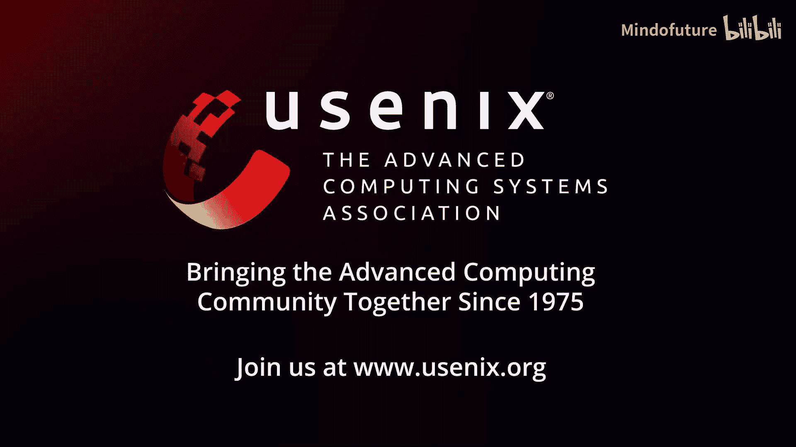

# SRE大会-2025-美洲-｜-srecon-｜-分布式-｜-缓存-｜-OpenTelemetry-｜-安全-｜-AIOps-p28-P28-OpenTelemetry-Semantic-Conventions-and-How-to-Avoid-Broken-Observability--BV1TmLDz7EZZ_p28-

。

嗯。Anyway， we went。So my name is Keil， I'm a staff engineer at TI。

 and I am also partner of Multi project inside the Open Ter3 project。So the first one is Oute Weaver。

That's a tool that we we will extensively present during this presentation。

And the civil Project is Ooteo， it's。An experimental protocol to optimize the transport and data processing of tele streams。

Hello everyone， Im Dinesh， Im a staff engineer at Datadog。

 I am also the founding member of Open Teletry team at Datadog。😊。

Our team works with both hotel community and internal teams at Datadog to ensure that customers using open telemetry have an excellent product experience。

😊，And the issue we are going to present， which is represented by the diagram here is what happened with our customers in production where they had a broken observability and well go into this incident much more detail。

The incident actually motivated us to solve the problem in a generic fashion。

 And the solution we are going to present is what we are building within the community。

It's a huge nation。So let me spend a little bit of time on this first diagram。So we are。

 I think all using CICD pipelines to deploy automatically and in a controlled way。

 new version of applications。So we， we， we have some ways to make sure to reduce the risk of deploying something that will break。

Right away。But what is usually missing is a set of control to make sure that your observability backend。

 your observivity stack is not。Will not break indirectly or will because maybe sometimes you have a renaming for a metric。

 you have a new set of attributes or some reds that disappear from specific metric。

 and the existing dashboard on the existing alerts or queries will no longer work as expected or will no longer work at all。

So the goal of this presentation is to try to fix that with a set of toollings and convention that we define inside the open Telemetry project。

So let's start with for people that are not untirely familiar with open telemetry。

 let's start with a quick introduction to this project， so it's the second CNCF project。

 it's a vendor neutral open source observability framework and there are multiple component inside this framework。

 so we have instrumentation systems also named client SDKs in multiple languages。

And we have a component name open Telemetry Corctoral， and this let's say telemetry gateway。

Is basically a solution to connect。A complex system that are observed with a set of observability backend that you can run for your infrastructure。

So something very common， you have multiple microservices and possibly with different type of instrumentation。

If you are lucky， you have only open telemetry， or if you have some kind of legacy， microservice。

 maybe they are using some other solution。So the the first benefits of the corrector is to do some adaptation。

 adaptation in terms of themaale and protocol。And the collector then will be able to send this unified representation of telemetry signals to value type of observability that。

So the the first benefits of open telemetry is to make sure that you。A that。

 you collect everything from an issue source， you can unify the telemetry that Im made and do some data processing on top of it。

 and you route that to the proper telemetry backend。

So we also have a second important project named Semantic conventions。

 And the purpose of this project is to define。Comman。Common set of attributes and signals by signal。

 I mean， metrics， events， logs and traces。And the goal of this second project se convention is to simplify operation to make sure that。

Across the values service， the values team that are responsible to implement and design those services。

We are making sure that people are using the same seman convention， the same name for。

 the same name for an attribute in order to avoid a lot of complexities。

On the backhand side for the Ss or anyone that want to use the the telemetry information。

 It's very common to see someone in some specific team， ma metric， let's say H TP underscore。

I don't know。HTTP request time。With Zosco another one with H T TP dot request dot time。

 That's for TV command。 So how to solve this kind of volume。

 That's the purpose of a set of tool and and technology that we are implementing inside the open telemetry project。

So the first element for that is what we name the Hotel Simonementti Convention Ogitry。

 Ogitry mean it's a catalog。 and in fact， it's an open catalog that is maintained by。

Multiple special interest group。 So we have9 of them， and they are defining。Tmetry definitions。

 and the goal here is to ensure consistency and interoper ability across observability To。

 so making sure that we provide we see on the right the definition of a metric。

And so there is a name， there is a description， there is a unit， there is a set of attributes。

 and it's also coming in with the specification of the instrument。

 what kind of metric are we reporting？So this catalog。

 this open catalog is a collection of those definitions for metrics， for events for spa。

 and the goal area is to let people the values series and the values team implementing them to adopt those 70 convention in order to reduce the risk of having some deviationrgs in the naming of those signals。

So it's not coming without challenges， so we have like you see， we have nine special Inter group。

 they are all working independently and they are currently producing something like 900 attributes and signal that are organized in 74 domain and that's。

Increasing in terms of size every day。So， the。So the goal is how can we help those teams to maintain that in an automated way。

 in a secure way， and we will see also that the values automation and tool that we will put in place there to solve this specific problem could also be used。

By any enterprise， any vendor to create their own custom semantic convention catalog。

And they can use the same kind of tooling to ensure the same guarantees。

So what we experience and probably what you also experience in production on your side。

 that's a typical set of issues。 You are deploying a new version of a software。

 and it's working well， but the instrumentation was in fact not exactly as expected and you break some array and dashboard。

 it's not necessarily super easy utilities。Right away， another set of issues that we。

I mentioned that before we have teams using slightly different version of the name to operate on the same concept。

 the same matrix， the same match attribute。How to make sure that people are converging in the same direction。

We talk also about the lack of documentation or documentation that was not necessarily super accurate。

 how can we make sure that we increase the quality of the telemetry catalog produced by this group of people or in your enterprise uppri。

 how can you make sure that the custom matrix custom balance so on our properly documented。

 so we need some kind of control to make that happening？And finally。

 it's not uncommon to spend a lot of time。In production， because。

Some metrics or some attributes are missing or incomplete or not exactly working as expected。Again。

 how can we make sure that we fix that？So the tooling that we are creating is basically something that is first able to detect any breaking changes in the。

You a get。We also controlled upgrade and Dogr and Dnesh will talk about a new type of processor that could be deployed inside ancoror to ensure that you are able to downgrade the version of your signal if you have the time to basically upgrade your backend。

We we are also able to identify deviation from Naming convention so we can basically make sure that okay。

 every underscore are unauthorized。 So these kind of policies are configurable and supported by this open telemetry riverer project。

We also make sure that all the required field are properly defined and we also are able to generate documentation in a Mac format。

 and we can extend the system to create documentation in values of the format also。

And it's a new feature that is not yet fully available。

 but we what we want to achieve with this weaver project。

 we really want to do the same kind of control that already exists in。St development lifescycler。

 so where you have unit test and you have coverage mechanism to basically test the values element of your system and having the instrument that you have you already cover on。

 let's say 80% of your code。 it's a good indication that you have enough test to get trust on your system on the corresponding deployment。

 So we want to get the same kind of testing and and coverage for instrumentation。

 So weer can be also used not only has a tool to to check and generate code and and documentation from specification。

 but it also can be used directly in your C CD pipeline。As an O TLP listener。

 so an open telemetry listener， and all your tests。

 unit tests or integration tests can send the telemetry to this system and this system will check the compliance。

Of every signal received with a registry that you specified。 And then at the end， you get， okay。

 there is a gap or we didnt cover 70 or 80%， depending on the threshold you want to achieve。

 So that's the the type of。New capability that we want to support。So this tool is named Weaver。

 it's a CLI tool also available as a Docker image。And it is supering multiple。Command。

So we have a a resolve command。 It's basically generating an aggregated version of this discreteed set of Yaml files。

There is a weaver check command that I will detail just after this slide。That's。

Is used to apply if that， to make sure that you follow the best practices。

We have a generate command to generate Mag document， but also。

The values claimed SD D K currently supported by open telemetry。

 So the at least the part that is related to cementti conventions。 So all the。

The language construct that will represent an attribute or represent a metric or an event will be generated with these two and it's already in place in the open Terory portal。

And recently， we added an option to compute differences between values version of the same ortry。

 and that's what we will use with the schema process of that DH wheel will present。Okay。

 so it's a very quick presentation of the default hotel policies are currently supported。

 I don't want to spend too much time there， but we for example。

 which we make sure that we never remove elements， we make sure that we never。

 if you have something that is stable， it will not go back in the experimental development mode。

 this kind of stuff。We also obviously check the naming conventions。

 is it following the pattern that we expect， this kind of thing。

So now a little bit more a deeper description of what Weaver is able to achieve。Like。

 like I mentioned， Weaver is coming with multiple comment。 So this one is a description。

 an overview of the weaver Roger Sw check and。In fact， wer is an extensible tool。

 you can extend wer by adding new template， adding new policies very easily withoutcompiling the Ontario system。

 so how that works。Let's say that you want to check that your registry is following some best practices。

 You will provide the registry as an input parameter and and。

This registry will follow value steps so on the top of this diagramgon we will apply what we then before resolution policies and then we will reserve the registry reserve the registry mean that we basically all the references all the extension mechanism are reserved and at at the end of this process we end up with a single massive registry where everything is properly。

Kown without references and without having to understand how things are overridden。

Then we have a second stage of policies， the after resolution policies。

 and for each of those stages you can provide your own policies and we will see how it's feasible easily。

And in the case where you are providing two registry。

An already released version of the registry and a new version that you want to use for your system。

 we have a third stage of pre。That is there to compare and make sure that we follow the compatibility rules that we want to apply to make sure that we don't break anything。

The output of this command is if there are a list of violations that will be displayed directly into your CICD pipeline and that you can use to understand what to fix the registry。

So this is an example of policy。 Obviously， we provide a lot of default policies。

 So if you don't want to go into this。Lbell of customization。 it's not a big deal。

But so basically what we did is reusing， I think， a relatively well known policy language namedrego。

 but has been introduced by the Open policy agent， a well known product used in massive inubities。

So we basically provide a way to extend we with this kind of regular policies。

So the next command is weaver re we generate， and so the next parameter to the generate command is basically the name of a set of templates。

So we have some default templates。 one is name MarkDon and some other are them with the corresponding client for the language for a specific client SDK。

 So if you want to generate a client SDK in Java C sharp worst patterny。

 you just add behind the generate the name of the language and and you get the the client SDK generated。

 So so the way that it's working， we have a collection of templates， it's based on G。And。

And this collection of templates are named。 So one of these collection is Mag done and another one will be like I said。

 different name for for different languages。 You can use this system to generate other things。

 if you want to generate an HML or I don't know whatever type of artifact that you want to derive from a registry。

 it's entirely already feasible， you can also integrate this kind of system into your own enterprise catalog if you if you are already using one of them。

That's on To。So the the last type of command that I want to describe today。

 and we have some of our command， but that's the most important one。

 The The last one is what we named the Weaver Reggistry diif。And， and this command is， again。

 taking two。Reggitry。Of this we。2 version of the same magtry。 And， and we have an automated way to。

 to compare them and computeative。And this de， that's the kind of artifactefact that could be used by something like achema processor to do this upgrade or downgrade transformation that we want to apply in order to avoid。

To， to maintain a specific version， for example， in the back， to ensure that we don't break anything。

 And DH will talk more about that。 But that could be used also for if you want to create a migration guide。

 So you are， let's say you are a vendor。 You have。So for myself。

 at the five we do a load balance of I awards and other things like that security oriented product。

 so we can use this kind of tools to generate a telemetry catalyst corresponding to a specific product and when we have a new issue of this product we can generate a migration guide。

That could be automatically generated by this kind of command。

 so there is no longer option or possibility of human mistake because you forget something it's fully automated。

Thanks， Roen。Now that we have seen how semantic conventions evolve。 Let's talk about the collector。

 the core component of open teletry。 Open teletry collector is a vendor neutral agent that allows us to。

Coect， transform and process all kinds of telemetry signals。 It works for data pipelines。

 It has receivers processors and exporters that you can use to build a pipeline。Let me pause here。

 I want to see how many folks are running hotel collector in production。 Raise your hands， wow。

Like 30%。 Okay， that's。Okay， let's look at a simple adult collector pipeline here。

 right Like we have three services which are producing traces。 We have one pipeline。

 which is using sense traces to the observability backend。

 it samples the traces and send them the other pipeline is using span metrics connect to compute red metrics and it is sending to the back end as well。

 We use this setup so that we can compute red metrics on unsampled data。

 You want to know the request per second without sampling in place。😊，This all looks in this example。

 we are using span metrics connector and computing red metrics over four dimensions。

 which is H dot methods， status code， deployment environment and service name。

 which is pretty typical red metrics dimensions we want。😊。

This all looks good and great and it works nicely。 Can anyone tell me what was assumption we made when we defined this pipeline。

😊，没有。Okay， I think this， unknowingly， we have defined the pipeline by using the attribute name。

 We are tied to the semantic conventions， because the semantic conventions， as we have seen。

 can evolve that can happen a different way。 So this is true for any processor。

 Anytime you use some processor and an attribute name in the collector， you are defining。😊。

That pipeline to a specific semantic version， that is something people don't assume。

 but that's the nature of the pipeline。呃。So in here。

 we have let's look at this scenario right here we have a team which is maintaining service B。

 has decided to upgrade their hotel S D K version。 In this case。

 they went from when they updatedated the hotel S D K version。

 they implicitly updated their semantic conventions as well。 So in this case。

 they are producing new telemetry with the semantic conventions of 1。27 and。😊。

What happened in between those two versions was the environment name。

 deployment dot environment I got renamed to deployment or environment dot name。 So the change was。

As a result of this change， the red metrics are no longer computed over environment dimension。

 This is what happened with our customers。 So one of the teams updated and implicitly unknowingly。

 they broke their dashboards。 They broke their alerts and they were flying blind in production。

 It took us a lot of time to track down the issue that okay。

 the issue was because of the semantic conventions。What we describe here。

 is not an isolated in Switzerland。 It's not like， oh。

 it doesn't change often what the issue repeated itself when history D P semantics got stabilized。

 in which case what happened was H D B do method got renamed history without request method and also broke the customer environment。

 They are no longer seeing red metrics for those。As an Sari who is managing hotel collector pipeline。

 we want to avoid these kind of scenarios。 We cannot control which teams update their software and which team is going to produce a new semantic conventions and break all the dashboards and alerts。

 And that's thing we want to solve for。And this is a problem we are proposing to solve by using a schema processor。

Schema processor transforms the incoming telemetry data into the target schema versions。

 And in this case， we are using target schema version as 1。26。And。

This enables us to define the pipeline configuration， which is specific to the target version。

By using the schema process， the first processor in the collector pipeline。

 we can convert the incoming signal to match the target versions。😊。

The schema processy is able to do these transformations because of two things。 First。

 the incoming OTLP payload defines the semantic version of the payload using an optional field called schema underscore URL。

 So the incoming payload has a schema URL which tells the schema version whats the incoming semantic conventions and the second it uses a schema a telemeter schema transformations。

 these is what is produced is it。😊，Output of we were de command。 So we were is able to tell okay。

 there is a difference between these two semantic conventions。 And this is the transformation。

 And that goes as an input to the schema processor。 And based on these。

 the schema processor does either an up transformation or down transformation because you can have in this case。

 it is doing a down， but there can be a scenario where you need to do an up transformation as well。

 So that。😊，By transforming the data at the very start of the pipeline。

 we are able to protect all the telemetry that is crossing beyond the schema processor。😊。

And this means the individual services and the collector setup and the telemeary setup are now decoupled。

 the the tight coupling， which was previously present， is no longer present。

And now if you run through the example right like the semantic conventions of 1。27 of servicep。

 which was producing deployment dot environment dot name， gets rempped。

 the schema processor will rename the attribute to deployment dot environment and that will not break red metrics anymore because span metrics connector is able to still use the same name。

This solution all looks good and great。 but it always comes with limitations。

The schema processoror is active is an active development。

 I'm happy to announce that it is going to be part of collector Con in the next release。

 I think which happens next week， so that's great。 It took a lot of effort for us to get it there。😊。

The second bigger issue is the schema URL is an optional fill in the whole payload right which makes the SDK doesn't enforce that it is set so it is sometimes left to the user to ensure that they set the schema URL。

If the schema URL is not present in the payload， schema processor doesn't know whether it needs to do an app transformation or down。

 So it just ignores the payload and sends it down for processinging， which is not what we want。

 So there is still some thing we want to avoid。And if the changes are not a objectiveive。

 like the schema browser cannot programmatically do anything。

 like if there is a merging of metric names or splitting of a metrics。

 those are the things we are unable to handle programmatical and we are still。

Working through those things。 currently， we are using schema file format 1 dot。

 which is doesn't help us handle complex transformations。

And unfortunately we are still updated manually like this file was defined in the very early stages of open teleementtry and we still are updating manually with no checks in place。

 so there is some error pros in there so we want to automate that as well。With that。

 let me see what we are working within the community as the next things。

There are lots of things in our pipeline and this is a whole bunch of lists the first thing I want to talk about is is we want to extend weward to support multiregistry。

 which we believe is going to be the most common use case。Wes， observability vendors like us。

 their dog want to define their own semantic conventions。

 and every open teletry has their own semantic convention。

 So we want the we were tool to be able to work with registries。And obviously。

 the other thing is we are working towards a new schema file format。 We want it to be shelves。

Contained registry， which allows us to do up and down transformation。

There is a lot of debate we are having in the community on this topic， what's the format。

 how what kind of transformations we want to handle and how and what language do you want to define the transformations。

 I think thats a lot of interesting things happening in there。Like I said。

 the schema process is just released， so it's still in an alpha state。

 we want to stabilize the schema process， make sure it's production ready and we can recommend everyone to use and define it in the collector pipelines。

 I think that is still exciting work there。😊，The scenario we have seen I think one of the interesting questions we need to ask ourselves how can we avoid and catch that scenario of deviation of semantic conventions during the development phase。

 This is where we believe we were live check is going to help。 So what。

What we want is we write tests for code， but do we write tests for like the telemetry produced by the applications。

 I think that is an answer most likely no because we assume the telemetry is always present。😊。

So this is something we want to encourage everyone to think about schema first approach where people write tests for the telemetry as well like you define what kind of a telemetry your application is producing and then use weer to do like a test and compliance test against that so you can write a unit test feed the unit test into the weer and weer is going to produce whether the output of the test is compliant with a registry。

 is it missing something or anything else。😊，One thing I skipped over which was type safe client SDK we want to we are thinking in the same terms as like proto where we want to get the attributes and everything clk。

Type save is D so that people know what type each attribute is right now， it's any string。

 and there is no attribute。 So it's people do not know whether duration is like milliseconds or seconds or is it a string or is it a number like it's something missing。

 And we want to avoid those kind of scenarios And not and not leave it to guesswork。Like I said。

 I want encourage everyone to be part of this journey。 We are in a very early stages of this journey。

 the community。 we are working through a lot of these discussions and issues。

And I have linked the two slacklack channels which are most where we are currently actively and all the Github reports allow if you can come up and do some testing of our tools。

 give us feedback in terms of bugs or feature requests， what how can we help to reduce your own。

Daily。Work life。With that， I will conclude and thanks for your attention， Let any questions。

