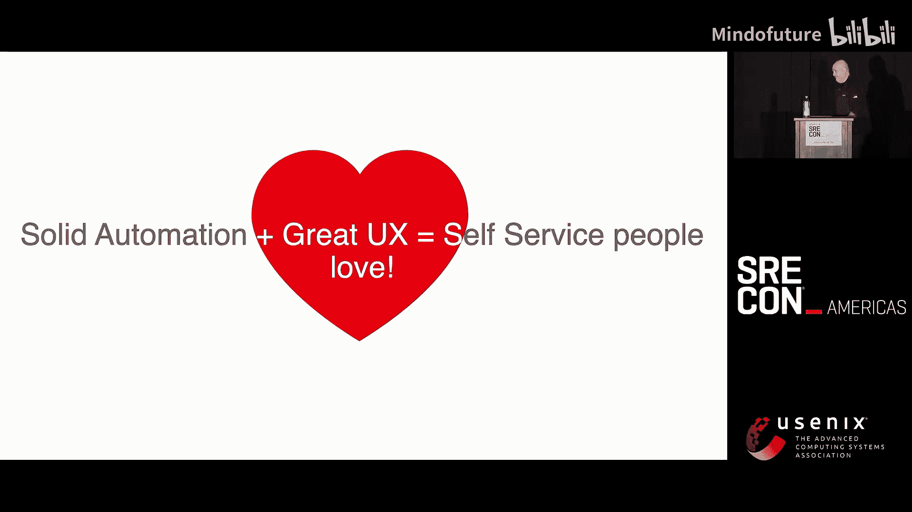
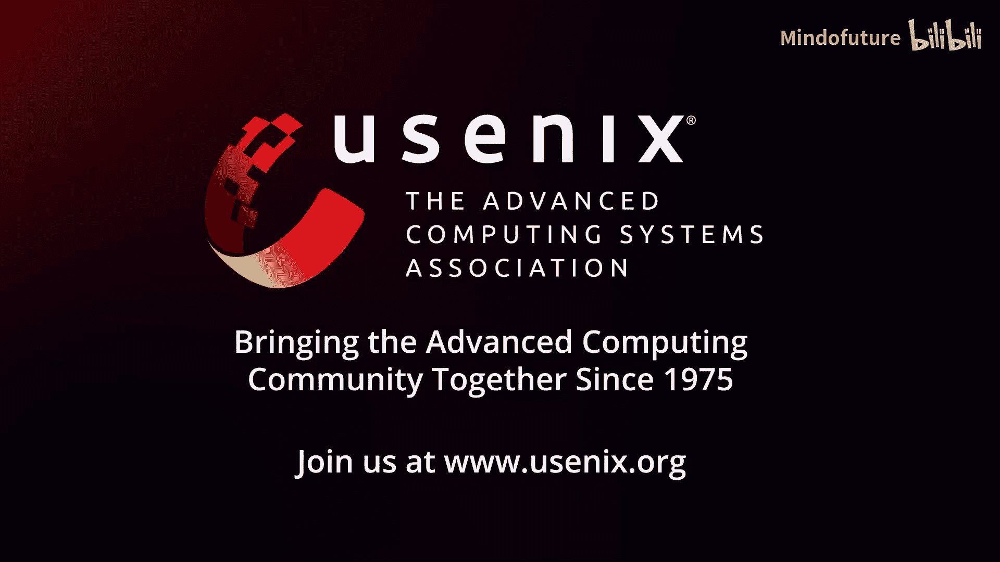
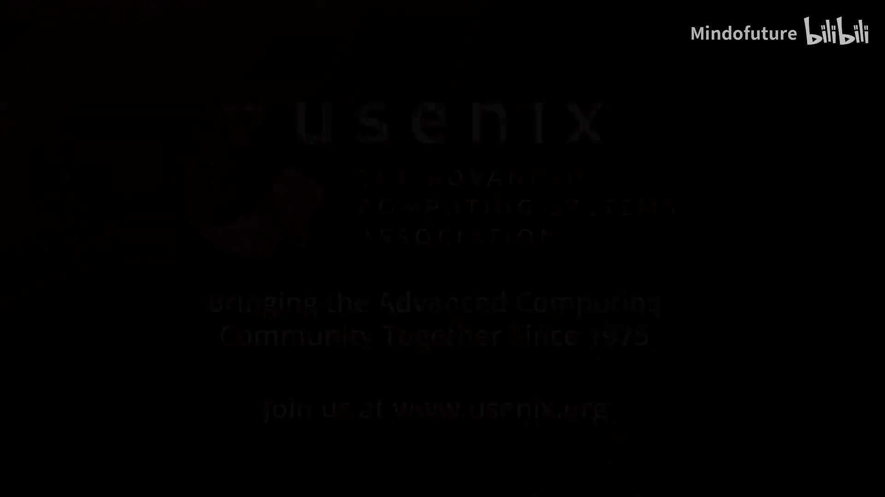

# SRE大会-2025-美洲-｜-srecon-｜-分布式-｜-缓存-｜-OpenTelemetry-｜-安全-｜-AIOps-p30-P30-Per-Aspera-ad-Productum---Turning-Processes-into-Products--BV1TmLDz7EZZ_p30-

。

Thank you very much good to see you all， it was on intro， a lot of buzzwords， ironically。

 the problem that I will be're discussing today is much simple one。So。

If you've been in industry for long enough， you know that long before things become trends。

 there are root fundamental principles。When we talk about what now we know is Devvos and Eerrito started with automation。

Initially we automated out of necessity， look after Shell Street， Crown jobs。

But is D message and journals。Over time， the complexity grew， we started using source control。

To automate staff with Pe， Python， when we had Che and Anableterraform。

 many other great tools we master to serve our needs and automate things with consistency and reliability。

Many of us build our whole career upon mastering tools。Later， this journey led us to GOs。

 Coopermate CRDs。And beyond。We learn to develop our own software。The automates。And automates。

Andello the wait。But the code remains unchanged， Things need to happen programmatically。

 automatically， be predictable and consistent。We all know that reliability is a blend of automation and consistency。

Initially， I believe that when you automate your technical pipelines to solve most of your problems。

 things are repeatable， predictable idea declarative。But no matter how good your gents pipelines are。

 how perfect your agoCD tie was customized， how great your alerting is。

 you still may be dealing with creativity are files and sending them over just like we did。

Or digging through a load balancer logs to found exactly what caused this five or three 10 days ago and of course。

 submitting it to your ticket。When I joined Dar as six years ago。

 I found a highly skilled team of engineers who dedicated their turn to streamlineing processes with some great automations。

However， some processes were just too complex to be automated fully。

 They involve too many peers and manual。Over the time。

 those processes became a significant obstacle in our ability to improve and evolve。

We were just too busy pushing up bicycles up the hill。Some workflows seem impossible to automate。

We had management chains， we had approval processes， we had people who wanted to be asked in person。

And so much more。That's where I thought， what if it was to run my own product with a so intent to solve this specific problem。

 a problem of manual process。Could I develop a product or technique to address this specific thing？

This question puts you in a different angle， you are no longer part of them。Problem。

You are not limited by the existing boundaries， you are outside of the box。

 you are looking at it and trying to find a solution。

I thought what if I wanted to make the process itself？The product。

How would it look like if my SE teams could focus on creating tools that act on their behalf and the others can use so we can have our precious time back investeded in the areas where that really needed our attention instead of creating another snowflake environment。

 deploying another service and provision more resources or whatever we be during those days？

If you think about it from the dimension of the manual process。

 we are a mediator between people and technology。So why couldn't we delegate this mediation to a piece of tech that we can build and then become a dealer of this technology？

I believe in tech and I trust they can solve anything， including this specific thing。

So we decided to look at it as an engineering problem。

 and an engineering problem requires an engineering approach。The accent was。

Thatill any process can be automated。But where should we start。

The key to automation isn't just about writing scripts， writing a code。

 it's about breaking processes into fundamentally reusable building blocks。

And if we analyze most operational workflows， they all boil down to five universal steps。

Number one is asking we want to our input our data。Number two is taking an action。

 we want to restart， we want to deploy， we want to send an email， we want to do something。

The next one is an approval process as a gatekeeper。

 whether your approval is programmatic or it's manual。

 but it's still an blog that you can use during automation of a process。

Number four is waiting for something， if you think about it then the ability to wait is what allow us for usentronous processing we can start working on something。

 wait for an input， wait for whoever works in it to come back， execute another process to return on。

 and then resume the operation。And the last one is the ability to report status who want to know the state of the process。

If you think about it at high level， then any manual process can be built or rebuilt using those building blocks by just arranging them in a certain way。

The details may differ， the way that you collect data may vary， the approval process may change。

 but the fundamental principles they remain consistent。Awesome。

 so now I was armed with this theoretical foundation of building blocks。

 I could arrange insert an order to automate process， and I wanted to see the theory in action。😊。

The first process we addressed Midlia was automating what we call the mask domain just to give a bit of a background for those of you who are not familiar with Midellia。

 we operate in a customer experience and user experience space we collect signals coming from people through different channels in different relations whether it's voice video user journeys from mobile application website and one of the signals is a customer feedback so I'm sure that all of you are familiar with it your open website of a famous retailer and then you've been shown a web forum asking how your experience was or you're just about to leave a car with the products that you added and then you're shown this forum asking hey。

 why are you leaving what's going on？So on the technical side。

 those feedbacks are sent to Melia domain， classic art， public cloud。Some of the customers。

They didn't want to mention our domains with all systems。

 instead of sending the feedback to fieldbeag dot customer dot TlD。

 they wanted it to be within their own domain。 So it becomes field dot customer top level domain。

It's a very simple thing to do， a very straightforward process。But on the operational side。

 it was a nightmare because of the dependencies， it was one of those things that you inherit from the times of the hyper growth of thetan company。

 look differently and you just keep doing it the same way over and over again。

Because of the dependencies， the times were long， the due date were missed。

 and I want to show this process in a more structured way so it makes more sense。

It obviously starts with the customer reaching out to professional services。

 asking to set up this domain masking。The P， S will open a ticket for SRA。 Nothing goes。

 Nothing moves without having a ticket， right。Then the SE will generate the CSR。

 send it back to the PS。The PS voltagetees are forwarded to the customer who will sign it and send the certificate back to the P S。

 who in turn will forward it to S3 for validation and the installation。

Theres a reason we willll create a DNS record and ask the customer to point to this record。

So the PS will reach out to the customer and say， hey， now things are ready， you can re your DNS。

 they will do it and finally things will start working。As I said in the beginning。

 the process is extremely simple， straightforward， nothing complicated。

But because of the interdependencies and because of the people involved and because of the procedures that were established on the customer side just because they were doing it the same way。

We just kept doing it。没orly。So。I want to show how this process can be rearranged in the building blocks that I mentioned earlier。

It obviously starts with the customer initiating the request for a math domain。

And we will have to P S and ask him for the customer details， the name， the data center。

 the desired domain， encryption， whatever is relevant to SS on certificates。

The next thing we can do is take an action。 We want to create ticket for truck。

 and we need it for auditing。 once again， I mentioned ticketet too many times during this presentation。

It is what it is。The next thing is another action， we will create the CSR and DDNS records all at once。

 they can be created so magically no problem， couple of lines of code。Next。

 we will wait for the PS to come back with the science certificate。And once he comes back。🤧嗯。

We will validate the certificate making sure the match is the private key that was generated during the CSR generation。

We will put the gatekeeper for ourselves， the reason that we are doing it is just to gain trust in the process that we are building。

But technically， it could be automated and it was automated。So we also implemented Gitth's approach。

 it's just a simple pull request we are stamping and things move move forward。

And the last action is install the provided Cer and let the PS team know， hey。

 the customer can now perform the DNS update and things will start working。

So basically it's exactly the same process， exactly the same things， just arranged。

In a bit more structured way。But in order to make it work， in order for the PS。

To be able to start this process and follow this process， we had to tie them all together。

 We had to create a system。 We had to create an interface。 That's what we did。But surprisingly。

 people weren't excited， and we kept receiving N tickets。

 although the system was functionally perfectly fine。We are technical people。

 so when we build things， we build them having technical details in mind。

 we build them for technical people。We are perfectly fine with creating a service that receives an API and speeds back adjacent。

 If you want to talk to it。 fine， you can use curl。 You don't want to use curl。

 get to know Postman is your best friend。😊，Even with building the UI， it looks like this。

 and I was very proud when we build it， to be honest。

It still required a very long documentation pages for the people to understand what they should do。

 what they should do first， what they should do next， when to continue。

 surprisingly people don't love reading long documentation pages。

And we kept receiving tickets because there was a shortcut。

And if there is something that requires reading documentation， versus shortcut。

 people will say shortcut all the time。The problem is that for us。

 this Jra ticket wasn't shortcut at all just because of the process that I showed earlier。

 it required us to keep working with Jra continuously updating things and keeping track of it。So。

We had another revelation。We understood that the automationation alone isn't enough。

People who want to use it。So I folded my startup founder head again and asked myself if I was to develop a product that I wanted people to use。

 what would it look like， what does a good selling product look like？When I speak about product。

 think about Apple， think about fallable or Mercedes。When you open your new iPhone。

 you instantly understand how it should be used， you sit it in a mod camera。

 and every control is exactly what you expect it to be。

Apple would never ask the customers to SSH to their phone to enable the Bluetooth。

Mices will not ask you to bring a range key to start your vehicle and Volvo will not provide you a five page long documentation on how to switch gears。

They expect it to just work。There is something similar about those brands。

 and I wanted my product to feel the same。 I wanted it to be intuitive， appealing and easy to use。

My product needed a great interface， but how in the world would serno what the great interface is？

To answer this question， we've engaged with friends and colleagues who are product professionals。

 We also consumed a good number of UX design principles。As I mentioned in mid。

 we focus on customer experience， we apply the same philosophy internally。

 so our automation products。And those of the guidelines were identified to be absolute best for what we needed。

And I hope you will find them useful as well。Number one is clarity over complexity。

 you want to reduce cognitive load， you want to make interaction obvious。

 you don't want to display any non-obous information。

 the system you are looking right now is our internal monitoring that we had to develop because of the highly nuanced environments。

And the bottom part has much less information， it provides you exactly what you are looking for don't mind the dates of the exc。

 I took the screenshot a long time ago， but you have these thumbs up and thumbs down clearly indicating you what is the state of this specific certificate。

Number two is minimalism with power。You want to provide simple defaults。

 but you also want to allow advanced controls when needed， by applying these principles。

 initially we were able to shrink down this Monous sidebar into just a couple of buttons in a tagggle。

But then also on the buttons we replace text with icons because if you have a homepage you can just display house。

 everybody knows what the house means if you have things that related to your in this specificific system team configuration。

 you can just display people so it's understandable that there you will find controls that related to the people and the next button is the dashboards。

 you want to do dashboards here you have an icon click on it。Makes this progressive disclosure。

 so this is a very familiar issue， I'm sure that。All of you faced at least once in your lifetime。

You have a web form and a web has plenty of details you're expected to fill。

Up to the point to an up when you are expected to answer something and it says， if not applicable。

 put N A and your lit type in N A， it shouldn't be there。

The progressive disclosure says that you don't want to overload your consumer。

 your user with all the options upfront， you want to disclose them as he progress， ideally。

 you want to build your form in the way that it will show the relevant option based on the previous option choosing。

 we were able to create those forms， configuration so just a J file where we define the relative steps and what is the next and what is the previous and then have it displayed。

 but in any way， the principle is this， you just want to show the details not upfront but as things progress。

Number four on the list is consistency， I'm sure all of you pay attention。

 but we are keeping the same UI patterns， the same Nordic cold pilot which is very popular those days。

 but you want to make sure that people get familiar with your systems。

So when you develop new systems， when you evolve your existing ones， they still feel at home。

 they still feel like they know how it works。Number five is zero handling and recovery。So。

This is a subject of its own， but hes thing。If your user enters some wrong information。

 don't make him restart the whole process， don't make the middle of the window。

 don't make him log out and log into the system， provide him a way of going back and fixing whatever he did wrongfully previously。

We found those next1 back arrows to be the most functional。

 the most intuitive and obvious using the web forms。 and it works pretty well。 So once again。

 you want to reduce the frustration of the user。Number six is accessibility and inclusivity。

 so those days when we talk about inclusivity we think about genders and races。

 but what I mean here is the different skill levels of people。You want to make your system usable。

 And if you think about it， it's an art。 How do you make your system。

Appealing to someone who is highly technically skilled and also someone that has zero knowledge in just during the company。

 how in the same time the same system， the same interface will work for both of them。

You can do it by applying the previous principle of minimalism with power。

 you can show the minimal interfaces required for the entry level users if I may call them。

And then you can have a toggle。 You can have an advanced mode that will expose more features to whoever might need them。

Last one on the list。His visual feedback。When a system does something you want to let your user know that it's working and it's not stuck。

 so he doesn't keep clicking， he doesn't keep refreshing。

 he understands exactly what's going on if you are loading something show speed。

 if you encounter the error， showing error。Speaking of fellows。Once again。

 we're all familiar with the website that we open and something goes south。

 and then we have a server encounter and unexpected arrow， 500 this and this is exception。

 it doesn't say anything to a user。Cause this exception and make it meaningful。

It's very important to keep the balance and not provide you know。

 error saying something happened or something went wrong because you want。

The idea is that you want a user to know what to do next。You want to tell him， hey。

 the problem is within the data that you submitted。 The problem is within the process。

 The problem is here and here and there， but you want it to be meaningful and actionable。

With the understanding of those principles in mind， we applied them to the existing system。 We they。

And then the presentation， it was a blast， their adoption rates。They skyroed。

 People people started using the system， so we went to the next one and the next one is the next one。

And then when we were reflecting on this process later。

 it was clear that the real challenge it did not come from technology。

It came from people the process and adoption rates。So you can have technical challenge。

 you can automate it fairly easily， you can make it self serviceice。

 you can give it to other people to use， but if it's not convenient， they will not use it。

 so all of your work goes through this trash can or nothing。

But there is a way you want to make people fall in love with what you do。

You want to make it appeal and easy， make it in a way that they would want everything to be as good as what you did。

And that's where you win your user's hearts and minds。

I call this talk peraspera productum through apir product， through hardship。

But it doesn't have to be hard。 The past is blazed。 and I want to share those ideas with you here。

 I'm grateful for being given the opportunity to do so。 And finally。

 I want to share an algorithm we are using now that helps us refactor the old ways of working。

 It's very simple， very obvious， yet powerful。😊，It consists of three steps。Understand。

 implement and improve。Breaking it down a little bit。But understand what I mean is this one。

 you want to understand what are the exact boundaries of the process youre trying to automate。

 One of the problems with manual processes is that they don't necessarily have a solid starting point and solid ending point。

So you want to understand who initiates it and what is the definition of that when we can call this process to an end。

 I see that I'm grind a lot of time so I'll just go quickly number two。

 you want to understand who you users some beneficiaries they are not always the same you want to meet with the audience and understand their real needs and build your product around answering the real needs of the target audience not just by benefiting yourself and your team。

Number three， you want to understand limitation things that are privacy， data governance， security。

 all the opio things that we all are familiar with。On the implementation side。It's the simplest。

Just do work。Whatever works for you works for developing a product。And then， lastly。We have improved。

So。By improving， the only way that you can improve your product is by collecting feedback and not just collecting feedback。

 but also action based on it。One very important thing that I want to quickly call out is the workarounds。

When you provide workarounds， there are not features。And they tend to become tribal knowledge。

 and they are very hard to maintain because of this nature。 So if you have a request from your users。

Don't give them a workoutarounds。 Make it official。Lastly。

 when I have a roadmap very obvious we all have roadmap where product roadmps is a bit different from an operational roadmap。

 so you want to manage your bug， feature requests and technical depths。And lastly。

 you want to make things reusable， I will not read what it's reading here。

 we all understand what reusable means。Finally， if you're taking one thing away from this talk。

 it's this solar automation plus great user experience we'll give you a self service that people love。

 Thank you very much。 It' was a great pleasure to join。😊。

