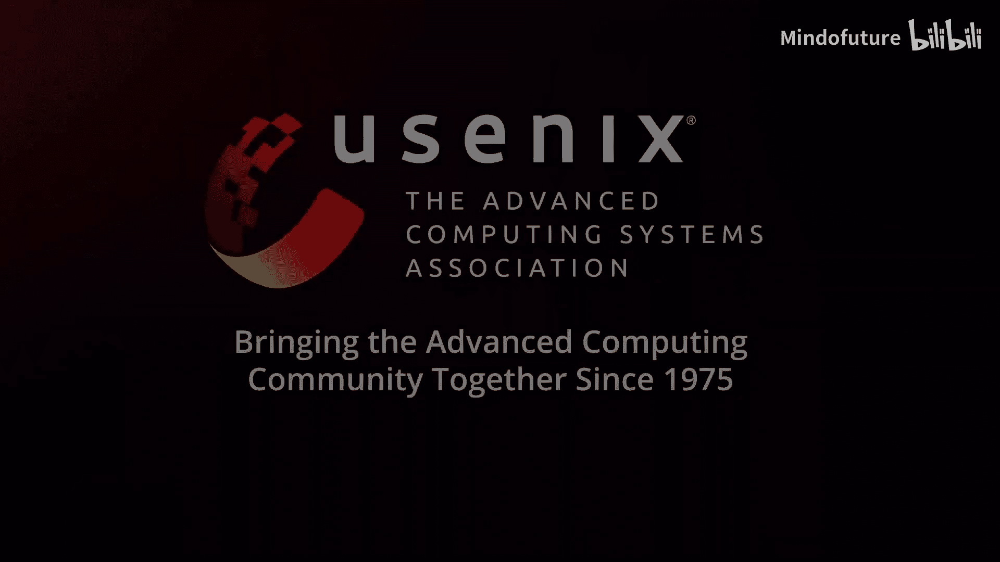

# SRE大会-2025-美洲-｜-srecon-｜-分布式-｜-缓存-｜-OpenTelemetry-｜-安全-｜-AIOps-p32-P32-Fully-Automated-HW-SKU-Selection-System-to-Optimize-Apache-Pinot’s-Cost-to..--BV1TmLDz7EZZ_p32-

。

Hi， I'm Dino。We work on Pino at LinkedIn。Well， Sabrina's now at Netflix， but she was at LinkedIn。

How many people know what a Piot is ever heard of Pot used Pot one person。 Okay， cool， wow。Oh， hi。

He we met。 That's cool。 Alright， so before we get started。

 I'm just gonna to give everyone like super brief overview。 Pot is this OAP distributed data store。😊。

EEver heard of lap。Show of hands， maybe yes， a few people， Okay， online analytics processing。

 So this is kind of slicing， dicing data。We're talking terabytes。Tens of terabytes。

 hundreds of terabytes， not quite at the level of like spark sel， but kind of serving online systems。

 So we have this broker routing layer。Set of serving layers that host nodes。

 and we push down SQL queries to process large amounts of data。

This talk is going to focus almost entirely on the serving node aspect。

 so we won't focus too much on the brokers or anything else in this picture。

 but good to have an idea。😊，Pino powers a lot of different use cases of LinkedIn。 Okay。

 we get a little peek under the covers。 For instance， this member facing analytics。

 who viewed your profile。 We have enterprise level products like this talent intelligence ecosystem that shows how talent is moving across the country。

 And then we have internal tools。😊，Business insights， this kind of thing。

 and each of these three use cases has kind of different query patterns。

With different latency expectations， when you open this LinkedIn dot com， who viewed my profile。

 you expect it to be pretty quick， hopefully。 but maybe internal analytics is more expensive queries running on more data。

And kind of has a more relaxed latency profile。So。With O app， unlike a lot of SQL products。

 the cost per query can vary really dramatically。 Like you can have some queries super cheap。

 Other queries are unbelievably expensive。So just for a sense of scale。

 so we know where we're talking， we're talking hundreds of thousands of QPS。

 tens of thousands of serving nodes， a couple thousand broker nodes。Half 55000 pinot tables。

 These numbers old， but it works。So what we found is that originally。

 Pino was deployed on kind of this general purpose app node at LinkedIn。 Okay。

 we have one size of host。And that's what we used。 It was available。 Eventually we added SSDs to say。

 okay， SSDs are fast。Previously， they were a little expensive。 So we had okay， S non SDs and SSDs。

 But as time passed， we have this question of， hey， we need。Different types of use cases。

 We have these CPU bound use cases。 Maybe they want to process more aggregations。

 Maybe they do more CPU bound work。 Maybe the whole data set fits in memory。

 We also have these memory bound use cases that really rely on memory to。Compute like a distinct set。

 And we use storage bound use cases。 Okay， we have I O throughput balance use cases。

And just raw physical storage bound use cases， these internal business analytics。

 generally the data just sits at rest。So it didn't make sense to keep going with this one sw to rule the world。

嗯。And use cases that didn't really quite match kind of wasted。A ton of hardware。

 So if you need a lot of disk， your CPU is kind of just sitting idle。So that's our goal。

 Figure out a， how to support multiple。Excusse without creating a whole bunch of to toil。

How do we integrate them into the ecosystem and how do we like manage this fleet of host。

And we justified it as all things do by saying that it's going to save a lot of money。Okay。

 and so our goal was kind of。20% rough estimate， because we had to keep using the host that we have。

 We already。Own these hardware。 Can't really throw them off the window。ESo we said， okay。

20% seems pretty reasonable。And we'll talk about how we did at the end。

The other justification that we have found historically speaking is the larger the host。

 the more cores， the more memory you put in it， the cheaper it actually is。 So keep that in mind。

 it's not super important for this talk， but you'll see。

We can can't kind of really give exact numbers， but let's begin。Bigness， all right， so goals，20%。

We really wanted to support any arbitrary s eventually。 So we know here from now。

 different hardware is going to be cheaper。Different hardware is going to be available。

 It'd be good to be able to add it。We wanted it to not create impact as we move these ten tables and tenants between hardware。

 So if we migrated this。Whoooed my profile and causes a bunch of latency spikes。People。

 will be unhappy。 So we didn't want to do that。 And we really wanted to automate the whole process。

 So we're not injecting a bunch of toil。 And as we scale with skekus， we have to scale with people。

 that doesn't really work out， so。Prime direct， minimize the additional work percu。That being said。

We did find that there's other non unimable parts to adding Skekus。 Okay， you have to order hardware。

 You have to manage the spare pool of hosts and Skekuws。So there's this trade off between， okay。

 we're gonna add additional Skus and support them and。We want to minimize the cost， yes。Good。

 and our non goals。 Okay， we don't really want to improve the utilization per roast。

 We just want to save money。If we accomplish the goal of saving 20%， we're happy。

 even if the utilization may still be low。😊，Good， okay， nice。

 So we have a few pieces to this that we ended up building。 We have kind of this orchestrator。

 which is managing the whole thing。 We have some production metrics and storage to gather a little bit more deep metrics about how the hosts are performing。

 All this gets fed into this cost estimator and skew recommendation engine。

 which kind of knows what skus we support and what their hardware is。 And then finally。

 we have this migrator， which takes tenant and tables running in production and moves them to a from one skew to the other with no impact。

😊，And。Jo is going to talk about all of that。Thanks。😊，Okay， folks。

 so before we get into the design details like tip technical part。Let's think about like。

 at a high level， if we're gonna do this problem， how are we gonna approach it。So basically。

 we are trying to build a new cluster for an existing cluster that will use some new skills。

 Will you apply some new dimensions for the cluster so that we can make it cost efficient。So。

There are two questions we basically need to answer here。

 The first one is we need to have a set of metrics defined and methodly collected。

To basically profile the utilization of the resources on the old cluster， right。

And on top of this profiling， were gonna build some heuristic。

 some model to map this utilization to some new skills and new dimensions so that it's gonna be like cost of Tim。

Okay， so to answer the first question， we basically want to collect the metrics like we collected the metrics in three dimensions。

CPU， memory and storage。 Okay， so for CPU， what we did was essentially。

 we want to like we took a look at the total number of CPU cores on given cluster serving a use case。

And we want to scale down the number， of course。 if it has some utilization below a threshold。

 So here we take that threshold at 60%， meaning that if the total CPU utilization is below 60%。

 we' are gonna scale down the number of course so that we get some reasonable like utilization rate。

 while we still leave this like 40% of the headroom for the organic growth。Here。

 we do not really count the like stuff like CPU frequency， IP PC。

 These things are like too kind of nuanced。 But if we're gonna develop this model。

 like to have more fine green prediction， we'll probably account for that in the future。

So with that being said， the， after we scale down the number of course， we still want the。

 like the cluster to withstand 99。Po99% of the like traffic so that we like， we serve you well。

 where youre like scrolling through feed while youre trying to do job search。Okay， so。To do that。

 because Pal like runs query in a very low latency， like tens of milliseconds。

We need to really collect the CPU utilization things in a very like frequent manner。

 We do that every 5 milliseconds。 but we still don't want that to be to to impact our system。

 like application performance。 So we did some research。

 I found that this Linux Linux performance Co pilot is really useful。

 and it really offers like low overhead matrix collection publishing this kind of stuff。Okay。

 so these story for memory is a little different。 so P memory usage is composed of like three parts。

The first one is the Java hit memory， which is managed by Java memory allocation。 the G C algorithm。

 And the second is the offhi buffers， which is basically the buffers we allocate use using some like Java buffer libraries。

 and we kind of manage them manually within our program。 and the third part is Linux page cache。

 which like essentially we use M map to kind of map these like data charts from our disk to the memory。

 and we read them from this M map。 So the M map will be managed by Linux system。

 and it will basically appear as Linux page cache。Okay， so the。Green and the blue box here。

 if we sum sum them up， it will be reflected as the R S S memory。

 which we collect and we put a headroom of 1。5 on top of it as the final memory usage。

As for the memory my mapping part， this part is a little tricky whereas like in the first version。

 we actually tried to figure it out。 But due to like the kind of lazy eviction of these pages。

 you don't really know like which pages are really used， which are not。

 So we kind of use this factor on the R S S memory to give some headroom as well for the memory map section。

Okay， so the storage side is has a。Favor on both sides。 I would say like first。

 you will need to have like in a steady rate of some storage capacity allocated on those hosts so that they are enough like kind to host to hold all the segments in。

 in the disk。And。I guess what's more tricky here is that。

When you actually start to use these segments or the data charts。

When you em map them into the memory， when you start to read， they will be loading to page cache。

 And this process is like paging， so。Although we are using like really high performance MVME SSDs。

The process of paging is still kind of bounded by the SSD speed， namely the throughput and the IOs。

Therefore， in this practice， we want to capture the。Like the throughput I ops。

 like kind of like how we capture CPU。 we want to capture all the bursting patterns so that we make sure when we like upload new segments。

 I mean， when we are downloading new segments to the server where we are like serving inquiries。

 there's no thrashing， there's no like conflict conflict and the bandwidth is basically。

Like enough for both operations。To do this， we also use this PCP to capture the subsequent granularity of IOs and throughput for the N M E S SD。

Okay， so make this， to make this process like really automated。

 we view this nice workflow like around the pinal ecosystem。

So I guess the really challenging part here is that because were collecting the metrics in a very high frequency。

 like 515 milliseconds。 and we have so large of a fleet size， the data itself can be very large。

So the optimization we've done here is that。Instead of really storing all the time series data， we。

 we， like what we really need here is just the percentiles， right， So we look at。

 we shape ourselves and look at the data in a like。Vio of distribution。And to do that。

 we basically leverage this T digest algorithm。Which like in a fixed time window。

 let's just say one hour after we've collected one hour of CPU utilization on the server with a frequency of 15 milliseconds。

We kind of like， looked at all this data， and we。Like， draw the distribution for it。And they。

 then the algorithm will like basically take maybe 100，10000 data points。As the like。

Represent representative points of the distribution itself。

So this is some lossy compression of the distribution。 but like。We did enough experiment on this。

 and we picked the kind of these parameters really carefully so that the error。

 the margin of error is really small。So yeah， on each host。

 we will be basically do the PCP collection。 And for a fixed time window。

 it will turn them into these tea digest points。 And these tea digest points will be kind of serialerized in bys and we will publish them to the Kaafka topic。

And eventually， it will get in just to pinal table。

And we use like this compress kind of view of the distribution to do the recommendation。

 which is like what we use previously for all these percentile stuff。So the good thing about this。

 like tea digest is that we can actually。Qury them and merge this T digest。On the fly， like within P。

 So P has this percentile T digest function， which it will basically take some column of T digests。

 like raw T digests by data。 And given a time window， given some filter， for example。

 if you want to look at the。Percentile of CPU utilization of past X days or given cluster， you can。

Write a pinal query on the fly。And you can put any number for the like percentile there。

 You can put 99。99。 You can put like 3 nights4 nights。

 It will give you a really like accurate estimation of the like percentile data on on， for example。

 CPU metrics。Okay， so this largely can of reduce our storage for this like matrix that are for different dimensions and for such a large fleet size。

And the。Manyage the data management ingestion， like the， the data。Kind of boundary。 And the。Qury。

 we all like implement those in P。Okay， so on top of this。

 like reach matrix data for the clusters like these utilization data。

 the heuristics to actually come up with the best skill and the size for a given cluster。

 iss kind of like straight。 So as you can say， here， let's imagine you have a large list of skills。

 And each skill has its own number of core， has its own like run size。

 and you can attach some number of disks to it。And each disk has its own size， eyeops and throughput。

 So these are the capacity for， for the hardware。And what we do here is basically。

 you will say for this cluster， I want to provision。

X number of such skills and Y number of disks so that the disks are kind of evenly mounted to all these machines。

And for each each host， we will take some numbers course out of， like。

The host basically for some O S operations。 and we also keep some ran buffer for the operating system for the demon as well。

 So after that， we will make sure that the capacity， like on all the capacity are on the left side。

 like in the right font。The total capacity of the cluster will need to be larger than those than those like actual resource usage of the to。

 to serve the table。The resource usage is basically these percentile numbers we measured on the real cluster。

So now this problem becomes really a like linear programming problem where we try to minimize the total cost of using such skills and disks。

 Well， we are still trying to satisfy all the capacity capacity need to serve some percentile of like traffic。

OK。Now， I'll give it just a agreement。Yeah， so dad is want to overhaul the capacity estimator and the Skuw selection algorithm works。

 And then the next step will just be taking the output that's the target Sw and how do we how do we migrate existing Skus and then also provision new tables。

 So the first one is we want to do the Skuw migration in impact free matter。

 That means our users should not notice any downtime or their performance should not experience any degradation and then the way that we do this。

 the key point here is to provision the new Sw and then running the cluster both of the new SkuU and the old SU at the same time。

 So essentially their cluster is under double the capacity。

 So the way we do this is we first allocate the new host on the target Sw and then we will add the table and the tenant to the new Sw and then also tag the new host as well。

 So at this point the table will be running at double the capacity and then at the routing layer that means。

Roughly 50% of the traffic will go to the old S and then the other 50% will go to the new S。

 and then we will go into a round of evaluation。 So in the evaluation。

 we will look at the query performance。 the P 95。 and then we will also look at other metrics such as memory usage and CPUUization just to see if everything looks good。

 if everything looks within expectation。 then we will go into the dis old replicas stage here。

 where we do is to do a soft dis on the old host。 So we're actually not we're actually not removing any data。

 we're just disabling it at the routing layer。 So that means queries will not go to the O S after this step。

So that means 100 percent of the load will now go into our new cluster on this running on this target s。

 and then we will enter another round of evaluation。

 That means we'll look at the same performance metrics again。

 to see if everything makes sense now that we have 100 percent of the traffic。

 if everything looks good， then we actually wrap up the whole evaluation system。

 and then we go into cleaning up the old host。 So after this step。

 everything will be running on the new s with no performance impact。

 And if any of the performance evaluation loop， go into a bad state。

 That means if we look if we see query performing worse。

 then we will immediately enable the old host， So this is very quick to do。

 there's roughly minimal impact。 and then we will automatically roll back and then we'll also alert our engineering team to take a look to investigate。

So this is how we do the sw migration with no downtime。And then after migrating existing tables。

 we also want to look at how we provision new tables taking in consideration of the new Skus So at Pot we have this smart provisioning system。

 this exists like long before we have this Skuw migration project it's a really smart system that takes user provided inputs such as table characteristics that can be the column cardinality。

 the schema and the QPS that they want the query patterns that they have。

 and then we'll also take in like latency SL storage requirement and then we'll translate this into what is the capacity needed to provision their table and we' automatically do that。

 and then there's two steps that's in the process。 one is the first provisioning step where we are provisioning the new cluster and then they can start ramping their QPS and the second step is we will go into a ramp evaluation loop that will look at the table at the lower ramp and it will extrapolate。

How much capacity that we need if they enter the full rep phase。

 And then we will also determine if uplift will be needed。And both of these steps， we made a S aware。

 that means for the first step， we will pick the best initial S with the lowest cost that can serve their production queries。

 and then in the second feedback loop， we will also consider multiple SkuUs as well so that this process can be SU aware and it will evaluate based on the S that's currently in the cluster。

And then lastly， once the table enters a steady state in production。

 that means they're fully ramped customers just using it as usual。

 and then after some time they will come back to us and ask， you know。

 can we ramp more QPS or can we increase the data retention essentially they want more capacity and then we also have this headroom estimation system that will look at the headroom of their existing cluster and see if we can support more QPS with the given cluster size。

And then in this process， we also add Skuw intelligence to it as well so that this evaluation can take into consideration of like the memory size。

 the disk size that's available in the cluster as well。

 So we did all these three things so that our existing smart provisioning system works with multi Sew。

And then lastly， to make things even better， we actually have a very convenient benchmarking tool that's available for both our team and our customers team to use。

 So the purpose of the benchmarking tool is they can spin up a production like cluster and then run real queries with real QPS and then we can test out if the cluster can support such use cases。

 And then in this benchmarking service。 we also offered Sku selection as well。

 So in addition to ramp their Qps and query pattern。

 we also made a selfserv that they can select the servers that they want the capacity that they need。

 We gave them a pool of Skus that they can use。 also for us for validating during the process as well。

 And then in this process， they're able to test out real queries multiple Skus。😊，So lastly。

 we had some very impressive results。 we meet our goal by reducing the total cost to serve by 35% by migrating only 20% of the clusters to the mixed Sw。

 We also reduced our overall cost of future hardware forecast by 57% last year。

And then as more SkuUs comb in our spare pool， we can easily support adding more use cases and onboarding new customers very easily with the smart provisioning process。

Okay， lastly， we just want to express that this project takes more than just the three of us。

 there's also a larger team who's not with us today。 There's Florence， Som。

 Shirayu and Saars that we want to sing Thanks yeah。

ok。Questions。

