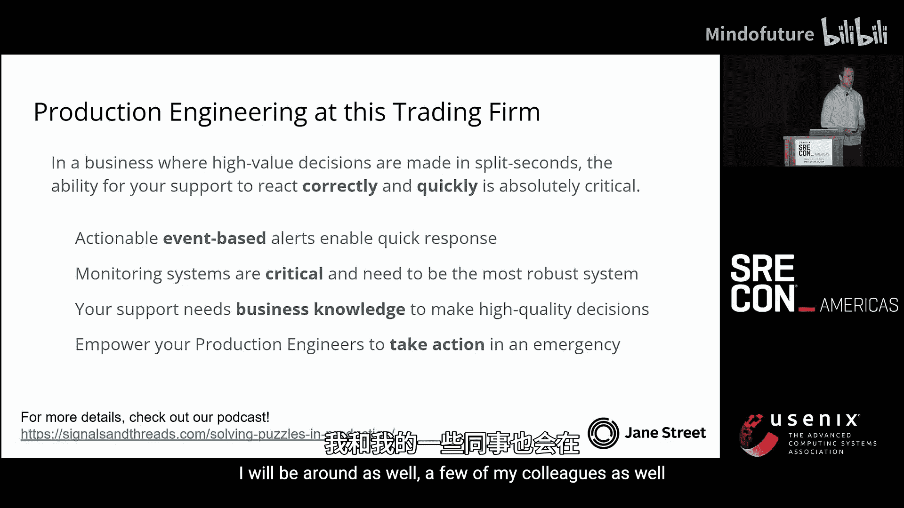
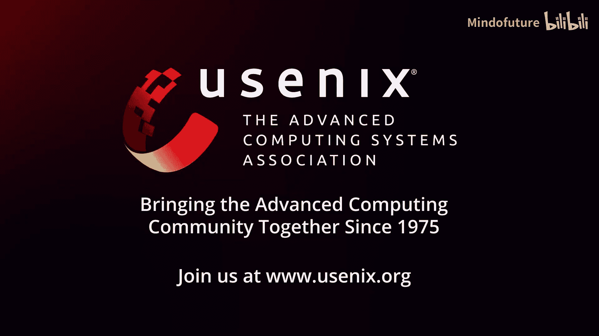

# SRE大会-2025-美洲-｜-srecon-｜-分布式-｜-缓存-｜-OpenTelemetry-｜-安全-｜-AIOps-p33-P33-Production-Engineering-When-Trading-Billions-of-Dollars-a-Day--BV1TmLDz7EZZ_p33-

。

First of all， good morning， everyone。 like you heard。 my name is Pedro。

 and I kind of want to say thank you all for still being here on day 3 of the conference。

 I know everyone's heard lots of deep and interesting topics over the last few days。

 I really appreciate you're still here to give your attention now to me。😊。

I work at a company called Jane Street。 I'll talk a little bit more about what we do。

 but it's not the main purpose of the talk。 actually。 I want to talk more about tech。

 but what we do is that we trade financial products in markets around the world。

 And what that means is stocks， options， bonds， all the sorts of things you can imagine trading in financial markets。

I promise you will not need any finance knowledge to follow the talk。 You also do it any。

 I also barely have any finance knowledge When I started there。 now I have some。

I want to use my 35 minutes here to give you an overview of how we think about production engineering in this kind of environment and also how we think about reliability in general。

Before I talk more about a little more about myself and go into the details of the talk and how we build and monitor trading systems。

I want to start by telling you a story of a real worldend event that happened。

Who here has heard of night day or。And a company called Night Capital。That's not bad。

 It's about half。嗯。For those of you who don't know， I'm going to recap the story。

 For those of you who do know， maybe I'll go into a little bit more detail and some of the takeaways that we've had from this particular event。

So in 2012。There was a company called Night Capital。

Night Capital was one of the largest US trading companies at the time。

 They made up a very significant proportion of the trading on， for example。

 the New York Stock Exchange。As part of that， they were obviously using heavily automated trading systems。

Nowown August，1 of 2012。Theyre try to deploy an updated version of one of their training systems into production。

In the old version of that particular system， there was a piece of code that had been unused for a while a few years and thus hadn't been maintained properly。

 It has now picked up a couple of bugs， but it didn't matter because the particular instruction to enable that piece of code was entirely unused。

In the new version now， they repurposed that particular instruction to point at a new piece of code that they want to turn on to enable a new kind of trading that they were excited to get into。

😊，And now this happened。When they upgraded their systems on August 1 of 2012。

One of their suite of trading systems， One of those systems failed to upgrade and remained at the old version。

When trading now started at 9，30 AM Eastern。This one up un upgraded system started executing this old code。

That I've mentioned had picked up bugs was deprecated， and in general， poorly understood。

Within the next 45 minutes。After trading had opened at 9，30。The company lost $460 million。

It was a major disruption to the prices of companies on the New York Stock Exchange。

More than 390 million shares of companies were traded。

And the firm acquired several billion dollars worth of positions。

 kind of like accumulate accumulateoid trades， in that sense。

That they did not want and didn't intend to do。In the aftermath of those 45 minutes of that incident on that day。

Night capital's own stock price collapsed。And roughly four months later。

 they were boughtded by a competitor。Now， there are lots of nuances to this particular incident。

And I left them out now。 And they're really interesting to read up。 If youre particularly interested。

 I'll put up some links in a minute and you'll see them on the slides to the S E。

 to the Securities and Exchange Commission。 How they've analyzed this particular incident。

 It is a great read。 I think there are some interesting takeaways there。😊。

And there are some obvious things that went back wrong here。 we might say now， in hindsight。

People mate。Software engineering mistakes。 And it's easy to label them as obvious mistakes。

But I also think there were quite honest mistakes。Probably all of us have cut corners at some point in the development cycle。

 For example， having left out or having left around some dead code because you thought I might use it later and left longer than it should have been。

 All of us have probably done that in the past or repurpose some config field or some kind of parameter because you didn't want to deal with a version upgrade or you didn't want to deal with that sort of migration。

I'm pretty sure most of us can relate to that。However。

 I still think there are a couple of non software engineering takeaways from this that relate to production engineering。

 what we call at Jane Street and the general attitude around support。Four， I want to highlight。

The first and maybe most important one is that trading is really， really scary。😰。

If you haven't thought about it， like， if you don't think trading is scary。

 you probably haven't thought about it hard enough。😰，In 45 minutes。

 you can very easily burn over $460 million of your own capital。And that's dollars in 2012 terms。

 I don't even want to do the math of how much it is today。

 as over $10 million per minute that you're burning。

Robust and redundant monitoring is crucial in this kind of environment。

It's not that the people at my capital didn't have monitoring。 They were smart engineers。

 They did have systems to monitor what kind of training was going on。For example， in this case。

 they did have a system that would track the kind of positions that they would accumulate。

 So as you buy， you incrementally increase your position in a particular stock， for example。However。

 due to the increased load of the system executing trades over and over again。

 that monitoring system itself started falling behind。

And couldn't keep up with the volume that was happening。

Your monitoring system might fail when you most need it。Noisy alerts。Are worse than useless。

On that morning， there were 97 emails that went out about that un upgradegraded system before trading had opened。

It is not clear why no one reacted to this or how exactly it was react。 They reacted to them。

But the fact that there was 97 of them。Probably points at something here that people might have been desensitized to these kind of alerts。

 I thought us it's just another thing that happened over here。 It's not actionable。Having clear。

 actionable alerts。Could have saved this。 And people would have noticed before the market opened。

 We would have never heard about this incident。And the fourth thing。

That we took away from this as well， is you want to empower your support to actually take action in these situations。

If， within five minutes。Someone from their support team would have realized the magnitude of what's happening。

 to potential risks and then been able to take a step to shut down trading。Or particular the system。

Things would have still been bad。 They would have lost a lot of money。

But it wouldn't have taken down the company Probably。 It wouldn't have been in the news。

 And I certainly wouldn't be talking about it today。These are the links up there。 Very interesting。

Highly recommend having a read later on。 You can just look for night capital on Google。

 and you'll find these。So today， I want to talk about how we， as Jane Street。

 a company in a very similar business， kind of the same business， Basically。

 how we build systems and practices that we do not run into these kinds of issues that lose a lot of money in a very short amount of time。

We want to talk about how do we monitor our systems。How do we respond to incidents。

And how in general do we work to improve the quality of our infrastructure。

I'll roughly go through it in three sections。 First。

 I want to talk a bit about how trading looks like in general。

 what kind of tech we build at a high level， what things matter in trading。Second。

 I want to talk about how we approach monitoring and support。And lastly。

 I want to spend a little bit amount of time also talking about project work。

 So kind of systems that production engineers and software engineers developed together in order to enable us to respond well to these sort of incidents。

Now， a couple more words about myself。 So you actually know who I am。 So I'm a software engineer。

 I've been at Jane Street for over seven years before that time。

 I spent some time working in Berlin and kind of a web startup。 This is also where I'm from。Actually。

 before that spent a year in the Bay Area， this is my first time being back since 2014。

 I'm pretty damn excited about it。 Now I live in London in the UK。

 which is very different in a very different life。 And I think in the past four days here。

 I've seen more sun than I've seen like in the last like six months in London， which is。

 I don't know， a different feeling that vitamin D is hitting pretty hard。😊，But anyways。

 that's like nowhere， neither here nor there。 Jane Street is a proprietary trading company。

And roughly what that means is that we trade with our own money。On financial markets。

 we do it with our own capital， our own strategies and our own technologies。

A lot of things we build are built in house， optimized for our use cases。

And because of that sort of  structure， we are very clearly and directly responsible to build our tech in a way that doesn't end up losing all of our own money。

 It's not customer money that we're losing。 It is our own money that we will be losing。

So let's talk about what a trading environment looks like at a high level。

So you have a trader who wants to trade on a market to pick Nasdaq。

 but you can pick any market in the world。Still roughly three components at a high level。

 I'm gonna mention that you want。One， the first thing you might want is something we call market data。

So the trader wants to have some visibility about what's happening in the market。 We also call this。

 like tick data。What kind of orders are happening in the market， who currently wants to buy。

 who currently wants to sell something， What kind of trades are happening。

 You want to feed this data live into the training system or towards your trader。

 whether it's a human or system is kind of arbitrary at this point。

And you also might want to use that for historical analysis kind to back test your strategies。

The second thing you want is something logically， I'm going to call an order entry system。

 So a trader decides， hey， I want to enter an order now。

 I want to buy a certain stock at a certain price。 They need to have a way to send that to the exchange。

These could all be like interconnected， I'm logically thinking about these different things now。

On the same path， you would be able to say modify an order or cancel an order that you've sent into the market。

And you would be able to receive what we call executions。

 whether or not you have traded and how much you have traded if you have。

And the third logical thing that's maybe a little bit of an afterthought here for many people。

 if you're not familiar with it， is you need to keep track of what you're actually trading。

Like what kind of positions you pick up， what kind of kind of accounting and bookkeeping purposes。

And we to upload that to the regulator as a trading firm。

 we have a lot of responsibilities to make sure that the heavily regulated industry we keep up with the compliance standards in that world。

I've made these like three different boxes and you could think of the most systems。

 It really depends on how your architecture works out。

 But I think it's useful to think of them as like three big concerns that you need to solve when you're building a trading system。

I want to be focusing for the entirety of my talk， just on the middle。

Because that's the part I know best。And I also personally obviously think it's the most interesting。

 but that is also just because I've been working in it。

I think these edges are particularly interesting when we're talking about when it comes to connections to the outside world。

And I think that's for two reasons。The first reason is。When something goes wrong internally。

 say you have a trading system somewhere internally that starts generating bad orders。

Everything is kind of fine。Until they hit the network and send and go out to the exchange。

So in that sense， the order entry system is your last line of defense。

That one needs to be working well and needs to be able to catch these issues。Similarly。

 the second thing is when something goes wrong in the outside world。

 the exchanges aren't infallible either。The order entry system or kind of connections to the exchange。

 Those systems are the first things， first places to notice when things go wrong in that part of the world。

 first places you want to be alerting on and make sure the rest of the infrastructure knows about it and training knows about what's going on in the market。

So in terms of monitoring technical connectivity and the technical systems。

 the edges to the external world。Are the places where you have the highest fidelity of signal？

And the highest risk options of like making sure you can control what goes out there and doesn't go out there。

Now。I talked about orders。What is an order， actually？

This is an example of an order for natural language。

 You can imagine it being in any sort of other kind of digitized form as well。

 It's an instruction to buy or sell a certain instrument at a certain size at a certain price。

And there's different kinds of orders。 But I think these are like the five components that I kind of w to highlight now the basic elements to an order。

 There's what we call the side。 So whether you sell or buy， there's the size。

 how many of the company or like the instrument you want to buy。 So in this case， one share。

There's what we call the symbol， or you might call a ticker。 In this case， a company called Jcom。

 It's a Japanese company。At a price of 600000。 And then the currency yen。

Imagine getting any of these wrong。For some reason， your system flips by and sell。

 You get the encoding wrong on the wire。That's suddenly a very different order。

If you start executing this in a hot loop， for example。

 because you're expecting your position to decrement。

Then you start crating lots and lots of batch trades。

Or imagine you mess up the currency you write down。Instead of like Japanese yen。

 you're trading US dollars。You put down or treat thing in this size。 Suddenly。

 your price is off by a factor of 20 plus。These are real things that we think about when we're designing these edge systems。

To make sure that encoding is really solid。Now， let me tell you another story that I think is really interesting。

In December of 2005， Thursday， Thursday， December 8，2005。

A trader at one of Japan's largest brokerage firms。Try to send。

Exactly this order to the Tokyo Stock exchange。Unfortunately， they made a typo。

Instead of setting this instruction。They sent this instruction。That's a big difference。

From excel one share at 600，000 end， they instructed to sell 600，000 shares at a price of bunyan。

Off the back of this one typo。The firm would ultimately lose over 27 billion yen。

Its about 223 million at the time。The NikK 225 stock index。

 which is kind of equivalent to the S&P 500 here。Dropped almost 2%。Based on this one order。Worse。

 though。The company or the trader， they tried to cancel that order， but couldn't。

 and not because of fault in their own system， but because of a fault in the system of the Tokyo Stock Exchange。

 It didn't allow them to cancel that trade in time。There was some litigation around that。

 and ultimately the company in question here was awarded like $10 billion at $10 billion yen in compensation。

However， they were trying to claim for $40 billion，$40 billion yen in damages。

 So they got maybe like a quarterback of that。 The damage is done， though， to the market。

So a couple of takeaways I want to highlight from this particular story。 Again， very real。

 You can look it up。 I'll put some links on there as well。 I find these incidents fascinating。😊。

Each order matters like things like this。 This is a pretty extreme example。

 and that doesn't happen every day， but it has happened。So each order matters in practice。

And the more subtle thing， which I think is actually more interesting。

 is that issues on the exchange side in the outside world do impact your own ability。To trade。

I think these incidents are always interesting。 They're highlighting changes。

 highlighting challenges and motivate improvements internally for us or in general。

 We sometimes refer to this as incident driven development。

 I heard about that like someplace in the outside world。 I think it's a great way to frame this。😊。

I should also probably， and I will not in the talk， talk about some internal incidents。

 but obviously they are secret。 However， if you find me after the talk at better booth。

 I would maybe talk about some and also have some another couple of interesting stories there's a couple of good ones going through financial times in the last few months of people doing similar mistakes and actually losing a bunch of money。

😊，Not to this extent， though。So let's look at more technical issues and start going a bit deeper there。

And I would roughly divide these things into two categories。 For one， there's bugs。

An error in an order like we just saw can turn immediately into a catastrophic loss。

 or at least very large losses。And more importantly， in automated trading。

Small errors rack up losses really， really quickly， much， much faster than any human could ever do。

The other part we haven't talked about yet， are outages。

Bugs can lead to outages in the response to bugs， what we might do is we might want to shut off trading。

 we want to cause an outage。Now， what are the repercussions of an outage in this industry？

One thing you might think about is that the number one thing that's happened is we opportunity cost。

 Its trading。 We're doing the trading with our own capital。 If we're down。

 we're just losing opportunity cost。I'll say that in itself is very bad。

But it's actually not the only thing。There's a couple other things that are interesting。

Outages lead to relationship harm。There are people in the industry that rely on us being up。

We have agreements with the exchangers with institutional counterparties that expect us to be there to trade with us。

If we are down， we sometimes say， we can't do this trade with you when you most need us。

They're going to go to our competitor， and they're not going to come back until we've proven ourselves or our competitor screws up。

That sort of relationship harm is pretty real and has a material impact。

 So outs in that world do have an active cost in that situation。For similar reasons。

 outages are also a regulatory concern。TheWhen we go down。

 we are a pretty large company that puts strain on the system as a whole。

The regulators will come after us。 And in the best case。

 they will ask us to really clearly identify why we went down， and they will not do more than that。

However， if we really screwed up or we screw consistently。They will put extra scrutin in us。

 They will fine us。And they might ban us from trading。

Until we kind of prove that we are reliable again。Something about regulatory concerns is that they're also re globally。

 so they're different in every market。 It's very different in the US， from Europe。

 from any of the Asian markets。Which makes actually a very interesting systems engineering problem to be aware of what these different concerns are。

Nothing is that stopping trading in itself can be costly and unsafe。Your trading strategy。

Might have picked up a number of positions， let's say， a large position in a particular company。

 under the assumption that within a few hours or minutes， they will be able to hedge their exposure。

 They' will be able to do trades in the opposite direction。

If they are not able to do that because we are down。

 that actively increases our risk and actively costs the system across the company money。

So that seems it can be unsafe to shut things down。

 It be unsa to shut things down in the first place， from your own perspective。

And something else I related maybe to the ignnite incident， I want to highlight is。

Kind of relates to both of these。Is that when things are very busy in the markets。

 when there's a lot of training going on， when the load on our systems is high。

The high impact and high risk scenarios correlate with high load on your systems。

Which kind of has a positive， either doubly positive effect or a negative feedback loop。

 So if things go down in those situations， they are more likely to go down because your system load is higher。

And they are more costly。Because you have larger positions out in the market because the trading is more valuable and because your services are more needed。

Now， well talk a little bit more about trading and the domain。

To give a couple of insights of how it might be different from what happens like other kind of tech companies when you think about。

The impact of when things go down。One thing I want to talk about is the time dependence of trading。

So one thing that's great in a way， is that markets close。 So the New York Stock Exchange opens at 9。

30 in the morning Eastern and closes around like4ish。😊，Around that time。

 there's no trading happening on the stock exchange。 It's it's， it's closed。

Our systems for that particular stock exchange， for example， need to not be running。

 must don't have to be running。We think of this kind of part before in the open morning as like impact free buffer zone。

If your system goes down at 8 AM， that's fine。 You have an hour and a half kind of to solve it。

However， it also means that there are particular times that are particularly valuable。

 That's the open at 9，30 and the close in the afternoon。If you're down during the open。

 which is the first time a trade hits your system， which means also is， in some sense。

 the highest likelihood for things to happen for you the first time to notice an actual issue。

That is the second most valuable time of the day。So you really care about knowing that you're up by the open。

Similarly for the close， the risk is a little bit lower。

 but you can sense how the load in your system is kind of evolving。

 You will need to know over the course of the day whether or not your systems will be able to handle the clothes。

 and you need to optimize for that。This picture is like true in a number of markets。

 and it's starting to become more of more of a lie。

There are derivative exchanges that are open longer。

 there are crypto exchanges that are open kind of like 247。

We do for like stock exchanges behave this way， and there's currently not a huge amount of momentum to change that。

 there's a little bit， but not a huge amount。We do also have offices in different places。

 So when we trade in Asia， our Asian offices can take care of that。嗯。But I think they like。

Time dependence is really true。 You see that when people come into the office of our other firms other people that are trading。

 that is around the time around the open。 That is when things start to get busy。

The second thing Ill talk about is kind like fine tuning your technology。My favorite example。

 because very illustrative is。Like we're called a co location。So for those of you don't know。

 colocation means that we try to deploy our own infrastructure as close as possible to the infrastructure of our trading partners in this sense in this case。

 let's say in exchange。Why does it matter？Why does， why do meters。

 or like say hundreds of meters matter， Why do you want to be in the data center closest to the exchange。

 Why does it matter that you want to be like in the server rack。

 ideally right next to the rack of the exchange and have the smallest cable between from your switch to the switch of the exchange。

When you think about a light is pretty fast。But also， nanoseconds are really， really short。

Like this on a light threshold of this distance， takes about three nanoseconds。Now。

 we think about like modern CPUs in3 nanoseconds。You can couple get like off to back。

 like envelope calculation it。 you can squeeze in like 7，7。

8 instructions in like a very stock like CPU， not even optimized。 And when you use like hardware。

 like FPGs and Ass， you can squeeze in a lot more。😊，There's a lot of things you can do in that time。

So suddenly this matters in a highly speed competitive market。

Not this doesn't matter for all things that we do， but it matters for a good number of them。

This also assumes， by the way， like light speed in the vacuum in fiber light travels。

 like about 30% slower。 So all these numbers are up to by another 30%。

But these are actual calculations we do。This matters for our production engineering efforts。

Because you conscious't just say。Here is the system deployed in the cloud。

Find me a thing that has this much memory， this much this sort CPUU available and go find me a server for it。

 You have more constraints on it。 and you really not care that your systems and your hardware is deployed or your systems are deployed on the hardware that has certain locality。

 for example， they are close to each other。This optimization is like relatively hard to do with stock software。

So in practice， we build a lot of things in house。For these particular high performance cases。

 how we deploy our systems onto this customized hardware as well。Again。

 this is like kind of a very very explicit example。 And this， this is true。 In many other cases。

 it doesn't matter。But a lot of the technology is fine， too only have much custom hardware。

To illustrate a little bit why we build all things in house。And the third thing is。

Training is really complicated。Finance is really complicated。 I've learned that over seven years。

 I didn't know anything before。It's complicated for a lot of good reasons and for a lot of historical reasons。

 And it's really fascinating。 If you' kind of interested in that。

 I can talk a bit more about it after the talk。But when you trade all these different asset classes that have different concerns about what kind of data you need to trade。

 you trade in different markets， trading in， let's say。

 Hong Kong is exceptionally different from trading in the US。Dhan from trading in Europe。

 for example， And you need to know all his intricate details when you're trying to decide how to respond to an incident。

 to something going wrong， to something going down。Another thing that's interesting is our users。

 because of that， are also generally experts。They will ask very detailed questions。

 We can leverage them in the how we resolve an incident。

 So it's a very tight feedback loop between our production support and our trading users。

Your response to an incident really depends heavily on the context of the training you're in。

Oftentimes， it's not just something is 0 to 100% down versus up。 You oftentimes have mitigations。

 right， You can say， okay， like everything here is down。

 but I have a mitigation that brings these 40% back up or these 20% or these 50%。

And sometimes getting these 20% up realizes 90% of the value。Knowing that in your let say。

 L1 support， for example。Just cuts down on the time。Of how quickly you can respond to an incident。

 And when we talk about an industry where you can easily lose $10 million per minute。

This time matters。It's monitoring。We've talkedalked a bit about why it's complicated。

 How do we actually go and monitor our systems。One thing I want to say immediately。

 which kind of was inspired by a talk I saw earlier this week here is that monitoring in itself was not optional。

I saw a talk the other day， it was kind of like more general， also engineering talk talking about。

 okay， here like two classes of systems， one of like the core workload systems and other ones are like like best effort。

 nice to have systems。 and one of them that was in that in that classification was like a monitoring system was a metric system。

 I was kind of confused by that。We would never run。 We would never。

 ever run without visibility of our trading。 You cannot leave a trading system unattended。

We'll have traders watching trading at all times， and we have engineers watching tradings at all times。

Willll take down all of our trading systems。It's not exactly true。

 We take on most of our training systems before we will take our monitoring。

For exactly the reasons what we've talked about in the cases like capital。

 we are really scared of that happening to us。😰，So。There are two thing， two ways in which we。

 I think， distinguish margin。For one， there's the tech systems monitoring。

Well call about technical health。Is our software and hardware running as expected。

 Are we going to be running out of memory， Classic things， Are there any technical issues。

Are there issues on the network， Is latency higher， latency， is latency unexpected。

 Are there some certain packet drops。These are kind of like clear technical issues。Also。

 are our systems able to send orders in the way that we expect。 Our traders want to send an order。

 Are we able to do that。 Are there issues on the connection to the exchange because on their end。

 on our end。Are we observing any of these things。Some of we call it technical health。

 It's a little bit removed from the what the business concerns。 It's still related， but that's。

 that's one part。And the second part is trading， impact monitoring。

Are our systems actually sending the orders that we want to send？What kind of P And L。

 profit and loss are we accumulating over time， Are we actually losing money based on those traits。

How are the markets responding to the trading that we're doing。

The left hand side is generally done by engineers， and the right hand side is more done by the traders itself。

But they are both crucial or to assess whether or not you are about to make a big mistake。

I'm going to be primarily talking now about the left side， because I only have 35 minutes。

So let's talk。Very quickly about the basic message flow。

 just to recap a little bit where we're at before I talk about what kind of monitoring we have in place。

In an order entry system， there's roughly 4，4，5 in things that you can that can happen。

 You want to send orders。 That's things we send outside。You want to be able to cancel your orders。

 Very important。You want to be able to receive what we call executions and executions can include like acknowledgeledments。

 So our order has made it to the market， rejects， or order was invalid， or we call like fills。

 So we have traded in some way。Now， what kind of monitoring would you want to put on top of that？

Let's start with thinking about like SLO based monitoring。Very clearly。

 like the first approach you might want to take。Let's say we define SO。

 like the up time of our order entry service should be above 99。99%。Or however。

 many 91 out on the back of that。It's very， that's very easy to do， very easy to measure。

 There's a problem with that that relates to have the impact of outages in general。

Is that any downtime immediately requires attention。If it's down for， however。

 a fraction of a percent。That always is an incident。

Any singular downtime can have the scrutiny of a regulator of relationship harm。

 It will require us to reach out to the other technical side。

Having a kind of metric on up time is not good enough。So maybe you want to go more fine granular。

 maybe you want to say the error rate should be below a certain percentage。

 say like the amount of reject that we see。This is like better because sometimes rejo are kind of like a little bit expected。

 and you do want to notice when they're going significantly higher。 However， in general。

 it's similar here to look back to the example of the Japanese trading incident I talked about。

Any order can be critical to cancel or send at a given time。

So we will want to make sure that if there are。Issues on and request that we sent are getting rejected by the exchange。

That we look into this， that immediately we know， is this something that is benign or something that will impact our ability when we have to send a crew to critical order or cancel a critical order。

That we will be prepared to solve this。And the third thing is。

 maybe we want to put something on latency。The P 9。

9 latency of our system should below a certain threshold。 And， yes。

 that's actually something that we do。 increased latency on like in the different buckets or an average latency is oftentimes a leading indicator of like issues。

 Youre network is degrading Maybe there is gonna be in soon like a fault or It know。

Literally happened like a squirl chew through a cable between us and an exchange。

 You might have to see that issue。 and then you have to go through a backup path。

 These are things that we see。However， even here， tail latency。

 So kind of the very extreme matters as well。 if we go back to thinking about how fast we sometimes have to be in sending orders because of the speed nature of the trading。

That means our trading strategies are built on top of the assumption。That we can trade within。

 let's say。A microsecond。So the tail latency matters。

 and you might start accuming losses as well if that one starts to go up。Now， what do we do instead。

 we rely a lot more for live trading monitoring on event based alerts。

The I predicate on making this useful is that your event based alerts are high quality。Not toy。

 not noisy， and always actionable。That is a high bar to hit， and we don't always hit it。

 to be very clear。But they give you a lot of benefits。

If you are able for your trading system to immediately say here is an unexpected state I've reached。

 here is an error。 you'll be able to raise an alert directly to your support。

 That's kind of like how it works for us。It gives you higher detail of what is going on。

It can give you a direct link to the call site， like where the error has been raised。

 So you can just basically click on the alert and it takes you to the code where the or the issue has been raised。

But it also makes these alerts like harder of a change。When something is toileted。

 it actually is kind of hard to change it a little bit， you have to go into deep into the system。

And they're more easy to be noisy。However， we do， for live trading systems。

 primarily rely on this kind of alert。We believe it gives us the highest ability to react quickly to incidents。

We do look at metric space alerts for the SO just I mentioned for long term health。

 how is the latency developing over time， how are our systems running at any given time。

Is the memory utilization in the right ballpark。 All of these things we do still use。

 but they are less used for， oh， this is an immediate incident for trading that we you look into。

 It is useful if you see kind of your memory consumption of creeping up above a certain point。

 and you're worried that you will run out of memory。Now。

 what does a support shift actually look like？Let's say you're a New York engineer supporting order flow connections to our exchange。

The US exchanges trade from 9ine，30 to 4 PM。 So kind of like that's the core trading hours。

 You have w to be in like a little bit before then。 So you show up at 9 AM。 You catch up with London。

 and we have like to follow the sun rotations。 So no one's generally on on like duty when you're outside all of the office。

We split the support trips into two kind of like different different buckets from 9 AM to 1 PM。

1 PM to 5 PM， usually that way around because the morning is shorter because the morning。

 more things are happening when systems start up and the afternoon is like usually a little bit quieter。

And people on support， like roughly like once every four or six weeks。

People do a lot of project work， even like during support or during their support shift。

 because it's not always incident mode。And this is pretty typical。

 It's not the things I'm going to talk about now are not that unique to us。

 I think it's pretty common across the industry。 This is where we follow a lot more the general where feels like a trading company。

 like a tech company， how we work。So when you run into an incident。

First thing you want to do is like what exactly is happening， how much trading is impacted。

 is it this particular desk， iss it that particular instrument， Is that particular market。

 You want to narrow that down as much as you can。 You want to assess how bad it is。

How much money are we losing， actually， you need to loop in the traders to do that calculation oftentimes as well。

 But the more context you have already is good。You go and find Smes。

 if you're not able to resolve it， you ask for help very loud about what you're doing。

 because any action you might take itself can be， as I mentioned， unsafe。

 So you'd want to be try loud about it。 And then you go and fix it。

 And you rinse and repeat until you're happy。Very very standard I think this is like something everyone here is probably familiar with。

So going through a very specific example real quick。This might really happen。 It's like a bit。

 I picked。 I made this up now， but it's something I've done like for sure。 So I'd say 9。

30 markets open。 Now， we're starting to see rejects only on a particular exchange， say on Nasdaq。

We conclude from that。 the impact is limited to that exchange。

When looking more detailed as these rejects that we're seeing。

 we see that they're all coming from one particular trading system on a subset of US ETFs that we're trading。

We talk to the desk， so our trades are organized kind of like trading desks。That particular desk。

 they confirm they are seeing that none of their orders are going out。 It's bad。 And they it's like。

 look。It's particular to their system。We now proactively halt trading from this system。

 we say you can't send anything out anymore。 So no further messages are going out。

 it is not going to be such that now these reject that are going out could cause a network to could conges it。

 It could cause issues on the exchange side。 We do want to proactively halt this。

 So nothing scary is happening until we really know what's happening and we can mitigate the issue。

We also broadcast this issue to the rest of the world。

 So we have confident internal broadcasting system that we very loud。

 All of our trading users will see it。Because。The system uses like shared components。

 so something might be going on in other parts。We notice looking a bit deeper。

 like eight minutes in now， the system in question was recently rolled to a new version。

messagesage format was changed。I will we conclude it's kind of like the solution here to roll back the system from talking to the Smes。

And let's say five minutes later， we're back online。

So between us like seeing the incident and responding by like， first of all， halting trading。

 mitigate what's happening to so iss not going not being much worse to like  four minutes and then to being resolving it to another like 9 minutes。

This is like fabricated， I said， but it's pretty， pretty， I think。

 if you got an example of what we might actually do。And then you do the postmtem analysis。

You go and say it。What was the overall cost， How much money did we actually lose。

How did this change go into production？Could we have noticed the issue sooner before they open with canaries？

And why did it take five minutes to walk about the system that's really long？

These are sort of things that you might like look into。

This is a one of my favorites I kind of want to highlight as well。So something probably went wrong。

 Someone made a mistake somewhere， someone shipped some code that was bad。

We strongly believe when you analyze what went wrongs。

 start talking about blameless postorems as well。We want to have a culture we're hiding mistakes。

No one does that。 It's not something someone should do。 Hiding mistakes is much， much。

 much worse than making mistakes。The history of finance is littered with examples of people that are so called rogue traders。

 Look at what ro traders are fascinating。 people who've made mistakes。

 and then had to cover up their trading mistakes。By then doubling down more risky trades and cumuling losses and losses and losses。

Ultimately， like either rankingking up a huge amount losses and in some cases。

 bankrupting whole companies。It's important for us that we do not run into this pattern。

 When you're making a mistake， it should be very important that you can put your hand up。 Oh。

 I fucked up。Let's fix it together。Also， like 9 out of 10 times and probably more than that But something really bad goes wrong。

 It's not a single person that made a mistake。 more people that made a mistake。

 It's a procedural error in some sense。 like something was wrong because you were allowed to make them。

 like you could make that mistake that itself was kind of wrong。

But we drill this into people really hard and we practice it。

There are few incidents that I can remember where I have like within like the first like three months I joined。

 I made， I made a mistake， and。I was really scared。 I felt really good when people talked about it。

 like in an open way， no one ever pointed fingers。 And this is why， because hiding mistakes is much。

 much more costly。Then making mistakes。Let's quickly run through before I wrap up about some projects and some tools that you that we would be building in like production engineering efforts。

You would have say， like a connectivity monitor。 that's a pre central part。

 So like my bad figma mockups， please excuse them， couldn't get a screenshot of all systems。

But you might want to be able at a glance to see。What the status of your connections to exchanges and trading partners are。

 You want to be able to see how much money you're trading。

 Is there like any sort of maybe you care about the derivative here。

 actually more than you care about the absolute value。

 Like is there any variation from the last few days， How does it compare I trading more busy。

 less busy。 Why is that the case。Are your message rates at a reasonable level。

 How is the latency looking against your？Against your expectations。And even more importantly。

 you want to take actions as well from this U I， you want to be able to say。Connect， disconnect。

 hold things as well。 We'll talk about that in a second。

 So as like turn off trading to this particular exchange， for example， if there's a systematic issue。

Looking at logs in detail， having good views about that is really important for a quick response。

 So we have a lot of people working on refining this shape of tool to allow us to monitor our connections in depth。

Another thing people might do is performance benchmarking。 So care about。Having your systems。

Operating at like an expected performance， you have some sort of requirements。

 this particular operation should take this long or that long。

 and we've built tools to automatically run on custom hardware because a lot of what we deploy is on custom hardware。

To define arbitrary tests and custom hardware and running them on our infrastructure。

 that's a pretty big project that we work on and we use across the firm。

And another thing might be this kind of a global halting service。

 So what kind of things are currently enabled or disabled for trading and much much more importantly why So you know when a trader ask you。

 why can't I send my orders， this is the reason and maybe you have some link to kind more details about it and you want to be able to control this from this UI very efficiently。

So wrapping up at this point。In this business where。Higher value decisions are made in split seconds。

 The ability for our support。To react correctly。And quickly。Is absolutely crucial。

We do that by using actionable event based alerts to enable quick response。

 high detailed alerts that give you as much information as you need。And reallyally， really。

 they must be actionable every time。We treat monitoring systems as critical and then need to be the most robust system in our pipeline。

We're happier in general， with our trading systems like going down first。

 if our monitoring systems crash， we will take down a lot of our trading as a first response。

 Never fly blind。Our support needs business knowledge to make high quality decisions。

 You need to give people the information that they need in order to say， this is that important。

Escalating takes time。 You do need to escalate for a lot of things。

 but empower them with more knowledge that they can make more decisions in detail quickly。

And in general， empower your production engineers or your support to take action in an emergency。

 Don't make them just be I like escalate always escalation points。 No。

 they should be empowered to say， I feel scared about this。 I'm going make this decision now。

 and that needs to be a thing that is okay for them to do。😰，For more details。

 is all I'm gonna to talk about now， For more details， we have we have a podcast。

 just like a good hour signals and threads the podcast called Talks about production engineeringing as well。

 It's called solvinglving puzzles In production。 High recommend listening to it。

 I listen to it on my flight here。 There's also other things on there。

 I want to plug that podcast before I head off。😊，And otherwise， also will be。

 we have a booth out there。 So if you can come by and chat for more。 a lot of more incidents。

 I will be around as well。 a few of my colleagues as well。

Thank you。

